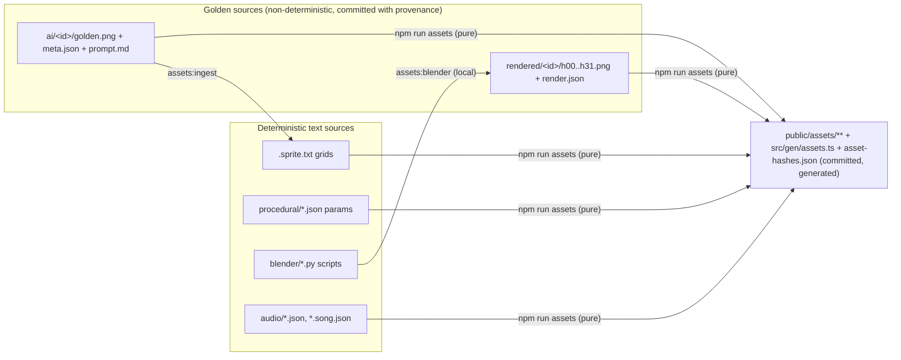

# CLAUDE.md: Agent Operating Manual

Read this file first in every session. It is short on purpose: it tells you **what you must and must not do**, and links to the docs that hold the detail. If an instruction here conflicts with a sibling doc, this file wins on *process*. The owning doc (see [Where truth lives](#2-where-truth-lives)) wins on *content*.

---

## 1. Project in one paragraph

**Street Sweeper Pro** is a top-down pixel-art arcade driving game. You drive **Bessie**, a council road sweeper (a *Dustmaster 3000*), through a week of 240 s shifts in the British seaside town of **Muckleford**. You collect litter, paint grime clean and avoid cats, grannies, joggers and dogs. It is built with **three.js 0.186.1 + TypeScript 7.0.2 + Vite 8.3.4**: a perspective camera looks straight down into a 480×270 palette-mapped render target. **Every asset is authored by AI agents** (that means you) from sources committed to this repo, through a deterministic pipeline. There is no human artist or composer. Release target is web 1.0 on itch.io (milestone **M7**).

**Repo status (2026-10-20):** M0 (**Foundations & Look Spike**), M1 (**Drivable Bessie**), M2 (**Sweeping Core**) and M3 (**Living Street**) are complete and approved by the owner (git tags `m0` to `m3`). On top of the M0/M1 base (scaffold, forge, locked look, deterministic sim, level compiler, 60 Hz loop, input, camera, F1 dev panel), the game now plays a full 240 s shift: brush, litter, grime, water, hopper and dumping, scoring and combos, HUD, intro and tally scenes, pause, and Big Pam's radio and tutorial prompts. Puddle Lane and the grey-box High Street have the Mon–Tue cast (pedestrians, animals, traffic, knockables, hazards, power-ups), both fail states (SACKED, TOWED), and the test-only zoo scene (`?test=1&scene=zoo`). Every sprite is still a placeholder under its final ID (real art is M4), and there is no audio (`npm run audio` is a 0-source guard until M5). **Remote:** the repo is public at https://github.com/matt-gribben/street-sweeper-pro (`origin`, since 2026-10-20), and `.github/workflows/ci.yml` runs on every push to `main`. Push only when asked. **Known flake:** heap-delta allocation tests and a few timing tests fail intermittently under heavy machine load (parallel agents) or on slow CI runners, and pass alone. Do not loosen them; making the measurement sturdier is open follow-up work (an unfinished attempt is in `git stash`). Some layout and commands below are still plans for later milestones. Until a command exists, do not pretend it ran.

---

## 2. Where truth lives

Each fact has exactly one owner. Update the owner first, then any mirrors in the same change.

**Game data (tuning, entities, upgrades, districts, economy):** until a `src/data/*.json` file exists, its owning doc is the truth ([docs/GDD.md](docs/GDD.md) for tuning, districts and economy; [docs/ENTITY_CATALOG.md](docs/ENTITY_CATALOG.md) for entity IDs, per-entity numbers and upgrades). From the commit that creates the JSON, the JSON is the truth and the doc is a mirror, kept in sync by `tests/unit/entityCatalog.test.ts`. Design intent that is not a data value (rules, cast, modes, pillars) stays owned by the GDD.

| Topic | Source of truth | Mirrors / consumers |
|---|---|---|
| Design intent (rules, cast, modes, scoring rules) | [docs/GDD.md](docs/GDD.md) | — |
| Game data values (see the rule above) | GDD / ENTITY_CATALOG until `src/data/tuning.json`, `entities.json`, `upgrades.json`, `districts.json` exist; the JSON afterwards | the other side of that pair |
| Architecture, tick order, renderer, tests, CI | [docs/TECHNICAL_DESIGN.md](docs/TECHNICAL_DESIGN.md) | this file, §5 |
| Stack choice and version pins | [docs/adr/0001-tech-stack.md](docs/adr/0001-tech-stack.md) + `package.json` / `tools/forge/pyproject.toml` | [README.md](README.md) |
| Asset techniques, tool commands, provenance schema | [docs/ASSET_PIPELINE.md](docs/ASSET_PIPELINE.md), [docs/adr/0002-ai-authored-asset-pipeline.md](docs/adr/0002-ai-authored-asset-pipeline.md) | `tools/forge/` |
| Visual style, palette, scale, shading | [docs/ART_BIBLE.md](docs/ART_BIBLE.md) ⇄ `assets-src/STYLE.md` | `assets-src/palette/kerbside32.json` is the truth for colour values |
| Audio direction, SFX and music lists, synth specs | [docs/AUDIO_DESIGN.md](docs/AUDIO_DESIGN.md) | `assets-src/audio/**` |
| Districts, map format, spawns, schedules | [docs/LEVEL_DESIGN.md](docs/LEVEL_DESIGN.md) | `assets-src/levels/**` |
| Milestones, risks, M0 decision log | [docs/ROADMAP.md](docs/ROADMAP.md) | — |
| Terms (Golden, Ingest, Ramp swap, Mixel…) | [docs/GLOSSARY.md](docs/GLOSSARY.md) | — |
| Every asset that exists | `assets-src/manifest.json` | `src/gen/assets.ts` (generated) |

**Rules:**

- If `src/data/*.json` and its owning doc disagree, the code ships the JSON. Either fix the JSON or update the doc in the same commit. Never leave them diverged.
- If a value you need is missing from every doc, write `TBD (M0 spike)` (or the milestone that will decide it) and flag it in your summary. Do not invent design numbers silently.
- Do not copy large tables between docs. Link to the owner.

---

## 3. Hard rules (non-negotiable)

Breaking one of these is a failed task, even if the tests pass.

1. **Sim purity.** `src/sim/**` must not import `three`, DOM modules or anything in `src/render|audio|ui|input`. It must not use `Math.random`, `Date`, `performance` or wall-clock time. Use `src/sim/rng.ts` (`sfc32`). Biome `noRestrictedImports` plus an import-scanning Vitest test enforce this. Do not disable either.
2. **Render, audio and UI read sim state, they never write it.** Communication flows out through the typed event bus (`src/app/events.ts`).
3. **Kerbside-32 only.** No colour outside `assets-src/palette/kerbside32.json` may appear in any asset, shader constant, CSS or Blender material. The palette pass guarantees this on screen; `forge lint` guarantees it in assets. Refer to colours by **palette index or name** (`15 sweeper_yellow`), not by raw hex in code. The one CSS exception is the letterbox colour `#0f0e12`, which is index 00.
4. **Assets are code.** Never commit a binary asset without its source, and never hand-edit a built output. See [§6](#6-asset-rules).
5. **No Blender or image model in builds, tests or CI.** `npm run assets` uses only uv/Python and Node. Blender (`npm run assets:blender`) and image generation (`npm run gen:ai`) are local, explicit, interactive steps.
6. **Exact version pins.** No `^` or `~` in `package.json`. Python deps are pinned with `==` and `uv.lock` is committed. Do not upgrade, add or swap a dependency without an ADR or an explicit request. Bun is installed but **not used**: use `npm` only and keep `package-lock.json` as the only lockfile.
7. **IP hygiene.** Never write "GTA", "Grand Theft Auto", "Paperboy" or any other trademark, real brand or logo in image prompts, asset names, in-game text, commit messages or store copy. Internal design docs may name them as inspirations, nowhere else. Describe the look instead ("overhead view, chunky pixel art, 1 px dark outline").
8. **Look before you accept.** Before accepting any AI golden, Blender render, asset batch or visual-golden update, open the evidence with the Read tool: contact sheets in `build/sheets/`, the zoo screenshot (`?test=1&scene=zoo`), and expected/actual/diff PNGs for a failed visual test. "The script exited 0" is not acceptance.
9. **Grids are the truth after ingest.** Once `forge ingest` writes `assets-src/sprites/<class>/<id>.sprite.txt`, fix and animate in the grid. Never re-ingest over an edited grid (`--force` only when explicitly discarding the edits, and say so).
10. **British English** in docs, UI strings, asset names and domain nouns in code (`kerb`, `tyre`, `litter`, `hopper`, `colour` in our own identifiers). Library API words keep the library spelling (`material.color`, `THREE.Color`).
11. **Rating guard (PEGI 7 / ESRB E10+).** Nobody is ever injured. Pedestrians fall over cartoonishly, get up and shake a fist. No blood, gore or ragdolls in any asset, prompt or string.
12. **Determinism.** A run is `f(seed, district, input log)`. Do not introduce iteration over unordered collections, frame-rate-dependent sim maths or float-sensitive branching without quantisation. Replay hashes use state quantised to 1e-4.

---

## 4. Commands

All exist since M0 and run from the repo root.

### 4.1 Setup

```sh
npm ci
uv sync --project tools/forge        # Python 3.13 forge venv in tools/forge/.venv
npx playwright install chromium      # visual + e2e only
```

### 4.2 Everyday

| Command | Use it when |
|---|---|
| `npm run dev` | Vite dev server. Works without uv because built assets are committed. |
| `npm run typecheck` | `tsc --noEmit` |
| `npm run lint` / `npm run format` | Biome check / write |
| `npm test` | Vitest unit + fast-check property tests |
| `npm run test:replay` | 3,600-tick replays: final-state hash + invariants |
| `npm run test:visual` | Playwright, pixelmatch threshold **0** vs `tests/visual/__goldens__/` |
| `npm run test:visual:update` | Approve new visual goldens, **only after reading the diffs** |
| `npm run test:e2e` | 60 s scripted smoke + perf |
| `npm run ci` | Everything above + `assets:verify` + `assets:lint` |

### 4.3 Assets and audio

| Command | Notes |
|---|---|
| `npm run assets` | `forge build` + `npm run audio` + `npm run levels`. Deterministic. |
| `npm run assets:verify` | Rebuild to a temp dir and byte-compare with committed outputs |
| `npm run assets:lint` | `forge lint` |
| `npm run assets:sheets` | Contact sheets → `build/sheets/` |
| `npm run assets:ingest -- <id>` | AI golden → indexed text grid |
| `npm run assets:blender -- <id\|all> [--check]` | **Local only.** Re-render Blender goldens. |
| `npm run gen:ai -- <id> [--tool codex\|cursor] [--candidates N]` | **Local only.** Then `--accept <n>` to promote a candidate. |
| `npm run audio` | `node tools/audio/render-sfx.ts && node tools/audio/render-music.ts` |
| `npm run levels` | `node tools/levels/compile-level.ts` |

Every forge command is `uv run --project tools/forge python -m forge <cmd>` underneath. Call it directly when debugging the forge.

### 4.4 Local tool binaries (not on PATH; always use absolute paths)

| Tool | Path | Version |
|---|---|---|
| Blender | `/Applications/Blender.app/Contents/MacOS/Blender` | 5.2.2 LTS |
| Codex CLI (image gen, primary) | `~/.local/bin/codex` | codex-cli 0.160.1 |
| Cursor Agent CLI (concept A/B and fallback only) | `~/.local/bin/cursor-agent` | 2026.10.16-e3cb207 |
| ffmpeg | `/opt/homebrew/bin/ffmpeg` | 9.0.2 |

Do not call these by hand for production assets. Go through the forge wrappers, which encode the gotchas: stdin prompt plus `-` and a pinned `-m` model for Codex, the `image_gen` output recovery, and `--factory-startup --python-exit-code 1` for Blender. (The Cursor wrapper is deferred until a milestone needs a concept A/B; `--tool cursor` exits non-zero until then.) The raw commands are documented in [docs/ASSET_PIPELINE.md](docs/ASSET_PIPELINE.md) for debugging only.

---

## 5. Code conventions

### 5.1 TypeScript

- **Strict mode**, plus `erasableSyntaxOnly: true` and `allowImportingTsExtensions: true`, because `tools/**/*.ts` runs directly on Node 24 type stripping (no tsx) and imports `src/sim/**` code. That means:
  - **no** `enum`, `namespace` or constructor parameter properties;
  - use `as const` objects plus a derived union instead of an enum;
  - everywhere (`src/`, `tools/`, `tests/`), write relative imports with an explicit `.ts` extension (`import { sfc32 } from './rng.ts'`), because tools run `src/sim` code directly on Node type stripping, which does not resolve extensionless imports.

  ```ts
  export const BrushState = { Up: 0, Lowering: 1, Down: 2, Raising: 3 } as const;
  export type BrushState = (typeof BrushState)[keyof typeof BrushState];
  ```

- **No `any`.** Use `unknown` and narrow it. Validate JSON data at load time with hand-written type guards (no zod).
- **Named exports only**, one primary concept per file. File names are `camelCase.ts` for modules and `PascalCase.ts` for classes and scenes (`vehicle.ts`, `ShiftScene.ts`).
- **Units:** the sim uses **metres, seconds, radians** and kg. Suffix ambiguous names: `speedMps`, `headingRad`, `timerS`, `widthPx`. Convert to pixels only in `src/render/` (16 px per metre).
- **Coordinates:** the sim's XY plane maps to three.js XZ, and buildings extrude along +Y. Vehicle-local axes put +y forward from the body centre.
- **Hot path:** zero allocations per tick in `src/sim/**`. Use typed struct-of-arrays stores per entity kind and preallocated scratch vectors. No ECS library, no closures created per tick, no `Array.prototype.map/filter` in per-tick loops.
- **No engine code without a feature that needs it.** Do not build generic systems speculatively.
- **Generated code** (`src/gen/assets.ts`) is never edited by hand. Reference frames through the typed `FRAME` const so a missing sprite is a compile error:
  - good: `FRAME['npc.cat:dart:w:1']`;
  - bad: a string assembled at runtime and never checked.
- **Storage:** `localStorage` keys are only `ssp.save.v1` and `ssp.settings.v1`. Every access goes in try/catch, and the game must run with storage unavailable.
- **Test hooks** live in `src/debug/testHooks.ts` and activate only with `?test=1`. Never ship behaviour that depends on them.

### 5.2 Python (forge)

- Python 3.13 via uv only. Type-hint public functions. Tests live in `tools/forge/tests/` and run with pytest 9.1.1.
- Randomness: `numpy.random.Generator(PCG64(seed))`, with the seed taken from the asset's params JSON. Never use the global `random` or `np.random.*` module functions.
- Write PNGs with Pillow, with **no metadata**, no timestamps and fixed encoder parameters, so outputs are byte-identical across runs.
- Use only numpy + Pillow. Do not add OpenCV, scikit-image, sharp or image-q.

### 5.3 Data

- **JSON only** for data (manifest, levels, tuning, palette, songs, SFX). No YAML or TOML except `pyproject.toml`.
- Levels are ASCII maps (`assets-src/levels/<district>.map.txt`, one char per 2 m tile) plus `<district>.level.json`. Do not introduce Tiled or LDtk.

### 5.4 IDs and naming

| Thing | Convention | Example |
|---|---|---|
| Entity / asset ID | `<class>.<snake_name>` | `npc.old_woman`, `litter.crisp_packet`, `pwr.flask_of_tea` |
| Asset classes | `veh npc litter stain prop haz pwr collect upg site tile roof facade fx ui font art portrait decal sign concept ref sfx mus jng amb` | — |
| District ID | `district.<snake_name>` | `district.puddle_lane` |
| Frame ID | `<asset-id>:<state>:<dir>:<n>`. Dir is `h00`–`h31` (vehicles), `s sw w nw n ne e se` (actors) or `-`. | `veh.sweeper:body:h07:0` |
| Sprite file | snake_case, asset ID minus its class | `assets-src/sprites/npc/old_woman.sprite.txt` |
| AI folder | full asset ID | `assets-src/ai/litter.sheet_01/` |
| Blender renders | full asset ID | `assets-src/rendered/veh.sweeper/h00.png` |

- **IDs are canonical and stable.** Use only IDs listed in [docs/ENTITY_CATALOG.md](docs/ENTITY_CATALOG.md). Exception: world-art IDs (`tile.*`, `facade.*`, `roof.*`) are owned by `assets-src/manifest.json` and [docs/ART_BIBLE.md §9](docs/ART_BIBLE.md), not the catalog (decided in SSP-040/SSP-041). Adding an ID means updating `entities.json`, the catalog and `assets-src/manifest.json` in one change. Renaming an ID needs an explicit request.
- **Placeholder first.** A new asset ships as a code-defined placeholder under its final ID and frame IDs, then gets upgraded behind the same IDs.

---

## 6. Asset rules

### 6.1 Which file is the source



- **Text sources** (grids, params, bpy scripts, song and SFX JSON) are edited by you directly.
- **Goldens** (`golden.png`, Blender renders) are replaced only by re-running their tool. They are never retouched in an image editor or by script.
- **Generated outputs** (`public/assets/**`, `src/gen/assets.ts`, `public/assets/asset-hashes.json`) are only ever written by `npm run assets`. Commit them together with the source change that produced them.

### 6.2 Technique cheat sheet

The full table, with reasons, is in [docs/ASSET_PIPELINE.md](docs/ASSET_PIPELINE.md).

| Asset class | Technique |
|---|---|
| Ground tiles, roofs, stains, VFX | Procedural Python (seeded) |
| Facades | Procedural assembly of 32×40 text-grid modules |
| Vehicles | Blender, straight down, 32 headings |
| Volumetric props, roof furniture | Blender, straight down (props: sprite-stack slices, 1 heading; roof kit: 4 headings) |
| Humans | Codex key-pose sheet locked to `ref.people_style` → ingest → **grid is truth** |
| Animals, small props, pickups, UI icons | Text grids written directly |
| Litter | Codex transparent 4×2 sheets → ingest (one scale per sheet) → grids |
| Road decals, shop signs, landmark roofs | Codex golden → `forge ingest` → grid |
| Title, key art, intro cards, Mercury art, portraits | Codex golden → `ai-art` downscale |
| Fonts | Text-grid glyphs. **Never image gen.** |
| Concept boards | Codex/Cursor, reference only, **never shipped** |

Cursor outputs never become sprite goldens.

### 6.3 Procedure: adding or replacing an AI asset

1. Check the world scale and sprite cell in [docs/ART_BIBLE.md](docs/ART_BIBLE.md), and add the manifest entry.
2. Write `assets-src/ai/<id>/prompt.md`, built on `_style_preamble.md` and stamped with its version. Use no trademarks and no text unless needed.
3. `npm run gen:ai -- <id> --candidates N`. Candidates land in `build/ai-candidates/` (git-ignored).
4. **Read every candidate.** Accept with `--accept <n>`, which writes `golden.png` and completes `meta.json` (`seed` is always `null`). Record why in `acceptance_notes`.
5. For sprites, run `npm run assets:ingest -- <id>`, then fix and animate the frames in the `.sprite.txt` grid.
6. `npm run assets` → `npm run assets:lint` → `npm run assets:sheets`, then **Read** the sheet and the zoo screenshot.
7. Commit the prompt, meta, golden, grid and generated outputs together. Never commit rejected candidates.

Blender assets follow the same shape: edit the `.py` script → `assets:blender -- <id>` → Read the renders → `npm run assets`. If `forge lint` warns "re-render needed", the script changed without a re-render. Fix it before merging.

---

## 7. Testing expectations

| Change touches | Required tests |
|---|---|
| `src/sim/**` | Unit tests for the new behaviour. Property test if it involves collision, motion or spatial queries (e.g. "never ends a tick inside a solid / no tunnelling at 17.2 m/s"). `npm run test:replay`. |
| Tuning JSON | `npm test` + `npm run test:replay` |
| `src/render/**`, shaders, UI | `npm run test:visual`. Add or extend a visual scene (`zoo`, `lean_quadrants`, `night_kebab_mile`, `hud_specimen`, `mercury_tally`, `scale_1440`) when you add a visual feature. |
| Assets | `assets:lint`, `assets:verify`, contact sheet Read, `test:visual` (zoo) |
| `tools/forge/**` | pytest, then `assets:verify` must still pass, or the outputs must be regenerated and committed with a reason |
| Audio tools or sources | `npm run audio` + `assets:verify` (WAV hashes) |
| Scenes, flow, input | `npm run test:e2e` |

- **Replay hash changes are design changes.** If an intentional sim change alters a committed hash, re-record it in the same commit and state the reason. An unexplained hash change is a bug: investigate it, do not re-record it.
- **Visual goldens** are canonical from the dev Mac (arm64, Playwright 1.64.1 Chromium, SwiftShader flags). Update them only after reading the diff PNGs, and describe what changed visually.
- Bug fixes come with a test that fails before the fix.
- Do not mark a test as skipped, reduce a pixelmatch threshold or loosen a property to get green. Fix the cause or report it.

---

## 8. Definition of done

A task is done when **all** of the following hold. Report which ones you ran and their results. If a check does not exist yet (pre-M0), say so explicitly.

- [ ] `npm run typecheck` passes
- [ ] `npm run lint` passes (no new suppressions without a comment explaining why)
- [ ] `npm test` passes, including new tests for new behaviour
- [ ] `npm run test:replay` passes, or hashes are re-recorded with a stated reason
- [ ] `npm run assets:lint` and `npm run assets:verify` pass if any asset, palette, forge or audio file changed
- [ ] `npm run test:visual` passes if anything visible changed, and any golden update was reviewed with Read
- [ ] Contact sheets and the zoo screenshot were opened with Read for any new or changed asset
- [ ] Sources, provenance (`prompt.md`, `meta.json`, `render.json`) and generated outputs are committed together
- [ ] The owning doc (see §2) is updated if behaviour, numbers, IDs or commands changed, with mirrors kept in sync
- [ ] No trademarks, no off-palette colours, no new dependencies or version changes unless they were requested
- [ ] The sim stays pure: no `three`/DOM/`Math.random`/`Date` in `src/sim/**`

The pre-merge shortcut is `npm run ci`, which runs everything except the human-judgement items (sheet and diff review).

---

## 9. Working style

- **Scope:** do what was asked. Note adjacent problems in your summary instead of fixing them uninvited.
- **Milestones:** work belongs to a milestone in [docs/ROADMAP.md](docs/ROADMAP.md) (M0 Foundations & Look Spike → M1 Drivable Bessie → M2 Sweeping Core → M3 Living Street → M4 Art Pass 1 → M5 Sound & Music → M6 Tidy Town Week → M7 1.0 Web Release → M8 Touch & Mobile Web → M9 Desktop & Extra Modes). Do not pull post-1.0 work (touch, Tauri, Daily Shift, Rival Sweep, camera tilt) forward.
- **Image generation costs real time:** about 60 s per Codex image and 93–136 s per Cursor run. Batch sprites into 4×2 sheets. Do not loop generation hoping for luck. After 2 to 3 rejected rounds, revise the prompt or reference and explain why.
- **Ignored paths:** `build/`, `dist/`, `node_modules/`, `test-results/`, `playwright-report/` and `tools/forge/.venv/` are git-ignored (plus the forge's `__pycache__/` and `.pytest_cache/`, via `tools/forge/.gitignore`). Never commit from them.
- **Probe artefacts:** the pre-project asset probe (2026-10-18) ran in a temporary scratch directory. The four artefacts M0 needs, plus each run's `report.json` and a mock scene, were copied into the git-tracked `assets-src/_probe/` (excluded from the manifest and lint). Import from there. If it is missing, follow R-06's contingency in [docs/ROADMAP.md](docs/ROADMAP.md).
- **Spike decisions:** record M0 decisions (zoom on/off, vehicle tilt 0° vs ≤ 8°, the 480×270 base, the night and shadow tables) in [docs/ROADMAP.md](docs/ROADMAP.md) and `assets-src/STYLE.md`. Do not re-decide them in code.
