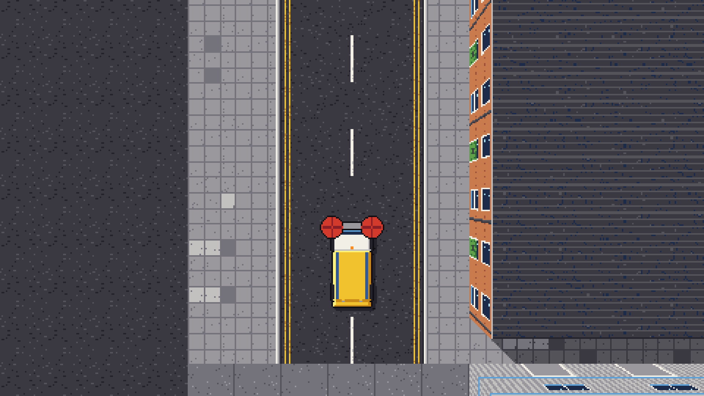
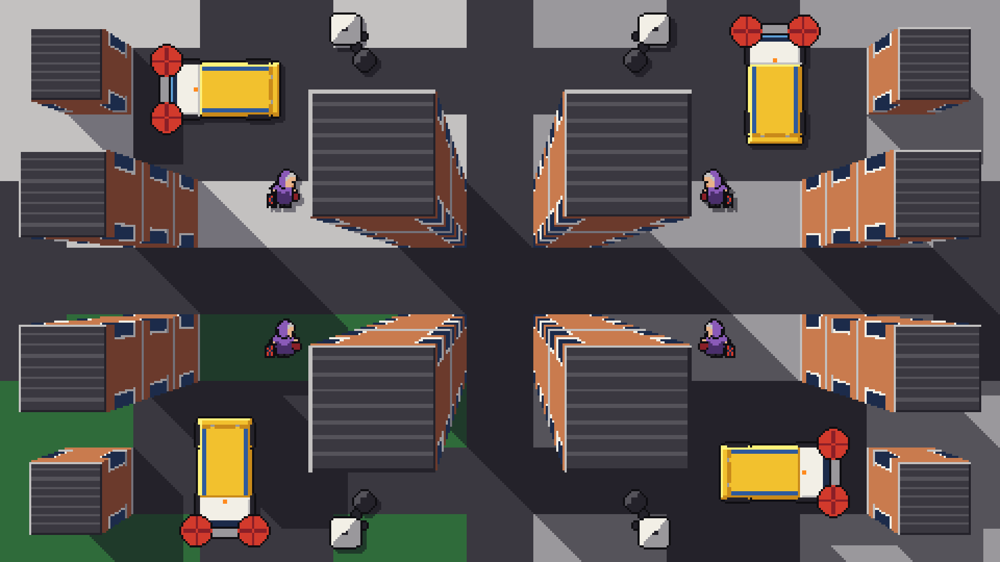
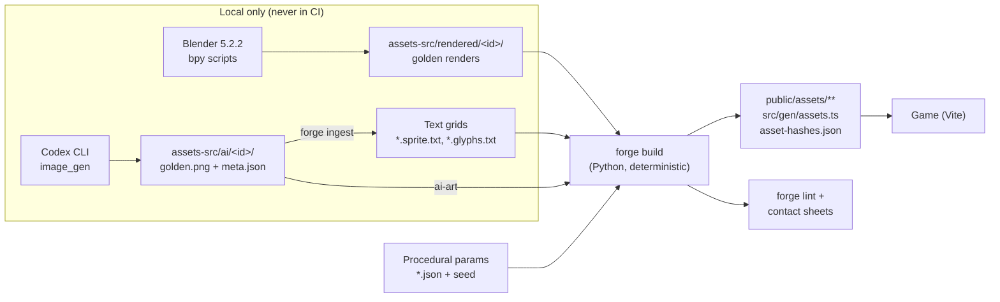

# Street Sweeper Pro

> **"Somebody's got to do it."**

A top-down pixel-art arcade driving game about the most underappreciated job in town. You drive **Bessie**, a lumbering council road sweeper (a *Dustmaster 3000*), through one week of shifts in the British seaside town of **Muckleford**. Suck up crisp packets, paint grimy streets visibly clean and keep your residents happy. Watch out for darting cats, grannies who won't budge, joggers, loose dogs and seagulls that steal chips. On Sunday the Tidy Town Inspector arrives.

| | |
|---|---|
| **Genre** | Top-down arcade driving / cleaning score-attack, with a route-and-week structure |
| **Platform (1.0)** | Web: desktop Chrome, Firefox, Safari and Edge, with keyboard and gamepad |
| **Session** | One shift = 240 s of play, about 5 min with intro and tally. First week clear: about 45 to 60 min. |
| **Rating target** | PEGI 7 / ESRB E10+. Nobody is ever injured: pedestrians fall over, get up and shake a fist. |
| **Built by** | Claude (Anthropic's AI coding agent), which writes the code **and authors every asset**: sprites, tiles, fonts, sound effects and music. There is no human artist or composer. |

---

## Status: pre-alpha, M1 complete (approved and tagged `m1`, 2026-10-19)

Milestone **M1, Drivable Bessie**, is done (2026-10-19). `npm run dev` opens Puddle Lane, compiled from its ASCII map and drawn with procedural placeholder tiles and facades. You can drive Bessie there with the keyboard or a gamepad. Under her is the deterministic sim: a kinematic bicycle model, OBB/SAT collision with impact damage, kerb jolts and surface grip. The camera adds look-ahead and speed zoom, and the F1 dev panel tunes the handling live. The first 3,600-tick replay hash is committed. The evidence is in [docs/ROADMAP.md](docs/ROADMAP.md#m1-drivable-bessie). Milestone **M0, Foundations & Look Spike** (pinned scaffold, forge, Blender and Codex wrappers, the locked Kerbside-32 palette in [assets-src/STYLE.md](assets-src/STYLE.md)) closed earlier the same day, and the decisions it settled are in the [M0 decision log](docs/ROADMAP.md#8-m0-spike-decision-log). There is **no game loop yet**: no brush, litter, timer, HUD or audio. The next milestone is **M2, Sweeping Core**.

Sections below that describe commands, directories or behaviour that later milestones add are marked *(partly planned)*, with what works today stated next to them.

### Screenshots



Puddle Lane in the M1 build (`/?test=1&seed=1&scene=district.puddle_lane&freeze=1&springs=1`, after 4 s of full throttle with the brush down). The camera leads Bessie by nearly 3 m and the ground is exactly 1 texel per pixel. This is the `camera_1to1.png` capture from `tests/visual/camera_follow.spec.ts`, upscaled 4× with nearest-neighbour filtering. The tiles and facades are procedural placeholders until M4.



The M0 spike scene (`/?test=1&seed=1&scene=lean_quadrants&freeze=1`): 1-, 3- and 6-storey blocks around the Blender-rendered Bessie (four copies, one per screen quadrant) and the Codex-derived pedestrian Doris, with sprite-stack lamp posts, SE building and drop shadows, at 480×270 through the palette pass. This is `window.__ssp.readFrame()` upscaled 4× with nearest-neighbour filtering (its 480×270 pixels are exactly those of the `lean_quadrants` visual golden). The placeholder facades and roofs are replaced in M4.

---

## The game in 30 seconds

1. **Shift intro card.** Depot manager Big Pam Scrubbs briefs you: district, target, weather.
2. **Sweep the district in 240 s.** Lower the brush, collect litter, paint grime clean, spray stains, keep pledge frontages spotless. Dodge and appease the locals.
3. **Dump at the depot bay** (or a skip) whenever the 100 LU hopper fills.
4. **The Muckleford Mercury** tally front page: headline, district map, stars, £ earned.
5. **Skip Run** bonus, **Depot Workshop** upgrades, then the **Week Map** and the next shift.

Seven districts, Monday to Sunday, from the tutorial terraces of **Puddle Lane** to the Sunday inspection in the **Civic Quarter**. Muckleford has entered the national *Tidiest Town* contest, and your rival, Spotless Sid from Snobbington, would love to see you fail.

The design pillars:

1. **Visibly Satisfying Clean.** The brush paints grime off the street at pixel level.
2. **Heavy, Honest Machine.** Bessie is slow, heavy and carries momentum, and she gets more sluggish as the hopper fills.
3. **Thorough vs. Fast.** Below 4.0 m/s you collect everything. Faster, and rubbish flings aside, but you cover more route.
4. **Charming Chaos.** Readable, comic characters who react to you. Mistakes are funny, not punishing.
5. **Every Pixel Reproducible** *(production pillar).* Every asset is AI-authored from sources committed to the repo, through a deterministic pipeline that is linted and reviewed.

Full design: [docs/GDD.md](docs/GDD.md). Every entity ID, stat and penalty: [docs/ENTITY_CATALOG.md](docs/ENTITY_CATALOG.md).

---

## Tech stack

**three.js + TypeScript + Vite**, with a perspective camera looking straight down into a low-res 480×270 render target. A final palette pass guarantees that no pixel outside the 32-colour **Kerbside-32** palette ever reaches the screen. The perspective camera gives buildings real parallax for free: taller roofs look closer and chunkier as you drive past. The core is deliberately lean. We own the collision code (OBB/SAT) and the audio mixer, and add no ECS, physics engine or audio library.

| Area | Choice | Version |
|---|---|---|
| Runtime / package manager | Node.js + npm (`package-lock.json`) | Node 24.21.0, npm 11.19.0 |
| Language | TypeScript, strict, `erasableSyntaxOnly` | 7.0.2 |
| Renderer | `three` / `@types/three` | 0.186.1 / 0.186.0 |
| Build / dev server | `vite` | 8.3.4 |
| Tests | `vitest`, `fast-check`, `@playwright/test`, `pixelmatch`, `pngjs` | 5.0.5, 4.10.2, 1.64.1, 8.0.0, 7.0.0 |
| Lint + format | `@biomejs/biome` | 2.5.15 |
| SFX synthesis | `zzfx` (vendored `buildSamples`, not imported in Node), `jsfxr` | 1.4.0, 1.4.1 |
| Node types | `@types/node` | 24.19.2 |
| Asset forge (images) | Python via uv, numpy, Pillow, pytest | Python 3.13.15, uv 0.12.23, numpy 2.5.4, Pillow 13.0.0, pytest 9.1.1 |
| 3D pre-render (local only) | Blender | 5.2.2 LTS |
| Image generation (local only) | Codex CLI (primary), Cursor Agent CLI (concept/fallback) | 0.160.1, 2026.10.16-e3cb207 |
| Audio encoding | ffmpeg | 9.0.2 |

Bun is installed on the dev machine but deliberately **not** used: one runtime only. TypeScript tools (`tools/audio/`, `tools/levels/`) run directly on Node 24's built-in type stripping, so tsx is not needed.

Why this stack, and why not Phaser, Godot or PixiJS: [docs/adr/0001-tech-stack.md](docs/adr/0001-tech-stack.md). Architecture, tick order, renderer pipeline and test strategy: [docs/TECHNICAL_DESIGN.md](docs/TECHNICAL_DESIGN.md).

---

## How the assets are made

Every asset is authored by Claude, using whichever technique gives the best balance of quality, consistency and reproducibility for that asset class. A probe run before these docs were written tested each technique against real assets, and the results decided the split.

| Technique | Used for | Why |
|---|---|---|
| **Text-grid pixel art** (`*.sprite.txt`) | Animals, small props, pickups, UI icons, facade modules, and the final truth for people and litter | Exact pixel control at 12 to 24 px |
| **Procedural Python** (the forge) | Ground tiles and the 47-tile kerb autotile, roofs, stains, VFX | Only code guarantees seamless tiling (AI tiles failed the seam test) |
| **Blender, headless** (`Blender -b -P`) | All vehicles (32 headings), volumetric props, roof furniture | A full 32-heading rotation set renders in 2 to 4.5 s, crisp and consistent |
| **Codex image generation**, then deterministic ingest | People key poses (reference-locked), litter sheets, decals, signs, landmark roofs, title and key art, portraits | Strongest at large one-offs and style-locked character sheets |
| **Cursor Agent image generation** | Concept and mood boards only | Lossy JPEG output and a soft pixel grid: never used as a sprite golden |
| **Code-defined bitmap fonts** | Kerbside 5×7 and Kerbside Bold 8×8 | Fonts are never image-generated |

Non-deterministic outputs (accepted AI images, Blender renders) are committed as **golden** sources with full provenance (`prompt.md`, `meta.json`). Everything after a golden is deterministic and byte-for-byte reproducible. **A normal build never calls Blender or an image model.**



The built outputs are committed, so `npm run dev` works without Python. CI rebuilds them into a temporary directory and byte-compares (`assets:verify`).

Full pipeline, exact tool invocations and their gotchas: [docs/ASSET_PIPELINE.md](docs/ASSET_PIPELINE.md). The palette, scale and style rules every asset obeys: [docs/ART_BIBLE.md](docs/ART_BIBLE.md). Sound and music: [docs/AUDIO_DESIGN.md](docs/AUDIO_DESIGN.md). Why hybrid: [docs/adr/0002-ai-authored-asset-pipeline.md](docs/adr/0002-ai-authored-asset-pipeline.md).

---

## Quick start

> These work today. `npm run dev` opens straight into Puddle Lane with Bessie at the depot, drivable (M1, SSP-046): W/↑ throttle, S/↓ brake (hold at a standstill to reverse), A/D or ←/→ steer, Space lowers or raises the brush; on a gamepad RT, LT, the left stick and A. There is no timer, litter or HUD until M2, F1 opens the dev panel, and the asset zoo URL below arrives in M3 (SSP-298). The M0 spike city is still at `?world=spike_city` in dev builds.

### Prerequisites

| Needed for | Tool |
|---|---|
| Playing and developing the game | Node **24.21.0** and npm **11.19.0** |
| Rebuilding image assets (`npm run assets`, `assets:verify`, `assets:lint`) | uv **0.12.23** (it installs Python 3.13.15 for you) |
| Rebuilding audio (`npm run audio`) | ffmpeg **9.0.2** (`/opt/homebrew/bin/ffmpeg`) |
| Re-rendering vehicles and props (rare, local only) | Blender **5.2.2 LTS** at `/Applications/Blender.app/Contents/MacOS/Blender` (not on PATH) |
| Generating new AI goldens (rare, local only) | Codex CLI 0.160.1 at `~/.local/bin/codex` |

### Run the game

```sh
npm ci                         # install pinned JS dependencies from package-lock.json
npm run dev                    # Vite dev server (http://localhost:5173 by default)
```

That is all you need to play: built assets are committed under `public/assets/`.

### Work on assets

```sh
uv sync --project tools/forge  # create the forge's Python 3.13 environment from uv.lock
npm run assets                 # forge build + audio + levels
npm run assets:sheets          # contact sheets in build/sheets/ for review
```

### Useful dev URLs

| URL | Shows |
|---|---|
| `/?test=1&scene=zoo` | The asset zoo: every sprite in-engine *(planned: a minimal zoo arrives in M3, SSP-298)* |
| `/?test=1&scene=lean_quadrants&freeze=1` | The M0 spike scene (above). `scale_1440` and `scale_sheet` are the other test scenes. |
| `/?test=1&seed=42&scene=<id>&tick=<n>&freeze=1` | A deterministic, frozen scene for tests and screenshots |

Test hooks (`window.__ssp`) are active only with `?test=1`. Press **F1** in a dev build for the dev panel.

### Production build

```sh
npm run build                  # vite build → dist/ (base: './', works on any static host)
```

The canonical public build will be an HTML5 game on itch.io, pushed with butler from M7.

---

## Commands *(partly planned)*

Every script below exists. `npm run audio` is an input-count guard until M5 adds its sources (it reports "0 sources; nothing to render"). `npm run levels` compiles Puddle Lane (since M1), and `npm run test:replay` runs the committed replays: `m1_drive_puddle_lane` (since M1), `m2_full_shift_puddle_lane` and `m2_dump_cycle_puddle_lane` (since M2). `npm run test:e2e` runs the M2 smoke test (`tests/e2e/smoke.spec.ts`: the full-shift replay's inputs played in the built game, 60 s of sweeping and then the whole shift to the tally) beside the perf draw-call check and the scene specs (flow, HUD, grime, items, text, panels).

### Assets and content

| Command | What it does |
|---|---|
| `npm run assets` | `forge build` + `npm run audio` + `npm run levels` |
| `npm run assets:verify` | Rebuild into a temporary directory and byte-compare with committed outputs (CI) |
| `npm run assets:lint` | `forge lint` (CI) |
| `npm run assets:sheets` | `forge sheets` → `build/sheets/` |
| `npm run assets:ingest -- <id>` | AI golden → grid |
| `npm run assets:blender -- <id\|all> [--check]` | Local only. Re-render. `--check` reports pixel diffs against committed renders. |
| `npm run gen:ai -- <id> [--tool codex\|cursor] [--candidates N]` | Local only, never in CI (`--tool cursor` exits "not implemented until needed" until a milestone needs a concept A/B). Writes candidates; Claude reviews; `--accept <n>` promotes one to `golden.png` and completes `meta.json`. |
| `npm run audio` | `node tools/audio/render-sfx.ts && node tools/audio/render-music.ts` |
| `npm run levels` | `node tools/levels/compile-level.ts` |

All forge commands run as `uv run --project tools/forge python -m forge <cmd>`.

### Tests and checks

| Command | Runs |
|---|---|
| `npm test` | Vitest unit + property |
| `npm run test:replay` | Committed replays, each for its own tick count (3,600 standard; the M2 full shift runs 14,600, to the end of the shift), asserting checkpoint and final-state hashes, invariants and zero allocation per tick |
| `npm run test:visual` (`:update` to approve) | Playwright, reading the internal frame, pixelmatch threshold 0 against `tests/visual/__goldens__/` |
| `npm run test:e2e` | 60 s scripted smoke: no console errors, score > 0, hopper filled, ≤ 10 draw calls; then the full shift ends on the tally with state()'s figures. Perf: ≤ 10 draw calls (the p99 frame-time budget, 20.6 ms, is checked locally by the `gpu` project). |
| `npm run typecheck` | `tsc --noEmit` |
| `npm run lint` / `npm run format` | Biome |
| `npm run ci` | All of the above + `assets:verify` + `assets:lint` |

---

## Repository layout *(partly planned)*

Condensed, showing the full planned tree; M0 created the top level, `src/render`, `src/scenes`, `src/debug`, `src/gen`, `src/sim/constants.ts`, `tools/forge` and `tests/`. The full tree, with every module, is in [docs/TECHNICAL_DESIGN.md](docs/TECHNICAL_DESIGN.md).

```
/
├─ README.md  CLAUDE.md  index.html  package.json  package-lock.json  tsconfig.json  biome.json
├─ vite.config.ts  vitest.config.ts  playwright.config.ts
├─ src/
│  ├─ app/        game loop (fixed 60 Hz), scene manager, event bus, save, settings
│  ├─ scenes/     Title, WeekMap, Workshop, ShiftIntro, Shift, SkipRun, Tally (Mercury), Zoo (test)
│  ├─ sim/        PURE TS game simulation: no three, no DOM, no Date, no Math.random
│  ├─ render/     city mesh, ground + grime layer, sprite batches, sprite stacks, shadows, palette pass
│  ├─ audio/      mixer, SFX, music, live engine/brush synths
│  ├─ input/      keyboard, gamepad, touch
│  ├─ ui/         bitmap text, HUD, menus, minimap, popups
│  ├─ data/       tuning.json, entities.json, upgrades.json, districts.json
│  ├─ gen/        assets.ts (GENERATED, committed)
│  └─ debug/      dev panel, test hooks
├─ assets-src/    every asset SOURCE: palette, text grids, fonts, procedural params,
│                 Blender scripts + renders, AI goldens + provenance, levels, audio JSON
├─ tools/
│  ├─ forge/      Python image pipeline (uv): ingest, build, pack, lint, sheets, blender, genai
│  ├─ audio/      offline SFX and tracker-music renderers (TS on Node)
│  └─ levels/     ASCII map + JSON legend → compiled level JSON
├─ public/assets/ atlases, fonts, art, audio, levels, asset-hashes.json (GENERATED, committed)
├─ tests/         unit/, property/, replay/, visual/ (+ __goldens__), e2e/
├─ docs/          the documentation set below
└─ build/         git-ignored: forge cache, contact sheets, rejected AI candidates, tmp
```

---

## Documentation

| Document | Read it for |
|---|---|
| [CLAUDE.md](CLAUDE.md) | The AI agent's operating manual: commands, hard rules and the done-checklist. **Read this first if you are an agent.** |
| [docs/GDD.md](docs/GDD.md) | Game design: pitch, pillars, cast, core loop, controls, handling, scoring, combo, penalties, stars, economy, modes |
| [docs/TECHNICAL_DESIGN.md](docs/TECHNICAL_DESIGN.md) | Architecture, tick order, sim/render split, collision, camera, renderer pipeline, testing, performance budgets, CI, deployment |
| [docs/ART_BIBLE.md](docs/ART_BIBLE.md) | Kerbside-32 palette and ramps, world scale, sprite size sheet, lighting, outlines, building language, UI and fonts, review checklist |
| [docs/ASSET_PIPELINE.md](docs/ASSET_PIPELINE.md) | Technique per asset class, source formats, Blender/Codex/Cursor commands and gotchas, provenance, ingest/build/lint, regeneration |
| [docs/AUDIO_DESIGN.md](docs/AUDIO_DESIGN.md) | SFX list, live synths, mixer and ducking, tracker song format, track list, adaptive stems, encoding |
| [docs/LEVEL_DESIGN.md](docs/LEVEL_DESIGN.md) | The seven districts plus the Depot Yard, ASCII map format, frontages and pledges, spawn tables, NPC schedules, difficulty curve |
| [docs/ENTITY_CATALOG.md](docs/ENTITY_CATALOG.md) | Every canonical entity ID with stats, behaviour, penalties, sprite cell and source path |
| [docs/ROADMAP.md](docs/ROADMAP.md) | Milestones M0 to M9, M0 decision log, risk register, deferred list |
| [docs/adr/0001-tech-stack.md](docs/adr/0001-tech-stack.md) | ADR: three.js lean core, and the rejected alternatives |
| [docs/adr/0002-ai-authored-asset-pipeline.md](docs/adr/0002-ai-authored-asset-pipeline.md) | ADR: the hybrid, golden-source asset pipeline and the probe evidence behind it |
| [docs/GLOSSARY.md](docs/GLOSSARY.md) | Terms: Bessie, Frontage, Tidy %, LU, Fling, Golden, Ingest, Forge, Palette pass and more |

### Milestones at a glance

| ID | Name |
|---|---|
| M0 | Foundations & Look Spike |
| M1 | Drivable Bessie |
| M2 | Sweeping Core |
| M3 | Living Street |
| M4 | Art Pass 1 |
| M5 | Sound & Music |
| M6 | Tidy Town Week |
| M7 | 1.0 Web Release |
| M8 | Touch & Mobile Web |
| M9 | Desktop & Extra Modes |

Exit criteria for each: [docs/ROADMAP.md](docs/ROADMAP.md).

---

## Contributing

Claude writes the code and assets, and a human maintainer reviews and merges. The same rules apply to anyone, human or agent, who sends a change:

- **Read [CLAUDE.md](CLAUDE.md) first.** Its hard rules are not optional. In short:
  - Keep the sim pure: nothing in `src/sim/` imports three or the DOM, or uses `Math.random`, `Date` or `performance`.
  - Never call Blender or an image model from a build or from CI.
  - Use Kerbside-32 colours only.
  - Keep the exact version pins.
  - After ingest, the text grid is the source of truth: fix the grid, not the golden.
- **Before you open a PR**, run the done-checklist: `npm run typecheck`, `npm run lint`, `npm test`, `npm run assets:lint` and `npm run test:visual`. Or run `npm run ci` for all of them plus `assets:verify`.
- **Asset changes** must include their sources and provenance (`prompt.md`, `meta.json`, or the bpy script and `render.json`) as well as the regenerated outputs. Review the contact sheets (`npm run assets:sheets`) and the asset zoo before accepting a batch, and say in the PR description that you did.
- **Visual golden updates** (`npm run test:visual:update`) need a sentence in the PR explaining why the pixels changed.
- **British English** in docs and in-game text (colour, kerb, tyre, rubbish). In code, domain nouns stay British (`kerb`, `litter`, `hopper`) and API words follow the library (`color` in three.js).
- **No trademarks** in image prompts, asset names, in-game text or store copy. Muckleford is fictional, and so are its shops, vans and plumbers.
- Commit or regenerate generated files (`public/assets/**`, `src/gen/assets.ts`, `asset-hashes.json`) in the same commit as the sources that produced them, so `assets:verify` stays green.

## Licence

Not yet chosen. Until a `LICENSE` file is added, all rights are reserved by the project owner.
