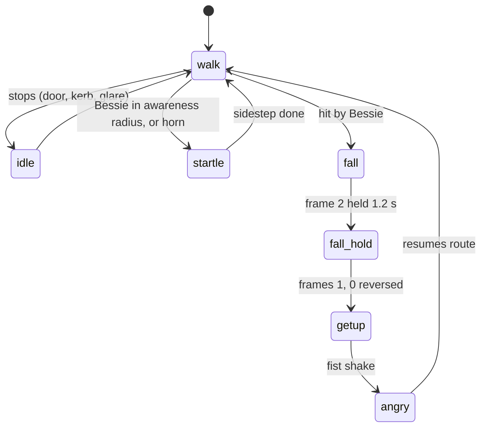
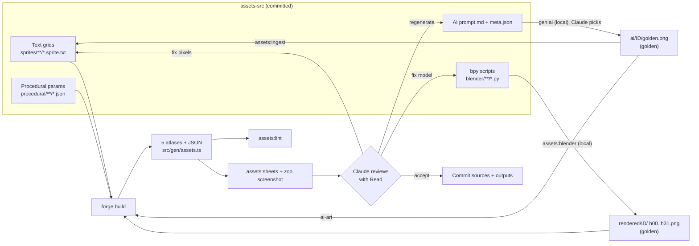

# Art Bible

> The visual rules of **Street Sweeper Pro**: what the game looks like, why, and how an AI author (Claude) produces and reviews every pixel of it.
>
> **Authority:** names, IDs, numbers, paths and the palette follow the canonical facts sheet (v1.0, 2026-10-18). Values marked *proposed* are this document's starting points and are locked (or changed) in the milestone noted. Values that were left open for the M0 Foundations & Look Spike have been decided and are recorded in [`assets-src/STYLE.md`](../assets-src/STYLE.md) v1 (2026-10-19, SSP-026). Items still open are listed in [§17](#17-open-items) with the milestone that decides them.
>
> **Relationship to [`assets-src/STYLE.md`](../assets-src/STYLE.md) (v1, 2026-10-19):** STYLE.md is the terse, operational copy of this bible that agents load while authoring assets. This document explains the reasoning and carries the examples. Both are edited in the same PR. If they ever disagree on a locked value, STYLE.md wins and this file is fixed in the next PR.
>
> **Language:** British English throughout (colour, kerb, tyre, rubbish).

**Related docs:** [README](../README.md) · [CLAUDE.md](../CLAUDE.md) · [GDD](GDD.md) · [TECHNICAL_DESIGN](TECHNICAL_DESIGN.md) · [ASSET_PIPELINE](ASSET_PIPELINE.md) · [AUDIO_DESIGN](AUDIO_DESIGN.md) · [LEVEL_DESIGN](LEVEL_DESIGN.md) · [ENTITY_CATALOG](ENTITY_CATALOG.md) · [ROADMAP](ROADMAP.md) · [ADR 0001](adr/0001-tech-stack.md) · [ADR 0002](adr/0002-ai-authored-asset-pipeline.md) · [GLOSSARY](GLOSSARY.md)

---

## Contents

1. [The look in one paragraph](#1-the-look-in-one-paragraph)
2. [References and what we take from each](#2-references-and-what-we-take-from-each)
3. [World scale and resolution](#3-world-scale-and-resolution)
4. [Perspective rules](#4-perspective-rules)
5. [Palette: Kerbside-32](#5-palette-kerbside-32)
6. [Light, shading and outline](#6-light-shading-and-outline)
7. [Sprite size sheet and proportions](#7-sprite-size-sheet-and-proportions)
8. [Look by asset class](#8-look-by-asset-class)
9. [Environment: ground, grime, facades, roofs](#9-environment-ground-grime-facades-roofs)
10. [Animation: frame counts and timings](#10-animation-frame-counts-and-timings)
11. [VFX](#11-vfx)
12. [UI art and pixel fonts](#12-ui-art-and-pixel-fonts)
13. [Night, weather and time of day](#13-night-weather-and-time-of-day)
14. [The AI-authored asset pipeline, from the art side](#14-the-ai-authored-asset-pipeline-from-the-art-side)
15. [Self-review: contact sheets and the quality checklist](#15-self-review-contact-sheets-and-the-quality-checklist)
16. [Do and don't](#16-do-and-dont)
17. [Open items](#17-open-items)

---

## 1. The look in one paragraph

Muckleford is a **British seaside town seen from a council helicopter at teatime**: chunky, sunny, slightly grubby pixel art in a strict 32-colour palette, viewed straight down with buildings that lean away from the centre of the screen as you drive past them. Streets are grey and busy with markings (double yellows, zebra stripes, give-way triangles); terraces are brick with slate roofs; the seafront is all sky blue, bubblegum and lemon. Characters are small, round-headed and over-animated, and they *react*: a startled hop, a cartoon pratfall, a shaken fist. Bessie is the brightest thing on screen at all times, a block of `sweeper_yellow` with a council-blue stripe. The single most important image in the game is **a stripe of clean street behind Bessie** cut through grime, so ground textures are built to make that contrast obvious.

**Mood words:** cheerful, municipal, cluttered, crisp, comic, tidy-versus-grotty.
**Not:** gritty, violent, neon-noir, photo-real, painterly, glossy, "mobile-game gradient".

---

## 2. References and what we take from each

> **IP hygiene:** the names below appear **only** in internal design docs, as inspirations. They are never written into image prompts, asset names, in-game text, store copy or commit messages that describe assets. Prompts describe the *qualities* we want ("overhead view", "chunky pixel art"), never a game. See [CLAUDE.md](../CLAUDE.md).

| Reference | What we take | What we leave behind |
|---|---|---|
| **Grand Theft Auto (1997)** | The straight-down city camera; roofs as the dominant "ground" of the city block; vehicles that read purely by silhouette and colour from overhead; 32-way pre-rendered vehicle rotations; the sense that the town is a toy you drive around. | Crime, violence, run-over pedestrians, grim palette. |
| **Grand Theft Auto 2 (1999)** | The **perspective camera over real 3D blocks**: buildings lean radially, tall roofs magnify ("closer and chunkier"), the camera zooms out at speed. Our §4 rules are essentially "GTA2's camera, with a fixed palette". Also its lighting cheat: pre-lit wall variants per face direction. | The muddy night palette and dither-heavy textures. |
| **Paperboy (1985)** | Suburban comedy hazards with personalities (dogs, grannies, cars pulling out), the idea that the *street* is the antagonist, the delivery-route structure. Its oblique tilt is reserved as `camera.tiltDeg` (default 0, max 12) for post-1.0 route views. | The oblique 3/4 camera in 1.0 districts; its punishing crash-and-lose-a-life tone. |
| **Micro Machines (1991)** | Tiny vehicles that stay readable at speed thanks to bold silhouettes, bright body colours and a dark outline; momentum you can *see*. | Track-racing framing. |
| **The Legend of Zelda: A Link to the Past (1991)** | The high three-quarter character convention (§4.4): round heads, visible faces, 8-direction walk cycles that read at about 22 px; ramps of 3–4 steps per material. | Fantasy content and its perspective-ignoring buildings. |
| **Untitled Goose Game (2019)** | British village comedy: residents with one strong trait each, reactions that are funny rather than punishing, low-stakes mischief. | Its flat vector style. |
| **PowerWash Simulator (2022)** | The **satisfaction of visible cleaning**: dirt that disappears where you pass and a clear clean/dirty boundary. Informs pillar 1 and the grime look in §9.2. | 3D realism, slow pace. |
| **British seaside postcards and 1980s council signage** | Saucy-but-wholesome humour (kept PEGI 7), Pantone-bright seafronts, municipal typography (chunky sans capitals on navy and yellow panels), hi-vis everything. | Real council logos, real brands. |

---

## 3. World scale and resolution

### 3.1 Locked world scale

These numbers are locked in M0 (signed off unchanged in [ROADMAP D-07](ROADMAP.md#8-m0-spike-decision-log), SSP-024; recorded in STYLE.md v1 §1) and every asset obeys them. Changing one after M0 needs an ADR.

| Quantity | Value |
|---|---|
| Ground texel density | **16 px per metre** |
| Map tile | **32×32 px = 2 m × 2 m** |
| Storey height (stylised) | **2.5 m = 40 px** of facade texture |
| Building heights | 1 to 6 storeys (2.5 to 15 m). Landmarks up to 8 storeys (20 m). |
| Facade module | **32×40 px** (2 m wide × 1 storey) |
| Roof texture density | 16 px/m (same as ground) |

### 3.2 Scale cheats (deliberate)

Not everything is drawn at 16 px/m. Gameplay readability wins over realism for small things. The table is the contract: an asset that drifts from its class's factor is a review failure.

| Thing | Drawn size | Real size | Factor | Why |
|---|---|---|---|---|
| Vehicles, buildings, tiles, roofs | 16 px/m | — | **1.0×** | The world must be geometrically honest for the camera and collision. |
| Bessie (`veh.sweeper`) | 28×52 px | 1.75 × 3.25 m | 1.0× | Matches the sim body exactly. |
| Humans (`npc.*` people) | figure ≤ 18×22 px | ~0.5 × 1.7 m | ~0.85× tall, ~2× wide | High three-quarter view (§4.4); heads are enlarged for faces. |
| Cats, dogs, birds | 12–16 px | 0.3–0.6 m | ~1.5–2× | A true-scale cat would be 7 px. |
| Litter (`litter.*`) | 8–14 px | 0.05–0.4 m | ~3–6× | A drink can at true scale is 2 px. Largest item = 14 px. |
| Pickups (`pwr.*`, `collect.*`) | 12×12 px | 0.1–0.3 m | ~4× | Must read as icons. |
| Storeys | 40 px | ~3 m | 0.83× | Keeps 6-storey towers from swallowing the screen. |

### 3.3 Internal resolution

- **Base internal resolution 480×270** (confirmed in M0, [ROADMAP D-03](ROADMAP.md#8-m0-spike-decision-log)). Height is always 270. Width adapts in whole pixels: `W = clampEven(round(270 × aspect), 432, 640)`.
- Render target is **(W+2)×272** (1 px margin for the sub-pixel camera). Nearest filtering, no MSAA, no mipmaps.
- Integer upscale only: 1080p fullscreen → 4× (windowed ≈ 3×, itch.io 960×540 embed 2×), 1440p → 5× (45 px bars), 4K → 8×. Letterbox colour `#0f0e12` (index 00 `ink`).
- At H = 31.5 m the ground is **1 texel = 1 pixel** (to within 0.03%, under 0.11 px of drift at the frame edge; [TECHNICAL_DESIGN §12.2](TECHNICAL_DESIGN.md#122-camera-rendercamerats)): 30 m × 16.875 m visible, about 15 × 8.4 tiles.

**Art consequence:** an asset is judged at **1×, in the 480×270 frame**, because that is the only scale a player ever sees it at (upscaling is pure nearest-neighbour). The 4× contact sheets are for inspecting pixels, not for judging readability. See [§15](#15-self-review-contact-sheets-and-the-quality-checklist).

---

## 4. Perspective rules

### 4.1 The camera

A three.js `PerspectiveCamera` looks **straight down** (vertical FOV 30°, sweep height H = 31.5 m), easing out to 37.8 m at transit top speed. Full maths is in [TECHNICAL_DESIGN](TECHNICAL_DESIGN.md). What matters for art:

| Element | How it is drawn | Who authors the "lean" |
|---|---|---|
| Ground tiles, stains, hazards, grime | Flat, at y = 0 | Nobody: they are flat. |
| Buildings | Real extruded boxes; facades on the walls, roof textures on top | **The camera.** Walls facing the screen centre become visible; roofs magnify by H/(H − h). |
| Actors (vehicles, people, animals, litter, pickups) | Flat textured quads at y = 0, layered by a depth offset ([TECHNICAL_DESIGN §12.5](TECHNICAL_DESIGN.md#125-sprites-spritebatchts-spritestackts)). **Not billboards.** | Nobody. Actors never lean. |
| Tall thin props (lamp posts, phone boxes, bollards, trees, bins) | **Sprite stacks:** 4–8 horizontal slice quads at increasing heights | **The camera** leans the stack automatically, matching the buildings. |

### 4.2 Building lean

- Walls are visible only on the side facing the screen centre: a building in the top half of the screen shows its **south** face, one on the left shows its **east** face, and so on.
- Lean grows toward the screen edges. Near the centre a 1-storey wall is only a few pixels wide; at the horizontal edge (15 m off-centre) it is about 21 px. **Facade detail is therefore always seen foreshortened** and must read through bold horizontal banding and strong vertical rhythm, not fine texture (§9.4).
- **Roof magnification** at H = 31.5: 1 storey 1.09×, 3 storeys 1.31×, 6 storeys 1.91×. Roof texels on tall buildings become visibly chunkier (mixels). This is **accepted as part of the look**. Roof textures for tall buildings are authored with low-frequency detail so magnification reads as "chunky", not "noisy" (§9.5).
- Shimmer while speed-zoomed is accepted (speed zoom stays on, [ROADMAP D-01](ROADMAP.md#8-m0-spike-decision-log)). At sweeping speeds the camera returns to exact 1:1, so all reviews happen at 1:1.

### 4.3 Vehicles are pure overhead

Vehicles are rendered by Blender with an **orthographic camera looking straight down** (`--tilt 0`). We see roofs, bonnets and windscreens, never sides, except the 1–2 px of bodywork that bevels away from the roof. **0° is locked** ([ROADMAP D-02](ROADMAP.md#8-m0-spike-decision-log), SSP-024): an 8° render shows the vehicle's south side in every quadrant, while buildings show their north walls in the bottom half of the screen, so it leans against them there (and overflows the 64 px cell at 16 of 32 headings). The probe's 22° clashed the same way and is rejected too.

### 4.4 Creatures use a high three-quarter cheat

Humans and animals are drawn in a **high three-quarter view**, as if seen from about 60° above the horizon, from the south. We see the top of the head, the face (when facing S, SW or SE), a foreshortened torso, and feet. This is a deliberate convention, not geometry: the sprite's "up" is always screen-north, regardless of where the actor is on screen.

Why: pillar 4 (Charming Chaos) needs faces: Doris's glare, the jogger's panic, the kid's "WAAAH!". A pure overhead person (a head-and-shoulders blob) cannot glare. The mismatch with pure-overhead vehicles is the same one generations of top-down games have shipped, and the **M0 spike scene** (Blender Bessie plus one Codex pedestrian in-engine) exists to confirm it reads. The `ref.people_style` golden locks the exact angle: `forge gen-ai` candidate `run_04`, accepted in SSP-014 ([ROADMAP D-04](ROADMAP.md#8-m0-spike-decision-log), approved by the owner at the M0/M1 close, 2026-10-19), SHA-256 `112e30d9…`. In-engine beside Bessie (SSP-018) the three-quarter figure reads as a person at a believable scale and does not clash with the overhead vehicle at 1×, so **the high three-quarter view is locked** (STYLE.md v1 §7).

Rules that follow from the cheat:

- **Pivot = feet.** The sprite's pivot is the centre of the feet, at the bottom of the figure. Collision circles and drop shadows are centred there.
- **Vertical order:** actors are flat quads, so sort order between overlapping actors is by world Y of the pivot (southern actors draw on top). See [TECHNICAL_DESIGN](TECHNICAL_DESIGN.md).
- **No implied ground plane in the sprite.** No painted floor, no painted shadow: the engine adds the drop shadow (§6.4).

### 4.5 Directions and headings

| Actor kind | Directions | Selection |
|---|---|---|
| Vehicles | 32 headings, `h00` = north (screen up), stepping 11.25° clockwise | Nearest heading, with 2° hysteresis *(proposed)* so a vehicle driving at exactly 5.6° does not flicker. |
| Humans, cats, dogs | 8 directions; S, SW, W, NW, N authored, SE, E, NE mirrored | Nearest 45° sector, with 10° hysteresis *(proposed)*. |
| Pigeons, seagulls | 4 directions; S, W, N authored, E mirrored from W | Nearest 90° sector. |
| Litter | 4 rotations `h00`, `h08`, `h16`, `h24`, generated by code from the authored `h00` frames | Seeded per item at spawn; never changes. |

---

## 5. Palette: Kerbside-32

### 5.1 The table

`assets-src/palette/kerbside32.json` holds **the only legal colours** in the game. The final palette pass maps every screen pixel to one of these 32, so the game can never show anything else.

| # | Name | Hex | # | Name | Hex |
|---|---|---|---|---|---|
| 00 | ink (outline) | `#0f0e12` | 16 | lemon | `#fff27a` |
| 01 | tar | `#24222a` | 17 | hivis_orange | `#ff8a1e` |
| 02 | asphalt | `#3a3840` | 18 | postbox_red | `#d23a2c` |
| 03 | asphalt_lt | `#55535a` | 19 | maroon | `#8a1f27` |
| 04 | slab_dk | `#74727a` | 20 | bubblegum | `#f07a8a` |
| 05 | slab | `#9a989c` | 21 | hedge_dk | `#1f3a2a` |
| 06 | kerb | `#c3c1c0` | 22 | grass | `#2f6b3a` |
| 07 | chalk (white) | `#f2efe6` | 23 | grass_lt | `#5fa04a` |
| 08 | soot_brown | `#3b2421` | 24 | lime | `#a8d06a` |
| 09 | brick_dk | `#6b3a2c` | 25 | navy | `#1c2b4a` |
| 10 | brick | `#9c5236` | 26 | council_blue | `#2e5a9c` |
| 11 | terracotta | `#c97b4e` | 27 | sky | `#5ea0d8` |
| 12 | skin_lt | `#e8b48a` | 28 | spray | `#a8dcef` |
| 13 | umber | `#8a5a3c` | 29 | teal | `#2a8a86` |
| 14 | ochre | `#c98a1a` | 30 | plum | `#4a2f6b` |
| 15 | sweeper_yellow | `#f2c12e` | 31 | lavender | `#8a5ab8` |

**Ramps:**

| Ramp | Indices |
|---|---|
| Neutral grey | 00→01→02→03→04→05→06→07 |
| Brick / skin | 08→09→10→11→12 |
| Skin tones | 12, 11, 13, 08 |
| Yellow | 14→15→16 |
| Orange / red | 19→18→17 |
| Green | 21→22→23→24 |
| Blue | 25→26→27→28 |
| Purple | 30→31 |
| Accents | 20, 29 |

**Bessie's livery:** body 15 (shade 14), cab 07, stripe 26, brushes 18, beacon 17 (flashes to 16), windscreen 25/27, tyres 00/01.

`kerbside32.json` contains `colors[32]` (`{ name, hex }`, names without the glosses above: `ink`, `chalk`), `ramps{}` (snake_case ramp name → indices, in the order above), `night[32]` (index remap), `shadow[32]` (index remap) and `swaps{}` (empty until M4, §5.6). The exact night and shadow tables are tuned in M0 and recorded in the file.

### 5.2 Value reference

OKLab lightness (L, 0–1) of each index, computed from the hex values. Use it for value checks: two colours that must separate at 1× should differ by **at least 0.12 L**, and an actor's dominant body colour should differ from both asphalt (02, L 0.35) and slab (05, L 0.68) by at least 0.12 L, or else rely on its ink outline and a contrasting accent.

| Idx | L | Idx | L | Idx | L | Idx | L |
|---|---|---|---|---|---|---|---|
| 00 | 0.17 | 08 | 0.29 | 16 | 0.95 | 24 | 0.81 |
| 01 | 0.26 | 09 | 0.41 | 17 | 0.75 | 25 | 0.29 |
| 02 | 0.35 | 10 | 0.52 | 18 | 0.58 | 26 | 0.47 |
| 03 | 0.45 | 11 | 0.66 | 19 | 0.42 | 27 | 0.68 |
| 04 | 0.56 | 12 | 0.81 | 20 | 0.72 | 28 | 0.86 |
| 05 | 0.68 | 13 | 0.51 | 21 | 0.32 | 29 | 0.58 |
| 06 | 0.81 | 14 | 0.68 | 22 | 0.47 | 30 | 0.37 |
| 07 | 0.95 | 15 | 0.83 | 23 | 0.64 | 31 | 0.56 |

Bessie's body (15, L 0.83) sits 0.48 above asphalt and 0.15 above slab: she pops on roads and still separates on pavements.

### 5.3 Usage rules per colour

| # | Name | Use for | Rules and restrictions |
|---|---|---|---|
| 00 | ink | Outlines; the deepest crevices (tyre gaps, open manhole, drain slots); letterbox; text outline | Never as a fill colour larger than 2×2 px on an actor. Never as a shading step inside a lit surface. |
| 01 | tar | Darkest ground (fresh tarmac patch, shadowed gutter), tyres, black cab body, felt roofs | Shading step below asphalt. |
| 02 | asphalt | The base road surface | The most common pixel in the game. Keep actors' dominant colours away from it (§5.2). |
| 03 | asphalt_lt | Road aggregate speckle, worn tarmac, slate roof highlights | |
| 04 | slab_dk | Paving joints, concrete shade, gravel roofs | |
| 05 | slab | Pavement slabs, concrete, silver car paint base | |
| 06 | kerb | Kerb stones, light concrete, worn white paint | Kerb top face is always 06 with a 07 NW lip and 04 SE lip. |
| 07 | chalk | Road markings, white van, cab roofs, highlights, UI text, newspaper paper | The brightest neutral. Use sparingly as a highlight on actors (1–3 px). |
| 08 | soot_brown | Grime, dog mess, deepest brick shade, dark hair | **The primary grime colour.** |
| 09 | brick_dk | Brick mortar shade, dark wood, `_dark` brick facades | |
| 10 | brick | Base brick, red-brown roofs | |
| 11 | terracotta | Pantiles, chimney pots, plant pots, lit brick, skin shade | |
| 12 | skin_lt | Light skin, sand, biscuit and pastry litter | |
| 13 | umber | Mid-brown skin, cardboard (pizza box), wood, dead leaves | |
| 14 | ochre | Bessie shade, double-yellow shade, autumn leaves, gold | |
| 15 | sweeper_yellow | **Bessie's body**, double yellow lines, hi-vis yellow trims, the player arrow on the minimap | **Reserved.** No other vehicle body, no NPC garment larger than 4 px, no large prop may be 15. The player must always find Bessie in under a second. |
| 16 | lemon | Highlights on yellow, beacon flash, headlight cores, lit windows at night, sparkles | |
| 17 | hivis_orange | Bessie's beacon, traffic cones, roadworks, hi-vis vests (postie, bin crew), orange accents | Never a large ground area. |
| 18 | postbox_red | Bessie's brushes, post box, phone box, bus, tail lights, penalty popups, dog lead | |
| 19 | maroon | Shade of red, Doris's handbag, deep awnings | |
| 20 | bubblegum | Seafront accents, milkshake, chalk art, the ×5 combo popup | Accent only: no more than ~10% of any district's screen. |
| 21 | hedge_dk | Hedges, tree canopy shade, deep park shadow | |
| 22 | grass | Grass base, green garments, Racing Green livery | |
| 23 | grass_lt | Lit grass, canopy highlight, pledge rosette, "good" UI states | |
| 24 | lime | Brightest foliage glints, ×2 "TIDY!" accents | |
| 25 | navy | Windscreens, the Inspector's suit, UI panel shade, night water | |
| 26 | council_blue | Bessie's stripe, council UI panels, police livery, signage | |
| 27 | sky | Windscreen highlight, sea, puddle surface, Seaside livery | |
| 28 | spray | Water spray, puddle glints, glass shards, police lightbar "on" | |
| 29 | teal | Seafront railings, oil sheen, teal garments | Accent. |
| 30 | plum | Doris's coat, oil sheen, police lightbar "off", night shading | |
| 31 | lavender | Lit plum, headscarves, chalk art | |

### 5.4 Ramp rules

- **Maximum 4 steps of any one ramp per sprite** (enforced by `forge lint`). Index 00 used as the outline does not count against the neutral ramp; index 00 used as interior fill does. *(The lint's exact treatment of 00 is confirmed in M4; see [§17](#17-open-items).)*
- **Hue-shift across ramps is allowed** where it reads better (e.g. a red car's highlight may be 17 hivis_orange; a black cab's shade may be 00), but the result still counts as 4 steps per ramp touched.
- **Ramps run along light, not along "colour":** step one index toward the light for NW-facing surfaces and one away for SE-facing ones (§6). Never place two non-adjacent steps of the same ramp side by side to fake texture; use one-step speckle.
- **Skin tones** use the skin ramp (12, 11, 13, 08) as light/shade pairs: (12, 11), (11, 13) and (13, 08). Every authored person uses **12 lit, 11 shade** as the key, so ramp swaps can produce the other two pairs (§5.6).

### 5.5 District colour keys

Each district has a dominant palette subset. This is the art-direction view; geometry and spawns live in [LEVEL_DESIGN](LEVEL_DESIGN.md).

| District | Dominant indices | Accents | Notes |
|---|---|---|---|
| Puddle Lane (Mon) | 09, 10, 11 brick terraces; 02/03 slate roofs; 05 slabs | 22/23 front gardens, 27 puddles | Dawn: long shadows, warm. |
| Muckleford High Street (Tue) | 05/06 concrete, 10 brick | Awnings in 18, 26, 22, 20; A-boards 07 | The busiest colour mix; keep ground calm. |
| Gasworks Estate (Wed) | 03, 04, 05 greys, 29 teal cladding, 01 felt roofs | 17 roadworks, 28 rain glints | Overcast; colour comes from hazards. |
| Conker Hill (Thu) | 21, 22, 23 gardens and trees; 11 pantiles | 14, 13, 11 falling leaves | The greenest district. |
| The Promenade (Fri) | 27 sea, 12 sand, 06/07 promenade | 20, 16, 29 railings and arcades | Golden hour; the most saturated. |
| Kebab Mile (Sat) | Night remap of 10/03/05 | Lit windows and signs (16, 17, 18, 20) | See §13. |
| Civic Quarter (Sun) | 06/07 civic stone, 22/23 parks | 26 council banners, 14 Town Hall clock | Grand and clean-looking: grime must still read. |
| The Depot Yard | 02/03 concrete, 15/14 bay hatching | 17 cones | The only place 15 appears on the ground in bulk (bay markings). |

### 5.6 Ramp swaps (per-instance palette variants)

The renderer supports **up to 8 swap tables per atlas**; each instance picks one table (an index → index map). Slot 0 is always identity. Because one table applies to the whole sprite, each slot is **multiplexed**: different sprite families are authored in different *key indices*, so a single table can mean "paint 3" to a hatchback, "outfit 3" to a shopper and "livery 3" to Bessie at the same time.

**Key indices on the `actors` atlas** *(proposed, locked in M4)*:

| Family | Key indices (authored as) | Must not use |
|---|---|---|
| `veh.hatchback`, `veh.saloon` paint | 21 dark, 22 base, 23 light | 14, 15, 16, 17, 26, 30, 12, 11 |
| `npc.shopper` primary garment | 21, 22, 23 | 26, 30 |
| `npc.shopper` secondary garment | 14, 15, 16 (≤ 4 px of 15) | 26, 30 |
| Skin (shopper) and dog coat (dog walker's dog) | 12 lit, 11 shade | — |
| `veh.sweeper` livery | body 14/15/16, stripe 26, beacon 17 | 21–23, 30 |
| `veh.police` lightbar | 30 ("off") | — |
| Glass on all vehicles | 25, 27 (never a swap source) | — |

**Slot allocation:**

| Slot | Car paint (21/22/23 →) | Bessie livery (14/15/16, 26 →) | Flash | Skin / coat (12/11 →) | Used by |
|---|---|---|---|---|---|
| 0 | green 21/22/23 (identity) | Council Yellow (identity) | — | 12/11 | everyone (default) |
| 1 | red 19/18/17 | Council Yellow | 17→16, 30→28 | 11/13 | cars, shoppers, dogs, Bessie and Sid beacon, police lights |
| 2 | blue 25/26/27 | Racing Green: 21/22/23, stripe → 15 | — | 13/08 | cars, shoppers, dogs, Bessie |
| 3 | white 05/06/07 | Racing Green | 17→16 | 12/11 | cars, shoppers, Bessie |
| 4 | silver 03/04/05 | Seaside Stripes: 26/27/28, stripe → 20 | — | 11/13 | cars, shoppers, Bessie |
| 5 | black 01/02/03 | Seaside Stripes | 17→16 | 13/08 | cars, shoppers, Bessie |
| 6 | teal 25/29/28 | Midnight Gold: 01/25/26, stripe → 15 | — | 12/11 | cars, shoppers, Bessie |
| 7 | rust 09/10/11 | Midnight Gold | 17→16 | 11/13 | cars, shoppers, Bessie |

- Tables are a single lookup (never chained), so "14→21 and 21→25" in the same table do not compound.
- **Beacon flash:** Bessie alternates between her livery's even slot and the odd slot after it. The police car alternates between slots 0 and 1. The brush overlay is a separate instance and always uses slot 0, so the red brushes never change.
- **Spotless Sid** (`veh.rival_sweeper`) is a *build-time* application of a `rival` table to Bessie's built frames: body 15→07, 14→06, 16→07, cab 07→22, stripe 26→22 (green and white). It therefore can never drift from Bessie's geometry and uses no runtime slot except slot 1 for his beacon.
- The swap tables are emitted in each atlas JSON under `swaps`. The `ui` and `fx` atlases have their own tables (none planned for 1.0).

### 5.7 Shadow and night remaps (intent)

The exact `shadow[32]` and `night[32]` tables were tuned in M0 (SSP-021, [ROADMAP §8](ROADMAP.md#8-m0-spike-decision-log) D-05/D-06) and live in `kerbside32.json`, which is the truth; the table at the end of this section mirrors it (kept in sync by `tools/forge/tests/test_palette.py`). The **intent** the tuning satisfies:

| Remap | Intent | Example targets (illustrative, not final) |
|---|---|---|
| `shadow` | Each colour drops about **two ramp steps** and cools slightly. Shadows must stay readable: details in shade survive. | 02→01, 05→03, 06→04, 07→05, 10→09, 15→14, 23→22, 27→26 |
| `night` | Everything outside a light pool shifts toward navy/plum: warm colours to maroon and plum, neutrals down 2–3 steps, blues stay blue. Bessie must still be the brightest non-light object. | 02→01, 05→02, 07→04, 10→08, 15→14, 16→15, 23→21, 27→25 |

**Ramp rule (mechanical form, enforced by forge pytest via `forge.palette.remap_violations`).** An entry `source → target` is legal when `target == source`; or `target` shares a ramp with `source` and is not lighter in OKLab L; or `target` is in a different ramp and is strictly darker in OKLab L (§5.2). This is how "within its own ramp, or to the next ramp down" is checked.

Shadow is applied after night, so a shadowed pixel at night is darker still. Lit windows, headlights and street lamps write the light mask and are exempt from the night remap (§13).

**Tuned tables (SSP-021, approved by the owner at the M0/M1 close, 2026-10-19).** Both tables also keep **value order within every ramp** (a lighter source never maps darker than a darker source of the same ramp), so shading survives either remap. Under `night`, Bessie's body (15 → 14 ochre, L 0.68) stays at least 0.12 L above every other remapped colour (the brightest, 07 → 04, is 0.56); only her own highlight 16 shares her night colour. Where the tuning departs from the illustrative targets above: `16 → 14` at night, not 15 (a 15 highlight would outshine the 14 body); warm walls step down their own ramp at night (`11 → 09`, `10 → 08`) rather than to maroon, because 11 → 19 turned every lit wall saturated red; `03`, `04 → 02` at night keep slate courses and asphalt speckle (02 on 01); grass shade goes to tar in shadow (`21 → 01`), not navy, which read as blue paint rather than shade. Asphalt in shadow (02 → 01) differs by only 0.09 L, the most the neutral ramp allows without turning shadows into ink outlines; large shadows and the 2 px drop-shadow fringe still read at 1× (evidence in D-06).

| # | Name | `night` | `shadow` |
|---|---|---|---|
| 00 | ink | 00 ink | 00 ink |
| 01 | tar | 00 ink | 00 ink |
| 02 | asphalt | 01 tar | 01 tar |
| 03 | asphalt_lt | 02 asphalt | 01 tar |
| 04 | slab_dk | 02 asphalt | 02 asphalt |
| 05 | slab | 02 asphalt | 03 asphalt_lt |
| 06 | kerb | 03 asphalt_lt | 04 slab_dk |
| 07 | chalk | 04 slab_dk | 05 slab |
| 08 | soot_brown | 00 ink | 00 ink |
| 09 | brick_dk | 01 tar | 08 soot_brown |
| 10 | brick | 08 soot_brown | 09 brick_dk |
| 11 | terracotta | 09 brick_dk | 13 umber |
| 12 | skin_lt | 13 umber | 11 terracotta |
| 13 | umber | 08 soot_brown | 08 soot_brown |
| 14 | ochre | 13 umber | 13 umber |
| 15 | sweeper_yellow | 14 ochre | 14 ochre |
| 16 | lemon | 14 ochre | 15 sweeper_yellow |
| 17 | hivis_orange | 13 umber | 18 postbox_red |
| 18 | postbox_red | 19 maroon | 19 maroon |
| 19 | maroon | 30 plum | 30 plum |
| 20 | bubblegum | 19 maroon | 31 lavender |
| 21 | hedge_dk | 25 navy | 01 tar |
| 22 | grass | 21 hedge_dk | 21 hedge_dk |
| 23 | grass_lt | 21 hedge_dk | 22 grass |
| 24 | lime | 22 grass | 23 grass_lt |
| 25 | navy | 25 navy | 00 ink |
| 26 | council_blue | 25 navy | 25 navy |
| 27 | sky | 25 navy | 26 council_blue |
| 28 | spray | 26 council_blue | 27 sky |
| 29 | teal | 25 navy | 26 council_blue |
| 30 | plum | 25 navy | 25 navy |
| 31 | lavender | 30 plum | 30 plum |

---

## 6. Light, shading and outline

### 6.1 The sun

One sun for every technique: **north-west, azimuth 315°, elevation 50°**. Hand-drawn grids, procedural generators, Blender materials and AI prompts ("light from the top-left") all agree.

### 6.2 Shading rules

| Surface | Treatment |
|---|---|
| Top faces (roofs, bonnets, cab roofs, heads seen from above) | **Base** ramp step, flat. Top faces render flat in Blender too. |
| NW-facing bevels and edges | One step **lighter** (1 px wide at actor scale) |
| SE-facing bevels and edges | One step **darker** (1 px wide; 2 px on large vehicles) |
| Building walls | Pre-built variants: N and W faces `_lit`, roofs `_base`, E and S faces `_dark` (§9.4) |
| Cast shadows | Never painted. Buildings get projected shadow polygons (SE, length 0.84 × height); actors get a drop shadow (§6.4). |

- **Readability comes from silhouette, palette and outline**, not from rendering. Three values per material is the norm: lit, base, dark. A fourth step is for a glint (e.g. a 1 px 16 on a yellow bevel), never for smooth gradients.
- **No pillow shading** (darkening all edges equally), no soft gradients, no anti-aliasing against transparency (alpha is binary), no dithering on sprites. Ordered 4×4 Bayer dither is allowed **only** in `ai-art` (title, key art, portraits), fog and transitions.
- **Mirror-safe creature shading:** SE, E and NE frames are horizontal mirrors of SW, W and NW, which would flip a NW highlight to the NE. Humans and animals therefore use **top-lit** shading: highlights on the top of the head, shoulders and back (centred), shade underneath and on the lower body, and no left/right-asymmetric highlights. The drop shadow, which the engine always offsets to the SE, carries the sun direction for them.
- **Rotation-safe litter shading:** litter is rotated in 90° steps by code, so it uses the same top-lit approach: a centred highlight, never an edge highlight.
- Vehicles and Blender props are exempt: Blender re-lights every heading under the fixed sun, so their highlights stay on the NW correctly. The rig's toon thresholds are **dot(N, sun) < 0.33 dark, 0.33–0.83 base, ≥ 0.83 lit** (settled in SSP-008; owner [ASSET_PIPELINE §7.2](ASSET_PIPELINE.md#72-rig-rules-enforced-in-rigpy)), so a flat top (0.766) renders base.

### 6.3 The outline rule

- **Every actor and prop** (vehicles, people, animals, litter, pickups, props, stack slices) has a **1 px `ink` (`#0f0e12`, index 00) outline, 4-connected, outside the silhouette**. `forge lint` fails any actor or prop with an opaque, non-ink pixel 4-adjacent to transparency.
- Manifest entries carry `outline: true` for these classes. The build **completes** the outline: every transparent pixel 4-adjacent to a non-ink opaque pixel becomes ink. For a grid that already has a full ink border this is a no-op, so hand-drawn grids, ingested grids and Blender renders all end up identical in style.
- **Visible body sizes in the size sheet include the outline.** A human figure of ≤ 18×22 px is at most 16×20 px of colour inside its ink. Vehicles are the exception: their visible body is the true-scale model, which must match the sim body (§3.2), and the forge outline adds 1 px on every side (Bessie 28×52 → 30×54 with outline, measured in [ROADMAP D-07](ROADMAP.md#8-m0-spike-decision-log); the 64 px cell already allows for it, §7.1).
- **No selective outlining** (coloured outlines, "sel-out"). Interior lines between parts use the darker ramp step of the part, not ink, except for genuine gaps (between a tyre and the body, the slot of a drain).
- **Not outlined:** ground tiles, roofs, facades, stains, hazards, grime, VFX particles. They are the world, not things on it. Shadows are masks, not sprites. The same goes for ground markings drawn inside an item sprite: a pickup's 1 px halo ring (§8.5) and the `site.depot_bay` bay markings (SSP-052); the pickup icon above the ring keeps its ink outline. SSP-115's Outline lint must exempt them.
- **Fonts:** the forge generates an outlined variant of each font (§12.5); UI text on the playfield always uses the outlined variant.

### 6.4 Shadows

| Shadow | Rule |
|---|---|
| Actor drop shadow | The same sprite offset **+2, +2 px** (SE), written to the shadow mask. Never painted into the sprite. Not drawn for flying birds while airborne *(proposed)*; drawn for the cat on Bessie's roof. Bessie's brush overlay casts none: its discs run on the road (SSP-018). |
| Building shadow | Polygon projected toward the SE, length 0.84 × height (1 / tan 50°, from the 50° sun elevation), written to the shadow mask. |
| Sprite stacks | **Only the lowest and highest slices cast** the +2, +2 offset, each at its own height so it stays beside its slice as the stack leans (decided in SSP-020, approved by the owner at the M0/M1 close, 2026-10-19; locked in STYLE.md v1 §8). Evidence: with all four lamp-post slices casting, the frame differs by only 37 px over four lamp posts (28 px at the frame edge), because the middle slices' fringes fall under the lantern and the plinth or are 1 px slivers on a 4 px post; ends-only reads the same and keeps mask instances at 2 per stack whatever the slice count. |
| Result | Pixels under the mask are remapped through `shadow[32]`: shadows are always palette colours. |

---

## 7. Sprite size sheet and proportions

### 7.1 Size sheet (locked)

| Class | Atlas cell | Visible body | Directions / frames |
|---|---|---|---|
| `veh.sweeper` (Bessie) | body/dented 64×64; brush overlay is a separate asset `veh.sweeper_brush`, cell 96×96 (rendered `--size 384`, `ortho_scale` 6 m), same centre pivot as the body | 28×52 px (1.75 × 3.25 m) | 32 headings. Brush overlay: 32 headings × 4 spin frames (the discs reach 2.40 m from the body centre at diagonals, beyond a 64 px cell). Dented variant below 40 HP. |
| `veh.hatchback` | 64×64 | 26×46 | 32 headings, 8 paint swaps |
| `veh.saloon`, `veh.taxi`, `veh.police` | 64×64 | 28×54 | 32 headings |
| `veh.van_white`, `veh.ice_cream_van` | 64×64 | 30×60 / 32×62 | 32 headings |
| `veh.bin_lorry` | 96×96 | 36×84 | 32 headings |
| `veh.bus` | 128×128 | 38×116 | 32 headings |
| `veh.rival_sweeper` | 64×64 | 28×52 | 32 headings (ramp swap of the Bessie model, green and white) |
| `veh.bicycle`, `veh.mobility_scooter` | 32×32 | 8×26 / 14×22 | 32 headings |
| Humans (`npc.*`) | **24×24** | figure ≤ 18×22 | 8 directions (S, SW, W, NW, N authored; SE, E, NE mirrored). Frames: walk 4, idle 2, startle 2, fall 3, angry 2 (13 per direction). |
| `npc.cat` | 16×16 | ≤ 12×14 | 8 directions: walk 4, sit 2, dart 2, leap 3 |
| `npc.dog_*` | 20×20 | ≤ 16×18 | 8 directions: walk 4, sit 2, bark 2 |
| `npc.pigeon` | 12×12 | ≤ 10×8 | 4 directions: peck 2, fly 3 |
| `npc.seagull` | 16×16 | ≤ 14×10 | 4 directions: walk 2, fly 3 |
| Litter (`litter.*`) | **16×16** | 8 to 14 px | 1 frame plus 2-frame wobble. 4 rotations generated by code. |
| Stains / grime decals (`stain.*`) | 32×32 | — | 1 to 3 variants |
| Props (`prop.*`) | 32×32 per slice | — | 1 frame, or a stack of 4 to 8 slices |
| Pickups (`pwr.*`, `collect.*`) | 16×16 | 12×12 | 2-frame bob |
| Ground tiles | 32×32 | — | variants plus a 47-tile kerb blob autotile set |
| HUD icons | 16×16 | — | — |
| 9-slice panels | 24×24 source, 8 px corners | — | — |
| Portraits (intro cards) | 64×64 | — | 2 expressions |
| Title / key art | 480×270 | — | — |

Notes:

- Hazards (`haz.*`) are not in the locked sheet; they use the stain cell, **32×32 ground decals** *(proposed, matching [ENTITY_CATALOG](ENTITY_CATALOG.md) §10)*.
- Vehicle cells are sized for the **diagonal** headings. Bessie's 28×52 body rotated 45° has a bounding box of about 57×57 px including outline, inside 64×64. The bus (38×116) peaks at about 109 px in 128. Check diagonals on the contact sheet, not `h00`.
- Per-class frame totals and frame IDs are listed in [ENTITY_CATALOG](ENTITY_CATALOG.md).

### 7.2 Human proportions (24×24 cell)

High three-quarter view (§4.4). Heights include outline. Pivot = bottom-centre of the feet, at row 22 of the cell *(proposed)*, leaving row 23 clear.

| Build | Total height | Head | Torso | Legs | Width (body / with props) | Used by |
|---|---|---|---|---|---|---|
| Adult | 22 | 8 (hair 3, face 4, chin/outline 1) | 7 | 7 | 10 / ≤ 18 | shopper, jogger, businessman, litterbug, postie, market trader, reveller, inspector, lollipop lady, dog walker, mum |
| Elderly (hunched) | 18–19 | 8 | 6 | 4–5 | 10 / ≤ 18 with trolley or frame | `npc.old_woman` (Doris), `npc.old_man_frame` |
| Child | 16–17 | 8 | 4–5 | 4 | 8 / ≤ 16 with skateboard | `npc.kid_skateboard`, `npc.kid_chalk` |

- Heads are deliberately large (8 px, a third or more of the figure) so expressions read: two-pixel eyes (00 or 01), a 1–2 px mouth, eyebrows only on angry frames.
- Carried props are part of the figure and must fit inside the cell: handbag, tartan shopping trolley, pushchair, walking frame, clipboard, phone, skateboard, postie trolley, lollipop sign.
- **Signature silhouettes:** each character must be identifiable as a 1× silhouette alone (§15). Doris = hunch + trolley; old man = frame; jogger = mid-stride, wide arms; businessman = arm up to ear; lollipop lady = disc on a pole; mum = pushchair rectangle ahead of her.

### 7.3 Character colour keys

So that each character reads at a glance across the street. Shoppers vary by swap (§5.6); unique characters always use slot 0.

| Character | Key colours | Signature detail |
|---|---|---|
| `npc.old_woman` "Doris" | coat 30/31, headscarf 31, handbag 19, trolley 18/25 tartan, hair 06 | The glare: angry frame 0 held, brows down |
| `npc.old_man_frame` | cardigan 13, trousers 03, frame 05/06, flat cap 09 | Frame drawn ahead of his feet |
| `npc.jogger` | top 29, shorts 25, headband 07 | Mid-stride even in idle (bouncing) |
| `npc.businessman` | suit 03/02, shirt 07, tie 18 | Phone 00/05 at the ear |
| `npc.litterbug` | hoodie 04/03, cap 18 | Hood up, hands in pockets |
| `npc.postie` | jacket 18/19, hi-vis 17 band, trolley 18 | Post bag 18 |
| `npc.lollipop_lady` | hi-vis coat 15/14 trim on 07, sign 07 disc with 18 ring | The only person allowed a 15 garment area > 4 px (her coat trim), because she is a "stop" signal |
| `npc.market_trader` | apron 26/07 stripes, flat cap 03 | |
| `npc.mum_pushchair` | coat 20, pushchair 25/03 | |
| `npc.reveller` | shirt 20 or 31, untucked, bottle 22 | Wobbling idle |
| `npc.kid_skateboard` | hoodie 17, board 13 | |
| `npc.kid_chalk` | dungarees 26, chalk 07 | Crouched pose in idle |
| `npc.dog_walker` | coat 22, lead 18 | Lead drawn at runtime (§8.3) |
| `npc.inspector` | suit 25, bowler 01, clipboard 06/07, rosette 23 | Clipboard held out front |
| `npc.cat` | ginger 11/13 with 12 belly (or tabby 03/05; variant by code) | Tail as a 1 px curve |
| `npc.dog_loose` | Jack Russell 07 with 11/12 patches, collar 18 | Patches in the skin key for swaps |
| `npc.pigeon` | 04/05 body, 29 neck sheen, 17 feet | |
| `npc.seagull` | 07 body, 04 wings, 15 beak with 18 dot | Beak is the read: 2 px |

---

## 8. Look by asset class

### 8.1 Bessie (`veh.sweeper`)

The Dustmaster 3000 is a compact council road sweeper, seen straight from above, front pointing to `h00` (north):

- **Front (top of sprite, ~14 px):** the cab. Roof 07 chalk with a 17 beacon (2×2 px) centred near the back of the cab roof. Windscreen band 25 with a 27 highlight along its NW edge, 2–3 px deep across the full cab width.
- **Middle and rear (~38 px):** the hopper body, 15 sweeper_yellow with 14 shade on the SE bevels. A 26 council-blue stripe (2 px) runs along both flanks. A hinged rear door shows as a 1 px 14 seam with 05 hinges.
- **Wheels:** 00/01 tyres peeking 1–2 px beyond the body at each corner.
- **Brushes (separate overlay, `veh.sweeper_brush`, 96×96 cell):** two red (18, shade 19) gutter-brush discs either side of the front, plus a 05 suction mouth between them. Each disc carries 4 radial bristle bars in 19 maroon on 18 postbox_red, so the spin is visible from straight above (a plain disc's top face is one flat colour in the toon shader). Overlay frames are 32 headings × 4 spin frames; the bristle pattern rotates 22.5° per frame (4 frames cover a quarter-turn of the 4-fold-symmetric brush, so the loop is seamless).
- **Dented variant (below 40 HP):** same render with a crumpled rear-left panel (two 14/01 notch pixels), a dangling 05 bumper corner and the hopper door ajar by 1 px. Combined with `fx.engine_smoke` puffs below 20 HP *(proposed)*.
- Bessie is **always the brightest, most saturated object** in her district (night included). If a new asset competes with her for attention at 1×, the asset changes.

### 8.2 Traffic and other vehicles

All Blender, 32 headings, same rig, same sun.

| Vehicle | Look |
|---|---|
| `veh.hatchback`, `veh.saloon` | Rounded boxy shapes, body in the paint key (21/22/23), glass 25/27, roofs flat base, 07 headlight dots, 18 tail lights. Paint varies by swap slot. |
| `veh.taxi` | A **black cab**: 01 body with 02 base roof, 00 shade, a 16 roof sign (lit at night). Not yellow (15 is reserved). |
| `veh.police` | 07 body with 26 and 16 checked flanks (lemon, not sweeper yellow), 30 lightbar flashing to 28. |
| `veh.van_white` | 07/06 box, 25 windscreen, ladder rack 05 on the roof. "Dave's Plumbing" lettering only if legible at 1×; otherwise a 26 stripe. |
| `veh.ice_cream_van` | 07 body with 20 bubblegum and 28 trim, a 12 cone shape on the roof. |
| `veh.bin_lorry` | 22/07 council livery, 05 compactor, 17 hi-vis rear bar. |
| `veh.bus` | 18 red with 07 roof band, 25 window strips along both flanks, 06 roof vents. |
| `veh.bicycle` | 05 frame, rider 29 top and 07 helmet modelled in. |
| `veh.mobility_scooter` | 26 body, rider 30 coat and 06 hair modelled in. |
| Parked variants | Same frames at the axis headings, with a random seeded paint slot. |

### 8.3 People and animals

See §7.2–7.3. Additional rules:

- **Reaction poses must be readable as silhouettes:** startle = arms up and body raised 1 px; fall = horizontal body, legs in the air; angry = fist raised above the head.
- **The dog walker's lead** is not a sprite: a 1 px runtime line in 18 postbox_red from the walker's hand to the dog's collar, with its +2, +2 drop shadow. It must read across both asphalt and slab.
- **Cats on walls and car roofs** use the same sprite; elevation is shown by a larger shadow offset (+3, +3) *(proposed)*.
- Nobody bleeds, nobody is flattened. The fall pose is comic: limbs out, a little 07 "dizzy" star from `fx.impact_star` above them.

*As built (SSP-097, M3 placeholders for the Monday cast: `npc.shopper`, `npc.old_woman`, `npc.old_man_frame`, `npc.mum_pushchair`, `npc.postie`, `npc.dog_walker`; final art is SSP-133 to SSP-136 in M4):* 24×24 grids in `assets-src/sprites/npc/`, all 13 frames × 5 authored directions plus the three mirror lines, drafted by `tools/forge/scripts/people_placeholders.py` from templated parts (head 8 incl. outline, torso, 1 px arms, 2 px legs, props with their own ink ring) and then owned by the grids. Every frame's lowest pixel is row 22 and fits 18×22 (pinned by `tools/forge/tests/test_people.py`). Adults stand 22 px, the elderly 19 px (head sunk between raised shoulders, head forward in profile). Lead calls made to keep the reaction poses inside the 22 px limit:
- **startle:** the elderly rise 1 px with both arms up. Adults already fill 22 rows standing, so frame 0 is a 1 px flinch (hands going up to the face) and frame 1 rises back 1 px with the arms fully up beside the head.
- **fall:** 0 = bumped onto the bottom, legs kicked out, arms flung up; 1–2 = flat on the back, face up (the S head and front torso turned a quarter), legs in the air, kicking. S, SW, W and NW topple to the right (backwards), N to the left. Carried props are dropped behind them (Doris's trolley and the postie's trolley tip over, the walking frame lies flat, the pushchair stays upright).
- **angry:** a fist raised above the head; frame 1 shakes it 1 px sideways. Adults bend their knees 2 px so the fist fits under the limit. Doris's frame 1 swings her 19 handbag overhead instead (the whack).
- **Doris** keeps her SSP-014 ingested `idle:<dir>:0` frames unchanged (they feed the `lean_quadrants` and `scale_sheet` goldens) and her `ai-ingest` provenance; `idle:<dir>:1` squashes them 1 px. Her template frames use her keys: coat 30 with 31 sleeves and collar, headscarf 31/30 with an 06 fringe, 11 stockings, handbag 19, tartan trolley 25/18.
- **Shopper:** top in 22/21/23, scarf 16 and trousers 14 (no 15 yet), skin 12/11, hair 08, shoes 01, so every garment is in a swap key (§5.6). **Dog walker:** coat 22/21/23, a 25 woolly hat over 13 hair, and the 18 handle of the extendable lead in the forward hand, where the runtime lead starts. **Postie:** jacket 18/19 with one 17 hi-vis row, 25 trousers, 18 trolley at the side and 18/19 post bag. **Mum:** coat 20/19, pushchair 25/26 with a 27 blanket, 03 frame (no 07, which would be a fifth neutral step). **Old man:** cardigan 13/08, trousers 03, cap 09 with a brim, 06 sideburns, walking frame 06/05 ahead of him.

### 8.4 Litter

- **One scale factor per sheet** when ingesting; the largest item is 14 px. Relative sizes between items must stay believable: a pizza box (13–14 px) dwarfs a crisp packet (9–10 px), which dwarfs a lolly stick (8 px).
- **Silhouette first:** each item is identifiable by outline alone. Drink can = capsule with silver ends; plastic bottle = longer capsule with a 1 px cap; glass bottle = 22/21 green with a neck; newspaper = 07/06 folded rectangle with 03 text lines; banana skin = 16/15 star with 08 tips.
- Items that fail legibility in ingest are redrawn by hand in the grid (the probe found the can and cigarette butts illegible at 12 px). `litter.cigarette_butts` ships as a **cluster** of 3–5 butts (07 with 17 filter tips).
- Litter wobble frames move the item by 1 px or rock one end; they never change its outline by more than 2 px.

### 8.5 Pickups and collectibles

- 12×12 icons on a 16×16 cell, bobbing 1 px over 2 frames.
- They sit on a **1 px ground halo ring** (alternating 16/07 with the bob) so they read as "for you", unlike litter. Litter never has a halo.
- Icons: `pwr.flask_of_tea` (26 flask, 07 cup), `pwr.bacon_butty` (12 bread, 18 bacon), `pwr.hi_vis` (17 vest with 07 bands), `pwr.super_suction` (05 nozzle, 28 swirl), `pwr.wrench` (05/06 spanner), `pwr.water_can` (22 can, 28 drop). `collect.golden_crisp` is a crisp packet in 15/16 with an `fx.sparkle` every 1.5 s. Lost Property items are drawn literally: false teeth 07/20, wallet 13, hard hat 15/14, cat collar 18 with a 16 bell, bucket and spade 26/18, shoe 19, mayor's chain 14/16.
- `collect.hard_hat` and `collect.golden_crisp` may use 15 because they are tiny pickups; the 15 reservation (§5.3) is about large areas.
- *As built (SSP-052, M2 placeholders for Puddle Lane: `pwr.flask_of_tea`, `collect.false_teeth`, `collect.golden_crisp`):* hand-authored grids in `assets-src/sprites/pickup/`, frames `bob:-:0` (icon down, ring 16) and `bob:-:1` (icon 1 px up, ring 07), so "alternating with the bob" means the whole ring changes colour each bob frame. The ring is the 16 px circle touching the cell edges, drawn under the icon, with no ink outline (§6.3); the icon draws its own outline (manifest `outline: false`). The final pickup art is SSP-149 (M4).
- *As built (SSP-101, M3 placeholders for the other five power-ups, same frames, ring and outline rules):* `pwr.bacon_butty` (12 bread with an 11 crust, 18/19 bacon poking out of both sides), `pwr.hi_vis` (a 17 vest with two 07 bands, an 06 zip and an 18 hem), `pwr.super_suction` (a 28 swirl with a 27 inner turn drawn up into an 05/06 nozzle), `pwr.wrench` (a double open-ended 06/05/04 spanner on the diagonal), `pwr.water_can` (a 22 can, 23 lit and 21 shaded, with a 28/27 drop under the rose).

### 8.6 Props

| Type | Look |
|---|---|
| Small grid props | Bollard (01 with 07 band), cone (17 with 07 bands), hydrant (18 with 06 cap), wheelie bin (22 or 01 lid, 26 recycling variant), A-board (07 with 03 lettering lines), litter bin (01 with 15 band), post box (18 with 00 slot), recycling box (26 with 22 lid). |
| Blender props | Bench (13 slats, 01 frame), bus shelter (05 frame, 28 glass panels, 26 roof), phone box (18 with 25 glass), tree canopy (21/22/23 clumps; canopy overhangs pavements), market stall (striped 18/07 or 26/07 awning), skip (17 or 22 steel with 01 interior). |
| Stacks | Lamp post 8 slices (01 post, 07 lamp head that writes the light mask at night); broad or short props 4 slices. **Slice counts (locked in STYLE.md v1 §8, SSP-026):** compute D = 16·r·h/(H − h) px at r = 20 m (the edge of the widest, 640 px frame) for the prop's top height h; a prop whose D / (narrowest member's width in px) is ≤ 4 gets **4 slices**, otherwise **8**. That gives **8** for `prop.lamp_post`, `prop.tree`, `prop.market_stall` and `prop.bus_shelter`, and **4** for `prop.phone_box`, `prop.post_box`, `prop.bollard`, `prop.litter_bin`, `prop.wheelie_bin`, `prop.traffic_cone`, `prop.a_board` and `prop.roadworks_barrier` (nominal heights and widths in STYLE.md §8; apply the rule to the modelled geometry if it differs). The committed 4-slice lamp post is the M0 prototype; SSP-131 (M4) replaces it with 8 slices. **SSP-020 finding (4-slice lamp post, 4.4 m):** slices sit at real heights, so slice k shifts r·h/(H − h) outward (r = distance from the screen centre). Beside the lean_quadrants blocks (r ≈ 7.6 m) the 4 slices overlap into one continuous post; 13.5 m out (near the side edge) the 6 px post breaks with a 3 px gap between the plinth and the lower post. A thin post stays continuous while consecutive slices shift less than its width, which needs about h·r·16 / ((H − h) · width px) slices: about 7 for a 6 px post at the 15 m frame edge, so **keep 8 slices for the lamp post** (and tall thin trunks); broad props (phone box 16 px wide, bins, bollards ≤ 1 m tall) stay continuous with 4. |

*As built (SSP-101, M3 placeholders under the final IDs; final art SSP-130, SSP-131 and SSP-148 in M4):* every other knockable and static prop is a hand-authored grid in `assets-src/sprites/prop/`, 32×32 per frame, atlas `items`, outlined by the build (each slice gets its own 1 px outline), manifest `placeholder: true`. Flats (`flat:-:0`): `prop.shopping_trolley` (06 wire basket with an 05 mesh over an 03 floor, 26 handle and child seat), `prop.recycling_box` (26 box, 22 lid over its west part, 07/28/13 contents), `prop.bench` (13 slats with 11 lit and 08 gaps, 01 ends; about 1.6 m), `prop.planter` (05 concrete rim round 08 soil with 21/22/23/24 shrubs and 20/16 flowers). Stacks (`slice:-:k`, k = 0 at the ground) with the STYLE.md v1 §8 counts: 4 slices for `prop.wheelie_bin` (22 body, 01 lid with an 03 handle bar, 01 wheels at the back), `prop.traffic_cone` (17 base and cone, 07 band at slice 2), `prop.a_board` (two 07 boards with 03 lettering lines converging on an 04 ridge), `prop.bollard` (01, 07 band at slice 2), `prop.litter_bin` (01, 15 band at slice 2, 02 rim round a 00 opening), `prop.post_box` (01 plinth, 18 pillar, 00 slot on the south face, domed cap), `prop.phone_box` (18 box, 25/27 glass walls, roof with 07 sign strips and a 19-crowned dome), `prop.roadworks_barrier` (01 feet, 18/07 striped plank); 8 slices for `prop.tree` (13 trunk, 21/22/23/24 canopy widest at slice 5), `prop.bus_shelter` (05 posts, 28 glass on the back and ends, open to the south, 13 bench, 26 roof) and `prop.market_stall` (04 poles, 13 counter with produce crates at slice 1, 18/07 striped awning). The bus shelter, stall and tree canopy stay inside the 32×32 cell until SSP-131 decides their oversize cells. `prop.lamp_post` keeps its 4-slice M0 render.

*As built (SSP-052):* `prop.hydrant` is a placeholder grid (`assets-src/sprites/prop/hydrant.sprite.txt`, 32×32, `flat:-:0`, atlas `items`, outlined by the build): seen from above, an 18 body about 1 m across with a 17 NW rim and 19 SE rim, a domed 06 cap (07 glint, 05 shade) and 06-capped side outlets. The final prop art is M4.

### 8.7 Stains and hazards (ground decals)

| ID | Look |
|---|---|
| `stain.gum` | Scattered 2–3 px 06/05 blobs, flattened discs |
| `stain.milkshake` | 20 splash with 07 core, a 1 px 13 cup outline nearby |
| `stain.oil` / `haz.oil_slick` | 01 pool with 30 and 29 iridescent sheen pixels on the NW side |
| `stain.chalk_art` | 07, 20, 27, 16, 31 child drawings: hopscotch grid, sun, a stick cat. Three variants. |
| `stain.splat` | 08/13 brown splat with radial flecks |
| `haz.puddle` | 25 body, 27 inner rim on the NW, 28 glints (2 px), irregular edge; rain adds `fx.rain_ripple` |
| `haz.pothole` | 00 core, 01 bowl, 03 broken rim, 04 rubble crumbs |
| `haz.speed_bump` | A tile-wide band of 03 with 07 or 15 chevrons |
| `haz.wet_leaves` | 14/11/13 leaves over a 01-darkened patch |
| `haz.broken_glass` | 28/07/27 shards, 2-frame glint |
| `haz.open_manhole` | 00 hole, 03 rim, lid 04 slid aside |

*As built (SSP-052, M2 placeholders under the final IDs; final stains SSP-123 in M4 and SSP-225 in M6):* generators in `tools/forge/forge/procedural/stains.py`, params in `assets-src/procedural/stains/<name>.json`, 32×32, frames `v:-:n`, atlas `world`, not outlined. Variants: gum 3, milkshake 2, oil 2, chalk art 3 (`v:-:0` hopscotch, `1` sun over 27 waves, `2` stick cat with a ball of wool, drawn from stroke lists in `params.layouts` and worn by random dropout), splat 2. Geometry is integer-only (squared distances, Bresenham lines, a 16-direction integer vector table, box-blurred integer noise), so no float rounding decides a pixel. Known weakness: gum's 06/05 discs are faint on 05 pavement slabs; revisit in M4.

*As built (SSP-101, M3 placeholders under the final IDs; final hazard decals SSP-123 in M4):* the hazard decals are 32×32, atlas `world`, not outlined, manifest `placeholder: true`, generators in `tools/forge/forge/procedural/hazards.py` with params in `assets-src/procedural/hazards/<name>.json`, 2 variants each (`v:-:0`, `v:-:1`): `haz.puddle` (rough 25 body, 1 px 27 inner rim on its north-west side, two or three 2×1 px 28 glints), `haz.oil_slick` (the `stains.oil` generator with a larger pool), `haz.pothole` (rough 01 bowl, 00 core shifted 1 px north-west, 1 px 03 rim with 30% broken away, 04 crumbs 2–4 px beyond it), `haz.wet_leaves` (a rough patch 70% darkened 01 in clumps, 12–16 small 14/11/13 leaves on it). **`haz.broken_glass` animates its `v` state** (the SSP-123 open question, decided here so the state vocabulary of §14.4 stays unchanged): `v:-:0` and `v:-:1` are the two glint frames of one decal, the same 9–12 short 28 shards (ending in a 27 pixel) with a different pair lit 07 in each frame, so a renderer cycles `v` 0–1 rather than picking a variant. `haz.open_manhole` is a ground-tile variant (§9.1). Known weakness: the 28 shards are faint on 05 slab; revisit in SSP-123.

**Site placeholders (SSP-052).** Neither site marker is in the locked size sheet (§7.1), so the placeholders take their footprint at 16 px/m: `site.depot_bay` 64×96 (2×3 tiles; a 2 px 07 box open to the south, worn to 06, an 01 tipping grate with 00 slots and an 06 rim at the north end, an 07 stop bar and three 07 chevrons; ground markings, no outline) and `site.skip` 64×32 (2×1 tiles; 22 steel with a 23 NW lip and 21 SE edge, sloped ends, 01 interior with a little rubbish, 03/05 lifting lugs; outlined by the build). Both are grids in `assets-src/sprites/site/`, state `flat`, atlas `items`. The final bay markings are procedural (M4) and the final skip is a Blender prop (SSP-130).

---

## 9. Environment: ground, grime, facades, roofs

### 9.1 Ground tiles

Procedural (seeded PCG64) Python generators in `tools/forge/forge/procedural/tiles.py`, parameters in `assets-src/procedural/tiles/*.json`. Only code guarantees seams: the Codex "seamless" tile failed the probe's seam test.

| Tile family | Indices | Rules |
|---|---|---|
| Asphalt | 02 base, 03 and 01 aggregate speckle (≤ 8% of pixels), occasional 01 patch repairs | Speckle is single pixels, never clumps larger than 2×1. 4 variants. |
| Lane markings | 07, worn to 06 | Centre dashes 2 px × 32 px with 32 px gaps (one tile on, one off) *(proposed)*. |
| Double yellows | 15 with 14 shade, 1 px each line, 2 px apart, 2 px from the kerb | |
| Kerbs | 06 top, 07 NW lip, 04 SE lip, 01 gutter line | **47-tile blob autotile**, generated by rule. |
| Pavement slabs | 05 with 04 joints on a 600 mm grid (~10 px), random 06 or 04 slab tints | |
| Zebra crossing | 07 bars 8 px wide (0.5 m) on 02, plus 07 zig-zag lines on approaches | |
| Give-way / SLOW | 07 triangles, 07 lettering drawn with Kerbside Bold scaled into the tile by the generator | |
| Drains and manholes | 01 grid slots with 00, 04 rim | |
| Grass | 22 base, 23 tufts, 21 shade near walls | |
| Cobbles | 04/05 rounded blocks with 03 gaps | Old Town and Civic Quarter |
| Tactile paving | 11 (or 06) with 1 px dot grid | At crossings |

**Seam rule:** a tile's wrap-edge difference must not exceed its interior difference (`forge lint`). **Calmness rule:** ground tiles have the lowest contrast in the game; their internal contrast (speckle versus base) stays within one ramp step, so actors, litter and grime sit on top of them clearly.

*As built (SSP-040, M1 placeholders; lead decisions approved by the owner at the M0/M1 close, 2026-10-19).* The tile IDs below are final from now on (CLAUDE.md §5.4); M4 (SSP-119, SSP-120, SSP-121) replaces the looks behind the same frame IDs. They live in the manifest only: tiles are not game entities, so, like the SSP-041 `facade.*` and `roof.*` IDs, they get no ENTITY_CATALOG or `entities.json` row. `haz.speed_bump` is the existing catalog ID. Every tile is 32×32, atlas `world`, not outlined; generators in `tools/forge/forge/procedural/tiles.py`, params in `assets-src/procedural/tiles/<name>.json`.

| Asset | Frames | Look (placeholder) | `wrap` |
|---|---|---|---|
| `tile.asphalt` | `v` 0–5 | 02 base; 01/03 speckle as single pixels or 2×1 clumps that never touch, ≤ 8% (about 6%). No patch repairs yet. **6 variants** (the ASSET_PIPELINE §6.1/§6.4 example) against 4 in the table above: SSP-111 settles which doc changes; the frame IDs stay. | yes |
| `tile.pavement` | `v` 0–3 | 05 slabs, 04 joints at x and y = 0, 11, 22 (a wrap-safe 11/11/10 px rhythm for the 600 mm grid), whole slabs tinted 06 or 04 (15% each), sparse 04 specks | yes |
| `tile.grass` | `v` 0–3 | 22 base, 1×2 tufts of 23 with a 21 shade pixel to their south-east, sparse 21 specks (shade near walls is M4) | yes |
| `tile.setts` | `v` 0–3 | 8×4 px blocks in running bond, 03 with some 04, 02 gaps | yes |
| `tile.cobbles` (SSP-101) | `v` 0–3 | courses of 3 px tall rounded stones (corner pixels left as gap) 5–7 px long, 04 with some tinted 05, 03 gaps; each course starts at a random x and wraps | yes |
| `tile.apron` | `v` 0–3 | 04 concrete, 03/05 single-pixel specks, an 03 expansion joint on the tile's east and south edge (one 2 m bay per tile) | yes |
| `tile.zebra` | `v` 0: vertical bars (a zebra across a north–south road), 1: horizontal bars | asphalt ground, 07 bars 8 px wide and 8 px apart, worn to 06. Zig-zags are M4. | yes |
| `haz.speed_bump` | `v` 0: band along x (across a north–south road), 1: band along y | asphalt ground, a 12 px 03 band (§8.7), 04 lit edge on its north/west side, 01 shade on its south/east side, 07 chevrons every 16 px | yes |
| `haz.open_manhole` (SSP-101) | `v` 0 | asphalt ground, an 11 px 00 hole in a 1 px 03 rim (its far south-east inner wall lit 01), the 04 lid (05 lit edge, 03 diagonal pattern) slid aside to the south-east with a 1 px 01 shadow (§8.7). There is no closed manhole tile yet (SSP-119). | yes |
| `tile.kerb` | `blob` 0–46 | see below | no |
| `tile.lane_marking` | `v` 0 `CENTRE_NS`, 1 `CENTRE_EW`, 2 `CENTRE_E_EDGE`, 3 `CENTRE_S_EDGE` | **overlay**: a 2 px × 32 px 07 dash (through the middle, or against the east/south edge), worn to 06 | no |
| `tile.double_yellow` | `v` 0–3: kerb side N, E, S, W | **overlay**: two 1 px 15 lines 2 px apart, the first 2 px from the kerb edge, with 14 shade pixels | no |
| `tile.parking_bay` | `v` 0–3: kerb side N, E, S, W | **overlay**: a 1 px 07 line dashed 6 on / 2 off along the road-side edge of the bay | no |

- **Overlays.** The three marking tiles are transparent except for their lines, so `groundLayer` (SSP-045) stacks them over the cell's ground tile, one per `markings` bit (LEVEL_DESIGN §7.1): `CENTRE_*` picks the `tile.lane_marking` variant with that bit, drawn on alternate tiles along the line for the one-on, one-off dash; `DOUBLE_YELLOW` and `PARKING_BAY` pick the variant for each `KERB_EDGE` side in the cell's `collide` value. Baking markings into opaque tiles would multiply every ground variant by every combination of sides.
- **Ground → tile.** Road (all four one-way ids too) → `tile.asphalt`; pavement → `tile.pavement`; grass → `tile.grass`; alley → `tile.setts`; cobbles → `tile.cobbles` (SSP-101; the setts fallback until then); apron → `tile.apron`. **Fallback until its M4 tile exists:** yard → `tile.apron` (SSP-121). Water, sand and void have no M1 tile (no M1 district uses them; an open cell of one fails the city build). The variant per cell is the renderer's deterministic choice: a stateless hash of the cell's (x, y), never the sim RNG (SSP-045, [TECHNICAL_DESIGN §12.4](TECHNICAL_DESIGN.md#124-city-mesh-and-ground-citymeshts-groundlayerts); lead decision approved by the owner at the M0/M1 close, 2026-10-19). Roof variants are picked the same way.
- **Sites and features.** `z` → `tile.zebra`, `=` → `haz.speed_bump` (variant from the merged site rect: wider than deep is a north–south road). **Fallbacks:** `k` school crossing → `tile.zebra` until its zig-zags (M4); `b` bus stop draws its cell's ground (road) until the bus box (M4) arrives; `$` depot bay draws its ground (apron) with the `site.depot_bay` placeholder markings over it, drawn by the shift's items batch since SSP-067 ([TECHNICAL_DESIGN §12.5](TECHNICAL_DESIGN.md#125-sprites-spritebatchts-spritestackts); the skip and hydrants likewise). So no compiled cell renders missing.
- **Kerb blob.** Frame `tile.kerb:blob:-:n` draws reduced mask `params.blob_masks[n]` of `kerb_blob.json` (the table the compiler shares, LEVEL_DESIGN §7.2), generated by rule, never by hand. Road lies beyond every clear edge or corner bit; each pixel's kerb distance *d* is its Chebyshev distance to the nearest road pixel minus one, so straight kerbs are bands and corners square rings. *d* = 0 is the 01 gutter line, *d* = 1–3 the 3 px stone (`style.kerb_px`) with an 06 top, and the rest is `tile.pavement` variant 0 (`style.interior`). The stone's two edges are lips: an edge facing north or west (toward the sun) is 07, one facing south or east 04, so a kerb south of the road shows 01 07 06 04 from the road and one north of it 01 04 06 07 (its road face is in shade); a corner pixel facing north-east or south-west stays 06. The distance is computed one pixel past the cell, which equals what the neighbouring tile computes, so runs and corners join with no seam. Kerb cells on grass or cobbles show the pavement interior until SSP-120 decides how kerbs sit on other surfaces. Index 46 (mask 255) is plain pavement and is never written by the compiler.
- **Seams** are guaranteed by construction (periods that divide 32, wrapping noise) and by the generator, which redraws a `wrap: true` variant from the same seeded stream until it passes the seam rule (wrap-edge difference ≤ the largest interior difference, both axes). pytest checks every wrap tile; `forge lint`'s Seams check arrives in M4 (SSP-115), with the shared seam metric of SSP-111.

### 9.2 Grime and the clean reveal

Pillar 1 lives here. Each 32 px tile has an 8×8 grid of 4 px grime cells (see [TECHNICAL_DESIGN](TECHNICAL_DESIGN.md) for the mask).

- Grime is drawn by the ground shader as a **tileable overlay pattern per surface** (asphalt, slab, gutter), masked per 4 px cell. Patterns are procedural, mostly 08 soot_brown and 13 umber blotches with 01 flecks, covering about 60–80% of a dirty cell's pixels.
- **Contrast target:** at least 60% of the pixels in a fully dirty cell must differ from the clean tile by one or more ramp steps, and the dirty-versus-clean boundary must be visible at 1× from a full screen away.
- **Gutter grime** (the dense strip along kerbs, worth 2× points) is darker and denser: 08 and 01, about 90% coverage, in a 4–8 px band against the kerb. *As built (SSP-054):* the band is 8 px, 2 grime cells on the road side of every raised kerb edge ([LEVEL_DESIGN §9.2](LEVEL_DESIGN.md#92-grime)).
- **The clean side is the reward:** clean tiles are authored slightly crisper than "average street" (fresh 07 markings, tidy speckle). A street fully cleaned should look newly resurfaced.
- Because grime cells are 4×4 px, the clean edge behind the brush is stepped in 4 px blocks. That chunkiness is intended; do not smooth it.

*As built (SSP-052, M2 placeholders; lead decision, flagged for owner review).* The overlay patterns are the assets **`tile.grime_asphalt`**, **`tile.grime_slab`** and **`tile.grime_gutter`** (atlas `world`, 32×32, frames `v:-:0`–`3`, not outlined, extruded like every `tile.*`). They are `tile.*` because the ground shader samples them exactly like the ground tiles they cover, and grime is not a game entity (no ENTITY_CATALOG or `entities.json` row, like the SSP-040 tiles). The renderer picks the pattern by the cell's surface (road → asphalt, pavement → slab, gutter bit 7 → gutter; SSP-066 decided the mapping for setts and other surfaces, below) and the variant by the same stateless cell hash as the ground tiles. Each is a transparent overlay: a grime pixel replaces the clean pixel under it, a transparent one leaves it. Generator `stains.grime` in `tools/forge/forge/procedural/stains.py`, params `assets-src/procedural/tiles/grime_<surface>.json`:

| Asset | Covered pixels per 4×4 cell | Colours |
|---|---|---|
| `tile.grime_asphalt` | 11–12 of 16 (69–75%) | 08 base, 30% 13 blotches, 10% 01 flecks |
| `tile.grime_slab` | 10–12 of 16 (62–75%) | 08 base, 30% 13 blotches, 10% 01 flecks |
| `tile.grime_gutter` | 14–15 of 16 (88–94%) | 08 base, 40% 01 blotches |

- Coverage is set per 4 px grime cell, not per tile, so every dirty cell shows grime whichever cells the mask marks. The covered pixels are the highest values of a fine toroidal noise field within each cell (so they clump instead of lining up along cell edges); the blotch colour follows a coarser field, so blotches span several cells. All patterns are seamless (`wrap: true`, the §9.1 seam rule).
- **Contrast target, as measured** (pytest `test_stains.py`): a pixel counts as one or more ramp steps away when its palette index differs from the clean pixel's (a step along a shared ramp, or a change of ramp, which §5.4 counts as a step too). Every 4 px cell of every overlay variant at full intensity, over every variant of its clean tile (`tile.asphalt` for asphalt and gutter, `tile.pavement` for slab), differs in at least 60% of its pixels. 08 on 02 asphalt is a small value change (OKLab ΔL 0.06), so on roads the visible contrast comes from the 13 umber blotches and the texture; SSP-122 (M4) tunes the final patterns against the 1×-from-a-screen-away rule.
- Mask intensity (bits 0–6) is for SSP-066 to map onto the pattern; the placeholders carry no per-pixel ranks.

*As built (SSP-066, the ground shader; lead decisions, flagged for owner review).*

- **Surface → pattern.** Roads (one-way roads, and speed bumps and zebras laid over them) draw `tile.grime_asphalt`; pavements, kerb blob tiles (their interior is pavement), cobbles and alleys (both setts, which read as stone paving) draw `tile.grime_slab`; a cell with the gutter bit draws `tile.grime_gutter` whatever its surface. Grass, yards and aprons never draw grime (the compiler never lays any there; the shader refuses it too). The variant is the same stateless `cellHash` as the ground tiles, with its own salt, so a tile's grime variant does not follow its ground variant. Setts get their own pattern only if SSP-121/SSP-122 finds slab wrong on them.
- **Intensity → strength.** A dirty cell shows a share of its pattern's opaque texels: a texel shows when its stable per-texel rank (0–127, a hash of its world position) is below 65 + ⌊intensity / 2⌋. At intensity 126–127 every pattern texel shows (the §9.2 contrast target is met as SSP-052 measured it); at the laid minimum, 64, about 76% do; Puddle Lane lays 64–127, almost all 104–127. Cells cleaned to 0 show the clean tile. The ranks are fixed per texel, so a cell never shimmers, and the clean edge stays stepped in 4 px blocks.
- **Evidence** (Read, 2026-10-19): `tests/e2e/grimeReveal.spec.ts` captures (`grime_before.png`, `grime_after.png`, `grime_depot.png`, `grime_park.png`). The road north of the depot reads as heavily soiled brown (08/13 over 02) with a darker gutter strip at each kerb and lighter slab grime on the pavements; after a brush-down drive a crisp, 4 px-stepped stripe of clean asphalt with its fresh centre dashes runs up the middle. The depot apron, the park grass and paths, walls and roofs show none. At 1× the placeholder grime is dense enough to hide most of the asphalt speckle; SSP-122 tunes the final patterns.

### 9.3 Building language

- **Massing:** buildings are boxes merged from 2 m cells, 1–6 storeys (landmarks up to 8). Only walls facing lower or open cells exist.
- **Roof edge:** every roof has a 1 px parapet or eave line: 06 or the roof's lit step on the NW edges, the roof's dark step on the SE edges. This edge is what separates a roof from the street below it at 1×. *As built (SSP-045):* NW is always 06; the SE dark step is `shadow[d]` of the roof frame's most common index `d` (slate 02 → 01, felt 01 → 00, depot 05 → 03).
- **Shadows** fall SE (§6.4), length 0.84 × height. The per-district shadow-length multiplier was decided in M0 ([ROADMAP D-06](ROADMAP.md#8-m0-spike-decision-log), provisional): **×0.5** overcast (Gasworks Estate, 0.42 × h), **×1.5** dawn (Puddle Lane) and golden hour (The Promenade, 1.26 × h), **×1.0** everywhere else. Hard shadows stay hard (×0 would float the buildings). Confirmation is re-deferred to **M6**, when Gasworks (SSP-202/SSP-204) and the Promenade (SSP-209) first render, because it can only be judged on real districts; no issue yet builds the per-district value, so until one does every district renders ×1.0.

### 9.4 Facades

Procedural assembly of text-grid modules (`assets-src/sprites/facade/*.sprite.txt`), laid out by `assets-src/procedural/facades/*.json`.

- **Module = 32×40 px** (2 m × 1 storey). Typical set *(proposed)*: plain brick, sash window, bay window, terrace door, shopfront (two modules wide), drainpipe overlay, ground-floor rendered band, gable end.
- **Three ramp variants** per module as frame states: `lit` (N and W faces), `base`, `dark` (E and S faces). Modules are authored once at `base`; the forge derives `lit` and `dark` by shifting each index one step along its ramp, clamped at the ramp ends. Ink (00) and glass (25, 27) shift by special-case rules (glass gains a 28 glint on `lit` only). The exact rules (SSP-041, `tools/forge/forge/procedural/facades.py`, checked by forge pytest):
  - an index shifts along the **first ramp of `kerbside32.json` that lists it**, with the members ordered by OKLab L (§5.2), so 08–12 step along brick/skin and 13 umber along the skin tones (08 → 13 → 11 → 12);
  - **ink (00) never shifts**: it is outline and crevice, never a shading step;
  - **glass (25, 27) never shifts**; on `lit` only, each 4-connected glass pane gains one 28 glint, a 3 px diagonal streak one pixel in from its top-left corner (or the pane's first pixel when the pane is smaller than 5×5);
  - the `accents` pair (20, 29) is not a light ramp, so accents never shift;
  - nothing on a facade may be 14 ochre, because `lit` would turn it into the reserved 15.
- **Modules and sets** are described in [ASSET_PIPELINE §10.9](ASSET_PIPELINE.md#109-facade-module-grid--procedural-assembly): the manifest lists facade *sets* (the `wall` IDs of `level.json`), each one bay of modules, an upper storey over a ground storey.
- **Foreshortening rule:** facades are almost always seen squeezed horizontally (§4.2). So:
  - windows are bold 25 blocks (at least 8×12 px) with 06/07 frames and a 1 px sill;
  - every storey has a horizontal band (sill line or string course) that survives squeezing;
  - no brick-by-brick texture: suggest brick with a sparse 1 px 09 mortar pattern at 4 px spacing.
- **Pledge frontages** (`site.pledge_frontage`) show the green rosette (23/22 with a 07 centre) **twice**: on the door module and as a 6×6 doorstep decal on the pavement, because facades near the screen centre are nearly invisible.
- **Shop signs** are Codex goldens (`assets-src/ai/sign.*/`) with any lettering redrawn using the Kerbside fonts. All shop names are invented (e.g. "Frank's Plaice", "Muckleford Mini Mart"); no real brands.

### 9.5 Roofs

| Roof | Indices | Notes |
|---|---|---|
| Felt (flat) | 01/02 with 03 patches | Gasworks, flat-roof shops |
| Gravel (flat) | 04/05 speckle on 03 | Office and civic roofs |
| Slate (pitched) | 02/03 courses every 4 px, 25 tint on the lit slope | Old Town terraces |
| Corrugated | 05/06 stripes every 2 px | Industrial units, depot sheds |

- Roof textures are procedural at 16 px/m and align to the tile grid.
- **Low-frequency rule for tall buildings:** for buildings of 4+ storeys, roof speckle density halves and features are at least 2 px, because magnification (up to 1.91× at 6 storeys) turns single pixels into blobs.
- **Roof furniture** (AC units, vents, skylights, water tanks, chimneys, stair housings) comes from the Blender roofkit, rendered straight down under the same sun, then placed by a seeded forge script. At least 1 piece per 3 roof cells, so roofs never read as empty slabs *(proposed)*.
- **Landmark roofs** (Town Hall, Pier, Depot) are Codex goldens ingested at 16 px/m.
- **M1 placeholders** (SSP-041): `roof.slate` (02 with a 03 course every 4 px and a sparse 25 tint in every variant, because M1 roofs are flat quads with no ridge to pick a lit slope from), `roof.felt` (01 mottled with 02 in 2×1 clumps, 0–2 03 repair patches) and `roof.depot` (a corrugated 05/06 placeholder with a 04 overlap line every 16 px, under the landmark's final ID until its Codex golden lands in M6). All are seamless 32×32 tiles (`v` variants); the parapet line (§9.3) is drawn by cityMesh along the roof outline, not baked into the texture. Final roofs, slope-aware slate and the 4+ storey low-frequency variants are SSP-124 (M4).

---

## 10. Animation: frame counts and timings

### 10.1 Principles

- **Animation is driven by sim ticks (60 Hz), not wall-clock time,** so replays and visual goldens (`?test=1&tick=<n>&freeze=1`) are deterministic. Timings below are given in ticks with milliseconds for reference.
- **Walk cycles are distance-driven:** a walk frame advances every *stride* metres travelled, so feet never skate at any speed.
- Idle loops get a **seeded phase offset per instance**, so a crowd never breathes in unison.
- Squash and stretch is **drawn into frames** where the size sheet gives frames for it (cat leap). Runtime quad scaling is allowed only for juice (M7) lasting at most 12 ticks (200 ms), because it creates mixels.
- Frame counts below are **locked** (from the size sheet). Timings are *proposed* and tuned in M3–M4; gameplay durations (fall-over time, how long Doris glares) belong to the [GDD](GDD.md) and override these if they differ.

### 10.2 Timing table

| Entity | State | Frames | Timing | Loop |
|---|---|---|---|---|
| `veh.sweeper` | `body` | 1 × 32 headings | — | — |
| `veh.sweeper_brush` | `brush` overlay | 4 × 32 headings | 3 ticks (50 ms) per frame at 100% RPM, scaled by 1/RPM; frozen on frame 0 below 10% RPM | loop |
| | beacon flash | swap slot toggle | 15 ticks on, 15 off (250 ms) while the brush is down or dumping; off in transit *(proposed: a visible cue of brush state)* | loop |
| | `dented` | 1 × 32 headings | Replaces `body` below 40 HP | — |
| Other vehicles | `body` | 1 × 32 | — | — |
| `veh.police` | lightbar | swap 0 ↔ 1 | 8 ticks each when witnessing a penalty | loop |
| Humans | `walk` | 4 | 1 frame per stride: 0.30 m adults, 0.18 m Doris, 0.15 m old man, 0.55 m jogger, 0.22 m kids | loop |
| | `idle` | 2 | 36 ticks each (600 ms), seeded phase | loop |
| | `startle` | 2 | frame 0 for 4 ticks (the hop), frame 1 held while sidestepping | once |
| | `fall` | 3 | 5 ticks each, hold frame 2 for 72 ticks (1.2 s), then get up by playing frames 1, 0 at 5 ticks | once |
| | `angry` | 2 | 9 ticks each, 6 alternations (fist shake ≈ 0.9 s). Doris's glare holds frame 0. | once / hold |
| `npc.kid_skateboard` | rolling | `idle` frames | Rolls on `idle`; pushes with `walk` 0–1 every 72 ticks | — |
| `npc.cat` | `walk` | 4 | 1 frame per 0.12 m | loop |
| | `sit` | 2 | frame 0 for 90 ticks, frame 1 (tail flick / groom) for 12 | loop |
| | `dart` | 2 | 3 ticks each | loop |
| | `leap` | 3 | squash 4, stretch 6, land 6 ticks | once |
| `npc.dog_*` | `walk` | 4 | 1 frame per 0.35 m (7 m/s → 20 fps) | loop |
| | `sit` | 2 | 30 ticks each | loop |
| | `bark` | 2 | 6 ticks each; `sfx.dog_bark` on frame 1 | loop while barking |
| `npc.pigeon` | `peck` | 2 | frame 0 held 12–30 ticks (seeded), frame 1 for 6 | loop |
| | `fly` | 3 | 4 ticks each | loop |
| `npc.seagull` | `walk` | 2 | 10 ticks each | loop |
| | `fly` | 3 | glide on frame 1; flap 0-1-2 at 5 ticks every 60 ticks | loop |
| Litter | `idle` | 1 | — | — |
| | `wobble` | 2 | 12 ticks each while in the suction zone, in wind or during a gust | loop |
| Pickups | `bob` | 2 | 24 ticks each (400 ms) | loop |
| `collect.golden_crisp` | `bob` + sparkle | 2 + fx | sparkle every 90 ticks | loop |

### 10.3 Pedestrian reaction flow

The frame states map to the reaction model in [ENTITY_CATALOG](ENTITY_CATALOG.md) §3.4:



---

## 11. VFX

VFX are **procedural Python frame generators** (`assets-src/procedural/fx/*.json`, 4–8 frames, packed into the `fx` atlas) plus **runtime particles** (1×1 or 2×2 px quads in palette colours). Looping effects must loop exactly; the generator's last frame must flow into its first.

Style rules:

- **Chunky, few, short.** Puffs are made of 2–4 px clumps, not single-pixel mist. Most one-shots finish in under 0.5 s.
- **Palette-strict and outline-free.** VFX never have ink outlines (they are light, air and water). They may use ink for debris only.
- **Readable over both asphalt and slab:** dust uses 06/05 (bright on asphalt, still visible on slab thanks to the 04 core).
- **Never obscure Bessie's front.** Dust and spray spawn at the brushes and drift *backwards and outwards*.

| ID *(proposed)* | Cell | Frames | Timing | Colours | Trigger |
|---|---|---|---|---|---|
| `fx.dust_puff` | 16×16 | 6 | 5 ticks, once | 06, 05, 04 | Brush down on dusty tiles without spray; one per brush every 7 ticks |
| `fx.spray_mist` | 16×16 | 4 | 4 ticks, loop | 28, 27, 07 | Water spray: 3–6 instances across the 2.6 m cone |
| `fx.sparkle` | 16×16 | 4 | 4 ticks, once | 07, 16 | Clean Sweep frontage, golden crisp, pickup collected |
| `fx.splash` | 24×24 | 6 | 4 ticks, once | 27, 28, 07 | Puddle crossed above 3 m/s |
| `fx.leaf_swirl` | 24×24 | 8 | 5 ticks, loop | 14, 11, 13, 22 | Thursday leaf fall; `haz.wind_gust` |
| `fx.splat` | 16×16 | 4 | 4 ticks, once | 08, 13 | Brush up over `litter.dog_mess` (leaves `stain.splat`) |
| `fx.glass_smash` | 16×16 | 5 | 3 ticks, once | 28, 07, 27 | Flung glass bottle (leaves `haz.broken_glass`) |
| `fx.impact_star` | 16×16 | 4 | 3 ticks, once | 16, 07, 17 | Collisions; dizzy star over fallen pedestrians |
| `fx.cough` | 8×8 | 4 | 7 ticks, once | 06, 07 | Pedestrians coughing in dust |
| `fx.rain_ripple` | 8×8 | 4 | 4 ticks, once | 28, 27 | Wednesday rain, random positions on visible ground |
| `fx.engine_smoke` | 16×16 | 6 | 6 ticks, once | 03, 04, 05 | Bessie below 20 HP |
| `fx.skid_mark` | 32×32 decal | 1 | Persistent; fades by one ramp step per 10 s, then removed | 01 | Hard braking, banana or oil spin-out |
| `fx.anger_mark` | 8×8 | 2 | 9 ticks, loop | 18 | Over angry pedestrians (comic "cross" vein) |

**Runtime particles:** fling debris (the item's own colours, on its kinematic arc), water droplets (28), hopper dump spill (08, 13), kerb dust for Kerb Hugger (06). Budget and pooling are in [TECHNICAL_DESIGN](TECHNICAL_DESIGN.md).

**Score popups** are not sprites: they are Kerbside text (§12.5) spawned at the pickup, rising 12 px over 36 ticks with ease-out, holding 12 ticks, then blinking out (3 × 3 ticks). Colour by combo tier:

*As built for the HUD's tier popups (SSP-070, `src/ui/hudModel.ts`).* At age a ticks the rise is round(12 × (1 − (1 − a/36)²)) px, held at 12 from a = 36; the blink-out is three blinks of 3 ticks hidden and 3 shown (hidden at a = 48–50, 54–56 and 60–62, shown 51–53, 57–59 and 63–65), gone from a = 66. Only rises spawn one (the multiplier going up); the ×5 cycle steps every 5 ticks of the world tick. The per-pickup world-space popups (SSP-288) reuse the same timing.

| Chain multiplier | Popup | Colour |
|---|---|---|
| ×1 | points only | 07 |
| ×2 | "TIDY!" | 23 |
| ×3 | "SPOTLESS!" | 28 |
| ×4 | "IMMACULATE!" | 16 |
| ×5 | "SWEEPING BEAUTY!" | cycles 16 → 17 → 20 → 28 → 23 every 5 ticks |
| Penalty | "−250" etc. | 18 |

---

## 12. UI art and pixel fonts

### 12.1 Style

Municipal and chunky: **council-blue panels with chalk text and hi-vis highlights**, as if the HUD were the dashboard of a council vehicle and the menus were depot noticeboards. The UI renders in the same 480×270 internal pixel space as the game (a second orthographic scene composited before the palette pass), so UI art obeys the palette and pixel grid exactly. Nothing in the UI is scaled by non-integer factors.

### 12.2 HUD layout (480×270 reference, anchored to corners for other widths)

[GDD §15.2](GDD.md#152-hud-layout) owns which elements exist, where they sit and how they behave (thresholds included). This section owns their pixel positions and colours, and must contain every GDD element.

```text
x=4                                                                   x=W-4
┌──────────────────────────────────────────────────────────────────────────┐ y=4
│ 3:42 (Bold)          012340 (Bold) x3 SPOTLESS!    [■][■][□][□][□]       │ timer | score + combo | complaints
│ PUDDLE LANE          ▬▬▬▬▬▬ (chain timer)                                │ y=16
│ TIDY ▕██████|███|█|  ▏ 47%                                               │ y=26 Tidy % bar, ticks 60/80/92
│                                                                          │
│                              playfield                                   │
│                                                                          │
│ ┌PAM────────────────────────┐                                            │ radio panel (1 line)
│ └───────────────────────────┘                                ┌────────┐  │
│ [hopper] ██████░░ 72%  [drop] ████░░░░  [spanner] ██████░░    │minimap │  │ 64x64
│ [■■■■/////····] 9 mph  [brush ▼]  [tea 0:11]                  └────────┘  │ Brush-o-meter 64x8, brush state, power-up
└──────────────────────────────────────────────────────────────────────────┘ y=266
```

| Element | Position *(proposed)* | Art |
|---|---|---|
| Shift timer | top-left (4, 4) | Kerbside Bold 8×8 outlined, 07; turns 16 lemon under 60 s; flashes 18 every 30 ticks under 30 s |
| District + Tidy % | (4, 16) name; (4, 26) bar | District name in Kerbside 5×7, 07. Tidy % bar 64×4: fill 23 on 03, 07 tick marks at 60/80/92, value in 5×7 beside it |
| Score | top-centre (centred on W/2, y = 4) | Kerbside Bold 8×8 outlined, 07 |
| Combo | beside the score, same baseline | Multiplier and tier word in Kerbside 5×7 outlined, tier colour (§11); chain-timer bar 48×2 in 17 beneath the score |
| Complaints | top-right, 5 × 16×16 slots, 2 px gaps | Empty: 06 outline form on 25. Filled: 18 rubber "COMPLAINT" stamp that slams in over 3 frames |
| Radio panel | bottom-left, above the gauges (moves to the opposite corner when Bessie drives toward it) | `ui.panel_council`, one line of 5×7 07 text, Pam's name tab in 17 |
| Hopper gauge | bottom-left, 16×16 icon + 64×6 bar | Fill 15, 17 at ≥ 80%, flashing 18 when full |
| Water gauge | beside the hopper gauge | Fill 27 with 28 top pixel row; hydrant icon pulses below 20% |
| Dignity (HP) | beside the water gauge, 16×16 spanner icon + 64×6 bar | 23 above 60 HP, 15 from 40 to 60 HP, 18 below 40 HP (the dented-sprite threshold) |
| Brush-o-meter | bottom-left, below the gauges, 64×8 (as built: the row above them, below) | Three patterned zones so it never relies on colour alone: clean (solid 23), fling (hatched 17/03), transit (dotted 26/03). Needle 07 with ink outline; speed in 5×7 beside it (mph by default) |
| Brush state | right of the Brush-o-meter, 16×16 | ▲ raised / ▼ lowered icon, with a 15 spin-up ring |
| Power-up | right of the brush state, 16×16 | Power-up icon plus countdown in 5×7 |
| Minimap | bottom-right, 64×64 *(proposed)*, rendered at runtime from map data | Roads 03, pavement 05, buildings 01, grime 08, clean frontages 23, dirty 18, Bessie arrow 15 with ink outline |
| Dump prompt | bottom-centre, above the gauges (as built, below) | The interact key label (`E` in 5×7, 07) on a 26 disc inside `ui.dump_ring`, whose ring fills in 15 over the 60-tick hold (GDD §6.2, §8.7) |
| Off-screen arrows | screen edge, inside the 4 px margin, clear of every HUD box (as built, below) | 11×11, 8 directions as separate frames (never rotated, §12.1): depot bay a solid arrow in 15, hydrant a double chevron in 27, both with a 00 outline |

Safe margin: 4 px from every edge at all widths (432–640).

**As built for M2 (SSP-070, `src/ui/hud.ts`; confirmed at every even W = 432..640).** Positions are boxes in internal pixels (x right, y down), each element's full extent including the 1 px ink ring of outlined text; every box is inside the 4 px margin and none overlaps another at any width (`tests/unit/hud.test.ts`). All text is **Kerbside 5×7 outlined** for now (Kerbside Bold is M4), so it reads over asphalt, slab and shadow alike.

| Element | Box | Art (M2 placeholder) |
|---|---|---|
| Shift timer | (4, 4), 28×9 | `m:ss`, 07; 16 under 60 s; under 30 s alternating 18 and 16 every 30 ticks (starting on 18), 18 at 0:00 |
| Score | top y = 4, centred on W/2, up to 70×9 (`-9,999,999`) | 07, commas every three digits; it rolls towards the real score, closing 1/8 of the gap per tick |
| Combo | 4 px right of the score's box, same baseline | `x2 TIDY!` … `x5 SWEEPING BEAUTY!` in the §11 tier colour (×5 cycling); hidden at ×1. The font has no `×`, so a lowercase `x` |
| Chain-timer bar | centred on W/2, y = 14: the 48×2 fill (17) in a 1 px 00 frame, 50×4 at full | Shrinks towards the middle with the chain timer; hidden without a chain |
| Tier popup | centred on W/2, box top y = 39 rising to 27 | The tier word in its colour, §11 timing |
| Dump prompt | centred on W/2, 20×20 at y = 224 | `ui.dump_ring` (9 frames: 0 = empty, n = n of 8 eighths filled clockwise from 12 o'clock) with `E` (07) at (7, 6) inside; shown while a dump is available, ring filled only while holding |
| Complaints meter (SSP-078) | box (W − 94, 16), 90×16: five 16×16 boxes 2 px apart, at rest from x = W − 93 (1 px of shake room each side), under the top row because the widest combo reaches past W − 92 at W = 432 and 480 | Placeholder until SSP-156: empty = a 06 outline form (8×10 with two lines) on 25 inside a 1 px 00 border; stamped = an 18 2 px ring and 6×6 centre block over it; the slam is 3 frames of 3 ticks (solid 18 face 1 px right, stamp 1 px left, rest); from 4 complaints the meter shakes ±1 px for 12 ticks of every 60 |
| Hopper gauge | (4, 248): label `HOPPER` (07) over the 64×6 bar in a 1 px 00 frame (66×8 at y = 258); text box at x = 72 | Fill 15 on a 03 track; 17 with `!` at ≥ 80% (the text turns 17 too); at full `FULL`, bar and text flashing 18/17 every 15 ticks; text `n%` (floored) |
| Water gauge | label `WATER` and bar, 6 px right of the hopper's box (x = 107) | Fill 27 with its top pixel row 28, on 03 |
| Dignity (HP) | label `DIGNITY` and bar, 6 px right of the water's box (x = 179) | 23 above 60 HP, 15 from 40 to 60, 18 below 40, on 03 |

The text labels stand in for the 16×16 icons until SSP-156 (M4), and the bars are cut from one solid placeholder frame, `ui.bar_fill` (66×8 of 07, recoloured per quad). The dump prompt sits above the gauges rather than on their row because at W = 432 the three gauges reach x = 245, past W/2; it only shows while Bessie is stopped, when the look-ahead zone is empty. Later M3/M4 elements (district and Tidy % bar, radio panel, Brush-o-meter, minimap) keep the proposed positions above and must stay clear of these boxes (the Brush-o-meter row could not: see below); the complaints meter (SSP-078) moved from the top row to y = 16 for that reason.

**As built for M3 (SSP-299, `src/ui/hud.ts`, `src/ui/hudModel.ts`; checked at every even W = 432..640).** Same conventions as the M2 table; every box is inside the margin and overlaps no other, and the off-screen arrows stay 1 px clear of all of them (`tests/unit/hud.test.ts`). Placeholder frames: `ui.brush_meter`, `ui.brush_needle`, `ui.brush_state` and `ui.offscreen_arrow` (`"placeholder": true`, replaced by SSP-144/SSP-156).

| Element | Box | Art (M3 placeholder) |
|---|---|---|
| District name | (4, 16), 140×9 (20 characters) | The compiled level's display name (`name`, copied from level.json), upper-cased, outlined, 07 |
| Tidy % bar | (4, 25), 96×9: the 64×4 fill in a 1 px 00 frame (66×6 at y = 26), value box at x = 72 | Fill 23 on 03, floor(Tidy × 64) px; 07 tick columns over the frame's full 6 px height at x = 5 + floor(threshold × 64) = 43, 56, 63 (thresholds 60/80/92%, from `tuning.json` stars); value floor(Tidy × 100) + `%`, outlined 07 |
| Brush-o-meter | (4, 233), 110×10: the 64×6 zones in a 1 px 00 frame (66×8 at y = 234), the 3×10 needle, the speed box at x = 72 | **Needle scale:** brush lowering or down, 0 .. the brush-down top speed (6.0 m/s); raising or raised, 0 .. the transit top speed (11.0 m/s); column floor(speed / top × 64), clamped to 0..63 and kept inside its zone's part of the bar. Brush down, the clean zone (solid 23) is the first floor(t0 / top × 64) px (42 at t0 = 4.0; all 64 under `pwr.super_suction`'s 6.0) and fling (hatched 17/03: 17 where (x + y) mod 4 < 2) the rest; brush up, the whole bar is transit (dotted 26/03: 2×2 dots of 26 on a 3 px lattice). Each zone is a sub-rectangle of its frame cut at the same x, so the pattern is phase-locked to the bar. Needle 07 in a 00 outline, 1 px proud of the frame top and bottom. Speed `n mph` (round(|vLong| × 2.237), ≤ 99), outlined 07. While the tutorial highlight is on, the clean zone blinks 23 → 24 every 8 ticks with its frame in 16 |
| Brush state | 16×16, 4 px right of the Brush-o-meter's box (x = 118, y = 230) | A 26 badge (8 px disc, 00 edge) with a 07 ▲ (Raised, Raising) or ▼ (Lowering..Bulldozing); over it, from Lowering through Bulldozing, the spin-up ring: a 2 px 03 track between 00 edges in **8 steps** (`ring:-:0..8`, n eighths filled in 15 clockwise from 12 o'clock): floor(rpm × 8) while Lowering and SpinningUp, full while Collecting and Bulldozing |
| Power-up slot | 16×16 + 2 + `0:00`, 4 px right of the brush state (x = 138), 46×16 | Reserved for SSP-096; nothing drawn yet |
| Radio panel (SSP-289) | home (4, 197), away (W − 208, 173): each slot 204×27, the 21×10 name tab over a 204×17 panel at its widest | `ui.panel_council` 17 px tall, as wide as the bark's widest page + 12 px (29..204), left-aligned at home (above the brush row and left of the dump prompt at W = 432), right-aligned away (above the minimap slot, 2 px clear). The **name tab** sits on the panel's top edge 4 px in from its left: a 1 px 00 border with its two top corners cut, 17 fill, `PAM` in 5×7 00 one pixel in. The **line** is one row of plain 5×7 in 07, its ink 6 px in from the panel's left (past the 05 bolts) and 5 px below its top (centred in the 13 px fill), at most 192 px; key glyphs are keycaps (§12.3). Each slot stays inside its own half of the frame at every width |
| Minimap slot | (W − 68, 202), 64×64 | Reserved for SSP-291 |
| Off-screen arrows | 11×11 centred on the arrow's point | Placed where the ray from Bessie's screen position to the projected target meets the frame inset by the margin (the whole arrow inside it), then moved back along the same ray until it is 1 px clear of every box above (all reserved boxes, including the slots); the frame is the ray's direction rounded to the nearest 45°. Hidden while the target is on screen |

The brush row sits **above** the gauges (y = 230..245), not below them as drawn in the proposal: the SSP-070 gauges already end on the bottom margin (y = 266), and moving them and the dump prompt up a row would have reopened every M2 position for no gain. Lead call (delegated by the owner, SSP-299): keep the M2 boxes and put the Brush-o-meter, brush state and power-up slot on the row above; at W = 432 the row ends at x = 183, clear of the dump prompt (x = 206). The radio panel (SSP-289) then sits above the brush row: its slot ends at y = 223, above the dump prompt's row, so the 204 px panel (wider than SSP-299's 200×22 reservation, so the 4th-complaint bark fits one line) cannot meet the prompt at W = 432.

### 12.3 Panels, buttons and icons

- **9-slice panels:** 24×24 source, 8 px corners. Three styles *(proposed IDs)*: `ui.panel_council` (26 fill, 07 inner border, 00 outer, 05 corner bolts), `ui.panel_paper` (07 fill, 06 shade, 00 border; notices and the Mercury), `ui.panel_dark` (01 fill, 03 border; pause overlay).
- **Buttons:** four states, each pixel-exact: normal (26 fill), focus (17 border with a `→` cursor glyph), pressed (25 fill, content shifted 1 px down-right), disabled (03 fill, 04 text). Focus must be visible without colour alone (the cursor glyph), for accessibility.
- **As built (SSP-285, placeholders until SSP-144):** the three panel IDs above are used as given, as 24×24 grids in `assets-src/sprites/ui/` (`"placeholder": true`). Council: 00 outer border with its corner pixels cut, 07 inner border, 26 fill, a 2×2 05 bolt in each corner. Paper: 00 border, 07 fill, a 1 px 06 shade inside the south and east borders. Dark: 03 border, 01 fill. Buttons are `ui.panel_council` recoloured per state (`src/ui/panels.ts`): focus turns the 07 inner border 17 and adds the `→` cursor in 17 at the left; pressed turns the fill 25 and shifts label and cursor 1 px down-right, keeping the cursor (a press lands on the focused button); disabled turns the fill 03 with 04 text. Lead call (delegated by the owner): buttons reuse the council panel rather than separate button grids, so a button costs no extra atlas space and the final council art restyles every button; SSP-144 may still add dedicated button grids if the final art needs them.
- **Keycaps (SSP-289; placeholder until SSP-156):** a key glyph inline in Pam's bark, or any later prompt, is the active device's label from `src/ui/glyphs.ts` ('Space', 'W', 'A/D', 'Left Shift'; 'A', 'RT', 'Left Stick' on a pad) in plain 5×7 07, inside a 1 px 07 box with its four corner pixels cut and 1 px of the panel's fill between box and ink: label ink + 4 px wide, 11 px tall, its top 2 px above the text's ink so the label sits on the line's baseline. No fill of its own, so it reads on any panel. A keycap advances the pen by its width + 1 px, like a glyph. Drawn from `ui.bar_fill` sub-rectangles in the HUD's one UI draw, so it costs quads, not atlas space.
- **HUD icons** (16×16 grids, `assets-src/sprites/ui/`): hopper, water drop, spanner, clock, complaint form, £ coin, star (filled and empty), brush up and down, horn, each power-up. Icons use ≤ 6 colours, an ink outline and a 1 px lit edge on the NW.

### 12.4 Screens

| Screen | Art notes |
|---|---|
| Title | `art.title`: Codex key art at full resolution → crop → pixelize at the detected pseudo-pixel period (about 3–4×, because the prompt asks for art at game resolution; see [ASSET_PIPELINE §9.2](ASSET_PIPELINE.md#92-forge-build-per-technique)) → palette map (Bayer allowed) → 480×270. Logo text "Street Sweeper Pro" drawn with Kerbside Bold at 2× integer scale over it, never generated. |
| Shift intro card | `ui.panel_council` with a 64×64 portrait (`portrait.big_pam`, 2 expressions: briefing and stern) *(other portrait IDs, proposed: `portrait.spotless_sid`, `portrait.doris` and `portrait.inspector`, matching [GDD §4.2](GDD.md#42-cast))* |
| Week map | Stylised town map on paper (07/06) with district pins; locked districts in 04 |
| The Muckleford Mercury (tally) | Front page on `ui.panel_paper`: masthead in Kerbside Bold (00 on 07), headline in Bold at 2×, columns of 5×7 body text, district map with frontages in 23 or 18, stars and £ in 15/16. Newspaper photo art from Codex goldens (`art.*`), Bayer-dithered like halftone. |
| SACKED! / TOWED! | Rubber-stamp 18 lettering slammed across the Mercury front page at a slight 2-step pixel tilt (drawn, not rotated) |
| Workshop | Pegboard backdrop (13 with 08 holes), upgrade icons as 16×16 grids |

### 12.5 Pixel fonts

Code-defined bitmap fonts written as text-grid glyphs in `assets-src/fonts/`. **Never use AI image generation for fonts.**

| Font | File | Glyph / cell | Character set |
|---|---|---|---|
| **Kerbside 5×7** (HUD, body) | `kerbside5x7.glyphs.txt` | 5×7 in a 6×8 cell | ASCII 32–126 plus £ ★ → ← ↑ ↓ |
| **Kerbside Bold 8×8** (titles, headlines) | `kerbsidebold8x8.glyphs.txt` | 8×8 in a 9×10 cell | same |

Design rules *(proposed, locked in M4)*:

- **Kerbside 5×7:** cap height 7, x-height 5, 1 px stroke. Descender letters (g, j, p, q, y) raise their bowls two rows so the tail ends on row 7 (the classic dot-matrix compromise), keeping everything inside 5×7. Default advance 6; narrow glyphs (i, l, !, .) use advance 2–4 via the metrics JSON. Line height 8 for HUD, 9 for paragraphs.
- **Kerbside Bold 8×8:** 2 px vertical stems, 1 px horizontals, rounded corners cut by one pixel; designed for capitals (lowercase present but secondary). Advance 9.
- **Outlined variants** (generated by the forge): a 1 px ink outline, **8-connected** for text (thin strokes need diagonal coverage), growing each glyph by 1 px on every side, with advance +1 so neighbouring outlines merge.
- **Kerning pairs** in the metrics JSON for at least: `AV AW AT AY LT LY PA TA VA WA YA Fo To Te Ty r. r, ££` *(starter set)*.
- £ must sit on the baseline with a cap-height ascender; ★ fills the full 7 rows.

Specimen glyphs (illustrative; the exact file grammar is in [ASSET_PIPELINE](ASSET_PIPELINE.md)):

```text
A (5x7)   g (5x7)   £ (5x7)   ★ (5x7)
..#..     .....     ..##.     ..#..
.#.#.     .####     .#..#     .###.
#...#     #...#     .#...     #####
#...#     #...#     ####.     .###.
#####     .####     .#...     .###.
#...#     ....#     .#...     .#.#.
#...#     .###.     #####     #...#
```

The draft glyph file (SSP-068, M2) gives A a pointed top instead of the earlier flat-topped specimen, so that AV, AY, VA and YA can kern by −1 without the letters touching. Its kerning rule is −1 only where the pair keeps a gap; with the draft shapes AW, WA, PA and ££ would touch at −1 and stay at 0 until SSP-142 (M4). The outlined variant is the `outline` state of the same frames ([ASSET_PIPELINE §6.3](ASSET_PIPELINE.md#63-glyph-files-glyphstxt)).

The `hud_specimen` visual-test scene renders every glyph of every font and variant, on 02, 05, 07 and 26 backgrounds; it is a committed visual golden.

---

## 13. Night, weather and time of day

| Condition | District | Look |
|---|---|---|
| Dawn → morning | Puddle Lane | Clear; warm and calm. Long SE shadows (×1.5, D-06, provisional; §9.3). |
| Late morning | High Street | Neutral, clear, busiest colour. |
| Overcast + rain | Gasworks Estate | Reduced shadows (×0.5, D-06, provisional; §9.3), many puddles, `fx.rain_ripple` across the ground, 28 glints on wet surfaces. No full-screen tint: the palette pass forbids blends. |
| Afternoon, wind + leaf fall | Conker Hill | `fx.leaf_swirl`, leaf litter, wet-leaf hazards; foliage at its most saturated. |
| Golden hour, gusts | The Promenade | Long shadows (×1.5, D-06, provisional; §9.3), warm sea glints (16 on 27). |
| **Night** | Kebab Mile | Night remap everywhere except the light mask. |
| Morning, clear | Civic Quarter | Crisp, clean civic stone; the grime contrast must still read on 06/07. |

**Night rules (Kebab Mile):**

- The light mask (G channel) is written by street lamp pools, Bessie's headlights, vehicle headlights and tail lights, lit shop signs and a seeded subset of facade windows. Pixels in light keep day colours; the rest go through `night[32]`.
- **Light pools are hard-edged pixel shapes** (stepped circles of **radius 5 m**, 10 m across, under lamps, decided in M0 by [ROADMAP D-05](ROADMAP.md#8-m0-spike-decision-log) and set as `LIGHT_POOL_RADIUS_M` in `src/render/lightPools.ts`; cones 8 m long for headlights), not gradients. The M0 night tuning did not approve dither on pool edges, so **edges stay hard**.
- Lit windows show interior 16 lemon with an 11 curtain stripe, and stay lit through the night remap.
- Bessie's beacon (17/16) always writes the light mask, so it pulses even in the dark.
- The `night_kebab_mile` visual scene is the golden for this look.

---

## 14. The AI-authored asset pipeline, from the art side

This section covers what the art author does and sees. Commands, schemas and gotchas live in [ASSET_PIPELINE](ASSET_PIPELINE.md); the decision record is [ADR 0002](adr/0002-ai-authored-asset-pipeline.md).

### 14.1 Technique per class, in one line each

| Class | Technique | Why (art view) |
|---|---|---|
| Ground tiles, roofs, stains, grime, VFX | Procedural Python | Seams, loops and variety need code. |
| Facades | Text-grid modules + procedural assembly | Exact pixel control of windows and bands. |
| Vehicles, volumetric props, roof furniture | Blender, straight down, 4× then block-downscaled | 32 consistent rotations under one sun; image models cannot. |
| Humans | Codex key-pose sheet (reference-locked to `ref.people_style`) → ingest → grid; Claude authors the remaining frames | Codex gives style and character; the grid holds the real animation. |
| Animals, small props, pickups, UI icons | Text grids written directly | At ≤ 20 px, hand-placed pixels beat downscales. |
| Litter | Codex transparent 4×2 sheets → ingest (one scale per sheet) → grids, hand-fixed | The probe's best AI result. |
| Decals, shop signs, landmark roofs | Codex goldens → ingest | One-offs where variety hides inconsistency. |
| Title, key art, portraits, Mercury art | Codex at full resolution → `ai-art` downscale | Image models are strongest at large one-offs. |
| Fonts | Text-grid glyphs | Never image generation. |
| Concept / mood boards | Codex (Cursor for A/B), **reference only, never shipped** | Guides STYLE.md. |

### 14.2 Flow



### 14.3 The text-grid sprite format

A `*.sprite.txt` file is the source of truth for every grid asset (and for every ingested asset after ingest). Header: `id:`, `cell: WxH`, `palette: kerbside32`, then the key map. Then one block per frame, `frame <state>:<dir>:<n>`, followed by H rows of W characters. Optional `mirror <dir> from <dir>` lines. Exact grammar: [ASSET_PIPELINE](ASSET_PIPELINE.md).

**Default key** (used unless the header overrides it):

| Char | Idx | Char | Idx | Char | Idx | Char | Idx |
|---|---|---|---|---|---|---|---|
| `.` | transparent | `8` | 08 soot_brown | `g` | 16 lemon | `o` | 24 lime |
| `0` | 00 ink | `9` | 09 brick_dk | `h` | 17 hivis_orange | `p` | 25 navy |
| `1` | 01 tar | `a` | 10 brick | `i` | 18 postbox_red | `q` | 26 council_blue |
| `2` | 02 asphalt | `b` | 11 terracotta | `j` | 19 maroon | `r` | 27 sky |
| `3` | 03 asphalt_lt | `c` | 12 skin_lt | `k` | 20 bubblegum | `s` | 28 spray |
| `4` | 04 slab_dk | `d` | 13 umber | `l` | 21 hedge_dk | `t` | 29 teal |
| `5` | 05 slab | `e` | 14 ochre | `m` | 22 grass | `u` | 30 plum |
| `6` | 06 kerb | `f` | 15 sweeper_yellow | `n` | 23 grass_lt | `v` | 31 lavender |
| `7` | 07 chalk | | | | | | |

**Example: `assets-src/sprites/litter/drink_can.sprite.txt`** (a red drink can lying on its side, no branding; the forge generates the `h08`, `h16` and `h24` rotations from these `h00` frames):

```text
id: litter.drink_can
cell: 16x16
palette: kerbside32

frame idle:h00:0
................
................
................
................
................
...0000000000...
..06hhhh77hh40..
..05iiii77ii40..
..05iiii66ii40..
..04jjjj55jj40..
...0000000000...
................
................
................
................
................

frame wobble:h00:0
................
................
................
................
................
...0000000000...
..06hhh77hhh40..
..05iii77iii40..
..05iii66iii40..
..04jjj55jjj40..
...0000000000...
................
................
................
................
................

frame wobble:h00:1
................
................
................
................
................
...0000000000...
..06hhhhh77h40..
..05iiiii77i40..
..05iiiii66i40..
..04jjjjj55j40..
...0000000000...
................
................
................
................
................
```

What to notice:

- The visible body is 12×6 px including its ink outline, inside the 8–14 px litter range.
- Neutral ramp steps used: 04, 05, 06, 07 (4 steps; the 00 outline does not count). Red ramp: 17, 18, 19 (3 steps). It passes the ramp lint.
- Shading is **top-lit and centred** (17 highlight on the upper row, 19 shade on the lower), so the 90° rotations stay plausible.
- The wobble frames roll the can by moving the white label band ±1 px; the silhouette never changes.
- No drop shadow is drawn: the engine adds it at +2, +2.

**Mirrors, from an 8-direction animal** (`assets-src/sprites/npc/cat.sprite.txt`, header only):

```text
id: npc.cat
cell: 16x16
palette: kerbside32
mirror se from sw
mirror e from w
mirror ne from nw
```

### 14.4 Naming conventions

| Thing | Convention | Example |
|---|---|---|
| Asset ID | `<class>.<snake_name>`. Classes: `veh`, `npc`, `litter`, `stain`, `prop`, `haz`, `pwr`, `collect`, `upg`, `site`, `tile`, `roof`, `facade`, `fx`, `ui`, `font`, `art`, `portrait`, `decal`, `sign`, `concept`, `ref`, `sfx`, `mus`, `jng`, `amb` | `npc.old_woman` |
| Frame ID | `<asset-id>:<state>:<dir>:<n>`. Dir is `h00`–`h31` for vehicles, or `s, sw, w, nw, n, ne, e, se` for actors, or `-`. | `veh.sweeper:body:h07:0`, `npc.cat:dart:w:1` |
| Files | snake_case. Sprite files are named after the asset ID minus its class. | `assets-src/sprites/npc/old_woman.sprite.txt` |
| AI folders | full asset ID | `assets-src/ai/litter.sheet_01/` |

**State vocabulary** (use these words, nothing else; new states are added here and in the manifest in the same PR):

| Class | States | Dirs |
|---|---|---|
| `veh.sweeper` | `body`, `dented` | `h00`–`h31` |
| `veh.sweeper_brush` | `brush` | `h00`–`h31` |
| Other `veh.*` | `body` | `h00`–`h31` |
| Humans | `walk`, `idle`, `startle`, `fall`, `angry` | 8 |
| `npc.cat` | `walk`, `sit`, `dart`, `leap` | 8 |
| `npc.dog_*` | `walk`, `sit`, `bark` | 8 |
| `npc.pigeon` | `peck`, `fly` | `s`, `w`, `n`, `e` |
| `npc.seagull` | `walk`, `fly` | `s`, `w`, `n`, `e` |
| `litter.*` | `idle`, `wobble` | `h00`, `h08`, `h16`, `h24` |
| `pwr.*`, `collect.*` | `bob` | `-` |
| `prop.*` | `flat`, or `slice` with `n` = slice index from the ground up | `-` |
| `site.*` (the few with a sprite: `site.depot_bay`, `site.skip`; SSP-052) | `flat` | `-` |
| `facade.*` | `lit`, `base`, `dark` | `-` |
| `fx.*` | `play` | `-` |
| `font.*` | `glyph` (plain), `outline` (outlined variant), `n` = glyph index (ASSET_PIPELINE §6.3) | `-` |
| `tile.*`, `roof.*`, `stain.*`, `haz.*` | `v` (variant `n`), or `blob` (autotile index `n`, 0–46) for kerbs (`tile.kerb`, SSP-040) | `-` |

### 14.5 AI generation from the art side

- **Every prompt starts with the shared preamble** `assets-src/ai/_style_preamble.md` (versioned; the version is stamped into `prompt.md` and `meta.json`). It specifies: overhead view, chunky pixel art with characters about 20 pixels tall (head to feet), so the ingested figure fits the ≤ 18×22 body in its 24×24 cell; 1 px dark outline; light from the top-left; flat colours from the attached palette (the hex list is included); transparent background; no text unless asked; no logos or brands.
- **Describe qualities, never games or brands.** "A cheerful elderly British woman in a purple coat and lilac headscarf pulling a red tartan shopping trolley" is fine. Any trademark, any "in the style of <game>", any real shop or council name is forbidden.
- **Ingest quality (D-13, decided in M0):** the block-mode step-down is accepted only when a people sheet's one factor stays **at about 0.8× or above**, so people prompts ask for near-native resolution ("the whole sheet is only about 200 × 100 art pixels", a figure of about 19 px, almost no interior lines). Below about 0.65× faces and interior detail collapse into ink: revise the prompt rather than repair. The accepted golden ingested at 0.9048× with 4.2% of pixels repaired (STYLE.md v1 §7).
- **Humans are always reference-locked** with `-i assets-src/ai/ref.people_style/golden.png`, and request a **key-pose sheet**: one row per authored direction (S, SW, W, NW, N), poses idle, walk contact, startle, fall, angry. Codex walk frames are not real animation (the probe's handbag swapped hands), so treat the sheet as pose and costume reference; the grid holds the animation.
- **Litter sheets** are 4×2 grids of 8 items on a transparent background, 2:1 aspect, one item per cell, centred, with similar real-world scale across the sheet.
- **Accepting a golden** (`npm run gen:ai -- <id> --candidates N`, then `--accept <n>`) is an art decision: open every candidate with Read, write the reason for the choice in `acceptance_notes`, and reject anything that breaks camera angle, light direction or the palette's mood. **Cursor outputs may never become sprite goldens.**

**After ingest, the grid is the truth.** What Claude typically fixes by hand in an ingested grid:

| Problem | Fix |
|---|---|
| Ragged or broken outline | Redraw a clean 1 px 4-connected ink border; let the build's outline completion confirm it. |
| Noisy shading (more than 4 ramp steps, scattered pixels) | Reduce to lit, base, dark per material; delete orphan pixels. |
| Left/right-asymmetric highlights on creatures | Re-shade top-lit (§6.2) so mirrors stay valid. |
| Inconsistent heights between directions | Align the head row and the feet row across all directions of a state. |
| Props swapping hands between frames | Fix in the grid; accept the mirror swap between W and E. |
| Off-palette intent (e.g. a beige that snapped to a muddy brown) | Choose the intended Kerbside-32 index by hand. |
| Illegible small items | Redraw from scratch in the grid (as for the can and butts). |

### 14.6 Atlas packing

- **Five atlases**, each at most 2048×2048, packed by a deterministic maxrects packer (inputs sorted by area descending, then by id): `world` (tiles, roofs, facades, stains, grime overlays), `actors` (vehicles, people, animals), `items` (litter, props, pickups, the site placeholders), `ui` (HUD, icons, panels, fonts), `fx`.
- **Trimming** *(proposed, locked in M4)*: each frame is trimmed to its opaque bounding box (outline included) before packing, and the pivot is stored relative to the trimmed rect (`px`, `py` in the atlas JSON). Trimming roughly halves the `actors` footprint (most vehicle headings fill well under their 64×64 cell) and is what keeps 192 Bessie frames, 11 other vehicle types and every pedestrian inside one 2048² atlas.
- **Padding:** 1 px transparent gutter around every actor, item and fx frame (2 px between neighbours), so the speed-zoom (non-1:1 sampling) never bleeds a neighbour's pixels. **Ground tiles, facade modules and roof surfaces are extruded** by 1 px (edge pixels duplicated) instead, so tiling surfaces never show transparent seams. The atlas rect covers the interior cell only, never the border ([ASSET_PIPELINE §9.3](ASSET_PIPELINE.md#93-packing-and-outputs)). Roofs were added in SSP-039 (M1, lead decision, approved by the owner at the M0/M1 close, 2026-10-19) because roof textures also tile across footprints on the tile grid (§9.5) and are magnified up to 1.91×; roof furniture shares the `roof.*` class, but its transparent edges extrude to a transparent ring, which behaves like the gutter. `haz.speed_bump` is extruded too (SSP-040): it is drawn as a ground cell ("a ground tile variant", ENTITY_CATALOG §10). Decal hazards and stains keep the gutter.
- **Budget check:** `forge build` reports each atlas's fill ratio. Above 85% on any atlas, split classes before adding assets; never grow beyond 2048².

---

## 15. Self-review: contact sheets and the quality checklist

Claude is both artist and art director, so review is a mandatory, written step, not a feeling. **No new golden or asset batch is accepted until Claude has opened the contact sheets and the zoo screenshot with the Read tool.**

### 15.1 Review procedure

1. `npm run assets` then `npm run assets:lint`. Lint must be clean before visual review: no off-palette, semi-transparent, missing-outline, orphan-pixel, ramp-step, size or frame-count failures.
2. `npm run assets:sheets` → open `build/sheets/<atlas>.png` with Read for each atlas touched. Sheets are 4×, labelled, on light (`#c3c1c0`) and dark (`#24222a`) backgrounds, with a palette strip and Bessie `h00` for scale.
3. Open the **asset zoo** (`?test=1&scene=zoo`) screenshot at 1× internal resolution: this is how the asset really looks, under the palette pass, shadow mask and sub-pixel camera.
4. For anything animated, check the frames in sequence on the sheet (they are laid out left to right per state), and step the zoo with `&tick=<n>&freeze=1` at a few tick values to see in-engine poses.
5. For readability, make a **1× greyscale check** of the zoo screenshot (a throwaway Pillow conversion into `build/tmp/`, run with `uv run --project tools/forge python`) and open it: the asset must still separate from asphalt and slab by value alone.
6. Run `npm run test:visual`. A failed diff writes expected, actual and diff PNGs: open all three with Read. Approve with `npm run test:visual:update` only when the change is intended.
7. Record the review in the PR: which sheets were opened, which checklist items needed fixes, and what was changed.

### 15.2 The checklist

An asset passes only if every applicable item passes.

**Palette and pixels**

- [ ] Lint clean (Kerbside-32 only, binary alpha, ≤ 4 steps per ramp, no orphans on actors).
- [ ] No reserved colour misuse: 15 only on Bessie, double yellows, depot bays, small accents (§5.3).
- [ ] Swap-key discipline: swapped families only use their key indices for the swapped parts (§5.6); check all 8 slots on the sheet for cars and shoppers.

**Scale and framing**

- [ ] Visible body within the size-sheet limit, including outline; vehicles checked on the **diagonal** headings.
- [ ] Scale factor matches §3.2 (e.g. litter not bigger than a person's head; cat smaller than a dog).
- [ ] Pivot correct: feet centre for creatures, body centre for vehicles; no jitter of the pivot between frames of a state.

**Silhouette and readability**

- [ ] Identifiable as a **solid ink silhouette at 1×** (cover the colours mentally, or flood-fill in a throwaway check): Doris is a hunch and a trolley, the cat is a cat.
- [ ] Readable on asphalt (02), slab (05) and grass (22), and under the night remap if it appears at night.
- [ ] Contrast: dominant colour at least 0.12 L from 02 and 05, or a contrasting accent plus outline.
- [ ] Bessie is still the most eye-catching object in a zoo screenshot of the district's set.

**Light and outline**

- [ ] 1 px ink outline, complete and 4-connected; no double outlines.
- [ ] Highlights on the NW for vehicles and props; top-lit and symmetric for creatures and litter.
- [ ] No painted shadows, no gradients, no dithering (except `ai-art`).

**Perspective**

- [ ] Vehicles straight overhead; creatures in the high three-quarter view matching `ref.people_style`.
- [ ] Facades read when squeezed to 25% width (windows and bands survive); roofs on tall buildings use the low-frequency rule.
- [ ] Sprite-stack slices line up vertically when the camera is centred (no "wobbling" stack).

**Animation**

- [ ] Correct frame counts per state and direction (manifest and §7.1).
- [ ] Loops are seamless (last frame flows into first); walk cycles alternate feet; head height stays constant within a cycle (±1 px bob allowed on contact frames).
- [ ] Mirrored directions look right (no backwards text, no asymmetric light); accepted mirror artefacts (a handbag changing hands) noted.
- [ ] Reaction poses read as silhouettes: startle, fall and angry are distinguishable from walk at 1×.

**Tiles and VFX**

- [ ] Tiles seamless in a 3×3 repeat on the sheet; no visible repetition grid across 4×4 tiles with variants.
- [ ] Grime contrast target met (§9.2); clean edge visible from across the screen.
- [ ] VFX loop exactly, never cover Bessie's front, and finish in the stated tick count.

**Provenance and hygiene**

- [ ] AI folders complete: `prompt.md` with preamble version, `meta.json`, `golden.png` hash match; candidates left in `build/ai-candidates/`.
- [ ] Blender `render.json` script hash matches the current script (no "re-render needed" warning).
- [ ] No text, logos, brands or trademarks in the asset, its prompt or its name; any lettering is drawn with Kerbside fonts and spelt in British English.
- [ ] Every frame ID referenced by code exists in `src/gen/assets.ts` (the compile catches this).

---

## 16. Do and don't

| Do | Don't |
|---|---|
| Keep ground tiles calm so actors, litter and grime sit on top. | Add busy, high-contrast texture to asphalt or slabs. |
| Make Bessie the brightest object in every scene. | Give traffic or props large areas of 15 sweeper_yellow. |
| Use three values per material: lit, base, dark. | Pillow-shade, gradient or dither sprites. |
| Draw creatures top-lit so mirrors work. | Put a strong NW edge highlight on a mirrored character. |
| Let the camera do the lean (real boxes, sprite stacks). | Paint lean or fake 3D sides into flat actor sprites. |
| Read facades as bands and bold window blocks. | Draw brick-by-brick detail that vanishes when foreshortened. |
| Exaggerate small things to gameplay scale (§3.2). | Draw litter at true scale (a 2 px can). |
| Redraw illegible ingested items by hand in the grid. | Re-roll the image model hoping a 12 px can becomes legible. |
| Describe the qualities you want in prompts. | Name a game, brand, studio or real shop in a prompt or asset. |
| Build titles and logos from the Kerbside fonts. | Ship AI-generated lettering or AI-generated fonts. |
| Keep shadows as masks through the palette remap. | Paint shadows into sprites or blend translucent black. |
| Open the sheets and the zoo with Read before accepting. | Accept an asset because the lint passed. |

---

## 17. Open items

| Item | Decided by | Notes |
|---|---|---|
| Exact `shadow[32]` and `night[32]` tables | M0, ROADMAP D-05/D-06 (SSP-021) | **Decided**: tables in `kerbside32.json`, mirrored in §5.7 and STYLE.md v1 §3. Light-pool radius 5 m, hard edges (§13). |
| Vehicle tilt (0° vs ≤ 8°) | M0, ROADMAP D-02 (SSP-024) | **Decided: 0°** (§4.3). |
| Character view angle and proportions | M0, ROADMAP D-04/D-13 (SSP-014) | **Decided**: high three-quarter, locked by the `ref.people_style` golden (§4.4); proportions as §7.2; ingest accepted at a sheet factor of about ≥ 0.8× (§14.5). |
| Speed zoom on or off | M0, ROADMAP D-01 (SSP-024) | **Decided: on**; art reviews always at 1:1 regardless. Confirmed with real driving in SSP-047 (M1): zoomed, procedural asphalt speckle and 1 px pavement joints flicker most, so M4 tiles keep that detail low-frequency. |
| Shadow length multiplier for overcast and golden hour | M0, ROADMAP D-06 (SSP-021); confirmed in M6 | **Decided, provisional**: ×0.5 overcast, ×1.5 dawn and golden hour, ×1.0 otherwise (§9.3). Confirmation re-deferred to M6 (SSP-202/SSP-204, SSP-209), because only real districts can show it; the per-district value is not yet owned by any issue. |
| Sprite-stack slice counts per prop, and which slices cast shadows | M0 (SSP-020 shadows, SSP-026 counts) | **Decided**: lowest and highest slices cast (§6.4); 4 or 8 slices by the lean rule, per prop in §8.6 and STYLE.md v1 §8. Oversize prop cells: M4 (SSP-131). |
| Swap-slot allocation and key indices | M4 | Proposed in §5.6. |
| Whether ramp lint ignores index 00 used as outline | M4 (forge lint) | Assumed in §5.4. |
| Atlas trimming and the actor/item/fx gutter | M4 (forge pack, SSP-113) | Proposed in §14.6. The 1 px extrusion of tiles, facades and roofs is in force from M1 (SSP-039). |
| Animation timings | M3–M4 | Proposed in §10.2; gameplay timings in the [GDD](GDD.md) win. |
| VFX IDs and HUD layout details | M2 (HUD), M4 (art) | **HUD layout decided for M2** (SSP-070): the as-built table in §12.2, popup timing in §11; confirmed at the M2 close (SSP-074), where it read clearly in a live 240 s shift. VFX IDs and the HUD's final art (Kerbside Bold, icons, panels) stay proposed until M4. |
| Font metrics, descender treatment and kerning set | M4 | Proposed in §12.5. |
