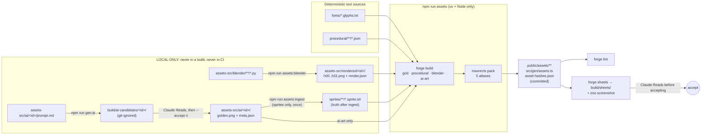
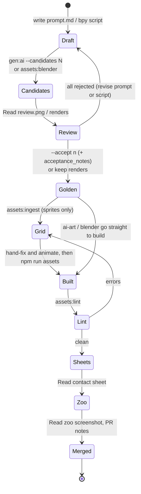

# Asset Pipeline

> **Status:** v1.0, 2026-10-18. Operational companion to [ART_BIBLE.md](ART_BIBLE.md) (what assets must look like) and [ADR 0002](adr/0002-ai-authored-asset-pipeline.md) (why the pipeline is hybrid). This document covers **how** to produce, regenerate, review and debug every image asset in Street Sweeper Pro. Audio rendering lives in [AUDIO_DESIGN.md](AUDIO_DESIGN.md) and level compilation in [LEVEL_DESIGN.md](LEVEL_DESIGN.md). Both are touched here only where they share `npm run assets`.

Every asset in the game is authored by an AI agent (Claude), with no human artist. That works only if every pixel can be traced back to a file in the repo and rebuilt by a deterministic script. That is production pillar 5, **Every Pixel Reproducible**. The rest of this document is the machinery that delivers it.

---

## Contents

1. [The pipeline at a glance](#1-the-pipeline-at-a-glance)
2. [Technique per asset class](#2-technique-per-asset-class)
3. [Directory layout](#3-directory-layout)
4. [One-time setup](#4-one-time-setup)
5. [Commands and npm scripts](#5-commands-and-npm-scripts)
6. [Source formats](#6-source-formats)
7. [Blender: headless pre-renders](#7-blender-headless-pre-renders)
8. [AI image generation: Codex and Cursor](#8-ai-image-generation-codex-and-cursor)
9. [Deterministic post-processing (the forge)](#9-deterministic-post-processing-the-forge)
10. [Adding a new asset, step by step, per class](#10-adding-a-new-asset-step-by-step-per-class)
11. [Golden review and acceptance](#11-golden-review-and-acceptance)
12. [Regeneration procedures](#12-regeneration-procedures)
13. [Troubleshooting](#13-troubleshooting)
14. [Appendix: time and cost budget](#14-appendix-time-and-cost-budget)

---

## 1. The pipeline at a glance

There are two kinds of source, and one rule that joins them:

- **Deterministic text sources:** text-grid sprites, glyph files, procedural generator params, bpy scripts, and SFX and song JSON. Claude edits these directly.
- **Golden sources:** accepted AI images and Blender renders. They come from non-deterministic tools, so they are committed together with full provenance. They are replaced only by re-running their tool, never retouched.
- **The rule:** everything downstream of a golden is a pure function of input bytes and parameters. It produces byte-identical PNGs (Pillow encode, no metadata, no timestamps, fixed parameters).



The hard boundaries:

| Boundary | Rule |
|---|---|
| Build vs. tools | `npm run assets` uses only Python (via uv) and Node. It **never** calls Blender, Codex or Cursor. |
| CI | `ubuntu-latest` runs `assets:verify` and `assets:lint`. Blender and AI generation **never** run in CI. |
| Committed outputs | `public/assets/**`, `src/gen/assets.ts` and `public/assets/asset-hashes.json` are committed, so `npm run dev` works without uv. |
| Golden vs. grid | For sprite classes that go through `forge ingest` (people, litter, decals, signs, landmark roofs), the **grid is the source of truth** once it has been written. Fix the grid, never the golden. |
| Palette | Kerbside-32 (`assets-src/palette/kerbside32.json`) is the only legal set of colours, in any asset, Blender material or prompt hex list. The colour table is in [ART_BIBLE.md](ART_BIBLE.md#5-palette-kerbside-32). |

---

## 2. Technique per asset class

This is the canonical mapping. The visual rules each class must meet are in [ART_BIBLE.md](ART_BIBLE.md), and per-entity cells and IDs are in [ENTITY_CATALOG.md](ENTITY_CATALOG.md).

| Asset class | Technique | Manifest `technique` | Source of truth in repo | Why |
|---|---|---|---|---|
| Ground tiles (asphalt, lane markings, double yellows, kerbs, pavement slabs, zebra, drains, manholes, grass, cobbles, tactile paving) | Procedural Python, seeded PCG64. The 47-tile kerb blob autotile is generated by rule. | `procedural` | `assets-src/procedural/tiles/*.json` + `tools/forge/forge/procedural/tiles.py` | The Codex "seamless" tile failed the seam test (wrap diff 11.4 vs 3.6 interior, a 209 px dash at the join). Only code guarantees seams. |
| Road decals (oil, graffiti, posters, manhole art) | Codex image gen → ingest at a common scale | `ai-ingest` | `assets-src/ai/decal.*/` | One-offs, where variety hides inconsistency |
| Roof surfaces (felt, gravel, slate, corrugated) | Procedural Python | `procedural` | `assets-src/procedural/roofs/*.json` | Must align to the tile grid |
| Roof furniture (AC units, vents, skylights, water tanks, chimneys, stair housings) | Blender kit rendered straight down, laid out on roofs by a seeded forge script | `blender` | `assets-src/blender/roofkit/*.py` | Same light and palette as vehicles |
| Landmark roofs (Town Hall, Pier, Depot) | Codex golden → ingest | `ai-ingest` | `assets-src/ai/roof.*/` | Unique pieces |
| Facades | Procedural assembly of 32×40 text-grid modules (window, door, drainpipe, shopfront) with `_lit/_base/_dark` ramp variants | `procedural` (modules are `grid`) | `assets-src/sprites/facade/*.sprite.txt` + `assets-src/procedural/facades/*.json` | Exact pixel control |
| Shop signs | Codex golden → ingest. Lettering is drawn with the Kerbside fonts, never generated. | `ai-ingest` | `assets-src/ai/sign.*/` | Flavour |
| Vehicles (all `veh.*`) | Blender procedural low-poly, 32 headings | `blender` | `assets-src/blender/vehicles/*.py` + `assets-src/rendered/<id>/` | A full rotation set renders in 2.0 to 4.5 s, crisp and deterministic. Image gen cannot hold 32 consistent rotations. |
| Volumetric props (bus shelter, phone box, bench, tree canopy, market stall, skip) | Blender, straight down, with sprite-stack slices for tall props | `blender` | `assets-src/blender/props/*.py` | The lean must match buildings |
| Small props (bollard, cone, hydrant, wheelie bin, A-board) | Text grids | `grid` | `assets-src/sprites/prop/*.sprite.txt` | Tiny, exact |
| Humans (`npc.*` people) | Codex reference-locked key-pose sheet (`-i` with the approved style reference) → `forge ingest` → indexed text grid → Claude authors the remaining frames and fixes errors | `ai-ingest` | `assets-src/ai/char.<id>/` (provenance) + `assets-src/sprites/npc/<id>.sprite.txt` (**truth**) | Codex holds style when locked to a reference; probe figures were about 25×31–34 px native (old woman 25×33, businessman 25×31), so ingest steps down about 0.7× to the ≤ 18×22 figure and Claude repairs the grid (quality tracked as decision D-13). Walk frames are not real animation (the handbag swaps hands), so the grid holds the animation. |
| Animals (cat, pigeon, dog, seagull) | Text grids written directly | `grid` | `assets-src/sprites/npc/*.sprite.txt` | At ≤ 20 px, hand-placed pixels beat downscales |
| Litter (`litter.*`) | Codex transparent-background 4×2 sheets → ingest with **one scale factor per sheet** (largest item = 14 px) → grids. Illegible items (can, butts) are redrawn by hand, and butts ship as a cluster sprite. | `ai-ingest` | `assets-src/ai/litter.sheet_NN/` + `assets-src/sprites/litter/*.sprite.txt` | The best AI result in the probe. Cans and butts were illegible at 12 px. |
| Stains / grime | Procedural Python | `procedural` | `assets-src/procedural/stains/*.json` | Tileable, many variants |
| Pickups, power-ups, collectibles | Text grids | `grid` | `assets-src/sprites/pickup/*.sprite.txt` | 16 px icons |
| UI / HUD | Text-grid icons + 9-slice panels in code. The minimap is rendered at runtime from map data. | `grid` | `assets-src/sprites/ui/*.sprite.txt` | Pixel-exact states |
| Fonts | Text-grid glyphs | `grid` (font builder) | `assets-src/fonts/*.glyphs.txt` | **Never image gen** |
| VFX (dust, spray, sparkle, skid marks, score popups, splash, leaf swirl) | Procedural Python frame generators (4 to 8 frames) + runtime particles in palette colours | `procedural` | `assets-src/procedural/fx/*.json` | Must loop exactly |
| Title, key art, intro cards, Mercury newspaper art, portraits | Codex at full resolution → golden → crop, pixelize at the detected pseudo-pixel period (about 3–4× for art prompted at game resolution), palette map (Bayer allowed) | `ai-art` | `assets-src/ai/art.*/`, `assets-src/ai/portrait.*/` | Image gen is strongest at large one-offs |
| Concept / mood boards | Codex (Cursor for A/B). **Reference only, never shipped.** | none (not in manifest) | `assets-src/ai/concept.*/` | Guides `assets-src/STYLE.md` |

**Choosing a technique for something new:** use the row above whose class matches. If nothing matches, apply these tie-breakers in order:

1. It must tile or loop → procedural.
2. It must rotate (8+ consistent views) → Blender.
3. It is ≤ 20 px and must be exact → text grid.
4. It is a one-off at ≥ 64 px → Codex `ai-art`.
5. It is a family of small, varied items → Codex sheet + ingest.

Record the decision in the PR.

**Placeholder first.** Every class gets a code-defined placeholder (usually a `grid` entry) under its **final asset ID and frame IDs** in M1/M2. Upgrading a class later changes `technique` and `source` in the manifest but never the frame IDs. `forge lint` enforces this by failing on any frame-count mismatch with the manifest.

---

## 3. Directory layout

Asset-relevant paths only. The full repo tree is in [TECHNICAL_DESIGN.md](TECHNICAL_DESIGN.md).

```
assets-src/
├─ STYLE.md                         # mirror of ART_BIBLE rules, read by Claude before authoring
├─ _probe/                          # asset-probe artefacts (2026-10-18), git-tracked, NOT in the manifest or lint
├─ manifest.json                    # one entry per asset (see §6.1)
├─ palette/kerbside32.json          # the only legal colours + ramps + night/shadow remaps
├─ sprites/
│  ├─ npc/      old_woman.sprite.txt, cat.sprite.txt, …
│  ├─ litter/   crisp_packet.sprite.txt, cigarette_butts.sprite.txt, …
│  ├─ prop/     bollard.sprite.txt, traffic_cone.sprite.txt, …
│  ├─ pickup/   flask_of_tea.sprite.txt, golden_crisp.sprite.txt, …
│  ├─ ui/       icon_hopper.sprite.txt, panel_default.sprite.txt, …
│  └─ facade/   window_sash.sprite.txt, door_terrace.sprite.txt, …
├─ fonts/
│  ├─ kerbside5x7.glyphs.txt
│  └─ kerbsidebold8x8.glyphs.txt
├─ procedural/
│  ├─ tiles/    asphalt.json, kerb_blob.json, zebra.json, …
│  ├─ roofs/    felt.json, gravel.json, slate.json, corrugated.json
│  ├─ facades/  terrace_brick.json, shopfront_row.json, …
│  ├─ stains/   gum.json, oil.json, …
│  └─ fx/       dust.json, sparkle.json, …
├─ blender/
│  ├─ rig.py                        # shared camera/light/material/render rules (§7.3)
│  ├─ vehicles/ sweeper.py, sweeper_brush.py, hatchback.py, bus.py, …
│  ├─ props/    phone_box.py, bus_shelter.py, tree.py, …
│  └─ roofkit/  ac_unit.py, water_tank.py, …
├─ rendered/                        # COMMITTED Blender goldens
│  ├─ veh.sweeper/  h00.png … h31.png, dented_h00.png …, render.json
│  └─ veh.sweeper_brush/  brush_h00_0.png … brush_h31_3.png, render.json
├─ ai/
│  ├─ _style_preamble.md            # shared, versioned preamble (§8.4)
│  ├─ ref.people_style/   prompt.md, meta.json, golden.png
│  ├─ char.old_woman/     prompt.md, meta.json, golden.png, ingest.json
│  ├─ litter.sheet_01/    prompt.md, meta.json, golden.png, ingest.json
│  ├─ art.title/          prompt.md, meta.json, golden.png, ingest.json
│  └─ concept.promenade_mood/  prompt.md, meta.json, golden.png   # never shipped
├─ levels/        (see LEVEL_DESIGN.md)
└─ audio/         (see AUDIO_DESIGN.md)

tools/forge/
├─ pyproject.toml  uv.lock
├─ forge/  __main__.py build.py ingest.py pixelize.py palette.py outline.py
│          pack.py lint.py sheets.py blender.py genai.py sprite.py manifest.py pngio.py
│          procedural/  tiles.py roofs.py facades.py stains.py fx.py roof_layout.py
└─ tests/  test_ingest.py test_pack.py test_determinism.py …

public/assets/                      # GENERATED, committed
├─ atlas/  world.png world.json actors.png actors.json items.png items.json ui.png ui.json fx.png fx.json
├─ fonts/  kerbside5x7.json kerbsidebold8x8.json (+ outlined variants)
├─ art/    title.png portrait_big_pam.png …        # asset IDs art.title, portrait.big_pam
└─ asset-hashes.json
src/gen/assets.ts                   # GENERATED, committed

build/                              # git-ignored
├─ .forge-cache/                    # content-hash cache for forge build
├─ sheets/                          # contact sheets for review
├─ ai-candidates/<id>/run_NN/       # every generation attempt, rejected or not
│                                   #   (plus <id>/review.png, §11.1)
└─ tmp/                             # verify rebuilds, Blender --check renders
```

`ingest.json` is a small deterministic config next to a golden. It tells `forge ingest` and the `ai-art` builder how to slice, scale and name the golden (§6.5). It is a text source, so it is edited by hand.

---

## 4. One-time setup

```bash
npm ci                                   # Node 24.21.0 / npm 11.19.0
uv sync --project tools/forge            # Python 3.13.15 venv in tools/forge/.venv from uv.lock
uv run --project tools/forge pytest      # forge self-tests (pytest 9.1.1)
npm run assets && git status --short     # must produce no diff on a clean checkout
```

Only needed for local generation work (never in CI):

| Tool | Check | Expected |
|---|---|---|
| Blender | `/Applications/Blender.app/Contents/MacOS/Blender -b --factory-startup --version` | `Blender 5.2.2 LTS` |
| Codex | `~/.local/bin/codex --version` | `codex-cli 0.160.1`. Logged in (`codex login`) |
| Cursor | `~/.local/bin/cursor-agent --version` | `2026.10.16-e3cb207`. Logged in |

Blender is **not on PATH**, and the forge always uses the absolute path above. If a machine has it elsewhere, set `SSP_BLENDER=/path/to/Blender` for that shell only. The forge refuses to run if `--version` does not report `5.2.2 LTS`, because a different Blender can change shader compilation and therefore pixels.

---

## 5. Commands and npm scripts

### 5.1 The command table

| Command | What it does | Where it runs |
|---|---|---|
| `npm run assets` | `forge build` + `npm run audio` + `npm run levels` | Anywhere |
| `npm run assets:verify` | Rebuild into a temporary directory and byte-compare with committed outputs | CI + local |
| `npm run assets:lint` | `forge lint` | CI + local |
| `npm run assets:sheets` | `forge sheets` → `build/sheets/` | Local |
| `npm run assets:ingest -- <id>` | AI golden → grid | Local |
| `npm run assets:blender -- <id\|all> [--check]` | Re-render. `--check` reports pixel diffs against committed renders. | **Local only** |
| `npm run gen:ai -- <id> [--tool codex\|cursor] [--candidates N]` | Writes candidates. Claude reviews. `--accept <n>` promotes one to `golden.png` and completes `meta.json`. | **Local only, never CI** |
| `npm run audio` | `node tools/audio/render-sfx.ts && node tools/audio/render-music.ts` | Anywhere |
| `npm run levels` | `node tools/levels/compile-level.ts` | Anywhere |

All forge commands run as `uv run --project tools/forge python -m forge <cmd>`. When debugging the forge, call it directly. It accepts `-v` for per-step logging.

### 5.2 `package.json` scripts

```jsonc
{
  "scripts": {
    "assets":         "uv run --project tools/forge python -m forge build && npm run audio && npm run levels",
    "assets:verify":  "uv run --project tools/forge python -m forge verify",
    "assets:lint":    "uv run --project tools/forge python -m forge lint",
    "assets:sheets":  "uv run --project tools/forge python -m forge sheets",
    "assets:ingest":  "uv run --project tools/forge python -m forge ingest",
    "assets:blender": "uv run --project tools/forge python -m forge blender",
    "gen:ai":         "uv run --project tools/forge python -m forge gen-ai --tool codex",
    "audio":          "node tools/audio/render-sfx.ts && node tools/audio/render-music.ts",
    "levels":         "node tools/levels/compile-level.ts"
  }
}
```

- **M0 guard behaviour:** until their real implementations land, `render-sfx.ts`, `render-music.ts` (M5) and `compile-level.ts` (M1) are input-count guards (`tools/inputGuard.ts`): with zero sources they log `0 sources; nothing to render` and exit 0, and with any source present they exit 3 with `not implemented until M5`/`M1`; each accepts `--out <dir>`.
- `gen:ai` defaults to `--tool codex`. A later `--tool cursor` on the command line overrides it, because the last flag wins.
- `forge verify` runs `forge build --out build/tmp/verify/`, then runs the audio and level tools with their `--out` pointed at the same temp root. It byte-compares every file listed in `public/assets/asset-hashes.json` and `src/gen/assets.ts`, and exits non-zero with a per-file report. Audio comparison follows the WAV-hash rule in [AUDIO_DESIGN.md](AUDIO_DESIGN.md).
  - The rebuild is always cold (`--no-cache`), into an emptied `build/tmp/verify/`. A guard tool that exits non-zero fails verify.
  - The compared set is every file under `public/assets/` plus `src/gen/assets.ts`, on both sides, plus the keys of the committed `asset-hashes.json`. A path also fails when it is generated but not committed (**missing**), committed but not generated (**stale**), generated but not listed (**unlisted**), listed but not generated, or when its committed bytes do not match its listed SHA-256.
  - With `--pixels`, a PNG whose bytes differ passes if its decoded RGBA is identical, and is reported as `pixels identical, bytes differ`. JSON and TS stay byte-compared, with one exception: the `asset-hashes.json` entries of exactly those PNGs may differ, because they hash encoder output.
- CI invokes `forge verify --pixels` (decoded RGBA plus JSON/TS bytes) per decision D-12 in [ROADMAP §8](ROADMAP.md#8-m0-spike-decision-log) (SSP-025). The dev Mac's `npm run assets:verify` stays a byte compare (see §13.5).

### 5.3 Forge subcommands (full reference)

| Subcommand | Key flags | Notes |
|---|---|---|
| `build` | `[--only <id>…] [--out <dir>] [--no-cache]` | Pure. Cached by content hash in `build/.forge-cache/`. `--only` still repacks all atlases, so packing stays global and deterministic (the other assets come from the cache, or are rebuilt). `--out <dir>` also receives the generated outputs, at their repo-relative paths (`<dir>/public/assets/…`, `<dir>/src/gen/assets.ts`), instead of the repo. |
| `verify` | `[--pixels]` | `--pixels` decodes mismatching PNGs and compares RGBA pixels instead of PNG bytes (JSON and TS outputs are still byte-compared), reporting whether the pixels or only the encoded bytes differ (§13.5). It is CI's sanctioned mode (D-12). Local runs on the dev Mac use byte mode. |
| `lint` | `[--only <id>…] [--warn-as-error]` | CI passes `--warn-as-error` except for the "re-render needed" warning, which blocks merge by review rule instead. |
| `sheets` | `[--atlas world\|actors\|items\|ui\|fx] [--only <id>…]` | 4×, labelled, light `#c3c1c0` and dark `#24222a` backgrounds, palette strip, Bessie h00 for scale. |
| `ingest` | `<id> [--force] [--dry-run]` | Refuses to overwrite an edited grid without `--force`. `--dry-run` writes previews to `build/tmp/ingest/<id>/` only. |
| `blender` | `<id\|all> [--check]`, `--version` | Local only. Wraps the exact Blender command (§7.1). `--version` prints the Blender version. |
| `gen-ai` | `<id> [--tool codex\|cursor] [--candidates N \| --accept <n>] [--ref <path>]…` | Local only. `--ref` defaults to whatever `prompt.md` declares. `--candidates` (default 1) appends `run_NN/` dirs numbered on from the last one; each holds `<output>.png`, `events.jsonl`, `stderr.txt`, `last_message.txt`, `verify.json` (the §8.2 checks) and the draft `meta.json`. `--accept <n>` promotes `run_<n>` (numbered from 0, so `accepted_index` = the run number) and refuses a run that failed verification or whose `prompt.md` or references changed since. `SSP_CODEX_MODEL` overrides the pinned model, `SSP_CODEX` the binary path and `CODEX_HOME` the `~/.codex` folder searched for `generated_images/`. `--tool cursor` exits 3 (§8.3). |

Until its implementing issue lands, a subcommand accepts its flags but exits 3 with `forge <cmd>: not implemented until SSP-xxx` on stderr (never 0). The mapping is `NOT_IMPLEMENTED_UNTIL` in `tools/forge/forge/__main__.py`. Since SSP-012 every subcommand has landed and the mapping is empty.

---

## 6. Source formats

### 6.1 Manifest (`assets-src/manifest.json`)

There is one entry per asset, with the fields `{ id, class, technique, source, cell:[w,h], states, dirs, frames, atlas, outline, swaps }`. `technique` is one of `"grid" | "procedural" | "blender" | "ai-ingest" | "ai-art"`. Entries are kept sorted by `id` (lint checks this, so diffs stay small).

```json
{
  "assets": [
    {
      "id": "veh.sweeper",
      "class": "veh",
      "technique": "blender",
      "source": "assets-src/rendered/veh.sweeper",
      "cell": [64, 64],
      "states": ["body", "dented"],
      "dirs": "h32",
      "frames": { "body": 1, "dented": 1 },
      "atlas": "actors",
      "outline": true,
      "swaps": ["livery_racing_green", "livery_seaside", "livery_midnight_gold"]
    },
    {
      "id": "veh.sweeper_brush",
      "class": "veh",
      "technique": "blender",
      "source": "assets-src/rendered/veh.sweeper_brush",
      "cell": [96, 96],
      "states": ["brush"],
      "dirs": "h32",
      "frames": { "brush": 4 },
      "atlas": "actors",
      "outline": true,
      "swaps": []
    },
    {
      "id": "npc.old_woman",
      "class": "npc",
      "technique": "ai-ingest",
      "source": "assets-src/sprites/npc/old_woman.sprite.txt",
      "cell": [24, 24],
      "states": ["walk", "idle", "startle", "fall", "angry"],
      "dirs": ["s", "sw", "w", "nw", "n", "ne", "e", "se"],
      "frames": { "walk": 4, "idle": 2, "startle": 2, "fall": 3, "angry": 2 },
      "atlas": "actors",
      "outline": false,
      "swaps": []
    },
    {
      "id": "tile.asphalt",
      "class": "tile",
      "technique": "procedural",
      "source": "assets-src/procedural/tiles/asphalt.json",
      "cell": [32, 32],
      "states": ["v"],
      "dirs": "-",
      "frames": { "v": 6 },
      "atlas": "world",
      "outline": false,
      "swaps": []
    }
  ]
}
```

Field semantics the forge relies on:

| Field | Meaning |
|---|---|
| `technique: "ai-ingest"` | Built **exactly like `grid`** from `source` (a `.sprite.txt`). The technique exists so that lint also requires the provenance folder named in the grid's `origin:` header to be complete and hash-valid. |
| `technique: "ai-art"` | Built from `assets-src/ai/<id>/golden.png` + `ingest.json` every build (crop → pixelize at the detected pseudo-pixel period → palette map). There is no intermediate grid. |
| `dirs` | `"h32"` = `h00`–`h31`. `"h4"` = `h00`–`h03` (90° steps, used for roof kit). A list = compass dirs. `"-"` = undirected. |
| `outline` | `true` → forge **adds** the 1 px ink (`#0f0e12`) outline, 4-connected, outside the silhouette. `false` → the source already contains it (grids usually draw their own). Lint checks the result either way, so the visible body must be ≤ cell − 2 px when `outline` is `true`. |
| `swaps` | Names of per-instance ramp-swap tables (index → index, at most 8 per atlas). They are defined in `assets-src/palette/kerbside32.json` under `swaps` and emitted into the atlas JSON. |

### 6.2 Text-grid sprite (`*.sprite.txt`)

Format:

- A header with `id:`, `cell: WxH` and `palette: kerbside32`, then an optional key map. The default key is `.` = transparent, `0`–`9` = indices 00–09 and `a`–`v` = indices 10–31.
- The key map is one or more `key: <c>=<v> …` lines, e.g. `key: .=- K=00 Y=15 L=16`. `<c>` is one printable ASCII character other than space, `#` or `:`; `<v>` is an index `0`–`31` or `-` for transparent. A key map **replaces** the default key entirely.
- One block per frame: `frame <state>:<dir>:<n>`, followed by exactly H rows of W characters.
- Optional `mirror <dir> from <dir>` lines: every authored frame in the source dir also exists in the target dir, flipped left-right. The target dir has no authored frames, and mirrors never chain.
- `#` starts a comment line. Blank lines are ignored. Unknown header names are errors.
- The parser and writer are `tools/forge/forge/sprite.py`, shared by `forge build` and `forge ingest`. The writer emits headers in the order above, then the frame blocks, then the mirror lines; comments are not preserved.

Default key, for quick reference while hand-editing:

| Char | Idx | Char | Idx | Char | Idx | Char | Idx |
|---|---|---|---|---|---|---|---|
| `0` | 00 ink | `8` | 08 soot_brown | `g` | 16 lemon | `o` | 24 lime |
| `1` | 01 tar | `9` | 09 brick_dk | `h` | 17 hivis_orange | `p` | 25 navy |
| `2` | 02 asphalt | `a` | 10 brick | `i` | 18 postbox_red | `q` | 26 council_blue |
| `3` | 03 asphalt_lt | `b` | 11 terracotta | `j` | 19 maroon | `r` | 27 sky |
| `4` | 04 slab_dk | `c` | 12 skin_lt | `k` | 20 bubblegum | `s` | 28 spray |
| `5` | 05 slab | `d` | 13 umber | `l` | 21 hedge_dk | `t` | 29 teal |
| `6` | 06 kerb | `e` | 14 ochre | `m` | 22 grass | `u` | 30 plum |
| `7` | 07 chalk | `f` | 15 sweeper_yellow | `n` | 23 grass_lt | `v` | 31 lavender |

Example: `assets-src/sprites/litter/crisp_packet.sprite.txt`. Litter is rotated by code (below), so it uses top-lit, rotation-symmetric shading: ink outline, a postbox_red (18, `i`) base and one centred lemon (16, `g`) highlight. There is no directional NW glint and no darker edge.

```text
id: litter.crisp_packet
cell: 16x16
palette: kerbside32
origin: ai/litter.sheet_01#cell=4
ingest_sha256: 9b1f0c6e2d7a4b38c5e1f7a90d2c6b4e8a3f1d5c7b9e0a2c4d6f8b1a3c5e7d90
# key omitted: default key applies

frame idle:h00:0
................
................
................
..000000000000..
..0iiiiiiiiii0..
..0iiiiiiiiii0..
..0iiiggggiii0..
..0iiggggggii0..
..0iiggggggii0..
..0iiiggggiii0..
..0iiiiiiiiii0..
..0iiiiiiiiii0..
..000000000000..
................
................
................

frame wobble:h00:0
# … 16 rows …
frame wobble:h00:1
# … 16 rows …
```

Header lines the forge adds or reads beyond the core format:

| Line | Written by | Purpose |
|---|---|---|
| `origin: ai/<asset-id>#cell=<k>[,<k>…]` | `forge ingest` | Links the grid to its provenance folder. Lint requires it for `ai-ingest` entries. A grid fed by several cells of one sheet (people) lists them in frame order, e.g. `#cell=0,1,2`. |
| `ingest_sha256: <hex>` | `forge ingest` | SHA-256 of the frame blocks (and mirror lines) as first written, exactly as the shared writer formats them. If the current content differs, the grid counts as **edited**, and `ingest` then refuses to overwrite it without `--force`. Comments and blank lines do not count; adding, removing or changing a frame or mirror line does. A grid with no `ingest_sha256` line (or one that does not parse) is also refused without `--force` (M0 prototype; SSP-110 adds the placeholder rule). Hand-editing never needs to update this line. |

For litter, only the `h00` rotation is authored. `forge build` generates `h08`, `h16` and `h24` as exact 90° rotations ("4 rotations generated by code"). Litter grids therefore use top-lit, rotation-symmetric shading only (outline + base + one centred highlight); directional NW glints are not allowed on litter. Lint checks this by flagging any litter frame whose 90° rotation changes which edge carries the ramp's darkest step. For humans, the S, SW, W, NW and N directions are authored, and SE, E and NE come from mirror lines:

```text
mirror se from sw
mirror e from w
mirror ne from nw
```

### 6.3 Glyph files (`*.glyphs.txt`)

The fonts are **Kerbside 5×7** (5×7 glyph in a 6×8 cell) and **Kerbside Bold 8×8** (8×8 glyph in a 9×10 cell). Both cover ASCII 32–126 plus £ ★ → ← ↑ ↓. `#` = ink and `.` = empty. Kerning pairs are explicit:

```text
font: Kerbside 5x7
glyph: 5x7
cell: 6x8
baseline: 7
advance: 6

glyph "£"
..##.
.#..#
.#...
###..
.#...
.#...
#####

kern "AV" -1
kern "LT" -1
```

The forge renders the atlas, builds an outlined variant automatically, and writes the metrics JSON (`public/assets/fonts/kerbside5x7.json`) consumed by `src/ui/bitmapText.ts`. Glyph design rules and specimens are in [ART_BIBLE.md](ART_BIBLE.md). **Never use AI image generation for fonts.**

### 6.4 Procedural params (`assets-src/procedural/**/*.json`)

Each file names its generator, its seed and its frame outputs. Generators live in `tools/forge/forge/procedural/` and must be pure functions of `(params, numpy.random.Generator(PCG64(seed)))` that return palette-index arrays (`uint8`), never RGB.

```json
{
  "id": "tile.asphalt",
  "generator": "tiles.asphalt",
  "seed": 1031,
  "cell": [32, 32],
  "variants": 6,
  "params": {
    "base_index": 2,
    "speckle": { "indices": [1, 3], "density": 0.06, "cluster": 2 },
    "crack":   { "index": 1, "probability": 0.25, "max_len_px": 14 },
    "wrap": true
  }
}
```

```python
# tools/forge/forge/procedural/tiles.py (shape of every generator)
import numpy as np
from numpy.random import Generator

def asphalt(params: dict, rng: Generator, cell: tuple[int, int], variant: int) -> np.ndarray:
    """Return a (h, w) uint8 array of Kerbside-32 indices. Must be seamless when params['wrap']."""
    w, h = cell
    out = np.full((h, w), params["base_index"], dtype=np.uint8)
    # ... seeded speckle and cracks; every random draw comes from rng, in a fixed order ...
    return out
```

Rules:

- No `random`, no `time`, no unordered `set` iteration when generating.
- Variant `k` draws from `rng` after variants `0..k-1`, so adding a variant never changes earlier ones.
- Tiles that set `wrap: true` must pass the lint seam test: the wrap-edge difference may not exceed the interior difference.

### 6.5 AI asset folder (`assets-src/ai/<asset-id>/`)

| File | Committed | Contents |
|---|---|---|
| `prompt.md` | yes | The full text sent to the tool, including the shared preamble, stamped with its version (§8.4) |
| `meta.json` | yes | Provenance (schema below) |
| `golden.png` | yes | The accepted raw output, byte-for-byte as produced (Cursor JPEGs are decoded to PNG; §8.3) |
| `refs/` | optional | Reference images passed with `-i`, if they are not themselves goldens elsewhere in the repo |
| `ingest.json` | for `ai-ingest` and `ai-art` | Slicing and scaling config (below) |
| rejected candidates | **never** | Live in `build/ai-candidates/<id>/`, which is git-ignored |

The `meta.json` schema is `{ id, tool, tool_version, model, date, argv, prompt_sha256, preamble_version, reference_images:[{path,sha256}], original_output_path, candidates_generated, accepted_index, acceptance_notes, golden_sha256, size:[w,h], seed:null }`. An example:

```json
{
  "id": "litter.sheet_02",
  "tool": "codex",
  "tool_version": "codex-cli 0.160.1",
  "model": "gpt-6.1-sol (agent, pinned via -m); image model: Codex built-in image_gen, version not exposed",
  "date": "2026-10-18",
  "argv": ["~/.local/bin/codex", "exec", "-m", "gpt-6.1-sol", "--skip-git-repo-check", "--ephemeral",
           "-s", "workspace-write", "-C", "build/ai-candidates/litter.sheet_02/run_02",
           "--json", "-o", "build/ai-candidates/litter.sheet_02/run_02/last_message.txt", "-"],
  "prompt_sha256": "4c2a9e7f0b13d85e6a1f9c3b7d2e0a45f8c6b1d93e7a2f0c5b8d4e1a6f3c9b27",
  "preamble_version": "v1",
  "reference_images": [],
  "original_output_path": "~/.codex/generated_images/0199f3a2-7c1e-7b40-9d6a-2f8e1c5b3a70/exec-1.png",
  "candidates_generated": 4,
  "accepted_index": 2,
  "acceptance_notes": "Run 2: all 7 items read at 14 px in the ingest preview, cell 8 empty; true alpha; no cast shadows. Run 0 painted a checkerboard background, run 1 drew a brand-like logo on the pizza box, run 3 had a 3/4 camera on the bottle.",
  "golden_sha256": "a81d03f5c9e2b74d6f0a1c8e3b5d97f2e4c6a0b8d1f3e5a7c9b2d4f6e8a0c1b3",
  "size": [1774, 887],
  "seed": null
}
```

`seed` is always `null`, because the Codex built-in `image_gen` exposes no seed or size control. `events.jsonl` carries no model field (only `thread.started`, `item.*` and `turn.completed`), so the wrapper writes `model` from its own pinned value (Codex: `CODEX_MODEL` in `tools/forge/forge/genai.py`, passed with `-m`) or from the `system.init` event's `model` (Cursor). `--accept` fills in `candidates_generated`, `accepted_index`, `golden_sha256`, `size` and `original_output_path`. Claude writes `acceptance_notes` by hand, and they must give the reason the accepted candidate won and why each rejected one lost.

`ingest.json` for a 4×2 litter sheet (`null` marks an empty cell). `litter.sheet_01` holds the eight items of the probe candidate (drink can, banana skin, glass bottle, newspaper, crisp packet, bin bag, dog mess, cigarette butts, in reading order), and `litter.sheet_02` holds the remaining seven:

```json
{
  "mode": "sheet",
  "grid": [4, 2],
  "cells": [
    "litter.kebab_wrapper", "litter.pizza_box", "litter.lolly_stick", "litter.chip_wrapper",
    "litter.leaf_pile", "litter.plastic_bottle", "litter.spilled_shopping", null
  ],
  "frame": "idle:h00:0",
  "target_cell": [16, 16],
  "largest_item_px": 14,
  "period_override": null
}
```

`ingest.json` for a people key-pose sheet. People sheets are **single-asset**: each cell names a full frame ID `<asset-id>:<state>:<dir>:<n>`, and all of them go into one grid. The draft for `ref.people_style` (the probe old-woman sheet; SSP-014 finalises the mapping):

```json
{
  "mode": "sheet",
  "grid": [4, 2],
  "cells": [
    "npc.old_woman:idle:s:0", "npc.old_woman:walk:s:0", "npc.old_woman:walk:s:1", "npc.old_woman:walk:s:2",
    null, null, null, null
  ],
  "target_cell": [24, 24],
  "largest_item_px": 19,
  "period_override": null,
  "baseline_row": 22
}
```

Sheet-mode fields (SSP-013):

| Field | Meaning |
|---|---|
| `grid` | `[columns, rows]`; cells are read left to right, top to bottom, and cell `(c, r)` spans `[c·W/cols, (c+1)·W/cols)` (integer division) |
| `cells` | One entry per cell: `null` (nothing is written for it), an asset ID (multi-asset sheets such as litter; the frame is `frame`), or a full frame ID (single-asset sheets such as people). Each frame may appear once. |
| `frame` | Local frame ID (`state:dir:n`) for cells given as bare asset IDs. Optional when every cell is a full frame ID or `null`. |
| `target_cell` | `[w, h]` of the written frames (the manifest cell) |
| `largest_item_px` | Optional. Sets the **one** step-down factor of the sheet: the largest extent (max of width and height) of any figure on the sheet becomes this many px, which for litter is the largest item (14) and **for people is the tallest figure, outline included (19 for elderly, 22 for adults; ART_BIBLE §7.2)**. Without it, the factor is the largest that fits every figure in `target_cell`. Never above 1 (no upscaling). |
| `period_override` | `null` (detect), one period for both axes, or `[x, y]`; each 3–16 px. Never a CLI flag. |
| `baseline_row` | Optional. When set, each figure's bottom row (the feet) lands on this row, e.g. `22` for people (ART_BIBLE §7.2 pivot, row 23 clear). When `null` or absent, figures are centred vertically (litter). Figures are always centred horizontally (floor). |

Every cell with content counts towards the sheet's scale factor, **including cells mapped to `null`**, so the factor is a property of the golden and never depends on which cells happen to be written. Unknown fields are errors.

`ingest.json` for `ai-art` (title screen, from a 2:1 Codex golden of 1774×887):

```json
{
  "mode": "art",
  "crop": null,
  "period_override": null,
  "dither": "bayer4",
  "out": "public/assets/art/title.png",
  "size": [480, 270]
}
```

### 6.6 Blender render folder (`assets-src/rendered/<asset-id>/`)

| File | Contents |
|---|---|
| `h00.png … h31.png` | Body frames, 256 px for 64 px cells (4× the target cell) |
| `<state>_hNN_<n>.png` | Extra animated states, e.g. `brush_h07_2.png` in `veh.sweeper_brush/` (Bessie's brush overlay, heading 7, spin frame 2) |
| `<state>_hNN.png` | Extra single-frame states, e.g. `dented_h07.png` |
| `slice_<k>.png` | Sprite-stack slices for tall props, `k` = 0 (ground) upward |
| `render.json` | `{ blender_version:"5.2.2 LTS", script_sha256, argv, tilt_deg, pivots_px }` |

```json
{
  "blender_version": "5.2.2 LTS",
  "script_sha256": "e07b6d2a91c4f38e5a0d7b1c6f9e2a43d8b5c0f7e1a9d3b6c2f8e4a0d7b1c5e9",
  "argv": ["--out", "assets-src/rendered/veh.sweeper", "--size", "256", "--headings", "32", "--tilt", "0"],
  "tilt_deg": 0,
  "pivots_px": { "h00": [32, 32], "h01": [32, 32], "...": "...", "h31": [32, 32] }
}
```

- `script_sha256` is the SHA-256 of the asset script's bytes, then a NUL byte, then `rig.py`'s bytes. A change to the shared rig therefore marks every render stale, which is intended.
- `pivots_px` are in **target-cell pixels** (after the 4× reduction). At 0° tilt they are constant at the cell centre.

---

## 7. Blender: headless pre-renders

### 7.1 The exact command

The forge runs this for you (`npm run assets:blender -- veh.sweeper`). Run it by hand only to debug:

```bash
/Applications/Blender.app/Contents/MacOS/Blender -b --factory-startup --python-exit-code 1 \
  -P assets-src/blender/vehicles/sweeper.py -- \
  --out assets-src/rendered/veh.sweeper --size 256 --headings 32 --tilt 0
```

| Part | Why |
|---|---|
| `-b` | Background (headless). Must come before `-P`. |
| `--factory-startup` | Ignores the user's preferences, add-ons and startup file, which would otherwise make renders machine-dependent |
| `--python-exit-code 1` | Without it, Blender 5.2.2 exits 0 even when the script raises (verified). With it, any uncaught Python exception, including argparse's `SystemExit(2)`, exits non-zero. Must come before `-P`. |
| `-P <script>` | Runs the asset script. The script imports `rig.py` from `assets-src/blender/`. |
| `--` | Everything after it goes to the script (`sys.argv` after `--`), not to Blender |
| `--size` | Render resolution, **4× the target cell**: 256 for 64 px cells, 128 for 32 px, 384 for `veh.bin_lorry` and `veh.sweeper_brush` (96), 512 for `veh.bus` (128) |
| `--headings` | 32 for vehicles. 4 for roof kit. 1 for sprite-stack props. |
| `--tilt` | 0 by default. Up to 8° only if the M0 spike approves it (the probe's 22° clashes with radially leaning buildings). |

`forge blender` adds what the raw command cannot do safely:

- It checks `<blender> -b --factory-startup --version` against `Blender 5.2.2 LTS` and refuses to run anything otherwise. `forge blender --version` prints the reported version (and exits non-zero on a mismatch).
- It renders into `build/tmp/blender/<id>/` and only swaps the folder into `assets-src/rendered/<id>/` after Blender exits 0, `render.json` verifies and the PNG set is exactly the expected frames (each a square RGBA `--size` image). The swap stages the new folder next to the target and uses two renames, so any failure leaves the committed folder byte-identical. Stale frames from an older render disappear with the swap.
- It passes `--python-exit-code 1` so any uncaught Python exception exits non-zero, and also treats a `Traceback` in stderr as failure. Blender's output is kept in `build/tmp/blender/<id>/stdout.txt` and `stderr.txt`.
- The rig writes `render.json` (`rig.write_render_json`); the wrapper verifies every field (`blender_version`, `script_sha256` = sha256(script + NUL + `rig.py`), `argv` = what it passed, `tilt_deg` = 0, `pivots_px` = the cell centre for every heading), then rewrites only the `--out` value in `argv` from the temp dir to `assets-src/rendered/<id>` so committed provenance does not depend on the machine.
- `--check` renders to `build/tmp/blender/<id>/`, prints per-frame changed-pixel counts (any RGBA channel differs) against the committed renders, writes diff PNGs to `build/tmp/blender/<id>/diff/` (changed pixels `18 postbox_red`, unchanged silhouette `04 slab_dk`, empty `00 ink`), replaces nothing and exits non-zero if any pixel changed or a frame was added or removed.
- `all` renders (or checks) every script under `assets-src/blender/{vehicles,props,roofkit}/`.

**Script lookup and arguments** (decided in SSP-007, so a script can be rendered before its manifest entry exists):

| Input | Rule |
|---|---|
| Script | The asset ID minus its class prefix maps to `assets-src/blender/{vehicles,props,roofkit}/<name>.py`: `veh.sweeper` → `vehicles/sweeper.py`, `veh.sweeper_brush` → `vehicles/sweeper_brush.py`. Zero or several matches is an error, and so is a match in the wrong class folder (`veh` → `vehicles/`, `prop` → `props/`, `roof` → `roofkit/`). |
| `--size` | 4 × the script's module-level `CELL_PX = <int>` (read by regex, never executed) |
| `--headings` | By class: `veh` 32, `prop` 1, `roof` 4 |
| Expected frames | The script's module-level `STATES` literal (state → frames per heading, the same shape as the manifest's `frames`), read with `ast`: `body` → `hNN.png`; `slice` → `slice_<k>.png` (1 heading only); another single-frame state → `<state>_hNN.png`; n > 1 frames → `<state>_hNN_<f>.png` (§6.6). The frame count must equal the sum of `STATES` × headings. |
| `--out` | The temp dir, repo-relative (`build/tmp/blender/<id>`); Blender runs with the repo root as its working directory |
| `--tilt` | Always 0 |
| Manifest | When `assets-src/manifest.json` has an entry for the ID, its `cell`, `frames` and `dirs` must agree with `CELL_PX`, `STATES` and the class headings |

### 7.2 Rig rules (enforced in `rig.py`)

| Concern | Rule |
|---|---|
| Camera | Orthographic, straight down (−Z in Blender, with +Y = north = screen up). `ortho_scale` = cell metres at 16 px/m: 32 px → 2 m, 64 px → 4 m, 96 px → 6 m, 128 px → 8 m. |
| Resolution | Square, `--size` (4× target), `resolution_percentage = 100` |
| Render | `film_transparent = True`. `view_transform = 'Standard'` (**never AgX** or Filmic). Look `None`, exposure 0, gamma 1. `dither_intensity = 0`. EEVEE with `taa_render_samples = 1` and `filter_size = 0.0`. PNG, RGBA, 8-bit. |
| Light | One sun at azimuth 315° (north-west), elevation 50°. Materials are emissive, so the sun object exists to **define the lighting vector** that the toon materials read, keeping one direction for every technique. |
| Materials | Unlit toon: `dot(normal, sun)` → constant ColorRamp with three **exact Kerbside-32 stops** (light/base/dark) → Emission. Colours are looked up by palette name from `kerbside32.json`, and **raw hex literals in bpy scripts are forbidden**. |
| Shading thresholds | dot < 0.33 → dark, 0.33–0.83 → base, ≥ 0.83 → lit (settled in SSP-008 from Bessie test renders; the M0 defaults were 0.35/0.85). A flat top face scores 0.766, so it renders `base`, matching the roof convention. A 45° chamfer whose facing is t° off the sun azimuth scores 0.542 + 0.455 cos t; at 32 headings t steps by 11.25°, so chamfers at t ≤ 45° are lit and t ≥ 123.75° dark, and each threshold sits midway between neighbouring chamfer values (≥ 0.03 margin). The 0.35/0.85 defaults gave pixel-identical chamfers but only 0.013 of margin on the lit side. |
| Headings | Rotate the **model root**, never the camera, so the light stays NW in screen space. `h00` faces north (screen up), stepping 360/headings clockwise (11.25° at 32). |
| Pivots | Recorded per frame in `render.json`. Constant at 0° tilt. |
| No baked shadows | No shadow catchers or ground planes. Actor drop shadows are added at runtime (+2, +2 px SE), and building shadows come from the mask target. |
| Readability | Top faces render flat. Readability comes from silhouette, palette and the post-process outline, so model chunky, distinct silhouettes (cab, hopper, brushes). |
| Timing | The first frame costs about 3.3 s of shader compile, then about 0.05 s per frame |

### 7.3 Skeleton: `assets-src/blender/rig.py`

The committed `assets-src/blender/rig.py` (SSP-007) is the implementation and wins over this skeleton if they differ; it adds palette-name validation, a check that the render settings stuck, and `heading_rad()`.

```python
"""Shared Blender rig for Street Sweeper Pro. Blender 5.2.2 LTS only.

Every asset script imports this module. Changing it changes script_sha256 for
every render, so forge lint will ask for a full re-render.
"""
from __future__ import annotations

import argparse
import hashlib
import json
import math
import sys
from pathlib import Path

import bpy
from mathutils import Vector

REPO = Path(__file__).resolve().parents[2]
PALETTE = json.loads((REPO / "assets-src/palette/kerbside32.json").read_text())

SUN_AZIMUTH_DEG = 315.0   # north-west, clockwise from north
SUN_ELEVATION_DEG = 50.0
T_BASE, T_LIT = 0.33, 0.83  # toon thresholds, settled in SSP-008 (see §7.2)
PX_PER_M = 16


def parse_args() -> argparse.Namespace:
    argv = sys.argv[sys.argv.index("--") + 1:] if "--" in sys.argv else []
    p = argparse.ArgumentParser()
    p.add_argument("--out", required=True)
    p.add_argument("--size", type=int, default=256)
    p.add_argument("--headings", type=int, default=32)
    p.add_argument("--tilt", type=float, default=0.0)
    return p.parse_args(argv)


def sun_vector() -> tuple[float, float, float]:
    az, el = math.radians(SUN_AZIMUTH_DEG), math.radians(SUN_ELEVATION_DEG)
    # +X east, +Y north, +Z up; vector points TOWARD the sun.
    return (math.cos(el) * math.sin(az), math.cos(el) * math.cos(az), math.sin(el))


def _srgb_to_linear(c: float) -> float:
    return c / 12.92 if c <= 0.04045 else ((c + 0.055) / 1.055) ** 2.4


def pal(name: str) -> tuple[float, float, float, float]:
    """Linear RGBA for a Kerbside-32 colour name, so 'Standard' output reproduces the exact hex."""
    entry = next(c for c in PALETTE["colors"] if c["name"] == name)
    h = entry["hex"].lstrip("#")
    rgb = [_srgb_to_linear(int(h[i:i + 2], 16) / 255) for i in (0, 2, 4)]
    return (*rgb, 1.0)


def reset_scene(cell_px: int, size: int, tilt_deg: float) -> bpy.types.Scene:
    bpy.ops.wm.read_factory_settings(use_empty=True)
    scene = bpy.context.scene
    scene.render.engine = "BLENDER_EEVEE"   # the only EEVEE identifier in 5.2.2
    scene.eevee.taa_render_samples = 1
    r = scene.render
    r.filter_size = 0.0
    r.film_transparent = True
    r.dither_intensity = 0.0
    r.resolution_x = r.resolution_y = size
    r.resolution_percentage = 100
    r.image_settings.file_format = "PNG"
    r.image_settings.color_mode = "RGBA"
    r.image_settings.color_depth = "8"
    for prop in r.bl_rna.properties:          # no Date/Time/RenderTime PNG text chunks
        if prop.identifier.startswith("use_stamp"):
            setattr(r, prop.identifier, False)
    vs = scene.view_settings
    vs.view_transform = "Standard"   # never AgX
    vs.look = "None"
    vs.exposure = 0.0
    vs.gamma = 1.0

    cam_data = bpy.data.cameras.new("cam")
    cam_data.type = "ORTHO"
    cam_data.ortho_scale = cell_px / PX_PER_M        # cell metres
    cam = bpy.data.objects.new("cam", cam_data)
    D = 50.0
    t = math.radians(tilt_deg)
    cam.location = (0.0, -D * math.sin(t), D * math.cos(t))  # keep the origin on the view axis at any tilt
    cam.rotation_euler = (t, 0.0, 0.0)  # 0 = straight down, +Y up on screen
    scene.collection.objects.link(cam)
    scene.camera = cam

    sun_data = bpy.data.lights.new("sun", type="SUN")
    sun = bpy.data.objects.new("sun", sun_data)
    sun.rotation_mode = "QUATERNION"
    # A sun light shines along its local -Z: point -Z away from the sun, i.e. along -sun_vector().
    sun.rotation_quaternion = (-Vector(sun_vector())).to_track_quat("-Z", "Y")
    scene.collection.objects.link(sun)
    return scene


def toon_material(name: str, lit: str, base: str, dark: str) -> bpy.types.Material:
    """Unlit toon: dot(N, sun) -> constant ramp (exact palette stops) -> Emission."""
    mat = bpy.data.materials.new(name)
    # 5.x materials always have a node tree; setting use_nodes is deprecated (warns on stderr).
    nt = mat.node_tree
    nt.nodes.clear()
    geom = nt.nodes.new("ShaderNodeNewGeometry")
    dot = nt.nodes.new("ShaderNodeVectorMath")
    dot.operation = "DOT_PRODUCT"
    dot.inputs[1].default_value = sun_vector()
    ramp = nt.nodes.new("ShaderNodeValToRGB")
    ramp.color_ramp.interpolation = "CONSTANT"
    els = ramp.color_ramp.elements
    els[0].position, els[0].color = 0.0, pal(dark)
    els[1].position, els[1].color = T_BASE, pal(base)
    els.new(T_LIT).color = pal(lit)
    emit = nt.nodes.new("ShaderNodeEmission")
    emit.inputs["Strength"].default_value = 1.0
    out = nt.nodes.new("ShaderNodeOutputMaterial")
    nt.links.new(geom.outputs["Normal"], dot.inputs[0])
    nt.links.new(dot.outputs["Value"], ramp.inputs["Fac"])
    nt.links.new(ramp.outputs["Color"], emit.inputs["Color"])
    nt.links.new(emit.outputs["Emission"], out.inputs["Surface"])
    return mat


def render_headings(scene, root, out: Path, headings: int, prefix: str = "", suffix: str = "",
                    before_frame=None) -> None:
    out.mkdir(parents=True, exist_ok=True)
    for i in range(headings):
        root.rotation_euler.z = -math.radians(i * 360.0 / headings)  # clockwise from north
        if before_frame:
            before_frame(i)
        scene.render.filepath = str(out / f"{prefix}h{i:02d}{suffix}.png")
        bpy.ops.render.render(write_still=True)


def script_sha256(script: Path) -> str:
    h = hashlib.sha256(script.read_bytes())
    h.update(b"\0")
    h.update((REPO / "assets-src/blender/rig.py").read_bytes())
    return h.hexdigest()


def write_render_json(out: Path, script: Path, args, cell_px: int, headings: int) -> None:
    c = cell_px // 2
    (out / "render.json").write_text(json.dumps({
        "blender_version": "5.2.2 LTS",
        "script_sha256": script_sha256(script),
        "argv": sys.argv[sys.argv.index("--") + 1:],
        "tilt_deg": args.tilt,
        "pivots_px": {f"h{i:02d}": [c, c] for i in range(headings)},
    }, indent=2) + "\n")
```

### 7.4 Skeleton: an asset script (`assets-src/blender/vehicles/sweeper.py`)

Conventions every asset script follows:

1. Model in **metres**, Z up, facing **+Y (north)**, centred on the origin at ground level, all parented to one empty called `root`.
2. Use only `rig.toon_material` with palette **names**. Bessie's livery is body 15 (shade 14), cab 07, stripe 26, brushes 18, beacon 17 (flashes to 16), windscreen 25/27 and tyres 00/01. The full livery spec is in [ART_BIBLE.md](ART_BIBLE.md).
3. Declare `CELL_PX` and the `STATES` it renders, and nothing else global.
4. No randomness. If variation is needed, use a literal list.
5. One script = one asset ID. Bessie is two assets: `veh.sweeper` (body and dented, 64×64 cell) and `veh.sweeper_brush` (the brush overlay, 96×96 cell, rendered `--size 384` with `ortho_scale` 6 m, the same centre pivot as the body, 32 headings × 4 spin frames). At h00 the discs reach y = +2.2 m (35.2 px) and at diagonal headings 2.40 m (38.3 px) from the body centre, which does not fit a 64 px cell once the outline is added.
6. Brush discs carry 4 radial bristle bars in a second palette colour (19 maroon on 18 postbox_red), so the spin is visible from straight above. A plain single-material disc has a flat top face in the toon shader, and its 4 spin frames would be identical.

```python
"""veh.sweeper — Bessie, the Dustmaster 3000. 64 px cell, body 28x52 px (1.75 x 3.25 m)."""
import math
import sys
from pathlib import Path

sys.path.insert(0, str(Path(__file__).resolve().parents[1]))  # assets-src/blender
import bpy  # noqa: E402
import rig  # noqa: E402

CELL_PX = 64
STATES = {"body": 1, "dented": 1}   # state -> frames per heading; forge blender expects exactly these frames
SCRIPT = Path(__file__).resolve()


def box(name, size, loc, mat, parent):
    bpy.ops.mesh.primitive_cube_add(size=1.0, location=loc)
    ob = bpy.context.active_object
    ob.name, ob.scale = name, size
    ob.data.materials.append(mat)
    ob.parent = parent
    return ob


def build():
    root = bpy.data.objects.new("root", None)
    bpy.context.scene.collection.objects.link(root)
    body = rig.toon_material("body", lit="lemon", base="sweeper_yellow", dark="ochre")
    cab = rig.toon_material("cab", lit="chalk", base="chalk", dark="kerb")
    glass = rig.toon_material("glass", lit="sky", base="sky", dark="navy")
    stripe = rig.toon_material("stripe", lit="sky", base="council_blue", dark="navy")
    box("hopper", (1.75, 1.9, 1.6), (0, -0.62, 0.95), body, root)
    box("cab", (1.70, 1.2, 1.4), (0, 0.95, 0.85), cab, root)
    box("windscreen", (1.50, 0.06, 0.5), (0, 1.56, 1.25), glass, root)
    box("stripe", (1.76, 1.9, 0.14), (0, -0.62, 0.60), stripe, root)
    return root


def main():
    args = rig.parse_args()
    out = Path(args.out)
    scene = rig.reset_scene(CELL_PX, args.size, args.tilt)
    root = build()

    # State "body": h00..h31.png. The brush discs are a separate asset (veh.sweeper_brush, below).
    rig.render_headings(scene, root, out, args.headings)

    # State "dented": dented_hNN.png (shown below 40 HP).
    # ... apply literal dent offsets to hopper vertices, re-show body parts, render with prefix="dented_" ...

    rig.write_render_json(out, SCRIPT, args, CELL_PX, args.headings)


main()
```

The brush overlay script, `assets-src/blender/vehicles/sweeper_brush.py`, follows the same shape (imports, `SCRIPT` and the `box()` helper as above) with `CELL_PX = 96` and `STATES = {"brush": 4}`, run with `--size 384`:

```python
def build():
    root = bpy.data.objects.new("root", None)
    bpy.context.scene.collection.objects.link(root)
    disc = rig.toon_material("brush", lit="postbox_red", base="postbox_red", dark="maroon")
    bristle = rig.toon_material("bristle", lit="maroon", base="maroon", dark="maroon")
    brushes = []
    for x in (-0.85, 0.85):
        bpy.ops.mesh.primitive_cylinder_add(vertices=12, radius=0.45, depth=0.12, location=(x, 1.75, 0.08))
        b = bpy.context.active_object
        b.data.materials.append(disc)
        b.parent = root
        for k in range(4):  # 4 radial bristle bars so the spin reads from straight above
            bar = box(f"bar{k}", (0.07, 0.40, 0.02), (0, 0.22, 0.07), bristle, b)
            bar.rotation_euler.z = k * math.pi / 2
        brushes.append(b)
    return root, brushes


def main():
    args = rig.parse_args()
    out = Path(args.out)
    scene = rig.reset_scene(CELL_PX, args.size, args.tilt)
    root, brushes = build()
    # State "brush": brush_hNN_<f>.png, 4 spin frames per heading (22.5° per frame; the 4-fold bars loop seamlessly).
    for f in range(4):
        def spin(_i, f=f):
            for k, b in enumerate(brushes):
                b.rotation_euler.z = (1 if k else -1) * f * (math.pi / 8)
        rig.render_headings(scene, root, out, args.headings, prefix="brush_", suffix=f"_{f}", before_frame=spin)
    rig.write_render_json(out, SCRIPT, args, CELL_PX, args.headings)
```

### 7.5 Special cases

| Case | How |
|---|---|
| `veh.rival_sweeper` | No separate render. The forge applies the `rival` swap table (defined in `kerbside32.json` → `swaps`) at build time to Bessie's built `body`/`dented` frames (`veh.sweeper`) and `brush` frames (`veh.sweeper_brush`), and packs the results as separate `veh.rival_sweeper:*` frames in `actors`. At runtime Sid uses only slot 0, plus slot 1 for the beacon flash ([ART_BIBLE §5.6](ART_BIBLE.md)). |
| Traffic paint variants (`veh.hatchback` 8 swaps) | One render. Paint variants are ramp swaps in the manifest, applied per instance at runtime. |
| `veh.<type>_parked` | Alias frame IDs on the moving vehicle's rects. No re-render. |
| Sprite-stack props (lamp post, phone box, tree) | `--headings 1`. The script renders 4 to 8 horizontal slices by moving the camera's `clip_start`/`clip_end` through height bands, writing `slice_0.png … slice_7.png`. Frame IDs are `prop.phone_box:slice:-:<k>`. Grid-authored stacks (the bollard) are written as `slice` frames in their `.sprite.txt` instead. |
| Roof kit (`roof.ac_unit`, …) | `--headings 4` (h00–h03, 90° steps). The seeded `forge/procedural/roof_layout.py` places them on roof cells and picks one of the 4 headings, so the lighting stays correct whichever way a unit faces. |
| Large cells | `veh.bin_lorry` and `veh.sweeper_brush` 96×96 → `--size 384`. `veh.bus` 128×128 → `--size 512`. Small cells (`veh.bicycle`, `veh.mobility_scooter`, 32×32) → `--size 128`. |

---

## 8. AI image generation: Codex and Cursor

### 8.1 Which tool, for what

| | Codex CLI (primary) | Cursor Agent (fallback / concept only) |
|---|---|---|
| Version | `codex-cli 0.160.1` | `2026.10.16-e3cb207` |
| Output | PNG, true alpha when asked | **Lossy JPEG** only |
| Sizes | Follows requested aspect: 2:1 → 1774×887, 1:1 → 1254×1254 | 1:1, 4:3, 3:4, 16:9, 9:16 |
| Time | About 60 s per image | 93–136 s, and it may regenerate silently |
| Reference lock (`-i`) | Yes, which is how people stay on-model | No reliable equivalent |
| May become a sprite golden | **Yes** | **No.** It adheres poorly to the camera angle and holds a soft pixel grid. |
| Use for | People key poses, litter sheets, decals, signs, landmark roofs, title/key art, portraits, concepts | Concept A/B against Codex, or when Codex is unavailable for concept work |

### 8.2 Codex: the exact command

Through the forge: `npm run gen:ai -- litter.sheet_02 --candidates 4`. The underlying call, once per candidate, with `WORKDIR=build/ai-candidates/<id>/run_NN`:

```bash
printf '%s' "$PROMPT" | ~/.local/bin/codex exec -m "$SSP_CODEX_MODEL" --skip-git-repo-check --ephemeral \
  -s workspace-write -C "$WORKDIR" --json -o "$WORKDIR/last_message.txt" \
  [-i assets-src/ai/ref.people_style/golden.png] - > "$WORKDIR/events.jsonl" 2> "$WORKDIR/stderr.txt"
```

`$SSP_CODEX_MODEL` defaults to `CODEX_MODEL` pinned in `tools/forge/forge/genai.py` (set to the agent model in use at M0, currently `gpt-6.1-sol`). Without `-m`, the model would come from the machine-local `~/.codex/config.toml`, and runs would not be reproducible across machines or recordable in `meta.json`.

Gotchas the wrapper encodes:

| Gotcha | Handling |
|---|---|
| `-i` is variadic and swallows a positional prompt | Always pipe the prompt on stdin and pass `-` as the prompt |
| An unredirected stdin can hang the run | stdin is always the prompt pipe. Never run it interactively. |
| The `image_gen` call does **not** appear in `--json` events | Verify that `$WORKDIR/<output>.png` exists. Otherwise fall back to the newest `~/.codex/generated_images/<thread-id>/exec-*.png`, with the thread id read from the `thread.started` event in `events.jsonl`. |
| The agent may "helpfully" draw the image with Python/PIL | The prompt forbids it. The wrapper also rejects a candidate if `events.jsonl` shows a shell command that writes the PNG. |
| No seed, no size control | `seed: null` in `meta.json`. Request the aspect ratio in words (2:1 or 1:1). Generate several candidates and choose. |
| Transparent sprites | Request a transparent background. Ingest thresholds alpha at 128, because of the ~253 body alpha and the alpha=1 haze. Use magenta keys only for full-bleed art. |
| Trademarks | The wrapper refuses to send a prompt that contains a denylisted trademark from the shared list `tools/ipDenylist.json`, which `tests/unit/ipHygiene.test.ts` also reads (see IP hygiene in [CLAUDE.md](../CLAUDE.md)) |
| Batching | About 60 s per image, so pack about 8 litter items into one 4×2 sheet |

### 8.3 Cursor: the exact command

```bash
~/.local/bin/cursor-agent -p --trust --force --model "$SSP_CURSOR_MODEL" --output-format stream-json \
  --workspace "$WORKDIR" "$PROMPT" < /dev/null > "$WORKDIR/out.jsonl"
```

The Cursor default model is account-dependent (the probe got "Grok 4.7 256K Medium"), so `--model` is always passed. The forge wrapper for Cursor is deferred until a milestone needs a concept A/B; until then `forge gen-ai --tool cursor` exits non-zero with "not implemented until needed", and this command is documented for manual concept work only.

- The output is always a lossy JPEG at `~/.cursor/projects/<workspace-slug>/assets/<name>.jpg`, wherever you ask it to save. The wrapper collects it into `$WORKDIR`.
- On `--accept`, the JPEG is decoded and stored as `golden.png` (decoded pixels, no re-compression). `meta.json` records the original JPEG path and the `sha256` in `original_output_path` and `acceptance_notes`.
- `forge lint` **fails** if any manifest asset traces back to a golden whose `meta.json` says `"tool": "cursor"`. Cursor goldens may only exist under `concept.*`.

### 8.4 Prompt file format

`prompt.md` is the **full text that was sent**, so `prompt_sha256` can be re-verified at any time. It has a small header for humans and the forge, then a `<!-- forge:send -->` marker. Everything after that line is piped to the tool byte-for-byte, and `prompt_sha256` is computed over exactly those bytes.

The sent text has three sections:

1. **Agent instructions** (wrapper-managed, tool-specific).
2. **Style preamble** (copied from `assets-src/ai/_style_preamble.md` and stamped with its version).
3. **Asset brief** (written by Claude).

`forge gen-ai` refreshes sections 1 and 2 in place before sending, then hashes the file. If the preamble changed since the last golden, `forge lint` reports the folder as "preamble stale (v1 → v2)". That is informational: the golden stays valid until someone chooses to regenerate it.

`assets-src/ai/_style_preamble.md`:

```markdown
<!-- preamble v1 (2026-10-18) -->
Overhead view, looking straight down from directly above. Chunky pixel art with clearly visible
square pixels; characters are about 20 pixels tall (head to feet). Every shape has a 1-pixel dark outline (#0f0e12).
Light comes from the top-left. Use only flat colours from this palette, no gradients, no
anti-aliasing: #0f0e12 #24222a #3a3840 #55535a #74727a #9a989c #c3c1c0 #f2efe6 #3b2421 #6b3a2c
#9c5236 #c97b4e #e8b48a #8a5a3c #c98a1a #f2c12e #fff27a #ff8a1e #d23a2c #8a1f27 #f07a8a #1f3a2a
#2f6b3a #5fa04a #a8d06a #1c2b4a #2e5a9c #5ea0d8 #a8dcef #2a8a86 #4a2f6b #8a5ab8.
Transparent background. No text or lettering unless explicitly requested. No logos, brands or
trademarks of any kind.
```

A complete example, `assets-src/ai/litter.sheet_02/prompt.md`:

```markdown
# litter.sheet_02

| Key | Value |
|---|---|
| Asset IDs | litter.kebab_wrapper, litter.pizza_box, litter.lolly_stick, litter.chip_wrapper, litter.leaf_pile, litter.plastic_bottle, litter.spilled_shopping (cell 8 empty) |
| Tool | codex |
| Output file | sheet.png |
| Aspect | 2:1 |
| References | none |
| Preamble | v1 |

<!-- forge:send -->
<!-- forge:begin agent-instructions -->
Use your built-in image generation tool to create the image described below. Copy the resulting
PNG into the current working directory as sheet.png. Do not draw it with code: do not use Python,
PIL, SVG, canvas or any other programmatic method. Do not create or edit any other file.
When finished, reply with the single word DONE.
<!-- forge:end agent-instructions -->

<!-- forge:begin preamble v1 -->
Overhead view, looking straight down from directly above. Chunky pixel art with clearly visible
square pixels; characters are about 20 pixels tall (head to feet). … (verbatim copy of _style_preamble.md v1) …
<!-- forge:end preamble -->

## Asset brief

A 2:1 sprite sheet of street rubbish lying on the ground, arranged as a grid of 4 columns and
2 rows. Each item sits alone in the centre of its cell with wide empty transparent space around
it. No item touches another or the edge. Seen from directly above, flat on the ground. No cast
shadows (the game adds its own). All items share the same pixel size, so the largest item (the
pizza box) is about 14 pixels across and the others are smaller in true proportion.

Row 1, left to right:
1. A crumpled white paper kebab wrapper, half open, a little orange sauce smudge.
2. A closed square cardboard pizza box, plain brown with a darker lid seam, no printing.
3. A single wooden lolly stick, pale tan, lying diagonally.
4. A screwed-up white chip paper with a few yellow chips spilling out.

Row 2, left to right:
5. A small heap of brown, orange and yellow autumn leaves.
6. A clear plastic drinks bottle lying on its side, pale blue tint, blue cap, no label text.
7. A small spill of dropped shopping: a dented tin, a red apple and a torn paper bag, no label text.
8. Leave this cell completely empty.
```

Prompt-writing rules:

- **Describe the camera every time:** "seen from directly above, flat on the ground". The preamble says it too. Repetition measurably helps.
- **Never use trademarks**, product names or real places. Describe: "plain brown pizza box, no printing".
- **Keep relative scale on sheets**, because ingest uses one scale factor per sheet. Say "same pixel size, the largest item is about 14 pixels across".
- **No text in images.** Shop-sign lettering is added afterwards from Kerbside font glyphs.
- **People:** always attach `ref.people_style/golden.png` with `-i` and say "match the attached reference's proportions, outline and palette exactly".
- **Art (`ai-art`):** `ai-art` prompts override the preamble's scale: "the whole image is pixel art at roughly 540×270 art pixels, upscaled" for a 2:1 title golden (1774×887, so the pseudo-pixel period is about 3.3 px and the 480×270 centre crop fills the screen), or "each portrait is pixel art at roughly 64×64 art pixels, upscaled". State the safe area too: "keep all important content inside the central 480×270 art pixels".

---

## 9. Deterministic post-processing (the forge)

```mermaid
flowchart LR
  A["golden.png"] --> B["alpha: real alpha ≥128<br/>else key median border<br/>(RGB dist > 110)"]
  B --> C["slice by ingest.json grid<br/>crop each cell to bbox"]
  C --> D["FFT edge profile<br/>pseudo-pixel period<br/>3–16 px per axis"]
  D --> E["block-mode resample<br/>majority, ties → lower index<br/>ONE factor per sheet"]
  E --> F["step down if > target cell<br/>(same per-sheet factor)"]
  F --> G["nearest Kerbside-32<br/>in OKLab, no dither"]
  G --> H["despeckle<br/>3×3 majority on opaque"]
  H --> I["binary alpha"]
  I --> J["write sprites/&lt;class&gt;/&lt;id&gt;.sprite.txt"]
```

### 9.1 `forge ingest <id>`: AI golden → indexed grid



Notes on each step:

| Step | Detail |
|---|---|
| 2. Alpha | Use real alpha thresholded at 128. If the golden has no meaningful alpha, key out the median border colour (RGB distance > 110). |
| 4. Period | Measured periods so far (x/y): Codex characters 9.22/9.38 px, rubbish 10.81/10.87 px (pinned by `tools/forge/tests/test_pixelize.py`). If detection picks a harmonic (e.g. 4.6 or 18.6 px), set `period_override` in `ingest.json`. Never pass it as a CLI flag, because the override must be committed. |
| 5–6. Scale | Block mode (`forge/pixelize.py`): majority over opaque pixels (alpha ≥ 128); a block is opaque when at least half its pixels are. Ties go to the lower palette index; before palette mapping, colours are bucketed RGB555 and ties go to the lowest bucket key (R>>3, then G>>3, then B>>3). **One factor per sheet**, never per-cell height normalisation. Step 5 resamples every cell at the sheet's period; step 6 then reduces every cell by the same factor (block mode again, output size `round(size × factor)`), chosen from `largest_item_px` so the largest item = 14 px for litter, and **the tallest figure = 19 px (elderly) or 22 px (adults) for people** (§6.5; the probe old-woman sheet steps down by 19/33 ≈ 0.58×). Figures are then placed in `target_cell`: centred, or with the feet on `baseline_row` (22 for people). A figure that still does not fit is an error, never a per-cell rescale. |
| 7. Palette | Nearest colour in OKLab, no dither |
| 8. Despeckle | 3×3 majority on opaque pixels, reading the input only: an opaque pixel with no opaque 8-neighbour becomes transparent; a pixel whose index none of its 8-neighbours shares takes the most frequent neighbour index (ties to the lower index) only when that index holds a strict majority of its window (itself plus its opaque neighbours). Pixels in any 1 px line (outlines, two-pixel eyes) are never changed. |
| 9. Alpha | Binary: every pixel is a Kerbside-32 index or transparent |
| 10. Output | Writes `origin:` and `ingest_sha256:` headers (§6.2). After this, **the grid is the source of truth**. |

`--dry-run` writes `build/tmp/ingest/<id>/preview.png` at 8× (raw cell | resampled | palette-mapped | final) without touching `assets-src/`. The preview has one row per cell with content (null-mapped cells included); the raw cell is shown at the same size as the resampled one, and the last two panels are the whole target cell. A `report.json` beside it records the period, the sheet factor and each cell's native and final size. A real run writes the same preview, then the grids, and refuses to write any grid of the sheet if one of them is edited (§6.2). `gen-ai` runs the same preview for every candidate (`forge.ingest.ingest_sheet` + `preview_png`), so review happens at final scale.

### 9.2 `forge build`, per technique

| Technique | Steps |
|---|---|
| `grid` / `ai-ingest` | Parse → validate (size, key, frame list against manifest) → render frames → apply mirrors → litter rotations → outline if `outline: true` |
| `procedural` | Run the generator with its seed → palette indices → PNG frames. Facades: assemble modules, then derive `_lit/_base/_dark` by ramp shift. |
| `blender` | Read `assets-src/rendered/<id>/` → block-mode 4×4 → 1 px → palette snap (expected no-op; the lint flags any changed pixel) → alpha 128 → **1 px ink (`#0f0e12`) outline, 4-connected, outside the silhouette** → record pivots. Block mode keys each render pixel by its exact colour (a Kerbside-32 colour by its index, any other colour after all 32), so ties go to the lower palette index and an output pixel is always one of its block's colours; the snap then changes only off-palette winners, and their count is reported per frame (`snap_changed_px`). |
| `ai-art` | Golden → crop → pixelize (FFT period detection and block-mode at the detected period, exactly as in ingest; `period_override` in `ingest.json`, `null` = auto) → if the result exceeds `size`, centre-crop; never upscale (a result smaller than `size` fails, so regenerate or set `period_override`) → palette map (optional ordered 4×4 Bayer) → 480×270 or 64×64 (`public/assets/art/`) |

**Build outputs (SSP-009).** `forge build` writes each frame as an indexed PNG to `<out>/frames/<asset-id>/<frame-id>.png` (PLTE = the 32 colours plus a 33rd entry made transparent by `tRNS`, so alpha is binary and the stored value is the palette index), plus `<out>/frames/<asset-id>/asset.json` with the frame list, pivots and snap counts. Without `--out`, `<out>` is `build/.forge-cache/`. Every PNG goes through `tools/forge/forge/pngio.py`: Pillow, `compress_level=9`, never `optimize`, and only the `IHDR`/`PLTE`/`tRNS`/`IDAT`/`IEND` chunks. Each asset is cached under `build/.forge-cache/entries/<asset-id>/<sha256>/`, keyed by the forge code, the palette file, the manifest entry and the source bytes; `--no-cache` neither reads nor writes it. Grid frames get the cell centre as their pivot. A frame whose non-ink body touches the cell edge when `outline: true` fails the build, because its outline cannot be completed.

Portraits use the same pixelize path: `crop` selects each expression from the 1:1 golden (1254×1254, 2 expressions), and the prompt asks for about 64×64 art pixels per portrait, so block-mode at the detected period lands on 64×64. There is no BOX pre-resize: resampling before block-mode blurs the pseudo-pixel grid into mush. A fixed `block: 3` on a golden with a ~10 px pseudo-pixel period would leave each art pixel about 3 game pixels wide (mixels), which [ART_BIBLE.md](ART_BIBLE.md) forbids outside roof magnification.

### 9.3 Packing and outputs

- **Packer:** deterministic maxrects. Inputs are sorted by area descending, then by frame id. There is no rotation and 1 px padding.
  - Implementation (`tools/forge/forge/pack.py`, SSP-010): MaxRects with Best-Short-Side-Fit and integer maths only. Ties are broken by long-side leftover, then y, then x. The padding is 1 px between neighbours, so a frame may touch the atlas edge.
  - Atlas size: the first power-of-two size (sides 16–2048), ordered by area, then longest side, then height, that holds every frame of that atlas.
  - Until SSP-113 (M4), frames are packed untrimmed at their cell size, and `px`/`py` is the pivot within the cell.
  - The atlas PNG is indexed, with the same PLTE/`tRNS` contract as the frame PNGs (§9.2).
  - `public/assets/atlas/` belongs to the packer: any file there that the build did not produce is removed.
- **Atlases:** 5 atlases of at most 2048×2048:

| Atlas | Contents |
|---|---|
| `world` | Tiles, roofs, facades, stains |
| `actors` | Vehicles, people, animals |
| `items` | Litter, props, pickups |
| `ui` | HUD, icons, panels, fonts |
| `fx` | VFX frames |

- **Atlas JSON** (`public/assets/atlas/<name>.json`):

```json
{
  "frames": {
    "veh.sweeper:body:h07:0": { "x": 128, "y": 0, "w": 64, "h": 64, "px": 32, "py": 32 },
    "npc.cat:dart:w:1":       { "x": 1408, "y": 312, "w": 16, "h": 16, "px": 8, "py": 8 }
  },
  "swaps": {
    "livery_racing_green": { "15": 22, "14": 21, "16": 23 }
  }
}
```

- **Generated TypeScript** (`src/gen/assets.ts`): a missing sprite is a compile error, not a runtime pink square.

```ts
// GENERATED by forge build. Do not edit. Source: assets-src/manifest.json
export const FRAME = {
  "veh.sweeper:body:h00:0": { atlas: "actors", x: 0, y: 0, w: 64, h: 64, px: 32, py: 32 },
  // …
} as const;
export type FrameId = keyof typeof FRAME;
export type AssetId = "veh.sweeper" | "npc.old_woman" | "litter.crisp_packet" /* | … */;
```

- **Hashes:** `public/assets/asset-hashes.json` maps every generated file to its SHA-256. `assets:verify` compares against it. Keys are repo-relative paths, sorted, and include `src/gen/assets.ts` but not the hashes file itself.

### 9.4 `forge lint`

| Check | Fails when |
|---|---|
| Palette | Any pixel is outside Kerbside-32 or semi-transparent |
| Shape | Size or frame count mismatches the manifest, or a frame is empty |
| Outline | An actor or prop silhouette edge lacks its ink outline |
| Orphans | An actor has an orphan pixel |
| Seams | A tile's wrap-edge difference exceeds its interior difference |
| Ramps | A sprite uses more than 4 steps of any ramp |
| Provenance | An AI folder is missing `meta.json`, the golden hash mismatches, or a shipped asset traces to a Cursor golden |
| Blender drift | `render.json` `script_sha256` ≠ the current script + rig (**warn:** "re-render needed") |
| Blender snap | The palette snap changed any pixel of a render |
| Manifest | Entries are unsorted, IDs are duplicated, or a class prefix is unknown |

**M0 subset (SSP-011, `tools/forge/forge/lint.py`).** Implemented now: Palette, Shape, Provenance (without the Cursor check), Blender drift, Blender snap and Manifest. Outline, Orphans, Seams, Ramps and Cursor provenance land in M4 (SSP-115). How each M0 rule reads the repo:

- **Palette** checks the Blender renders pixel for pixel (the rig emits exact palette colours with binary alpha, §7.3) and every committed PNG under `public/assets/`. Built frames are index arrays, so they are range-checked only. AI goldens are raw tool output and are exempt.
- **Shape** builds each entry in memory (`forge build`'s own validation: cell size, frame list, empty frames) and checks that the committed atlas JSON lists every manifest frame at the cell size.
- **Provenance** checks every `assets-src/ai/<id>/` folder (folders starting with `_` are skipped): `meta.json` is present and valid with every §6.5 field, its `id` matches the folder and `seed` is null; `prompt.md` and `golden.png` are present; and `golden_sha256` matches the file. `prompt_sha256` and `preamble_version` may be `null` only when `acceptance_notes` contain the word "retro" (the retro-filled probe form). This is a generic rule, not a list of folder names. For `ai-ingest` entries, the grid's `origin:` folder must pass the same checks. M0 does not re-hash `prompt.md` against `prompt_sha256` (M4).
- **Blender drift** is a warning. A missing script, `rig.py` or `render.json` is an error.
- **Manifest** also rejects an entry whose `source` is inside `assets-src/_probe/`. Lint never reads `assets-src/_probe/`.
- `--only <id>…` takes manifest IDs or AI folder IDs and restricts the per-asset and per-folder rules (the manifest-wide checks always run). Errors exit 1. Warnings exit 0, or 1 with `--warn-as-error`, which as implemented also escalates "re-render needed". Lint writes nothing.

### 9.5 `forge sheets`

`build/sheets/<atlas>.png` shows every frame of the atlas:

- at 4×, labelled with frame IDs;
- on both light (`#c3c1c0`) and dark (`#24222a`) backgrounds;
- with a palette strip;
- with **Bessie h00** beside each group for scale.

`--only <id>` produces a focused sheet, `build/sheets/only_<id>.png`, which is the one to Read during iteration.

**Implementation (SSP-011, `tools/forge/forge/sheets.py`).** Frames are built in memory from the sources, the same way `forge build` builds them, so a sheet never depends on the cache. Each tile is the full frame ID as its label, then the frame at 4× on light (palette 06) and again on dark (palette 01). Each panel is exactly the cell, so diagonal headings can be checked against its edge. A state with one frame per direction runs across the directions. An animated state gets one left-to-right run per direction, and runs wrap at about 6,400 px. Bessie `veh.sweeper:body:h00:0` is the first tile of every group. Every colour is read from `kerbside32.json` by index. Labels use Pillow's built-in bitmap font at 2×, so sheets hold palette colours only and are written as byte-stable indexed PNGs. `--atlas <name>` limits output to one atlas (an atlas with no entries writes nothing). `--only` writes one `only_<id>.png` per ID (a combined multi-ID sheet is SSP-116). Sheets of real atlases are large (actors: 6932×8788), and Read downsamples them. Check labels and edges on 1:1 crops (a throwaway Pillow crop into `build/tmp/`).

---

## 10. Adding a new asset, step by step, per class

Every recipe starts and ends the same way:

- **Start:** check the cell and visible-body size in the sprite size sheet ([ART_BIBLE.md](ART_BIBLE.md)) and the entity's row in [ENTITY_CATALOG.md](ENTITY_CATALOG.md). Add or update the manifest entry. If the class is not yet real art, a placeholder grid under the final ID comes first.
- **End:** `npm run assets` → `npm run assets:lint` → `npm run assets:sheets -- --only <id>` → **Read the sheet** → check `?test=1&scene=zoo` (§11.3) → commit the sources, goldens and generated outputs together.

### 10.1 Vehicle (`veh.*`, Blender)

1. Copy the closest script, e.g. `assets-src/blender/vehicles/hatchback.py` → `ice_cream_van.py`.
2. Model at true size from the size sheet (`veh.ice_cream_van` body 32×62 px = 2.0 × 3.875 m) facing +Y. Use `rig.toon_material` with palette names only.
3. `npm run assets:blender -- veh.ice_cream_van`. This renders `h00–h31.png` and writes `render.json` (about 5 s).
4. Read `h00.png`, `h08.png`, `h16.png` and `h24.png` directly. They are large enough to judge the silhouette.
5. Add the manifest entry: `technique: "blender"`, `cell: [64,64]`, `dirs: "h32"`, `outline: true`, plus any `swaps`.
6. Run the common end steps. On the sheet, check that the outline is continuous at all 32 headings and that the body stays within 32×62.

### 10.2 Volumetric or tall prop (`prop.*`, Blender + sprite stack)

1. Write `assets-src/blender/props/<name>.py`. For a tall prop, define `SLICES = [(z0, z1), …]` (4 to 8 bands).
2. `npm run assets:blender -- prop.phone_box` (`--headings 1`). This writes `slice_0.png … slice_N.png`.
3. Add the manifest entry: `states: ["slice"]`, `dirs: "-"`, `frames: {"slice": N}`, `cell: [32,32]`.
4. Run the common end steps, then check the `lean_quadrants` visual scene. The stack must lean in step with the buildings around it.

### 10.3 Roof furniture (`roof.*`, Blender kit)

1. Write `assets-src/blender/roofkit/<name>.py`, then `npm run assets:blender -- roof.water_tank` (`--headings 4`).
2. Register it in the roof layout params, `assets-src/procedural/roofs/*.json` → `"furniture": [{"id": "roof.water_tank", "weight": 2}]`.
3. Run the common end steps. Check a rendered roof in the spike or zoo scene. Kit items must sit on whole-tile positions.

### 10.4 Human (`npc.*` people, Codex → ingest → grid)

1. Create `assets-src/ai/char.<name>/prompt.md`. Request a 2:1 key-pose sheet: 5 columns (S, SW, W, NW, N) × 2 rows (idle, walk contact). Declare `References | assets-src/ai/ref.people_style/golden.png`.
2. `npm run gen:ai -- char.postie --candidates 4`, then Read `build/ai-candidates/char.postie/review.png` (§11.1).
3. `npm run gen:ai -- char.postie --accept 1`, and write `acceptance_notes`.
4. Write `ingest.json` (`grid: [5,2]`, `target_cell: [24,24]`, `largest_item_px: 22` for an adult or 19 for elderly, `baseline_row: 22`, cells mapped to full frame IDs `npc.postie:idle:s:0 … npc.postie:walk:n:0`; §6.5). Then run `npm run assets:ingest -- char.postie --dry-run`, Read the preview, and run it again without `--dry-run`.
5. Open `assets-src/sprites/npc/postie.sprite.txt`. Fix ingest errors (stray pixels, broken outline, a handbag in the wrong hand) and author the rest: walk 4, idle 2, startle 2, fall 3, angry 2, which is **13 frames × 5 authored directions = 65 frames**. Add the three `mirror` lines for SE, E and NE.
6. Keep the figure within 18×22 inside the 24×24 cell, with feet on a consistent baseline (pivot).
7. Run the common end steps. Read the sheet at 4× next to `npc.old_woman` and Bessie h00 to check the figure is on-model.

### 10.5 Animal (`npc.cat`, `npc.dog_*`, `npc.pigeon`, `npc.seagull`, grids)

1. Write the grid directly, e.g. `assets-src/sprites/npc/cat.sprite.txt`, `cell: 16x16`, with walk 4, sit 2, dart 2 and leap 3 per direction.
2. Author only what the size sheet says is authored. Mirror the rest.
3. Run the common end steps. In the zoo, animate at 10 fps and check that the walk cycle doesn't "swim".

### 10.6 Litter (`litter.*`, Codex sheet → ingest → grids)

1. Take the next sheet number: `assets-src/ai/litter.sheet_NN/`. Write `prompt.md` (§8.4 example) with up to 8 items, all of similar real-world size.
2. `npm run gen:ai -- litter.sheet_03 --candidates 4` → Read the review → `--accept <n>`.
3. Write `ingest.json` (`grid: [4,2]`, `largest_item_px: 14`) → `npm run assets:ingest -- litter.sheet_03`.
4. Grids appear in `assets-src/sprites/litter/`. Redraw any item that is illegible at 16 px by hand, in the grid. Precedents: drink can, cigarette butts (cluster sprite). Then author `wobble:h00:0..1`.
5. Run the common end steps. Rotations `h08/h16/h24` are generated, so check that none of them reads as a different object and that the shading stays rotation-symmetric.

### 10.7 Small prop, pickup or UI icon (grids)

1. Write `assets-src/sprites/{prop,pickup,ui}/<name>.sprite.txt`. Props are 32×32 (or 32×32 per slice), pickups 16×16 with a 2-frame bob, HUD icons 16×16.
2. 9-slice panels are 24×24 source with 8 px corners. Name them `ui.panel_<name>`. The slicing is done in code (`src/ui/panels.ts`).
3. Run the common end steps, and check the `hud_specimen` visual scene for UI.

### 10.8 Ground tile, roof surface, stain or VFX (procedural)

1. Add or extend params in `assets-src/procedural/{tiles,roofs,stains,fx}/<name>.json`. If no existing generator fits, add one in `tools/forge/forge/procedural/` with a pytest covering seam and determinism.
2. New variants go at the end (the rule in §6.4). Bump `variants`, never reorder.
3. Run the common end steps. Lint's seam check covers tiles. Also Read the sheet's 3×3 tiled preview, which `forge sheets` draws for every `wrap: true` tile.
4. Kerb blob autotile: never hand-edit the 47 tiles. Change the rule params in `kerb_blob.json`.

### 10.9 Facade module (grid + procedural assembly)

1. Draw the 32×40 module grid in `assets-src/sprites/facade/<name>.sprite.txt` using **base** ramp values only.
2. Reference it from a facade set in `assets-src/procedural/facades/<set>.json`. The forge derives `_lit` (N/W faces) and `_dark` (E/S faces) by ramp shift.
3. Run the common end steps, then check `lean_quadrants`.

### 10.10 Decal, shop sign, landmark roof (Codex → ingest)

1. Same as §10.6, with `ingest.json` `mode: "sheet"` and `grid: [1,1]` for one-offs. Decals target 32×32. Landmark roofs target their footprint at 16 px/m.
2. Shop signs: generate the **blank** sign board only. Lettering is composited at build time from Kerbside glyphs, as declared in the manifest entry's `states`.

### 10.11 Title, key art, intro cards, Mercury art, portraits (`ai-art`)

1. `prompt.md` states the art-pixel scale and the safe area (§8.4). Title: 2:1 golden 1774×887 at about 540×270 art pixels, centre 480×270 kept. Portraits: 1:1 golden with **2 expressions** side by side, about 64×64 art pixels each.
2. Generate, review and accept as usual. Then write `ingest.json` with `mode: "art"`, `crop` (or `null`), `period_override` (`null` = auto-detect) and `dither` (`"none"` or `"bayer4"`).
3. There is no ingest step. `npm run assets` rebuilds from the golden every time.
4. Run the common end steps. Check `mercury_tally` and the title scene at 1080p fullscreen (4×).

### 10.12 Font glyph changes

1. Edit `assets-src/fonts/kerbside5x7.glyphs.txt` or `kerbsidebold8x8.glyphs.txt`.
2. `npm run assets`, then `npm run test:visual` (`hud_specimen`). If the change is intended, `npm run test:visual:update` and Read the new golden.

### 10.13 Concept board (`concept.*`)

1. `npm run gen:ai -- concept.<name> --candidates 2`, optionally followed by `--tool cursor` for an A/B.
2. Accept the result into `assets-src/ai/concept.<name>/`. There is no manifest entry, and it is never referenced by a build. It informs `assets-src/STYLE.md` only.

---

## 11. Golden review and acceptance

A golden is accepted only after Claude has **looked at it** with the Read tool. "The script exited 0" is not acceptance.



### 11.1 Candidate review (AI)

`gen:ai` writes `build/ai-candidates/<id>/review.png`. For each candidate it shows the raw image downsized to fit, plus the **ingest preview at final cell size, 4× and 8×**, on light and dark backgrounds. Read the review image, then Read any individual `run_NN/<output>.png` that is a close call.

Reject a candidate if **any** of these is true:

| Reject when | Typical cause |
|---|---|
| The camera is not straight down (side or 3/4 view, visible vehicle sides, bottle labels facing camera) | Prompt drift. Restate "directly above". |
| A checkerboard is painted as the "transparent" background, or there is a coloured backdrop | The model faked transparency |
| Text, a logo or brand-like marks appear | Restate "no text, no logos". Never accept and clean up. |
| Items are touching or overlapping cell boundaries | Slicing will fail |
| Inconsistent relative scale within a sheet | One factor per sheet makes small items vanish |
| The ingest preview is illegible at final size | Subject too detailed. Simplify the brief. |
| People: proportions, outline weight or palette differ from `ref.people_style` | The reference lock failed |
| Soft or blurred pixel grid (FFT period unstable) | Common in Cursor output, and why Cursor is barred from sprites |
| Shadows baked onto the ground | Restate "no cast shadows" |

Once a candidate passes, run `npm run gen:ai -- <id> --accept <n>`. Write `acceptance_notes`: why the accepted candidate won, and one clause per rejected candidate.

### 11.2 Render review (Blender)

- Read at least `h00`, `h08`, `h16` and `h24`, and for a changed script also the frames the change affects.
- For re-renders, `npm run assets:blender -- <id> --check` first. It prints changed-pixel counts per frame and writes diff PNGs to `build/tmp/blender/<id>/diff/`. Read the diffs, because a rig change that should be invisible must show 0 changed pixels.

### 11.3 Batch review (always)

1. `npm run assets:sheets` (or `-- --only <id>`) → Read `build/sheets/<atlas>.png`.
2. Asset zoo: `npm run test:visual` renders `?test=1&scene=zoo`. If the zoo golden fails because of the new asset (expected), Read the actual/expected/diff PNGs, then `npm run test:visual:update` and Read the new golden. For a quick look during iteration, `npm run dev` and open `http://localhost:5173/?test=1&scene=zoo&freeze=1`.
3. Use the contact-sheet checklist in [ART_BIBLE.md](ART_BIBLE.md) (palette, outline, light from NW, scale against Bessie, ramp use, silhouette at 1×).

### 11.4 PR notes template

```markdown
### Assets
- New/changed: `litter.sheet_03` → litter.kebab_wrapper, litter.pizza_box, …
- Technique: ai-ingest (Codex, preamble v1), 4 candidates, accepted #2
- Hand edits after ingest: pizza_box outline closed (2 px), glass_bottle neck redrawn
- Reviewed: build/sheets/items.png (light + dark), zoo golden updated
- Lint: clean · verify: clean
```

---

## 12. Regeneration procedures

| Trigger | Procedure | Expected blast radius |
|---|---|---|
| A bpy asset script changed | `npm run assets:blender -- <id> --check` → Read diffs → `npm run assets:blender -- <id>` → `npm run assets` | One asset |
| `rig.py` changed | `npm run assets:blender -- all --check`. If any diff is unintended, fix the rig. Otherwise `-- all`, Read sheets for `actors`, `items` and `world` (roof kit). | All Blender assets. `lint` warns "re-render needed" on every one until this is done. |
| `_style_preamble.md` changed (version bump) | Nothing is forced. Goldens remain valid, and lint marks them "preamble stale". Regenerate a class only when its look needs to change, starting with `ref.people_style`. | None until you choose |
| `ref.people_style` re-accepted | Every `char.*` golden is now off-reference. Regenerate them, but **do not re-ingest over edited grids**. Ingest into `--dry-run`, compare the preview with the grid, and port the improvements by hand. | All people |
| Re-roll a single AI golden | `gen:ai -- <id> --candidates N` → `--accept n`. This overwrites `golden.png` and `meta.json`, and git history keeps the old one. For `ai-ingest` assets, the grid is unchanged unless you explicitly `assets:ingest -- <id> --force`, so say so in the PR. | One folder |
| Palette `night`/`shadow` tables retuned | `npm run assets` (atlases are unaffected; palette JSON and LUT are regenerated) → `npm run test:visual` (`night_kebab_mile`) | Visual goldens only |
| Palette colour changed (**locked after M0**) | Requires an ADR amendment. Then Blender re-render all → `npm run assets` → every visual golden. | Everything |
| Forge code changed | pytest → `npm run assets:verify`. If outputs change, regenerate, commit them and state why in the PR. | Varies |
| Probe artefact import (M0 only) | Retro-fill `meta.json` with `tool`, `tool_version`, `date` and `original_output_path` pointing at the probe run's original `~/.codex/generated_images/<thread-id>/exec-*.png` (from the `cp` in its `events.jsonl`). Fields that cannot be reconstructed are `null` or explicitly marked as reconstructed or inferred, never guessed, and `acceptance_notes` say "retro". The artefacts were copied on 2026-10-18 from the temporary probe scratchpad into the git-tracked `assets-src/_probe/`, so import from there. Set `candidates_generated` from the probe log and `acceptance_notes: "Imported from asset probe (M0)"`. Mappings (paths relative to `assets-src/_probe/`): `blender/sweeper_v2.py` → `assets-src/blender/vehicles/sweeper.py` and `sweeper_brush.py` (refactored onto `rig.py`, 0° tilt, Kerbside-32 names); `tools/pixelize.py` → `tools/forge/forge/pixelize.py`; `codex/old_woman_sheet.png` → candidate `assets-src/ai/ref.people_style/golden.png`; `codex4/rubbish_sheet.png` → candidate `assets-src/ai/litter.sheet_01/golden.png`. Tracked in [ROADMAP.md](ROADMAP.md) under M0. | Four files |

---

## 13. Troubleshooting

### 13.1 Codex

| Symptom | Cause | Fix |
|---|---|---|
| Run hangs with no output | stdin not redirected, so Codex waits for input | Always go through `forge gen-ai`. By hand: pipe the prompt and pass `-`. |
| The agent replies but ignores the prompt, or errors with "no prompt" | A positional prompt after `-i` was swallowed as an image path | Pipe the prompt on stdin and pass `-` last |
| `DONE` is returned but `$WORKDIR/sheet.png` is missing | `image_gen` saved only to Codex's own folder | The wrapper falls back to `~/.codex/generated_images/<thread-id>/exec-*.png`. If that is empty too, check `stderr.txt` for auth or quota errors (`codex login`). |
| PNG exists but looks like vector or flat code art | The agent drew it with PIL/SVG | The wrapper rejects it (it checks `events.jsonl` for shell writes). Re-run. If it repeats, strengthen the "do not draw it with code" line. |
| Grey and white checkerboard behind sprites | Painted fake transparency | Reject. Ingest's border key cannot remove a checkerboard. |
| Faint halo around sprites after ingest | Alpha=1 haze pixels | Already handled by the 128 threshold. If it persists, the golden had no true alpha. Check `meta.json` `size` and the alpha histogram via `forge ingest --dry-run -v`. |
| People drift off-model | Missing `-i` reference | Confirm `References` in `prompt.md` and `reference_images` in `meta.json` list `ref.people_style/golden.png` with the right sha256 |

### 13.2 Cursor

| Symptom | Cause | Fix |
|---|---|---|
| Output not in `$WORKDIR` | Cursor always saves to `~/.cursor/projects/<workspace-slug>/assets/<name>.jpg` | The wrapper collects it. Do not chase the requested path. |
| Blocky JPEG artefacts | It is always lossy JPEG | Expected. This is one reason Cursor never makes sprite goldens. |
| A run takes over 2 min, and the image changed between log lines | It regenerated silently | Expected (93–136 s). Use the final collected file. |
| `forge lint`: "shipped asset traces to cursor golden" | A Cursor golden was used outside `concept.*` | Regenerate with Codex |

### 13.3 Blender

| Symptom | Cause | Fix |
|---|---|---|
| `Blender: command not found` | Not on PATH (by design) | Use the absolute path or `npm run assets:blender`. Set `SSP_BLENDER` only for a non-standard install. |
| Non-zero exit, or no or partial frames | A Python exception (`--python-exit-code 1` makes Blender exit non-zero; without it Blender exits 0) | Read `build/tmp/blender/<id>/stderr.txt` for the `Traceback`. The forge reports it as a failure. |
| `forge blender`: version mismatch | Another Blender build | Use 5.2.2 LTS exactly |
| Colours off by 1–3 levels, so lint reports "palette snap changed N px" | `view_transform` is not Standard (AgX is the default), a Look is set, `dither_intensity` > 0, or a hex was used without sRGB→linear | Use `rig.reset_scene()` and `rig.pal()`. Never set colours by hand. |
| Soft or anti-aliased edges, non-binary alpha before the threshold | `filter_size` ≠ 0 or `taa_render_samples` > 1 | Use rig defaults. Check that no script overrides them. |
| Highlight on the wrong side at some headings | The camera was rotated instead of the model root, or the sun vector was hard-coded in object space | Rotate `root` only. Read normals from Geometry (world space). |
| Vehicle clipped at frame edge | Wrong `ortho_scale` (cell metres) or `--size` | 64 px cell → 4 m and 256. Bus 128 px → 8 m and 512. |
| Lint: "re-render needed" | Script or `rig.py` changed after the last render | `npm run assets:blender -- <id>` (or `all` for a rig change) |
| First frame takes ~3 s | Shader compile | Normal. Later frames take ~0.05 s. |
| `--check` shows small diffs with an unchanged script | Non-determinism across Blender builds or GPUs | Confirm the version. If confirmed and the diffs are real, record them in the PR and re-render. Never commit a mixed set. |

### 13.4 Ingest and build

| Symptom | Cause | Fix |
|---|---|---|
| `ingest: grid edited, refusing to overwrite` | `ingest_sha256` ≠ current content | Intended. Use `--dry-run` to compare. `--force` only when explicitly discarding hand edits (say so in the PR). |
| Sprite comes out 2× too big or too small | FFT picked a harmonic of the pseudo-pixel period | Set `period_override` in `ingest.json` (e.g. `9.3`) and commit it |
| One litter item is a 3-px smudge | One-scale-per-sheet plus an item drawn too small relative to the others | Redraw it in the grid, or regenerate the sheet with corrected relative sizes. Never per-cell normalise. |
| Items merged during slicing | Items crossed cell boundaries in the golden | Reject the golden. Regenerate with "wide empty space around each item". |
| Lint: "orphan pixel" on an actor | Single stray pixel after hand edits or despeckle edge cases | Fix in the grid |
| Lint: "missing outline" | `outline: false` but the grid has gaps, or a hand edit broke it | Close the outline in the grid, or set `outline: true` and remove the drawn outline |
| Lint: "> 4 ramp steps" | Too much shading for the size | Reduce to ≤ 4 steps (see ramp rules in [ART_BIBLE.md](ART_BIBLE.md)) |
| Lint: "tile wrap diff > interior diff" | Generator not wrap-aware, or a hand-placed feature crosses the edge | Use the generator's `wrap` path, and pytest the seam |
| Mirrored E/SE/NE frames look lit from the right | Mirroring flips NW light to NE | Keep NPC shading top-lit and symmetric. If a sprite still reads wrong, replace that `mirror` line with authored frames (lint accepts both). |
| `atlas 'actors' exceeds 2048×2048` | Too many or too large frames | Check for accidental oversized cells first. If it is genuine growth, raise it in an ADR. Do not silently add a sixth atlas. |
| TypeScript: `"npc.postie:walk:s:0"` is not assignable to `FrameId` | Manifest entry missing, or `npm run assets` not re-run | Add the entry, rebuild, commit `src/gen/assets.ts` |

### 13.5 Verify (CI)

| Symptom | Cause | Fix |
|---|---|---|
| `assets:verify` fails on a file you did not touch | Generated outputs not committed after a source change | `npm run assets` and commit everything it changed |
| Fails on CI only. `forge verify --pixels` says "pixels identical, bytes differ" | PNG encoder drift: an out-of-date venv, or Pillow wheels that bundle different compression libraries on macOS-arm64 and ubuntu-x86_64 | Run `uv sync --project tools/forge` and confirm Pillow 13.0.0. CI runs `forge verify --pixels` (decision D-12, [TECHNICAL_DESIGN §19](TECHNICAL_DESIGN.md#19-ci)), which compares decoded RGBA plus JSON/TS bytes, so this note alone never fails CI. On the dev Mac, the bytes must match. |
| Fails with real pixel diffs on CI only | Hidden non-determinism (set iteration, float summation order, unseeded RNG) | Reproduce with `forge build --no-cache --out build/tmp/a` twice and diff. Fix the generator, and add a pytest. |
| Audio entries fail | See [AUDIO_DESIGN.md](AUDIO_DESIGN.md) | — |

---

## 14. Appendix: time and cost budget

| Operation | Typical time | Notes |
|---|---|---|
| Blender, one 32-heading vehicle (body only) | 2.0–4.5 s | ~3.3 s compile + ~0.05 s/frame |
| Blender, Bessie complete (32 body + 128 brush + 32 dented) | ~13 s | |
| Blender, `all` | Under 5 min at 1.0 scope | Dominated by per-asset shader compile |
| Codex, one image | ~60 s | 4 candidates ≈ 4 min. A litter sheet of 8 items costs the same as one item. |
| Cursor, one image | 93–136 s | Concept only |
| `forge ingest` | < 2 s per sheet | |
| `npm run assets` (cold / cached) | 1.3 s / 0.55 s at M0 scope | Cached by content hash. Median of 5 on the dev Mac (Apple M4 Pro, 12 cores, 24 GB, macOS 27.0.1), SSP-025. M0 scope means 2 Blender assets, 192 frames and 1 atlas; the audio and level tools are still 0-source guards. Cold means `rm -rf build/.forge-cache`. Re-measure when M4/M5 content lands. |
| `npm run assets:verify` in CI | Pending (no remote, so no `ubuntu-latest` run yet). Dev Mac: 1.1 s at M0 scope | Always cold. The Mac figure is the median of 5 on the same machine and scope as the row above (SSP-025). The CI row is filled in by the first real `checks` run (SSP-117 / SSP-296). |

Related documents: [ART_BIBLE.md](ART_BIBLE.md) · [adr/0002-ai-authored-asset-pipeline.md](adr/0002-ai-authored-asset-pipeline.md) · [ENTITY_CATALOG.md](ENTITY_CATALOG.md) · [TECHNICAL_DESIGN.md](TECHNICAL_DESIGN.md) · [AUDIO_DESIGN.md](AUDIO_DESIGN.md) · [LEVEL_DESIGN.md](LEVEL_DESIGN.md) · [ROADMAP.md](ROADMAP.md) · [GLOSSARY.md](GLOSSARY.md) · [../CLAUDE.md](../CLAUDE.md) · [../README.md](../README.md)
