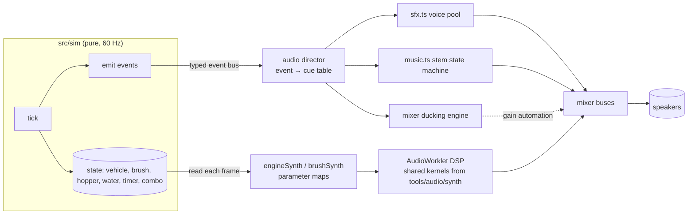
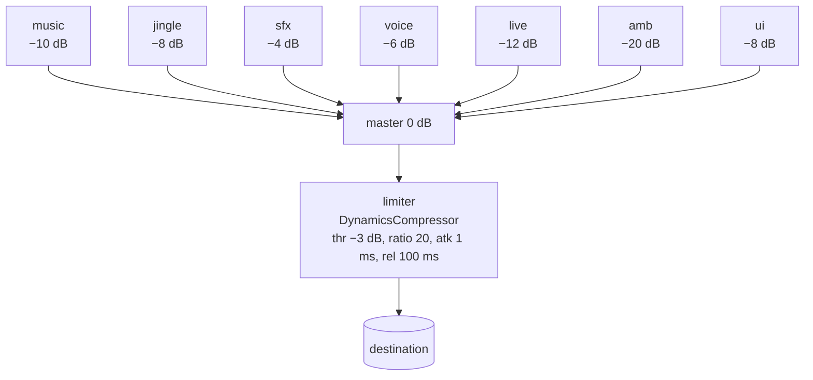
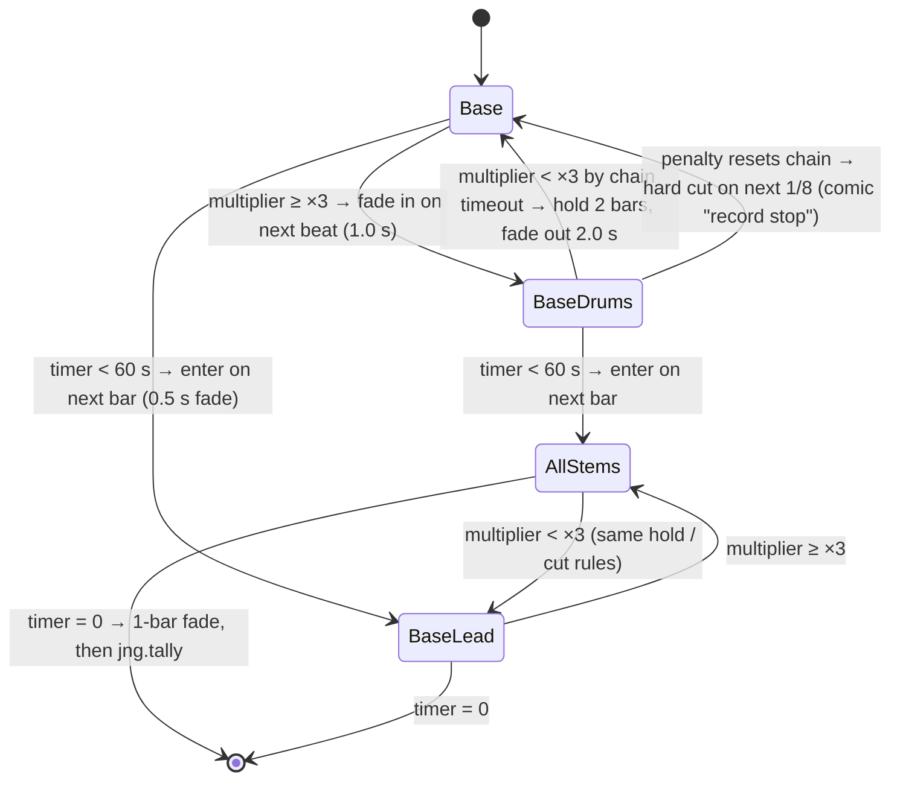
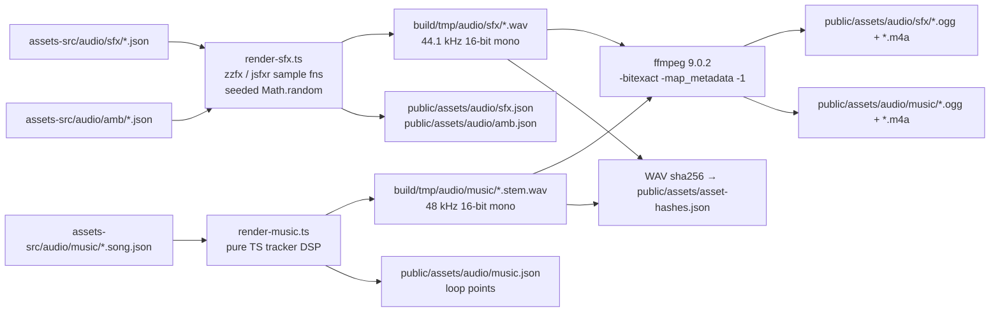

# Audio Design — Street Sweeper Pro

> **Status:** v1.0, 2026-10-18. Owner: Claude (AI author). The ears that sign off: the project lead.
> **Binding inputs:** the Canonical Facts Sheet (IDs, versions, paths, commands), [ADR 0001](adr/0001-tech-stack.md) and [ADR 0002](adr/0002-ai-authored-asset-pipeline.md).
> **Milestone:** audio ships in **M5 — Sound & Music**. All songs land by **M7 — 1.0 Web Release**. The iOS Safari unlock is verified in **M8 — Touch & Mobile Web**.

This document defines how Street Sweeper Pro sounds and how every sound is made, mixed and played. It covers:

- the audio direction;
- the full `sfx.*`, `mus.*`, `jng.*` and `amb.*` lists, with what triggers each;
- the live synth specs for the engine, brush, spray, reverse beeper and ambience;
- the mixer buses, levels and ducking rules;
- the tracker song format and the adaptive stem rules;
- the rendering and encoding commands, file formats, runtime and accessibility.

Related docs: [GDD](GDD.md) (what the events mean in play), [TECHNICAL_DESIGN](TECHNICAL_DESIGN.md) (event bus, tick order, module layout), [ASSET_PIPELINE](ASSET_PIPELINE.md) (the image half of the pipeline, verification and hashes), [ENTITY_CATALOG](ENTITY_CATALOG.md) (the entities that make the sounds), [LEVEL_DESIGN](LEVEL_DESIGN.md) (district weather and time of day), [ROADMAP](ROADMAP.md) and [GLOSSARY](GLOSSARY.md).

---

## Contents

1. [Audio direction](#1-audio-direction)
2. [How audio is authored (and why there is no AI audio)](#2-how-audio-is-authored-and-why-there-is-no-ai-audio)
3. [Runtime architecture](#3-runtime-architecture)
4. [Mixer: buses, levels and ducking](#4-mixer-buses-levels-and-ducking)
5. [Sound effects (`sfx.*`)](#5-sound-effects-sfx)
6. [Live synthesis (engine, brush, spray, beeper)](#6-live-synthesis)
7. [Ambience beds (`amb.*`)](#7-ambience-beds-amb)
8. [Music (`mus.*`) and jingles (`jng.*`)](#8-music-mus-and-jingles-jng)
9. [Adaptive music](#9-adaptive-music)
10. [Tracker song format](#10-tracker-song-format)
11. [Rendering, encoding and verification](#11-rendering-encoding-and-verification)
12. [File formats, loading and runtime](#12-file-formats-loading-and-runtime)
13. [Accessibility](#13-accessibility)
14. [Testing](#14-testing)
15. [Milestone plan and open questions](#15-milestone-plan-and-open-questions)

---

## 1. Audio direction

### 1.1 One-line brief

**A British seaside comedy played on a 1990 games console that someone left in a brass-band hut.** It should be bright, bouncy and slightly pompous, never grim. The music is cheerful and the sound effects are cartoon slapstick. The machine at the centre is heavy and honest.

### 1.2 Tone pillars (mapped to the design pillars)

| Design pillar | What it means for audio |
|---|---|
| **Visibly Satisfying Clean** | Cleaning must also be *audibly* satisfying. The brush synth crackles harder as it erases grime cells. Each pickup is a crisp "thwip" whose pitch climbs with the chain. When a frontage reaches 100% it gets a sparkle sting. |
| **Heavy, Honest Machine** | Bessie's diesel is always under you. Pitch follows the hydrostatic drive continuously, with no gear changes. A fuller hopper makes the engine strain: lower pitch, more grit. Kerbs thud and the suspension creaks. |
| **Thorough vs. Fast** | Going fast has its own sound. Flung items give a sad "fwip" with a falling blip, and transit speed lifts the engine an octave. The trade-off can be heard without looking at the HUD. |
| **Charming Chaos** | Every character has a voice "bark" in synthesised gibberish (the "Oi!", Doris's "HMPH!", the cat's yowl), and each one is captioned. Mistakes sound funny. Nothing sounds painful: no screams, no crunches of bone, no screeching-tyre-then-thud. |
| **Every Pixel Reproducible** | Every sound is a pure function of a committed text source: JSON parameter presets and tracker song data. No recordings, no sample packs, no generated audio. |

### 1.3 Era and palette

- **Music:** an 8-bit core with a 16-bit bass. Four channels in the style of the 1985–1990 home console (`pulse1`, `pulse2`, `tri`, `noise`) plus one **2-operator FM bass** (`bass`) that gives the low end the warmth of an early-90s console. The voice count is capped at five, and that cap is a creative constraint, just as Kerbside-32 is for pixels.
- **SFX:** classic sfxr/zzfx vocabulary (square blips, noise bursts, pitch slides, arpeggios), layered for weight where a single preset sounds thin.
- **Everything is mono at source.** Stereo comes only from runtime panning by screen position (§3.4). This matches the era, halves decoded memory (§12.3) and keeps panning consistent with the top-down camera.

### 1.4 Inspirations (internal only)

These names may appear in this internal design doc as *inspirations* only. They must never appear in asset names, source JSON `title` fields, in-game text or marketing (IP hygiene rule).

- **Top-down crime-sandbox games of the late 1990s (GTA 1/2):** the idea of a distinct musical identity per area, and the way pedestrians' voice barks bring the street to life.
- **Paperboy:** a jaunty, relentless route theme, with comic sound for each hazard.
- **British brass-band and seaside-pier traditions,** tea-time light music, and 1970s sitcom theme tunes: for melody and harmony.
- **Chiptune practice:** fast arpeggios in place of chords, duty-cycle sweeps, and noise-channel drum kits.

All melodies are original. Nothing quotes or paraphrases an existing tune, including traditional ice-cream-van tunes (§5.4, `ice_cream_chime`).

### 1.5 Do and don't

| Do | Don't |
|---|---|
| Use short, bright transients that read well on laptop speakers | Build sub-bass-heavy sounds that vanish on laptops and phones |
| Pitch voice barks by character (kids high, businessman low) | Use realistic human screams or pain sounds, even cartoonish ones |
| Make the comedy timing land: a beat of silence before Doris's "HMPH!" | Stack five one-shots on the same frame (§4.4 caps this) |
| Leave the 1–4 kHz band clear for pickups and barks while music plays | Write melodies that sit in the same register as `pickup_small` |
| Use a major key by default; minor keys only for Wednesday and Saturday colour | Use horror stings or tension drones. Stakes are comic. |

---

## 2. How audio is authored (and why there is no AI audio)

All audio is **deterministic text-source** (source kind (a) in the Facts Sheet §5.1). There are **no golden audio files.**

| Asset class | Technique | Source of truth | Renderer |
|---|---|---|---|
| `sfx.*` one-shots | zzfx 1.4.0 / jsfxr 1.4.1 parameter presets (optionally layered) | `assets-src/audio/sfx/<name>.json` | `tools/audio/render-sfx.ts` (offline) |
| `mus.*` songs | Tracker data, 5 channels, 3 stems | `assets-src/audio/music/<id>.song.json` | `tools/audio/render-music.ts` (offline) |
| `jng.*` jingles | Tracker data (single stem) | `assets-src/audio/music/<id>.song.json` | `tools/audio/render-music.ts` (offline) |
| `amb.*` beds | Layer and sprinkle presets | `assets-src/audio/amb/<name>.json` | WebAudio at runtime (`src/audio/`) |
| Engine, brush, spray, beeper | DSP kernels plus parameter maps | `tools/audio/synth/*.ts` (shared) + `src/audio/engineSynth.ts`, `brushSynth.ts` | AudioWorklet at runtime |

**Why procedural only?**

1. **Reproducibility (Pillar 5).** A JSON preset can be diffed, reviewed, linted and rebuilt byte for byte (§11.4). A generated WAV cannot.
2. **Tool reality.** The local AI tools (Codex CLI, Cursor Agent CLI) generate *images*, not audio, and Blender has no place in the audio chain. No locally available generative audio tool would meet the provenance bar, so none is used.
3. **Style coherence.** A fixed synth vocabulary gives audio the same "house palette" effect that Kerbside-32 gives pixels.
4. **Size.** About 32 SFX presets fit in a few kilobytes of JSON. The rendered SFX pack is about 0.6 MB (§12.3).

**The author cannot hear.** Claude authors every preset and song blind, so the pipeline produces *objective evidence* for review: spectrograms, waveforms, piano rolls, loudness and peak reports (§11.5). Claude reads these with the Read tool before accepting any change. The final listening sign-off on every new or changed sound belongs to the project lead, and is recorded in the PR description.

---

## 3. Runtime architecture

### 3.1 Modules (`src/audio/`)

| File | Responsibility |
|---|---|
| `mixer.ts` | The roughly 200-line WebAudio mixer: `AudioContext`, bus graph, gains, the ducking engine, master limiter, settings binding. No third-party audio library (Howler and Tone.js were rejected in ADR 0001). |
| `sfx.ts` | One-shot playback: buffer cache, variant selection, pitch ladder and jitter, voice pool and priorities, spatial pan and attenuation. |
| `music.ts` | Song loading, sample-locked stem playback, loop points, adaptive stem state machine (§9), jingles, crossfades. |
| `engineSynth.ts` | Main-thread controller for the engine AudioWorklet. Maps sim state to synth parameters at 60 Hz. |
| `brushSynth.ts` | Main-thread controller for the brush, suction fan and spray worklet voices, and the reverse beeper. |
| `unlock.ts` | Creates the context suspended and resumes it on the first user activation. Handles iOS Safari quirks (verified in M8). |

The ambience bed player lives in `sfx.ts`. It schedules sprinkles from the same voice pool, using the `amb` bus.

### 3.2 Data flow

The audio layer follows the architecture rule: **it reads sim state and the event bus, and never writes sim state.**



- The **audio director** is a pure function, `(event, audioState) → cue[]`, in `sfx.ts`. Because it is pure it can be unit-tested with no WebAudio (§14).
- Event names come from `src/app/events.ts`. The tables in §5 name events descriptively. The typed names in `events.ts` (owned by [TECHNICAL_DESIGN](TECHNICAL_DESIGN.md)) are authoritative.
- **Randomness in audio** (variant choice, pitch jitter, ambience sprinkle timing) uses its **own** `sfc32` instance from `src/sim/rng.ts`, seeded once per session. In test mode it is seeded from the `?seed=` parameter. It never draws from the sim's RNG, so audio can never perturb a replay hash.
- **Render interpolation:** the sim ticks at 60 Hz, but live synth parameters are smoothed with `setTargetAtTime` (τ = 30 ms), so engine pitch never steps audibly.

### 3.3 Timing

- One-shots from sim events are scheduled at `ctx.currentTime + 0` (as soon as possible). The sim-to-ear latency target is **≤ 50 ms** on desktop Chrome (`latencyHint: 'interactive'`).
- Music stems and jingles are scheduled sample-accurately on the context clock. Stem fades and jingle entries are **quantised to the next beat or bar** of the running song (§9.3).

### 3.4 Spatialisation (top-down)

The camera looks straight down, so space is simple and readable:

| Parameter | Rule |
|---|---|
| **Pan** | `pan = clamp((x_screen − W/2) / (W/2), −1, 1) × 0.6` using a `StereoPannerNode`. Panning is capped at ±0.6 so nothing feels hard-panned. |
| **Distance gain** | `0 dB` within 8 m of the camera centre, falling linearly to `−18 dB` at 24 m, culled beyond 24 m. |
| **Sources attached to Bessie** | Engine, brush, spray, beeper, horn and pickups are always centred at 0 dB. The player is the camera's subject, and the look-ahead offset must not pull them off-centre. |
| **Off-screen threats** | Barks from `npc.dog_loose` and `veh.police` are *never culled* within 24 m, and they get a caption with an edge arrow (§13). |
| **Doppler** | None, except `police_whoop` and traffic horns, which get ±60 cents from relative closing speed (simple, not physical). |
| **Mono setting** | Forces every pan to 0 (§13). |

No HRTF or reverb is used. One short global "street" slap delay (85 ms, −20 dB, low-passed at 3 kHz) on the `sfx` bus glues the one-shots together. The Gasworks district raises it to 120 ms and −16 dB (tower blocks).

---

## 4. Mixer: buses, levels and ducking

### 4.1 Bus graph



### 4.2 Default bus levels and settings

| Bus | Default gain | Contains | Settings slider |
|---|---|---|---|
| `master` | 0 dB | everything | **Master** |
| `music` | −10 dB | `mus.*` stems | **Music** |
| `jingle` | −8 dB | `jng.*` | Music |
| `sfx` | −4 dB | world and feedback one-shots | **Sound effects** |
| `voice` | −6 dB | character barks (`ped_oi`, `granny_harrumph`, `kid_waah`, animal calls) | Sound effects |
| `live` | −12 dB | engine, brush, fan, spray, beeper | Sound effects |
| `amb` | −20 dB | `amb.*` beds and sprinkles | **Ambience** |
| `ui` | −8 dB | `ui_move`, `ui_select`, `ui_back` | Sound effects |

- Sliders run **0–10** in `ssp.settings.v1`. Step `n` maps to `(n − 10) × 3 dB`, so 10 = 0 dB, 5 = −15 dB, 1 = −27 dB, and 0 = mute.
- Defaults: Master 8, Music 7, Sound effects 8, Ambience 7.
- Per-sound trims (`gainDb` in each SFX source) are applied on top of the bus gain (§5.2).

### 4.3 Loudness targets

| Material | Target (measured on the rendered WAV) |
|---|---|
| Full song mix (all three stems summed) | **−16 LUFS integrated** (±1), true peak ≤ **−1 dBTP** |
| Each SFX variant | Peak-normalised at render to **−1 dBFS**. Relative loudness comes from `gainDb` at runtime, so the 16-bit resolution is never wasted. |
| Jingles | −15 LUFS short-term at the loudest point (jingles sit slightly forward) |
| In-game mix, all buses at default during a busy shift | −18 to −14 LUFS momentary. The limiter should engage less than 1% of the time (checked with the dev-panel meter). |

The full-mix normalisation gain is computed by `render-music.ts` and applied **equally to all stems**, so the stem balance written in the song is preserved.

### 4.4 Voice management

- **Pool:** 24 one-shot voices plus dedicated live-synth voices (engine, brush, fan, spray, beeper; they are not pooled).
- **Priority:** each SFX has a priority from 1 (lowest) to 5 (highest). When the pool is full, the new sound steals the oldest voice of the lowest priority below its own. If none exists, the new sound is dropped.
- **Per-ID limits:** `maxVoices` (concurrent instances) and `cooldownMs` (minimum gap between starts) per ID, in the source JSON (§5.2). This is what stops a 50-item suction gulp becoming a wall of noise.

### 4.5 Ducking

Ducking is **event-driven gain automation, not a sidechain compressor.** That makes it deterministic, cheap and easy to test.

- When several ducks overlap on one bus, the **deepest wins**. Ducks never add together.
- Attack, hold and release use `setTargetAtTime` with τ = time/3.

| Trigger | Ducked buses | Depth | Attack | Hold | Release | Why |
|---|---|---|---|---|---|---|
| Any `jng.*` starts | `music` | −∞ (stems faded out) | 120 ms | jingle length | music resumes per §9 | Jingles replace music. They never fight it. |
| `complaint_stamp` | `music`, `amb` | −6 dB | 20 ms | 400 ms | 600 ms | The most important negative feedback must punch through. |
| Voice bark (`ped_oi`, `granny_harrumph`, `kid_waah`, `cat_yowl`) | `music` −4 dB, `live` −6 dB | — | 15 ms | bark length | 300 ms | Comedy lines must be heard over the diesel. |
| `crash` | `music` −4 dB, `amb` −6 dB, `live` −3 dB | — | 5 ms | 250 ms | 500 ms | Impact weight |
| `combo_tier` | `music` | −3 dB | 10 ms | 250 ms | 400 ms | Lets the tier arpeggio sparkle |
| `powerup` | `music` | −3 dB | 10 ms | 300 ms | 400 ms | |
| `timer_warn` (final 10 s) | `music` | −2 dB | 5 ms | 120 ms | 200 ms | Ticks stay crisp without pumping the music |
| `horn` | `amb` | −4 dB | 5 ms | 300 ms | 300 ms | |
| Pause overlay open | `music` | −9 dB plus a 900 Hz low-pass | 150 ms | while paused | 250 ms | "Heard through a wall". `sfx`, `voice`, `live` and `amb` are suspended (gain 0, worklets frozen). Triggered by the bus's `PauseOpened` and released on `PauseClosed` (`src/app/events.ts` `PAUSE_EV`, built in SSP-287). |
| Shift intro card | `live` | muted | — | while shown | 400 ms on dismiss | The engine starts with the shift |

---

## 5. Sound effects (`sfx.*`)

### 5.1 File naming

- Source: `assets-src/audio/sfx/<name>.json`, where `<name>` is the ID without the `sfx.` class (`sfx.horn` → `sfx/horn.json`). This follows the "files are named after the asset ID minus its class" convention.
- Output: `public/assets/audio/sfx/<name>.ogg` and `.m4a`.
- **Variants** of one ID are rendered back to back into the **same file**, with 50 ms of silence between them, as an audio sprite. Their offsets go in the generated index `public/assets/audio/sfx.json`.

### 5.2 SFX source schema

Every file follows the canonical shape `{ engine, params, variants, pitchJitterCents }`, plus the runtime metadata fields below.

```jsonc
// assets-src/audio/sfx/pickup_small.json
{
  "id": "sfx.pickup_small",
  "engine": "zzfx",                 // "zzfx" | "jsfxr"
  "params": {                       // zzfx: named fields; the renderer maps them to the positional array
    "volume": 1, "randomness": 0, "frequency": 620, "attack": 0, "sustain": 0.02,
    "release": 0.05, "shape": 1, "shapeCurve": 1.4, "slide": 18, "deltaSlide": 0,
    "pitchJump": 300, "pitchJumpTime": 0.03, "repeatTime": 0, "noise": 0,
    "modulation": 0, "bitCrush": 0, "delay": 0, "sustainVolume": 1, "decay": 0.01,
    "tremolo": 0, "filter": 0
  },
  "variants": 4,                    // integer N: N seeded mutations (random pool)
  "mutate": { "frequency": 0.06, "slide": 0.10 },  // ± relative range per variant (seeded)
  "seed": 1001,
  "pitchJitterCents": 25,           // ± at runtime, uniform
  "pitchLadder": "chain",           // only on pickups: +1 semitone per 5 chain, max +12
  "bus": "sfx", "gainDb": -3, "priority": 3, "maxVoices": 4, "cooldownMs": 35,
  "caption": null                   // captions live in §13; null = no caption
}
```

**Optional extensions** (all deterministic, all handled by `render-sfx.ts`):

| Field | Meaning |
|---|---|
| `variants: [{ "name": "...", "overrides": {...} }, ...]` | **Named variants** in place of an integer. The game asks for one by name, e.g. `sfx.horn` + `"two_tone"`. Unnamed calls choose randomly among variants that have no `"named": true` flag. |
| `params: { "layers": [{ "at": 0.0, "gainDb": 0, "semitones": 0, "params": {...} }, ...] }` | A **layered** SFX. Each layer is a full preset for the file's `engine`. Layers are mixed sample-accurately offline. Used for weight (`crash`) and for short phrases (`ice_cream_chime`, `combo_tier`). |
| `loop: { "start": s, "end": s }` | Loop points within the variant, for `ice_cream_chime`. |
| `durationScale` | Runtime `playbackRate` override for a named context. The skip dump uses `dump` at 0.667 (§5.4). |

**jsfxr** sources use jsfxr's own parameter names (`wave_type`, `p_env_attack`, `p_env_sustain`, `p_env_punch`, `p_env_decay`, `p_base_freq`, `p_freq_limit`, `p_freq_ramp`, `p_freq_dramp`, `p_vib_strength`, `p_vib_speed`, `p_arp_mod`, `p_arp_speed`, `p_duty`, `p_duty_ramp`, `p_repeat_speed`, `p_pha_offset`, `p_pha_ramp`, `p_lpf_freq`, `p_lpf_ramp`, `p_lpf_resonance`, `p_hpf_freq`, `p_hpf_ramp`, `sound_vol`). `sample_rate` and `sample_size` are forced by the renderer to 44100 and 16.

```jsonc
// assets-src/audio/sfx/horn.json
{
  "id": "sfx.horn",
  "engine": "jsfxr",
  "params": {
    "wave_type": 0, "p_env_attack": 0.02, "p_env_sustain": 0.26, "p_env_punch": 0.15,
    "p_env_decay": 0.12, "p_base_freq": 0.29, "p_freq_ramp": 0, "p_vib_strength": 0.04,
    "p_vib_speed": 0.55, "p_duty": 0.35, "p_lpf_freq": 0.62, "p_lpf_resonance": 0.3,
    "p_hpf_freq": 0.05, "sound_vol": 0.5
  },
  "variants": [
    { "name": "bessie", "overrides": {} },
    { "name": "two_tone", "named": true, "overrides": { "p_arp_mod": 0.24, "p_arp_speed": 0.55, "p_env_sustain": 0.34 } },
    { "name": "car", "named": true, "overrides": { "p_base_freq": 0.36, "p_env_sustain": 0.18, "p_duty": 0.2 } }
  ],
  "pitchJitterCents": 0,
  "bus": "sfx", "gainDb": -2, "priority": 4, "maxVoices": 1, "cooldownMs": 120
}
```

### 5.3 Determinism rule for zzfx and jsfxr

**How the libraries are loaded in Node.** zzfx 1.4.0 constructs an `AudioContext` when its module loads (`ZzFX.js` runs `audioContext: new AudioContext` at import), so `import 'zzfx'` in Node 24 throws `ReferenceError: AudioContext is not defined` (verified 2026-10-18). `tools/audio` therefore **never imports the `zzfx` package**. The ZzFX `buildSamples` function (MIT) is vendored into `tools/audio/synth/zzfx.ts` with attribution, and its internal `Math.random` is replaced by an injected `sfc32`. jsfxr 1.4.1 imports cleanly and is imported from `jsfxr/sfxr.mjs`.

Both libraries use randomness internally: zzfx for `randomness`, and jsfxr for its noise wave and phaser. The vendored ZzFX takes its `sfc32` stream as a parameter. For jsfxr, `render-sfx.ts` wraps each call in `withSeededRandom(seed, fn)`, which temporarily swaps `Math.random` for an `sfc32` stream. Both streams are seeded from the file's `seed` plus the variant index. The lint also requires `"randomness": 0` in zzfx base params. Per-variant spread comes from the explicit, seeded `mutate` block instead, so it is visible and reviewable.

### 5.4 Full SFX list

Columns: **Var** = variants (an integer, or the named variants listed). **Jit** = `pitchJitterCents`. **Pri** = priority 1–5. **Voices / cd** = `maxVoices` / `cooldownMs`. Durations are targets for the rendered variant.

#### Sweeping and hopper

| ID | Trigger | Sound design | Engine | Var | Jit | Bus | Pri | Voices / cd |
|---|---|---|---|---|---|---|---|---|
| `sfx.pickup_small` | Litter collected through the inlet with LU ≤ 1 (crisp packet, can, plastic bottle, butts, banana skin, chip/kebab wrapper, lolly stick, dog mess, spilled shopping) | Bright "thwip": a square blip sliding 620 → 1,100 Hz with a pitch jump at 30 ms, 70 ms long, plus a 10 ms noise tick. Obeys the **pitch ladder**: +1 semitone per 5 chain, capped at +12 (`playbackRate = 2^(min(⌊chain/5⌋, 12)/12)`), with jitter on top. | zzfx | 4 | 25 | sfx | 3 | 4 / 35 |
| `sfx.pickup_big` | Litter collected with LU ≥ 2 (newspaper, leaf pile, pizza box, bin bag) | Suction "shloomp": a sine sweeping 300 → 90 Hz over 180 ms, with a low-passed noise gulp layer and a cardboard flap at 40 ms. Same pitch ladder. | zzfx | 3 | 30 | sfx | 3 | 2 / 60 |
| `sfx.pickup_glass` | `litter.glass_bottle` collected, or `haz.broken_glass` swept | Clink plus tinkle: a 2.4 kHz triangle hit with a fast upward arpeggio tail, 220 ms. Same pitch ladder. | jsfxr | 3 | 40 | sfx | 3 | 2 / 50 |
| `sfx.fling` | An item fails the speed check and is knocked sideways | Air "fwip" (noise high-passed and swept 3 kHz → 800 Hz) followed by a small falling two-note blip (A4 → E4) that says "missed". 140 ms. A glass-bottle fling is followed by `pickup_glass` (named `smash`), as it becomes `haz.broken_glass`. | zzfx | 3 | 50 | sfx | 2 | 3 / 40 |
| `sfx.hopper_full` | Hopper reaches 100%. Also the **pre-warning** at 80% (named `warn`), and every item shoved by the brush while full (named `clunk`) | `full`: a two-note "bwah-bwah" sawtooth (220 → 165 Hz), 600 ms. `warn`: the same at +5 semitones and −6 dB, 400 ms. `clunk`: a low square thump at 110 Hz with two metallic partials (1.3 and 2.1 kHz), 120 ms, rate-limited to one per 400 ms. | zzfx | `full`, `warn`ᴺ, `clunk`ᴺ | 0 / 0 / 40 | sfx | 4 | 1 / 400 |
| `sfx.dump` | Drain starts at `site.depot_bay` (2.0 s) or `site.skip` (3.0 s) | A tumble of rubbish down a chute: noise grains at about 25/s, low-passed with the cutoff falling 2 kHz → 600 Hz, a tin-can clatter layer, and a final thunk. Rendered at 2.0 s. The skip plays it with `durationScale: 0.667`, so it is 3.0 s long and pitched about 7 semitones lower: heavier and slower. | zzfx | 1 | 0 | sfx | 4 | 1 / 0 |
| `sfx.brush_lower` | Brush toggled down (0.5 s animation) | A hydraulic hiss (band-passed noise, 400 ms, falling) ending in a rubbery clunk at 450 ms | zzfx | 2 | 20 | sfx | 3 | 1 / 100 |
| `sfx.brush_raise` | Brush toggled up | The mirror of `brush_lower`: a clunk at 0 ms, then a rising hiss | zzfx | 2 | 20 | sfx | 3 | 1 / 100 |

ᴺ = named-only variant (`"named": true`).

#### Vehicle

| ID | Trigger | Sound design | Engine | Var | Jit | Bus | Pri | Voices / cd |
|---|---|---|---|---|---|---|---|---|
| `sfx.horn` | Player horn (H / B). Named `two_tone` once `upg.two_tone_horn` is owned. Named `car` for traffic honking after 3 s blocked (positional). | `bessie`: a nasal square "PARP" around 390 Hz with slight vibrato, 350 ms. `two_tone`: alternating 390/494 Hz, 430 ms. `car`: a higher, shorter "meep". | jsfxr | `bessie`, `two_tone`ᴺ, `car`ᴺ | 0 / 0 / 30 | sfx | 4 | 1 / 120 (Bessie); 3 / 300 (car) |
| `sfx.bump_wall` | Collision with a static solid or knockable at a normal impact speed of 0.5–3 m/s | A hollow body "thunk" (square at 90 Hz, fast decay) plus a 2-partial panel rattle. Gain maps from −12 dB at 0.5 m/s to 0 dB at 3 m/s. | zzfx | 3 | 60 | sfx | 3 | 2 / 80 |
| `sfx.bump_kerb` | Kerb crossing jolt. Also `haz.pothole` and `haz.speed_bump` jolts. | A rubbery tyre thud (sine at 70 Hz, 90 ms) plus a suspension creak (pulse with narrow duty and pitch wobble, 200 ms) | zzfx | 3 | 40 | sfx | 3 | 1 / 150 |
| `sfx.crash` | Normal impact speed above 3 m/s, any hit on a vehicle (including `veh.<type>_parked` dents), `haz.open_manhole` hard stop, and the start of **TOWED!** | Layered: a noise burst (0–60 ms), a metallic clang (3 inharmonic partials, 400 ms decay), a bouncy hubcap "boing-oing" (pitch-wobbled triangle, from 150 ms) and a tinkly debris tail (to 900 ms). Comic, not violent. | zzfx (layers) | 3 | 30 | sfx | 5 | 2 / 200 |
| `sfx.police_whoop` | `veh.police` within 15 m witnesses a penalty (+1 complaint) | A short UK two-tone "whoop-whoop" siren chirp (rising square sweep 600 → 1,300 Hz, twice), 700 ms. Positional, with mild Doppler. | jsfxr | 2 | 0 | sfx | 5 | 1 / 1,500 |
| `sfx.ice_cream_chime` | `veh.ice_cream_van` stops (20 s). Loops while stopped, then fades over 1 s. | An **original** 8-bar music-box phrase in F major at 132 bpm (about 3.6 s), triangle plus sine bell layers, with slight detune for that wonky van-speaker charm. Loop points at the phrase boundary. Positional. | zzfx (layers, `loop`) | 1 | 0 | sfx | 2 | 1 / 0 |

#### Props and hazards

| ID | Trigger | Sound design | Engine | Var | Jit | Bus | Pri | Voices / cd |
|---|---|---|---|---|---|---|---|---|
| `sfx.cone_knock` | `prop.traffic_cone` knocked. Named variants: `a_board` (`prop.a_board`), `trolley` (`prop.shopping_trolley`), `box` (`prop.recycling_box`) | `cone`: a hollow plastic "bonk" at 520 Hz, 120 ms. `a_board`: a woody clack at −4 semitones. `trolley`: rattly wire-basket noise grains, 350 ms. `box`: a plastic slap plus a small spill rattle. | zzfx | `cone`, `a_board`ᴺ, `trolley`ᴺ, `box`ᴺ | 50 | sfx | 2 | 3 / 60 |
| `sfx.bin_knock` | `prop.wheelie_bin` knocked (spills 4 items). Named `burst`: `litter.bin_bag` hit above 4 m/s, bursting into 6 items. | `bin`: a deep plastic boom at 140 Hz, a lid clap at 80 ms and a spill rattle, 500 ms. `burst`: a wet plastic rip (noise with a fast high-pass sweep) plus a scatter of 6 small taps. | zzfx (layers) | `bin`, `burst`ᴺ | 40 | sfx | 3 | 2 / 100 |
| `sfx.splash` | `haz.puddle` crossed above 3 m/s. Named `soak` when a pedestrian within 1.5 m is splashed (followed by `ped_oi`). Also the start of a hydrant refill (named `refill`, softer). | A noise burst band-passed at 1.8 kHz with a fast decay, plus droplet blips (random high sine pips, seeded), 400 ms. `soak` is +3 dB with a longer droplet tail. `refill` is −9 dB and gurgly. | zzfx | 3 + `soak`ᴺ, `refill`ᴺ | 60 | sfx | 3 | 2 / 150 |

#### Animals

| ID | Trigger | Sound design | Engine | Var | Jit | Bus | Pri | Voices / cd |
|---|---|---|---|---|---|---|---|---|
| `sfx.cat_yowl` | `npc.cat` hit (leaps on to the roof). Named `hiss`: horn makes a cat bolt. | `yowl`: "MRRROWW!", a square wave with heavy vibrato sliding 600 → 1,100 → 500 Hz, 650 ms. `hiss`: a short high-passed noise "khhh", 250 ms. | jsfxr | 2 + `hiss`ᴺ | 80 | voice | 4 | 1 / 400 |
| `sfx.dog_bark` | `npc.dog_loose` chasing (one bark every 0.6–1.0 s, seeded), a dog walker's dog at a Lead Tangle, and a loose dog sitting after the horn (one bark, named `settle`) | "Yap!": a 70 ms square burst with a fast pitch drop 1.4 kHz → 700 Hz and a noise breath. Jack Russell high. The `settle` variant is a lower, rising "wuff?". | jsfxr | 4 + `settle`ᴺ | 120 | voice | 4 | 2 / 250 |
| `sfx.pigeon_flap` | A pigeon flock scatters (also triggers the "Pigeon Scatter" bonus) | A flurry: noise grains amplitude-modulated at 18 Hz, 600 ms, with a soft "coo" pip at the start. Played **once per flock**, with gain scaled by flock size (6 birds −6 dB, 12 birds 0 dB). | zzfx | 3 | 70 | sfx | 2 | 2 / 300 |
| `sfx.seagull_squawk` | `npc.seagull` steals chips or snatches litter ahead of the brush | "KAAW-kaw-kaw": a falling sawtooth with an arpeggio stutter, 700 ms. Smug. | jsfxr | 3 | 90 | voice | 3 | 2 / 500 |

#### People

Barks are **synthesised gibberish** (about 3–6 formant-ish square syllables with vibrato and pitch contour). The words are carried by the speech-bubble caption (§13), so they are never sampled speech. Per-character pitch offsets are applied at runtime.

| ID | Trigger | Sound design | Engine | Var | Jit | Bus | Pri | Voices / cd |
|---|---|---|---|---|---|---|---|---|
| `sfx.ped_oi` | Any human pedestrian is hit, splashed, startled by a near miss, coughs in dust (named `cough`), or catches you cleaning chalk with no kid present. Named `tut` for the Inspector logging a frontage below 90%. Named `huh` for the litterbug when Caught! | "Oi!": a two-syllable square blip, up then down (≈ 330 → 440 → 260 Hz), 280 ms. `cough`: three noise "khuh" bursts. `tut`: two dry clicks. `huh`: a single rising blip. | jsfxr | 6 + `cough`ᴺ, `tut`ᴺ, `huh`ᴺ | 60 | voice | 4 | 2 / 250 |
| `sfx.granny_harrumph` | `npc.old_woman` (Doris) glares when blocked, shakes her fist after the horn, or is hit. Named `whack`: each handbag hit (2 HP) during the chase. | "HMPH!": a low nasal pulse burst with a falling pitch and a breathy noise tail, 400 ms, preceded by **150 ms of rendered silence** (comic timing). `whack`: a leathery thwack (noise thump plus a 200 Hz body). | jsfxr | 3 + `whack`ᴺ | 40 | voice | 4 | 1 / 600 |
| `sfx.kid_waah` | `npc.kid_chalk` sees you cleaning their chalk art. `npc.kid_skateboard` is hit. | "WAAAH!": a rising-then-falling square wail with wide vibrato, 1.1 s, starting high (≈ 700 Hz) | jsfxr | 2 | 50 | voice | 4 | 1 / 1,000 |

Runtime pitch offsets for barks, in semitones: `npc.kid_*` +5, `npc.shopper` ±2 (by outfit swap index), `npc.jogger` +1, `npc.businessman` −3, `npc.old_man_frame` −5, `npc.reveller` −2 (with +40 cents of extra wobble), `npc.inspector` −4, `npc.lollipop_lady` +2. Everyone else is 0.

#### Game feedback

| ID | Trigger | Sound design | Engine | Var | Jit | Bus | Pri | Voices / cd |
|---|---|---|---|---|---|---|---|---|
| `sfx.complaint_stamp` | The Council Complaints meter rises by 1 (any cause). On the 5th, it is followed by `jng.sacked`. | A rubber-stamp "KA-CHUNK" (a 60 Hz thump plus a woody slap at 30 ms) and a paper rustle tail, 350 ms | zzfx (layers) | 2 | 0 | sfx | 5 | 1 / 200 |
| `sfx.combo_tier` | The combo multiplier reaches a new tier: named `x2`, `x3`, `x4`, `x5`. Named `bonus` for style bonuses (near miss, Pigeon Scatter, Kerb Hugger, Clean Sweep, Caught!). | `x2`–`x5`: an ascending major arpeggio on pulse waves (3, 4, 5, 6 notes; the root rises a fourth per tier), 250–450 ms. `bonus`: a two-note sparkle (E6 → B6), 120 ms. | zzfx (layers) | `x2`ᴺ…`x5`ᴺ, `bonus`ᴺ | 0 | sfx | 4 | 1 / 100 |
| `sfx.powerup` | Any `pwr.*` collected. Named `collect` for Lost Property (`collect.*`). Named `golden` for `collect.golden_crisp`. Named `expire` 1 s before a timed power-up ends. | `power`: a rising square sweep with a fast arpeggio, 500 ms. `collect`: a cheerful 4-note fanfare on triangle. `golden`: `collect` plus a shimmering high pulse layer, 900 ms. `expire`: three falling blips. | zzfx (layers) | `power`, `collect`ᴺ, `golden`ᴺ, `expire`ᴺ | 0 | sfx | 4 | 1 / 100 |
| `sfx.coin` | Money earned: tipping fee on dump, Skip Run bay (£5) and clean run (£50), Lost Property (£25), the tally count-up | The classic two-step "ka-ching" (B5 → E6 square), 180 ms. In the tally count-up it is rate-limited to every 60 ms, with a ladder rising +1 semitone per £50 (max +12). | zzfx | 2 | 0 | ui | 3 | 2 / 60 |
| `sfx.timer_warn` | The shift timer reaches 30 s (named `thirty`: double beep) and every whole second from 10 s to 1 s (named `tick`; the last 3 ticks are named `final`, a fifth higher) | `tick`: a 1 kHz square, 60 ms. `final`: 1.5 kHz, 80 ms. `thirty`: two 880 Hz beeps, 90 ms apart. | zzfx | `tick`ᴺ, `final`ᴺ, `thirty`ᴺ | 0 | sfx | 5 | 1 / 0 |

#### UI

| ID | Trigger | Sound design | Engine | Var | Jit | Bus | Pri | Voices / cd |
|---|---|---|---|---|---|---|---|---|
| `sfx.ui_move` | Menu cursor moves, a slider steps, a Week Map node is highlighted | A tiny tick: a 30 ms square at 1.4 kHz | zzfx | 1 | 0 | ui | 1 | 1 / 40 |
| `sfx.ui_select` | Confirm, buy an upgrade, start a shift | Two rising notes (C6 → G6), 110 ms | zzfx | 1 | 0 | ui | 2 | 1 / 80 |
| `sfx.ui_back` | Cancel, back, close a panel, denied (cannot afford: plays twice, 90 ms apart) | Two falling notes (G5 → C5), 110 ms | zzfx | 1 | 0 | ui | 2 | 1 / 80 |

### 5.5 Events with no dedicated SFX

Some events reuse a cue or are carried by a live synth (§6), so the canonical ID list stays closed.

| Event | Audio |
|---|---|
| Brush active over grime cells | Brush synth crackle density (§6.2). There is no one-shot per cell. |
| Kerb Hugger contact | Brush synth "scrape" layer brightens. The `combo_tier:bonus` cue plays every 3 s of contact (+50). |
| Oil slick, wet leaves, banana-skin spin-out, hard cornering | **Tyre squeal** layer of the engine synth, driven by lateral slip (§6.1) |
| Lead Tangle | `dog_bark` + `ped_oi` 120 ms later |
| Running an occupied zebra or a lollipop crossing | `ped_oi` (from the person crossing) + `complaint_stamp` |
| Horn spam complaint ("Noise") | `complaint_stamp` |
| Road Rage (blocking traffic over 10 s) | Rising `horn:car` honks from blockers at 3 s, 6 s and 9 s, then `complaint_stamp`. *(SSP-089: each honk is a sim `EV.CarHorn` from the head of the queue, its `honk` 1, 2 or 3 picking the step; the complaint is the `EV.Complaint` with reason RoadRage.)* |
| Water tank empty while spraying | Spray synth "dry pump" state (§6.3) |
| `haz.wind_gust` (Friday) | `amb.wind_leaves` gust swell (§7) |
| Bus stopping, bin lorry working | Positional ambience sprinkles of the vehicle (§7.2) |
| **SACKED!** / **TOWED!** | `complaint_stamp` → `jng.sacked`; `crash` → `jng.towed` |

---

## 6. Live synthesis

Continuous sounds that depend on sim state are synthesised live in an **AudioWorklet**. The DSP kernels (band-limited pulse and saw oscillators, state-variable filter, ADSR, noise, one-pole smoothers) are pure TypeScript functions in `tools/audio/synth/*.ts`. They are shared by the offline renderer and the runtime worklet, so a kernel bug shows up in tests (§14), not only in the browser. The exact Vite import form for the worklet module is settled in M5.

Parameters are pushed from the main thread at 60 Hz through `AudioParam`s (k-rate), smoothed in the worklet with τ = 30 ms.

**CPU budget:** all live voices together ≤ **0.6 ms per 128-frame render quantum** on the M0 reference Mac (under 25% of the quantum's 2.9 ms at 44.1 kHz).

### 6.1 Engine (`engineSynth.ts`): Bessie's diesel

Bessie is a 4-cylinder diesel with **hydrostatic drive**, so pitch tracks speed continuously and never changes gear. Like a real road sweeper, when the brush is down the engine holds a **work RPM** to drive the suction fan. Sweeping therefore has its own steady drone, and transit sounds different.

| Input (from sim state) | Mapping |
|---|---|
| `rpm` | `rpm = max(idle, workFloor, 750 + 1,650 × max(0.6 × throttle, |v| / 11))`, where idle = 750, `workFloor` = 1,800 while the brush is lowered (ramping over the 0.6 s spin-up) and 0 otherwise. The ceiling is 2,400 rpm. |
| Firing frequency | `f0 = rpm / 60 × 2` (4-stroke, 4 cylinders), so 25 Hz at idle and 80 Hz at 2,400 rpm |
| Hopper fill `h` (0–1) | Pitch × `(1 − 0.05 h)`, strain-noise layer +2 dB × h, low-pass cutoff × `(1 − 0.15 h)`. Bessie gets audibly heavier, in line with Pillar 2. |
| Throttle | Low-pass cutoff `300 + 1,500 × throttle` Hz, Q 0.9. Off-throttle leaves a muffled "chug". |
| Health below 40 HP (the dented sprite) | **Misfire:** a seeded 1-in-12 cycle dropout plus a loose-panel rattle layer (band-passed noise gated at f0/2) |
| Lateral slip (vehicle sim) | **Tyre squeal** layer: a narrow band-pass (1.6–2.2 kHz, following slip) on noise mixed with a detuned square pair. Gain is 0 below a slip of 0.8 m/s and full at 3 m/s. On `haz.oil_slick` the squeal is a higher "whee". |
| Reverse | No change to the engine. The beeper handles it (§6.4). |

**Voice structure:**

1. A pulse oscillator at `f0` (duty 0.3) feeding a soft clipper.
2. A saw oscillator at `2 × f0`, detuned by +7 cents.
3. A sine sub at `f0 / 2`.
4. A "clatter" layer of noise amplitude-modulated at `f0`, high-passed at 1.2 kHz, −14 dB. This is the diesel character.

All four layers sum through the throttle-driven low-pass into the `live` bus.

### 6.2 Brush and suction (`brushSynth.ts`)

| Layer | Synthesis | Driven by |
|---|---|---|
| **Gutter brushes** (two voices, panned ±0.3) | Noise → band-pass at 2.5 kHz (Q 0.8), amplitude-modulated at the bristle rate = `rpmFrac × 4 rev/s × 8 tufts` (32 Hz at full). Left and right are detuned by 3% so they beat gently. | Brush lowered, RPM fraction (0.6 s spin-up / spin-down) |
| **Suction fan** | A sine plus a quiet triangle at `180 Hz × rpmFrac`, with a whine partial at `1,200 Hz × rpmFrac` (−12 dB). After raising, it winds down over 1.2 s. | RPM fraction, `pwr.super_suction` (+3 semitones and +2 dB while active), `upg.suction` level (+1 semitone per level) |
| **Scrub crackle** (the Pillar 1 sound) | A dust-crackle generator: impulses at a rate of `min(400, 6 × cellsErasedPerSecond)` /s, each a 2 ms band-passed click (3–6 kHz, seeded random centre) | Grime cells erased this tick (sim state) |
| **Gutter scrape** | The crackle doubled and brightened (+4 kHz shelf, +3 dB) while a gutter brush collects gutter grime | Kerb Hugger contact |
| **Litter rustle** | Granular crinkle (short noise grains with a fast decay) at a density proportional to items inside the suction zone | Suction-zone item count |
| **Bulldozer load** | A low rumble (low-passed noise at 200 Hz) while the hopper is full and the brush is pushing items | Hopper full + brush lowered + moving |

The collection layers (crackle, scrape and rustle) are muted when RPM is below 80%, because the brush does not collect then. That gives an audible cue for the spin-up rule in [GDD](GDD.md).

### 6.3 Water spray

| State | Synthesis |
|---|---|
| Spraying, water > 10% | Noise high-passed at 1.5 kHz and low-passed at 6 kHz, with a slow 0.7 Hz LFO on the cutoff (±400 Hz), plus a pump hum (a 120 Hz square at −18 dB) |
| Water ≤ 10% | **Sputter:** the spray layer gated by a seeded random 6–14 Hz gate |
| Water = 0 | **Dry pump:** hum plus a 4 Hz click and no spray noise. A caption and a HUD flash fire (§13). |
| Refilling (hydrant 25/s, depot full) | A gurgle: band-passed noise at 400–900 Hz with a pitch rising as the tank fills, plus `splash:refill` at the start |

### 6.4 Reverse beeper

- Active while Bessie moves backwards faster than 0.05 m/s.
- **Classic** (default): a 1,050 Hz square, 450 ms on and 450 ms off, at −6 dB on the `live` bus. Each beep has a 5 ms attack and release so it never clicks.
- **Broadband** (accessibility option, §13): band-limited white noise "shh-shh" bursts on the same 450/450 ms cadence. Modern UK vehicles use this alarm style, and it is gentler on tinnitus.

---

## 7. Ambience beds (`amb.*`)

### 7.1 Assignment

| ID | Used in | Character |
|---|---|---|
| `amb.town_morning` | Puddle Lane (Mon), High Street (Tue), Civic Quarter (Sun), Depot Yard after those days | Distant traffic wash, sparrow chirps, a far-off milk float, door chimes. Tuesday raises the "market chatter" layer to 0 dB. Sunday adds church bells at the start of the shift. |
| `amb.rain` | Gasworks Estate (Wed) | Steady rain (pink noise, low-passed at 5 kHz), gutter drips, distant tower-block hum, occasional far-off van splash |
| `amb.wind_leaves` | Conker Hill (Thu) | Wind (noise through a slow-swept band-pass), leaf skitters, a crow, dogs barking far away. Gusts swell 6 dB. |
| `amb.seafront` | The Promenade (Fri) | Waves (low-passed noise with a 0.12 Hz swell envelope), distant gulls, amusement-arcade bleeps, rattling rigging. `haz.wind_gust` swells the wind layer. |
| `amb.night_town` | Kebab Mile (Sat) | A low urban hum, distant pub singing (a filtered gibberish "choir"), taxi idles, a far-off siren wail every 60–120 s, the buzz of a chip-shop sign |

The Depot Yard (Skip Run) uses the bed of the preceding shift's district at −4 dB, matching its "time and weather of the preceding shift" rule in [LEVEL_DESIGN](LEVEL_DESIGN.md).

### 7.2 Ambience source schema (`assets-src/audio/amb/<name>.json`)

Beds are **synthesised live**. There are no rendered files, so a bed never audibly loops.

- **Layers** are continuous noise or oscillator sources with a filter and an LFO.
- **Sprinkles** are short one-off events scheduled from the audio `sfc32` stream, with random pan and distance.
- Sprinkles carry their own inline zzfx or jsfxr params. They are **not** `sfx.*` IDs and are never triggered by gameplay.

```jsonc
// assets-src/audio/amb/rain.json
{
  "id": "amb.rain",
  "layers": [
    { "name": "rain",  "source": "noise:pink", "filter": { "type": "lowpass", "cutoff": 5000, "q": 0.5 },
      "gainDb": 0, "lfo": { "target": "gain", "rateHz": 0.05, "depthDb": 2 } },
    { "name": "hum",   "source": "osc:sine:55", "gainDb": -24 }
  ],
  "sprinkles": [
    { "name": "drip",  "perMinute": [20, 40], "gainDb": [-18, -9], "engine": "zzfx",
      "params": { "frequency": 1800, "attack": 0, "sustain": 0, "release": 0.04, "shape": 0, "slide": -30 } },
    { "name": "van_splash", "perMinute": [0.5, 1.5], "gainDb": [-22, -16], "distance": "far", "engine": "zzfx",
      "params": { "noise": 1, "frequency": 400, "sustain": 0.3, "release": 0.4, "shape": 4 } }
  ],
  "weatherParam": { "target": "layer:rain:gainDb", "range": [-6, 0] }
}
```

At build time `render-sfx.ts` validates every bed and writes a combined, minified `public/assets/audio/amb.json`. Optional positional emitters (market stalls, arcade frontages) would need a field in the level legend. That is **TBD (M5)**, coordinated with [LEVEL_DESIGN](LEVEL_DESIGN.md).

---

## 8. Music (`mus.*`) and jingles (`jng.*`)

### 8.1 Channel and stem conventions (every song)

| Channel | Role | Typical range | Stem |
|---|---|---|---|
| `pulse1` | Lead melody, the hook | C4–C7 | **lead** |
| `pulse2` | Harmony, counter-melody, arpeggiated chords; carries a simplified motif so the base stem is recognisably the tune | C3–C6 | **base** |
| `tri` | Mid bass or pad-like sustained thirds | C2–C5 | **base** |
| `bass` (2-op FM) | Low end | E1–E3 | **base** |
| `noise` | Drum kit: kick (pitched noise drop), snare, closed and open hats, shaker | — | **drums** |

The canonical mapping is `stems: { base: ["pulse2", "tri", "bass"], drums: ["noise"], lead: ["pulse1"] }`. A song may move a channel between stems only with a lint waiver noted in the song's `notes` field.

The base stem is designed to work alone: it is what players hear for most of a calm early shift (§9). Pulse2 therefore always carries a two-bar motif from the lead.

### 8.2 Track list

| ID | Title | Used in | BPM | Key | Metre / feel | Mood and instrumentation notes | Loop |
|---|---|---|---|---|---|---|---|
| `mus.title` | "Brush With Greatness" | Title scene; Skip Run (§8.4) | 132 | B♭ major | 4/4, brass-band march with a chiptune bounce | Pompous and heroic, like a civic parade for a road sweeper. Pulse1 plays a cornet-like hook with 1/16 grace notes. FM bass plays a tuba "oom-pah". The drums are a snare roll and a bass drum on 1 and 3. | 4-bar intro + 24-bar loop (≈ 51 s) |
| `mus.workshop` | "Tea Break" | Week Map, Depot Workshop, Tally bed, **Free Sweep** | 92 | F major | 4/4, gentle bossa / light-music lounge | Cosy, kettle-just-boiled. Pulse2 plays jazzy 6th and 9th arpeggios, tri walks the bass, and pulse1 has a lazy vibrato melody. The drums are a rim-click and shaker. | 32-bar loop (≈ 83 s) |
| `mus.puddle_lane` | "Milk Float Shuffle" | Mon, Puddle Lane (tutorial) | 112 | G major | 4/4 with **16% swing** | Dawn, chipper and unhurried. The tune sounds whistled by a milkman. Pulse2 plays skipping thirds. A clinking-bottle hat pattern on the noise channel. | 2-bar pickup + 32-bar loop (≈ 69 s) |
| `mus.high_street` | "Window Shopping" | Tue, High Street (market day) | 124 | D major | 4/4, bouncy 80s-pop / sitcom theme | Busy and bright. Syncopated pulse2 stabs, a slap-bass FM patch, and a lead full of "ka-ching" arpeggios. A "market bell" motif returns every 8 bars. | 32-bar loop (≈ 62 s) |
| `mus.gasworks` | "Drizzle Dub" | Wed, Gasworks Estate (rain) | 76 (half-time feel, written at 152) | A minor (Dorian colour, F♯ allowed) | 4/4 one-drop | Damp but not miserable: wry and rain-soaked. The FM bass is a deep, round dub bass. Pulse2 skanks on the off-beats. The song uses a **dub delay send** (dotted 1/8, feedback 0.35) on pulse2 and the snare. The lead is sparse and melodica-like. | 24-bar loop (≈ 76 s) |
| `mus.conker_hill` | "Conker Crunch" | Thu, Conker Hill (autumn, wind) | 104 (dotted crotchet) | E minor → G major chorus | **6/8** jig | Leafy folk romp. Pulse1 plays a tin-whistle-style melody with ornamented triplets. Tri plays a drone fifth. Noise plays a bodhrán-ish kick and brush pattern. | 32-bar loop (≈ 55 s) |
| `mus.promenade` | "Seagull Surf" | Fri, The Promenade (golden hour, gusts) | 148 | E major | 4/4, surf-rock | Sunny, fast and windswept. Pulse1 plays a "tremolo-picked" lead (32nd-note volume retrigs). Pulse2 plays reverby-sounding echo arpeggios. Driving floor-tom noise kit. A seagull-cry pitch bend in the lead every 16 bars. | 32-bar loop (≈ 52 s) |
| `mus.kebab_mile` | "Kebab O'Clock" | Sat, Kebab Mile (night) | 118 | C minor | 4/4, late-night disco / UK garage shuffle | Neon and a bit tipsy. Octave-jumping FM disco bass, offbeat open hats, and a lead with "wobbly" pitch bends (as if it has had a few). Pulse2 plays minor-7th stabs. | 32-bar loop (≈ 65 s) |
| `mus.civic_quarter` | "Clipboard March" | Sun, Civic Quarter (inspection) | 120 | E♭ major | 2/4 march, written in 4/4 rows | Official, fussy and grand: a reprise of the `mus.title` motif in a stiffer, "inspected" arrangement. Pulse2 and tri play trumpet-style fanfare thirds. The snare is a parade-ground rudiment. Clear quotes of the title hook, so the week ends where it began. | 4-bar intro + 32-bar loop (≈ 72 s) |

Shift length is 240 s, so a district song loops 3 to 4 times. Each loop is therefore written as **two contrasting 16-bar halves**, with a B-section variation in the base stem, to fight fatigue.

### 8.3 Jingles

Jingles are single-stem tracker songs (`stems: { base: [all five channels] }`). They play on the `jingle` bus and never loop.

| ID | Plays when | Length | Key / feel | Description |
|---|---|---|---|---|
| `jng.shift_start` | The shift intro card is dismissed and the timer starts | 2.5 s | Tonic of the district song | An "on your marks" brass flourish ending on the dominant, so the district song's first downbeat resolves it. Transposed per district by `render-music.ts` (one render per district key; the variants go into one sprite file like SFX variants). |
| `jng.tally` | The Muckleford Mercury front page appears | 4.0 s | F major (leads into "Tea Break") | Printing-press rhythm on the noise channel, then a "hot off the press" fanfare |
| `jng.star` | Each star stamps on to the tally page | 0.8 s | F major | A bright 3-note fanfare. Star 1 → root, star 2 → +4 semitones, star 3 → +7 (playback-rate transposition, so the 2nd and 3rd stars climb). |
| `jng.sacked` | Complaints reach 5 | 3.0 s | Minor, descending | A comic "wah-wah-wah-waaah" trombone-style descent on pulse1 with pitch bends. Silly, not cruel. |
| `jng.towed` | Health reaches 0 | 3.5 s | Chromatic slide | A tow-truck "winch" (pulse with a rising duty sweep) and a deflating tuba slide. Ends on a dry "honk". |
| `jng.trophy` | The Tidy Town Trophy is awarded (Sunday win) | 9.0 s | B♭ major (the `mus.title` key) | A full brass-band reprise of the "Brush With Greatness" hook with the drums stem, ending on a held tonic with a cymbal-noise swell. The emotional payoff of the week. |

### 8.4 Scene → audio map

| Scene | Music | Ambience | Notes |
|---|---|---|---|
| `BootScene` | none | none | Context created suspended (§12.4) |
| `TitleScene` | `mus.title`, all stems | none | Starts on the first unlock gesture |
| `WeekMapScene` | `mus.workshop`, base + lead | none | |
| `WorkshopScene` | `mus.workshop`, all stems | none | |
| `ShiftIntroScene` | none (silence under Big Pam's card) | district bed at −6 dB | `jng.shift_start` on dismiss |
| `ShiftScene` | district `mus.*`, adaptive (§9) | district bed | |
| `SkipRunScene` | `mus.title`, base + drums. Lead enters at 15 s remaining (scaled from the shift's 60 s of 240). | previous district bed at −4 dB | |
| `TallyScene` | `jng.tally` → `jng.star` × n → `mus.workshop` base at −6 dB | none | Or `jng.sacked` / `jng.towed` / `jng.trophy` |
| `PauseOverlay` | underlying music ducked and low-passed (§4.5) | suspended | |
| `SettingsScene` | underlying, unchanged | unchanged | Sliders preview their bus with `ui_move` |
| `ZooScene` (test) | none | none | Silent: visual tests only |
| Free Sweep (`ShiftScene` with no timer) | `mus.workshop` (§9.4) | district bed | |

---

## 9. Adaptive music

### 9.1 Canonical rules

- The **`drums`** stem fades in at **combo ×3 or higher** (chain ≥ 25).
- The **`lead`** stem enters when the **shift timer is under 60 s**.
- The **`base`** stem plays throughout.

All three stems are rendered as complete, equal-length loops and started on the **same `AudioContext` time**, so they stay sample-locked forever. Adaptivity is gain automation only. There are no tempo changes, no re-sequencing and no branching, which keeps the system deterministic and cheap.

### 9.2 State machine



### 9.3 Details

| Rule | Value | Reason |
|---|---|---|
| Drums fade-in | Starts on the next beat, 1.0 s linear-in-dB ramp to 0 dB | Rewarding but not jarring |
| Drums hold | When the multiplier drops below ×3 by chain timeout (2.0 s with no pickup), the drums keep playing for **2 bars**. If ×3 is regained in that window, nothing changes. | Hysteresis. Combos flicker around 25. |
| Drums fade-out | 2.0 s | |
| Drums on penalty | **Hard cut** at the next 1/8 note, with a 15 ms anti-click ramp | "Any penalty resets the chain." The sudden silence is the joke and the lesson. |
| Lead entry | On the next bar line after the timer passes 60.0 s, 0.5 s ramp. The lead never leaves once entered, because the timer only decreases. | The tune "arrives" for the finale |
| `pwr.flask_of_tea` (chain timer ×2) | No music change. The longer chain timer simply makes the drums stickier. | |
| Timer reaches 0 | All stems fade over 1 bar (capped at 2.0 s), then `jng.tally` | |
| **SACKED!** / **TOWED!** | Stems cut immediately, then the jingle | |
| Pause | Stems keep their positions. The context clock is used, so a pause ducks and does not stop (§4.5). | |
| "Adaptive music" accessibility toggle off | Base + drums + lead all at 0 dB for the whole shift | §13 |

### 9.4 Free Sweep and Tea Break

Free Sweep has no timer, so the lead rule never fires. Instead, `mus.workshop` plays base always, drums at ×3 or higher (same rules), and lead on **every other loop** (loop count from the song clock), which gives variety over long sessions.

---

## 10. Tracker song format

### 10.1 File

- Path: `assets-src/audio/music/<id>.song.json`, using the **full asset ID**, because the folder holds two classes. Examples: `mus.puddle_lane.song.json`, `jng.tally.song.json`.
- JSON only (Facts Sheet §3.1: no YAML).

### 10.2 Schema

```jsonc
{
  "id": "mus.puddle_lane",
  "title": "Milk Float Shuffle",
  "bpm": 112,
  "rowsPerBeat": 4,                 // canonical: 4 rows per beat (a row = 1/16 note in 4/4)
  "swing": 0.16,                    // delays odd rows by swing × row length (optional, default 0)
  "key": "G major",                 // used by the song lint (§10.5)
  "sampleRate": 48000,
  "channels": ["pulse1", "pulse2", "tri", "noise", "bass"],
  "instruments": {
    "01": { "name": "whistle", "wave": "pulse", "duty": 0.25,
            "adsr": [0.004, 0.06, 0.70, 0.10],                     // seconds, seconds, level, seconds
            "filter": { "type": "lowpass", "cutoff": 6500, "q": 0.7 },
            "vibrato": { "depthCents": 14, "rateHz": 5.5, "delay": 0.18 } },
    "02": { "name": "arp",     "wave": "pulse", "duty": 0.125, "adsr": [0.002, 0.05, 0.4, 0.05] },
    "03": { "name": "tri_bass","wave": "triangle", "adsr": [0.002, 0.02, 1.0, 0.04] },
    "04": { "name": "kick",    "wave": "noise", "noiseMode": "short", "pitchEnv": { "from": 60, "to": 0, "time": 0.06 },
            "adsr": [0.0, 0.09, 0.0, 0.0] },
    "05": { "name": "hat",     "wave": "noise", "adsr": [0.0, 0.03, 0.0, 0.0],
            "filter": { "type": "highpass", "cutoff": 7000, "q": 0.5 } },
    "06": { "name": "fm_bass", "wave": "fm2", "ratio": 1.0, "index": 2.4, "indexDecay": 0.22,
            "adsr": [0.003, 0.12, 0.55, 0.08] }
  },
  "fx": { "delay": { "time": "3/16", "feedback": 0.3, "lowpass": 3000, "sends": { "pulse2": 0.25 } } },
  "patterns": {
    "A": { "rows": 64,
      "pulse1": { "0": "D-5 01 v38", "4": "B-4 01 v34", "6": "G-4 01 v34", "8": "A-4 01 v38", "14": "===" },
      "pulse2": { "0": "B-3 02 v20 A47", "8": "C-4 02 v20 A47" },
      "tri":    { "0": "G-3 03 v40", "8": "D-3 03 v40" },
      "noise":  { "0": "C-4 04 v40", "2": "C-6 05 v18", "4": "C-6 05 v24", "6": "C-6 05 v18" },
      "bass":   { "0": "G-1 06 v38", "6": "G-2 06 v28", "8": "D-2 06 v38" } }
  },
  "order": ["I", "A", "A", "B", "A", "C", "C", "B", "D"],
  "loopRow": 32,                    // absolute row (pattern index × rows + row) where the loop restarts: here after the 2-bar pickup "I"
  "stems": { "base": ["pulse2", "tri", "bass"], "drums": ["noise"], "lead": ["pulse1"] },
  "mixDb": { "pulse1": -3, "pulse2": -6, "tri": -2, "noise": -5, "bass": -1 },
  "notes": "Two contrasting 16-bar halves. Pulse2 quotes the hook at bar 9."
}
```

### 10.3 Note cell format: `"NNO II vVV [EXX]"`

| Part | Meaning |
|---|---|
| `NNO` | Note name plus octave: `C-4`, `C#4`, `B-1`. No flats; use sharps. For `noise`, the note selects the noise period (higher = brighter). |
| `II` | Instrument number (two hex digits) from `instruments` |
| `vVV` | Volume, hex `v00`–`v40` (0–64, tracker convention) |
| `EXX` | Optional effect (table below) |
| `===` | Note off: enters the release stage |
| `---` or an absent row | Continue (empty) |

Patterns may be **sparse objects keyed by row** (as above) or **full arrays of `rows` strings**. The sparse form is preferred because it diffs better.

| Effect | Name | Meaning |
|---|---|---|
| `Axy` | Arpeggio | Cycle root, +x, +y semitones at 1/3 row each (the chiptune chord) |
| `1xx` / `2xx` | Slide up / down | Pitch slide of xx cents per row |
| `3xx` | Portamento | Glide to the note at xx cents per row |
| `4xy` | Vibrato | Override depth x×4 cents, rate y Hz |
| `7xy` | Tremolo / retrig | Volume retrigger every x/8 row, depth y (used for "Seagull Surf") |
| `Dxx` | Duty | Set pulse duty to xx/100 |
| `Cxx` | Cut | Note cut after xx ticks (6 ticks per row) |

### 10.4 Instrument waves

`pulse` (with `duty`), `triangle` (stepped 4-bit, in the 8-bit style, optional `smooth: true`), `saw`, `sine`, `noise` (`noiseMode: "long" | "short"`, a 15-bit LFSR in the console style), and `fm2` (2-operator FM: carrier plus modulator with `ratio`, `index`, `indexDecay`).

All oscillators are band-limited (polyBLEP) in `tools/audio/synth/osc.ts`, so there is no aliasing grit at 48 kHz unless an instrument asks for it with `bitcrush`.

### 10.5 Song lint (part of `npm run audio`)

The song lint fails on any of:

- a note outside the declared `key` (except notes in a pattern listed in `allowChromatic`);
- a note outside a channel's range (§8.1);
- an unknown instrument;
- a pattern row ≥ `rows`;
- `loopRow` outside the order;
- stems that do not cover every channel exactly once;
- a loop length that is not a whole number of bars;
- a jingle with `loopRow` set;
- a full-mix true peak above −1 dBTP after normalisation.

---

## 11. Rendering, encoding and verification

### 11.1 Pipeline



### 11.2 Commands

| Command | What it does |
|---|---|
| `npm run audio` | `node tools/audio/render-sfx.ts && node tools/audio/render-music.ts` (canonical) |
| `npm run assets` | `forge build` + `npm run audio` + `npm run levels` |
| `npm run assets:verify` | Rebuilds into a temporary directory and compares WAV hashes and the audio JSON. Encoded files are not compared (D-11, §11.4) |
| `node tools/audio/render-sfx.ts --only horn` | Renders one SFX (development convenience) |
| `node tools/audio/render-sfx.ts --only horn --report` | Also writes the review evidence (§11.5) to `build/audio-report/` |
| `node tools/audio/render-music.ts --only mus.puddle_lane --report` | Renders one song, plus its piano roll and loudness report |

The `--only` and `--report` flags are tool-level conveniences added in M5. The canonical npm scripts stay as listed in the Facts Sheet.

### 11.3 Encoding (exact ffmpeg invocations wrapped by the renderers)

```sh
# SFX → Opus 64 kbps (Ogg)
/opt/homebrew/bin/ffmpeg -hide_banner -nostdin -y -i build/tmp/audio/sfx/horn.wav \
  -c:a libopus -b:a 64k -vbr on -application audio -ac 1 \
  -bitexact -map_metadata -1 public/assets/audio/sfx/horn.ogg

# SFX → AAC-LC 96 kbps (M4A); ffmpeg's native encoder, never aac_at (AudioToolbox varies by macOS version)
/opt/homebrew/bin/ffmpeg -hide_banner -nostdin -y -i build/tmp/audio/sfx/horn.wav \
  -c:a aac -profile:a aac_low -b:a 96k -ac 1 -movflags +faststart \
  -bitexact -map_metadata -1 public/assets/audio/sfx/horn.m4a

# Music stems → Opus 96 kbps / AAC-LC 128 kbps (same flags, different bitrates)
/opt/homebrew/bin/ffmpeg ... -i build/tmp/audio/music/mus.puddle_lane.base.wav -c:a libopus -b:a 96k ... mus.puddle_lane.base.ogg
/opt/homebrew/bin/ffmpeg ... -i build/tmp/audio/music/mus.puddle_lane.base.wav -c:a aac -profile:a aac_low -b:a 128k ... mus.puddle_lane.base.m4a
```

Output naming:

- music stems: `public/assets/audio/music/<id>.<stem>.{ogg,m4a}`;
- jingles: `public/assets/audio/music/<id>.{ogg,m4a}`.

### 11.4 Determinism

| Stage | Guarantee |
|---|---|
| JSON → WAV | Byte-identical. All DSP is pure TS with no browser globals and no wall-clock time. The vendored ZzFX takes an injected seeded `sfc32`, and `Math.random` is swapped for seeded `sfc32` during jsfxr calls (§5.3). Hashes are pinned to **Node 24.21.0** (V8's `Math.sin` and similar are consistent across platforms for one V8 version). The WAV writer (`tools/audio/wav.ts`) emits a fixed 44-byte header with no `LIST`/`INFO` chunks. |
| WAV → OGG/M4A | ffmpeg runs with `-bitexact -map_metadata -1`. **Decision D-11 ([ROADMAP §8](ROADMAP.md#8-m0-spike-decision-log)): WAV only.** `assets:verify` compares WAV hashes and the audio JSON, never encoded bytes. In verify mode (`--out`), the renderers skip the ffmpeg encode, so CI needs no ffmpeg ([TECHNICAL_DESIGN §19](TECHNICAL_DESIGN.md#19-ci)). The committed OGG/M4A are derived artefacts that `npm run assets` on the dev Mac rebuilds. Verify checks that each one exists, not its bytes (SSP-168). Measured in SSP-025: on the dev Mac (ffmpeg 9.0.2, libopus 1.6.1), libopus and the native AAC encoder are byte-stable between runs with both the minimal flags and the exact §11.3 invocations, so re-running `npm run assets` does not churn committed encodes. The Mac-vs-`ubuntu-latest` comparison is pending and informational. |
| Hashes | WAV sha256 values are recorded in `public/assets/asset-hashes.json` alongside the image hashes |

### 11.5 Review evidence (what Claude reads before accepting audio)

`--report` writes, per asset, into `build/audio-report/` (git-ignored):

| File | Made with | Checked for |
|---|---|---|
| `<name>.spec.png` | `ffmpeg -i x.wav -lavfi showspectrumpic=s=1024x512:legend=1:scale=log x.spec.png` | Energy in the intended band; no aliasing fans; pickups clear of the 1–4 kHz music lead |
| `<name>.wave.png` | `ffmpeg -i x.wav -lavfi showwavespic=s=1024x256:split_channels=0 x.wave.png` | Clicks at the start or end, DC offset, the envelope shape (Doris's 150 ms pause) |
| `<name>.metrics.json` | Renderer plus `ffmpeg -af ebur128=peak=true -f null -` | Duration, sample peak, true peak, LUFS, DC offset, leading/trailing silence |
| `<id>.roll.png` (songs) | `render-music.ts` piano-roll renderer (pure TS → pngjs 7.0.0) | Voice ranges, register clashes, the shape of the 16-bar halves, the stem split |
| `index.html` | Generated | One page with `<audio>` players for the project lead's listening pass |

**Acceptance checklist** (copied into every audio PR):

- [ ] Spectrogram and waveform opened with Read; no clicks or aliasing.
- [ ] Metrics within target (§4.3).
- [ ] The song lint passes.
- [ ] Duration within 20% of the target in §5.4.
- [ ] The project lead has listened to the `index.html` page and approved (recorded in the PR).

---

## 12. File formats, loading and runtime

### 12.1 Formats

| Stage | Format |
|---|---|
| Sources | JSON (`.json`, `.song.json`) |
| Intermediate | WAV, PCM 16-bit, **mono**. SFX at 44.1 kHz (canonical). Music at **48 kHz**: Opus encodes internally at 48 kHz, so this avoids a resample and keeps loop points exact. |
| Delivered SFX | Ogg Opus 64 kbps + M4A AAC-LC 96 kbps |
| Delivered music and jingles | Ogg Opus 96 kbps + M4A AAC-LC 128 kbps |
| Codec selection | Once at boot: `new Audio().canPlayType('audio/ogg; codecs=opus')` returns `"probably"` or `"maybe"` → `.ogg`, otherwise `.m4a`. Only one codec set is ever downloaded. |
| Indexes | `public/assets/audio/sfx.json`, `music.json`, `amb.json` |

**`music.json`** entry (generated):

```json
{
  "mus.puddle_lane": {
    "bpm": 112, "beatsPerBar": 4, "sampleRate": 48000,
    "lengthSamples": 3497143, "loopStartSamples": 205714, "loopEndSamples": 3497143,
    "loopStartSec": 4.285714, "loopEndSec": 72.857143,
    "stems": ["base", "drums", "lead"], "stemPan": { "base": 0, "drums": 0, "lead": 0.15 },
    "encoderDelaySamples": { "ogg": 0, "m4a": 0 }
  }
}
```

Loops are played by decoding to an `AudioBuffer` and setting `AudioBufferSourceNode.loopStart` and `loopEnd` in seconds, never with `<audio loop>`. AAC encoder priming can offset the decoded buffer differently per browser. The measured `encoderDelaySamples` correct for that, and a Playwright audio-offset test guards it. Method (SSP-025): decode the §11.3 music-profile encodes with `OfflineAudioContext.decodeAudioData` at 48 kHz and cross-correlate them with the source WAV (`node tools/spikes/audioDecodeOffset.ts`). A 300-sample shifted control reads back as exactly 300. The values above, 0 and 0, are **provisional**. They were measured in Playwright Chromium 156 and WebKit 27.2, which both trim Opus pre-skip and honour the M4A edit list. Firefox and the branded browsers are confirmed in M5 (A2, SSP-178). WebKit leaves 512 trailing padding samples on a decoded M4A, so take `loopEnd` from `loopEndSamples`, never from `AudioBuffer.duration`.

### 12.2 Loading strategy

| When | What |
|---|---|
| Boot | `sfx.json`, `amb.json`, `music.json`, and **all** SFX sprites (≈ 0.6 MB). Decoded once and kept for the session. |
| Title | `mus.title` stems |
| Tally of shift *n* | Prefetch and decode shift *n + 1*'s song while the Mercury page shows. Release the previous district's buffers. |
| Workshop / Week Map | `mus.workshop` (kept resident: it is used in four places) |

### 12.3 Budgets

| Budget | Value | Basis |
|---|---|---|
| Decoded audio resident | **≤ 64 MB** | Mono 48 kHz float32 = 0.19 MB/s. One district song of 3 stems × ≈ 70 s ≈ 40 MB, plus `mus.workshop` ≈ 16 MB (base + lead only while not in the Workshop; the drums are decoded on demand), plus SFX ≈ 4 MB. |
| Download (Opus set) | ≈ 20 MB for all 9 songs + jingles, ≈ 0.6 MB SFX | 96 kbps mono stems |
| One-shot voices | 24 | §4.4 |
| Live-synth CPU | ≤ 0.6 ms per render quantum | §6 |

Stereo stems were rejected because they double the decoded memory for little gain on a mono-era palette. This is revisited at the end of M5 if the base stems sound flat.

### 12.4 Unlock and lifecycle (`unlock.ts`)

1. The `AudioContext` is created at boot in the suspended state, with `latencyHint: 'interactive'` and the device's native sample rate.
2. The context resumes on the first `pointerdown`, `keydown` or `touchend`. **Gamepad button presses do not count as user activation** in current browsers. A gamepad-only player sees a speaker icon with "Click or press a key for sound" on the Title screen. The game is fully playable without sound.
3. `visibilitychange` → hidden: suspend the context. Visible: resume and re-sync stems (the context clock is preserved, so the stems stay locked).
4. iOS Safari (M8): the context is also resumed inside the first `touchend` handler, and a silent 1-sample buffer is played in the same handler. This is verified on a device in M8.
5. All `localStorage` access for audio settings is wrapped in try/catch. Without storage the defaults apply.

### 12.5 Haptics

Gamepad rumble (`vibrationActuator.playEffect('dual-rumble')`, where supported) uses the same event cues:

| Cue | Strong / weak magnitude | Duration |
|---|---|---|
| `crash` | 0.9 / 0.6 | 220 ms |
| `bump_wall` | 0.3 to 0.6 (by impact speed) / 0.2 | 90 ms |
| `bump_kerb` | 0.2 / 0.4 | 70 ms |
| `complaint_stamp` | 0.6 / 0 | 120 ms |
| `dump` | 0.1 / 0.3 | for the drain duration |
| Brush lowered and collecting | 0 / 0.05 | continuous (toggleable) |

Rumble follows the Rumble setting (On by default) and is off whenever "Reduce loud sounds" is on.

---

## 13. Accessibility

Every gameplay-relevant sound has a **visual equivalent**, and no information is carried by audio alone. Settings live in `ssp.settings.v1`.

### 13.1 Settings

| Setting | Options (default **bold**) | Effect |
|---|---|---|
| Captions | Off / **Speech** / Speech + sounds | **Speech:** character barks shown as speech bubbles (they double as comic art). **Speech + sounds:** also bracketed sound captions (table below). |
| Caption size | **1×** / 2× | 2× draws Kerbside 5×7 at double scale. If space is short, Kerbside Bold 8×8 is used. |
| Mono audio | **Off** / On | All pans forced to 0 |
| Reduce loud sounds | **Off** / On | `crash`, `horn`, `police_whoop`, `jng.sacked` and `jng.towed` −6 dB; limiter threshold −6 dB; rumble off |
| Reversing beeper | **Classic** / Broadband / Off | §6.4. "Off" relies on the on-screen reverse indicator. |
| Adaptive music | **On** / Off | Off = all stems constant (§9.3) |
| Volume sliders | Master / Music / Sound effects / Ambience | §4.2 |

### 13.2 Caption table

- Captions are drawn in the internal pixel space with the Kerbside 5×7 font: chalk (`#f2efe6`) text on an ink (`#0f0e12`) panel with a 1 px outline.
- **On-screen** sources get a speech bubble anchored above them.
- **Off-screen** sources get a caption at the screen edge with an arrow glyph (← → ↑ ↓) pointing to the source.
- Display time is 1.5 s plus 60 ms per character, at most 3 s. At most 3 captions show at once, and newer captions replace older ones of the same ID.

| Sound | Speech caption | Sound caption (Speech + sounds) | Always-on visual cue |
|---|---|---|---|
| `ped_oi` | "Oi!" (varies: "Watch it!", "Oi, Sweepy!", "My shoes!"; seeded from a list in `src/data/entities.json`) | — | Pedestrian angry animation |
| `ped_oi:cough` | "*cough cough*" | — | Dust cloud VFX |
| `ped_oi:tut` | "Tut tut." | — | Clipboard tick and −100 popup |
| `granny_harrumph` | "HMPH!" / "Young people today!" | — | Fist-shake animation |
| `granny_harrumph:whack` | "Take that!" | — | Handbag swing, HP flash |
| `kid_waah` | "WAAAH!" | — | Crying animation |
| `cat_yowl` | — | [Cat yowls] (with the "Not the cat!" popup) | Cat leaps on to the roof |
| `dog_bark` | — | [Dog barks] with an edge arrow while chasing | Barking animation, plus an edge indicator for `npc.dog_loose` within 12 m |
| `seagull_squawk` | — | [Seagull squawks] | Snatch animation |
| `pigeon_flap` | — | [Pigeons scatter] | Flock VFX |
| `police_whoop` | — | [Police siren] with an edge arrow | Police beacon flash, complaint +1 popup |
| `horn` (player) | — | — | Expanding ring VFX of radius 8 m (12 m with the upgrade) |
| `horn:car` | — | [Car horn] | Honk "!" bubble over the car |
| `ice_cream_chime` | — | [Ice cream van chimes] | Music-note particles over the van |
| `hopper_full` | — | [Hopper full] | HUD hopper bar flashes `hivis_orange` (17) at 80% and `postbox_red` (18) at 100% |
| `timer_warn` | — | — | HUD timer blinks at 30 s; large countdown digits for the last 10 s |
| `complaint_stamp` | — | — | Stamp animation on the Complaints meter |
| Spray dry pump | — | [Water empty] | Water gauge flashes, "REFILL AT HYDRANT" hint |
| Reverse beeper | — | — | Reverse chevrons behind Bessie |
| Brush below 80% RPM | — | — | Brush sprite spins visibly slower, HUD brush icon dims |

### 13.3 Other commitments

- Caption text is British English, never relies on colour alone, and never uses trademarks.
- No sound above the limiter's ceiling, and no sudden full-scale bursts. The loudest event (`crash`) is capped by priority and cooldown.
- The game is fully playable with all audio muted. The e2e smoke test runs muted (§14).

---

## 14. Testing

| Test | Where | What |
|---|---|---|
| Kernel unit tests | `tests/unit/audio/synth.test.ts` (Vitest 5.0.5) | Oscillators band-limited (no energy above Nyquist/2 for a test tone), ADSR timings to ±1 sample, LFSR period, FM index decay |
| Golden renders | `tests/unit/audio/render.test.ts` | Rendering `sfx.pickup_small` and a 2-bar fixture song gives known sha256 values (catches accidental DSP changes) |
| Engine synth map | `tests/unit/audio/engineMap.test.ts` | RPM, cutoff and squeal parameters for fixed sim states (idle, brush down, transit, full hopper, below 40 HP) |
| Audio director | `tests/unit/audio/director.test.ts` | Event → cue mapping: the pickup ladder (+12 cap), drums hysteresis, hard cut on penalty, lead at 60 s, duck "deepest wins" |
| Property tests | `tests/property/audio.prop.test.ts` (fast-check 4.10.2) | For any event sequence: active voices never exceed 24; no ID exceeds `maxVoices`; bus gains stay within [−∞, 0] dB; stem gains are monotonic over each fade |
| Schema and song lint | `npm run audio` | §10.5, plus SFX schema checks (`randomness: 0`, known bus, priority 1–5) |
| Verify | `npm run assets:verify` (CI, `ubuntu-latest`) | WAV hash comparison (§11.4) |
| E2E | `tests/e2e/smoke.spec.ts` | Runs with the context suspended or muted. Asserts no console errors from `src/audio/` and that the game completes the 60 s smoke test without sound. |

Audio is never compared by ear in CI. The listening pass is human (§11.5).

---

## 15. Milestone plan and open questions

### 15.1 Plan

| Milestone | Audio deliverables |
|---|---|
| **M0 — Foundations & Look Spike** | Vendor ZzFX `buildSamples` into `tools/audio/synth/zzfx.ts` and confirm it and jsfxr 1.4.1 (`jsfxr/sfxr.mjs`) run in Node 24 with no browser globals (§5.3). Confirm ffmpeg 9.0.2 determinism on macOS vs `ubuntu-latest` (§11.4). Measure AAC/Opus encoder delay per browser. (SSP-025: D-11 decided WAV only, and the Linux half is pending. Encoder delay was measured in Chromium and WebKit, and the rest moves to M5; see A1 and A2.) |
| **M1 — Drivable Bessie** | No audio. Each sim event that a later sound hangs off is on the event bus: `EV.Impact` and `EV.KerbJolt` (for `bump_wall`, `bump_kerb`), plus Bessie's speed and gear for the engine synth. |
| **M2 — Sweeping Core** | No audio. Each sim event or state that a later sound hangs off is on the event bus or in the read-only world view: `EV.LitterCollected` and the combo chain (for `pickup_small` and its pitch ladder), `EV.HopperFull`, `EV.DumpStart`/`EV.DumpEnd`, the brush state and RPM (for `brush_lower`/`brush_raise` and the brush whirr), and the spray flag. |
| **M3 — Living Street** | No audio. `EV.Complaint`, `EV.Horn`, `EV.Impact` and the NPC states (in the read-only world view) are there for the barks, animal sounds, `complaint_stamp` and `crash`. |
| **M5 — Sound & Music** | **All `sfx.*` rendered.** Live engine, brush, spray and beeper synths. Mixer with ducking. **`mus.title`, `mus.puddle_lane`, `mus.high_street`** with adaptive stems. **`jng.tally`, `jng.sacked`**, `jng.shift_start` (vertical slice). Ambience beds for Mon–Tue (`amb.town_morning`). Captions. |
| **M6 — Tidy Town Week** | `mus.workshop` (Free Sweep, the Workshop and the fallback track), `mus.gasworks`, `mus.conker_hill`, plus `amb.rain`, `amb.wind_leaves`, `amb.seafront` and `amb.night_town` as those districts land. `jng.star`, `jng.towed`. |
| **M7 — 1.0 Web Release** | **All songs:** `mus.promenade`, `mus.kebab_mile`, `mus.civic_quarter`, `jng.trophy`. Accessibility settings complete. Mix pass on a full playthrough. |
| **M8 — Touch & Mobile Web** | iOS Safari unlock verified. Decoded-memory budget checked on a mid-range phone. |
| **M9 — Desktop & Extra Modes** | Rival Sweep and Daily Shift reuse existing songs. Tauri audio parity check. |

*Aligned with the ROADMAP at the M2 close (SSP-074, a lead call pending owner review).* This table used to list placeholder sounds for M1, M2 and M3. The [ROADMAP](ROADMAP.md) owns milestones, and it has no audio task before M5: M0 defers "audio of any kind" to M5, M1 defers the engine sound, and M2 defers the pickup pitch rise. No `src/audio/` exists, and `npm run audio` is a 0-source guard. So all of those sounds, as placeholders or finished, are M5 work. They are rendered from the events and state these milestones already expose, so nothing has to be retrofitted. If a playtest needs sound earlier, pull the M5 tooling forward as [ROADMAP §2.1](ROADMAP.md#21-dependency-graph) allows, and add the task to the ROADMAP first.

### 15.2 Open questions

| # | Question | Owner / when |
|---|---|---|
| A1 | Are libopus and native AAC byte-deterministic across macOS arm64 and `ubuntu-latest`? | **Resolved by D-11 (SSP-025): WAV only.** Encodes are byte-stable run to run on the dev Mac, so verify compares WAVs and never encoded bytes, whatever the cross-platform answer is (§11.4). The Linux measurement is pending and informational ([ROADMAP §8](ROADMAP.md#8-m0-spike-decision-log) lists the commands). |
| A2 | Encoder delay correction values for Opus and AAC per browser (`encoderDelaySamples`) | **Partly measured in M0, finished in M5 (SSP-178).** SSP-025 measured a start offset of 0 for both OGG and M4A in Playwright Chromium 156.0.8078.4 and WebKit 27.2 (`node tools/spikes/audioDecodeOffset.ts`, §12.1), so the provisional values are `{ ogg: 0, m4a: 0 }`. It is re-deferred because Playwright Firefox would not launch inside the agent sandbox, branded Chrome, Safari and iOS Safari are not in the toolchain, and no real looping stems exist before M5. SSP-178's audio-offset test confirms or replaces the values, and 0 is a valid measured result. |
| A3 | Do mono stems sound too narrow? If so, per-channel pan rendered to stereo stems would cost about 2× memory. | End of M5 |
| A4 | Positional ambience emitters in the level legend (§7.2) | M5, with [LEVEL_DESIGN](LEVEL_DESIGN.md) |
| A5 | The exact AudioWorklet module import form under Vite 8.3.4 | M5 |
| A6 | Is a gamepad-only "press a key for sound" prompt acceptable, or should the Title screen require one click? | M7 UX review |
