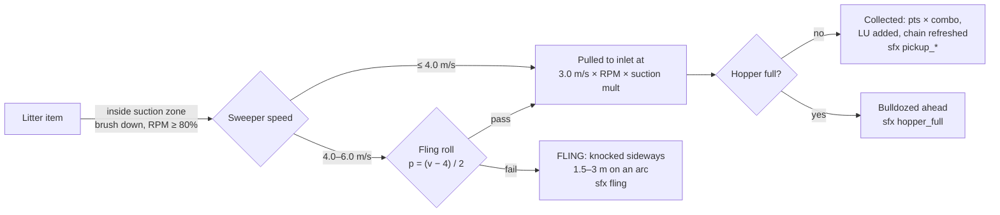
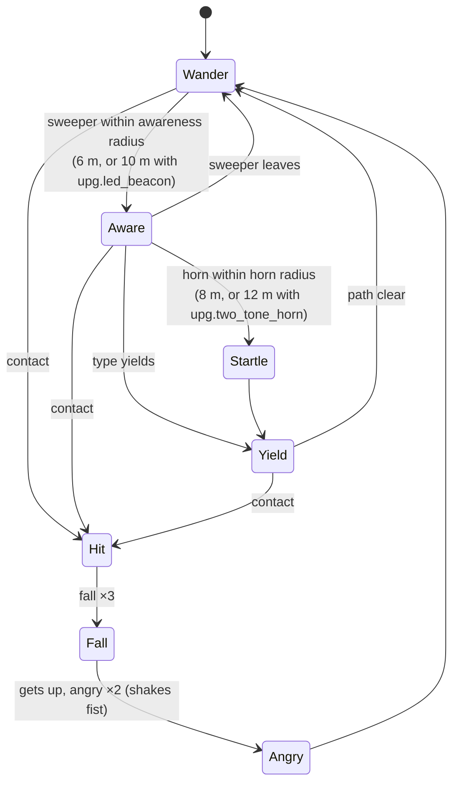
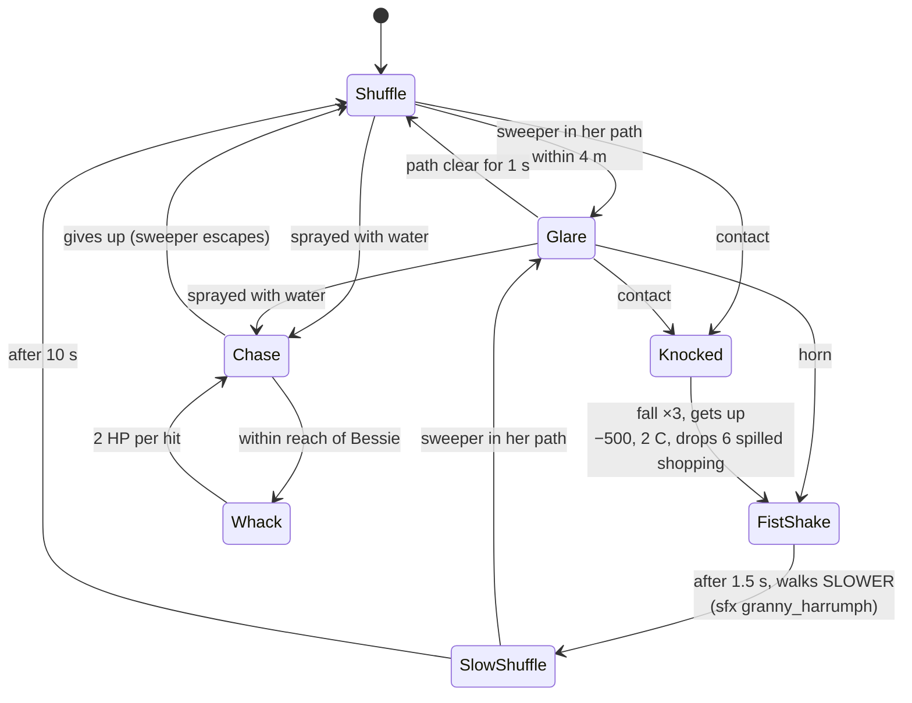
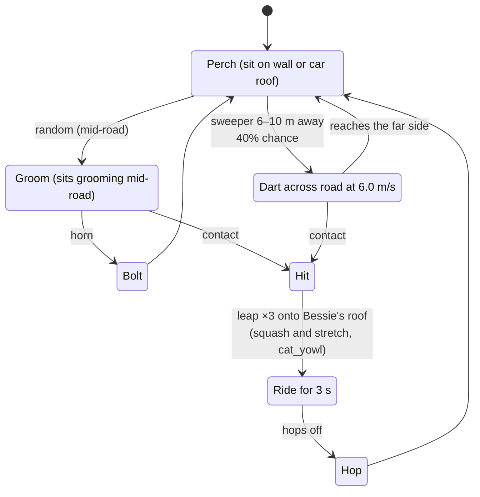
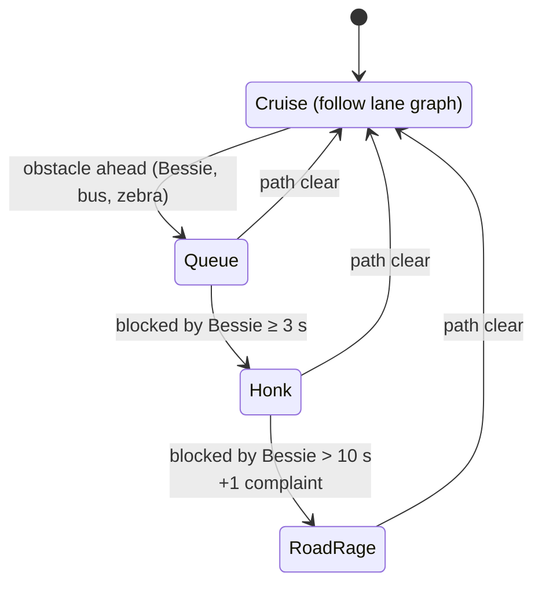

# Entity Catalog

> **Status:** v1.0, 2026-10-18. Derived from the Canonical Facts Sheet v1.0, §7 and §8.
> **Authority:** This document mirrors `src/data/entities.json` (upgrades: `src/data/upgrades.json`). Until a JSON file exists, this catalog holds the canonical values for its entity IDs, per-entity numbers and upgrades. From the commit that creates the JSON, the JSON is the source of truth and this document is a mirror, kept in sync by `tests/unit/entityCatalog.test.ts` (see [CLAUDE.md §2](../CLAUDE.md#2-where-truth-lives)). If the JSON and this document disagree, that is a bug: fix both in the same PR.
> **Language:** British English throughout (kerb, tyre, rubbish, colour).

Related documents:

- [GDD](GDD.md): why the numbers are what they are (pillars, scoring philosophy, economy).
- [LEVEL_DESIGN](LEVEL_DESIGN.md): spawn tables, densities and NPC schedules per district. This catalog only says *whether* an entity appears in a district.
- [ART_BIBLE](ART_BIBLE.md): the Kerbside-32 palette, ramps, the outline rule and character proportions.
- [ASSET_PIPELINE](ASSET_PIPELINE.md): how each technique below is run (forge, Blender, Codex).
- [AUDIO_DESIGN](AUDIO_DESIGN.md): what each `sfx.*` sounds like and how it is synthesised.
- [TECHNICAL_DESIGN](TECHNICAL_DESIGN.md): struct-of-arrays stores, tick order and collision maths.
- [GLOSSARY](GLOSSARY.md): LU, Tidy %, Frontage, Pledge, Fling, Chain, Complaint and the other terms used here.

---

## Contents

1. [Conventions](#1-conventions)
2. [ID index](#2-id-index)
3. [Shared rules](#3-shared-rules) (collection, collisions, penalties, pedestrian reactions)
4. [Rubbish (`litter.*`)](#4-rubbish-litter)
5. [Stains (`stain.*`)](#5-stains-stain)
6. [Pedestrians (`npc.*` people)](#6-pedestrians-npc-people)
7. [Animals (`npc.*` animals)](#7-animals-npc-animals)
8. [Vehicles (`veh.*`)](#8-vehicles-veh)
9. [Props and obstacles (`prop.*`)](#9-props-and-obstacles-prop)
10. [Hazards (`haz.*`)](#10-hazards-haz)
11. [Sites (`site.*`)](#11-sites-site)
12. [Power-ups (`pwr.*`)](#12-power-ups-pwr)
13. [Collectibles (`collect.*`)](#13-collectibles-collect)
14. [Upgrades and liveries (`upg.*`)](#14-upgrades-and-liveries-upg)
15. [`entities.json` shape](#15-entitiesjson-shape)
16. [Changing this catalog](#16-changing-this-catalog)
17. [Open questions](#17-open-questions)

---

## 1. Conventions

### 1.1 Units and abbreviations

| Term | Meaning |
|---|---|
| **Pts** | Score points **before** the combo multiplier ([GDD](GDD.md), facts sheet §8.1). Negative values are penalties. |
| **LU** | Litter units: how much of the hopper an item fills. Base hopper is **100 LU**. |
| **C** | Council Complaints added to the 0–5 meter. Reaching 5 = **SACKED!** |
| **HP** | "Bessie's Dignity". 100 HP; 0 HP = **TOWED!** |
| m, m/s | Sim units are metres and seconds. 16 px = 1 m on the ground. |
| **TBD (M0 spike)** | The facts sheet does not give this value, and it depends on the M0 look or tech spike (render and asset values such as slice counts). Do not guess it in code: read it from `entities.json`. |
| **TBD (M*n* tuning)** | A gameplay value the facts sheet does not give. M0 has no vehicle or NPC sim, so these are settled in the milestone that first simulates them (M2 for stains, M3 for NPCs and knockables, M6 for Wed–Sun entities). Where a proposed default is given, it is the starting value for that tuning. |

### 1.2 District codes

The "Districts" column uses these short codes (full table in [LEVEL_DESIGN](LEVEL_DESIGN.md)):

| Code | District ID | Name | Weather / time |
|---|---|---|---|
| **Mon** | `district.puddle_lane` | Puddle Lane (tutorial) | Dawn → morning, clear |
| **Tue** | `district.high_street` | Muckleford High Street | Late morning, clear, market day |
| **Wed** | `district.gasworks` | Gasworks Estate | Overcast, rain |
| **Thu** | `district.conker_hill` | Conker Hill | Afternoon, wind + leaf fall |
| **Fri** | `district.promenade` | The Promenade | Golden hour, gusts |
| **Sat** | `district.kebab_mile` | Kebab Mile | Night |
| **Sun** | `district.civic_quarter` | Civic Quarter | Morning, clear; **every NPC type** |
| **Yard** | `district.depot_yard` | The Depot Yard (Skip Run) | Matches the preceding shift |

**Bold** codes mark a district where the entity is a *signature* element (facts sheet §9.2). "Any" means the entity is created dynamically by another entity and can therefore turn up wherever its parent does.

### 1.3 Sprite and frame notation

- **Cell** is the atlas cell from the locked sprite size sheet (facts sheet §4.6). Figures in brackets are the maximum visible body.
- **Frames** are given as `state ×n`. Frame IDs follow `<asset-id>:<state>:<dir>:<n>`, e.g. `npc.old_woman:angry:sw:1`.
- Humans and 8-direction animals author **S, SW, W, NW, N** and mirror **SE, E, NE**.
- **Technique** is from facts sheet §5.2: `grid` (text-grid sprite), `ai-ingest` (Codex golden → `forge ingest` → grid, after which the grid is the truth), `blender`, `procedural`. An entry marked *(proposed)* is not named in §5.2 and follows the nearest listed class. Confirm it in M4.
- Litter **rotations** are generated by code. They use heading directions `h00`, `h08`, `h16`, `h24` (0°, 90°, 180°, 270°), so the frame ID grammar needs no new direction type: `litter.pizza_box:wobble:h08:1`.

### 1.4 SFX notation

SFX are written without the `sfx.` prefix, exactly as in the [AUDIO_DESIGN](AUDIO_DESIGN.md) list: `pickup_small`, `pickup_big`, `pickup_glass`, `fling`, `hopper_full`, `dump`, `brush_lower`, `brush_raise`, `horn`, `bump_wall`, `bump_kerb`, `crash`, `police_whoop`, `ice_cream_chime`, `cone_knock`, `bin_knock`, `splash`, `cat_yowl`, `dog_bark`, `pigeon_flap`, `seagull_squawk`, `ped_oi`, `granny_harrumph`, `kid_waah`, `complaint_stamp`, `combo_tier`, `powerup`, `coin`, `timer_warn`, `ui_move`, `ui_select`, `ui_back`.

No entity may reference an SFX ID outside this list. Behaviours that would benefit from a dedicated sound are listed in [§17](#17-open-questions) rather than given invented IDs.

---

## 2. ID index

All 111 canonical IDs (plus parked vehicle variants), grouped by class. `src/gen/assets.ts` exports `AssetId` as a union type, so a typo in any of these is a compile error.

| Class | Count | IDs |
|---|---|---|
| `litter` | 15 | `crisp_packet` `drink_can` `plastic_bottle` `glass_bottle` `newspaper` `cigarette_butts` `banana_skin` `chip_wrapper` `pizza_box` `kebab_wrapper` `leaf_pile` `dog_mess` `bin_bag` `lolly_stick` `spilled_shopping` |
| `stain` | 5 | `gum` `milkshake` `oil` `chalk_art` `splat` |
| `npc` (people) | 15 | `shopper` `old_woman` `old_man_frame` `jogger` `dog_walker` `kid_skateboard` `kid_chalk` `litterbug` `businessman` `mum_pushchair` `postie` `lollipop_lady` `market_trader` `reveller` `inspector` |
| `npc` (animals) | 4 | `cat` `dog_loose` `pigeon` `seagull` |
| `veh` | 12 | `sweeper` `hatchback` `saloon` `taxi` `van_white` `bus` `bin_lorry` `ice_cream_van` `police` `rival_sweeper` `bicycle` `mobility_scooter` (+ `veh.<type>_parked`) |
| `prop` | 17 | Knockable: `wheelie_bin` `traffic_cone` `a_board` `shopping_trolley` `recycling_box`. Static: `lamp_post` `bollard` `bench` `bus_shelter` `phone_box` `post_box` `hydrant` `tree` `planter` `market_stall` `litter_bin` `roadworks_barrier` |
| `haz` | 8 | `oil_slick` `puddle` `pothole` `speed_bump` `wet_leaves` `broken_glass` `open_manhole` `wind_gust` |
| `site` | 8 | `depot` `depot_bay` `skip` `bus_stop` `zebra` `school_crossing` `frontage` `pledge_frontage` |
| `pwr` | 6 | `flask_of_tea` `bacon_butty` `hi_vis` `super_suction` `wrench` `water_can` |
| `collect` | 8 | `false_teeth` `lost_wallet` `hard_hat` `cat_collar` `bucket_and_spade` `lost_shoe` `mayors_chain` `golden_crisp` |
| `upg` | 13 | `hopper` `suction` `gutter_brooms` `water_tank` `engine` `tyres` `bumper` `two_tone_horn` `led_beacon` `livery_council` `livery_racing_green` `livery_seaside` `livery_midnight_gold` |

---

## 3. Shared rules

These rules apply to every entity in a class unless its own row overrides them. Values come from `src/data/tuning.json` and the facts sheet §6.

### 3.1 How litter is collected



- The gutter brushes reach ±1.30 m, so the swept width is **2.6 m (≈ 42 px)**. The inlet is 1.0 × 0.4 m at y +1.2. An item is collected when its centre enters the inlet.
- `pwr.super_suction` raises the fling threshold to **6.0 m/s**, so there is no fling at all at brush-down top speed.
- **Brush up:** litter is driven over with no effect, **except** for the items with a brush-up rule (`banana_skin`, `leaf_pile`, `dog_mess`, `bin_bag`, `glass_bottle` when flung).
- **Pickup SFX** pitch rises one semitone every 5 chain, up to +12.

### 3.2 Collision responses

| Response type | Applies to | What happens |
|---|---|---|
| **Solid** | Static props, buildings, parked vehicles, moving traffic | OBB vs OBB/AABB (SAT), restitution **0.2**. Damage = **4 HP per m/s** of normal impact speed above **2 m/s** (×0.6 with `upg.bumper`). SFX `bump_wall`; `crash` above the damage threshold. |
| **Knockable** | `prop.wheelie_bin`, `traffic_cone`, `a_board`, `shopping_trolley`, `recycling_box` | Custom impulse body. Bessie barely slows; the prop slides or tips and may spill litter. Per-prop penalty. |
| **Actor hit** | Pedestrians, dogs, cats, bicycles, mobility scooters | The actor plays its **fall** (3 frames), gets up and plays **angry** (shakes fist). Nobody is injured (PEGI 7). Penalty + complaints. **Any penalty resets the combo chain.** An actor hit counts only when Bessie's closing speed toward the actor is ≥ 1.0 m/s (settled in M3, SSP-075: `tuning.json` → `streetLife.actorHit`). Actors that walk into a stationary or slower Bessie bump off, play startle, and incur no penalty. |
| **Line obstacle** | `npc.dog_walker` lead | Crossing the lead segment = **Lead Tangle**. No physical collision. |
| **Ghost** | Pigeons, seagulls, all sites, stains, most hazards | No physical collision. Overlap triggers an effect. |
| **Pickup** | `pwr.*`, `collect.*` | Collected when Bessie's body OBB overlaps the pickup, whatever the brush state. |

**Kerbs:** crossing costs 30% of speed plus a jolt (`bump_kerb`). Pavements are drivable, so pedestrians have no "safe" zone: the comedy depends on that.

### 3.3 Penalty multipliers and complaint sources

- **Police witness:** a penalty within **15 m** of a `veh.police` adds **+1 extra complaint**.
- **Horn spam:** more than 3 honks in 5 s = 1 complaint ("Noise"). The threshold becomes 5 with `upg.two_tone_horn`. As built (SSP-078): the window is the last 300 ticks (a honk at tick t counts those at t − 299 … t); a Noise complaint clears it, so the next needs another 4 honks within 5 s (8 quick honks = 2 complaints; proposed re-arm rule, owner to confirm); a honk that lands the litterbug's Caught! does not count.
- **Blocking traffic** for more than 10 s = 1 complaint ("Road Rage").
- **Running an occupied zebra** = −200 + 1 complaint (`tuning.json` → `complaints.zebra`). As built (SSP-085): one offence per entry, on the tick Bessie's body first overlaps a `site.zebra` with someone on it (its occupancy above 0); she must leave it fully before another entry counts, and a zebra that was empty when she drove onto it costs nothing even if someone steps out while she is on it. A hit on the person crossing is its own penalty on top.
- Every complaint plays `complaint_stamp` and a rubber-stamp popup.
- Every offence, these included, goes through one penalty pipeline (`world.penalties`, consumed in tick phase 9; [TECHNICAL_DESIGN §10.6](TECHNICAL_DESIGN.md#106-scoring-and-combo-srcsimscoringts-srcsimcombots)): points off the score, the chain reset, the complaints added, the police-witness check. So a complaint-only offence resets the combo chain too (SSP-078).

### 3.4 Generic pedestrian reaction model

All people share a steering core (`src/sim/npc/steering.ts`) and the same five animation states (walk, idle, startle, fall, angry). Per-type behaviours (`src/sim/npc/behaviours/<npc>.ts`) override transitions, never the animation set: the 13-frames-per-direction budget is locked.



- **Near miss:** passing within 0.5 m of a pedestrian at more than 3 m/s without contact = **+25**. The pedestrian plays **startle**.
- **Dust:** a pedestrian within 3 m of a dust cloud coughs (startle frames): −10 pts per pedestrian per 2 s. No complaint.
- *As built (SSP-095, `npc/reactions.ts` `stepStreetLife`, `dirt.ts` `stepDust`; the numbers are `tuning.json` → `streetLife.nearMiss` and `streetLife.dust`):* both rules cover the people (every person kind, not the cat, pigeons or a walker's dog). **Near miss:** the gap is from the pedestrian's circle to Bessie's body, her speed counts at the closest approach, and the +25 comes on the tick after it, with a startle (Doris takes the bonus but never startles). One award per pedestrian per pass: a pass re-arms once the gap exceeds 1.5 m, and a contact anywhere in the pass (a hit or a bump) spends it with no award; a fallen pedestrian is never near-missed. **Dust:** with the brush down and collecting on `%` yard ground and no spray, each gutter brush puffs one cloud every 7 ticks at its centre, and a cloud lives 30 ticks (the `fx.dust_puff` animation). A pedestrian whose centre is within 3 m of a live cloud coughs on its 120th tick in a row in range and every 120th after (leaving the range restarts the count): −10 through the penalty pipeline (it resets the chain, files no complaint) and the startle frames (not Doris). The 1.5 m re-arm and the 30-tick cloud life are proposals for owner review (no doc gave them). Roadworks dust arrives with the districts that have roadworks (SSP-204).
- **Puddle splash:** above 3 m/s through `haz.puddle`, pedestrians within 1.5 m: −50 each. Every 3rd splash = 1 complaint. *As built (SSP-094, `src/sim/npc/splash.ts`; proposals for owner review):* "within 1.5 m" is the gap between Bessie's body and the pedestrian's circle; a pedestrian is splashed **once per crossing** (from entering some puddle to being in none, so touching puddles are one crossing), on any tick of it above 3 m/s (\|vLong\|), and plays startle (Doris has no startle: she pays the −50 and walks on). **"Every 3rd splash" counts splashed pedestrians across the shift**: the 3rd, 6th, 9th… splashed pedestrian of the shift files the complaint (reason Splash), whatever the crossing. Animals (the cat, pigeons, a walker's dog) are never splashed. Each fast puddle crossing emits `EV.Splash` (sfx, fx) and each splashed pedestrian `EV.NpcSplash`.
- **`pwr.hi_vis`:** every pedestrian yields and parts for 12 s, including the ones that normally never yield (Doris, the businessman). Stationary NPCs (`kid_chalk`, `market_trader`) do not move.
- **Who yields** (`yields` in `entities.json`): `npc.shopper`, `npc.old_man_frame`, `npc.dog_walker`, `npc.litterbug`, `npc.mum_pushchair` and `npc.postie` yield inside the awareness radius. Doris and the businessman never yield, the market trader is stationary, and the animals have their own reactions ([§7](#7-animals-npc-animals)), so those have `yields: false`.
- The numbers above (awareness, horn, near miss, dust, splash, actor hits, complaint rules) live in `src/data/tuning.json` → `streetLife`, `complaints` and `endStates` (SSP-075).
- *As built (SSP-082, the generic pedestrian, [TECHNICAL_DESIGN §11.1](TECHNICAL_DESIGN.md#111-behaviour-system)):* Wander is the `Walk` state, and Aware is a Walk with Bessie inside the awareness radius this tick. The **horn reaches Wander and Aware pedestrians alike** (the diagram draws it only from Aware, but the horn radius is the larger one and the businessman reacts only to the horn), and Yield too: all three Startle. "Path clear" is read as Bessie leaving the awareness radius: a yielder parts out of her predicted path or stands, and walks on once she is gone (after at least 0.5 s). Under `pwr.hi_vis` every walking type yields to Bessie inside the awareness radius. A touch below the hit speed is a bump: the actor startles, no penalty. Startle 0.5 s, minimum yield 0.5 s, idle 1–3 s and the 0.4–1.2 m scatter of hit drops were chosen in M3 tuning (SSP-082; owner to review); the per-type modules (SSP-083 to SSP-088) override transitions on top.

---

## 4. Rubbish (`litter.*`)

**Common sprite spec:** cell **16×16**, visible body 8–14 px. Frames: `idle ×1` + `wobble ×2`, each in 4 code-generated rotations (`h00`, `h08`, `h16`, `h24`) = **12 frame IDs per item**. Technique: Codex transparent 4×2 sheet → `forge ingest` (one scale factor per sheet, largest item = 14 px) → grid (`ai-ingest`). Source: `assets-src/ai/litter.sheet_NN/` (provenance) and `assets-src/sprites/litter/<name>.sprite.txt` (truth). Atlas: `items`. Manifest `dirs: "rot4"` (ASSET_PIPELINE §6.1). **Until M4:** the 15 IDs ship as hand-authored placeholder grids (`technique: "grid"`, SSP-051) under these final frame IDs; `litter.banana_skin` is already `ai-ingest` (the SSP-024 scale sample). SSP-139 moves the ingested items to `ai-ingest` without changing frame IDs.

### 4.1 Stats

| ID | Name | Pts | LU | Technique | Pickup SFX | Districts |
|---|---|---|---|---|---|---|
| `litter.crisp_packet` | Crisp packet | 10 | 1 | ai-ingest | `pickup_small` | All except Yard |
| `litter.drink_can` | Drink can | 15 | 1 | **grid** (hand-tuned for legibility) | `pickup_small` | All except Yard |
| `litter.plastic_bottle` | Plastic bottle | 15 | 1 | ai-ingest | `pickup_small` | All except Yard |
| `litter.glass_bottle` | Glass bottle | 20 | 1 | ai-ingest | `pickup_glass` | Tue, Wed, **Sat**, Sun |
| `litter.newspaper` | Newspaper | 10 | 2 | ai-ingest | `pickup_small` | All except Yard; heavy on **Fri** |
| `litter.cigarette_butts` | Cigarette butts (cluster of 3–5) | 5 | 0.5 | **grid** (cluster sprite, hand-drawn) | `pickup_small` | All except Yard |
| `litter.banana_skin` | Banana skin | 20 | 1 | ai-ingest | `pickup_small` | **Tue**, Fri, Sun |
| `litter.chip_wrapper` | Chip wrapper | 15 | 1 | ai-ingest | `pickup_small` | Tue, **Fri**, Sat, Sun; Any (seagull theft) |
| `litter.pizza_box` | Pizza box | 25 | 3 | ai-ingest | `pickup_big` | Tue, **Sat**, Sun |
| `litter.kebab_wrapper` | Kebab wrapper | 15 | 1 | ai-ingest | `pickup_small` | **Sat** |
| `litter.leaf_pile` | Leaf pile | 5 | 2 | ai-ingest | `pickup_big` | **Thu**, Sun |
| `litter.dog_mess` | Dog mess | 40 | 1 | ai-ingest | `pickup_small` | Mon, **Thu**, Sun; Any (dog walker) |
| `litter.bin_bag` | Bin bag | 50 | 8 | ai-ingest | `pickup_big` | Tue, **Wed**, Sat, Sun |
| `litter.lolly_stick` | Lolly stick | 10 | 0.5 | ai-ingest | `pickup_small` | **Fri**, Sun (ice cream van) |
| `litter.spilled_shopping` | Spilled shopping | **0** | 1 | ai-ingest | `pickup_small` | Any (knocked-over NPCs) |

### 4.2 Behaviours and brush-up rules

| ID | Behaviour |
|---|---|
| `litter.crisp_packet` | Light. **Drifts in wind**: during `haz.wind_gust` it moves 1.5 m/s for 4 s. Wobble frames play while drifting. |
| `litter.drink_can` | Inert. The grid is hand-tuned because the AI version was illegible at 12 px. |
| `litter.plastic_bottle` | Inert. |
| `litter.glass_bottle` | **If flung, it smashes into `haz.broken_glass`** where it lands. Collecting it cleanly plays `pickup_glass`. |
| `litter.newspaper` | **Blows 1.5 m/s in gusts.** The 2 LU reflects its bulk. |
| `litter.cigarette_butts` | Ships as a single cluster sprite (3–5 butts). Lowest value, but it counts as 1 item toward Tidy % and the chain, which makes it a cheap way to keep a combo alive. |
| `litter.banana_skin` | **Driven over with the brush up: 180° spin-out** of Bessie. With the brush down it is collected normally. |
| `litter.chip_wrapper` | **Attracts pigeons and seagulls.** A pigeon flock (6–12) gathers around it. Dropped by pedestrians whose chips a seagull steals. |
| `litter.pizza_box` | Bulky (3 LU). Dropped by `npc.reveller`. |
| `litter.kebab_wrapper` | Saturday-night item. Dropped by `npc.reveller`. |
| `litter.leaf_pile` | Thursday item. **Driven through brush-up, it leaves `haz.wet_leaves`** (grip 3.0). |
| `litter.dog_mess` | Dropped by the dog on a `npc.dog_walker` lead every 40–60 s. **Brush up over it: creates `stain.splat` and costs −20.** Mild Crude Humour (rating note). |
| `litter.bin_bag` | Worth the most, but fills 8% of the base hopper. **Hit above 4 m/s, it bursts into 6 small items** drawn from the district's small-litter table (the hit itself is not a pickup). Below 4 m/s with the brush down, it is collected whole. Dropped occasionally by `veh.bin_lorry`. |
| `litter.lolly_stick` | Spawned around a stationary `veh.ice_cream_van`. |
| `litter.spilled_shopping` | Dropped by NPCs you knock over (`npc.old_woman` drops **6**). **No points: it's your mess.** It still counts toward litter collected for Tidy %, and still uses 1 LU. |

---

## 5. Stains (`stain.*`)

**Common spec:** cell **32×32**, 1–3 variants, technique `procedural` (`assets-src/procedural/stains/*.json`), atlas `world`. Stains are ground decals, so they have no collision. They are **cleaned only by water spray** (6 water units/s, 2.6 m cone ahead) and scored once per stain. The **Spray** column is the seconds of spray each stain needs (`sprayS` in `entities.json`, adopted in SSP-053 from the proposed defaults; kept at the M2 close, SSP-074: Puddle Lane starts with no stains, only player-made splats, so they stand until a district with stains is playtested); `stain.splat` uses the gum value. The loop sound is the live spray synth (see [AUDIO_DESIGN](AUDIO_DESIGN.md)); there is no one-shot `sfx.*` on completion other than the score popup. **Until M4:** placeholder generators under the final frame IDs `stain.<name>:v:-:n` (SSP-052; variants gum 3, milkshake 2, oil 2, chalk_art 3, splat 2; looks in [ART_BIBLE §8.7](ART_BIBLE.md#87-stains-and-hazards-ground-decals)).

| ID | Name | Pts | Spray | Districts | Notes |
|---|---|---|---|---|---|
| `stain.gum` | Chewing gum | 10 | 1.0 s | Tue, Sat, Sun | Small, many per tile near shops and bus stops. |
| `stain.milkshake` | Milkshake | 20 | 1.5 s | Tue, **Fri**, Sun | |
| `stain.oil` | Oil stain | 30 | 2.0 s | **Wed**, Sun | **Same tile as `haz.oil_slick`.** Spraying the slick cleans this stain; the +30 is awarded once. |
| `stain.chalk_art` | Chalk art | 30 | 2.0 s | **Thu**, Sun | Drawn by `npc.kid_chalk`. **Cleaning it while its kid is present: −100 + 1 complaint ("WAAAH!", `kid_waah`).** Wait until the kid leaves (60–90 s) to score the +30. |
| `stain.splat` | Splat | 0 | 1.0 s | Any | Created by driving brush-up over `litter.dog_mess` (−20; "driven over" is defined in [GDD §8.2](GDD.md#82-brush-states)). Cleaning it scores 0 and refunds nothing ([§17](#17-open-questions) Q8). |

---

## 6. Pedestrians (`npc.*` people)

**Common sprite spec:** cell **24×24**, figure ≤ 18×22 px (≈ 1.1 × 1.4 m). 8 directions (S, SW, W, NW, N authored; SE, E, NE mirrored). Frames per direction: `walk ×4`, `idle ×2`, `startle ×2`, `fall ×3`, `angry ×2` = **13 per direction, 104 frame IDs, 65 authored**. Carried props (handbag, trolley, pushchair, walking frame, clipboard, skateboard) must fit inside the 24×24 cell. Technique: `ai-ingest`, using a Codex key-pose sheet reference-locked to `assets-src/ai/ref.people_style/golden.png`, ingested to `assets-src/sprites/npc/<name>.sprite.txt`. Claude authors the remaining frames in the grid. Atlas: `actors`. Outfit variety uses per-instance ramp swaps (up to 8 tables per atlas). Until M4, the M3 people are `grid` placeholders under these final frame IDs (`"placeholder": true`; SSP-097 for the Monday cast, SSP-098 for the businessman, litterbug and market trader, [ART_BIBLE §8.3](ART_BIBLE.md#83-people-and-animals)).

### 6.1 Stats

| ID | Name | Speed (m/s) | Hit penalty | Hit SFX | Districts | Milestone |
|---|---|---|---|---|---|---|
| `npc.shopper` | Shopper (8 outfit swaps) | 1.3 | −250, 1 C | `ped_oi` | **Mon**, **Tue**, Wed, Thu, Fri, Sun | M3 |
| `npc.old_woman` | "Doris", old woman with handbag + shopping trolley | 0.6 (chase 1.2) | −500, 2 C, drops 6 `litter.spilled_shopping` | `granny_harrumph` | **Mon**, Tue, Thu, Sun | M3 |
| `npc.old_man_frame` | Old man with walking frame | 0.4 | −500, 2 C | `ped_oi` | Mon, Tue, Sun | M3 |
| `npc.jogger` | Jogger | 3.5 | −250, 1 C | `ped_oi` | Thu, **Fri**, Sun | M6 |
| `npc.dog_walker` | Dog walker + dog on extendable lead (up to 5 m) | 1.2 | Tangle −150, 1 C; hit −300, 1 C | `ped_oi` + `dog_bark` | Mon, **Thu**, Sun | M3 |
| `npc.kid_skateboard` | Kid on skateboard | 5.0 | −250, 1 C | `kid_waah` | Wed, Thu, Fri, Sun | M6 |
| `npc.kid_chalk` | Kid chalking | 0 | Cleaning chalk while present: −100, 1 C | `kid_waah` | **Thu**, Sun | M6 |
| `npc.litterbug` | Litterbug teen | 1.4 | −250, 1 C | `ped_oi` | **Tue**, Wed, Sun | M3 |
| `npc.businessman` | Businessman on phone | 1.4 | −250, 1 C | `ped_oi` | **Tue**, Sun | M3 |
| `npc.mum_pushchair` | Parent with pushchair | 1.1 | −500, 2 C | `ped_oi` | Mon, Thu, Sun | M3 |
| `npc.postie` | Postie with trolley | 1.2 | −250, 1 C | `ped_oi` | Mon, Thu, Sun | M3 |
| `npc.lollipop_lady` | Lollipop lady | 0.8 | Running her crossing: −200, 1 C | `ped_oi` | **Sun** | M6 |
| `npc.market_trader` | Market trader | 0 | −250, 1 C | `ped_oi` | **Tue**, Sun | M3 |
| `npc.reveller` | Saturday-night reveller | 1.0 | −250, 1 C | `ped_oi` | **Sat**, Sun | M6 |
| `npc.inspector` | The Tidy Town Inspector | 1.0 | Splash or hit: 2 C | `ped_oi` | **Sun** only | M6 |

All hits also play `complaint_stamp` for each complaint and reset the combo chain.

### 6.2 Behaviours

| ID | Behaviour summary | Animation mapping (within the 13-frame set) |
|---|---|---|
| `npc.shopper` | Wanders pavements on the nav graph, crosses at crossings, **sidesteps at 4 m**. The baseline yielder that teaches the player how pedestrians move. | walk / idle at shop windows / startle on sidestep |
| `npc.old_woman` | See [§6.3](#63-doris-npcold_woman). **Never yields.** Glares, shakes her fist, chases and whacks with her handbag. | idle = glare; angry = fist shake and handbag whack; walk (fast cadence) = chase |
| `npc.old_man_frame` | **Crosses only at zebras, painfully slowly** (a 6 m two-lane crossing takes him 15 s). Bessie must wait at an occupied `site.zebra`: running it is −200 + 1 C on top of any hit. *As built (SSP-085):* the generic pedestrian at 0.4 m/s whose paths never use a dropped-kerb or school-crossing edge, so he crosses a road only on a zebra. | walk is a shuffle-frame-shuffle cycle |
| `npc.jogger` | **Runs along the kerb gutter** (exactly where the gutter brush wants to be) and **swerves into the road around obstacles** such as parked cars and bins. Prime near-miss bonus source (+25). | walk = run cycle |
| `npc.dog_walker` | Walks a route with the dog up to 5 m ahead on an extendable lead. **The lead is a line obstacle across the pavement or road.** The dog drops `litter.dog_mess` every **40–60 s**. **Driving through the lead = Lead Tangle** (−150, 1 C): the walker spins (startle) and the dog barks. The dog reuses the `npc.dog_loose` grid with a coat ramp swap; it is a child actor of the walker, not a separate catalog entity. | startle on tangle |
| `npc.kid_skateboard` | **Fast on pavements, ollies off kerbs into the road.** Telegraphs the ollie with a crouch frame (startle 0) just before leaving the kerb, so attentive players can react. | walk = push cycle; startle = crouch/ollie |
| `npc.kid_chalk` | Stationary. **Draws `stain.chalk_art`, leaves after 60–90 s.** Spraying the chalk while the kid is there is a −100 + 1 C "WAAAH!". | idle = drawing; angry = wail |
| `npc.litterbug` | **Drops an item every 3–5 s** from the district litter table. **Honk within 6 m → "Caught!" +100**, then he slinks off the map (walk, head down) and stops dropping. Honking him does not count toward horn spam if it lands the Caught! | startle on honk, then walk |
| `npc.businessman` | Stares at his phone. **Ignores you until 2 m and crosses without looking.** Does not react to the awareness radius or the LED beacon, only to the horn. | idle = phone; startle at 2 m |
| `npc.mum_pushchair` | **Wide and slow**: the pushchair widens her collision footprint, so she blocks most of a pavement. Her footprint is a circle of radius 0.55 m centred on her cell (`rules.footprintRadiusM`; proposed in SSP-085, owner to review), used for Bessie's contact, separation and the steering constraints instead of the 0.3 m human circle. | walk |
| `npc.postie` | Walks frontage to frontage and **stops at doors for 3 s**, often with the trolley left on the pavement edge. *As built (SSP-085):* the round is every frontage door in a walking order that works along one side of a street before crossing it; he joins it at the nearest door and loops it, facing each facade for the stop. The trolley is visual only: not collidable, no entity ID of its own (proposed, owner to review). | idle at doors |
| `npc.lollipop_lady` | **Steps out at `site.school_crossing`; you must stop.** Holds the crossing for 6 s (proposed, TBD (M6 tuning)) while a group of children crosses. Running it: −200 + 1 C. | idle = sign raised; angry = sign waved |
| `npc.market_trader` | Mans a `prop.market_stall` all shift. **A litter pile builds at closing time (Tuesday)**, a late-shift scoring opportunity. | idle = calling out |
| `npc.reveller` | **Weaves, sings, drops pizza boxes and kebab wrappers.** The weave is a sine offset on the nav path, so its line is readable but never straight. | walk with sway |
| `npc.inspector` | **Walks a fixed route with a clipboard.** Each `site.frontage` he passes that is **below 90% clean: −100**. Splash or hit: 2 C. Sweeping ahead of his route is the Sunday puzzle. | idle = writing on the clipboard; angry = clipboard tap |

*As built (SSP-084, `src/sim/npc/behaviours/shopper.ts`, `businessman.ts`, `litterbug.ts`; the shared machine of [§3.4](#34-generic-pedestrian-reaction-model) underneath):*

- **Shopper.** Wanders from frontage door to frontage door of the nav graph and idles 1–3 s at each (the shop windows). Inside the awareness radius he yields (stops and parts). He **sidesteps** (the startle hop, then a sidestep of Bessie's path, 0.5 s) on the perception query that finds her 1.5 s predicted path within `rules.sidestepM` (4 m) of him while she is coming his way, once per approach (the latch clears when her path is farther than 4 m again); never mid-crossing. Each shopper draws its outfit swap 0–7 from the `npc` stream as he spawns (`NpcStore.swap`). [GDD §20](GDD.md#20-open-design-questions) Q11 is resolved this way (lead call, owner to review).
- **Businessman.** Never takes the awareness radius or the LED beacon (`BeaconYield` is dropped, so he is never Aware). He startles once per approach when Bessie's body outline comes within `rules.noticeM` (2 m) of his centre, measured every tick; the horn startles him like anyone, `pwr.hi_vis` makes him yield, and he jaywalks.
- **Litterbug.** Drops one item every `dropEveryMinS`–`MaxS` (180–300 whole ticks, one `npc` draw each, armed as he spawns; paused while he is down). The item comes from the district's **small-litter table** (the level's `litter.table` restricted to kinds of at most 1 LU with no brush-up rule, as for hazard spills), so a teen never drops dog mess, leaf piles or bin bags (lead reading of "the district litter table", owner to review). It lands 0.3 m behind him through `addLitterAt`, counts toward litter spawned and is refused when the field holds 2,000. A honk whose origin (Bessie's centre) is within `rules.caughtRadiusM` (6 m, edge included) of him, in any state but fallen or getting up, is **Caught!**: once per litterbug, `EV.Caught` (+`caughtPts`, 100) in phase 7, scored in phase 9 as a style bonus (not multiplied, the chain untouched), and that honk is not counted toward horn spam. He startles, then slinks to the nearest map-edge portal (state `Slink`, walk frames), drops nothing more and ignores every stimulus but a hit; the spawner retires him on its first once-a-second run with him out of view (`NPC_FLAG.LEAVING`). A honk 6.1 m away only startles him.

*As built (SSP-086, `src/sim/npc/behaviours/dogWalker.ts`; lead calls for owner review):*

- **The lead is never longer than 5 m** (`rules.leadMaxM`): the dog trots ahead at 2.0 m/s, about 3 m out with a ±1.25 m sway, and a step of either that would stretch the lead past 5 m is taken back.
- **Lead Tangle** (−150, 1 C) is counted on the tick Bessie's body first overlaps the lead (walker centre to dog centre). Re-arm: she must clear the whole segment before another Tangle counts. The walker spins (startle) and the dog barks; a crossing during a contact episode with the walker or the dog (a hit or a bump) is part of that episode and costs no Tangle.
- **Hitting the dog** (unspecified above) is the walker's animal hit, −300 and 1 C, and shares one contact episode with the walker: hitting both costs one hit.
- **Dog mess:** the first is due 40–60 s after the pair spawns, then every 40–60 s after each drop; a due mess waits until the dog stands on a pavement or grass tile ([LEVEL_DESIGN §9.1](LEVEL_DESIGN.md#91-litter) rule 5) and lands under it.

*As built (SSP-088, `src/sim/npc/behaviours/marketTrader.ts`; the pitches and the closing pile in `src/sim/shift.ts`, [LEVEL_DESIGN §4.3](LEVEL_DESIGN.md#43-event-catalogue)):*

- **Market trader.** The generic pedestrian's stationary twin. The spawner adds one per pitch of the level's `market` event once it opens (origin `market`, `group` = the pitch), on the tile in front of his `prop.market_stall` (the side with the most open floor, south first on a tie), facing out into the aisle. He mans it all shift, the closing pile included (he packs up but does not leave). Idle is calling out. He never moves: the horn, a bump and a spray startle him on the spot, `pwr.hi_vis` leaves him where he is, and a hit (−250, 1 C) knocks him down where he stands; after the fist shake he turns back to his aisle. Other people step round him.

### 6.3 Doris (`npc.old_woman`)

Doris is the game's mascot antagonist. She is never knocked aside, never yields, and turns every confrontation into a scene.



- **Shuffle:** 0.6 m/s with her trolley. *As built (SSP-104):* where her district names her route (Puddle Lane: home → the zebra → the corner shop → the zebra → home, LEVEL_DESIGN §5.1), she shuffles it stop by stop, pausing 1–3 s at each, picks it up again after a glare, a chase or a fall, and potters about the street once she is home.
- **Glare:** she **stops in your path and glares** (idle frames, facing Bessie) when Bessie's body is within 4 m ahead on her path (her own trigger, from TECHNICAL_DESIGN §11.2: she ignores the awareness radius and `upg.led_beacon`), and walks on once her path has been clear for 1.0 s. Only `pwr.hi_vis` makes her part.
- **Horn while she glares → she shakes her fist for 1.5 s and walks slower.** The reduced speed is 0.4 m/s (chosen in M3 tuning, SSP-075), and she stays slowed for 10 s (chosen in M3 tuning by SSP-083, owner to review). The lesson: the horn makes things worse with Doris.
- **Spray her → she chases you at 1.2 m/s, whacking with her handbag (2 HP per hit).** At 1.2 m/s she can only catch a stationary or reversing Bessie, which is the joke: she catches you while you are dumping or refilling. She whacks every 1.0 s and gives up at 8 m (both chosen in M3 tuning, SSP-075). Her handbag reaches Bessie's body when it is within 0.6 m of her centre (her 0.3 m radius plus a 0.3 m swing; chosen in M3 tuning by SSP-083, owner to review). Each whack can help get Bessie TOWED.
- **Hit:** −500, 2 complaints, 6 `litter.spilled_shopping` scattered around her. Collecting them earns 0 pts.

---

## 7. Animals (`npc.*` animals)

Technique for all animals: **`grid`**, written directly in `assets-src/sprites/npc/<name>.sprite.txt` (at ≤ 20 px, hand-placed pixels beat downscales). Atlas: `actors`.

### 7.1 Stats and sprites

| ID | Name | Cell (body) | Frames | Speed (m/s) | Hit / interaction | SFX | Districts | Milestone |
|---|---|---|---|---|---|---|---|---|
| `npc.cat` | Cat | 16×16 (≤ 12×14) | 8 dirs: `walk ×4`, `sit ×2`, `dart ×2`, `leap ×3` = 11/dir, 88 IDs | 6.0 dart | −300, 1 C ("Not the cat!") | `cat_yowl` | **Mon**, **Thu** (many), Sat, Sun | M3 |
| `npc.dog_loose` | Loose Jack Russell | 20×20 (≤ 16×18) | 8 dirs: `walk ×4`, `sit ×2`, `bark ×2` = 8/dir, 64 IDs | 7.0 | −300, 1 C | `dog_bark` | Wed, **Thu**, Sun | M6 |
| `npc.pigeon` | Pigeon (flocks of 6–12) | 12×12 (≤ 10×8) | 4 dirs: `peck ×2`, `fly ×3` = 5/dir, 20 IDs | — | Cannot be hit. Drive through a flock: **+25 "Pigeon Scatter"** | `pigeon_flap` | Tue, **Fri**, Sun | M3 |
| `npc.seagull` | Seagull | 16×16 (≤ 14×10) | 4 dirs: `walk ×2`, `fly ×3` = 5/dir, 20 IDs | — | No penalty; cannot be hit | `seagull_squawk` | **Fri**, Sun | M6 |

Animals with 8 directions author S, SW, W, NW, N and mirror the rest, like humans. The 4-direction birds author S, W, N and mirror E from W.

**Until M4:** `npc.cat`, `npc.pigeon` and the `npc.dog_loose` grid (drawn for the dog walker's dog with a coat swap) ship as placeholder grids under their final frame IDs (SSP-099: `technique: "grid"`, atlas `actors`, `placeholder: true`, `assets-src/sprites/npc/<name>.sprite.txt`). The dog's patches use only the skin key 12/11, so the SSP-114 coat swap applies. SSP-146 (cat) and SSP-147 (pigeon, dog) hand-author the final frames behind the same IDs.

### 7.2 Cat (`npc.cat`)

The cat is the game's other recurring gag. Every behaviour must be readable a beat before it happens.



- **Idles on walls and car roofs** (including parked `veh.*_parked`), playing `sit`.
- **Darts across the road when you're 6–10 m away (40% chance per approach)**, using the `dart` frames. The roll happens once per approach so the player cannot farm it: an approach is Bessie coming within 10 m, and only going back beyond 10 m starts a new one. The dart runs straight across at 6.0 m/s to the far side (a free parked car roof or garden wall there, else the far pavement) and covers at most 16 m.
- **Sometimes sits grooming mid-road.** Every 20–40 s a perched cat strolls out at 1.0 m/s to a mid-road spot within 8 m (one more than 10 m from Bessie that no other cat has), grooms there for 10 s, then strolls back to the nearest free perch. **Horn → bolts** (dart frames, away from Bessie) at 7.0 m/s to cover, perched or grooming, and a grooming cat also bolts when Bessie comes within 4 m.
- **Hit → leaps onto your roof (squash and stretch), rides 3 s, hops off.** −300, 1 complaint ("Not the cat!"). The cat is never hurt. While riding it is drawn at Bessie's roof height using `sit` frames, offset to her local frame: it sits 0.5 m ahead of her body centre. It hops off beside her and runs back to cover.
- *Chosen in M3 tuning by SSP-087 (owner to review):* the 20–40 s groom idle, the 1.0 m/s stroll, the 8 m reach, the 10 s groom, the 7.0 m/s bolt, the 16 m run reach and the 0.5 m seat (`entities.json` `npc.cat.rules`; the catalog gave none of them). The 4 m bolt distance is [TECHNICAL_DESIGN §11.3](TECHNICAL_DESIGN.md#113-example-cat-npccat)'s.

### 7.3 Loose dog (`npc.dog_loose`)

- **Chases you within 12 m, barking** (`bark` frames, `dog_bark`). At 7.0 m/s it out-runs Bessie at any brush-down speed (top 6.0 m/s).
- **Horn → sits for 3 s.**
- **Out-run it in transit:** with the brush raised (11.0 m/s top speed) Bessie escapes.
- **Hit:** −300, 1 C. It rolls over (sit frames) and resumes the chase.

### 7.4 Pigeon (`npc.pigeon`)

- Spawned in flocks of **6–12**. **Gathers around chips** (`litter.chip_wrapper`), pecking.
- **Scatters at 4 m and lands 10 m away** (`fly ×3`, `pigeon_flap`).
- **Cannot be hit.** Driving through a flock awards **+25 "Pigeon Scatter"** once per flock per scatter.

*As built (SSP-088, `src/sim/npc/behaviours/pigeon.ts`; the file header is the full rule set):* every bird is its own NPC (a flock of 12 is 12 of the 80) carrying its flock's number, and a flock acts as one (its first bird to tick runs the flock's step). A bird pecks (still) or flies (straight to its landing spot at 8 m/s; 10 m takes 1.25 s). It is a **ghost**: no `hit`, so Bessie's contact never touches it (no hit, bump, penalty or complaint), people walk through it, it never holds a zebra, and it ignores the horn, the spray and hi-vis. The flock **scatters** when Bessie's body outline comes within `rules.scatterM` (4 m, edge included) of any bird: every bird flies `rules.landM` (10 m) along one direction, away from her, turned by 30° steps when that would land the flock off the map, on a building or inside its own scatter range (a bird whose own spot is blocked lands on the flock's centre). It **gathers** at the nearest chip wrapper within `rules.gatherM` (10 m) of its centre, checked once a second after 3 s on the ground, unless the wrapper is within 6 m (scatterM + 2) of Bessie's body: the birds fly to it, keeping their places round the flock's centre. **"Driving through a flock"** is read as Bessie's body OBB overlapping the circle the flock covered as it took off (its birds' centres plus a bird's radius) at any time while that scatter is in the air; the first such tick awards the +25 (`EV.PigeonScatter`, a style bonus: not multiplied, the chain untouched), once per scatter. So the bonus needs a run at the flock: from 4 m away Bessie reaches the circle before the birds land only above about 3 m/s. The flight speed `rules.flyMps` 8 m/s and the gather reach `rules.gatherM` 10 m were chosen in M3 tuning by SSP-088, as was this reading of "drive through" (owner to review).

### 7.5 Seagull (`npc.seagull`)

- **Steals chips from pedestrians.** The pedestrian drops a `litter.chip_wrapper` and plays startle.
- **Snatches litter just ahead of your brush:** it picks a target item in front of the suction zone and flies off with it (`seagull_squawk`). The item is gone and scores nothing.
- No penalty and no collision. Seagulls exist to be annoying.

---

## 8. Vehicles (`veh.*`)

**Common spec:** technique **`blender`** (`assets-src/blender/vehicles/<name>.py` + committed renders in `assets-src/rendered/<id>/`), 32 headings (`h00` = north, 11.25° clockwise steps), unlit toon materials using exact Kerbside-32 hex stops, 1 px ink outline added by the forge. Atlas: `actors`. Actor drop shadow = the same sprite offset +2, +2 px.

### 8.1 Sprites

| ID | Cell | Visible body (m) | Frames |
|---|---|---|---|
| `veh.sweeper` | body/dented 64×64; brush overlay is a separate asset `veh.sweeper_brush`, cell 96×96 (rendered `--size 384`, `ortho_scale` 6 m), same centre pivot as the body | 28×52 px (1.75 × 3.25 m) | `body ×1` × 32 headings; `dented ×1` × 32 headings (below 40 HP); `veh.sweeper_brush:brush` ×4 spin frames × 32 headings. **192 frame IDs** (64 + 128). |
| `veh.hatchback` | 64×64 | 26×46 px (1.63 × 2.88 m) | 32 headings, 8 paint swaps |
| `veh.saloon` | 64×64 | 28×54 px (1.75 × 3.38 m) | 32 headings, 8 paint swaps |
| `veh.taxi` | 64×64 | 28×54 px | 32 headings |
| `veh.police` | 64×64 | 28×54 px | 32 headings; beacon flash by ramp swap |
| `veh.van_white` | 96×96 (rendered `--size 384`; the 30×60 body does not fit 64 px at the near-diagonal headings, [ART_BIBLE §7.1](ART_BIBLE.md#71-size-sheet-locked), SSP-100) | 30×60 px (1.88 × 3.75 m) | 32 headings |
| `veh.ice_cream_van` | 64×64 | 32×62 px (2.0 × 3.88 m) | 32 headings |
| `veh.bin_lorry` | 96×96 | 36×84 px (2.25 × 5.25 m) | 32 headings |
| `veh.bus` | 128×128 | 38×116 px (2.38 × 7.25 m) | 32 headings |
| `veh.rival_sweeper` | 64×64 | 28×52 px | 32 headings; ramp swap of the Bessie model (green and white) |
| `veh.bicycle` | 32×32 | 8×26 px (0.5 × 1.63 m) | 32 headings, rider modelled in |
| `veh.mobility_scooter` | 32×32 | 14×22 px (0.88 × 1.38 m) | 32 headings, rider modelled in |

The visible body (m) of every lane and pavement vehicle is also its collision OBB in the sim: `entities.json` → `body` (`widthM`, `lengthM`; a parked variant has its parent's), added in SSP-089 for traffic. Bessie's body is `tuning.json` → `vehicle.sweeper.body`.

Bessie's livery (default `upg.livery_council`): body 15 (shade 14), cab 07, stripe 26, brushes 18, beacon 17 (flashes to 16), windscreen 25/27, tyres 00/01. Other liveries are ramp swaps ([§14.2](#142-liveries-upglivery_)).

### 8.2 Behaviour, collision and districts

| ID | Name | Behaviour | Collision / penalty | SFX | Districts |
|---|---|---|---|---|---|
| `veh.sweeper` | **Bessie** (Dustmaster 3000), the player | Handling in [GDD](GDD.md) and `tuning.json` → `vehicle.sweeper`. | Takes damage, never deals a penalty by herself. | `horn`, `brush_lower`, `brush_raise`, `bump_wall`, `bump_kerb`, `crash`, `dump`, `hopper_full` | All |
| `veh.hatchback` | Traffic car (8 paint swaps) | **Follows the lane graph and stops behind you. Honks after 3 s blocked.** **Blocking traffic over 10 s = 1 complaint ("Road Rage").** | Solid; impact damage to Bessie | `horn` (pitched up) | All except Yard |
| `veh.saloon` | Traffic car (8 paint swaps) | As hatchback. | Solid | `horn` | All except Yard |
| `veh.taxi` | Taxi | **Stops abruptly to pick up fares**: the classic rear-end trap for a following sweeper. | Solid | `horn` | Tue, **Sat**, Sun |
| `veh.van_white` | White van ("Dave's Plumbing") | **Parks half on the pavement**, blocking the gutter line and forcing Bessie out into traffic. | Solid; when parked, uses parked rules | `horn` | Mon, Tue, Wed, Thu, Sun |
| `veh.bus` | Bus | **Stops at `site.bus_stop` for 5 s.** Long body; overtaking it means crossing into the oncoming lane. | Solid | `horn` (pitched down) | **Tue**, Fri, Sun |
| `veh.bin_lorry` | Bin lorry (friendly bin crew) | **4 m/s, stops at bins, sometimes drops a `litter.bin_bag`.** Following it is a deliberate strategy for collecting 50-point bags. | Solid | `horn` | **Wed**, Thu, Sun |
| `veh.ice_cream_van` | Ice cream van | **Stops for 20 s with chimes; spawns kids, wrappers and lolly sticks** (`litter.lolly_stick`). | Solid | `ice_cream_chime` | **Fri**, Sun |
| `veh.police` | Police car | **Patrols.** **A penalty witnessed within 15 m adds +1 extra complaint.** The beacon flashes and the whoop plays when it witnesses one. | Solid | `police_whoop` | **Sat**, Sun |
| `veh.rival_sweeper` | Spotless Sid's sweeper | **Rival Sweep mode (M9) plus a Friday cameo; steals litter** using the same inlet rules as Bessie. | Solid | `horn` | **Fri** (cameo); Rival Sweep mode |
| `veh.bicycle` | Cycle courier | **Fast (8 m/s), filters between lanes.** | Actor hit: **−250, 1 C** | `ped_oi` | Tue, Sat, Sun |
| `veh.mobility_scooter` | Mobility scooter | **1.5 m/s on pavements.** | Actor hit: **−500, 2 C** | `granny_harrumph` | Mon, Fri, Sun |
| `veh.<type>_parked` | Parked variants | **Static.** Reuse the parent's frames at a fixed heading, so they need no new art. Cats perch on their roofs. | Solid. **Denting one costs −100 and 5 HP** (the flat 5 HP replaces impact damage). | `crash` | All except Yard |

**Parked variants** exist for `hatchback`, `saloon`, `taxi`, `van_white`, `police` and `ice_cream_van` (`veh.hatchback_parked` and so on). Buses, bin lorries, bicycles and mobility scooters are never parked props.

*As built (SSP-090, `src/sim/parked.ts`; TECHNICAL_DESIGN §9.4, §11.4):* parked cars fill the level's 2-tile bays to `parkedFill` at shift start (the `traffic` stream picks the bays, the `parkedMix` kind and a hatchback's or saloon's paint swap slot), at the bay's lane heading; they are static OBBs (their parent's `body`) in the 30-vehicle store, and every roof is a cat perch. A dent is an approaching contact faster than **2 m/s** (the `crash` threshold of §3.2) once per **contact episode** (until Bessie has been clear of the car for 0.5 s, `tuning.json` → `streetLife.traffic.dentRearmS`): `rules.dentPts` (−100, through the penalty pipeline, so it resets the chain) and the flat `rules.dentHp` (5 HP, not scaled by `upg.bumper`), with `EV.Dent` instead of `EV.Impact`. A slower nudge, or a second hit in the same episode, is a free bump. Moving traffic costs impact HP only (16 HP at 6 m/s). *Decisions for owner review:* the 2 m/s threshold and the 0.5 s re-arm.

*As built (SSP-091, `src/sim/traffic.ts`, `src/sim/parked.ts`; TECHNICAL_DESIGN §11.4; numbers in `entities.json` `rules`):*

- **Taxi:** after a seeded 30–90 m of driving (`fareStopMinM`, `fareStopMaxM`: one `traffic` draw at spawn and after each fare) it stops for a fare, braking at **6 m/s²** (`fareStopDecelMps2`, twice the 3.0 m/s² car-following rate, so a sweeper following at the 2.5 m gap cannot stop in time) to a standstill in its lane, then stands **3 s** (`fareStopDwellS`) and drives on. It only starts a stop on a plain lane: no junction, roundabout, zebra, school crossing, bus stop, give-way, portal or turn-around edge from its rear to a little past where it would stop, and no junction box held. Cars behind it queue as behind any vehicle; Bessie behind it is not blocking it, so no honk timer runs.
- **White van:** a parked one always stands **half on the pavement**, its centre on the kerb line (1 m out of the middle of the bay row), and only in a bay beside a pavement at least **2 tiles** deep (LEVEL_DESIGN §9.5); in any other bay the `parkedMix` draw leaves it out (a bay where no other kind has weight stays empty). Moving vans drive like cars.
- **Bicycle:** rides at its own **8 m/s** whatever the road class (a junction box's lower limit still holds). With traffic or Bessie slower than **5 m/s** (`filterBelowMps`) within 20 m ahead in its lane it moves sideways at **1.5 m/s** (`filterLateralMps`) to **1.5 m** right of its lane (`filterOffsetM`: the centre line of a 3-tile two-way road, whose lanes are 3 m apart) and rides past the queue, merging back once the lane beside it is clear. It never moves sideways into a body and follows whatever is in its own corridor; it filters only on straight lane edges away from junctions with room beside it (a parking bay, the kerb or an oncoming lane closer than 2.94 m stops it), and waits at the end of such a stretch until it can merge.
- **Mobility scooter:** a vehicle of the 30-vehicle store (`VEHICLE_FLAG.PAVEMENT`) that follows the pavement nav graph instead of the lanes, at 1.5 m/s. `traffic.pavement` sets how many are out; one spawns at most once a second at a nav node off the view within 40 m of Bessie, and one left beyond 40 m off the view leaves, as ambient pedestrians are recycled. It wanders node to node, never takes a crossing (it stays on the pavement) or an edge its body would not clear (a prop, a building corner, a van half on the pavement), stops 0.3 m short of a pedestrian ahead and, held up for **3 s** (`turnRoundS`), turns round.
- **Actor hits:** both are hit, not collided with: phase 3 does not push Bessie out of them. Her body overlapping one starts a contact episode (as a pedestrian's, §3.2: 1.5 s window, never while it is down); a closing speed of at least 1.0 m/s is the row's penalty (−250 and 1 complaint for the bicycle, −500 and 2 for the scooter), `EV.VehicleHit` and the rider falls over, gets up and shakes a fist (the pedestrian's 97 + 54 ticks) before riding on; slower, it is a free bump.

*Decisions for owner review (SSP-091):* the taxi's trigger (a seeded distance rather than a waiting pedestrian), its 6 m/s² and 3 s; the bicycle's 8 m/s, 1.5 m offset, 5 m/s trigger and 1.5 m/s sideways speed; the scooter's no-crossing rule and 3 s turn-round; an empty bay when the mix has only vans. The taxi rank (`traffic.taxiRank`, Saturday) waits for the Kebab Mile in M6.

### 8.3 Traffic car state machine



The blocking timer resets when the path clears. Each continuous block of more than 10 s by the same queue costs **one** complaint.

---

## 9. Props and obstacles (`prop.*`)

**Common spec:** cell **32×32 per slice**, `flat` (1 frame) or `stack` (4 or 8 horizontal slices, leaned by the perspective camera). Atlas: `items`. Collision shape = the opaque bounding box of the lowest slice, as an OBB. Until the M4 art pass measures those slices, the static props (§9.2) collide with a **provisional** footprint table, a circle or a box per id, in `src/data/tuning.json` → `propFootprints` (SSP-036). It stays there until M4 measures the slices, then moves into the prop entries of `entities.json` (SSP-075 added those entries without it; see [TECHNICAL_DESIGN §9.1](TECHNICAL_DESIGN.md#91-static-world)). Slice counts were locked in M0 ([`assets-src/STYLE.md`](../assets-src/STYLE.md) v1 §8, [ART_BIBLE §8.6](ART_BIBLE.md#86-props)) and appear in the Render column as `stack (n)`: 8 for tall props with thin members, 4 for broad or short ones. Only the lowest and highest slices cast drop shadows. **Placeholders (SSP-101):** every prop has a placeholder grid under its final ID and frame IDs (`prop.<id>:flat:-:0`, or `prop.<id>:slice:-:0`–`n−1` with the Render column's count; `prop.hydrant` since SSP-052, `prop.lamp_post` the M0 4-slice render); the techniques below are the final ones (M4). Looks in [ART_BIBLE §8.6](ART_BIBLE.md#86-props).

### 9.1 Knockable props

Custom impulse bodies (`src/sim/bodies.ts`). They do not slow Bessie meaningfully and never damage her.

| ID | Name | Mass | Penalty | Spills | Technique | Render | SFX | Districts |
|---|---|---|---|---|---|---|---|---|
| `prop.wheelie_bin` | Wheelie bin | 30 kg | −50 | 4 items | grid (`assets-src/sprites/prop/`) | stack (4) | `bin_knock` | All except Yard |
| `prop.traffic_cone` | Traffic cone | 2 kg | none | — | grid | stack (4) | `cone_knock` | Wed, Sun, **Yard** (Skip Run slalom) |
| `prop.a_board` | A-board | 8 kg (chosen in M3 tuning) | −25 | — | grid | stack (4) | `cone_knock` | **Tue**, Fri, Sun |
| `prop.shopping_trolley` | Shopping trolley | 15 kg (chosen in M3 tuning) | none | — | grid *(proposed)* | flat | `bin_knock` | Tue, Wed, Sat |
| `prop.recycling_box` | Recycling box | 5 kg (chosen in M3 tuning) | −25 | 2 items | grid *(proposed)* | flat | `bin_knock` | Mon, Thu, Sun |

The three masses marked *chosen in M3 tuning* were picked in SSP-075 (no source gave them): an A-board is a light folding sign (8 kg), a shopping trolley a steel basket on castors (15 kg), a recycling box a part-filled kerbside crate (5 kg), all between the cone (2 kg) and the bin (30 kg). They are tunable when `bodies.ts` is playtested. Spilled items are drawn from the district's small-litter table and are worth their normal points (unlike `litter.spilled_shopping`). Knocking a prop is a penalty, so it **resets the combo chain** even when the spilled items let you rebuild it.

**First hit only (decided in SSP-092, owner to review).** No source said what a second hit does. A prop's penalty, like its spill, applies only on its **first** hit of the shift: Bessie knocking an already-knocked bin again costs nothing, spills nothing and leaves the chain alone, so a bin she bulldozes along the kerb costs −50 once rather than every tick it touches her. Every contact still plays its knock sound (`EV.Knock`, once per contact episode: a new episode starts after the prop has been clear of her for 0.5 s). Only Bessie knocks a prop: one shoved into another by a sliding bin moves but is not "knocked" (no penalty, no spill). Free props (cone, trolley) never record a penalty, so they never reset the chain. The physics (provisional OBB sizes, friction, restitution, where spills land) is in `tuning.json` → `knockables` ([TECHNICAL_DESIGN §9.3](TECHNICAL_DESIGN.md#93-knockables-phase-4)).

### 9.2 Static props

Solid. Hitting them uses the standard impact-damage rule ([§3.2](#32-collision-responses)) and `bump_wall` / `crash`.

| ID | Name | Technique | Render | Notes | Districts |
|---|---|---|---|---|---|
| `prop.lamp_post` | Lamp post | blender | stack (8) | Lifts the light mask at night (Sat, and the Depot Yard after Saturday's shift). M0 spike asset (SSP-020): a 4-slice prototype, `prop.lamp_post:slice:-:0`–`3`, in the `items` atlas; SSP-131 (M4) replaces it with the locked 8 slices (`:0`–`7`). | All |
| `prop.bollard` | Bollard | grid | stack (4) | Small and easy to clip with the gutter brush. | All except Yard |
| `prop.bench` | Bench | blender | flat | | Mon, Tue, Fri, Sun |
| `prop.bus_shelter` | Bus shelter | blender | stack (8) | Paired with `site.bus_stop`. | Tue, Fri, Sun |
| `prop.phone_box` | Phone box | blender | stack (4) | | Mon, Tue, Sun |
| `prop.post_box` | Post box | grid *(proposed)* | stack (4) | `postbox_red` (18). | Mon, Tue, Thu, Sun |
| `prop.hydrant` | Hydrant | grid | flat | **Water refill: stop adjacent, 25 units/s.** Placeholder grid `prop.hydrant:flat:-:0` since SSP-052. | All |
| `prop.tree` | Tree | blender (canopy) | stack (8) | Canopy overhangs pavements. | Mon, **Thu**, Sun |
| `prop.planter` | Planter | blender *(proposed)* | flat | | Tue, Sun |
| `prop.market_stall` | Market stall | blender | stack (8) | Manned by `npc.market_trader`. | **Tue**, Sun |
| `prop.litter_bin` | Litter bin | grid *(proposed)* | stack (4) | Static (bolted down), unlike the wheelie bin. | All except Yard |
| `prop.roadworks_barrier` | Roadworks barrier | grid *(proposed)* | stack (4) | Rings `haz.open_manhole`. | Wed, Sun |

---

## 10. Hazards (`haz.*`)

Hazards are ground effects with no physical collision (except the open manhole's hard stop). Sprites: cell 32×32 ground decal *(proposed: `haz.*` is not in the §4.6 size sheet; it follows the stain cell)*, atlas `world`, technique `procedural` *(proposed)* unless noted. **Placeholders (SSP-101):** every hazard with a sprite has a procedural placeholder under its final ID, frames `haz.<id>:v:-:n` (2 variants; `haz.open_manhole` 1 tile variant; `haz.broken_glass` `v:-:0`/`v:-:1` are its 2-frame glint, cycled, not chosen). Looks in [ART_BIBLE §8.7](ART_BIBLE.md#87-stains-and-hazards-ground-decals).

| ID | Name | Effect | Score | SFX | Districts |
|---|---|---|---|---|---|
| `haz.oil_slick` | Oil slick | **Lateral grip 1.2** (asphalt is 9.0). | **Spray it for +30** (this is the `stain.oil` award on the same tile) | — | **Wed**, Sun |
| `haz.puddle` | Puddle | **Grip 4.0.** **Above 3 m/s it splashes pedestrians within 1.5 m: −50 each. Every 3rd splash = 1 complaint.** Splashing `npc.inspector` = 2 C. | −50 per splashed pedestrian | `splash` | **Mon**, **Wed** (many), Sun |
| `haz.pothole` | Pothole | **Jolt: −2 HP, spills 2 LU from the hopper behind you** (spilled as small litter items). | — | `bump_kerb` | **Wed**, Thu, Sun |
| `haz.speed_bump` | Speed bump | **Above 6 m/s: the jolt spills 3 LU.** At or below 6 m/s, no effect. Rendered as a ground tile variant. | — | `bump_kerb` | Mon, Thu, Sun |
| `haz.wet_leaves` | Wet leaves | **Grip 3.0.** Created when `litter.leaf_pile` is driven through brush-up. | — | — | **Thu** |
| `haz.broken_glass` | Broken glass | **−5 HP/s while driving on it.** Created when a flung `litter.glass_bottle` smashes. | **Sweep for +20** | `pickup_glass` | Any (where glass bottles appear: Tue, Wed, **Sat**, Sun) |
| `haz.open_manhole` | Open manhole | **Within roadworks. Driving in: −10 HP and a hard stop.** Always ringed by `prop.roadworks_barrier`. Tile variant of the manhole ground tile. | — | `crash` | Wed, Sun |
| `haz.wind_gust` | Wind gust | Not a sprite: a timed district event shown with the leaf-swirl FX. **Newspapers, packets and leaves drift 1.5 m/s for 4 s.** | — | — | **Fri** |

Grip values are multiplied by 1.15 with `upg.tyres` (oil 1.2 → 1.38, puddle 4.0 → 4.6, wet leaves 3.0 → 3.45, asphalt 9.0 → 10.35).

*As built (SSP-093, `src/sim/hazards.ts`; the rules in [TECHNICAL_DESIGN §8.2](TECHNICAL_DESIGN.md#82-per-tick-integration-phase-2) steps 7 and 10):* every hazard covers whole 2 m tiles (one tile, or a speed bump's `=` site rectangle). Grip hazards switch the surface under each wheel on them. Jolts and the hard stop act **once per crossing episode**: from the first tick Bessie's wheel rectangle overlaps the hazard until the first tick it does not, judged at her speed on the first tick. The speed bump compares \|vLong\| with its `minSpeedMps` (strictly above 6.0 m/s spills; the brush-down cap never does). A spill moves whole **small-litter** items out of the hopper: the district's `litter.table` kinds of at most 1 LU with no brush-up rule (crisp packets, cans, bottles, butts, wrappers…), by weight, or crisp packets when the level has no table; exactly the LU of the items placed leaves the hopper, never more than it holds. The items land in a strip 0.3–1.3 m behind the rear bumper, ±0.8 m across. A `litter.leaf_pile` driven through brush-up is removed (it stays in Tidy %'s spawned count, like a splatted dog mess) and leaves `haz.wet_leaves` on its tile, unless a hazard already covers the tile.

*As built (SSP-094, `src/sim/hazards.ts`; proposals for owner review):* **broken glass.** A flung `litter.glass_bottle` that lands on a tile with no hazard smashes into `haz.broken_glass` on that tile (`EV.GlassSmash`, for `fx.glass_smash`); the bottle is removed and stays in Tidy %'s spawned count, never collectable. Landing on glass already there it smashes into it (no second hazard); landing on a tile another hazard covers, off the map, or with the 64 dynamic-hazard cap reached, it lands whole as litter. **Drain:** −5 HP/s (1/12 HP a tick) every tick her wheel rectangle is on the glass, standing still included; two glass tiles under her at once still drain 5 HP/s, not 10. **Sweep:** while the brush collects, glass whose tile centre is inside the brush zone (the suction rect's width, from the inlet back to the suction rect's front edge) is swept up: **+20 as a litter pickup** (× the combo multiplier, +1 to the chain and its timer refreshed), **0 LU** (it is swept even into a full hopper), **not counted in Tidy %**, `EV.GlassSwept` (`pickup_glass`). With the brush down, a head-on approach sweeps the glass before her front wheels reach it; with the brush up she drives over it and the drain runs. **Puddles:** see the splash rule in [§3.4](#34-generic-pedestrian-reaction-model).

---

## 11. Sites (`site.*`)

Sites are level-authored regions and markers from `<district>.level.json`. Most have no sprite of their own: they are drawn by ground tiles, facades or props.

| ID | Purpose | Rules | Visual | Districts |
|---|---|---|---|---|
| `site.depot` | The depot yard | Shift start and end. | Ground tiles + Blender props | All shifts (edge of map), **Yard** |
| `site.depot_bay` | Dump and full water refill | **Stop (< 0.5 m/s), hold Dump 1.0 s, drain 2.0 s.** Pays the tipping fee (**£1 per 5 LU**) and fully refills water. In the Skip Run: £5 per clean bay, £50 for a clean run. `dump` SFX. | Procedural bay markings | All shifts, **Yard** |
| `site.skip` | On-route dump | **Hold 1.0 s, drain 3.0 s, no tipping fee.** `dump` SFX. | Blender prop (skip) | Per level (including Yard set dressing) |
| `site.bus_stop` | Bus stopping point | `veh.bus` stops here for 5 s. | Road marking + `prop.bus_shelter` | Tue, Fri, Sun |
| `site.zebra` | Zebra crossing | **Must stop if occupied: running it is −200 + 1 complaint.** `npc.old_man_frame` crosses only here. | Zebra ground tiles | All except Yard |
| `site.school_crossing` | Lollipop lady's crossing | `npc.lollipop_lady` steps out here; you must stop. | Zig-zag ground tiles | **Sun** |
| `site.frontage` | Scoring segment, one per house or shop | Clean Sweep: **+100** at 100%. The inspector deducts **−100** for each one below 90% that he passes. Shown green or red on the Mercury map. | Facade | All except Yard |
| `site.pledge_frontage` | Tidy Pledge resident | **Green rosette on the door.** **£10 tip at ≥ 90%** (8–20 pledges per district). | Facade + rosette module | All except Yard |

**Until M4:** `site.depot_bay` and `site.skip` have placeholder grids under their final IDs (SSP-052): `site.depot_bay:flat:-:0` (64×96, its 2×3-tile footprint at 16 px/m) and `site.skip:flat:-:0` (64×32, 2×1 tiles), atlas `items` ([ART_BIBLE §8.7](ART_BIBLE.md#87-stains-and-hazards-ground-decals) has the looks).

---

## 12. Power-ups (`pwr.*`)

**Common spec:** cell **16×16**, visible 12×12, `bob ×2`, technique `grid` (`assets-src/sprites/pickup/<name>.sprite.txt`), atlas `items`. **1–3 per shift, spawn on pavements.** Collected by body overlap with any brush state; SFX `powerup`. A timed power-up picked up while the same one is active restarts its timer (it does not stack). All districts except Yard. **Placeholders (SSP-052):** `pwr.flask_of_tea` has a placeholder grid with frames `bob:-:0`/`bob:-:1` (Puddle Lane's power-up); the other five have placeholder grids with the same frames since SSP-101; the final art for all six is SSP-149 (M4). **As built (SSP-096, `src/sim/pickups.ts`):** spawned at shift start (LEVEL_DESIGN §9.6), drawn bobbing in the items batch, collected when Bessie's body OBB overlaps the 0.75 m pickup (`EV.PowerUp`), and every effect below is live from entities.json `effect`; a timed effect lasts `durationS × 60` ticks from the pickup tick and a second pickup of the same kind restarts it. The HUD shows the running one with its countdown (GDD §15.2).

| ID | Name | Effect | Duration | Numbers in practice |
|---|---|---|---|---|
| `pwr.flask_of_tea` | Flask of Tea | **Combo chain timer ×2** | 15 s | Chain timer 2.0 s → 4.0 s |
| `pwr.bacon_butty` | Bacon Butty | **Top speeds +30%** | 10 s | Brush down 6.0 → 7.8 m/s; transit 11.0 → 14.3 m/s. The clean-pickup speed stays 4.0 m/s, so a greedy player flings more. |
| `pwr.hi_vis` | Hi-Vis Vest | **All pedestrians yield and part** | 12 s | Includes Doris and the businessman ([§3.4](#34-generic-pedestrian-reaction-model)) |
| `pwr.super_suction` | Super Suction | **Suction zone ×2 and the fling threshold rises to 6.0 m/s** | 10 s | Pull speed 3.0 → 6.0 m/s × RPM; no fling up to brush-down top speed |
| `pwr.wrench` | Wrench | **Repair +25 HP** | instant | Capped at 100 HP; can clear the dented sprite (40 HP threshold) |
| `pwr.water_can` | Watering Can | **Water +50** | instant | Capped at tank capacity (100 / 150 / 200) |

---

## 13. Collectibles (`collect.*`)

**Common spec:** as power-ups (16×16 cell, 12×12 body, `bob ×2`, `grid`, atlas `items`). SFX `powerup` (named variant `collect` for Lost Property, `golden` for `collect.golden_crisp`); the £25 Lost Property payout also plays `coin`. **Placeholders (SSP-052):** `collect.false_teeth` and `collect.golden_crisp` (the ones Puddle Lane uses) have placeholder grids with frames `bob:-:0`/`bob:-:1`; so, since SSP-105, does `collect.lost_wallet` (the High Street's Lost Property: a 13 umber wallet with 14 stitching, an 08 clasp and a 07 card); the rest arrive in M4/M6.

### 13.1 Lost Property (one per district)

**+250 pts and £25.** The owner thanks you on the Mercury tally page. Returning it is one of the three conditions for the **Gleaming** badge (with 3★ and 0 complaints).

| District | ID | Item | Suggested owner on the tally page |
|---|---|---|---|
| Mon | `collect.false_teeth` | False teeth | Doris, naturally |
| Tue | `collect.lost_wallet` | Lost wallet | The businessman |
| Wed | `collect.hard_hat` | Hard hat | A gasworks foreman |
| Thu | `collect.cat_collar` | Cat collar | The cat's owner |
| Fri | `collect.bucket_and_spade` | Bucket and spade | A tearful child |
| Sat | `collect.lost_shoe` | Lost shoe | A reveller |
| Sun | `collect.mayors_chain` | Mayor's chain | The Mayor |

### 13.2 Golden Crisp Packet

| ID | Rule | Reward |
|---|---|---|
| `collect.golden_crisp` | **One hidden per district.** Placement is authored in the level JSON ([LEVEL_DESIGN](LEVEL_DESIGN.md)). | **+500 pts.** Collecting all 7 unlocks the **Midnight Gold** livery (`upg.livery_midnight_gold`). |

---

## 14. Upgrades and liveries (`upg.*`)

Bought in the Depot Workshop with £. Upgrades have no world sprite. Each has a 16×16 HUD icon (`grid`, `assets-src/sprites/ui/`, atlas `ui`). Workshop SFX: `ui_move`, `ui_select`, `ui_back`, and `coin` on purchase. Values are mirrored in `src/data/upgrades.json`.

### 14.1 Upgrades

| ID | Level 1 | Price | Level 2 | Price | Base → L1 → L2 |
|---|---|---|---|---|---|
| `upg.hopper` | 140 LU | £300 | 180 LU | £800 | 100 → 140 → 180 LU |
| `upg.suction` | Suction zone +25% | £250 | +50% | £700 | Pull 3.0 → 3.75 → 4.5 m/s × RPM |
| `upg.gutter_brooms` | Reach +0.15 m per side | £300 | +0.30 m | £750 | Swept width 2.6 → 2.9 → 3.2 m (≈ 42 → 46 → 51 px) |
| `upg.water_tank` | 150 units | £200 | 200 units | £500 | 100 → 150 → 200 |
| `upg.engine` | Transit top speed and accel +10% | £400 | +20% | £1,000 | Transit 11.0 → 12.1 → 13.2 m/s; accel 2.4 → 2.64 → 2.88 m/s² |
| `upg.tyres` | All grip values +15% | £350 | — | — | Asphalt 9.0 → 10.35, oil 1.2 → 1.38 |
| `upg.bumper` | Impact damage −40% | £300 | — | — | 4 → 2.4 HP per m/s above 2 m/s |
| `upg.two_tone_horn` | Horn radius 8 → 12 m; noise complaint threshold 3 → 5 honks | £150 | — | — | |
| `upg.led_beacon` | Pedestrians start yielding at 10 m instead of 6 m | £200 | — | — | Doris and the businessman are unaffected |

The full-hopper handling penalties (accel ×0.70, top speed ×0.90, steer rate ×0.85, +1,500 kg) scale with **fill fraction**, so a bigger hopper means you are lighter at any given LU.

### 14.2 Liveries (`upg.livery_*`)

Liveries are per-instance ramp swaps of the `veh.sweeper` frames: no extra renders.

| ID | Name | How to get |
|---|---|---|
| `upg.livery_council` | Council Yellow | Default |
| `upg.livery_racing_green` | Racing Green | £150 |
| `upg.livery_seaside` | Seaside Stripes | £150 |
| `upg.livery_midnight_gold` | Midnight Gold | Unlock: all 7 Golden Crisps |

**Price check:** the listed upgrade and livery prices sum to **£6,500** (upgrades £6,200 + liveries £300). The facts sheet §8.4 quotes **£7,350** for "buying everything". This is tracked in [§17](#17-open-questions); the prices in this table are canonical until the economy pass in M6.

---

## 15. `entities.json` shape

`src/data/entities.json` is keyed by entity ID. The sim reads it once at boot into typed struct-of-arrays stores; render, audio and UI read the same file for sprite, SFX and display-name lookups. The shape below is the contract this catalog mirrors. [TECHNICAL_DESIGN](TECHNICAL_DESIGN.md) owns the loader: `src/sim/entities.ts` holds the types and guards, and `src/sim/tuning.ts` (the only sim file that may import `src/data/`) loads the file as `DEFAULT_ENTITIES`.

SSP-053 (M2) seeded the 15 `litter.*` and 5 `stain.*` entries plus the three pickups Puddle Lane references (`pwr.flask_of_tea`, `collect.false_teeth`, `collect.golden_crisp`); SSP-105 (M3) added the High Street's Lost Property, `collect.lost_wallet` (`milestone: "M3"`, district Tue only), which L041 needs. SSP-075 froze the Mon–Tue set at the start of M3 ([ROADMAP M3](ROADMAP.md#m3-living-street) entity-scope table): the 11 people and animals, the 7 traffic vehicles and 4 parked variants, all 17 props, the 7 Mon–Tue hazards, 4 sites and all 6 power-ups, every one with `milestone: "M3"`. The Wed–Sun entities arrive in M6. Entries appear in this catalog's section order. Fields per class:

| Class | Required fields (besides `class`, `name`, `sprite`, `districts`, `milestone`) |
|---|---|
| `litter` | `pts`, `lu`, `sfx.pickup`, `rules` (optional keys: `brushUp`, `flung`, `burst`, `drift`) |
| `stain` | `pts`, `sprayS`, `rules` (optional keys: `pairedHazard`, `cleanWhileOwnerPresent`). Stains have no `sfx` ([§5](#5-stains-stain)). |
| `npc` | `speed` (m/s; the cat's is its dart speed, 0 for the market trader and the pigeon, which never walk), `behaviour` (the behaviour module key), `yields` ([§3.4](#34-generic-pedestrian-reaction-model)), `hit` (`{ pts, complaints, drops }`, or `null` for the pigeon, which cannot be hit; `drops` maps a `litter.*` ID to a count and is `{}` for everyone but Doris, [§17](#17-open-questions) Q7), `sfx` (keys `hit`, `horn`, `tangle`, `scatter`), `rules` |
| `veh` | `behaviour` (`traffic`, `taxi`, `van_white`, `bus`, `bicycle`, `mobility_scooter`, `parked`), `collision` (`solid` or `actor`, [§3.2](#32-collision-responses)), `speed` (m/s, or `null` where the lane speed limit sets it), `hit` (as `npc`, for actors; `null` for solid vehicles, which cost HP only, Q3), `sfx` (keys `horn`, `hit`, `dent`), `rules` |
| `prop` (knockable) | `collision: "knockable"`, `massKg`, `knock` (`{ pts, spills }`; `pts` 0 is free), `sfx.knock` |
| `prop` (static) | `collision: "solid"`. No `sfx`: static props use the shared `bump_wall`/`crash` rule. Collision footprints stay in `tuning.json` → `propFootprints` until M4 ([§9](#9-props-and-obstacles-prop)). |
| `haz` | `effect` (`grip`, `jolt`, `drain`, `hardStop`), `surface` (for `grip`: the `tuning.json` `vehicle.sweeper.lateralGripPerS` key, `wet`, `oil` or `wetLeaves`, so each grip number lives in one place; `null` otherwise), `sfx` (keys `splash`, `jolt`, `sweep`, `hardStop`; may be empty), `rules` |
| `site` | `sprite` is `null`: these sites are drawn by ground tiles, facades and props ([§11](#11-sites-site)). No other fields. |
| `pwr` | `effect` (`kind` plus that kind's numbers: `chainTimerMul` `mul` `durationS`; `topSpeedMul` `mul` `durationS`; `pedestriansYield` `durationS`; `superSuction` `suctionMul` `flingThresholdMps` `durationS`; `repairHp` `hp`; `addWater` `units`), `sfx.pickup` |
| `collect` | `kind` (`lostProperty` or `goldenCrisp`), `pts`, `sfx.pickup` |

`rules` on `npc`, `veh` and `haz` entries holds the behaviour numbers of [§6](#6-pedestrians-npc-people)–[§10](#10-hazards-haz), with a fixed, required key set per ID (the loader's rule specs in `src/sim/entities.ts`): for example Doris has `chaseSpeedMps`, `handbagHitHp`, `whackEveryS`, `chaseGiveUpM`, `hornSlowSpeedMps`, `glareM`, `glareClearS`, `fistShakeS`, `hornSlowS` and `handbagReachM`; the dog walker `leadMaxM`, `messEveryMinS`/`MaxS`, `tanglePts` and `tangleComplaints`; the bus `stopDwellS`; a parked car `dentPts` and `dentHp`; the pothole `hpLoss` and `spillLu`. Key names carry their unit. Shared street-life rules (awareness, horn, near miss, dust, splash, actor hits, complaints) are not per entity: they live in `tuning.json` → `streetLife`, `complaints` and `endStates`.

Angles in `rules` are stored in degrees and converted to radians at load, like `tuning.json`. "Any" and "All" in a Districts column mean all eight districts; "All except Yard" means the seven shift districts.

```json
{
  "litter.banana_skin": {
    "class": "litter",
    "name": "Banana skin",
    "pts": 20,
    "lu": 1,
    "sprite": "litter.banana_skin",
    "sfx": { "pickup": "pickup_small" },
    "districts": ["district.high_street", "district.promenade", "district.civic_quarter"],
    "rules": { "brushUp": { "effect": "spinOut", "turnDeg": 180 } },
    "milestone": "M2"
  },
  "stain.gum": {
    "class": "stain",
    "name": "Chewing gum",
    "pts": 10,
    "sprayS": 1.0,
    "sprite": "stain.gum",
    "districts": ["district.high_street", "district.kebab_mile", "district.civic_quarter"],
    "rules": {},
    "milestone": "M2"
  },
  "npc.old_woman": {
    "class": "npc",
    "name": "Doris",
    "speed": 0.6,
    "behaviour": "old_woman",
    "yields": false,
    "hit": { "pts": -500, "complaints": 2, "drops": { "litter.spilled_shopping": 6 } },
    "sprite": "npc.old_woman",
    "sfx": { "hit": "granny_harrumph", "horn": "granny_harrumph" },
    "districts": ["district.puddle_lane", "district.high_street", "district.conker_hill", "district.civic_quarter"],
    "rules": {
      "chaseSpeedMps": 1.2,
      "handbagHitHp": 2,
      "whackEveryS": 1.0,
      "chaseGiveUpM": 8,
      "hornSlowSpeedMps": 0.4,
      "glareM": 4,
      "glareClearS": 1.0,
      "fistShakeS": 1.5,
      "hornSlowS": 10,
      "handbagReachM": 0.6
    },
    "milestone": "M3"
  },
  "haz.puddle": {
    "class": "haz",
    "name": "Puddle",
    "effect": "grip",
    "surface": "wet",
    "sprite": "haz.puddle",
    "sfx": { "splash": "splash" },
    "districts": ["district.puddle_lane", "district.gasworks", "district.civic_quarter"],
    "rules": {},
    "milestone": "M3"
  }
}
```

Rules for the file:

- Keys are canonical IDs from [§2](#2-id-index). The `sprite` field references an `AssetId` from `src/gen/assets.ts`. The sim may import that module for types only, so the loader checks the shape and `tests/unit/entityCatalog.test.ts` asserts that every `sprite` is a real `AssetId` with frames. Every non-site sprite resolves: the M3 placeholder issues (SSP-097 to SSP-101) have landed, and SSP-103 removed the test's pending list (`PENDING_PLACEHOLDER_SPRITES`), so a sprite with no frames fails it.
- `sfx` values are bare IDs from [§1.4](#14-sfx-notation). Until the audio sources arrive in M5, `tests/unit/entityCatalog.test.ts` asserts that each one is in the canonical §1.4 list (and the loader rejects any other value); from M5 (SSP-168) the test also asserts that each one exists in `assets-src/audio/sfx/`.
- `districts` here is a *membership* list. Weights and counts live in the level JSON spawn tables ([LEVEL_DESIGN](LEVEL_DESIGN.md)). The level compiler fails if a level spawns an entity whose `districts` list does not include that level.
- `milestone` is the milestone that delivers the entity's behaviour (§6.1). The level compiler rejects a district that spawns an entity whose milestone is later than the milestone that delivers that district ([LEVEL_DESIGN §10.3](LEVEL_DESIGN.md#103-validation-rules), L007).
- Numbers marked TBD in this document are absent from the JSON until decided; the loader must fail loudly on a missing required field rather than defaulting. Since SSP-075 no M3 value is TBD: the values chosen then are marked *chosen in M3 tuning*.

---

## 16. Changing this catalog

1. Change `src/data/entities.json` (or `upgrades.json`) **and** this document in the same PR. A Vitest test (`tests/unit/entityCatalog.test.ts`) parses the tables in this file and diffs IDs, points, LU, speeds and penalties against the JSON.
2. **Never rename an ID after M4** (Art Pass 1). Frame IDs are baked into atlases, replays and goldens. Deprecate instead: keep the old ID, mark it unused, and remove it at the next milestone boundary.
3. A new entity needs, in the same PR: a manifest entry in `assets-src/manifest.json`, at least a code-defined placeholder sprite under its final ID (facts sheet §5.1, "placeholder first"), a behaviour file if it moves, an `sfx` mapping that uses only existing IDs, and a row here. (One exception: SSP-075 froze the M3 data before its placeholder sprites, which SSP-097 to SSP-101 add in parallel; see [§15](#15-entitiesjson-shape).)
4. A tuning change that affects a replay updates the replay hash in the same PR, with a note explaining why.

---

## 17. Open questions

Each item is resolved in the milestone named, then this section and the tables above are updated.

| # | Question | Default until resolved | Resolve in |
|---|---|---|---|
| 1 | **Economy total:** listed prices sum to £6,500, but facts sheet §8.4 says buying everything costs £7,350. Either prices rise by £850 in total or the quoted total changes. | Prices in [§14](#14-upgrades-and-liveries-upg) stand | M6 |
| 2 | Minimum relative speed for an actor **hit** (vs a harmless nudge that only startles). | **Resolved (M3, SSP-075): the default.** Closing speed toward the actor ≥ 1.0 m/s counts (`tuning.json` → `streetLife.actorHit.minClosingSpeedMps`); actors walking into a stationary or slower Bessie bump off with no penalty ([§3.2](#32-collision-responses)) | M3 ✓ |
| 3 | Does colliding with **moving traffic** carry a points or complaint penalty, or only HP damage? | **Resolved (M3, SSP-075): the default.** HP damage only: solid `veh.*` entries have `hit: null` | M3 ✓ |
| 4 | Does denting a **parked car** (−100, 5 HP) replace or add to the impact-speed damage? | **Resolved (M3, SSP-075): the default.** The flat 5 HP (`rules.dentHp`) replaces it | M3 ✓ |
| 5 | Do **stain cleans** and **style bonuses** take the combo multiplier and refresh the chain, or only litter pickups? | **Resolved (M2, SSP-063): the default.** A stain cleaned is a pickup: it scores its `pts` × the multiplier, adds 1 to the chain and refreshes its timer, like litter (a splat scores 0 but still counts). Style bonuses are neither multiplied nor chain-extending ([GDD §10.2, §10.3, §20 Q3](GDD.md#102-combo-chain)) | M2 ✓ |
| 6 | Does litter removed by a **seagull** or **Spotless Sid** reduce "litter spawned" in the Tidy % denominator? | Stolen litter is removed from both numerator and denominator (it was taken off the street), so the compiler's 3★ par, which does not model theft, stays valid. A "Pinched by Sid/gulls" count shows on the Mercury. | M6 |
| 7 | How many `litter.spilled_shopping` do other carrying NPCs (shopper, postie) drop when hit? Only Doris (6) is specified. | **Resolved (M3, SSP-075): the default.** 0 for everyone except Doris (`hit.drops` is `{}`) | M3 ✓ |
| 8 | `stain.splat`: "Cleaning it removes −20 grime" is ambiguous (refund of the −20 penalty, or just removal of the grime). | **Resolved (M2, SSP-061).** No refund, as the default said: spraying a splat clean (1.0 s, like gum) scores 0 and only removes the splat. A splat is a stain decal, not grime cells, so cleaning it does not touch the grime mask or Tidy % ([§5](#5-stains-stain)) | M2 ✓ |
| 9 | Thursday's weather is "wind + leaf fall" but `haz.wind_gust` is listed as a Friday event. Does Thursday get gusts too? | No: Thursday wind only drives leaf fall | M6 |
| 10 | Missing values: Doris's post-horn speed (0.4 m/s proposed), handbag whack interval (1.0 s) and give-up distance (8 m), lollipop crossing duration (6 s), knockable masses for A-board/trolley/recycling box, prop slice counts, animation frame rates. | M3 values chosen in SSP-075: Doris 0.4 m/s, 1.0 s and 8 m (the proposed defaults; [§6.3](#63-doris-npcold_woman)), masses A-board 8 kg, trolley 15 kg, recycling box 5 kg ([§9.1](#91-knockable-props)), all marked *chosen in M3 tuning*. The lollipop crossing stays TBD (M6 tuning), 6 s proposed. Stain spray times were settled in M2 (SSP-053: 1.0 / 1.5 / 2.0 s, splat = gum; [§5](#5-stains-stain)) and kept at the M2 close (SSP-074). Slice counts: decided in M0 (§9, [ART_BIBLE §8.6](ART_BIBLE.md#86-props)). Frame rates: [ART_BIBLE §10.2](ART_BIBLE.md#102-timing-table). **M3 half closed (SSP-109):** every M3 value is in `entities.json` and `tuning.json`, marked *chosen in M3 tuning* where no source gave it, with no M3 value left TBD. That includes the later M3 choices: Doris's 10 s slow (SSP-083), the cat's groom and bolt numbers (SSP-087) and the knockables' physics (SSP-092). The placeholders (SSP-103) used the §10.2 frame timings. Only the lollipop crossing (M6) remains open. | M0–M6 (M3 ✓) |
| 11 | SFX gaps with no ID in the canonical list: banana spin-out, Lead Tangle, seagull snatch, handbag whack, pothole/speed-bump spill. Currently mapped to the nearest existing ID or silent. | Reuse existing IDs | M5 ([AUDIO_DESIGN](AUDIO_DESIGN.md)) |

**M3 proposals (recorded at the M3 close, SSP-109).** The M3 issues decided several rules that no source gave. Each is written into the section that owns it, marked *proposed* or *owner to review*. They were adopted for 1.0 as built at the close and are pending the owner's batched review. None is an open question any more:

| Rule | Decision | Owner section | Issue |
|---|---|---|---|
| Horn-spam re-arm | A Noise complaint clears the 5 s window, so the next needs another 4 honks (8 quick honks = 2 complaints); the honk that lands a Caught! does not count | [§3.3](#33-penalty-multipliers-and-complaint-sources) | SSP-078 |
| Splash counting | One splash per pedestrian per puddle crossing; every 3rd splashed pedestrian **of the shift** files the complaint; animals are never splashed | [§3.4](#34-generic-pedestrian-reaction-model) | SSP-094 |
| Near miss and dust | The 1.5 m near-miss re-arm, and the 30-tick dust cloud life | [§3.4](#34-generic-pedestrian-reaction-model) | SSP-095 |
| Second knockable hit | A prop's penalty and spill apply on its first hit of the shift only | [§9.1](#91-knockable-props) | SSP-092 |
| Hitting the walker's dog | The walker's animal hit (−300, 1 C), sharing one contact episode with the walker | [§6.2](#62-behaviours) | SSP-086 |
| Broken-glass scoring | Swept for +20 as a litter pickup (multiplied, chain +1), 0 LU, not in Tidy %; −5 HP/s however many glass tiles are under her | [§10](#10-hazards-haz) | SSP-094 |
| Footprints | The pushchair's 0.55 m circle (`rules.footprintRadiusM`); static props keep the provisional `propFootprints` table until the M4 slices exist | [§6.2](#62-behaviours), [§9](#9-props-and-obstacles-prop) | SSP-085, SSP-036 |
| Pigeon Scatter | "Drive through a flock" means Bessie's body crossing the circle the flock took off from, once per flock per scatter | [§7.4](#74-pigeon-npcpigeon) | SSP-088 |
| Parked-car dent | A dent needs more than 2 m/s of approach, once per contact episode (0.5 s re-arm) | [§8.2](#82-behaviour-collision-and-districts) | SSP-090 |
