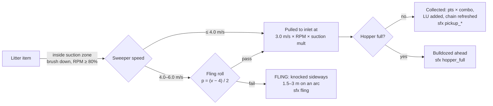
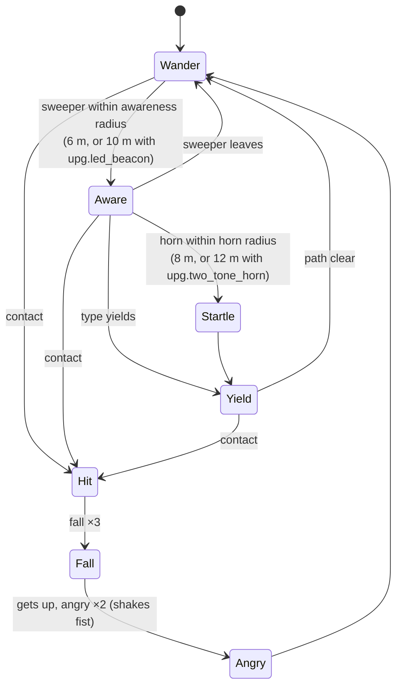
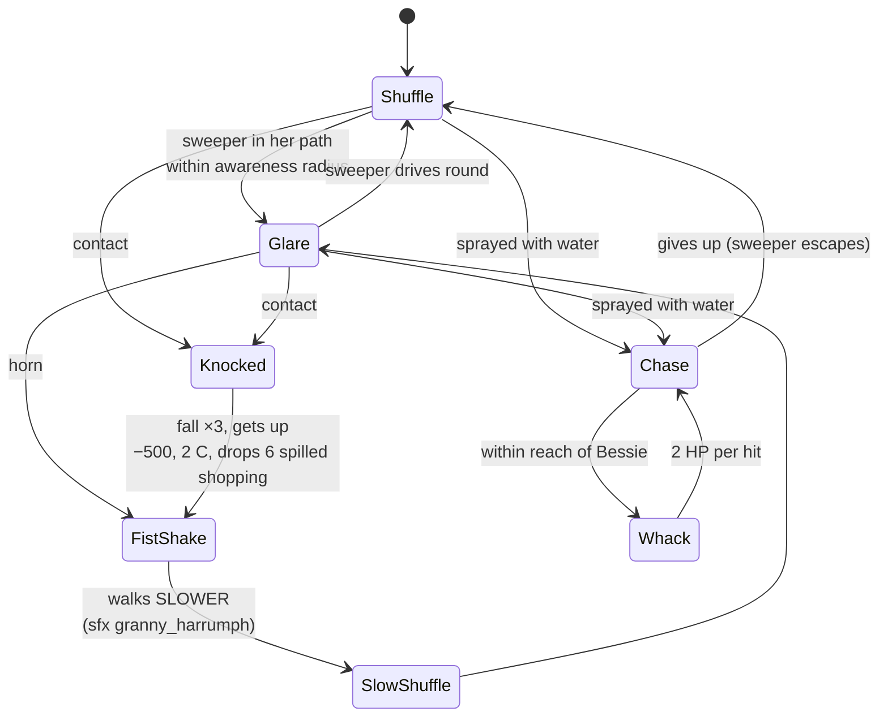
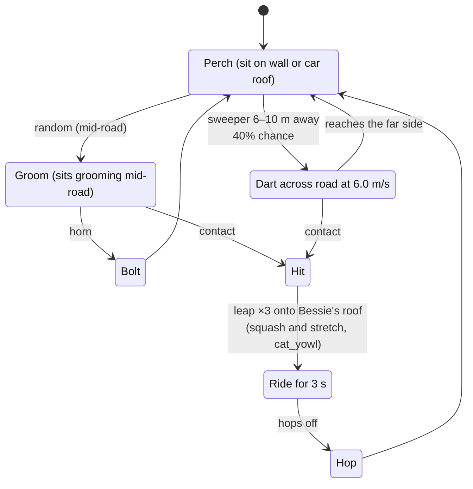
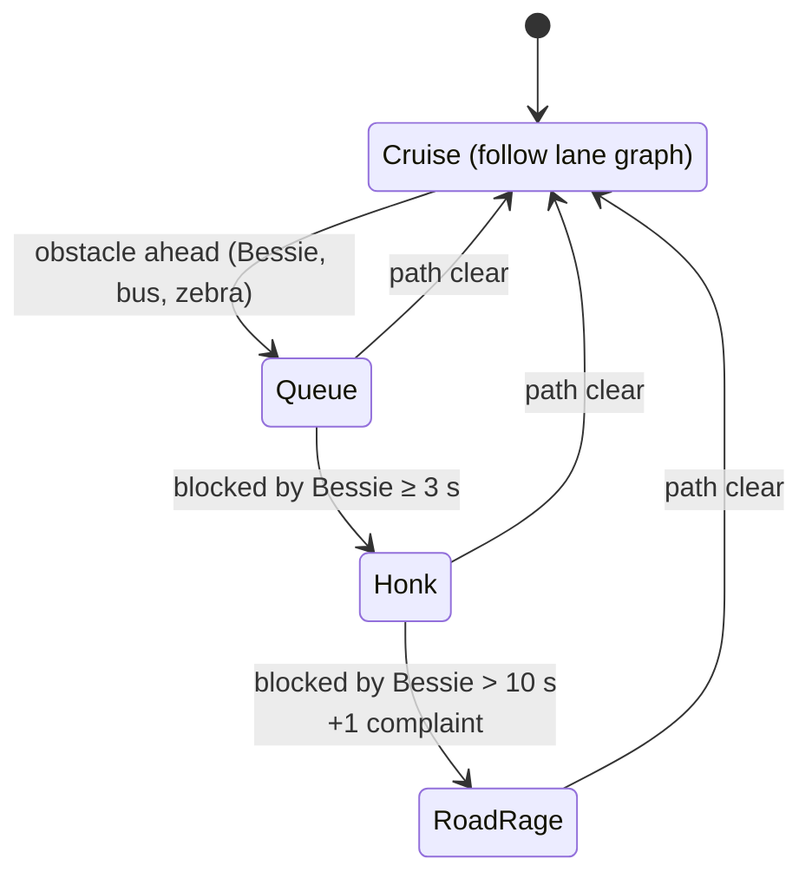

# Entity Catalog

> **Status:** v1.0, 2026-10-18. Derived from the Canonical Facts Sheet v1.0, §7 and §8.
> **Authority:** This document mirrors `src/data/entities.json` (upgrades: `src/data/upgrades.json`). Until a JSON file exists, this catalog holds the canonical values for its entity IDs, per-entity numbers and upgrades. From the commit that creates the JSON, the JSON is the source of truth and this document is a mirror, kept in sync by `tests/unit/entityCatalog.test.ts` (see [CLAUDE.md §2](../CLAUDE.md#2-where-truth-lives)). If the JSON and this document disagree, that is a bug: fix both in the same PR.
> **Language:** British English throughout (kerb, tyre, rubbish, colour).

Related documents:

- [GDD](GDD.md): why the numbers are what they are (pillars, scoring philosophy, economy).
- [LEVEL_DESIGN](LEVEL_DESIGN.md): spawn tables, densities and NPC schedules per district. This catalog only says *whether* an entity appears in a district.
- [ART_BIBLE](ART_BIBLE.md): the Kerbside-32 palette, ramps, the outline rule and character proportions.
- [ASSET_PIPELINE](ASSET_PIPELINE.md): how each technique below is run (forge, Blender, Codex).
- [AUDIO_DESIGN](AUDIO_DESIGN.md): what each `sfx.*` sounds like and how it is synthesised.
- [TECHNICAL_DESIGN](TECHNICAL_DESIGN.md): struct-of-arrays stores, tick order and collision maths.
- [GLOSSARY](GLOSSARY.md): LU, Tidy %, Frontage, Pledge, Fling, Chain, Complaint and the other terms used here.

---

## Contents

1. [Conventions](#1-conventions)
2. [ID index](#2-id-index)
3. [Shared rules](#3-shared-rules) (collection, collisions, penalties, pedestrian reactions)
4. [Rubbish (`litter.*`)](#4-rubbish-litter)
5. [Stains (`stain.*`)](#5-stains-stain)
6. [Pedestrians (`npc.*` people)](#6-pedestrians-npc-people)
7. [Animals (`npc.*` animals)](#7-animals-npc-animals)
8. [Vehicles (`veh.*`)](#8-vehicles-veh)
9. [Props and obstacles (`prop.*`)](#9-props-and-obstacles-prop)
10. [Hazards (`haz.*`)](#10-hazards-haz)
11. [Sites (`site.*`)](#11-sites-site)
12. [Power-ups (`pwr.*`)](#12-power-ups-pwr)
13. [Collectibles (`collect.*`)](#13-collectibles-collect)
14. [Upgrades and liveries (`upg.*`)](#14-upgrades-and-liveries-upg)
15. [`entities.json` shape](#15-entitiesjson-shape)
16. [Changing this catalog](#16-changing-this-catalog)
17. [Open questions](#17-open-questions)

---

## 1. Conventions

### 1.1 Units and abbreviations

| Term | Meaning |
|---|---|
| **Pts** | Score points **before** the combo multiplier ([GDD](GDD.md), facts sheet §8.1). Negative values are penalties. |
| **LU** | Litter units: how much of the hopper an item fills. Base hopper is **100 LU**. |
| **C** | Council Complaints added to the 0–5 meter. Reaching 5 = **SACKED!** |
| **HP** | "Bessie's Dignity". 100 HP; 0 HP = **TOWED!** |
| m, m/s | Sim units are metres and seconds. 16 px = 1 m on the ground. |
| **TBD (M0 spike)** | The facts sheet does not give this value, and it depends on the M0 look or tech spike (render and asset values such as slice counts). Do not guess it in code: read it from `entities.json`. |
| **TBD (M*n* tuning)** | A gameplay value the facts sheet does not give. M0 has no vehicle or NPC sim, so these are settled in the milestone that first simulates them (M2 for stains, M3 for NPCs and knockables, M6 for Wed–Sun entities). Where a proposed default is given, it is the starting value for that tuning. |

### 1.2 District codes

The "Districts" column uses these short codes (full table in [LEVEL_DESIGN](LEVEL_DESIGN.md)):

| Code | District ID | Name | Weather / time |
|---|---|---|---|
| **Mon** | `district.puddle_lane` | Puddle Lane (tutorial) | Dawn → morning, clear |
| **Tue** | `district.high_street` | Muckleford High Street | Late morning, clear, market day |
| **Wed** | `district.gasworks` | Gasworks Estate | Overcast, rain |
| **Thu** | `district.conker_hill` | Conker Hill | Afternoon, wind + leaf fall |
| **Fri** | `district.promenade` | The Promenade | Golden hour, gusts |
| **Sat** | `district.kebab_mile` | Kebab Mile | Night |
| **Sun** | `district.civic_quarter` | Civic Quarter | Morning, clear; **every NPC type** |
| **Yard** | `district.depot_yard` | The Depot Yard (Skip Run) | Matches the preceding shift |

**Bold** codes mark a district where the entity is a *signature* element (facts sheet §9.2). "Any" means the entity is created dynamically by another entity and can therefore turn up wherever its parent does.

### 1.3 Sprite and frame notation

- **Cell** is the atlas cell from the locked sprite size sheet (facts sheet §4.6). Figures in brackets are the maximum visible body.
- **Frames** are given as `state ×n`. Frame IDs follow `<asset-id>:<state>:<dir>:<n>`, e.g. `npc.old_woman:angry:sw:1`.
- Humans and 8-direction animals author **S, SW, W, NW, N** and mirror **SE, E, NE**.
- **Technique** is from facts sheet §5.2: `grid` (text-grid sprite), `ai-ingest` (Codex golden → `forge ingest` → grid, after which the grid is the truth), `blender`, `procedural`. An entry marked *(proposed)* is not named in §5.2 and follows the nearest listed class. Confirm it in M4.
- Litter **rotations** are generated by code. They use heading directions `h00`, `h08`, `h16`, `h24` (0°, 90°, 180°, 270°), so the frame ID grammar needs no new direction type: `litter.pizza_box:wobble:h08:1`.

### 1.4 SFX notation

SFX are written without the `sfx.` prefix, exactly as in the [AUDIO_DESIGN](AUDIO_DESIGN.md) list: `pickup_small`, `pickup_big`, `pickup_glass`, `fling`, `hopper_full`, `dump`, `brush_lower`, `brush_raise`, `horn`, `bump_wall`, `bump_kerb`, `crash`, `police_whoop`, `ice_cream_chime`, `cone_knock`, `bin_knock`, `splash`, `cat_yowl`, `dog_bark`, `pigeon_flap`, `seagull_squawk`, `ped_oi`, `granny_harrumph`, `kid_waah`, `complaint_stamp`, `combo_tier`, `powerup`, `coin`, `timer_warn`, `ui_move`, `ui_select`, `ui_back`.

No entity may reference an SFX ID outside this list. Behaviours that would benefit from a dedicated sound are listed in [§17](#17-open-questions) rather than given invented IDs.

---

## 2. ID index

All 111 canonical IDs (plus parked vehicle variants), grouped by class. `src/gen/assets.ts` exports `AssetId` as a union type, so a typo in any of these is a compile error.

| Class | Count | IDs |
|---|---|---|
| `litter` | 15 | `crisp_packet` `drink_can` `plastic_bottle` `glass_bottle` `newspaper` `cigarette_butts` `banana_skin` `chip_wrapper` `pizza_box` `kebab_wrapper` `leaf_pile` `dog_mess` `bin_bag` `lolly_stick` `spilled_shopping` |
| `stain` | 5 | `gum` `milkshake` `oil` `chalk_art` `splat` |
| `npc` (people) | 15 | `shopper` `old_woman` `old_man_frame` `jogger` `dog_walker` `kid_skateboard` `kid_chalk` `litterbug` `businessman` `mum_pushchair` `postie` `lollipop_lady` `market_trader` `reveller` `inspector` |
| `npc` (animals) | 4 | `cat` `dog_loose` `pigeon` `seagull` |
| `veh` | 12 | `sweeper` `hatchback` `saloon` `taxi` `van_white` `bus` `bin_lorry` `ice_cream_van` `police` `rival_sweeper` `bicycle` `mobility_scooter` (+ `veh.<type>_parked`) |
| `prop` | 17 | Knockable: `wheelie_bin` `traffic_cone` `a_board` `shopping_trolley` `recycling_box`. Static: `lamp_post` `bollard` `bench` `bus_shelter` `phone_box` `post_box` `hydrant` `tree` `planter` `market_stall` `litter_bin` `roadworks_barrier` |
| `haz` | 8 | `oil_slick` `puddle` `pothole` `speed_bump` `wet_leaves` `broken_glass` `open_manhole` `wind_gust` |
| `site` | 8 | `depot` `depot_bay` `skip` `bus_stop` `zebra` `school_crossing` `frontage` `pledge_frontage` |
| `pwr` | 6 | `flask_of_tea` `bacon_butty` `hi_vis` `super_suction` `wrench` `water_can` |
| `collect` | 8 | `false_teeth` `lost_wallet` `hard_hat` `cat_collar` `bucket_and_spade` `lost_shoe` `mayors_chain` `golden_crisp` |
| `upg` | 13 | `hopper` `suction` `gutter_brooms` `water_tank` `engine` `tyres` `bumper` `two_tone_horn` `led_beacon` `livery_council` `livery_racing_green` `livery_seaside` `livery_midnight_gold` |

---

## 3. Shared rules

These rules apply to every entity in a class unless its own row overrides them. Values come from `src/data/tuning.json` and the facts sheet §6.

### 3.1 How litter is collected



- The gutter brushes reach ±1.30 m, so the swept width is **2.6 m (≈ 42 px)**. The inlet is 1.0 × 0.4 m at y +1.2. An item is collected when its centre enters the inlet.
- `pwr.super_suction` raises the fling threshold to **6.0 m/s**, so there is no fling at all at brush-down top speed.
- **Brush up:** litter is driven over with no effect, **except** for the items with a brush-up rule (`banana_skin`, `leaf_pile`, `dog_mess`, `bin_bag`, `glass_bottle` when flung).
- **Pickup SFX** pitch rises one semitone every 5 chain, up to +12.

### 3.2 Collision responses

| Response type | Applies to | What happens |
|---|---|---|
| **Solid** | Static props, buildings, parked vehicles, moving traffic | OBB vs OBB/AABB (SAT), restitution **0.2**. Damage = **4 HP per m/s** of normal impact speed above **2 m/s** (×0.6 with `upg.bumper`). SFX `bump_wall`; `crash` above the damage threshold. |
| **Knockable** | `prop.wheelie_bin`, `traffic_cone`, `a_board`, `shopping_trolley`, `recycling_box` | Custom impulse body. Bessie barely slows; the prop slides or tips and may spill litter. Per-prop penalty. |
| **Actor hit** | Pedestrians, dogs, cats, bicycles, mobility scooters | The actor plays its **fall** (3 frames), gets up and plays **angry** (shakes fist). Nobody is injured (PEGI 7). Penalty + complaints. **Any penalty resets the combo chain.** An actor hit counts only when Bessie's closing speed toward the actor is ≥ 1.0 m/s (proposed, M3). Actors that walk into a stationary or slower Bessie bump off, play startle, and incur no penalty. |
| **Line obstacle** | `npc.dog_walker` lead | Crossing the lead segment = **Lead Tangle**. No physical collision. |
| **Ghost** | Pigeons, seagulls, all sites, stains, most hazards | No physical collision. Overlap triggers an effect. |
| **Pickup** | `pwr.*`, `collect.*` | Collected when Bessie's body OBB overlaps the pickup, whatever the brush state. |

**Kerbs:** crossing costs 30% of speed plus a jolt (`bump_kerb`). Pavements are drivable, so pedestrians have no "safe" zone: the comedy depends on that.

### 3.3 Penalty multipliers and complaint sources

- **Police witness:** a penalty within **15 m** of a `veh.police` adds **+1 extra complaint**.
- **Horn spam:** more than 3 honks in 5 s = 1 complaint ("Noise"). The threshold becomes 5 with `upg.two_tone_horn`.
- **Blocking traffic** for more than 10 s = 1 complaint ("Road Rage").
- **Running an occupied zebra** = −200 + 1 complaint.
- Every complaint plays `complaint_stamp` and a rubber-stamp popup.

### 3.4 Generic pedestrian reaction model

All people share a steering core (`src/sim/npc/steering.ts`) and the same five animation states (walk, idle, startle, fall, angry). Per-type behaviours (`src/sim/npc/behaviours/<npc>.ts`) override transitions, never the animation set: the 13-frames-per-direction budget is locked.



- **Near miss:** passing within 0.5 m of a pedestrian at more than 3 m/s without contact = **+25**. The pedestrian plays **startle**.
- **Dust:** a pedestrian within 3 m of a dust cloud coughs (startle frames): −10 pts per pedestrian per 2 s. No complaint.
- **Puddle splash:** above 3 m/s through `haz.puddle`, pedestrians within 1.5 m: −50 each. Every 3rd splash = 1 complaint.
- **`pwr.hi_vis`:** every pedestrian yields and parts for 12 s, including the ones that normally never yield (Doris, the businessman). Stationary NPCs (`kid_chalk`, `market_trader`) do not move.

---

## 4. Rubbish (`litter.*`)

**Common sprite spec:** cell **16×16**, visible body 8–14 px. Frames: `idle ×1` + `wobble ×2`, each in 4 code-generated rotations (`h00`, `h08`, `h16`, `h24`) = **12 frame IDs per item**. Technique: Codex transparent 4×2 sheet → `forge ingest` (one scale factor per sheet, largest item = 14 px) → grid (`ai-ingest`). Source: `assets-src/ai/litter.sheet_NN/` (provenance) and `assets-src/sprites/litter/<name>.sprite.txt` (truth). Atlas: `items`. Manifest `dirs: "rot4"` (ASSET_PIPELINE §6.1). **Until M4:** the 15 IDs ship as hand-authored placeholder grids (`technique: "grid"`, SSP-051) under these final frame IDs; `litter.banana_skin` is already `ai-ingest` (the SSP-024 scale sample). SSP-139 moves the ingested items to `ai-ingest` without changing frame IDs.

### 4.1 Stats

| ID | Name | Pts | LU | Technique | Pickup SFX | Districts |
|---|---|---|---|---|---|---|
| `litter.crisp_packet` | Crisp packet | 10 | 1 | ai-ingest | `pickup_small` | All except Yard |
| `litter.drink_can` | Drink can | 15 | 1 | **grid** (hand-tuned for legibility) | `pickup_small` | All except Yard |
| `litter.plastic_bottle` | Plastic bottle | 15 | 1 | ai-ingest | `pickup_small` | All except Yard |
| `litter.glass_bottle` | Glass bottle | 20 | 1 | ai-ingest | `pickup_glass` | Tue, Wed, **Sat**, Sun |
| `litter.newspaper` | Newspaper | 10 | 2 | ai-ingest | `pickup_small` | All except Yard; heavy on **Fri** |
| `litter.cigarette_butts` | Cigarette butts (cluster of 3–5) | 5 | 0.5 | **grid** (cluster sprite, hand-drawn) | `pickup_small` | All except Yard |
| `litter.banana_skin` | Banana skin | 20 | 1 | ai-ingest | `pickup_small` | **Tue**, Fri, Sun |
| `litter.chip_wrapper` | Chip wrapper | 15 | 1 | ai-ingest | `pickup_small` | Tue, **Fri**, Sat, Sun; Any (seagull theft) |
| `litter.pizza_box` | Pizza box | 25 | 3 | ai-ingest | `pickup_big` | Tue, **Sat**, Sun |
| `litter.kebab_wrapper` | Kebab wrapper | 15 | 1 | ai-ingest | `pickup_small` | **Sat** |
| `litter.leaf_pile` | Leaf pile | 5 | 2 | ai-ingest | `pickup_big` | **Thu**, Sun |
| `litter.dog_mess` | Dog mess | 40 | 1 | ai-ingest | `pickup_small` | Mon, **Thu**, Sun; Any (dog walker) |
| `litter.bin_bag` | Bin bag | 50 | 8 | ai-ingest | `pickup_big` | Tue, **Wed**, Sat, Sun |
| `litter.lolly_stick` | Lolly stick | 10 | 0.5 | ai-ingest | `pickup_small` | **Fri**, Sun (ice cream van) |
| `litter.spilled_shopping` | Spilled shopping | **0** | 1 | ai-ingest | `pickup_small` | Any (knocked-over NPCs) |

### 4.2 Behaviours and brush-up rules

| ID | Behaviour |
|---|---|
| `litter.crisp_packet` | Light. **Drifts in wind**: during `haz.wind_gust` it moves 1.5 m/s for 4 s. Wobble frames play while drifting. |
| `litter.drink_can` | Inert. The grid is hand-tuned because the AI version was illegible at 12 px. |
| `litter.plastic_bottle` | Inert. |
| `litter.glass_bottle` | **If flung, it smashes into `haz.broken_glass`** where it lands. Collecting it cleanly plays `pickup_glass`. |
| `litter.newspaper` | **Blows 1.5 m/s in gusts.** The 2 LU reflects its bulk. |
| `litter.cigarette_butts` | Ships as a single cluster sprite (3–5 butts). Lowest value, but it counts as 1 item toward Tidy % and the chain, which makes it a cheap way to keep a combo alive. |
| `litter.banana_skin` | **Driven over with the brush up: 180° spin-out** of Bessie. With the brush down it is collected normally. |
| `litter.chip_wrapper` | **Attracts pigeons and seagulls.** A pigeon flock (6–12) gathers around it. Dropped by pedestrians whose chips a seagull steals. |
| `litter.pizza_box` | Bulky (3 LU). Dropped by `npc.reveller`. |
| `litter.kebab_wrapper` | Saturday-night item. Dropped by `npc.reveller`. |
| `litter.leaf_pile` | Thursday item. **Driven through brush-up, it leaves `haz.wet_leaves`** (grip 3.0). |
| `litter.dog_mess` | Dropped by the dog on a `npc.dog_walker` lead every 40–60 s. **Brush up over it: creates `stain.splat` and costs −20.** Mild Crude Humour (rating note). |
| `litter.bin_bag` | Worth the most, but fills 8% of the base hopper. **Hit above 4 m/s, it bursts into 6 small items** drawn from the district's small-litter table (the hit itself is not a pickup). Below 4 m/s with the brush down, it is collected whole. Dropped occasionally by `veh.bin_lorry`. |
| `litter.lolly_stick` | Spawned around a stationary `veh.ice_cream_van`. |
| `litter.spilled_shopping` | Dropped by NPCs you knock over (`npc.old_woman` drops **6**). **No points: it's your mess.** It still counts toward litter collected for Tidy %, and still uses 1 LU. |

---

## 5. Stains (`stain.*`)

**Common spec:** cell **32×32**, 1–3 variants, technique `procedural` (`assets-src/procedural/stains/*.json`), atlas `world`. Stains are ground decals, so they have no collision. They are **cleaned only by water spray** (6 water units/s, 2.6 m cone ahead) and scored once per stain. The spray time needed per stain is TBD (M2 tuning), with proposed defaults 1.0 s (gum), 1.5 s (milkshake) and 2.0 s (oil and chalk); `stain.splat` uses the gum value until tuned. The loop sound is the live spray synth (see [AUDIO_DESIGN](AUDIO_DESIGN.md)); there is no one-shot `sfx.*` on completion other than the score popup.

| ID | Name | Pts | Districts | Notes |
|---|---|---|---|---|
| `stain.gum` | Chewing gum | 10 | Tue, Sat, Sun | Small, many per tile near shops and bus stops. |
| `stain.milkshake` | Milkshake | 20 | Tue, **Fri**, Sun | |
| `stain.oil` | Oil stain | 30 | **Wed**, Sun | **Same tile as `haz.oil_slick`.** Spraying the slick cleans this stain; the +30 is awarded once. |
| `stain.chalk_art` | Chalk art | 30 | **Thu**, Sun | Drawn by `npc.kid_chalk`. **Cleaning it while its kid is present: −100 + 1 complaint ("WAAAH!", `kid_waah`).** Wait until the kid leaves (60–90 s) to score the +30. |
| `stain.splat` | Splat | 0 | Any | Created by driving brush-up over `litter.dog_mess` (−20). Cleaning it removes −20 grime. |

---

## 6. Pedestrians (`npc.*` people)

**Common sprite spec:** cell **24×24**, figure ≤ 18×22 px (≈ 1.1 × 1.4 m). 8 directions (S, SW, W, NW, N authored; SE, E, NE mirrored). Frames per direction: `walk ×4`, `idle ×2`, `startle ×2`, `fall ×3`, `angry ×2` = **13 per direction, 104 frame IDs, 65 authored**. Carried props (handbag, trolley, pushchair, walking frame, clipboard, skateboard) must fit inside the 24×24 cell. Technique: `ai-ingest`, using a Codex key-pose sheet reference-locked to `assets-src/ai/ref.people_style/golden.png`, ingested to `assets-src/sprites/npc/<name>.sprite.txt`. Claude authors the remaining frames in the grid. Atlas: `actors`. Outfit variety uses per-instance ramp swaps (up to 8 tables per atlas).

### 6.1 Stats

| ID | Name | Speed (m/s) | Hit penalty | Hit SFX | Districts | Milestone |
|---|---|---|---|---|---|---|
| `npc.shopper` | Shopper (8 outfit swaps) | 1.3 | −250, 1 C | `ped_oi` | **Mon**, **Tue**, Wed, Thu, Fri, Sun | M3 |
| `npc.old_woman` | "Doris", old woman with handbag + shopping trolley | 0.6 (chase 1.2) | −500, 2 C, drops 6 `litter.spilled_shopping` | `granny_harrumph` | **Mon**, Tue, Thu, Sun | M3 |
| `npc.old_man_frame` | Old man with walking frame | 0.4 | −500, 2 C | `ped_oi` | Mon, Tue, Sun | M3 |
| `npc.jogger` | Jogger | 3.5 | −250, 1 C | `ped_oi` | Thu, **Fri**, Sun | M6 |
| `npc.dog_walker` | Dog walker + dog on extendable lead (up to 5 m) | 1.2 | Tangle −150, 1 C; hit −300, 1 C | `ped_oi` + `dog_bark` | Mon, **Thu**, Sun | M3 |
| `npc.kid_skateboard` | Kid on skateboard | 5.0 | −250, 1 C | `kid_waah` | Wed, Thu, Fri, Sun | M6 |
| `npc.kid_chalk` | Kid chalking | 0 | Cleaning chalk while present: −100, 1 C | `kid_waah` | **Thu**, Sun | M6 |
| `npc.litterbug` | Litterbug teen | 1.4 | −250, 1 C | `ped_oi` | **Tue**, Wed, Sun | M3 |
| `npc.businessman` | Businessman on phone | 1.4 | −250, 1 C | `ped_oi` | **Tue**, Sun | M3 |
| `npc.mum_pushchair` | Parent with pushchair | 1.1 | −500, 2 C | `ped_oi` | Mon, Thu, Sun | M3 |
| `npc.postie` | Postie with trolley | 1.2 | −250, 1 C | `ped_oi` | Mon, Thu, Sun | M3 |
| `npc.lollipop_lady` | Lollipop lady | 0.8 | Running her crossing: −200, 1 C | `ped_oi` | **Sun** | M6 |
| `npc.market_trader` | Market trader | 0 | −250, 1 C | `ped_oi` | **Tue**, Sun | M3 |
| `npc.reveller` | Saturday-night reveller | 1.0 | −250, 1 C | `ped_oi` | **Sat**, Sun | M6 |
| `npc.inspector` | The Tidy Town Inspector | 1.0 | Splash or hit: 2 C | `ped_oi` | **Sun** only | M6 |

All hits also play `complaint_stamp` for each complaint and reset the combo chain.

### 6.2 Behaviours

| ID | Behaviour summary | Animation mapping (within the 13-frame set) |
|---|---|---|
| `npc.shopper` | Wanders pavements on the nav graph, crosses at crossings, **sidesteps at 4 m**. The baseline yielder that teaches the player how pedestrians move. | walk / idle at shop windows / startle on sidestep |
| `npc.old_woman` | See [§6.3](#63-doris-npcold_woman). **Never yields.** Glares, shakes her fist, chases and whacks with her handbag. | idle = glare; angry = fist shake and handbag whack; walk (fast cadence) = chase |
| `npc.old_man_frame` | **Crosses only at zebras, painfully slowly** (a 6 m two-lane crossing takes him 15 s). Bessie must wait at an occupied `site.zebra`: running it is −200 + 1 C on top of any hit. | walk is a shuffle-frame-shuffle cycle |
| `npc.jogger` | **Runs along the kerb gutter** (exactly where the gutter brush wants to be) and **swerves into the road around obstacles** such as parked cars and bins. Prime near-miss bonus source (+25). | walk = run cycle |
| `npc.dog_walker` | Walks a route with the dog up to 5 m ahead on an extendable lead. **The lead is a line obstacle across the pavement or road.** The dog drops `litter.dog_mess` every **40–60 s**. **Driving through the lead = Lead Tangle** (−150, 1 C): the walker spins (startle) and the dog barks. The dog reuses the `npc.dog_loose` grid with a coat ramp swap; it is a child actor of the walker, not a separate catalog entity. | startle on tangle |
| `npc.kid_skateboard` | **Fast on pavements, ollies off kerbs into the road.** Telegraphs the ollie with a crouch frame (startle 0) just before leaving the kerb, so attentive players can react. | walk = push cycle; startle = crouch/ollie |
| `npc.kid_chalk` | Stationary. **Draws `stain.chalk_art`, leaves after 60–90 s.** Spraying the chalk while the kid is there is a −100 + 1 C "WAAAH!". | idle = drawing; angry = wail |
| `npc.litterbug` | **Drops an item every 3–5 s** from the district litter table. **Honk within 6 m → "Caught!" +100**, then he slinks off the map (walk, head down) and stops dropping. Honking him does not count toward horn spam if it lands the Caught! | startle on honk, then walk |
| `npc.businessman` | Stares at his phone. **Ignores you until 2 m and crosses without looking.** Does not react to the awareness radius or the LED beacon, only to the horn. | idle = phone; startle at 2 m |
| `npc.mum_pushchair` | **Wide and slow**: the pushchair widens her collision footprint, so she blocks most of a pavement. | walk |
| `npc.postie` | Walks frontage to frontage and **stops at doors for 3 s**, often with the trolley left on the pavement edge. | idle at doors |
| `npc.lollipop_lady` | **Steps out at `site.school_crossing`; you must stop.** Holds the crossing for 6 s (proposed, TBD (M6 tuning)) while a group of children crosses. Running it: −200 + 1 C. | idle = sign raised; angry = sign waved |
| `npc.market_trader` | Mans a `prop.market_stall` all shift. **A litter pile builds at closing time (Tuesday)**, a late-shift scoring opportunity. | idle = calling out |
| `npc.reveller` | **Weaves, sings, drops pizza boxes and kebab wrappers.** The weave is a sine offset on the nav path, so its line is readable but never straight. | walk with sway |
| `npc.inspector` | **Walks a fixed route with a clipboard.** Each `site.frontage` he passes that is **below 90% clean: −100**. Splash or hit: 2 C. Sweeping ahead of his route is the Sunday puzzle. | idle = writing on the clipboard; angry = clipboard tap |

### 6.3 Doris (`npc.old_woman`)

Doris is the game's mascot antagonist. She is never knocked aside, never yields, and turns every confrontation into a scene.



- **Shuffle:** 0.6 m/s with her trolley.
- **Glare:** she **stops in your path and glares** (idle frames, facing Bessie). She ignores the awareness radius and `upg.led_beacon`. Only `pwr.hi_vis` makes her part.
- **Horn → she shakes her fist and walks slower.** The reduced speed is 0.4 m/s (proposed, TBD (M3 tuning)). The lesson: the horn makes things worse with Doris.
- **Spray her → she chases you at 1.2 m/s, whacking with her handbag (2 HP per hit).** At 1.2 m/s she can only catch a stationary or reversing Bessie, which is the joke: she catches you while you are dumping or refilling. She whacks every 1.0 s and gives up at 8 m (both proposed, TBD (M3 tuning)).
- **Hit:** −500, 2 complaints, 6 `litter.spilled_shopping` scattered around her. Collecting them earns 0 pts.

---

## 7. Animals (`npc.*` animals)

Technique for all animals: **`grid`**, written directly in `assets-src/sprites/npc/<name>.sprite.txt` (at ≤ 20 px, hand-placed pixels beat downscales). Atlas: `actors`.

### 7.1 Stats and sprites

| ID | Name | Cell (body) | Frames | Speed (m/s) | Hit / interaction | SFX | Districts | Milestone |
|---|---|---|---|---|---|---|---|---|
| `npc.cat` | Cat | 16×16 (≤ 12×14) | 8 dirs: `walk ×4`, `sit ×2`, `dart ×2`, `leap ×3` = 11/dir, 88 IDs | 6.0 dart | −300, 1 C ("Not the cat!") | `cat_yowl` | **Mon**, **Thu** (many), Sat, Sun | M3 |
| `npc.dog_loose` | Loose Jack Russell | 20×20 (≤ 16×18) | 8 dirs: `walk ×4`, `sit ×2`, `bark ×2` = 8/dir, 64 IDs | 7.0 | −300, 1 C | `dog_bark` | Wed, **Thu**, Sun | M6 |
| `npc.pigeon` | Pigeon (flocks of 6–12) | 12×12 (≤ 10×8) | 4 dirs: `peck ×2`, `fly ×3` = 5/dir, 20 IDs | — | Cannot be hit. Drive through a flock: **+25 "Pigeon Scatter"** | `pigeon_flap` | Tue, **Fri**, Sun | M3 |
| `npc.seagull` | Seagull | 16×16 (≤ 14×10) | 4 dirs: `walk ×2`, `fly ×3` = 5/dir, 20 IDs | — | No penalty; cannot be hit | `seagull_squawk` | **Fri**, Sun | M6 |

Animals with 8 directions author S, SW, W, NW, N and mirror the rest, like humans. The 4-direction birds author S, W, N and mirror E from W.

### 7.2 Cat (`npc.cat`)

The cat is the game's other recurring gag. Every behaviour must be readable a beat before it happens.



- **Idles on walls and car roofs** (including parked `veh.*_parked`), playing `sit`.
- **Darts across the road when you're 6–10 m away (40% chance per approach)**, using the `dart` frames. The roll happens once per approach so the player cannot farm it.
- **Sometimes sits grooming mid-road.** **Horn → bolts** (dart frames, away from Bessie).
- **Hit → leaps onto your roof (squash and stretch), rides 3 s, hops off.** −300, 1 complaint ("Not the cat!"). The cat is never hurt. While riding it is drawn at Bessie's roof height using `sit` frames, offset to her local frame.

### 7.3 Loose dog (`npc.dog_loose`)

- **Chases you within 12 m, barking** (`bark` frames, `dog_bark`). At 7.0 m/s it out-runs Bessie at any brush-down speed (top 6.0 m/s).
- **Horn → sits for 3 s.**
- **Out-run it in transit:** with the brush raised (11.0 m/s top speed) Bessie escapes.
- **Hit:** −300, 1 C. It rolls over (sit frames) and resumes the chase.

### 7.4 Pigeon (`npc.pigeon`)

- Spawned in flocks of **6–12**. **Gathers around chips** (`litter.chip_wrapper`), pecking.
- **Scatters at 4 m and lands 10 m away** (`fly ×3`, `pigeon_flap`).
- **Cannot be hit.** Driving through a flock awards **+25 "Pigeon Scatter"** once per flock per scatter.

### 7.5 Seagull (`npc.seagull`)

- **Steals chips from pedestrians.** The pedestrian drops a `litter.chip_wrapper` and plays startle.
- **Snatches litter just ahead of your brush:** it picks a target item in front of the suction zone and flies off with it (`seagull_squawk`). The item is gone and scores nothing.
- No penalty and no collision. Seagulls exist to be annoying.

---

## 8. Vehicles (`veh.*`)

**Common spec:** technique **`blender`** (`assets-src/blender/vehicles/<name>.py` + committed renders in `assets-src/rendered/<id>/`), 32 headings (`h00` = north, 11.25° clockwise steps), unlit toon materials using exact Kerbside-32 hex stops, 1 px ink outline added by the forge. Atlas: `actors`. Actor drop shadow = the same sprite offset +2, +2 px.

### 8.1 Sprites

| ID | Cell | Visible body (m) | Frames |
|---|---|---|---|
| `veh.sweeper` | body/dented 64×64; brush overlay is a separate asset `veh.sweeper_brush`, cell 96×96 (rendered `--size 384`, `ortho_scale` 6 m), same centre pivot as the body | 28×52 px (1.75 × 3.25 m) | `body ×1` × 32 headings; `dented ×1` × 32 headings (below 40 HP); `veh.sweeper_brush:brush` ×4 spin frames × 32 headings. **192 frame IDs** (64 + 128). |
| `veh.hatchback` | 64×64 | 26×46 px (1.63 × 2.88 m) | 32 headings, 8 paint swaps |
| `veh.saloon` | 64×64 | 28×54 px (1.75 × 3.38 m) | 32 headings, 8 paint swaps |
| `veh.taxi` | 64×64 | 28×54 px | 32 headings |
| `veh.police` | 64×64 | 28×54 px | 32 headings; beacon flash by ramp swap |
| `veh.van_white` | 64×64 | 30×60 px (1.88 × 3.75 m) | 32 headings |
| `veh.ice_cream_van` | 64×64 | 32×62 px (2.0 × 3.88 m) | 32 headings |
| `veh.bin_lorry` | 96×96 | 36×84 px (2.25 × 5.25 m) | 32 headings |
| `veh.bus` | 128×128 | 38×116 px (2.38 × 7.25 m) | 32 headings |
| `veh.rival_sweeper` | 64×64 | 28×52 px | 32 headings; ramp swap of the Bessie model (green and white) |
| `veh.bicycle` | 32×32 | 8×26 px (0.5 × 1.63 m) | 32 headings, rider modelled in |
| `veh.mobility_scooter` | 32×32 | 14×22 px (0.88 × 1.38 m) | 32 headings, rider modelled in |

Bessie's livery (default `upg.livery_council`): body 15 (shade 14), cab 07, stripe 26, brushes 18, beacon 17 (flashes to 16), windscreen 25/27, tyres 00/01. Other liveries are ramp swaps ([§14.2](#142-liveries-upglivery_)).

### 8.2 Behaviour, collision and districts

| ID | Name | Behaviour | Collision / penalty | SFX | Districts |
|---|---|---|---|---|---|
| `veh.sweeper` | **Bessie** (Dustmaster 3000), the player | Handling in [GDD](GDD.md) and `tuning.json` → `vehicle.sweeper`. | Takes damage, never deals a penalty by herself. | `horn`, `brush_lower`, `brush_raise`, `bump_wall`, `bump_kerb`, `crash`, `dump`, `hopper_full` | All |
| `veh.hatchback` | Traffic car (8 paint swaps) | **Follows the lane graph and stops behind you. Honks after 3 s blocked.** **Blocking traffic over 10 s = 1 complaint ("Road Rage").** | Solid; impact damage to Bessie | `horn` (pitched up) | All except Yard |
| `veh.saloon` | Traffic car (8 paint swaps) | As hatchback. | Solid | `horn` | All except Yard |
| `veh.taxi` | Taxi | **Stops abruptly to pick up fares**: the classic rear-end trap for a following sweeper. | Solid | `horn` | Tue, **Sat**, Sun |
| `veh.van_white` | White van ("Dave's Plumbing") | **Parks half on the pavement**, blocking the gutter line and forcing Bessie out into traffic. | Solid; when parked, uses parked rules | `horn` | Mon, Tue, Wed, Thu, Sun |
| `veh.bus` | Bus | **Stops at `site.bus_stop` for 5 s.** Long body; overtaking it means crossing into the oncoming lane. | Solid | `horn` (pitched down) | **Tue**, Fri, Sun |
| `veh.bin_lorry` | Bin lorry (friendly bin crew) | **4 m/s, stops at bins, sometimes drops a `litter.bin_bag`.** Following it is a deliberate strategy for collecting 50-point bags. | Solid | `horn` | **Wed**, Thu, Sun |
| `veh.ice_cream_van` | Ice cream van | **Stops for 20 s with chimes; spawns kids, wrappers and lolly sticks** (`litter.lolly_stick`). | Solid | `ice_cream_chime` | **Fri**, Sun |
| `veh.police` | Police car | **Patrols.** **A penalty witnessed within 15 m adds +1 extra complaint.** The beacon flashes and the whoop plays when it witnesses one. | Solid | `police_whoop` | **Sat**, Sun |
| `veh.rival_sweeper` | Spotless Sid's sweeper | **Rival Sweep mode (M9) plus a Friday cameo; steals litter** using the same inlet rules as Bessie. | Solid | `horn` | **Fri** (cameo); Rival Sweep mode |
| `veh.bicycle` | Cycle courier | **Fast, filters between lanes.** | Actor hit: **−250, 1 C** | `ped_oi` | Tue, Sat, Sun |
| `veh.mobility_scooter` | Mobility scooter | **1.5 m/s on pavements.** | Actor hit: **−500, 2 C** | `granny_harrumph` | Mon, Fri, Sun |
| `veh.<type>_parked` | Parked variants | **Static.** Reuse the parent's frames at a fixed heading, so they need no new art. Cats perch on their roofs. | Solid. **Denting one costs −100 and 5 HP.** | `crash` | All except Yard |

**Parked variants** exist for `hatchback`, `saloon`, `taxi`, `van_white`, `police` and `ice_cream_van` (`veh.hatchback_parked` and so on). Buses, bin lorries, bicycles and mobility scooters are never parked props.

### 8.3 Traffic car state machine



The blocking timer resets when the path clears. Each continuous block of more than 10 s by the same queue costs **one** complaint.

---

## 9. Props and obstacles (`prop.*`)

**Common spec:** cell **32×32 per slice**, `flat` (1 frame) or `stack` (4 or 8 horizontal slices, leaned by the perspective camera). Atlas: `items`. Collision shape = the opaque bounding box of the lowest slice, as an OBB. Until the M4 art pass measures those slices, the static props (§9.2) collide with a **provisional** footprint table, a circle or a box per id, in `src/data/tuning.json` → `propFootprints` (SSP-036; it moves to `entities.json` in M2; see [TECHNICAL_DESIGN §9.1](TECHNICAL_DESIGN.md#91-static-world)). Slice counts were locked in M0 ([`assets-src/STYLE.md`](../assets-src/STYLE.md) v1 §8, [ART_BIBLE §8.6](ART_BIBLE.md#86-props)) and appear in the Render column as `stack (n)`: 8 for tall props with thin members, 4 for broad or short ones. Only the lowest and highest slices cast drop shadows.

### 9.1 Knockable props

Custom impulse bodies (`src/sim/bodies.ts`). They do not slow Bessie meaningfully and never damage her.

| ID | Name | Mass | Penalty | Spills | Technique | Render | SFX | Districts |
|---|---|---|---|---|---|---|---|---|
| `prop.wheelie_bin` | Wheelie bin | 30 kg | −50 | 4 items | grid (`assets-src/sprites/prop/`) | stack (4) | `bin_knock` | All except Yard |
| `prop.traffic_cone` | Traffic cone | 2 kg | none | — | grid | stack (4) | `cone_knock` | Wed, Sun, **Yard** (Skip Run slalom) |
| `prop.a_board` | A-board | TBD (M3 tuning) | −25 | — | grid | stack (4) | `cone_knock` | **Tue**, Fri, Sun |
| `prop.shopping_trolley` | Shopping trolley | TBD (M3 tuning) | none | — | grid *(proposed)* | flat | `bin_knock` | Tue, Wed, Sat |
| `prop.recycling_box` | Recycling box | TBD (M3 tuning) | −25 | 2 items | grid *(proposed)* | flat | `bin_knock` | Mon, Thu, Sun |

Spilled items are drawn from the district's small-litter table and are worth their normal points (unlike `litter.spilled_shopping`). Knocking a prop is a penalty, so it **resets the combo chain** even when the spilled items let you rebuild it.

### 9.2 Static props

Solid. Hitting them uses the standard impact-damage rule ([§3.2](#32-collision-responses)) and `bump_wall` / `crash`.

| ID | Name | Technique | Render | Notes | Districts |
|---|---|---|---|---|---|
| `prop.lamp_post` | Lamp post | blender | stack (8) | Lifts the light mask at night (Sat, and the Depot Yard after Saturday's shift). M0 spike asset (SSP-020): a 4-slice prototype, `prop.lamp_post:slice:-:0`–`3`, in the `items` atlas; SSP-131 (M4) replaces it with the locked 8 slices (`:0`–`7`). | All |
| `prop.bollard` | Bollard | grid | stack (4) | Small and easy to clip with the gutter brush. | All except Yard |
| `prop.bench` | Bench | blender | flat | | Mon, Tue, Fri, Sun |
| `prop.bus_shelter` | Bus shelter | blender | stack (8) | Paired with `site.bus_stop`. | Tue, Fri, Sun |
| `prop.phone_box` | Phone box | blender | stack (4) | | Mon, Tue, Sun |
| `prop.post_box` | Post box | grid *(proposed)* | stack (4) | `postbox_red` (18). | Mon, Tue, Thu, Sun |
| `prop.hydrant` | Hydrant | grid | flat | **Water refill: stop adjacent, 25 units/s.** | All |
| `prop.tree` | Tree | blender (canopy) | stack (8) | Canopy overhangs pavements. | Mon, **Thu**, Sun |
| `prop.planter` | Planter | blender *(proposed)* | flat | | Tue, Sun |
| `prop.market_stall` | Market stall | blender | stack (8) | Manned by `npc.market_trader`. | **Tue**, Sun |
| `prop.litter_bin` | Litter bin | grid *(proposed)* | stack (4) | Static (bolted down), unlike the wheelie bin. | All except Yard |
| `prop.roadworks_barrier` | Roadworks barrier | grid *(proposed)* | stack (4) | Rings `haz.open_manhole`. | Wed, Sun |

---

## 10. Hazards (`haz.*`)

Hazards are ground effects with no physical collision (except the open manhole's hard stop). Sprites: cell 32×32 ground decal *(proposed: `haz.*` is not in the §4.6 size sheet; it follows the stain cell)*, atlas `world`, technique `procedural` *(proposed)* unless noted.

| ID | Name | Effect | Score | SFX | Districts |
|---|---|---|---|---|---|
| `haz.oil_slick` | Oil slick | **Lateral grip 1.2** (asphalt is 9.0). | **Spray it for +30** (this is the `stain.oil` award on the same tile) | — | **Wed**, Sun |
| `haz.puddle` | Puddle | **Grip 4.0.** **Above 3 m/s it splashes pedestrians within 1.5 m: −50 each. Every 3rd splash = 1 complaint.** Splashing `npc.inspector` = 2 C. | −50 per splashed pedestrian | `splash` | **Mon**, **Wed** (many), Sun |
| `haz.pothole` | Pothole | **Jolt: −2 HP, spills 2 LU from the hopper behind you** (spilled as small litter items). | — | `bump_kerb` | **Wed**, Thu, Sun |
| `haz.speed_bump` | Speed bump | **Above 6 m/s: the jolt spills 3 LU.** At or below 6 m/s, no effect. Rendered as a ground tile variant. | — | `bump_kerb` | Mon, Thu, Sun |
| `haz.wet_leaves` | Wet leaves | **Grip 3.0.** Created when `litter.leaf_pile` is driven through brush-up. | — | — | **Thu** |
| `haz.broken_glass` | Broken glass | **−5 HP/s while driving on it.** Created when a flung `litter.glass_bottle` smashes. | **Sweep for +20** | `pickup_glass` | Any (where glass bottles appear: Tue, Wed, **Sat**, Sun) |
| `haz.open_manhole` | Open manhole | **Within roadworks. Driving in: −10 HP and a hard stop.** Always ringed by `prop.roadworks_barrier`. Tile variant of the manhole ground tile. | — | `crash` | Wed, Sun |
| `haz.wind_gust` | Wind gust | Not a sprite: a timed district event shown with the leaf-swirl FX. **Newspapers, packets and leaves drift 1.5 m/s for 4 s.** | — | — | **Fri** |

Grip values are multiplied by 1.15 with `upg.tyres` (oil 1.2 → 1.38, puddle 4.0 → 4.6, wet leaves 3.0 → 3.45, asphalt 9.0 → 10.35).

---

## 11. Sites (`site.*`)

Sites are level-authored regions and markers from `<district>.level.json`. Most have no sprite of their own: they are drawn by ground tiles, facades or props.

| ID | Purpose | Rules | Visual | Districts |
|---|---|---|---|---|
| `site.depot` | The depot yard | Shift start and end. | Ground tiles + Blender props | All shifts (edge of map), **Yard** |
| `site.depot_bay` | Dump and full water refill | **Stop (< 0.5 m/s), hold Dump 1.0 s, drain 2.0 s.** Pays the tipping fee (**£1 per 5 LU**) and fully refills water. In the Skip Run: £5 per clean bay, £50 for a clean run. `dump` SFX. | Procedural bay markings | All shifts, **Yard** |
| `site.skip` | On-route dump | **Hold 1.0 s, drain 3.0 s, no tipping fee.** `dump` SFX. | Blender prop (skip) | Per level (including Yard set dressing) |
| `site.bus_stop` | Bus stopping point | `veh.bus` stops here for 5 s. | Road marking + `prop.bus_shelter` | Tue, Fri, Sun |
| `site.zebra` | Zebra crossing | **Must stop if occupied: running it is −200 + 1 complaint.** `npc.old_man_frame` crosses only here. | Zebra ground tiles | All except Yard |
| `site.school_crossing` | Lollipop lady's crossing | `npc.lollipop_lady` steps out here; you must stop. | Zig-zag ground tiles | **Sun** |
| `site.frontage` | Scoring segment, one per house or shop | Clean Sweep: **+100** at 100%. The inspector deducts **−100** for each one below 90% that he passes. Shown green or red on the Mercury map. | Facade | All except Yard |
| `site.pledge_frontage` | Tidy Pledge resident | **Green rosette on the door.** **£10 tip at ≥ 90%** (8–20 pledges per district). | Facade + rosette module | All except Yard |

---

## 12. Power-ups (`pwr.*`)

**Common spec:** cell **16×16**, visible 12×12, `bob ×2`, technique `grid` (`assets-src/sprites/pickup/<name>.sprite.txt`), atlas `items`. **1–3 per shift, spawn on pavements.** Collected by body overlap with any brush state; SFX `powerup`. A timed power-up picked up while the same one is active restarts its timer (it does not stack). All districts except Yard.

| ID | Name | Effect | Duration | Numbers in practice |
|---|---|---|---|---|
| `pwr.flask_of_tea` | Flask of Tea | **Combo chain timer ×2** | 15 s | Chain timer 2.0 s → 4.0 s |
| `pwr.bacon_butty` | Bacon Butty | **Top speeds +30%** | 10 s | Brush down 6.0 → 7.8 m/s; transit 11.0 → 14.3 m/s. The clean-pickup speed stays 4.0 m/s, so a greedy player flings more. |
| `pwr.hi_vis` | Hi-Vis Vest | **All pedestrians yield and part** | 12 s | Includes Doris and the businessman ([§3.4](#34-generic-pedestrian-reaction-model)) |
| `pwr.super_suction` | Super Suction | **Suction zone ×2 and the fling threshold rises to 6.0 m/s** | 10 s | Pull speed 3.0 → 6.0 m/s × RPM; no fling up to brush-down top speed |
| `pwr.wrench` | Wrench | **Repair +25 HP** | instant | Capped at 100 HP; can clear the dented sprite (40 HP threshold) |
| `pwr.water_can` | Watering Can | **Water +50** | instant | Capped at tank capacity (100 / 150 / 200) |

---

## 13. Collectibles (`collect.*`)

**Common spec:** as power-ups (16×16 cell, 12×12 body, `bob ×2`, `grid`, atlas `items`). SFX `powerup` (named variant `collect` for Lost Property, `golden` for `collect.golden_crisp`); the £25 Lost Property payout also plays `coin`.

### 13.1 Lost Property (one per district)

**+250 pts and £25.** The owner thanks you on the Mercury tally page. Returning it is one of the three conditions for the **Gleaming** badge (with 3★ and 0 complaints).

| District | ID | Item | Suggested owner on the tally page |
|---|---|---|---|
| Mon | `collect.false_teeth` | False teeth | Doris, naturally |
| Tue | `collect.lost_wallet` | Lost wallet | The businessman |
| Wed | `collect.hard_hat` | Hard hat | A gasworks foreman |
| Thu | `collect.cat_collar` | Cat collar | The cat's owner |
| Fri | `collect.bucket_and_spade` | Bucket and spade | A tearful child |
| Sat | `collect.lost_shoe` | Lost shoe | A reveller |
| Sun | `collect.mayors_chain` | Mayor's chain | The Mayor |

### 13.2 Golden Crisp Packet

| ID | Rule | Reward |
|---|---|---|
| `collect.golden_crisp` | **One hidden per district.** Placement is authored in the level JSON ([LEVEL_DESIGN](LEVEL_DESIGN.md)). | **+500 pts.** Collecting all 7 unlocks the **Midnight Gold** livery (`upg.livery_midnight_gold`). |

---

## 14. Upgrades and liveries (`upg.*`)

Bought in the Depot Workshop with £. Upgrades have no world sprite. Each has a 16×16 HUD icon (`grid`, `assets-src/sprites/ui/`, atlas `ui`). Workshop SFX: `ui_move`, `ui_select`, `ui_back`, and `coin` on purchase. Values are mirrored in `src/data/upgrades.json`.

### 14.1 Upgrades

| ID | Level 1 | Price | Level 2 | Price | Base → L1 → L2 |
|---|---|---|---|---|---|
| `upg.hopper` | 140 LU | £300 | 180 LU | £800 | 100 → 140 → 180 LU |
| `upg.suction` | Suction zone +25% | £250 | +50% | £700 | Pull 3.0 → 3.75 → 4.5 m/s × RPM |
| `upg.gutter_brooms` | Reach +0.15 m per side | £300 | +0.30 m | £750 | Swept width 2.6 → 2.9 → 3.2 m (≈ 42 → 46 → 51 px) |
| `upg.water_tank` | 150 units | £200 | 200 units | £500 | 100 → 150 → 200 |
| `upg.engine` | Transit top speed and accel +10% | £400 | +20% | £1,000 | Transit 11.0 → 12.1 → 13.2 m/s; accel 2.4 → 2.64 → 2.88 m/s² |
| `upg.tyres` | All grip values +15% | £350 | — | — | Asphalt 9.0 → 10.35, oil 1.2 → 1.38 |
| `upg.bumper` | Impact damage −40% | £300 | — | — | 4 → 2.4 HP per m/s above 2 m/s |
| `upg.two_tone_horn` | Horn radius 8 → 12 m; noise complaint threshold 3 → 5 honks | £150 | — | — | |
| `upg.led_beacon` | Pedestrians start yielding at 10 m instead of 6 m | £200 | — | — | Doris and the businessman are unaffected |

The full-hopper handling penalties (accel ×0.70, top speed ×0.90, steer rate ×0.85, +1,500 kg) scale with **fill fraction**, so a bigger hopper means you are lighter at any given LU.

### 14.2 Liveries (`upg.livery_*`)

Liveries are per-instance ramp swaps of the `veh.sweeper` frames: no extra renders.

| ID | Name | How to get |
|---|---|---|
| `upg.livery_council` | Council Yellow | Default |
| `upg.livery_racing_green` | Racing Green | £150 |
| `upg.livery_seaside` | Seaside Stripes | £150 |
| `upg.livery_midnight_gold` | Midnight Gold | Unlock: all 7 Golden Crisps |

**Price check:** the listed upgrade and livery prices sum to **£6,500** (upgrades £6,200 + liveries £300). The facts sheet §8.4 quotes **£7,350** for "buying everything". This is tracked in [§17](#17-open-questions); the prices in this table are canonical until the economy pass in M6.

---

## 15. `entities.json` shape

`src/data/entities.json` is keyed by entity ID. The sim reads it once at boot into typed struct-of-arrays stores; render, audio and UI read the same file for sprite, SFX and display-name lookups. The shape below is the contract this catalog mirrors. [TECHNICAL_DESIGN](TECHNICAL_DESIGN.md) owns the loader.

```json
{
  "litter.banana_skin": {
    "class": "litter",
    "name": "Banana skin",
    "pts": 20,
    "lu": 1,
    "sprite": "litter.banana_skin",
    "sfx": { "pickup": "pickup_small" },
    "districts": ["district.high_street", "district.promenade", "district.civic_quarter"],
    "rules": { "brushUp": "spinOut180" }
  },
  "npc.old_woman": {
    "class": "npc",
    "name": "Doris",
    "speed": 0.6,
    "chaseSpeed": 1.2,
    "behaviour": "old_woman",
    "yields": false,
    "hit": { "pts": -500, "complaints": 2, "drops": { "litter.spilled_shopping": 6 } },
    "handbagHitHp": 2,
    "sprite": "npc.old_woman",
    "sfx": { "hit": "granny_harrumph", "horn": "granny_harrumph" },
    "districts": ["district.puddle_lane", "district.high_street", "district.conker_hill", "district.civic_quarter"],
    "milestone": "M3"
  }
}
```

Rules for the file:

- Keys are canonical IDs from [§2](#2-id-index). The `sprite` field references an `AssetId` from `src/gen/assets.ts`, which makes a missing sprite a compile error.
- `sfx` values are bare IDs from [§1.4](#14-sfx-notation). A unit test asserts that each one exists in `assets-src/audio/sfx/`.
- `districts` here is a *membership* list. Weights and counts live in the level JSON spawn tables ([LEVEL_DESIGN](LEVEL_DESIGN.md)). The level compiler fails if a level spawns an entity whose `districts` list does not include that level.
- `milestone` is the milestone that delivers the entity's behaviour (§6.1). The level compiler rejects a district that spawns an entity whose milestone is later than the milestone that delivers that district ([LEVEL_DESIGN §10.3](LEVEL_DESIGN.md#103-validation-rules), L007).
- Numbers marked TBD in this document are absent from the JSON until decided; the loader must fail loudly on a missing required field rather than defaulting.

---

## 16. Changing this catalog

1. Change `src/data/entities.json` (or `upgrades.json`) **and** this document in the same PR. A Vitest test (`tests/unit/entityCatalog.test.ts`) parses the tables in this file and diffs IDs, points, LU, speeds and penalties against the JSON.
2. **Never rename an ID after M4** (Art Pass 1). Frame IDs are baked into atlases, replays and goldens. Deprecate instead: keep the old ID, mark it unused, and remove it at the next milestone boundary.
3. A new entity needs, in the same PR: a manifest entry in `assets-src/manifest.json`, at least a code-defined placeholder sprite under its final ID (facts sheet §5.1, "placeholder first"), a behaviour file if it moves, an `sfx` mapping that uses only existing IDs, and a row here.
4. A tuning change that affects a replay updates the replay hash in the same PR, with a note explaining why.

---

## 17. Open questions

Each item is resolved in the milestone named, then this section and the tables above are updated.

| # | Question | Default until resolved | Resolve in |
|---|---|---|---|
| 1 | **Economy total:** listed prices sum to £6,500, but facts sheet §8.4 says buying everything costs £7,350. Either prices rise by £850 in total or the quoted total changes. | Prices in [§14](#14-upgrades-and-liveries-upg) stand | M6 |
| 2 | Minimum relative speed for an actor **hit** (vs a harmless nudge that only startles). | Closing speed toward the actor ≥ 1.0 m/s counts; actors walking into a stationary or slower Bessie bump off with no penalty ([§3.2](#32-collision-responses)) | M3 |
| 3 | Does colliding with **moving traffic** carry a points or complaint penalty, or only HP damage? | HP damage only | M3 |
| 4 | Does denting a **parked car** (−100, 5 HP) replace or add to the impact-speed damage? | Flat 5 HP replaces it | M3 |
| 5 | Do **stain cleans** and **style bonuses** take the combo multiplier and refresh the chain, or only litter pickups? | Litter and stains refresh the chain; style bonuses are not multiplied | M2 |
| 6 | Does litter removed by a **seagull** or **Spotless Sid** reduce "litter spawned" in the Tidy % denominator? | Stolen litter is removed from both numerator and denominator (it was taken off the street), so the compiler's 3★ par, which does not model theft, stays valid. A "Pinched by Sid/gulls" count shows on the Mercury. | M6 |
| 7 | How many `litter.spilled_shopping` do other carrying NPCs (shopper, postie) drop when hit? Only Doris (6) is specified. | 0 for everyone except Doris | M3 |
| 8 | `stain.splat`: "Cleaning it removes −20 grime" is ambiguous (refund of the −20 penalty, or just removal of the grime). | No refund; cleaning clears the grime cells only | M2 |
| 9 | Thursday's weather is "wind + leaf fall" but `haz.wind_gust` is listed as a Friday event. Does Thursday get gusts too? | No: Thursday wind only drives leaf fall | M6 |
| 10 | Missing values: Doris's post-horn speed (0.4 m/s proposed), handbag whack interval (1.0 s) and give-up distance (8 m), lollipop crossing duration (6 s), stain spray time (1.0 / 1.5 / 2.0 s), knockable masses for A-board/trolley/recycling box, prop slice counts, animation frame rates. | Gameplay values: TBD (M2/M3/M6 tuning) with the proposed defaults above. Slice counts: decided in M0 (§9, [ART_BIBLE §8.6](ART_BIBLE.md#86-props)). Frame rates: [ART_BIBLE §10.2](ART_BIBLE.md#102-timing-table). | M0–M6 |
| 11 | SFX gaps with no ID in the canonical list: banana spin-out, Lead Tangle, seagull snatch, handbag whack, pothole/speed-bump spill. Currently mapped to the nearest existing ID or silent. | Reuse existing IDs | M5 ([AUDIO_DESIGN](AUDIO_DESIGN.md)) |
