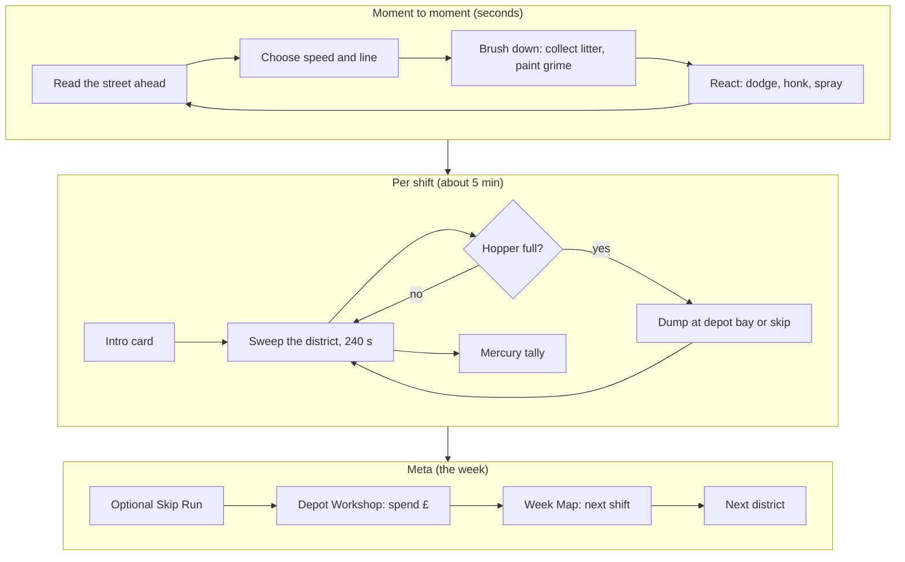
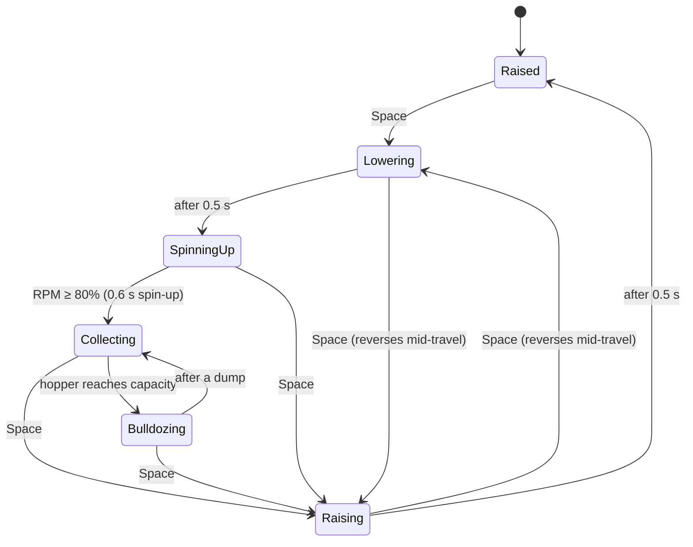
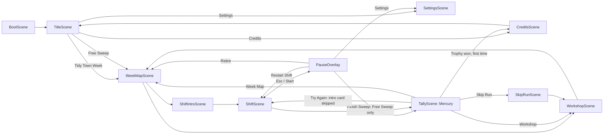

# Street Sweeper Pro: Game Design Document

> **Status:** Living document, v1.0 draft · **Date:** 2026-10-18 · **Canon:** Canonical Facts Sheet v1.0
> **Scope:** What the game is, how it plays and why. For *how it is built*, see [TECHNICAL_DESIGN.md](TECHNICAL_DESIGN.md). For *what every entity's stats are*, see [ENTITY_CATALOG.md](ENTITY_CATALOG.md). For *what each district contains*, see [LEVEL_DESIGN.md](LEVEL_DESIGN.md).
>
> **Language:** British English throughout (colour, kerb, tyre, rubbish). Gameplay numbers here are mirrored in `src/data/tuning.json`, `src/data/entities.json`, `src/data/upgrades.json` and `src/data/districts.json`. **Until a data file exists, this document is the truth for its tuning, district and economy numbers (entity and upgrade numbers belong to [ENTITY_CATALOG.md](ENTITY_CATALOG.md)). From the commit that creates the data file, the data file wins for the build and this document gets a fix PR** (see [CLAUDE.md §2](../CLAUDE.md#2-where-truth-lives)).
>
> Values marked **(proposed)** are design intent that the sheet does not fix. They are expected to move during tuning and must be confirmed in the milestone named next to them. Values marked `TBD (M0 spike)` were deliberately left to the M0 spike; none remain since M0 closed (SSP-027).

---

## Contents

1. [Vision](#1-vision)
2. [Design pillars](#2-design-pillars)
3. [Audience, platforms and rating](#3-audience-platforms-and-rating)
4. [Fiction, setting and cast](#4-fiction-setting-and-cast)
5. [Core loop](#5-core-loop)
6. [Controls](#6-controls)
7. [Vehicle handling](#7-vehicle-handling)
8. [Sweeping, hopper, water and dumping](#8-sweeping-hopper-water-and-dumping)
9. [Grime, frontages and Tidy %](#9-grime-frontages-and-tidy-)
10. [Scoring and combos](#10-scoring-and-combos)
11. [Penalties, complaints and fail states](#11-penalties-complaints-and-fail-states)
12. [Stars, economy, progression and upgrades](#12-stars-economy-progression-and-upgrades)
13. [Modes](#13-modes)
14. [Difficulty curve](#14-difficulty-curve)
15. [UX: HUD, menus and flow](#15-ux-hud-menus-and-flow)
16. [Onboarding and tutorial](#16-onboarding-and-tutorial)
17. [Accessibility and assists](#17-accessibility-and-assists)
18. [Humour and tone](#18-humour-and-tone)
19. [Out of scope](#19-out-of-scope)
20. [Open design questions](#20-open-design-questions)

---

## 1. Vision

### 1.1 Elevator pitch

A top-down pixel-art arcade driving game about the most underappreciated job in town. You drive **Bessie**, a lumbering council road sweeper (a *Dustmaster 3000*), through one week of shifts in the British seaside town of **Muckleford**. Suck up crisp packets, paint grimy streets visibly clean and keep your residents happy. Watch out for darting cats, grannies who won't budge, joggers, loose dogs and seagulls that steal chips. On Sunday the Tidy Town Inspector arrives.

**Tagline:** *"Somebody's got to do it."*
**Alt / marketing tagline:** *"Clean streets. Dirty looks."*

**Genre:** top-down arcade driving / cleaning score-attack, with a route-and-week structure.

### 1.2 Core fantasy

> *"I am the unsung hero of this town. I drive a big, slow, honest machine, and everywhere I go, the world gets better behind me."*

The player should feel three things in quick succession, many times a minute:

1. **Competence.** Threading a 4.2-tonne sweeper along a kerb at exactly the right speed, gutter brush kissing the edge, rubbish vanishing into the inlet.
2. **Visible progress.** A grey, grubby street turning into clean asphalt *in a stripe exactly as wide as your brushes*. The minimap and the frontages fill in. The town looks better because of you.
3. **Comic exasperation.** Doris has stopped in the road again. The cat is grooming itself on the centre line. A seagull has just nicked the chip wrapper you were lining up. None of this is your fault, and all of it is your problem.

### 1.3 Inspirations (internal only)

These are named here only to brief the team. They **never** appear in prompts, asset names, marketing or in-game text (see [CLAUDE.md](../CLAUDE.md), IP hygiene).

| Inspiration | What we take | What we leave |
|---|---|---|
| The original top-down Grand Theft Auto (1 and 2) | The straight-down camera into a city of extruded buildings with chunky, "close" roofs; the bustle of a living street; short, replayable driving runs | Crime, violence, open-world sprawl |
| Paperboy | A fixed route against the clock, a street of comic hazards, residents who are either pleased or furious with you, a daily tally | Throwing things at people; one-hit deaths |
| Satisfying-clean games (power-washing, cleaning sims) | Pixel-level erasure of dirt as the core reward; completion percentages | Slow, timerless zen as the *main* mode (it survives as Free Sweep) |
| British seaside comedy | Tone, cast, headlines | Anything mean-spirited |

### 1.4 What success looks like

- A new player clears Puddle Lane with 1★ on their **first** attempt and wants to retry for 2★ immediately.
- Players describe Bessie as "heavy but fair", never "floaty" or "unresponsive".
- Every playtester tells a Doris or cat story unprompted.
- A full week (first clear) takes 45 to 60 minutes; total 1.0 content including star-chasing is about 4 hours.

---

## 2. Design pillars

Every feature, tuning change and asset is tested against these. If a proposal weakens a pillar, it needs a strong reason.

| # | Pillar | What it means in play | Feature tests |
|---|---|---|---|
| 1 | **Visibly Satisfying Clean** | Every pass of the brush paints grime off the street at pixel level. The town looks measurably better because of you. | Is the result of the player's action *visible on the ground*, at 4 px grime-cell resolution, within one frame? Does the tally show the town before/after? |
| 2 | **Heavy, Honest Machine** | Bessie is slow, heavy and carries momentum. She gets more sluggish as the hopper fills. Mastering her is the skill. | Is the handling deterministic and readable? Does every slide, bump and spin have a visible cause (grip surface, kerb, load)? No hidden assists or rubber-banding. |
| 3 | **Thorough vs. Fast** | Going slow collects everything. Going fast flings rubbish aside, but you cover more route before the timer ends. Every second is that trade-off. | Does the feature create or sharpen a speed decision? Does it ever make one speed strictly dominant? |
| 4 | **Charming Chaos** | The street is alive with readable, comic characters who react to you with exaggerated animations. Mistakes are funny, not punishing. | Can a player predict this NPC from its silhouette and first two seconds of behaviour? Is the failure animation funny? Is the penalty recoverable within the shift? |
| 5 | **Every Pixel Reproducible** *(production)* | Every asset is AI-authored from sources committed to the repo, through a deterministic pipeline that is linted and reviewed. | Can this feature's art and audio be produced by the pipeline in [ASSET_PIPELINE.md](ASSET_PIPELINE.md) within Kerbside-32 and the locked scale sheet? If it needs a bespoke hand-painted asset, redesign it. |

Pillar 5 shapes design directly: we favour mechanics that are expressed through **palette, silhouette and animation state** (ramp-swapped outfits, 13-frame NPC sets, flat litter sprites) over mechanics that need unique illustrated assets.

---

## 3. Audience, platforms and rating

| Field | Value |
|---|---|
| Audience | Casual players aged 10+, retro and pixel-art fans, and anyone who enjoys a "satisfying clean" game |
| Rating target | **PEGI 7 / ESRB E10+** (Comic Mischief, Mild Crude Humour: dog mess) |
| 1.0 platforms | Web: desktop Chrome, Firefox, Safari, Edge, with keyboard and gamepad. Canonical build is an HTML5 game on itch.io (M7). |
| Post-1.0 | Touch and mobile web (**M8**), then macOS/Windows/Linux desktop via Tauri 2 (**M9**). A native mobile wrapper (Capacitor) is deferred indefinitely. |
| Session length | One shift = **240 s** of play plus about 60 s of intro and tally, so **about 5 min**. First full week clear about 45 to 60 min. Total 1.0 content about 4 h. |

**Rating guardrails (binding on design):**

- **Nobody is ever injured.** Pedestrians fall over cartoonishly, get up and shake a fist. Animals leap, yowl and bolt. There is no blood, no gore and no ragdolls.
- Collisions with people are always framed as *your embarrassment*, never their pain: the penalty is a complaint and a fine, the animation is a pratfall, the audio is an indignant "Oi!".
- Dog mess is the crudest joke in the game. Night-time revellers are "singing", never drunk on screen; no alcohol is shown.

**Player profile assumptions:**

- Plays in 5 to 20 minute sittings, often on a laptop keyboard.
- Has not necessarily played a driving game with momentum. Puddle Lane must teach "slow down to clean" without text walls.
- Is motivated by stars and visible completion more than by leaderboards (there are no online leaderboards in 1.0).

---

## 4. Fiction, setting and cast

### 4.1 Setting

**Muckleford** is a faded British seaside town: terraced Old Town streets, a market-day high street, a grubby gasworks estate, leafy hillside suburbs, a seafront promenade with arcades and a pier, a town centre that gets lively after the pubs shut, and a pompous Civic Quarter around the Town Hall. Muckleford has entered the national *Tidiest Town* contest. The inspection is on **Sunday**.

You are the rookie driver at the **Muckleford Borough Council Cleansing Department**. You have one week, one sweeper and a depot manager who has seen it all.

### 4.2 Cast

| Character | Role | Characterisation | Where they appear |
|---|---|---|---|
| **Bessie** (`veh.sweeper`) | Your Dustmaster 3000 road sweeper | Elderly, much-loved, yellow (sweeper_yellow), slightly asthmatic engine. Her health bar is "Bessie's Dignity". Visibly dented below 40 HP. | Every shift |
| **You** | Rookie driver | Never seen, never named. You are Bessie's hands. | — |
| **Big Pam Scrubbs** | Depot manager, your boss | Brisk, unflappable, tea-powered. Gives the shift briefing, barks advice on the radio, judges you at the Workshop. Secretly proud of you. | Shift intro cards, radio barks, Workshop, Mercury quotes |
| **Spotless Sid** | Rival sweeper driver from the neighbouring borough of **Snobbington** | Smug, immaculate, green-and-white sweeper (`veh.rival_sweeper`). Steals your litter. | Friday cameo, Rival Sweep mode (M9), Mercury quotes |
| **Doris** (`npc.old_woman`) | Old woman with handbag and shopping trolley | Will not yield. Will not be hurried. Will not be sprayed without consequences. The game's mascot of exasperation. | Mon, Tue, Thu and Sun (see [ENTITY_CATALOG.md](ENTITY_CATALOG.md)) |
| **The Tidy Town Inspector** (`npc.inspector`) | Contest judge | Clipboard, silence, tiny pencil. Walks a fixed route on Sunday and marks every frontage. | Sunday |
| **The Muckleford Mercury** | Local newspaper | Delivers the post-shift tally as a front page. Unreliable, sensationalist, affectionate. | Every tally |
| **Dave** (`veh.van_white`, "Dave's Plumbing") | Local tradesman | Never seen outside his van. Parks half on the pavement, always. | Ambient traffic |
| **The bin crew** (`veh.bin_lorry`) | Friendly colleagues | Wave, stop at bins, occasionally drop a bin bag in front of you. | Ambient traffic, mostly Wednesday |

The full pedestrian and animal roster (shoppers, joggers, dog walkers, kids, litterbugs, postie, lollipop lady, revellers and so on) is in [ENTITY_CATALOG.md](ENTITY_CATALOG.md). Portraits for intro cards are 64×64 with 2 expressions each (see [ART_BIBLE.md](ART_BIBLE.md)); 1.0 needs portraits for Big Pam, Spotless Sid, Doris and the Inspector (proposed).

### 4.3 Narrative structure

There is no cutscene story. The narrative is delivered entirely through:

1. **Shift intro cards:** Big Pam's portrait, two or three lines of briefing, the district, the target and the weather.
2. **Radio barks:** one-line text barks from Pam during play, shown in a small speech panel (tutorial prompts on Monday, warnings and quips afterwards).
3. **The Muckleford Mercury:** each tally is a front page whose headline reacts to how the shift went.
4. **The week arc:** Monday's rookie becomes Sunday's hope. The final Mercury headline on winning is fixed: **"MUCKLEFORD NAMED BRITAIN'S TIDIEST TOWN (RUNNER-UP)"**.

---

## 5. Core loop

### 5.1 Three nested loops



### 5.2 Moment to moment (every 2 to 10 seconds)

The central decision is always **"how fast, on which line?"**

| Situation | Slow and thorough | Fast and loose |
|---|---|---|
| Dense litter strip along a kerb | ≤ 4.0 m/s, gutter brush within 0.2 m of the kerb: everything collected, Kerb Hugger bonus, combo climbs | 6.0 m/s: some items flung 1.5 to 3 m sideways, chain may break, but you reach the next street sooner |
| Empty road between litter clusters | Brush down wastes time (top speed 6.0 m/s) | **Brush up** for transit at up to 11.0 m/s. You stop cleaning grime, and banana skins and dog mess become dangerous. |
| Pedestrian on a crossing | Stop. Wait. Lose seconds. | Honk (risk a Noise complaint), weave (risk a −250 hit), or take the near miss (+25 if > 3 m/s and within 0.5 m without contact) |
| Stain on the pavement | Stop-start, spray 6 units/s of water | Skip it and accept a lower frontage % |
| Hopper at 80% | Head back now, dump, keep the chain going on the way | Push on to 100% and start bulldozing litter ahead of you |

The **combo chain** (2.0 s timer, refreshed by every pickup) is the glue: it rewards keeping the brush in continuous contact with rubbish, which rewards planning a line through litter rather than zig-zagging.

### 5.3 Per shift

1. **Shift intro card** (about 15 s, skippable after first viewing): Big Pam's briefing, district, target (star thresholds, pledge count, a hint about the Lost Property), weather.
2. **Sweep the district within 240 s.** The shift starts at the district's depot bay or route start (per level, see [LEVEL_DESIGN.md](LEVEL_DESIGN.md)).
   - Lower the brush, collect litter, paint grime clean, keep pledge frontages spotless.
   - Dodge and appease NPCs.
   - Spray stains; refill water at hydrants.
3. **Dump** at the depot bay (or a skip) whenever the hopper fills.
4. **Timer ends** ("KNOCK-OFF TIME!"): the player's controls stop answering and Bessie rolls to a stop under a gentle automatic brake (half brake while above 0.2 m/s, then drag; about 2.3 s from 6 m/s, 3.4 s from 11 m/s: a pure coast took 15–19 s; `tuning.json` → `shift.knockOffBrake`, decided in SSP-062). The shift ends (and the tally follows) on the first tick she is at rest. Any LU still in the hopper is *not* paid as a tipping fee (decided in SSP-062, §20 Q10), and a dump still draining is cut short, which motivates a final dump run that finishes before the whistle.
5. **The Muckleford Mercury tally:** headline, district map with frontages green or red, Tidy %, stars, score, £ earned, Lost Property thank-you.
6. **Skip Run** (45 s, optional) → **Depot Workshop** → **Week Map**.

### 5.4 Meta (the week)

- **Seven districts, Monday to Sunday**, unlocked in order. Each needs 1★ on the previous one. **Sunday needs ≥ 12★ in total across Mon–Sat** (out of 18).
- **£ wages and tips** buy Workshop upgrades that change how Bessie handles and how much she can carry.
- **Collectibles:** one Lost Property item per district and one hidden Golden Crisp Packet per district. All seven Golden Crisps unlock the *Midnight Gold* livery.
- **Star-chasing:** 3★ and the **Gleaming** badge (3★ + 0 complaints + Lost Property returned) on every district.
- **The finale:** Sunday's Inspection decides the Tidy Town Trophy.

### 5.5 Why the loop works

| Need | Delivered by |
|---|---|
| Immediate reward | Grime erasure and pickup SFX every frame the brush is down |
| Short-term goal | Combo tiers (×2 at 10 chain, up to ×5 at 100+) |
| Mid-term goal | Frontages and pledges turning green; hopper management; the 240 s clock |
| Long-term goal | Stars, unlocks, upgrades, Golden Crisps, the Trophy |
| Mastery | Kerb lines, speed control, dump routing, NPC prediction |
| Variety | A new district, weather and NPC mix every day of the week |

---

## 6. Controls

### 6.1 Bindings

| Action | Keyboard | Gamepad (standard mapping) | Touch (M8) |
|---|---|---|---|
| Throttle | W / ↑ | RT | Right pedal |
| Brake → reverse (hold at standstill) | S / ↓ | LT | Left pedal |
| Steer | A, D / ←, → | Left stick X (deadzone 0.15) | Drag wheel slider (left half) |
| Brush lower/raise (toggle) | Space | A (south) | Brush button |
| Water spray (hold) | Left Shift | X (west) | Spray button |
| Horn | H | B (east) | Horn button |
| Interact / Dump (hold) | E | Y (north) | Contextual button |
| Shift map | Tab | View/Back | Map icon |
| Pause | Esc / P | Start/Menu | Pause icon |
| Dev panel (dev builds only) | F1 | — | — |

All keys are remappable and stored in `ssp.settings.v1`. Rumble on impacts plays where supported.

**Menu navigation (proposed, M3):** arrows/WASD or D-pad/left stick to move; Enter/Space or A to select; Esc/Backspace or B to go back. Mouse clicks work on all menu items. `sfx.ui_move`, `sfx.ui_select` and `sfx.ui_back` accompany each action.

### 6.2 Control design notes

- **Digital steering is first-class.** Most players are on a keyboard. Steering input is rate-limited (120°/s steer, 180°/s return, see §7), so tapping A/D produces smooth arcs, not twitches. Analogue sticks map stick X directly to the target steering angle.
- **Brake then reverse.** Holding brake at a standstill (below 0.2 m/s) engages reverse after a 0.25 s hold, with the reverse beeper. This avoids accidental reversing when braking hard. In reverse the pedals swap roles: brake drives Bessie backwards and throttle brakes her. Throttle at a standstill puts her back into forward at once. *(Built in SSP-030 and confirmed by the M1 lead playtest, SSP-050. The numbers live in `tuning.json` → `vehicle.sweeper.reverse`.)*
- **Brush is a toggle, spray is a hold.** The brush is a mode (you're "on the job" or in transit); spray is a short, resource-spending burst. An accessibility option offers toggle-spray (see §17).
- **Dump and Interact share one held button.** Holding for 1.0 s prevents accidental dumps while still being quick. A ring fills around the button prompt during the hold.
- **The horn is a tool, not a toy.** It has gameplay effects (cats bolt, loose dogs sit, litterbugs get caught, Doris slows down) and a cost (> 3 honks in 5 s = a Noise complaint).
- **Shift map (Tab)** overlays the district map with frontage status and the depot, skips and hydrants. It does **not** pause the shift (proposed): reading the map is a deliberate time cost.

---

## 7. Vehicle handling

Bessie is the game. Handling values live in `src/data/tuning.json` → `vehicle.sweeper`, which is their source of truth (since SSP-029). The numbers in §7.1, §7.3 and §7.4 are **mirrored from that file**: change the JSON first, then this section in the same commit (`tests/unit/tuning.test.ts` checks the §7.3 and §7.4 tables against it). Sim units are metres and seconds; the JSON stores angles in degrees and `src/sim/tuning.ts` converts them to radians at load. The implementation (kinematic bicycle model, OBB/SAT collision, fixed 60 Hz tick) is specified in [TECHNICAL_DESIGN.md](TECHNICAL_DESIGN.md).

### 7.1 Handling sheet

| Parameter | Value |
|---|---|
| Body / wheelbase | 1.75 × 3.25 m / 2.4 m |
| Mass | 4,200 kg empty, plus up to **1,500 kg** at a full hopper (linear with fill) |
| Engine acceleration | 2.4 m/s² empty. At full hopper: accel ×0.70, top speed ×0.90, steer rate ×0.85. |
| Brake deceleration | 6.0 m/s² |
| Reverse | max 2.5 m/s, accel 1.5 m/s², reverse beeper |
| **Top speed, brush down** | **6.0 m/s (21.6 km/h)** |
| **Clean-pickup speed** | **≤ 4.0 m/s (14.4 km/h).** Between 4.0 and 6.0 m/s the fling probability rises linearly from 0 to 1. |
| **Top speed, brush up (transit)** | **11.0 m/s (39.6 km/h)** |
| Steering | max 34°, scaled by `1/(1 + v/8)`. Steer rate 120°/s, return 180°/s. Kinematic bicycle model; minimum turning circle about 7 m. |
| Drag | rolling 0.3 m/s² + quadratic 0.012·v² |
| Lateral grip (decay rate /s) | asphalt **9.0**, pavement 8.0, grass 5.0 (drag ×2.5), wet/puddle 4.0, wet leaves 3.0, oil 1.2 |
| Kerb crossing | 30% speed loss + jolt. Pavements are drivable. |
| Collision | restitution 0.2. Damage = 4 HP per m/s of normal impact speed above 2 m/s. |
| Health ("Bessie's Dignity") | 100 HP. At 0 the shift ends ("TOWED!"). |
| Brush | raise/lower 0.5 s. RPM spin-up 0.6 s. Collects only at RPM ≥ 80% while lowered. RPM drops to 0 when raising starts (spin-down 0 s, SSP-059). |

### 7.2 What those numbers feel like

| Moment | Derived value | Design intent |
|---|---|---|
| 0 → clean-pickup speed (4.0 m/s), empty | ≈ 1.7 s | Getting back to work after a stop is quick enough not to feel punishing |
| 0 → clean-pickup speed, full hopper (2.4 × 0.70 = 1.68 m/s²) | ≈ 2.4 s | A full hopper is *felt* on every restart. Pillar 2. |
| Max steer angle at 4 m/s | 34° / 1.5 ≈ 22.7° | Tight enough to follow a kerb around a corner |
| Max steer angle at 11 m/s | 34° / 2.375 ≈ 14.3° | Transit speed commits you to wide lines; you brake for corners |
| Stopping from transit top speed (11 m/s at 6.0 m/s²) | ≈ 1.8 s, ≈ 10 m (about 5 tiles) | The camera's 3.0 m look-ahead plus speed zoom-out must show at least this far ahead |
| Head-on wall hit at 11 m/s | (11 − 2) × 4 = **36 HP** | Three of these and you're towed. A 4 m/s scrape costs 8 HP. |
| Head-on wall hit at 11 m/s with `upg.bumper` | 36 × 0.6 ≈ **21.6 HP** | |
| Dented variant threshold | below 40 HP | Visible warning before TOWED |

*Measured in the sim at M1 close (SSP-050), with drag included, which the derived values above leave out.* 0 → 4.0 m/s takes 1.98 s empty and 3.05 s at a full hopper. A stop from 10.9 m/s takes 1.62 s and 8.4 m. At 37.8 m the camera shows about 10.1 m ahead of the screen centre, plus up to 3.0 m of look-ahead, so the stop stays in view. A full-lock 90° turn takes 2.35 s at 4 m/s and 1.43 s at 10.9 m/s.

**Speed display.** The HUD speedometer (the "Brush-o-meter", §15.2) shows **mph** by default for local flavour (4.0 m/s ≈ 9 mph, 6.0 m/s ≈ 13 mph, 11.0 m/s ≈ 25 mph), with km/h as a setting (proposed). Its zones matter more than its digits.

### 7.3 Surfaces and terrain

| Surface | Grip | Notes |
|---|---|---|
| Asphalt | 9.0 | Baseline. On Wednesday (rain) all roads drop to **6.0**. |
| Pavement | 8.0 | Drivable. Crossing the kerb costs 30% speed and a jolt. Pedestrians live here. |
| Grass | 5.0 | Drag ×2.5. Verges and parks. A shortcut that rarely pays. |
| Wet / puddle (`haz.puddle`) | 4.0 | Above 3 m/s, splashes pedestrians within 1.5 m (−50 each; every 3rd splash = 1 complaint) |
| Wet leaves (`haz.wet_leaves`) | 3.0 | Thursday; created by driving through leaf piles with the brush up |
| Oil (`haz.oil_slick`) | 1.2 | Spray it for +30 |

Other road features (potholes, speed bumps, broken glass, open manholes, wind gusts) are in [ENTITY_CATALOG.md](ENTITY_CATALOG.md) §Hazards. The key design rule for all of them: **every handling disturbance has a visible tile or sprite cause.** Nothing slides Bessie that the player could not have seen.

### 7.4 Load: the hopper makes Bessie heavier

The full-hopper multipliers scale **linearly with fill fraction** (LU in hopper ÷ capacity), not with absolute LU. A 180 LU upgraded hopper at 90 LU is half-full and handles like a half-full base hopper. Upgrading capacity is therefore a pure benefit: you go further before Bessie gets sluggish.

| Fill | Accel | Top speed (brush down / transit) | Steer rate |
|---|---|---|---|
| 0% | 2.40 m/s² | 6.0 / 11.0 m/s | 120°/s |
| 50% | 2.04 m/s² | 5.7 / 10.45 m/s | 111°/s |
| 80% (HUD warning) | 1.82 m/s² | 5.52 / 10.12 m/s | 105.6°/s |
| 100% | 1.68 m/s² | 5.4 / 9.9 m/s | 102°/s |

### 7.5 Camera behaviour as a handling aid

From the player's point of view (details in [TECHNICAL_DESIGN.md](TECHNICAL_DESIGN.md)):

- **Look-ahead:** the camera leads Bessie by up to 3.0 m along her velocity, so you see more of where you're going.
- **Speed zoom:** above the brush-down top speed the camera eases out (height 31.5 m → 37.8 m at transit top speed) so transit driving shows more road. At sweeping speeds it returns to exact 1:1 pixels. *(The M0 spike kept zoom on and M1 confirmed it with real driving, [ROADMAP D-01](ROADMAP.md#8-m0-spike-decision-log). If it is ever disabled, look-ahead alone remains.)*

---

## 8. Sweeping, hopper, water and dumping

Since SSP-053 the numbers in this section are **mirrored from `src/data/tuning.json`** (`sweeping`, `hopper`, `water`, `dumping`; the brush timings and fling ramp are in `vehicle.sweeper.brush`, §7.1) and item values from `src/data/entities.json` ([ENTITY_CATALOG](ENTITY_CATALOG.md)). Change the JSON first, then this section in the same commit (`tests/unit/tuning.test.ts` checks them).

### 8.1 Brush geometry

Vehicle-local coordinates: origin at body centre, +y forward, metres.

| Part | Shape and position | Behaviour |
|---|---|---|
| **Gutter brushes** | Two circles, r = 0.45 m, at (±0.85, +1.75). Reach ±1.30 m, so the **total swept width is 2.6 m (≈ 42 px)**. | Sweep items inward toward the centre at 3.0 m/s and backward at 0.5 m/s (§8.2) |
| **Suction zone** | Rect 2.6 m wide, from y +1.6 to +2.8 | Items inside are pulled toward the inlet at 3.0 m/s × RPM × suction multiplier |
| **Inlet** | Rect 1.0 × 0.4 m at y +1.2 | An item whose centre enters it is collected |
| **Grime footprint** | The 2.6 m swept band | Erases grime cells while the brush is down and RPM ≥ 80% |

- **Kerb Hugger:** a gutter brush whose centre is within 0.2 m of a raised kerb edge (measured to the edge segment; `sweeping.kerbHugger.maxKerbDistanceM`) collects **gutter grime** (a dense strip along kerbs worth 2× points) under its circle. Holding kerb contact continuously, with the brush collecting, scores +50 per 3 s (decided in SSP-060).
- **Fling:** items that fail the speed check are knocked sideways 1.5 to 3 m on a kinematic arc that lasts 0.5 s (decided in SSP-057; tunable), and cannot be collected until they land. Flung items stay on the ground and can be collected on a later pass, *except* a flung `litter.glass_bottle`, which smashes into `haz.broken_glass` (−5 HP/s to drive on; sweep it for +20).

```
            suction zone (2.6 m wide, y +1.6 .. +2.8)
        ┌───────────────────────────────┐
        │  ○ gutter        gutter ○     │  ← brushes at (±0.85, +1.75), r 0.45
        │   brush    ▓▓▓▓    brush      │  ← inlet 1.0 × 0.4 m at y +1.2
        └──────────┬────────┬───────────┘
                   │ BESSIE │  1.75 × 3.25 m body
                   │  cab   │
                   │        │
                   └────────┘
   |←──────────── swept width 2.6 m (≈ 42 px) ────────────→|
```

### 8.2 Brush states



| State | Grime | Litter | Top speed | Audio |
|---|---|---|---|---|
| Raised (transit) | No | Driven over. Banana skins spin Bessie 180°; dog mess splats into `stain.splat` (−20); leaf piles leave `haz.wet_leaves`. | 11.0 m/s | Engine only |
| Lowering / Raising (0.5 s) | No | No | 6.0 m/s: the cap applies from the tick lowering starts until the brush is fully raised (SSP-059) | `sfx.brush_lower` / `sfx.brush_raise` |
| Spinning up (0.6 s) | No | No | 6.0 m/s | Brush whirr pitch rising |
| Collecting | Yes | Yes, subject to the fling check | 6.0 m/s | Brush whirr, pickup SFX |
| Bulldozing (hopper full) | Yes (decided in SSP-060: grime is not stored in the hopper) | Pushed ahead, not collected: an item reaching the inlet is pinned 0.1 m ahead of the front bumper | 6.0 m/s | Clunk, `sfx.hopper_full` |

The 1.1 s from pressing Space to full RPM (0.5 s lower + 0.6 s spin-up) is deliberate: it makes raising the brush for a short transit hop a real decision, not a free action. Collecting starts as soon as RPM reaches 80%, 29 of the 36 spin-up ticks, so the first pickup can come 59 ticks (≈ 0.98 s) after the press.

**Decided in SSP-059** (values in `tuning.json`; all tunable):

- **Gutter sweep-in:** an item inside a gutter circle is pushed toward the centre line at **3.0 m/s** (`sweeping.gutterBrush.sweepInMps`) and backward at **0.5 m/s** (`sweepBackMps`). 3.0 is the smallest round value that collects every item across the full 2.6 m width at the 4.0 m/s clean-pickup speed (2.5 m/s missed items starting beyond ±1.28 m and 2.0 m/s beyond ±1.22 m; measured on a 4 mm grid of start offsets, one item at a time).
- **RPM on raise:** RPM drops to **0** the moment Raising starts (`vehicle.sweeper.brush.spinDownS = 0`; a positive value spins it down linearly from full over that time). RPM only rises while the brush is fully lowered.
- **Reversal:** Space during Lowering raises again, and Space during Raising lowers again, from where the brush is, so a reversal takes as long as the travel already made.
- **Contact episode:** an item rolls the fling check the first time it is in the brush zone (the gutter circles, the suction rect, the inlet and the 0.2 m throat between the suction rect and the inlet). The episode ends when the item is outside all of them, when the brush stops collecting, or when it is flung (a flung item that lands back in the zone rolls again).
- **Throat:** items between the suction rect's back edge (y +1.6) and the inlet's front edge (y +1.4) are pulled like suction items, so with Bessie stopped the suction still delivers them to the inlet.
- **Bulldozer:** at a full hopper an item in the inlet mouth (inlet width, from the inlet's back edge to the pin line) is pinned on the pin line **0.1 m** ahead of the front bumper (`sweeping.bulldozer.pinAheadM`) and pushed along. Pinned items are released into the suction (and collected) once a dump takes the hopper below capacity, and left where they are when the brush is raised.

**Decided in SSP-061:** an item is **driven over** when its centre is inside Bessie's body OBB (**1.75 × 3.25 m**, edges inclusive) while the brush is Raised; Lowering and Raising never drive over litter (the table above). A driven-over `litter.dog_mess` is removed, a `stain.splat` appears at its position and the −20 goes through scoring's penalty hook, which also resets the combo chain. The mess is not collected: it stays in Tidy %'s litter-spawned count and can no longer be swept up, which is part of the cost.

### 8.3 The fling curve (Pillar 3 in one formula)

Fling probability per item touched by the brushes, at speed *v* (m/s):

```
p_fling(v) = clamp((v − 4.0) / 2.0, 0, 1)
```

| Speed | 3.0 | 4.0 | 4.5 | 5.0 | 5.5 | 6.0 |
|---|---|---|---|---|---|---|
| Fling chance | 0% | 0% | 25% | 50% | 75% | 100% |

With `pwr.super_suction` the fling threshold rises to 6.0 m/s, so at normal brush-down top speed nothing is flung. If it stacks with `pwr.bacon_butty` (brush-down top speed +30% = 7.8 m/s), the ramp shifts up by the same 2 m/s width: 0% at 6.0, 100% at 8.0 (proposed, M2).

**Coverage arithmetic** (why fast is tempting):

| Speed | Swept area per second | Route covered in a 240 s shift (if never stopping) |
|---|---|---|
| 4.0 m/s (clean) | 10.4 m²/s | 960 m |
| 6.0 m/s (all litter flung) | 15.6 m²/s | 1,440 m |
| 11.0 m/s transit (no cleaning) | 0 | 2,640 m |

Puddle Lane is 64×48 tiles (128 × 96 m). Districts are sized so that a perfect clean is impossible in one shift at 4.0 m/s: the player must choose which streets get the slow treatment (see [LEVEL_DESIGN.md](LEVEL_DESIGN.md) for route lengths per district).

### 8.4 Hopper

| Rule | Value |
|---|---|
| Base capacity | **100 LU** (litter units). Upgrades: 140 LU (`upg.hopper` L1), 180 LU (L2). |
| Warning | HUD warns at **80%**: gauge flashes, Pam bark "She's getting full, love." (proposed) |
| Full | The brush pushes items ahead without collecting ("bulldozer"), with a clunk SFX (`EV.HopperFull`, once per fill). Full ends as soon as a dump takes the hopper below capacity, so the next fill clunks again. |
| Overflow | An item that would push the hopper past capacity (99.5 LU + a 1 LU crisp packet, or a bin bag at 95 LU) is **still collected and scored**; the hopper is clamped to exactly capacity, the excess LU are lost, and the hopper is full. Without this rule, items of 0.5/1/2/3/8 LU could strand the hopper just below 100 so it never went full. (Decided in SSP-058.) |
| Spills | `haz.pothole` spills 2 LU behind you; `haz.speed_bump` above 6 m/s spills 3 LU. Spilled LU become litter on the road (proposed: as generic small items, re-collectable but not re-scored). |
| Weight | Up to +1,500 kg at full, with the handling multipliers in §7.4 |

Representative LU costs (full table in [ENTITY_CATALOG.md](ENTITY_CATALOG.md)): a crisp packet is 1 LU, cigarette butts 0.5 LU, a newspaper 2 LU, a pizza box 3 LU, a bin bag **8 LU**. Big items are high-value but fill the hopper fast, so in a dense area a player chooses between "a bin bag now" and "eight crisp packets and a ×2 chain".

### 8.5 Water

| Rule | Value |
|---|---|
| Tank | 100 units (`upg.water_tank`: 150 / 200) |
| Spray | Uses 6 units/s over a 2.6 m cone ahead. A full base tank is about 16.7 s of spray. |
| Required for | Cleaning `stain.*` (gum, milkshake, oil, chalk art, splat) and suppressing dust |
| Refill | At `prop.hydrant`: stop adjacent, 25 units/s (a base tank refills in 4 s). At the depot bay: full refill with every dump. `pwr.water_can`: +50. |
| Spray cone *(decided in SSP-061)* | A triangle from the front bumper: apex on the centre line at y = +1.625 m (vehicle-local), 2.6 m long, widening to the 2.6 m brush band at its far end (y = +4.225). A stain is sprayed while its centre is inside. Holding Spray with an empty tank does nothing; the tank never goes below 0. |
| Hydrant "stop adjacent" *(decided in SSP-061)* | Speed below 0.5 m/s (the depot bay's "stopped") and the hydrant's centre within 1.5 m of Bessie's body OBB, so she must pull into the near lane beside it. Spraying while refilling is allowed. |
| Stain cleaning | A stain is cleaned when it has had its spray time in total (1.0 s gum and splat, 1.5 s milkshake, 2.0 s oil and chalk art; [ENTITY_CATALOG §5](ENTITY_CATALOG.md#5-stains-stain)); progress is kept between passes. It is scored once and removed. A splat scores 0 and refunds nothing (ENTITY_CATALOG §17 Q8). |
| Spraying people | Pedestrians splashed by spray react with a startle (proposed: −50, like a puddle splash). Spraying **Doris** makes her chase you at 1.2 m/s, whacking Bessie with her handbag for 2 HP per hit. |

### 8.6 Dust

Brush down on dusty tiles without spray emits a dust cloud. Pedestrians within 3 m cough: **−10 pts per pedestrian per 2 s** (no complaint). Dust tiles are concentrated in the Gasworks Estate (Wednesday) and roadworks. The design goal is a light resource tension: spray water while sweeping dusty stretches near people, or accept the coughing.

### 8.7 Dumping

| Site | How | Drain time | Pays | Also |
|---|---|---|---|---|
| **Depot bay** (`site.depot_bay`) | Stop inside (< 0.5 m/s), hold Dump **1.0 s** | **2.0 s** | Tipping fee: **£1 per 5 LU** | Fully refills water |
| **Skip** (`site.skip`) | Stop adjacent (< 0.5 m/s), hold Dump **1.0 s** | **3.0 s** | No tipping fee | — |

Design intent: the depot is the "proper" dump (faster, pays, refills water) but is usually further away; skips are the emergency option on route. A full 100 LU depot dump pays £20. During the drain, the combo chain timer is **frozen** (decided in SSP-062, §20 Q4) so that a well-timed dump does not cost the player their multiplier; leaving the bay mid-drain cancels the remaining drain.

**Decided in SSP-062** (`src/sim/shift.ts`; numbers in `tuning.json` → `dumping`):

| Rule | Decision |
|---|---|
| "Inside" a depot bay | Bessie's body centre is inside the bay's rectangle (edges included). The bay is 2×3 tiles, so she may sit at any angle as long as her middle is in it. |
| "Adjacent" to a skip | Her body (the 1.75 × 3.25 m OBB) is within **2 m (one tile)** of the skip's rectangle (`dumping.skip.reachM`): the skip's rectangle grown by 2 m on every side overlaps her body. Pulling up alongside it in the near lane qualifies. |
| Stopped | Speed below **0.5 m/s** at both sites (the same "stopped" as a hydrant, §8.5). |
| Something to dump | LU in the hopper. At a depot bay a tank below full also counts, so the bay can be used just to refill water (a 0 LU drain). Otherwise holding Dump does nothing. |
| Hold | Dump (E / pad Y) held for 60 ticks while stopped at the site. Releasing it, leaving the site or reaching 0.5 m/s cancels the hold. |
| Drain | Starts on the tick the hold completes and runs for 120 ticks (depot) or 180 (skip); the key need not stay held. LU leave linearly. A depot bay refills the water to full as the drain starts. After a drain, Dump must be released and held again for another. |
| Leaving mid-drain | Driving inside the site does not stop the drain; leaving it (the bay: centre out of the rectangle; the skip: out of reach) stops it at once. LU already drained stay gone and count as dumped (and for the depot tipping fee); the rest stay in the hopper; a depot refill stands. |
| Time up mid-drain | The knock-off cuts the drain short, as if Bessie had left (§5.3). |

---

## 9. Grime, frontages and Tidy %

### 9.1 Grime

- Each 32 px tile holds an **8×8 grid of 4 px grime cells**. A district's grime is a `Uint8` mask uploaded as a texture, so cleaning is visible at near-pixel resolution.
- Grime is erased by the 2.6 m swept band while the brush is down and RPM ≥ 80%, in Collecting and in Bulldozing. A single pass clears a cell (decided in SSP-060, §20 Q2; no multi-pass "heavy grime" in 1.0).
- **Gutter grime** is a dense strip along kerbs (the 0.5 m gutter band on the road side of a raised kerb). It is collected only by a gutter brush whose centre is within 0.2 m of the kerb edge (Kerb Hugger): that brush's 0.45 m circle clears the gutter cells under it. The rest of the swept band clears only ordinary grime and passes over gutter grime (decided in SSP-060). It is worth 2×.
- Grime scores **1 pt per cell** (2 pts for gutter grime). Grime neither builds nor breaks the combo chain.

Initial grime layout and density are authored per district (see [LEVEL_DESIGN.md](LEVEL_DESIGN.md)). As a scale reference, one fully grimy road tile is 64 cells = 64 pts. A full-width pass at 4.0 m/s over fully grimy road clears about 166 cells/s (10.4 cells wide × 16 rows/s), which is 166 pts/s, or about 90 pts/s at typical route density. Grime is therefore the bulk of a shift's score (about two thirds on Monday; see [LEVEL_DESIGN §6.3](LEVEL_DESIGN.md#63-target-score-bands)). Litter's role is the combo multiplier, the hopper trade-off and 40% of Tidy %.

### 9.2 Tidy %

> **Tidy % = 0.6 × (grime cells cleaned ÷ initial grime cells) + 0.4 × (litter collected ÷ litter spawned)**, measured over the district's route area (roads + pavements).

- Grime is weighted higher because it is what the player *sees* (Pillar 1) and because it cannot be skipped by clever routing to the big-ticket litter.
- "Litter spawned" includes litter that arrives during the shift (litterbugs, bin lorries, ice cream vans, reveller drops, burst bin bags). NPCs keep making mess, so standing still is never safe.
- `litter.spilled_shopping` (dropped by pedestrians you knocked over) counts toward litter spawned but scores 0 points: you are cleaning up your own mess.
- Litter stolen by a seagull or Spotless Sid is removed from both counts (it was taken off the street), and a "Pinched by Sid/gulls" count shows on the Mercury (proposed, M6; [ENTITY_CATALOG](ENTITY_CATALOG.md) Q6).
- Tidy % alone decides stars (§12.1). Score is for personal bests.
- *Edge cases (decided in SSP-064):* a share with nothing in it (no grime laid, or no litter spawned) is left out and the other share takes the whole weight; with neither, Tidy % is 100%. Tidy % and every frontage's clean % are rounded to the nearest millionth before any threshold is compared, so a value that is mathematically on a star boundary (0.6 × 100% + 0.4 × 50% = 80%) is on it. Tidy % never falls on a tick in which no litter spawns (nothing adds grime mid-shift).

### 9.3 Frontages and pledges

- Every house or shop has a `site.frontage`: a scoring segment of pavement and road in front of it. Its clean % is the same formula applied to its segment.
- **Clean Sweep:** a frontage at 100% scores +100 once per shift.
- **Pledge frontages** (`site.pledge_frontage`, a green rosette on the door, 8–20 per district) are residents who signed the Tidy Pledge. Each pledge at **≥ 90%** at the end of the shift pays a **£10 tip**.
- The Mercury tally map shows every frontage green (≥ 90%) or red (< 90%) (proposed threshold for non-pledge colouring, matching the pledge and Inspector thresholds).
- On Sunday the Inspector deducts −100 for each frontage he passes that is below 90% clean.
- The 90% threshold (pledge tip, green on the map, the Inspector) is `tuning.json` → `tidy.frontageGoodMinClean` (0.9, SSP-064).

**Decided in SSP-064** (`src/sim/tidy.ts`, `src/sim/zoneTally.ts`; [TECHNICAL_DESIGN §10.3](TECHNICAL_DESIGN.md#103-grime-mask-srcsimdirtts)):

- **Litter that moves (open question 1).** Every litter item is tagged with the tile it **spawned** on, and counts for the frontage zone(s) holding that tile, wherever it is later collected. A crisp packet flung out of a frontage, blown along by a gust or bulldozed down the street still counts as that frontage's litter, so a fling costs the frontage it came from until the item is swept up anywhere. Items that spawn outside every zone (road centres, precincts) count only toward the district's Tidy %. Where two zones share a tile (facades facing each other across a narrow street share the gutter), its grime cells and its litter count for both.
- **Empty zones (open question 2).** A zone with no initial grime and no litter spawned in it is shown 100% clean (green, pledge met, never deducted) but is **never eligible for Clean Sweep**: the bonus rewards cleaning, and an empty zone had none to do. A zone that later gets litter (a litterbug drop) stops being empty.
- **Clean Sweep needs exact counts.** A frontage scores its +100 the first time every grime cell laid in its zone is cleaned and every item spawned in it is collected (not merely a % that rounds to 100). It is awarded at most once per shift: litter that spawns there afterwards lowers its clean % but never re-arms the bonus. An item that is removed without being collected (a dog-mess splat, a leaf pile driven through, §8.2) stays in the zone's litter spawned, so that frontage cannot reach 100% again.
- **One-share zones.** A zone with grime but no litter (or litter but no grime) is clean in proportion to the share it has, as in §9.2: 45 of 50 cells cleaned is 90%, not 0.6 × 90% + 0.4.
 in each district: they tell the player *where* thoroughness pays.

---

## 10. Scoring and combos

Since SSP-053 the chain timer, combo tiers, grime points and the Kerb Hugger and Clean Sweep bonuses are **mirrored from `src/data/tuning.json`** (`combo`, `scoring`), as are the Tidy % weights of §9.2 and the 90% frontage threshold of §9.3 (`tidy`) and the star thresholds of §12.1 (`stars`). `tests/unit/tuning.test.ts` checks the §10.2 tier table and the §12.1 thresholds against the file.

### 10.1 Points

**Score = Σ (item points × combo multiplier) + grime points + style bonuses − penalties.**

Item point values are in [ENTITY_CATALOG.md](ENTITY_CATALOG.md). For calibration: cigarette butts 5, crisp packet 10, drink can 15, glass bottle 20, pizza box 25, dog mess 40, bin bag 50. Stains score on being sprayed clean (gum 10, milkshake 20, oil and chalk art 30).

### 10.2 Combo chain

- Every **pickup** (litter collected, stain cleaned) refreshes a **2.0 s chain timer** and adds 1 to the chain. The pickup scores at the multiplier *after* its own increment (the item that makes the chain 10 scores ×2; §10.4). Stain cleans take the multiplier and extend the chain like litter ([ENTITY_CATALOG](ENTITY_CATALOG.md) §17 Q5, resolved in SSP-063), and 0-point pickups (`litter.spilled_shopping`, a cleaned splat) still count.
- With no pickup the chain expires exactly 2.0 s (120 ticks) after the last one; the timer is frozen while a dump drains (§20 Q4).
- **Any penalty resets the chain.** (This includes dust coughs; see §11.) A tick's penalties apply after that tick's pickups, so the tick always ends at chain 0 (decided in SSP-063).
- Grime neither builds nor breaks the chain.
- `pwr.flask_of_tea` doubles the chain timer (to 4.0 s) for 15 s.

| Chain length | Multiplier | Popup |
|---|---|---|
| 0–9 | ×1 | — |
| 10–24 | ×2 | "TIDY!" |
| 25–49 | ×3 | "SPOTLESS!" |
| 50–99 | ×4 | "IMMACULATE!" |
| 100+ | ×5 | "SWEEPING BEAUTY!" |

**Feedback stack:**

- The pickup SFX pitch rises one semitone every 5 chain, up to +12, so a long chain *sounds* like a rising scale.
- `sfx.combo_tier` and a Kerbside Bold popup on each tier change.
- The music's `drums` stem fades in at ×3 or higher (see [AUDIO_DESIGN.md](AUDIO_DESIGN.md)).
- The chain timer is a shrinking bar under the multiplier on the HUD.

### 10.3 Style bonuses

| Bonus | Points | Notes |
|---|---|---|
| Near miss | +25 | Pass within 0.5 m of a pedestrian at > 3 m/s without contact. Joggers are the classic source. |
| Pigeon Scatter | +25 | Drive through a pigeon flock (pigeons cannot be hit) |
| Kerb Hugger | +50 | Per 3 s of continuous kerb contact |
| Clean Sweep | +100 | A frontage reaches 100% |
| Caught! | +100 | Honk within 6 m of a `npc.litterbug`; he slinks off |
| Lost Property | +250 | Plus £25; the owner thanks you on the tally page |
| Golden Crisp Packet | +500 | One hidden per district |

Style bonuses are **not** multiplied by the combo and do not extend the chain (decided in SSP-063, §20 Q3). They exist to reward expressive driving, not to replace sweeping as the main points engine.

### 10.4 Example 10 seconds

> Bessie enters a littered kerb strip at 3.8 m/s with a chain of 8. She collects a crisp packet (10 × 1 = 10, chain 9) and a drink can (15 × 2 = 30, chain 10, "TIDY!"). Six more items in 6 s at ×2 (chain 16). Kerb contact for 3 s: +50. The strip ends; the player raises the brush to cross an empty junction, the chain timer runs out after 2.0 s, and the multiplier drops back to ×1. They should have planned a route through the litter on the far side of the junction.

---

## 11. Penalties, complaints and fail states

### 11.1 Two currencies of failure

Since SSP-075 the shared numbers of this section (complaint rules, the SACKED threshold, the TOWED score share) are **mirrored from `src/data/tuning.json`** (`complaints`, `endStates`; the near miss and Pigeon Scatter of §10.3 and the splash and dust rules are in `streetLife` and `entities.json`), and per-entity penalties from `src/data/entities.json` ([ENTITY_CATALOG](ENTITY_CATALOG.md)). `tests/unit/tuning.test.ts` checks them.

| | **Points penalty** | **Council Complaint** |
|---|---|---|
| What it costs | Score (and resets the chain) | Progress toward being SACKED |
| Range | −10 to −500 | 0 to 5 per shift. **5 = SACKED.** |
| Recovers? | Score can be earned back | No: complaints never decay within a shift |
| Typical cause | Mild clumsiness | Upsetting people |

### 11.2 Penalty summary

Full per-entity values are in [ENTITY_CATALOG.md](ENTITY_CATALOG.md). The tiers are:

| Tier | Examples | Penalty |
|---|---|---|
| Vulnerable pedestrians | Doris, old man with walking frame, parent with pushchair, mobility scooter | −500 + **2 complaints** (Doris also drops 6 `litter.spilled_shopping`) |
| Animals | Cat ("Not the cat!"), loose dog, dog walker hit | −300 + 1 complaint |
| Standard pedestrians and cyclists | Shopper, jogger, businessman, skateboarder, postie, litterbug, reveller, market trader, cycle courier | −250 + 1 complaint |
| Lollipop crossing / zebra | Running a lollipop lady's crossing or an occupied zebra | −200 + 1 complaint |
| Lead Tangle | Driving through a dog walker's lead | −150 + 1 complaint |
| Chalk art | Cleaning `stain.chalk_art` while its kid is present ("WAAAH!") | −100 + 1 complaint |
| Parked car dent | Denting a `veh.<type>_parked` | −100 and 5 HP |
| Splashes | Puddle splash above 3 m/s | −50 per pedestrian; every 3rd splash = 1 complaint |
| Knockables | Wheelie bin (−50, spills 4 items), A-board (−25), recycling box (−25, spills 2). Cones and shopping trolleys are free. | Points only |
| Dog mess with brush up | Splat stain | −20 |
| Dust | Coughing pedestrian within 3 m | −10 per pedestrian per 2 s |

**Complaint-only offences:**

| Offence | Penalty |
|---|---|
| Horn spam (> 3 honks in 5 s) | 1 complaint ("Noise") |
| Blocking traffic over 10 s | 1 complaint ("Road Rage") |
| Running an occupied zebra | −200 + 1 complaint |
| Splashing or hitting the Inspector | 2 complaints |

**Police witness:** a penalty committed within 15 m of a `veh.police` adds **+1 extra complaint**.

**Inspector deductions** (−100 per frontage below 90% that he passes on Sunday) are *marks*, not offences: they do not reset the chain (proposed).

### 11.3 Fail states

| State | Trigger | Result | Mercury headline example |
|---|---|---|---|
| **SACKED!** | Council Complaints meter reaches **5** | The shift fails with a comic Mercury headline and you retry. Nothing from the shift is banked (proposed). `jng.sacked`. | "SWEEPER SACKED AFTER GRANNY STANDOFF" |
| **TOWED!** | Bessie's Dignity reaches **0 HP** | The shift ends immediately, keeps **50% of the score** and earns **no stars**. Proposed: no wage, tipping fees already earned are kept. `jng.towed`. | "BESSIE TOWED: 'SHE'S NOT ANGRY, JUST DISAPPOINTED'" |

Design rules for failure (Pillar 4):

- **Telegraph.** Complaint stamps slam onto the HUD with `sfx.complaint_stamp`. At 4 complaints the meter shakes and Pam barks "One more and you're off the van!" At 40 HP Bessie visibly dents and smokes.
- **Retry fast.** From SACKED or TOWED, "Try Again" restarts the same shift in under 3 s (intro card skipped).
- **Make it funny.** Every fail gets its own headline from a pool of at least 6 per fail type (proposed, M6), chosen by what caused it (most-complained-about NPC type, last thing hit).

---

## 12. Stars, economy, progression and upgrades

### 12.1 Stars (per district)

| Rating | Requirement |
|---|---|
| 1★ | Tidy % ≥ **60** |
| 2★ | Tidy % ≥ **80** |
| 3★ | Tidy % ≥ **92** |
| **Gleaming** badge | 3★ + 0 complaints + Lost Property returned |

- **Unlocks:** the next district needs 1★ on the previous one. **Sunday needs ≥ 12★ in total across Mon–Sat** (out of 18), so the player must average 2★ before the finale.
- Stars are a best-ever record per district. Replaying can only raise them.
- **Pam's Target** (proposed, M6): each district has a target score, the 3★ band in [LEVEL_DESIGN §6.3](LEVEL_DESIGN.md#63-target-score-bands), shown on the intro card and the Mercury. Beating it awards a "Top Tipper" stamp on the Mercury and the Week Map card, so combos, near misses and style bonuses have a visible goal. It does not change stars, unlocks or the Gleaming badge. A one-off £ bonus for it is an open question (§20, Q12).

### 12.2 Currency: £ ("wages and tips")

| Source | Amount |
|---|---|
| Wage | £60 per completed shift |
| Pledge tip | £10 per pledge frontage at ≥ 90% (8–20 pledges per district) |
| Tipping fee | £1 per 5 LU dumped at the depot |
| Star bonus | £50 per star (first time only) |
| Lost Property | £25 |
| Skip Run | £5 per clean bay, £50 for a clean run |

- A good shift earns about **£300–450** once pledges and LU grow from Tuesday on. Monday's small map caps a first run at about £345 before the Skip Run (£60 + 8 pledges £80 + ~150 LU £30 + 3★ £150 + Lost Property £25), so a solid first Monday is about £280. A first week earns about **£2,500** (£2,100–2,600) including Skip Runs.
- Buying everything costs **£7,350**, so replays matter. *(Note: the current upgrade and livery price list in §12.4 sums to £6,500; the £850 gap is to be reconciled during M6 economy tuning. See §20.)*
- **Score** feeds stars and personal bests. **£** feeds the Workshop. **Pledges** are shown green or red on the Mercury map.

**Worked example, a solid first Monday:** wage £60 + 7 of 8 pledges at ≥ 90% (£70) + about 140 LU dumped (£28) + 2★ first time (£100) + Lost Property (£25) = **£283**, plus a Skip Run (£15–65). A replay of the same shift without new stars or Lost Property earns about £158.

### 12.3 Progression curve (target)

| After | Cumulative £ (target) | Typical first purchases (the par loadout in [LEVEL_DESIGN §6.2](LEVEL_DESIGN.md#62-par-times-the-target-times)) | Cumulative spend |
|---|---|---|---|
| Mon | ~£300 | `upg.hopper` L1 (£300) | £300 |
| Tue | ~£650 | Nothing yet: save toward the brooms | £300 |
| Wed | ~£1,000 | `upg.gutter_brooms` L1 (£300) | £600 |
| Thu | ~£1,350 | `upg.engine` L1 (£400) | £1,000 |
| Fri | ~£1,750 | `upg.suction` L1 (£250) | £1,250 |
| Sat | ~£2,100 | `upg.hopper` L2 (£800) before the biggest map | £2,050 |
| Sun | ~£2,500 | Replay purchases: `upg.water_tank`, `upg.tyres` (for leaves), `upg.two_tone_horn`, `upg.bumper`, `upg.led_beacon` | — |

The par times assume exactly this order, so the 3★ par stays inside 240 s on every day. A player can buy anything in any order; the water tank, tyres, horn, bumper and LED beacon are deliberately left as replay purchases because they do not shorten the par route.

Level 2 upgrades (£500 to £1,000) are **replay rewards**: a first week cannot afford more than one or two of them. This is intentional: star-chasing replays are where the economy pays out.

### 12.4 Upgrades

Upgrades are bought in the **Depot Workshop** between shifts and take effect from the next shift. Full stat table and IDs: [ENTITY_CATALOG.md](ENTITY_CATALOG.md) §Upgrades. Summary of design roles:

| Upgrade | L1 / L2 price | Design role | Which pillar it eases |
|---|---|---|---|
| `upg.hopper` | £300 / £800 | Fewer dump trips; longer before Bessie gets heavy | Thorough vs. Fast |
| `upg.suction` | £250 / £700 | Bigger pull zone; forgives imperfect lines | Thorough vs. Fast |
| `upg.gutter_brooms` | £300 / £750 | Wider swept band (+0.15 / +0.30 m per side) | Visibly Satisfying Clean |
| `upg.water_tank` | £200 / £500 | Fewer hydrant stops | Thorough vs. Fast |
| `upg.engine` | £400 / £1,000 | Transit top speed and accel +10% / +20% | Thorough vs. Fast |
| `upg.tyres` | £350 | All grip +15% | Heavy, Honest Machine |
| `upg.bumper` | £300 | Impact damage −40% | Charming Chaos (fewer TOWEDs) |
| `upg.two_tone_horn` | £150 | Horn radius 8 → 12 m; noise threshold 3 → 5 honks | Charming Chaos |
| `upg.led_beacon` | £200 | Pedestrians start yielding at 10 m instead of 6 m | Charming Chaos |

**Upgrade design rules:**

- No upgrade removes a pillar's trade-off. Even fully upgraded, the clean-pickup speed is still 4.0 m/s and the fling ramp still exists (only `pwr.super_suction`, a temporary power-up, moves it).
- Upgrades are visible on Bessie where the sprite budget allows (proposed, M6: bigger hopper and LED beacon as ramp swaps or overlay frames).
- No refunds, no respec (proposed). Prices are low enough that experimentation is cheap.

### 12.5 Liveries

| ID | Name | How to get |
|---|---|---|
| `upg.livery_council` | Council Yellow | Default |
| `upg.livery_racing_green` | Racing Green | £150 |
| `upg.livery_seaside` | Seaside Stripes | £150 |
| `upg.livery_midnight_gold` | Midnight Gold | Unlock: all 7 Golden Crisps |

Liveries are cosmetic ramp swaps of Bessie's sprite (see [ART_BIBLE.md](ART_BIBLE.md)).

### 12.6 Collectibles

- **Lost Property** (one per district: false teeth, lost wallet, hard hat, cat collar, bucket and spade, lost shoe, the mayor's chain): +250 pts and £25, required for the Gleaming badge. Placed in plausible-but-off-route spots, hinted at on the intro card.
- **Golden Crisp Packet** (`collect.golden_crisp`, one hidden per district): +500 pts. Hidden in genuinely tricky places (behind parked vans, down alleys, on the pier end). All 7 unlock Midnight Gold.

Placement rules are in [LEVEL_DESIGN.md](LEVEL_DESIGN.md).

### 12.7 Power-ups

1–3 power-ups spawn on pavements per shift. Drive over one to collect it (`sfx.powerup`).

| ID | Name | Effect | Duration |
|---|---|---|---|
| `pwr.flask_of_tea` | Flask of Tea | Combo chain timer ×2 | 15 s |
| `pwr.bacon_butty` | Bacon Butty | Top speeds +30% | 10 s |
| `pwr.hi_vis` | Hi-Vis Vest | All pedestrians yield and part (yes, even Doris, very grudgingly) | 12 s |
| `pwr.super_suction` | Super Suction | Suction zone ×2 and the fling threshold rises to 6.0 m/s | 10 s |
| `pwr.wrench` | Wrench | Repair +25 HP | instant |
| `pwr.water_can` | Watering Can | Water +50 | instant |

Power-ups are placed by the level's spawn table (not random drops), so they are part of the route puzzle.

### 12.8 The week finale

- **Sunday Inspection Score = week Tidy total + inspection result.**
- Proposed definition (M6): **Inspection Score (0–100) = 0.5 × mean of best Tidy % across Mon–Sat + 0.5 × Inspection pass rate**, where *Inspection pass rate* = the % of frontages on the Inspector's route that are ≥ 90% clean when he passes. The −100 point marks still appear on Sunday's score but do not enter this formula (points and percentages do not mix).
- **Trophy at Inspection Score ≥ 80** (proposed, M6), chosen so that a ~14★ player (mean best Tidy % about 85) who passes 75% of inspected frontages wins: 0.5 × 85 + 0.5 × 75 = 80. This is the pass condition for the M6 `week.spec.ts` e2e test.
- Winning awards the **Tidy Town Trophy** (`jng.trophy`) and the Mercury headline: **"MUCKLEFORD NAMED BRITAIN'S TIDIEST TOWN (RUNNER-UP)"**.
- **After the win:** the Week Map shows the Trophy, Sunday stays replayable for stars, and the credits (`CreditsScene`, [ROADMAP](ROADMAP.md) M7) play once after `jng.trophy`.
- Losing is not a game over: Sunday can be replayed, and so can any earlier district to raise the week total.

---

## 13. Modes

| Mode | Milestone | Description |
|---|---|---|
| **Tidy Town Week** | 1.0 | Campaign: 7 shifts (Mon–Sun), each followed by an optional Skip Run |
| **Free Sweep** | 1.0 | Any unlocked district. No timer, no complaints, "Tea Break" music. |
| **Skip Run** | 1.0 | 45 s bonus course in the depot yard. Slalom the cones, then reverse-park into dump bays for £ (£5 per clean bay, £50 for a clean run). |
| **Daily Shift** | M9 | Seed = UTC date `YYYYMMDD`. Random district and modifiers. Local best only. |
| **Rival Sweep** | M9 | Versus Spotless Sid, most LU dumped in 180 s |

### 13.1 Tidy Town Week

The main mode, described throughout this document. The **Week Map** shows seven days as a row of district cards with stars, Gleaming badges and collectible ticks. Locked days show a padlock and the unlock requirement ("Needs 1★ on Tuesday", "Needs 12★ total").

### 13.2 Free Sweep

A relaxation and practice mode, unlocked per district once that district is unlocked in the week.

- No timer, no complaints, no SACKED and no TOWED (proposed): damage is shown, but Bessie's Dignity never drops below 1 HP.
- Scores and Tidy % are shown but **not** recorded as personal bests and award **no stars and no £** (proposed). This keeps the economy driven by the timed mode.
- Collectibles **can** be found and kept in Free Sweep (proposed). Hunting Golden Crisps without a clock is a legitimate way to play.
- Music: `mus.workshop` ("Tea Break").
- **Ending a Free Sweep** (proposed, M6): there is no timer, so the player ends it from Pause → **Finish Sweep**. It shows a cut-down Mercury (Tidy %, collectibles found, no £ or stars). Collectibles found are kept and count toward Golden Crisp and Gleaming tracking, but Lost Property pays no £25 in Free Sweep.

### 13.3 Skip Run

A 45 s bonus stage in `district.depot_yard` (32×24 tiles, weather matches the preceding shift), offered after every completed shift.

- **Part 1, slalom:** a cone course. Knocking cones is free (`prop.traffic_cone` has no penalty) but breaks the "clean run".
- **Part 2, reverse-park:** back Bessie into marked dump bays. A **clean bay** is entered without touching its lines or cones and stopped < 0.5 m/s (proposed definition, M6). £5 each.
- **Clean run:** every gate and bay completed with no contact: £50.
- Teaches and rewards reversing and low-speed precision, which the main mode only lightly requires. Layout rules: [LEVEL_DESIGN.md](LEVEL_DESIGN.md).

### 13.4 Daily Shift (M9)

One seeded shift per UTC day: random district (from those unlocked) and one or two modifiers. Modifier pool (proposed, M9): *Bin Strike* (litter density ×1.5), *Heatwave* (two ice cream vans), *Gale* (wind gusts in any district), *Market Day* (Tuesday stalls elsewhere), *Doris Day* (three Dorises). Local best only; no online leaderboard.

### 13.5 Rival Sweep (M9)

Versus Spotless Sid in a chosen district for 180 s. Winner is whoever dumps the most LU. Sid uses the same handling model and steals litter in front of you; he never collides deliberately. AI difficulty tiers are `TBD (M9)`.

---

## 14. Difficulty curve

The week is the difficulty curve. Each day adds one or two new ideas on top of everything before it, and the town gets bigger. District contents, maps and NPC schedules are authored in [LEVEL_DESIGN.md](LEVEL_DESIGN.md); this table is the design intent per day.

| # | Day | District | Map (tiles) | New idea the player learns | New pressure |
|---|---|---|---|---|---|
| 1 | Mon | **Puddle Lane** | 64×48 | Brush, speed control, hopper, depot dump, puddles, zebras, the horn on cats; Doris as the first "won't move" obstacle | None beyond the basics. Tutorial prompts on first play. |
| 2 | Tue | **Muckleford High Street** | 80×60 | Traffic and blocking (buses, A-boards), litterbugs ("Caught!"), stains and the water spray, market stalls | Litter arrives during the shift; traffic complaints |
| 3 | Wed | **Gasworks Estate** | 96×72 | Water management: rain (all roads grip 6.0), oil, dust, potholes | Lower grip everywhere; bin lorries dropping bags |
| 4 | Thu | **Conker Hill** | 96×72 | Wind and leaf fall; dog walkers' leads; loose dogs; kids chalking | Line obstacles and a chaser; "don't clean that yet" stains |
| 5 | Fri | **The Promenade** | 112×64 | Seagulls stealing litter, wind gusts moving litter, ice cream van spawning mess | Litter that moves; Spotless Sid cameo stealing litter |
| 6 | Sat | **Kebab Mile** | 96×80 | Night: reading the street by lamplight and headlights | Revellers, taxis stopping abruptly, police witnesses (+1 complaint) |
| 7 | Sun | **Civic Quarter** | 128×96 | The Inspector's route; the lollipop lady; everything at once | The biggest map, every NPC type, Inspector deductions |
| — | any | **The Depot Yard** | 32×24 | Reversing and precision (Skip Run) | 45 s clock |

**Tuning levers per district** (owned by [LEVEL_DESIGN.md](LEVEL_DESIGN.md)): litter density, grime density, pledge count (8–20), NPC schedule and caps, traffic density, hydrant and skip placement, distance from route to depot bay, weather.

**Curve rules:**

1. **One new verb or hazard type per day.** If a district introduces two, one of them must be a variant of something known.
2. **1★ (60%) on first attempt should be achievable** for a player who has 1★ on the previous day. 3★ (92%) should need knowledge of the map and usually an upgrade or two.
3. **Map area grows** roughly with the player's upgrade-driven efficiency, from 3,072 tiles (Mon) to 12,288 tiles (Sun).
4. **No difficulty selector.** Difficulty is managed by assists (§17), which are optional and visible.

---

## 15. UX: HUD, menus and flow

### 15.1 Scene flow



Scene names match `src/scenes/` (see [TECHNICAL_DESIGN.md](TECHNICAL_DESIGN.md), whose §6.2 mirrors this diagram). `ZooScene` is a test-only scene and never reachable from menus.

**Flow targets (proposed, M7):**

- Cold boot to driving on a returning save: ≤ 4 inputs (Title → Continue → Week Map card → Start).
- Tally to next shift's intro: ≤ 3 inputs if the player skips the Skip Run and the Workshop.
- Every screen responds to keyboard, gamepad and mouse; there is no hover-only information.

### 15.2 HUD layout

All UI renders in the same internal pixel space as the game (base 480×270; width adapts between 432 and 640 px). HUD elements anchor to the screen corners with a 4 px safe margin (proposed), so wider aspect ratios add road, not empty HUD. Text uses **Kerbside 5×7**; popups and headlines use **Kerbside Bold 8×8**; icons are 16×16; panels are 9-slice (see [ART_BIBLE.md](ART_BIBLE.md)).

```
┌──────────────────────────────────────────────────────────────────────────────┐
│ [TIME 3:12]                 12,450   ×3 SPOTLESS!            COMPLAINTS ▣▣□□□  │
│ PUDDLE LANE  TIDY 47%            ▬▬▬▬▬▬▬▬ (chain timer)                       │
│                                                                              │
│                                                                              │
│                              (play area)                                     │
│                                                                              │
│                                   "Oi!"                                       │
│                                                                              │
│ ┌PAM──────────────────────┐                                     ┌────────┐  │
│ │ Kerb's filthy there, love│                                     │ mini-  │  │
│ └─────────────────────────┘                                     │  map   │  │
│ HOPPER ████████░░ 82% !   WATER ████░░░░   DIGNITY ██████░░     │        │  │
│ [Brush-o-meter 9 mph  ▮▮▮▮▮▯▯▯ ]  [BRUSH ▼]  [TEA 0:11]          └────────┘  │
└──────────────────────────────────────────────────────────────────────────────┘
```

| Element | Position | Content and behaviour |
|---|---|---|
| Shift timer | Top-left | m:ss. Turns lemon at 60 s (music `lead` stem enters), postbox red and pulsing at 30 s with `sfx.timer_warn` (proposed thresholds) |
| District + Tidy % | Under timer | Live Tidy % so the player can track star thresholds; small tick marks at 60/80/92 on a thin bar (proposed) |
| Score | Top-centre | Counts up with a short roll |
| Combo | Top-centre, beside score | Multiplier and tier word; shrinking chain-timer bar beneath |
| Complaints meter | Top-right | Five empty stamp boxes; each complaint slams a red "COMPLAINT" stamp in with `sfx.complaint_stamp` and a 2-frame shake |
| Radio panel | Bottom-left, above gauges | Pam's barks: 9-slice panel, one line, auto-dismiss after 3 s (proposed). Never covers the road ahead of Bessie. |
| Hopper gauge | Bottom-left | Fill bar and %. Flashes and shows "!" at 80%. Shows "FULL" and the dump-site arrow at 100%. |
| Water gauge | Bottom-left | Fill bar; hydrant icon pulses when below 20% (proposed) |
| Dignity (HP) | Bottom-left | Bar: green above 60 HP, yellow from 40 to 60 HP, turns red below 40 HP when the dented sprite appears (colours in [ART_BIBLE §12.2](ART_BIBLE.md)) |
| Brush-o-meter | Bottom-left | Speed with **three zones**: clean (≤ 4.0 m/s), fling (4.0–6.0 m/s), transit (brush up). Needle position plus zone colour plus a pattern (solid / hatched / dotted) so it never relies on colour alone. |
| Brush state | Bottom-left | ▲ raised / ▼ lowered, with a spin-up ring |
| Power-up | Bottom-left | Icon and countdown |
| Minimap | Bottom-right | Rendered at runtime from map data: roads, Bessie's arrow, depot bay, skips, hydrants, pledge frontages (green/red). Grime shown as a coarse heat tint. |
| Score popups | World space | Points float up from the pickup; tier words big and centred |
| Off-screen arrows | Screen edge | Point to depot bay when hopper ≥ 80% and to the nearest hydrant when water < 20% (proposed) |

**HUD principles:**

- **The road ahead of Bessie is sacred.** HUD elements never overlap the look-ahead zone. The radio panel moves to the opposite corner if Bessie is driving toward it (proposed).
- **State changes are audio-visual pairs.** Every warning has both a visual and an SFX (see [AUDIO_DESIGN.md](AUDIO_DESIGN.md) for the `sfx.*` list).
- **Diegesis where cheap.** NPC reactions ("Oi!", "Not the cat!", "WAAAH!") are speech bubbles in the world, not HUD text.

### 15.3 Tally screen: The Muckleford Mercury

The tally is a 480×270 newspaper front page, built from Codex-generated masthead art plus live text and a live district map.

| Section | Content |
|---|---|
| Masthead | *The Muckleford Mercury*, date ("MONDAY", week edition number) |
| Headline | Kerbside Bold, chosen from a pool by outcome (see §18.3) |
| District map | Frontages green (≥ 90%) or red; pledges marked with rosettes; Bessie's route as a faint trail (proposed) |
| Column: "By the numbers" | Tidy %, stars (with `jng.star` per star as they stamp on), score, best chain, complaints |
| Column: "Wages and tips" | Itemised £: wage, pledge tips, tipping fees, star bonus, Lost Property, total (`sfx.coin` per line) |
| Letters page snippet | Lost Property owner's thank-you, or a complaint letter from the most-annoyed NPC type (proposed) |
| Pam quote | One line from Big Pam |

Buttons: **Skip Run**, **Workshop**, **Try Again**, **Week Map**. After SACKED or TOWED, **Try Again** is the default focus.

### 15.4 Other screens

| Screen | Purpose and key content |
|---|---|
| Title | Key art (480×270), "Somebody's got to do it.", Continue / Tidy Town Week / Free Sweep / Settings / Credits. `mus.title`, "Brush With Greatness". |
| Week Map | Seven district cards (Mon–Sun) as a seafront map of Muckleford; stars, Gleaming badge, Lost Property and Golden Crisp ticks per district; total stars; Workshop button. |
| Shift intro card | Pam portrait, briefing, district, target, weather, "Press Space to start". `jng.shift_start`. |
| Depot Workshop | Bessie on a lift; upgrade list with current level, next level, price, stat preview (before → after); livery selector; £ balance. `mus.workshop`, "Tea Break". |
| Pause | Resume, Restart Shift, Settings, Controls, Retire to Week Map, and Finish Sweep (Free Sweep only). The world freezes under a dimmed palette (proposed: shadow remap applied to the whole frame). |
| Settings | Volume sliders (master, music, sound effects, ambience), controls and remapping, assists, accessibility, display (Fullscreen, mph/km/h, speed zoom if shipped). Stored in `ssp.settings.v1`. |

### 15.5 Save behaviour

Progress (stars, best scores, £, upgrades, liveries, collectibles, unlocks) is stored under `ssp.save.v1`; settings under `ssp.settings.v1`. The game **must run without storage**: if storage is unavailable, the Title shows a one-line notice ("Progress won't be saved in this browser") and play continues. Autosave happens at tally and after every Workshop purchase (proposed); there is no mid-shift save.

---

## 16. Onboarding and tutorial

### 16.1 Principles

- **Teach by doing, in the first real level.** There is no separate tutorial level: Monday's Puddle Lane *is* the tutorial, with a prompt layer on first play.
- **One prompt at a time, triggered by context,** delivered as Pam radio barks with the relevant key glyph inline (glyphs update to the active input device).
- **Never stop the world for text.** Prompts don't pause. Instead, on first play only, **the shift timer does not start until the player first lowers the brush** (decided in M2: the first BRUSH press starts it, and neither throttle nor the 3 s rollout does; `shift.ts` has the `firstPlay` hook, and SSP-186 computes it from the save in M6).
- **Prompts disappear once performed** and never repeat once learned (tracked per save).

### 16.2 Puddle Lane first-play script (proposed, M2–M3)

| # | Trigger | Pam says (bark) | Teaches |
|---|---|---|---|
| 1 | Shift start | "Morning, rookie. That's Bessie. Be gentle with her. **W** to go, **A/D** to steer." | Throttle, steering |
| 2 | Moved 10 m | "Brush down with **Space**. Takes her a second to spin up." | Brush toggle, spin-up |
| 3 | First pickup | "Lovely. Keep it under **9 mph** or you'll fling it everywhere." (Brush-o-meter clean zone highlights) | Clean-pickup speed |
| 4 | First fling | "Too quick! Slow down, it's not a race." | Fling |
| 5 | Chain reaches 10 | "TIDY! Keep picking it up and the bonus keeps growing." | Combo |
| 6 | First kerb contact | "Hug the kerb. That's where the real muck is." | Kerb Hugger, gutter grime |
| 7 | Hopper 80% | "She's getting full. Back to the depot, the arrow'll show you." | Hopper, dump routing |
| 8 | In depot bay | "Stop in the bay and hold **E**." | Dumping |
| 9 | First cat within 10 m | "Cat! Give it a toot on the **horn**." | Horn |
| 10 | First Doris encounter | "Ah. Doris. She won't move. Go round. Don't honk. *Definitely* don't spray her." | Doris |
| 11 | First complaint | "That's a complaint. Five of those and you're sacked." | Complaints |
| 12 | First pledge frontage on screen | "Green rosette means they've signed the Tidy Pledge. Get theirs spotless and they'll tip." | Pledges |
| 13 | Sim event `timer_remaining<=60` | "One minute! Dump what you've got before knocking-off time." | Final dump |

This table is the single owner of beat text and triggers. [LEVEL_DESIGN §4.4](LEVEL_DESIGN.md#44-tutorial-beats-monday-only) authors each beat as a `tutorial_beat` event that copies the trigger and text exactly. Triggers are sim events; beat 13 uses the timer event, so a player who already knows what to do still sees only prompts they have not learned.

Later days introduce their new idea with one or two barks in the same style. **Tuesday** teaches stains and the water spray (Puddle Lane has no authored stains): "Gum. Brush won't shift that. Hold **Shift** to spray." on the first `stain.*` within 10 m, and "Running dry? Pull up by a hydrant." when water drops below 40%, following the intro card hint in [LEVEL_DESIGN §3.3](LEVEL_DESIGN.md#33-what-each-day-teaches). Other examples (Wednesday: "Roads are slippy in this rain. Brake early."; Thursday: "Mind the dog leads. They stretch."; Saturday: "Can't see a thing. Stick under the street lamps.").

### 16.3 Controls reference

The Pause menu has a **Controls** page showing the current bindings for the active device, and the shift intro card shows a compact 4-key reminder on the first three shifts (proposed).

---

## 17. Accessibility and assists

### 17.1 Assists (M7)

Assists are optional, off by default, toggleable at any time from Settings or Pause, and never hidden. Using them is **not** shameful and is not called "easy mode" in UI text.

| Assist | Effect | Effect on rewards (proposed, M7) |
|---|---|---|
| **Auto-brush** | The brush lowers automatically when litter or grime lies within 6 m ahead of the brushes and speed ≤ 6.0 m/s. It raises automatically when nothing collectable has been within 6 m ahead for 1.5 s and throttle is held. Pressing Space still toggles it manually, which suspends auto-brush for 5 s. The normal 0.5 s and 0.6 s timings apply. (A speed-only rule would never enter transit, because brush-down top speed is capped at 6.0 m/s.) M7 unit test: with auto-brush on, holding throttle on an empty road reaches > 10 m/s. | None |
| **+60 s timer** | Shift timer 300 s instead of 240 s | Stars and £ awarded normally; tally shows an "Overtime" stamp; personal best stored separately |
| **"Chill Shift"** | No complaints (no SACKED) | Stars and £ awarded normally; the **Gleaming** badge cannot be earned (its 0-complaint condition becomes meaningless); tally shows a "Chill" stamp |

### 17.2 Accessibility features

| Need | Feature | Milestone |
|---|---|---|
| Motor | Full remapping for keyboard and gamepad (`ssp.settings.v1`) | M7 |
| Motor | **Toggle spray** and **instant dump** (no 1.0 s hold) options (proposed) | M7 |
| Motor | Auto-brush assist | M7 |
| Motor | Digital steering tuned to feel good with keys alone | M1 |
| Vision (colour) | Kerbside-32 is fixed, so no palette filters. Instead, every colour-coded state has a second channel: frontages use ✓/✗ glyphs on the Mercury map as well as green/red; the Brush-o-meter uses zone patterns; complaints are stamps, not colour; pledges are rosettes. | M6 |
| Vision (clarity) | Every actor has a 1 px ink outline; litter is 8–14 px with a wobble frame so it reads against any tile | M4 |
| Vision | Integer scaling only (no blurry upscales); fonts are bitmap at native size | M0 |
| Photosensitivity | **Reduce flashing**: beacon flash, complaint shake and timer pulse become steady states (proposed) | M7 |
| Motion | **Reduce motion**: disables screen shake, hit-stop and speed zoom (if shipped) (proposed) | M7 |
| Hearing | Every gameplay-relevant sound has a visual equivalent (speech bubbles for NPC barks, popups for combo tiers, HUD flashes for warnings); separate volume sliders for master, music, sound effects (including the live engine/brush synths) and ambience (see [AUDIO_DESIGN.md](AUDIO_DESIGN.md)) | M5 |
| Cognitive | Contextual one-line prompts; no simultaneous tutorial prompts; the game can be paused at any time; Free Sweep has no timer and no complaints | M3 |
| Rumble | Rumble on impacts, toggleable | M7 |
| Storage | Game runs fully without `localStorage` | M1 |

Text size cannot scale independently of the 270 px internal resolution. The integer-scaled internal pixel grid keeps Kerbside 5×7 legible at 1080p (4× scale in fullscreen = 20×28 device pixels per glyph cell; 3× in a windowed browser).

---

## 18. Humour and tone

### 18.1 Tone in one line

> *Affectionate British seaside farce: everybody is a bit ridiculous, nobody is cruel, nobody gets hurt.*

| We are | We are not |
|---|---|
| Gently absurd, deadpan, local | Snarky, cynical, mean |
| Slapstick: pratfalls, fist-shaking, handbag whacks | Violent: no injuries, no blood, no ragdolls |
| Fond of our characters, including the annoying ones | Punching down at old people, kids or anyone |
| Mildly crude at most (dog mess) | Rude, sexual, or about drink and drugs |
| Self-deprecating about the council | Political |

### 18.2 Comedy mechanics

Humour is delivered through **systems**, not cutscenes:

- **Exaggerated reactions** (Pillar 4): startle, fall (3 frames), get up, angry (2 frames, fist shake). Every human NPC has the same 13-frame set, so reactions are consistent and readable.
- **Escalation:** horn at Doris and she walks *slower*; spray her and she chases you. Hit the cat and it rides on your roof for 3 s before hopping off.
- **Comeuppance:** the litterbug slinks off when caught; the seagull steals the chips you were about to collect.
- **The Mercury:** headlines turn the player's failures into local news.

### 18.3 Writing samples

**Mercury headlines** (pool examples; final pools authored in M6):

| Outcome | Headline |
|---|---|
| 3★ | "STREETS SO CLEAN YOU COULD EAT YOUR CHIPS OFF THEM (PLEASE DON'T)" |
| 2★ | "PUDDLE LANE 'MOSTLY LOVELY', SAY RESIDENTS" |
| 1★ | "SWEEPER SPOTTED. STREET STILL GRUBBY." |
| Many cat incidents | "CAT RIDES COUNCIL SWEEPER, DEMANDS NOTHING" |
| Doris complaint | "LOCAL GRAN: 'I WAS HERE FIRST'" |
| SACKED | "SWEEPER SACKED AFTER GRANNY STANDOFF" |
| TOWED | "BESSIE TOWED: 'SHE'S NOT ANGRY, JUST DISAPPOINTED'" |
| Gleaming | "GLEAMING! INSPECTOR SAID TO BE 'QUIETLY STIRRED'" |
| Trophy (fixed) | "MUCKLEFORD NAMED BRITAIN'S TIDIEST TOWN (RUNNER-UP)" |

**Pam barks:** "Mind the cat." / "That's not a shortcut, that's a flowerbed." / "Lovely kerb work, that." / "Snobbington's laughing at us, rookie." / "Kettle's on when you get back."

**NPC speech bubbles:** "Oi!" (shoppers), "Hmph!" (Doris, paired with `sfx.granny_harrumph`), "Not the cat!" (cat hit), "WAAAH!" (chalk kid), "Caught!" (litterbug).

### 18.4 Naming and IP rules

- In-game text, asset names, prompts and marketing never mention real trademarks or brands. Fictional brands only (Dave's Plumbing, the Dustmaster 3000, the Muckleford Mercury).
- Shop signs use invented, pun-based names (proposed examples: "Cod Almighty", "Curl Up & Dye", "The Codfather's Plaice"); every sign name is reviewed for real-business collisions before it goes into a prompt.
- All in-game text is British English.

---

## 19. Out of scope

Explicitly **not** in 1.0. Some are deferred to named milestones; the rest are not planned. See [ROADMAP.md](ROADMAP.md) for the deferred list and revisit triggers.

| Item | Status |
|---|---|
| Touch controls and mobile web | **M8** |
| Desktop builds (Tauri 2) | **M9** |
| Daily Shift, Rival Sweep | **M9** |
| Native mobile wrapper (Capacitor) | Deferred indefinitely |
| Online leaderboards, accounts, cloud saves | Not planned. Daily Shift is local best only. |
| Multiplayer (local or online) | Not planned |
| Optional tilted "route view" camera (`camera.tiltDeg` > 0) | Post-1.0; not used in the 1.0 districts |
| Other playable vehicles | Not planned. Bessie plus liveries only. |
| Open-world free roam across all districts in one map | Not planned. Districts are separate maps. |
| Procedurally generated districts | Not planned. Daily Shift picks authored districts. |
| In-game level editor, mod support, Tiled/LDtk import | Not planned (an optional Tiled export is a post-1.0 extra) |
| Voice acting | Not planned. Barks are text plus synthesised vocal SFX (`sfx.ped_oi`, `sfx.granny_harrumph`, `sfx.kid_waah`). |
| Localisation | Not in 1.0. British English only. Text is kept in data files so it is possible later. |
| Cutscenes and animated story sequences | Not planned. Intro cards and the Mercury carry the story. |
| Any injury, crime, combat or weapon mechanic | Never |
| Monetisation (ads, IAP, loot boxes) | Never |
| Difficulty selector | Not planned; assists cover it |

---

## 20. Open design questions

Tracked here until resolved; resolutions go into the relevant section and data file.

| # | Question | Owner milestone | Current leaning |
|---|---|---|---|
| 1 | **Economy total:** the facts sheet says buying everything costs £7,350, but the listed prices sum to £6,500. Raise L2 prices, add a third livery price, or correct the total? | M6 | **Deferred (owner, 2026-10-18):** a tunable gameplay number, not a design blocker. Revisit in M6 economy tuning |
| 2 | Does a single brush pass clear a grime cell, or do some districts have "heavy" grime needing two passes? | M2 | **Resolved in M2 (SSP-060): single pass.** One tick of the footprint over a cell clears it, so the clean edge behind the brush is crisp and the Tidy % numerator is a plain count. Heavy grime would strengthen Pillar 3 but makes the reveal harder to read; it stays out of 1.0 (§9.1, [TECHNICAL_DESIGN §10.3](TECHNICAL_DESIGN.md#103-grime-mask-srcsimdirtts)) |
| 3 | Do style bonuses (near miss, Kerb Hugger) extend or multiply the chain? | M2 | **Resolved in M2 (SSP-063): neither.** Style bonuses (Kerb Hugger, Clean Sweep, and M3's near miss, Pigeon Scatter, Caught! and the rest) are added unmultiplied and leave the chain and its timer alone, so sweeping stays the main points engine (§10.3; `awardBonus` in `scoring.ts`, [TECHNICAL_DESIGN §10.6](TECHNICAL_DESIGN.md#106-scoring-and-combo-srcsimscoringts-srcsimcombots)) |
| 4 | Is the chain timer frozen during a dump? | M2 | **Resolved in M2 (SSP-062): yes,** from the tick the drain starts (`EV.DumpStart`) to the tick it ends (`EV.DumpEnd`), not during the 1 s hold. `shift.ts` exposes `isShiftDraining`; `combo.ts` (SSP-063) freezes the chain timer while it holds (§8.7) |
| 5 | Does the Shift map overlay pause? | M3 | No (§6.2); revisit if playtests show frustration |
| 6 | Trophy threshold and exact Inspection Score formula | M6 | 0.5 × mean best Tidy % Mon–Sat + 0.5 × Inspection pass rate; Trophy at ≥ 80 (§12.8) |
| 7 | Speed zoom on or off | M0 | **Resolved in M0: On** ([ROADMAP D-01](ROADMAP.md#8-m0-spike-decision-log), SSP-024; `SPEED_ZOOM_DEFAULT = true`). Transit driving zooms out to H = 37.8 m as in §7.5. Re-judged with real driving and procedural asphalt in M1 (SSP-047): **kept on**, so [LEVEL_DESIGN §7.9](LEVEL_DESIGN.md#79-sight-lines-and-the-camera) keeps the 20 m telegraph |
| 8 | Is dust coughing a "penalty" that resets the chain? | M2 | Yes, for consistency with "any penalty resets the chain" |
| 9 | Free Sweep: collectibles allowed? HP floor at 1? | M6 | Yes and yes (§13.2) |
| 10 | Undumped hopper contents at shift end: any pay-out? | M2 | **Resolved in M2 (SSP-062): none.** The tipping fee is paid only on LU drained at a depot bay (`hopper.luDumpedDepot`); a drain cut short by the knock-off counts only what had drained (§5.3, §8.7) |
| 11 | Pedestrian yield radius 6 m (10 m with LED beacon) vs shopper sidestep at 4 m: confirm that 6 m is "aware and slowing", with per-NPC dodge distances inside it | M3 | Yes |
| 12 | Should beating Pam's Target (§12.1) also pay a one-off £50 "Top Tipper" bonus? It would give the score layer an economic consequence, but it is not in the canonical £ sources, so it changes the economy totals. | M6 | Undecided: stamp only for now; decide in the M6 economy pass with Q1 |

---

### Related documents

[README](../README.md) · [CLAUDE.md](../CLAUDE.md) · [TECHNICAL_DESIGN](TECHNICAL_DESIGN.md) · [ASSET_PIPELINE](ASSET_PIPELINE.md) · [ART_BIBLE](ART_BIBLE.md) · [AUDIO_DESIGN](AUDIO_DESIGN.md) · [LEVEL_DESIGN](LEVEL_DESIGN.md) · [ENTITY_CATALOG](ENTITY_CATALOG.md) · [ROADMAP](ROADMAP.md) · [ADR 0001: Tech stack](adr/0001-tech-stack.md) · [ADR 0002: AI-authored asset pipeline](adr/0002-ai-authored-asset-pipeline.md) · [GLOSSARY](GLOSSARY.md)
