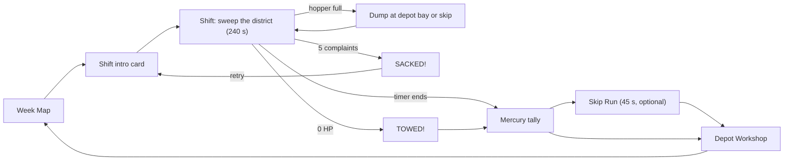
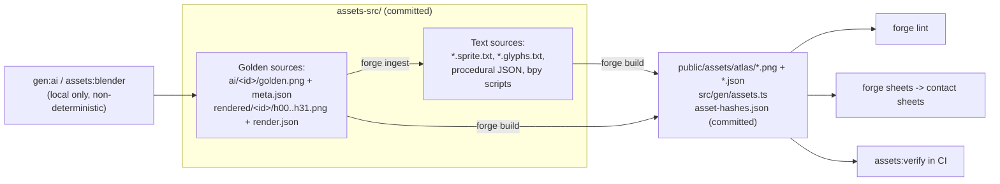

# Glossary

> The shared vocabulary of **Street Sweeper Pro**, covering game terms, production and pipeline terms, and engine terms. It is written for human contributors and for Claude, who authors every asset and most of the code.
>
> **Authority:** names, IDs and numbers here follow the canonical facts sheet (v1.0, 2026-10-18). If this glossary disagrees with `src/data/tuning.json`, `src/data/entities.json` or `assets-src/palette/kerbside32.json` once those files exist, the data file wins. Fix this page in the same PR.
>
> **Conventions:** entries are alphabetised letter by letter, ignoring case, punctuation and a leading "The". `Code-formatted` text is an exact identifier, path or command. "See" points to the doc that owns the full detail; this page defines terms and does not repeat whole tables. Spelling is British English (kerb, tyre, colour, rubbish), as in the game itself.

**Jump to:** [A](#a) · [B](#b) · [C](#c) · [D](#d) · [E](#e) · [F](#f) · [G](#g) · [H](#h) · [I](#i) · [K](#k) · [L](#l) · [M](#m) · [N](#n) · [O](#o) · [P](#p) · [R](#r) · [S](#s) · [T](#t) · [U](#u) · [V](#v) · [W](#w) · [Z](#z)

---

## How the terms fit together

Two pictures cover most of this vocabulary. The first shows the player's week. The second shows the life of an asset.

---

## A

### Actor
Any moving or interactive sprite in the world: vehicles, people, animals and litter. Actors are textured quads lying flat at y = 0, layered by a clip-space depth offset rather than by height, so they share the ground's exact 1:1 projection. They are **not** billboards. They are drawn through one `InstancedMesh` per atlas, which reads frame rects from per-instance attributes. Every actor gets a 1 px [ink](#ink) [outline](#outline-rule) and a drop shadow offset +2, +2 px (south-east). Compare [Sprite stack](#sprite-stack), used for tall thin props. See [TECHNICAL_DESIGN.md](TECHNICAL_DESIGN.md).

### Adaptive music
Songs are rendered as three **stems** (`base`, `drums`, `lead`) that play in sync. The `drums` stem fades in at [combo](#combo) ×3 or higher, and the `lead` stem enters when the shift timer drops under 60 s. See [AUDIO_DESIGN.md](AUDIO_DESIGN.md).

### ai-art / ai-ingest
Two of the five [technique](#technique) values in the [manifest](#manifest). **`ai-ingest`** turns an AI [golden](#golden) into an indexed [text-grid sprite](#text-grid-sprite) through [ingest](#ingest). Humans and litter use it. **`ai-art`** pixelizes a full-resolution golden at its detected pseudo-pixel period (about 3–4× for art prompted at game resolution) and palette-maps it straight to a 480×270 or 64×64 image. Title art, intro cards, Mercury art and portraits use it.

### Asset ID
The canonical name of every asset and entity: `<class>.<snake_name>`, e.g. `npc.old_woman`, `veh.sweeper`, `litter.crisp_packet`. The class is one of the [entity ID prefixes](#entity-id-prefix). Asset IDs are shared by `entities.json`, the manifest, the atlases and `src/gen/assets.ts`, so one ID names the same thing everywhere. The full list is in [ENTITY_CATALOG.md](ENTITY_CATALOG.md). Compare [Frame ID](#frame-id).

### Asset zoo
The in-engine test scene that draws every sprite in the game. Open it with `?test=1&scene=zoo`. It is also the `zoo` visual-test scene, with a committed [visual golden](#visual-golden). Claude must open the zoo screenshot (and the [contact sheets](#contact-sheet)) with the Read tool before accepting a new golden or asset batch. Implemented as `ZooScene`.

### Assists
Accessibility and difficulty options added in M7: **auto-brush**, a **+60 s timer**, and **[Chill Shift](#chill-shift)** (no complaints). See [GDD.md](GDD.md).

### Atlas
A packed sprite sheet of at most 2048×2048 px, produced by `forge build` with a deterministic maxrects packer (inputs sorted by area descending, then by ID). There are exactly **five**:

| Atlas | Contents |
|---|---|
| `world` | tiles, roofs, facades, stains |
| `actors` | vehicles, people, animals |
| `items` | litter, props, pickups |
| `ui` | HUD, icons, panels, fonts |
| `fx` | VFX frames |

Each atlas is `public/assets/atlas/<name>.png` plus `<name>.json` (`{frames:{"<frameId>":{x,y,w,h,px,py}}, swaps:{...}}`). See [ASSET_PIPELINE.md](ASSET_PIPELINE.md).

### Atlas cell
The fixed canvas size a sprite class is authored in, e.g. 64×64 for most vehicles, 24×24 for humans and 16×16 for litter. The **visible body** inside the cell is smaller (Bessie is 28×52 px in a 64×64 cell). Cell sizes are locked in the [scale sheet](#scale-sheet). See the sprite size sheet in [ART_BIBLE.md](ART_BIBLE.md).

### Autotile
See [Kerb blob autotile](#kerb-blob-autotile).

---

## B

### Bayer dither
An ordered 4×4 dither. It is allowed **only** in fog and screen transitions (in the [palette pass](#palette-pass)) and in `ai-art` downscales. Sprites, tiles and ingested grids are never dithered.

### Bessie
The player's vehicle: a lumbering council road sweeper, model **[Dustmaster 3000](#dustmaster-3000)**, asset ID `veh.sweeper`. Her livery is body 15 `sweeper_yellow` (shaded 14), cab 07, stripe 26, brushes 18 and beacon 17 (flashing to 16). She is rendered in Blender at 32 [headings](#heading), with a separate brush overlay (asset `veh.sweeper_brush`, 96×96 cell, 32 headings × 4 spin frames) and a dented variant below 40 HP. Bessie h00 is the reference sprite on every contact sheet. Handling numbers are in [GDD.md](GDD.md).

### Bessie's Dignity
See [Dignity](#dignity).

### Big Pam Scrubbs
Depot manager at the Muckleford Borough Council Cleansing Department and the player's boss. She delivers the [shift intro card](#shift-intro-card) briefing.

### Block-mode resample
The forge's downscaling method. Each block of the detected pixel grid becomes the **majority colour** in that block, with ties going to the lower palette index. Unlike bilinear or box filtering, it never invents new colours. It is used in [ingest](#ingest) (with one scale factor per sheet), in the Blender build (4×4 → 1 px) and in `ai-art` downscales. See [Pseudo-pixel period](#pseudo-pixel-period).

### Brush (brush down / brush up)
Bessie's cleaning gear: two [gutter brushes](#gutter-brushes), a [suction zone](#suction-zone) and an [inlet](#inlet). Toggle it with Space or gamepad A. Raising or lowering takes 0.5 s, and spin-up to full RPM takes 0.6 s. The brush collects only when it is lowered **and** RPM is at least 80%. **Brush down** caps top speed at 6.0 m/s. **Brush up** is [transit](#transit). Several hazards punish driving over things brush-up (banana skin spin-out, dog mess splat, wet leaves).

### Building column
The optional per-cell building data in a level: storey count (1–6, landmarks up to 8), roof style and wall style. Adjacent building cells merge into boxes, and only walls facing lower or open cells are emitted. See [LEVEL_DESIGN.md](LEVEL_DESIGN.md).

### Bulldozer
The state of a full hopper (100% of capacity). The brush pushes items ahead of the vehicle without collecting them, with a clunk SFX. The HUD warns at 80%. The cure is a [dump](#dump).

---

## C

### Chain
See [Combo](#combo).

### Chill Shift
An [assist](#assists) that disables [complaints](#complaint). The shift cannot end in [SACKED!](#sacked).

### Clean-pickup speed
The speed at or below which the brush collects items cleanly: **≤ 4.0 m/s (14.4 km/h)**. Between 4.0 and 6.0 m/s, the probability that an item is [flung](#fling) instead of collected rises linearly from 0 to 1. This is the mechanical core of the "Thorough vs. Fast" pillar. `pwr.super_suction` raises the fling threshold to 6.0 m/s.

### Clean Sweep
A style bonus of **+100** for bringing a [frontage](#frontage) to 100% clean.

### Collectible (`collect.*`)
Hidden pickups, one of each kind per district. **Lost Property** (e.g. `collect.false_teeth` on Monday, `collect.mayors_chain` on Sunday) is worth +250 pts and £25. **[Golden Crisp Packet](#golden-crisp-packet)** is worth +500 pts. Collectibles are 16×16 text grids with a 2-frame bob.

### Combo
Also called the **chain**. Every pickup refreshes a **2.0 s chain timer**, and the chain length sets a multiplier on item points:

| Chain | ×1 | ×2 | ×3 | ×4 | ×5 |
|---|---|---|---|---|---|
| Length | 0–9 | 10–24 | 25–49 | 50–99 | 100+ |
| Popup | — | TIDY! | SPOTLESS! | IMMACULATE! | SWEEPING BEAUTY! |

**Any penalty resets the chain.** [Grime](#grime) points neither build nor break it. The pickup SFX rises one semitone every 5 chain, up to +12. `pwr.flask_of_tea` doubles the chain timer for 15 s. Implemented in `src/sim/combo.ts`.

### Complaint
One point on the **Council Complaints meter** (0–5). Complaints come from hitting pedestrians or animals, running zebras or lollipop crossings, horn spam (more than 3 honks in 5 s), blocking traffic for over 10 s ("Road Rage"), every 3rd puddle splash, and so on. A `veh.police` car within 15 m adds **+1 extra complaint** to any penalty it witnesses. Reaching 5 means [SACKED!](#sacked). Implemented in `src/sim/complaints.ts`. Per-entity values are in [ENTITY_CATALOG.md](ENTITY_CATALOG.md).

### Contact sheet
A review image written by `npm run assets:sheets` (`forge sheets`) to `build/sheets/<atlas>.png`. Each atlas is shown at 4×, labelled, on both a light (`#c3c1c0`) and a dark (`#24222a`) background, with a Kerbside-32 palette strip and Bessie h00 for scale. **Opening it with the Read tool is mandatory** before accepting any new golden or asset batch. In M4 and later, PRs note that the sheets were reviewed.

---

## D

### Daily Shift
An M9 mode. The seed is the UTC date as `YYYYMMDD`, which picks a random district and modifiers. Only a local best is kept.

### Depot
The home base of the Cleansing Department. In the world it is two [sites](#site-site): **`site.depot`**, the yard, and **`site.depot_bay`**, the dump bay. Stopping in the bay (below 0.5 m/s) and holding Dump/Interact for 1.0 s starts a 2.0 s drain. The drain empties the hopper, pays the [tipping fee](#tipping-fee) and fully refills the water tank. Not to be confused with the [Depot Yard](#depot-yard) district or the [Depot Workshop](#depot-workshop) menu.

### Depot Workshop
The between-shift upgrade shop (`WorkshopScene`), where £ is spent on [upgrades](#upgrade-upg) and [liveries](#livery). Its music is `mus.workshop` "Tea Break".

### Depot Yard
`district.depot_yard`, a 32×24-tile bonus stage used only for the [Skip Run](#skip-run). Its time and weather match the preceding shift.

### Despeckle
Ingest step 8. A 3×3 majority filter removes orphan pixels (isolated single pixels) from opaque areas. `forge lint` also fails any orphan pixel on an actor.

### Determinism
The rule that a run is a pure function of **f(seed, district, input log)**. The sim uses a hand-written `sfc32` PRNG (`src/sim/rng.ts`), a fixed 60 Hz [tick](#tick) and no wall-clock time. On the asset side, every step after a [golden](#golden) is byte-identical on rebuild. See [Replay hash](#replay--replay-hash) and [Sim purity](#sim--sim-purity).

### Dev panel
A plain-DOM in-game tuning panel (`src/debug/devPanel.ts`), opened with **F1** in dev builds only. It replaces tweakpane. It live-edits every `vehicle.sweeper` value of `tuning.json`, shows speed, steer angle and the surface under Bessie, saves the shift's input log as a [replay](#replay--replay-hash) and copies the edited tuning as JSON (SSP-048, [TECHNICAL_DESIGN §18.3](TECHNICAL_DESIGN.md#183-deterministic-replay-tests)).

### Dignity
Short for **Bessie's Dignity**, her health: **100 HP**. Collisions cost 4 HP per m/s of normal impact speed above 2 m/s. Potholes, broken glass, open manholes and Doris's handbag also cost HP. At 0 HP the shift ends as [TOWED!](#towed). `pwr.wrench` restores +25 HP, and `upg.bumper` cuts impact damage by 40%.

### District
One playable map, played as one [shift](#shift) of the [week](#week). Each district has an ID `district.<name>` and is authored as an ASCII map plus a JSON legend in `assets-src/levels/`.

| Day | ID | Name |
|---|---|---|
| Mon | `district.puddle_lane` | Puddle Lane (tutorial) |
| Tue | `district.high_street` | Muckleford High Street |
| Wed | `district.gasworks` | Gasworks Estate |
| Thu | `district.conker_hill` | Conker Hill |
| Fri | `district.promenade` | The Promenade |
| Sat | `district.kebab_mile` | Kebab Mile |
| Sun | `district.civic_quarter` | Civic Quarter |
| any | `district.depot_yard` | The Depot Yard (Skip Run only) |

Themes, sizes, weather and signature NPCs are in [LEVEL_DESIGN.md](LEVEL_DESIGN.md).

### Doris
The nickname of `npc.old_woman`, the old woman with a handbag and shopping trolley. She **never yields**. The horn makes her walk slower, and spraying her makes her chase you and whack Bessie with her handbag (2 HP per hit). Hitting her costs −500 and 2 complaints, and she drops 6 `litter.spilled_shopping`. Her ingested key-pose sheet is the candidate for `ref.people_style`, the style reference for every human.

### Draw call budget
At most **10 draw calls per frame**. The budget is met by one instanced mesh per atlas, chunked merged ground geometry and a merged city mesh. It is checked in `tests/e2e/perf.spec.ts`.

### Dump
Emptying the hopper. A **depot dump** happens at `site.depot_bay`: hold 1.0 s, drain 2.0 s, pays the tipping fee and refills the water tank. A **skip dump** happens at `site.skip` on the route: hold 1.0 s, drain 3.0 s, no tipping fee and no water refill. Dumping is the main reason to break off sweeping.

### Dust
Lowering the brush on dusty tiles without spraying water raises a dust cloud. Pedestrians within 3 m cough, costing −10 pts per pedestrian every 2 s, but no complaint. Water spray suppresses it.

### Dustmaster 3000
The (fictional) make and model of council sweeper that Bessie is.

---

## E

### Entity ID prefix
The class part of an [asset ID](#asset-id), before the dot. The prefix tells you the kind of thing, its atlas and usually its technique:

| Prefix | Meaning | Example |
|---|---|---|
| `veh` | Vehicles, including Bessie and parked variants (`veh.<type>_parked`) | `veh.bin_lorry` |
| `npc` | Pedestrians and animals | `npc.cat` |
| `litter` | Collectable rubbish | `litter.pizza_box` |
| `stain` | Ground stains that need water spray | `stain.gum` |
| `prop` | Static and knockable street furniture | `prop.hydrant` |
| `haz` | Ground hazards | `haz.oil_slick` |
| `pwr` | Power-ups | `pwr.bacon_butty` |
| `collect` | Collectibles | `collect.golden_crisp` |
| `upg` | Workshop upgrades and liveries | `upg.livery_seaside` |
| `site` | Gameplay locations (depot bay, zebra, frontage...) | `site.pledge_frontage` |
| `district` | Playable maps | `district.promenade` |
| `tile` | Ground tiles | — |
| `roof` | Roof surfaces and landmark roofs | — |
| `facade` | Facade modules | — |
| `fx` | VFX frame sets | — |
| `ui` | HUD icons and panels | — |
| `font` | Bitmap fonts | — |
| `art` | Title, key art, intro cards, Mercury art | — |
| `portrait` | 64×64 intro-card portraits | — |
| `decal` | Road decals (oil, graffiti, posters) | — |
| `sign` | Shop signs | — |
| `concept` | Concept and mood boards, **never shipped** | — |
| `ref` | Style references for generation | `ref.people_style` |
| `sfx` | Sound effects | `sfx.pickup_small` |
| `mus` | Music tracks | `mus.title` |
| `jng` | Jingles | `jng.sacked` |
| `amb` | Ambience beds | `amb.seafront` |

`district` is a game-data ID, not an asset class in the manifest. The others are the manifest classes. See [ENTITY_CATALOG.md](ENTITY_CATALOG.md) for every concrete ID.

### Event bus
The typed publish/subscribe channel (`src/app/events.ts`) that the sim emits on at the end of each tick (pickups, penalties, combo tiers, collisions). The renderer, audio and UI subscribe. They read sim state but **never write it**.

---

## F

### Facade module
The unit of building wall texture: **32×40 px**, i.e. 2 m wide × 1 [storey](#storey). Modules (window, door, drainpipe, shopfront) are text grids assembled procedurally. Each comes in three pre-built ramp variants by facing: `_lit` for north and west faces, `_base` (which is also the roof shade), and `_dark` for east and south faces. This follows the fixed north-west sun.

### Fixed tick
See [Tick](#tick).

### Fling
What happens to an item that fails the [clean-pickup speed](#clean-pickup-speed) check. It is knocked 1.5–3 m sideways on a kinematic arc instead of being collected. A flung `litter.glass_bottle` smashes into `haz.broken_glass`. `sfx.fling` plays.

### Forge
The Python asset tool in `tools/forge/` (Python 3.13, numpy, Pillow, run through uv). It provides `ingest`, `build`, `lint`, `sheets`, `blender` and `gen-ai`, and is always invoked as `uv run --project tools/forge python -m forge <cmd>`, usually wrapped by an `npm run assets:*` script. Everything in it except the `blender` and `gen-ai` wrappers is deterministic. See [ASSET_PIPELINE.md](ASSET_PIPELINE.md).

### Frame ID
The address of one sprite frame: `<asset-id>:<state>:<dir>:<n>`. `dir` is `h00`–`h31` for vehicles, `s, sw, w, nw, n, ne, e, se` for actors, or `-` for no direction. Examples are `veh.sweeper:body:h07:0` and `npc.cat:dart:w:1`. All frame IDs are generated into the `FrameId` union in `src/gen/assets.ts`, so referencing a missing sprite is a **compile error**.

### Free Sweep
A 1.0 mode. You play any unlocked district with no timer and no complaints, to the "Tea Break" music.

### Frontage
`site.frontage`, the scoring segment in front of one house or shop. Its cleanliness shows green or red on the [Mercury](#mercury) district map. 100% clean earns [Clean Sweep](#clean-sweep) (+100). On Sunday the [Inspector](#tidy-town-inspector) deducts −100 for each frontage he passes that is below 90%. See also [Pledge](#pledge).

---

## G

### Gleaming
A per-district badge above 3★. It needs 3★, **0 complaints** and the district's Lost Property returned.

### Golden
This word has two meanings in the project. Say which one you mean.

1. **Golden source** (the asset pipeline). A non-deterministic tool output that has been reviewed, accepted and committed as a source file, with full provenance. AI goldens are `assets-src/ai/<id>/golden.png` plus `meta.json`. Blender goldens are `assets-src/rendered/<id>/h00…h31.png` plus `render.json`. Everything downstream of a golden is deterministic. Rejected candidates go to `build/ai-candidates/` and are never committed. `npm run gen:ai -- <id> --accept <n>` promotes a candidate.
2. **Visual golden** (testing). See [Visual golden](#visual-golden).

### Golden Crisp Packet
`collect.golden_crisp`, one hidden per district and worth +500 pts. Collecting all 7 unlocks the [Midnight Gold](#midnight-gold) livery.

### Grime
Painted-on street dirt that the brush erases pixel-visibly. It is the "Visibly Satisfying Clean" pillar in mechanical form. Grime is scored at 1 pt per [grime cell](#grime-cell) (2 for [gutter grime](#gutter-grime)) and makes up 60% of [Tidy %](#tidy-). Implemented in `src/sim/dirt.ts`. Compare [Stain](#stain-stain), which needs water.

### Grime cell
The unit of grime: a **4×4 px** square (0.25 × 0.25 m). Each 32 px tile holds an **8×8 grid** of grime cells. A cell is erased when it falls inside the 2.6 m swept band while the brush is down with RPM at least 80%.

### Grime mask
The per-district `Uint8` array of grime cells, uploaded as a texture to the ground shader so that cleaned cells show immediately.

### Gutter brushes
Bessie's two front brushes: circles of r = 0.45 m at (±0.85, +1.75) m in vehicle space. They reach ±1.30 m, for a **total swept width of 2.6 m (about 42 px)**, and sweep items inward toward the suction zone. `upg.gutter_brooms` extends the reach.

### Gutter grime
A dense strip of grime along kerb edges worth **2× points** (2 pts per cell). A gutter brush collects it only when it is within 0.2 m of a kerb edge. See [Kerb Hugger](#kerb-hugger).

---

## H

### Hazard (`haz.*`)
A ground feature that changes grip, damages Bessie or spills the hopper: `haz.oil_slick`, `haz.puddle`, `haz.pothole`, `haz.speed_bump`, `haz.wet_leaves`, `haz.broken_glass`, `haz.open_manhole` and `haz.wind_gust`. Effects are in [ENTITY_CATALOG.md](ENTITY_CATALOG.md).

### Heading
One of the **32** rotation frames of a vehicle sprite, `h00`–`h31`. `h00` faces north (screen up), and each step is 11.25° clockwise. All are rendered from one Blender model. Image generation is not used for vehicles because it cannot keep 32 rotations consistent.

### Hopper
Bessie's rubbish container. Base capacity is **100 [LU](#lu)** (`upg.hopper`: 140, then 180). As it fills, Bessie gets heavier (up to +1,500 kg at full, linear with fill) and more sluggish: at full, acceleration ×0.70, top speed ×0.90 and steer rate ×0.85. This drives the "Heavy, Honest Machine" pillar. A full hopper goes [bulldozer](#bulldozer). Potholes and fast speed bumps spill LU out of it. Implemented in `src/sim/hopper.ts`.

### HP
See [Dignity](#dignity).

---

## I

### Ingest
`forge ingest <id>` (`npm run assets:ingest -- <id>`) turns an AI golden sheet into indexed [text-grid sprites](#text-grid-sprite). The steps are: alpha threshold at 128 (or median-border colour key) → slice by sheet grid → [pseudo-pixel period](#pseudo-pixel-period) detection → [block-mode resample](#block-mode-resample) with **one scale factor per sheet** → OKLab palette mapping with no dither → [despeckle](#despeckle) → binary alpha → write `assets-src/sprites/<class>/<id>.sprite.txt`. **After ingest, the grid is the source of truth.** Claude hand-fixes and animates in the grid, and re-ingest refuses to overwrite an edited grid without `--force`.

### Ink
Palette index 00, `#0f0e12`. It is the outline colour, the letterbox colour and the darkest step of the neutral ramp.

### Inlet
The 1.0 × 0.4 m collection rectangle at y = +1.2 m in vehicle space. An item whose centre enters it is collected and its LU added to the hopper.

### Inspector
See [Tidy Town Inspector](#tidy-town-inspector).

### Integer scale
How the internal frame reaches the screen: `scale = floor(min(winW / W, winH / 270))`, a nearest-neighbour blit, centred and letterboxed in `#0f0e12`, with CSS `image-rendering: pixelated` and devicePixelRatio handled. One internal pixel is always exactly N×N device pixels. Typical results are 1080p fullscreen → 4× (a windowed 1080p browser gives 3×, and the itch.io 960×540 embed 2×), 1440p → 5× (1350 px tall, 45 px bars) and 4K → 8×. The `scale_1440` visual scene covers it.

### Internal resolution
The size of the game's logical frame, in which the world, HUD and UI are all drawn. The base is **480×270**. Height is **always 270**, and width adapts to the window aspect in whole pixels: `W = clampEven(round(270 × aspect), 432, 640)`. The actual [render target](#render-target) is (W+2)×272. Every pixel-art measurement in the docs ("42 px swept width", "24×24 human") is in internal pixels.

---

## K

### Kerb blob autotile
The **47-tile** set of kerb and pavement edge tiles (a "blob" autotile covering every edge and corner combination). The forge generates it by rule from procedural parameters, and the level compiler picks tiles automatically from neighbouring cells. Both read the one index ↔ neighbour-mask table in `assets-src/procedural/tiles/kerb_blob.json`.

### Kerb Hugger
Keeping a gutter brush within 0.2 m of a kerb collects [gutter grime](#gutter-grime). Holding continuous kerb contact also pays a style bonus of **+50 per 3 s**.

### Kerbside-32
The project's **only legal palette**: 32 named colours (index 00 `ink` `#0f0e12` to 31 `lavender` `#8a5ab8`), stored in `assets-src/palette/kerbside32.json` with [ramps](#ramp) and the [night and shadow remaps](#night-remap--shadow-remap). Every asset is built in it, Blender materials use its exact hex values, `forge lint` rejects any pixel outside it, and the [palette pass](#palette-pass) makes it impossible for the game to display any other colour. Kerbside-32 was curated by hand because median-cut palettes failed in the asset probe. The full table is in [ART_BIBLE.md](ART_BIBLE.md).

### Kerbside 5×7 / Kerbside Bold 8×8
The two code-defined bitmap fonts. **Kerbside 5×7** (5×7 glyph in a 6×8 cell) is used for the HUD and body text. **Kerbside Bold 8×8** (8×8 in a 9×10 cell) is used for titles and headlines. Both cover ASCII 32–126 plus `£ ★ → ← ↑ ↓` and are authored as text grids in `assets-src/fonts/*.glyphs.txt`. The forge adds an outlined variant of each. Fonts are **never** made with image generation.

---

## L

### Lane graph
The directed road network that traffic follows, compiled from the level map by `tools/levels/compile-level.ts` (`laneGraph.ts`, SSP-076): one lane each way on the left of a two-way road, one on a one-way road, joined through junctions, with map-edge **portals** where traffic enters and leaves ([LEVEL_DESIGN §7.1](LEVEL_DESIGN.md#71-roads)). Compare [Nav graph](#nav-graph).

### Lead Tangle
Driving through the extendable lead (up to 5 m) between `npc.dog_walker` and the dog. The lead acts as a line obstacle. A tangle costs −150 and 1 complaint.

### Litter (`litter.*`)
Collectable rubbish, from `litter.crisp_packet` (10 pts, 1 LU) to `litter.bin_bag` (50 pts, 8 LU, bursts above 4 m/s). Litter sprites are 16×16 cells with 8–14 px items, one frame plus a 2-frame wobble, and 4 rotations generated by code. Most come from Codex transparent-background 4×2 sheets. Litter makes up 40% of [Tidy %](#tidy-). The full list is in [ENTITY_CATALOG.md](ENTITY_CATALOG.md).

### LitterField
The sim store of every litter item (`src/sim/litter.ts`). It is a struct-of-arrays backed by a [spatial hash](#spatial-hash) with 4 m cells, budgeted at 2,000 items.

### Livery
A cosmetic paint scheme for Bessie, applied by [ramp swap](#ramp-swap): `upg.livery_council` (Council Yellow, the default), `upg.livery_racing_green` (£150), `upg.livery_seaside` (£150) and `upg.livery_midnight_gold` (unlocked by all 7 Golden Crisps).

### Look-ahead
The camera leads Bessie by up to **3.0 m** along her velocity on a damped spring, so the player sees more road ahead the faster they go (velocity × 0.75 s, capped at 3.0 m: the full lead from 4.0 m/s; `src/render/camera.ts`).

### Lost Property
See [Collectible](#collectible-collect).

### LU
**Litter units**, the measure of hopper volume. Each item costs a fixed LU (cigarette butts 0.5, crisp packet 1, pizza box 3, bin bag 8). Hopper capacity, spills and the [tipping fee](#tipping-fee) (£1 per 5 LU) are all in LU.

---

## M

### Manifest
`assets-src/manifest.json`, with one entry per asset: `{ id, class, technique, source, cell:[w,h], states, dirs, frames, atlas, outline, swaps }`. It is the contract that `forge build` and `forge lint` check sizes and frame counts against.

### Mask target
A render target that records **shadow** (R) and **light** (G) per pixel instead of blended colour. The [palette pass](#palette-pass) reads it to apply the shadow and night remaps.

### Mercury
**The Muckleford Mercury**, the local newspaper. Its front page is the end-of-shift tally screen (`TallyScene`), with a headline, a district map with frontages green or red, stars and £ earned. Comic Mercury headlines also mark [SACKED!](#sacked) and the week finale. It is covered by the `mercury_tally` visual scene.

### Midnight Gold
The secret livery unlocked by collecting all 7 [Golden Crisp Packets](#golden-crisp-packet).

### Milestone
The ten delivery stages **M0–M9**: Foundations & Look Spike, Drivable Bessie, Sweeping Core, Living Street, Art Pass 1, Sound & Music, Tidy Town Week, 1.0 Web Release, Touch & Mobile Web, Desktop & Extra Modes. Exit criteria are in [ROADMAP.md](ROADMAP.md).

### Mirror
A line in a text-grid sprite, `mirror <dir> from <dir>`, that produces one direction by flipping another. Humans author S, SW, W, NW and N, and mirror SE, E and NE.

### Mixel
Short for "mixed pixel". It means pixels of **different on-screen sizes** visible at once, which is the classic way a pixel-art game breaks its own grid. Our rules:

- **Forbidden inside an asset.** Sprites are never scaled by non-integer factors, and all sprite and tile art is authored at 1 internal px = 1 texel at the 16 px/m scale.
- **Accepted, deliberately, for [roof magnification](#roof-magnification).** Tall roofs render 1.09×–1.91× larger because they are closer to the perspective camera.
- **Accepted while [speed zoom](#speed-zoom) is active** (ground shimmer at transit speed). At sweeping speeds the camera returns to exact 1:1.
- **Never in the HUD.** UI renders in the same internal pixel space as the world.

### Muckleford
The fictional British seaside town where the game is set. Its council is Muckleford Borough Council, and it has entered the national *Tidiest Town* contest.

---

## N

### Nav graph
The pavement navigation graph that pedestrians walk, compiled alongside the [lane graph](#lane-graph) and the collision grid (`navGraph.ts`, SSP-076). It crosses a road only at a zebra, a school crossing or a dropped kerb ([LEVEL_DESIGN §7.2](LEVEL_DESIGN.md#72-pavements-and-kerbs)).

### Near miss
A style bonus of **+25** for passing within 0.5 m of a pedestrian at more than 3 m/s without contact. Joggers are the usual source.

### Night remap / shadow remap
Two 32-entry **index → index** tables in `palette.json`. The [palette pass](#palette-pass) applies `shadow` wherever the shadow mask is set, and `night` wherever night is active and the light mask is 0. Street lamps and headlights lift the mask on Saturday's Kebab Mile. Because the remaps map palette indices to palette indices, shadows and night can never produce an off-palette colour. The exact tables are tuned and locked in M0 and covered by the `night_kebab_mile` visual scene.

### NPC
A non-player character (`npc.*`): pedestrians (24×24 cells, 13 frames per direction) and animals (cat, dogs, pigeon, seagull, in 12–20 px cells). NPC behaviours live in `src/sim/npc/behaviours/<npc>.ts`, budgeted at 80 NPCs. Nobody is ever injured. Pedestrians fall over cartoonishly, get up and shake a fist.

---

## O

### OBB/SAT
The hand-written collision approach: Bessie and other bodies are **oriented bounding boxes**, tested against the static grid's AABBs with the **separating axis theorem**, and sub-stepped when speed exceeds 0.5 tile per tick. It is deterministic and synchronous. Rapier2D is documented as an escape hatch only. Implemented in `src/sim/collision/`.

### OKLab
A perceptual colour space. It is used for every "nearest palette colour" decision: building the 64³ LUT in the palette pass and mapping colours during ingest and Blender builds.

### Outline rule
Every actor and prop silhouette has a **1 px ink (`#0f0e12`) outline, 4-connected, outside the silhouette**. The forge adds it to Blender renders, grids include it, and `forge lint` fails any silhouette edge without it.

---

## P

### Palette pass
The final full-screen shader and the project's consistency guarantee. For each pixel it (1) maps RGB to the nearest Kerbside-32 index through a 64³ LUT built in OKLab, (2) applies the `night` remap if night is active and the light mask is 0, (3) applies the `shadow` remap if the shadow mask is set, and (4) outputs the palette RGB. The HUD is composited before this pass, so it is palette-locked as well. Implemented in `src/render/palettePass.ts`.

### Pigeon Scatter
A style bonus of **+25** for driving through a pigeon flock. Pigeons cannot be hit.

### Pivot
The anchor point of a sprite frame in pixels (`px`, `py` in the atlas JSON). For Blender renders, per-frame pivots are recorded in `render.json`. They are constant at 0° tilt.

### Placeholder
A code-defined stand-in sprite, made in M1/M2 under the asset's **final ID and frame IDs**, so real art can later replace it one class at a time without code changes.

### Pledge
A **Tidy Pledge** resident's frontage, `site.pledge_frontage`, marked by a green rosette on the door. There are 8–20 per district. Each pledge frontage at ≥ 90% clean at the end of the shift pays a **£10 pledge tip**.

### Pounds (£)
The in-game currency ("wages and tips"), spent only in the Depot Workshop. It comes from the [wage](#wage), pledge tips, the [tipping fee](#tipping-fee), star bonuses (£50 per star, first time only), Lost Property (£25) and the Skip Run. Score and £ are separate: score feeds stars and personal bests. See [GDD.md](GDD.md).

### Power-up (`pwr.*`)
A temporary boost, 1–3 per shift, spawning on pavements: `pwr.flask_of_tea`, `pwr.bacon_butty`, `pwr.hi_vis`, `pwr.super_suction`, `pwr.wrench` and `pwr.water_can`. The sprites are 16×16 text grids with a 2-frame bob.

### Probe
The pre-project asset-tooling experiment, run in a temporary scratch directory on 2026-10-18. The artefacts M0 needs, plus each run's `report.json` and a mock scene, were copied into the git-tracked `assets-src/_probe/`. It produced the evidence behind the pipeline: Blender rotation sets in 2.0–4.5 s, Codex being strongest at transparent litter sheets and reference-locked characters, AI tiles failing the seam test, and median-cut palettes failing. Its artefacts are imported in M0. See [adr/0002-ai-authored-asset-pipeline.md](adr/0002-ai-authored-asset-pipeline.md).

### Prop (`prop.*`)
Street furniture. **Knockable** props (`prop.wheelie_bin`, `prop.traffic_cone`, `prop.a_board`, `prop.shopping_trolley`, `prop.recycling_box`) are custom impulse bodies. **Static** props include `prop.lamp_post`, `prop.hydrant` (water refill) and `prop.bus_shelter`. Tall thin props are drawn as [sprite stacks](#sprite-stack).

### Provenance
The record that makes a golden auditable. For AI goldens it is `meta.json` (tool, tool version, model, date, argv, `prompt_sha256`, preamble version, reference images with hashes, candidates generated, accepted index, acceptance notes, `golden_sha256`, size, and `seed: null`, because Codex exposes no seed). For Blender goldens it is `render.json` (`blender_version`, `script_sha256`, argv, `tilt_deg`, `pivots_px`). `forge lint` checks the hashes.

### Pseudo-pixel period
The size of the "fake pixels" in an AI image that only looks like pixel art. Ingest detects it per axis by FFT of the edge-strength profile, searching 3–16 px. The probe measured about 9.2–9.4 px for Codex characters and 10.8 px for rubbish. The [block-mode resample](#block-mode-resample) then runs on that grid.

---

## R

### Ramp
An ordered run of Kerbside-32 indices from dark to light used for shading, e.g. Neutral grey 00→07, Yellow 14→15→16, Blue 25→28. A sprite may use **at most 4 steps of any ramp** (enforced by lint). Ramps are listed in `palette.json` and [ART_BIBLE.md](ART_BIBLE.md).

### Ramp swap
A per-instance **index → index** table applied when drawing a sprite, with up to 8 swap tables per atlas. It produces traffic car paint variants (8 for hatchbacks and saloons), pedestrian outfits (8 for shoppers), [liveries](#livery), the green-and-white `veh.rival_sweeper` and the beacon flash, all from one set of pixels. Declared under `swaps` in the manifest and atlas JSON.

### Render target
The off-screen buffer the scene is drawn into: **(W+2)×272**, i.e. the [internal resolution](#internal-resolution) plus a 1 px margin on every side for the [sub-pixel camera](#sub-pixel-camera). It uses NearestFilter, no MSAA and no mipmaps.

### Replay / replay hash
A **replay** is a recorded seed, district and input log (`tests/replay/replays/*.json`). `npm run test:replay` re-simulates 3,600 ticks (60 s) and asserts its **replay hashes**: a running FNV-1a hash of the sim state, quantised to 1e-4, checked every 600 ticks and at the end (the final-state hash), plus invariants. See [TECHNICAL_DESIGN §18.3](TECHNICAL_DESIGN.md#183-deterministic-replay-tests). A changed hash means the simulation's behaviour changed. That is either a bug or an intentional tuning change that must be re-approved. The first replay hash is committed in M1.

### Rival Sweep
An M9 mode: versus [Spotless Sid](#spotless-sid), most LU dumped in 180 s.

### Roof magnification
The apparent enlargement of a roof caused by the perspective camera: **H / (H − h)** at H = 31.5 m. One storey is 1.09×, 3 storeys 1.31× and 6 storeys 1.91×. Tall roofs look "closer and chunkier". This is accepted as a look, and it is a deliberate source of [mixels](#mixel). Covered by the `lean_quadrants` visual scene.

---

## S

### SACKED!
Shift failure from complaints. The Council Complaints meter reaches **5**, the shift ends with a comic Mercury headline and `jng.sacked`, and you retry. Compare [TOWED!](#towed).

### Scale sheet
The locked world-scale and sprite-size specification: **16 px per metre**, 32×32 px tiles (2 m), 2.5 m (40 px) storeys, 32×40 facade modules, and the per-class cell sizes (e.g. Bessie 64×64 with a 28×52 body, humans 24×24, litter 16×16). It is locked in `assets-src/STYLE.md` during M0 **before any asset is generated**, and mirrored in [ART_BIBLE.md](ART_BIBLE.md).

### Seed
The integer that fixes all randomness. In the sim it feeds `sfc32` (TS). In the forge's procedural generators it feeds `numpy.random.Generator(PCG64(seed))`. In tests it is set with `&seed=<n>`. AI generation has **no** seed (`seed: null`), which is why its outputs are committed as goldens.

### Shift
One play session in one district: **240 s** of play, plus about 60 s of intro and tally, so about 5 minutes. A shift ends when the timer runs out (→ Mercury tally), at 5 complaints ([SACKED!](#sacked)) or at 0 HP ([TOWED!](#towed)). Implemented in `src/sim/shift.ts` and `ShiftScene`.

### Shift intro card
The pre-shift briefing screen (`ShiftIntroScene`): Big Pam's portrait and briefing, the district, the target and the weather.

### Sim / sim purity
**The sim** is `src/sim/`, the deterministic game simulation. **Sim purity** is the rule that it imports no `three`, no DOM, and uses no `Math.random`, `Date` or `performance`. A Biome `noRestrictedImports` override and a Vitest import scan enforce it. Sim units are metres and seconds, and the sim's XY plane maps to the renderer's XZ plane.

### Site (`site.*`)
A gameplay location with rules: `site.depot`, `site.depot_bay`, `site.skip`, `site.bus_stop`, `site.zebra`, `site.school_crossing`, `site.frontage` and `site.pledge_frontage`.

### Skip
`site.skip`, an on-route dump point. Hold 1.0 s, drain 3.0 s, no tipping fee. It saves a trip back to the depot. Also, in the Skip Run, the place you reverse-park into.

### Skip Run
The optional **45 s** bonus stage after each shift, played in the [Depot Yard](#depot-yard). Slalom the cones, then reverse-park into dump bays for £: £5 per clean bay and £50 for a clean run. Implemented as `SkipRunScene`.

### Snobbington
The neighbouring, smugger borough, home of [Spotless Sid](#spotless-sid).

### Spatial hash
A uniform grid with **4 m cells** used to look up nearby litter and NPCs quickly. It underlies the [LitterField](#litterfield) and NPC steering.

### Speed zoom
The camera rises from H = **31.5 m** (at or below the brush-down top speed) to **37.8 m** (at transit top speed, 1.2×) on a critically damped spring (ω = 3 rad/s), so you see further when driving fast. At sweeping speeds the view is exact 1:1. Whether it stays on is a recorded M0 decision. If it is removed, [look-ahead](#look-ahead) alone remains.

### Spike
The **M0 Foundations & Look Spike**: an in-engine test scene with 1-, 3- and 6-storey blocks, the Blender Bessie and one Codex pedestrian, rendered with the palette pass, sub-pixel camera and speed zoom. It settles the open decisions (zoom on or off, vehicle tilt 0° vs ≤ 8°, the 480×270 base). Values marked `TBD (M0 spike)` in any doc are resolved here.

### Spotless Sid
The player's rival, a sweeper driver from [Snobbington](#snobbington). He drives `veh.rival_sweeper`, a green-and-white ramp swap of Bessie's model, appears as a Friday cameo stealing litter, and is the opponent in [Rival Sweep](#rival-sweep).

### Sprite stack
How tall thin props (lamp posts, phone boxes, bollards, trees) are drawn: **4–8 horizontal slice quads** stacked at increasing heights, each a 32×32 slice. The perspective camera leans them away from the screen centre automatically, consistent with building walls. Implemented in `src/render/spriteStack.ts`.

### Stain (`stain.*`)
A ground mark that needs **water spray**, not just the brush: `stain.gum`, `stain.milkshake`, `stain.oil`, `stain.chalk_art` and `stain.splat`. Each is scored per stain. Stain sprites are 32×32 decals made procedurally.

### Stars
The per-district rating from [Tidy %](#tidy-): **1★ ≥ 60**, **2★ ≥ 80**, **3★ ≥ 92**, plus the [Gleaming](#gleaming) badge. Each district needs 1★ on the previous one to unlock, and Sunday needs **≥ 12★** in total across Mon–Sat (out of 18). A TOWED shift earns no stars.

### Stems
See [Adaptive music](#adaptive-music).

### Storey
The stylised building height unit: **2.5 m = 40 px** of facade texture. Buildings are 1–6 storeys, and landmarks go up to 8 (the Town Hall tower).

### Struct-of-arrays
The sim's data layout: one typed-array store per entity kind (positions, velocities, states as parallel arrays). It is used **instead of an ECS library** and keeps the hot path allocation-free.

### Style preamble
`assets-src/ai/_style_preamble.md`, the shared, versioned text prepended to every image-generation prompt. It asks for an overhead view, chunky pixel art with characters about 20 pixels tall (head to feet), a 1 px dark outline, light from the top-left, flat colours from the attached Kerbside-32 hex list, a transparent background, and no text, logos or brands. Its version is stamped into each `prompt.md` and `meta.json`.

### Sub-pixel camera
The technique that gives a smooth-scrolling camera without breaking the pixel grid. The camera's XZ position is snapped to the ground texel grid (1/16 m), the scene is rendered into the [render target](#render-target) with its 1 px margin, and the final nearest-neighbour blit is offset by the fractional remainder × the integer scale. The world moves in device pixels while every art pixel stays square and whole.

### Suction zone
A 2.6 m wide rectangle from y = +1.6 to +2.8 m in front of Bessie. Items inside it are pulled toward the [inlet](#inlet) at 3.0 m/s × RPM × the suction multiplier. `upg.suction` and `pwr.super_suction` enlarge it.

### Sweep height (H)
The camera's height above the ground: **31.5 m** with a 30° vertical FOV, giving 1 texel = 1 px at 270 px tall (to within 0.03%; see TECHNICAL_DESIGN §12.2) (16.875 m visible vertically, 30 m horizontally at W = 480, about 15 × 8.4 tiles). It rises to 37.8 m under [speed zoom](#speed-zoom).

---

## T

### Technique
The manifest field that says how an asset is built: `"grid"`, `"procedural"`, `"blender"`, `"ai-ingest"` or `"ai-art"`. Which technique each asset class uses, and why, is in [ASSET_PIPELINE.md](ASSET_PIPELINE.md).

### Test hooks
Debug entry points active **only** with the `?test=1` URL parameter. Parameters are `&seed=<n>&scene=<id>&tick=<n>&freeze=1`. They expose `window.__ssp = { ready, step(n), state(), readFrame(), setCamera(x,y,h) }`, where `readFrame()` returns the raw W×270 palette-mapped pixels (row 0 at the top) and `ready` turns true once assets are loaded and the first frame is rendered. Playwright visual and e2e tests drive the game through them. Implemented in `src/debug/testHooks.ts`.

### Text-grid sprite
A `*.sprite.txt` file: pixel art written as characters. It has a header (`id:`, `cell: WxH`, `palette: kerbside32`, a key map where by default `.` is transparent and `0`–`9`, `a`–`v` are indices 00–31), then one block per frame (`frame <state>:<dir>:<n>` followed by H rows of W characters), plus optional `mirror` lines. It is the source of truth for animals, small props, pickups, UI, facades, and for humans and litter after [ingest](#ingest). It is diffable and Claude can edit it directly.

### Tick
One step of the simulation at a **fixed 60 Hz**, run from an accumulator with at most 5 steps per frame and render interpolation. The tick order is fixed: input → vehicle → static collision → knockables → brush/litter → dirt → NPC AI → traffic → scoring/combo/complaints → shift timer → emit events. See [TECHNICAL_DESIGN.md](TECHNICAL_DESIGN.md).

### Tidy %
The district cleanliness score that decides [stars](#stars):

**Tidy % = 0.6 × (grime cells cleaned ÷ initial grime cells) + 0.4 × (litter collected ÷ litter spawned)**

It is measured over the district's route area (roads and pavements). Points and Tidy % are separate: you can score well on combos and still miss a star.

### Tidy Town Inspector
`npc.inspector`, who appears on Sunday (Civic Quarter). He walks a fixed route with a clipboard and deducts −100 for each frontage he passes that is below 90% clean. Splashing or hitting him costs 2 complaints. His visit is the week's finale.

### Tidy Town Trophy
The week-finale award, won through the Sunday Inspection Score (week Tidy total + inspection result). It is announced with the Mercury headline "MUCKLEFORD NAMED BRITAIN'S TIDIEST TOWN (RUNNER-UP)" and `jng.trophy`.

### Tidy Town Week
See [Week](#week).

### Tilt
Two related settings, both defaulting to 0°:

- **`camera.tiltDeg`** (runtime). Tips the game camera off vertical, up to a maximum of 12°. It is reserved for optional post-1.0 route views and is not used in any 1.0 district. Early design notes informally call it the "Paperboy tilt" after its inspiration. Never use that name in code, assets or in-game text.
- **Blender `--tilt`** (pre-render). Tips the sprite render camera. It is 0°: the M0 spike compared 0° with 8° and kept 0° ([ROADMAP D-02](ROADMAP.md#8-m0-spike-decision-log)), because a steeper tilt (the probe used 22°) clashes with radially leaning buildings. It is recorded as `tilt_deg` in `render.json`.

### Tipping fee
The payment for dumping at the depot: **£1 per 5 LU** dumped. Skip dumps pay nothing.

### TOWED!
Shift failure from damage. Bessie's [Dignity](#dignity) reaches 0 HP, the shift ends immediately, you keep 50% of the score and you earn no stars. `jng.towed` plays. Compare [SACKED!](#sacked).

### Tracker song
The music source format, `assets-src/audio/music/<id>.song.json`. It holds a tempo at 4 rows per beat, five channels (`pulse1`, `pulse2`, `tri`, `noise`, `bass` 2-op FM), instruments, patterns as note strings such as `"C-4 01 v40"`, an order list, a loop row and stem groupings. It is rendered offline by the pure-TS `tools/audio/render-music.ts`. See [AUDIO_DESIGN.md](AUDIO_DESIGN.md).

### Transit
Driving with the **brush up**. Top speed is **11.0 m/s (39.6 km/h)**, and nothing is collected. It is used to cross already-clean ground or to get to the depot. [Speed zoom](#speed-zoom) peaks at transit top speed.

---

## U

### Upgrade (`upg.*`)
A permanent Bessie improvement bought in the Depot Workshop. Most have two levels: `upg.hopper`, `upg.suction`, `upg.gutter_brooms`, `upg.water_tank` and `upg.engine`. Single-level ones are `upg.tyres`, `upg.bumper`, `upg.two_tone_horn` and `upg.led_beacon`. [Liveries](#livery) are also `upg.*`. Prices are in [ENTITY_CATALOG.md](ENTITY_CATALOG.md) and `src/data/upgrades.json`.

---

## V

### Visual golden
A committed reference PNG in `tests/visual/__goldens__/`. Playwright compares the internal frame (read through `readFrame()`) against it with **pixelmatch threshold 0**. Canonical goldens come from the dev Mac (arm64) running Chromium headless with SwiftShader. They are approved with `npm run test:visual:update`. A failed diff writes expected, actual and diff PNGs, which Claude opens with Read. The scenes are `zoo`, `lean_quadrants`, `night_kebab_mile`, `hud_specimen`, `mercury_tally` and `scale_1440`. Not to be confused with an asset [golden](#golden).

---

## W

### Wage
**£60** per completed shift.

### Water tank / spray
Bessie's 100-unit water supply (`upg.water_tank`: 150, then 200). Holding spray (Left Shift or gamepad X) uses 6 units/s over a 2.6 m cone ahead. Spray is required to clean [stains](#stain-stain) and to suppress [dust](#dust), and it also cleans `haz.oil_slick` (+30). Refill at `prop.hydrant` (stop adjacent: 25 units/s), at the depot bay (full refill) or with `pwr.water_can` (+50). Spraying Doris is a mistake.

### Week
**Tidy Town Week**, the campaign mode: 7 shifts, Monday to Sunday, one district per day, each followed by an optional Skip Run and ending in the Sunday inspection. A first full clear takes about 45–60 minutes.

### Week Map
The campaign hub screen (`WeekMapScene`). It shows the seven days, stars earned, the next unlocked district and the route into the next shift.

---

## Z

### Zoo
See [Asset zoo](#asset-zoo).

---

*Missing a term? Add it in alphabetical position, keep the definition to a few lines, and link to the doc that owns the detail. Related docs: [README](../README.md) · [CLAUDE.md](../CLAUDE.md) · [GDD](GDD.md) · [Technical Design](TECHNICAL_DESIGN.md) · [Asset Pipeline](ASSET_PIPELINE.md) · [Art Bible](ART_BIBLE.md) · [Audio Design](AUDIO_DESIGN.md) · [Level Design](LEVEL_DESIGN.md) · [Entity Catalog](ENTITY_CATALOG.md) · [Roadmap](ROADMAP.md) · [ADR 0001](adr/0001-tech-stack.md) · [ADR 0002](adr/0002-ai-authored-asset-pipeline.md)*
