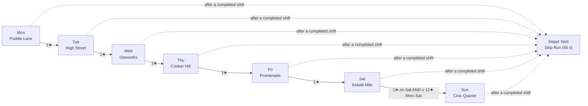
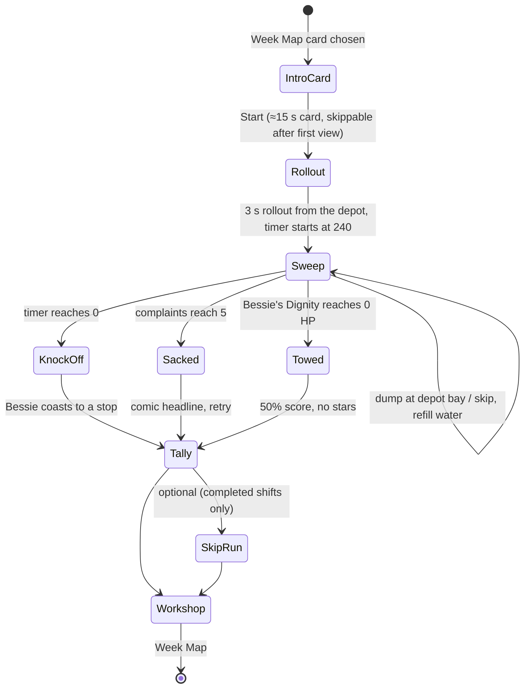
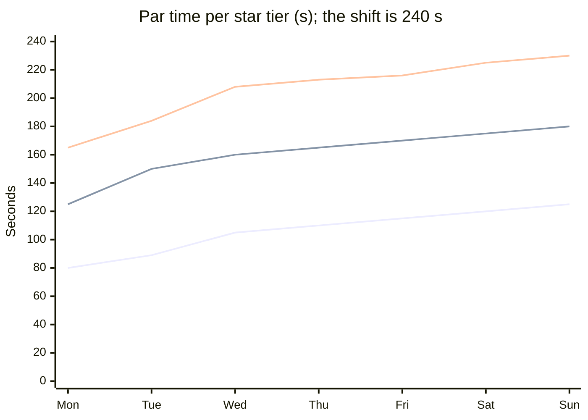
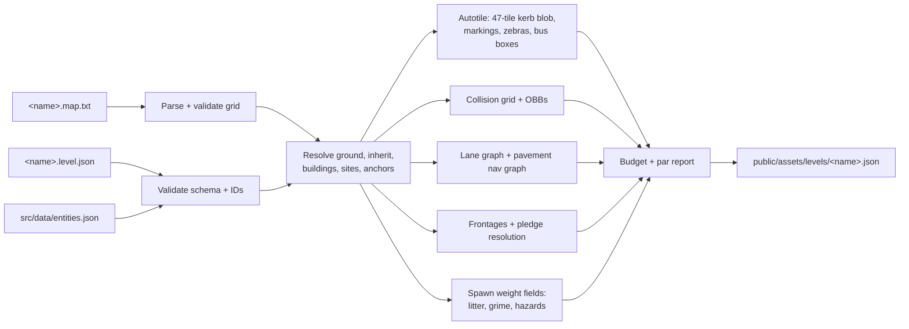

# Level Design

> **Scope:** the seven districts of the Tidy Town Week plus the Depot Yard: what each one contains, how it is laid out, how dense it is, how it is authored as text, how things spawn, and how a shift unfolds second by second. For *why* the game plays the way it does, see [GDD.md](GDD.md). For *the stats of every entity named here*, see [ENTITY_CATALOG.md](ENTITY_CATALOG.md). For *how the compiled level is rendered and simulated*, see [TECHNICAL_DESIGN.md](TECHNICAL_DESIGN.md).
>
> **Status:** v1.0, 2026-10-18. Numbers marked *(initial)* are starting values for M3/M6 playtest tuning. Their source of truth is the level JSON, not this document. Values that depend on an engine decision still to be made are marked with the milestone that decides them (`TBD (M0 spike)` markers were all resolved when M0 closed).

**Related docs:** [README](../README.md) · [CLAUDE.md](../CLAUDE.md) · [GDD](GDD.md) · [TECHNICAL_DESIGN](TECHNICAL_DESIGN.md) · [ASSET_PIPELINE](ASSET_PIPELINE.md) · [ART_BIBLE](ART_BIBLE.md) · [AUDIO_DESIGN](AUDIO_DESIGN.md) · [ENTITY_CATALOG](ENTITY_CATALOG.md) · [ROADMAP](ROADMAP.md) · [ADR 0001](adr/0001-tech-stack.md) · [ADR 0002](adr/0002-ai-authored-asset-pipeline.md) · [GLOSSARY](GLOSSARY.md)

---

## Contents

1. [What this document owns](#1-what-this-document-owns)
2. [Level design principles](#2-level-design-principles)
3. [The week at a glance](#3-the-week-at-a-glance)
4. [Shift structure](#4-shift-structure)
5. [District specifications](#5-district-specifications)
6. [Difficulty curve, targets and knobs](#6-difficulty-curve-targets-and-knobs)
7. [Level building blocks](#7-level-building-blocks)
8. [Map authoring format](#8-map-authoring-format)
9. [Spawn rules](#9-spawn-rules)
10. [The compile step](#10-the-compile-step)
11. [Skip Run layout rules](#11-skip-run-layout-rules)
12. [Level design checklist](#12-level-design-checklist)
13. [Open questions](#13-open-questions)

---

## 1. What this document owns

| This document owns | Lives in | Owned elsewhere |
|---|---|---|
| District list, order, themes, sizes, weather, time of day | `src/data/districts.json` (campaign order, unlock rules) + `assets-src/levels/<name>.level.json` | Star thresholds: [GDD §12.1](GDD.md#121-stars-per-district); economy: [GDD §12.2](GDD.md#122-currency--wages-and-tips) |
| ASCII map and JSON legend format | `assets-src/levels/<name>.map.txt` + `<name>.level.json` | Compiled-level schema and loader: [TECHNICAL_DESIGN §15.2](TECHNICAL_DESIGN.md#152-compiled-schema-v1) |
| Building columns (storeys, roof, wall style), frontages, pledges | `level.json` → `buildings`, `pledges` | Facade and roof art: [ART_BIBLE](ART_BIBLE.md), [ASSET_PIPELINE](ASSET_PIPELINE.md) |
| Litter, grime, stain, hazard and power-up spawn tables | `level.json` → `litter`, `grime`, `stains`, `hazards`, `powerups` | Points, LU, penalties: [ENTITY_CATALOG](ENTITY_CATALOG.md) |
| NPC and traffic schedules, caps, events | `level.json` → `npcs`, `traffic`, `events` | NPC behaviours: [ENTITY_CATALOG](ENTITY_CATALOG.md) |
| Par times, target score bands, difficulty knobs | `level.json` → `par` | Assists: [GDD §17](GDD.md) |
| Skip Run course layouts | `depot_yard.level.json` → `skipRun` | Skip Run payouts: [GDD §13.3](GDD.md) |
| The level compiler's validation rules | `tools/levels/compile-level.ts` | Build commands: [README](../README.md) |

**File naming.** District IDs are `district.<snake_name>`. As with sprite files, level files drop the class prefix: `district.puddle_lane` is authored as `assets-src/levels/puddle_lane.map.txt` + `puddle_lane.level.json` and compiled to `public/assets/levels/puddle_lane.json`.

---

## 2. Level design principles

These follow from the [design pillars](GDD.md). Every district review checks them.

1. **Grime is a route, not a carpet.** A 240 s shift at clean speed covers at most about 960 m of brush path ([GDD §8.3](GDD.md)). That is roughly a third of Puddle Lane's road and pavement area, and less in later districts. So grime is concentrated in **grime zones** (gutters, bin stores, bus stops, takeaway fronts, market pitches) at 55–90% local density, with light speckle elsewhere. A grimy street must *look* grimy at a glance, and a clean stripe must look like a reward (Pillar 1).
2. **Perfect is impossible, 3★ is a plan.** Every district is validated so that 92% Tidy (3★) fits inside 240 s with 10–75 s of slack for a player who knows the map, while 100% does not fit (the compiler's 100% par estimate must exceed 260 s). This is what makes "Thorough vs. Fast" (Pillar 3) a real choice on every street ([GDD §8.3](GDD.md): "a perfect clean is impossible in one shift").
3. **Long kerbs, honest corners.** Bessie has a ~7 m turning circle and loses 30% of her speed crossing a kerb (Pillar 2). Streets give her long straight kerb runs for Kerb Hugger and gutter grime. Tight spots are a deliberate puzzle, never an accident of layout.
4. **Every hazard is readable before it matters.** Hazards and darting NPCs appear on screen with enough distance to react at the speed the player is likely to be doing there (see [§7.9 sight lines](#79-sight-lines-and-the-camera)). A mistake should make the player laugh and say "I saw that coming" (Pillar 4).
5. **One new idea per day.** Each district introduces one new verb or hazard family, and everything before it stays in the mix ([GDD §14](GDD.md)).
6. **Everything is text.** A district is an ASCII grid plus a JSON file that an AI author can write, diff and review in a PR. The compiler is deterministic and its output is committed (Pillar 5).

---

## 3. The week at a glance

### 3.1 District table

This is facts sheet §9.2, reproduced as the master reference for level authors.

| # | Day | ID | Name | Theme | Heights | Time / weather | Map (tiles) | Signature NPCs and hazards |
|---|---|---|---|---|---|---|---|---|
| 1 | Mon | `district.puddle_lane` | **Puddle Lane** | Old Town terraces (tutorial) | 2–3 storeys | Dawn → morning, clear | 64×48 | Shoppers, cats, Doris, puddles |
| 2 | Tue | `district.high_street` | **Muckleford High Street** | Shops, market day | 3–5 | Late morning, clear | 80×60 | Buses, market traders, litterbugs, businessmen, A-boards |
| 3 | Wed | `district.gasworks` | **Gasworks Estate** | Industrial units + tower blocks | 2–4, towers 6 | Overcast, **rain** (all roads grip 6.0, many puddles) | 96×72 | Bin lorries, potholes, oil, dust |
| 4 | Thu | `district.conker_hill` | **Conker Hill** | Leafy suburbs, autumn | 2 | Afternoon, **wind + leaf fall** | 96×72 | Dog walkers, loose dogs, many cats, leaf piles, kids chalking |
| 5 | Fri | `district.promenade` | **The Promenade** | Seafront, arcades, pier | 2–4 | Golden hour, **gusts** | 112×64 | Seagulls, chips, pigeons, ice cream van, joggers, Sid cameo |
| 6 | Sat | `district.kebab_mile` | **Kebab Mile** | Town centre after the pubs | 3–5 | **Night** (night remap; street lamps and headlights lift the mask) | 96×80 | Revellers, taxis, police, pizza boxes |
| 7 | Sun | `district.civic_quarter` | **Civic Quarter** | Town Hall, parks, inspection | 3–6, Town Hall tower 8 | Morning, clear | 128×96 | The Inspector, lollipop lady, every NPC type |
| — | any | `district.depot_yard` | **The Depot Yard** | Skip Run bonus stage | 1–2 | Matches the preceding shift | 32×24 | Cones, bays |

One tile is 2 m × 2 m (32×32 px at 16 px/m), so Puddle Lane is 128 × 96 m and the Civic Quarter is 256 × 192 m.

### 3.2 Unlock order

The next district needs **1★** on the previous one. **Sunday needs ≥ 12★ in total across Mon–Sat** (out of 18). The Depot Yard is offered after every completed shift (not after SACKED or TOWED). Free Sweep is available for any district already unlocked in the week.



`districts.json` holds the order and the unlock rule for each card, so the Week Map, the save system and this table cannot drift:

```json
[
  { "id": "district.puddle_lane",   "day": "mon", "level": "puddle_lane",   "unlock": { "always": true } },
  { "id": "district.high_street",   "day": "tue", "level": "high_street",   "unlock": { "starsOn": "district.puddle_lane", "min": 1 } },
  { "id": "district.gasworks",      "day": "wed", "level": "gasworks",      "unlock": { "starsOn": "district.high_street", "min": 1 } },
  { "id": "district.conker_hill",   "day": "thu", "level": "conker_hill",   "unlock": { "starsOn": "district.gasworks", "min": 1 } },
  { "id": "district.promenade",     "day": "fri", "level": "promenade",     "unlock": { "starsOn": "district.conker_hill", "min": 1 } },
  { "id": "district.kebab_mile",    "day": "sat", "level": "kebab_mile",    "unlock": { "starsOn": "district.promenade", "min": 1 } },
  { "id": "district.civic_quarter", "day": "sun", "level": "civic_quarter", "unlock": { "starsOn": "district.kebab_mile", "min": 1, "totalStarsMonSat": 12 } }
]
```

### 3.3 What each day teaches

| Day | New idea (the one new verb or hazard family) | Carried forward | First-play support |
|---|---|---|---|
| Mon | Brush, clean-pickup speed, hopper and depot dump, horn on cats, Doris, puddles, zebra | — | Big Pam's tutorial beats ([§4.4](#44-tutorial-beats-monday-only)) |
| Tue | Traffic (buses, taxis, blocking), stains and the water spray, litterbugs ("Caught!"), litter that arrives mid-shift (market close) | Mon | Intro card hint: "Spray the gum, love. Hydrants are on the map." |
| Wed | Low grip everywhere (rain), oil, potholes, covered-yard dust, bin lorries | Mon–Tue | Intro card hint on dust and spray |
| Thu | Line obstacles (dog leads), a chaser (loose dog), "don't clean that yet" (chalk), leaf fall | Mon–Wed | — |
| Fri | Litter that moves (gusts) or is stolen (seagulls, Sid), mess generators (ice cream van) | Mon–Thu | — |
| Sat | Night: reading the street by lamplight; police witnesses | Mon–Fri | — |
| Sun | The Inspector's route as a sweep-ahead puzzle; the lollipop lady; everything at once | All | Intro card shows the Inspector's route |

---

## 4. Shift structure

### 4.1 Phases



- **Shift length: 240 s** in every campaign district (the compiler rejects any other `timer` for a campaign level). The Skip Run is 45 s. The **+60 s timer** assist raises the campaign timer to 300 s at runtime; levels are never authored for it.
- **Rollout:** the shift starts with Bessie stationary on the depot apron at `@`, brush up, empty hopper, full water. The timer starts the moment the player first applies throttle or after 3 s, whichever comes first (decided in SSP-062, [§13](#13-open-questions) Q3); on the first play of Puddle Lane only, it waits until the brush is first lowered ([GDD §16.1](GDD.md#161-principles)). The rollout is a level-design tool: the first 10–15 s of every district should show the player a short, clean, readable street before the first decision.
- *As built (SSP-062, `src/sim/shift.ts`):* to the tick, the timer starts on the first tick whose input has throttle > 0, or on tick 180 (`tuning.json` → `shift.rolloutS` × 60) if none came first. That tick is the timer's first: 240 s later, at the end of its 14,400th tick, `ticksRemaining` is 0 and the knock-off begins ([GDD §5.3](GDD.md#53-per-shift)). Brake, steer, Spray, Dump and the brush do not start it, so a player can look around for up to 3 s. The first-play rule is the `firstPlay` shift start parameter (only the first BRUSH press starts the timer); nothing sets it until the save exists (SSP-186, M6). `shiftElapsedTicks` is the event clock below.
- **Event clock:** every scheduled event is keyed to **elapsed** seconds (0 = timer start), not remaining time. With the +60 s assist, the player simply gets 60 s after the final scheduled beat.
- **Late-shift pressure:** the music's `lead` stem enters when the timer drops below 60 s ([AUDIO_DESIGN](AUDIO_DESIGN.md)). Districts schedule their last big event at or before 200 s elapsed so it lands in that final minute.

### 4.2 Shift objectives

Every shift has the same objective structure. The intro card picks one of these as Big Pam's emphasis, but scoring never changes.

| Objective | Rule | Where it is set |
|---|---|---|
| **Stars** (primary) | Tidy % ≥ 60 / 80 / 92 → 1★ / 2★ / 3★ | Fixed ([GDD §12.1](GDD.md#121-stars-per-district)) |
| **Pledges** | £10 per pledge frontage at ≥ 90% | `level.json` → `pledges` (8–20) |
| **Lost Property** | One per district, +250 pts and £25 | `level.json` → `collectibles.lostProperty` |
| **Golden Crisp Packet** | One hidden per district, +500 pts | `level.json` → `collectibles.goldenCrisp` |
| **Gleaming** | 3★ + 0 complaints + Lost Property returned | Fixed |
| **Inspection** (Sunday only) | −100 per frontage below 90% that the Inspector passes | `level.json` → `events[type=inspection]` |

### 4.3 Event catalogue

Events are the level author's way to change a street during the shift. Each is a typed entry in `level.json` → `events`, run by `src/sim/shift.ts` on the fixed tick. Events only use canonical entity IDs: there are no event-only entities.

| Type | What it does | Key params | Used in |
|---|---|---|---|
| `dawn` | Night remap at elapsed 0, dissolving to day with the 4×4 Bayer transition dither | `durationS` | Mon |
| `tutorial_beat` | One-line Big Pam prompt on a sim trigger, first play only | `trigger`, `text` | Mon |
| `market` | Stalls open; `npc.market_trader` at each `m` pitch; litter and shopper bias around pitches | `pitches` (default all `m`) | Tue |
| `market_close` | Traders pack up; a litter pile builds around each pitch over `buildS` | `at`, `buildS`, `itemsPerPitch`, `table` | Tue |
| `bin_round` | Wheelie bins put out at kerbs at shift start; `veh.bin_lorry` follows a route, stops at each bin, sometimes drops `litter.bin_bag` | `route` (anchors), `lorries`, `startAt`, `bagDropChance` | Wed (Thu, Sun light) |
| `rain` | All road grip 6.0 for the whole shift; puddle table active; `amb.rain` | — | Wed |
| `leaf_fall` | New `litter.leaf_pile` items appear under `prop.tree` canopies | `everyS`, `max` | Thu |
| `school_out` | A population wave of kids from a school anchor (skaters, chalkers) | `at`, `anchor`, `mix`, `count` | Thu, Sun |
| `gust` | `haz.wind_gust`: newspapers, packets and leaves drift 1.5 m/s for 4 s in a set direction | `at[]`, `dirDeg` | Fri |
| `vehicle_stop` | A vehicle arrives on the lane graph and stops at an anchor for a fixed time (e.g. the ice cream van: 20 s, chimes, spawns kids, wrappers and lolly sticks) | `vehicle`, `anchor`, `at`, `stopS` | Fri, Sun |
| `rival_cameo` | `veh.rival_sweeper` enters, sweeps a fixed route stealing litter, leaves | `at`, `untilS`, `route` | Fri |
| `kicking_out` | The pubs shut: reveller population ramps up from the pub doors | `at`, `rampS`, `from`, `to`, `anchors` | Sat |
| `crossing_patrol` | `npc.lollipop_lady` works a `site.school_crossing` during windows | `crossing`, `windows[]` | Sun |
| `parade` | Closes a road section to traffic; a slow column of existing NPCs (shoppers in outfit swaps, kids, parents with pushchairs) walks it behind a `veh.police` escort, dropping litter behind it | `route`, `at`, `untilS`, `walkers`, `dropEveryS`, `table` | Sun |
| `inspection` | `npc.inspector` walks a fixed anchor route marking frontages | `route`, `at`, `speed` (1.0 m/s) | Sun |
| `population_wave` | Generic temporary change to an NPC cap or mix | `at`, `untilS`, `npc`, `delta` | Any |

**Free Sweep** runs a district with no timer: one-off events (`market_close`, `kicking_out`, `inspection`, `parade`, `dawn`) are skipped, and recurring ones (`gust`, `vehicle_stop`, `bin_round`, `leaf_fall`, NPC schedules) loop on a 240 s cycle. **Daily Shift** (M9) modifiers are implemented as extra events and knob overrides on top of the level JSON ([§6.4](#64-difficulty-knobs)).

### 4.4 Tutorial beats (Monday only)

The beat script is [GDD §16.2](GDD.md#162-puddle-lane-first-play-script-proposed-m2m3); each beat is authored as a `tutorial_beat` event with the GDD trigger and text, copied exactly. Triggers are sim events (including the timer event `timer_remaining<=60` for the last beat), and a beat never repeats once learned. Only one prompt shows at a time ([GDD §17.2](GDD.md)). Beats show on the first play of Puddle Lane and again if the setting "Show tips" is on. Spraying and hydrants are taught on Tuesday, where the stains are (§3.3).

### 4.5 Per-district event timelines

Elapsed seconds. "Cont." means the event runs for the whole shift. All values *(initial)*.

| Day | 0–60 s | 60–120 s | 120–180 s | 180–240 s |
|---|---|---|---|---|
| Mon | `dawn` (20 s). Postie starts his round at 10 s. | Doris leaves home (anchor `1`) at 70 s, heading for the zebra and the corner shop | Dog walker loop from Pump Green at 120 s | Quiet: the clean-up minute |
| Tue | `market` (cont.). Buses every 45 s from 20 s. | Litterbug wave (+2) at 90 s | Lunchtime shopper wave (+8) from 120 to 180 s | **`market_close` at 180 s**: about 40 items build over 20 s |
| Wed | `rain` (cont.). `bin_round` starts at 15 s (2 lorries). | Second lorry at 70 s | Skater wave from the tower blocks at 140 s | Bin lorries return to depot from 200 s |
| Thu | `leaf_fall` every 4 s, max +40 (cont.) | **`school_out` at 75 s**: 4 chalkers, 3 skaters | Dog walkers peak (6) from 120 s | Leaf fall continues; chalk kids start leaving (60–90 s after arrival) |
| Fri | Gust at 40 s. Ice cream van stops at 55 s. | Gust at 95 s. **Sid cameo 110–170 s.** | Gust at 150 s. Ice cream van stops at 165 s. | Gust at 205 s |
| Sat | Night (cont.). Taxis queue at the rank; police patrol loop. | Second police car from 90 s | **`kicking_out` at 150 s**: revellers ramp 8 → 32 over 30 s | Peak chaos; pizza boxes and kebab wrappers everywhere |
| Sun | `crossing_patrol` 20–80 s (Sunday School). Ice cream van at 45 s. | **`inspection` starts at 60 s** from the Town Hall steps | **`parade` 120–170 s** along Civic Way | Inspector finishes at about 230 s; `crossing_patrol` 200–240 s |

---

## 5. District specifications

Each district below lists its layout, density, hazards and NPC mix. The numbers are the *(initial)* authored values; the comparison across the week is in [§6](#6-difficulty-curve-targets-and-knobs). Entity membership (which entity may appear in which district) is fixed by `entities.json` → `districts` and mirrored in [ENTITY_CATALOG](ENTITY_CATALOG.md). The compiler rejects a level that spawns anything outside that list. Every map contains a depot entrance at its edge with at least one `site.depot_bay` ([§7.7](#77-depot-skips-and-hydrants)).

### 5.1 Mon: Puddle Lane (`district.puddle_lane`), tutorial

**Theme.** Old Town terraces at dawn: red-brick 2-storey terraces, a 3-storey parade with a corner shop, slate roofs and chimneys, a small green with a pump, narrow two-way streets. Music `mus.puddle_lane` ("Milk Float Shuffle"), ambience `amb.town_morning`.

**Layout (64×48).**

- **Depot** on the south-west edge. The rollout heads north up **Mangle Street** (a straight 3-tile two-way road with long kerbs, the first thing the player sweeps).
- **Puddle Lane** runs east–west across the middle: 3-tile carriageway, 1-tile pavements, parking bays on the south side, one zebra, speed bumps at both ends.
- **Gutter Row** runs south from Puddle Lane to the back of the district: the skip lives in a 2-tile-wide drivable alley off it.
- **Pump Green** (about 14×8 tiles): hedge-bounded grass with paved paths. The paths are drivable pavement and form a shortcut, but the grass costs drag ×2.5.
- A ring of back streets (**Drain Close**, **Soapsud Terrace**) completes a figure-of-eight loop, so no route ever needs a three-point turn.
- **Heights:** 2-storey terraces (`roof.slate`), a 3-storey parade on Puddle Lane. No street is flanked by more than 3 storeys.

*As built (SSP-042, layout calls approved by the owner at the M0/M1 close, 2026-10-19):* `assets-src/levels/puddle_lane.map.txt`, with the §8.5 excerpt in its north-west corner. Streets are 3-tile two-way roads with 1-tile pavements; x is the column, y the row.

- **Depot** `[0, 38, 14, 10]`: a walled concrete yard with the 2-storey shed `P` (`roof.depot`, landmark) along its north wall, two 2×3 bays (`$`) in front of it, `@` at (3, 44) facing north, and a 12×6 apron that is the 5×5 turning head at Mangle Street's south end. The gate is Mangle Street itself (row 38).
- **Mangle Street** x 2–4, rows 21–38: straight, kerbed on both sides for 15+ tiles from the gate (the first 30 m), garden walls (`w`, cat perches) on the west edge, terrace `L` on the east. It turns east into Soapsud Terrace at its north end.
- **Soapsud Terrace** rows 21–23, from Mangle Street to x 60–62, where it turns north up the east edge to Puddle Lane's east end. So neither Puddle Lane's east end nor Soapsud runs off the map.
- **Gutter Row** x 22–24, rows 7–41, and **Drain Close** x 50–52, rows 7–41, joined at the back by a road on rows 39–41: with Puddle Lane and Soapsud Terrace they make the figure-of-eight (two loops sharing Soapsud between Gutter Row and Drain Close).
- **The skip alley**: rows 30–31, 2 tiles of setts off Gutter Row's east pavement (dropped kerbs at x 25). The skip is at (38–39, 31) in its south lane, with the north lane beside it as the stopping tile, 118 m (path) from the bays. The alley ends in a 5×5 yard (`%`, x 40–44, rows 28–32) that is the turning head and holds the Golden Crisp tile (44, 30).
- **Pump Green east walk**: a 1-tile footway at x 40, rows 8–19, bollarded at both ends, carrying the dog walker's anchor `5`.
- **Parking:** 24 bays: Puddle Lane south kerb x 28–33 and x 41–46, Drain Close west kerb rows 11–16 and east kerb rows 30–35 (60% fill ≈ 14 parked), each 3+ tiles clear of a junction. **Speed bumps:** Puddle Lane x 8 and x 56, Drain Close row 27.
- **Heights:** 2-storey slate terraces, plus 3-storey `C` (parade), `D` (corner shop), `F` and `X` (flats).
- **Compile report:** route area 1,264 tiles, max dump distance 158 m, max water distance 108 m, kerb blob indices used 4, 10, 12, 26, 31, 33, 34, 36, 41, 42, 44, 45.
- **Deviation:** Puddle Lane's west end (x 0, fixed by the §8.5 excerpt) and the 2-tile alley at x 12–13 (rows 0–2) run off the map edge. L014 treats an edge as "the town goes on", so they pass, but Puddle Lane west of Gutter Row is not part of a loop: driving west, Bessie meets the map edge. What the edge does is the runtime's call (SSP-036/SSP-045).

*As built (SSP-056, the M2 sweeping content; lead calls pending owner review):* `puddle_lane.level.json` now carries `pledges`, `litter`, `grime`, `powerups` and `collectibles` with the values in the table below, and the map is unchanged (it already had 2 bays, 1 skip and 2 hydrants).

- **Building uses.** The parade `C` is now `shop` (default width 4), like the corner shop `D` (width 5); `P` is `depot`; every other building is `house` (width 3; `F` and `X`, the flats, 4).
- **Frontages: 122, not 46.** The generator makes a frontage on every building side that faces open street, and §13 Q4 fixed a house frontage at 3 tiles, one terraced house front. Puddle Lane as built (SSP-042) has about 370 tiles of such facade, so 46 would need a house width of 10 tiles (20 m; width 10 still gives 47), which is no longer one house. So the widths stay and 122 is recorded here and in §6.1. Clean Sweep (+100 each) has 2.7× the frontages the §6.3 bands assumed; the M6 economy pass re-checks Monday's band.
- **Pledges** (8, at most 2 per street, on 7 of the 10 streets): `fr_3_3` (Doris's front door, anchor `1`), `fr_16_7` (the corner shop, a litter hotspot beside the zebra), `fr_44_7` (Puddle Lane behind the parking bays at x 41–46), `fr_25_16` (flats `F` on Gutter Row), `fr_49_11` (Drain Close behind the west-kerb bays), `fr_30_20` (flats `F` on Soapsud, on the dog walker's leg 6 → 7), `fr_5_31` (Mangle Street, the first pledge on screen in the rollout) and `fr_53_29` (flats `X` behind the Drain Close east-kerb bays). Five compete with something: parked cars over the gutter (`fr_44_7`, `fr_49_11`, `fr_53_29`, from M3), Doris (`fr_3_3`), the dog walker's mess (`fr_30_20`) and the shop's litter (`fr_16_7`). No L031 warning.
- **Litter.** `gutterBias` 0.6 (the §8.5 example's value): a kerb-hugging lap of the first 447 m (Mangle Street, Soapsud, Gutter Row, Puddle Lane west and back, Drain Close, the back road, to the skip; 124 s at 3.6 m/s) passes about 47 LU of the expected litter at 0.6, against 36 LU at 0.4, so the Kerb Hugger lesson also fills the hopper. 60% in the gutter still leaves 40% for pavements, alleys and yards, where dog mess (pavement only), the frontages and the shop hotspot are.
- **Hopper warning and the skip.** The skip stays at (38–39, 31): 1,254 of the 1,264 route tiles are within 150 m (path) of it; only the north-east tip of Puddle Lane (x 60–63, rows 3–6) is over, by 2–8 m. So wherever the first 80 LU warning comes, the skip is within 150 m of it. The same lap estimate passes only about 47 LU by 124 s, so the warning at 80–100 s probably comes later for a one-side kerb hug; M3's dynamic litter (+20) and the M6 par replay decide whether `litter.initial` or the route needs to change *(flagged for owner review)*.
- **Power-up:** count 1, `pwr.flask_of_tea`, no fixed `at` (placement and behaviour are M3's, SSP-096/SSP-104). **Collectibles:** Lost Property `collect.false_teeth` at (34.5, 11.5) on the Pump Green path cross beside the bench (35, 10); Golden Crisp at (44.5, 30.5) in the alley's turning head, 12 m (path) past the skip. L041 passes. If the M6 par route dumps at the skip, the Crisp detour is shorter than §9.6's 15 s; that is checked with the par report (SSP-190).
- **Compile report** (`npm run levels`; the NPC, vehicle and par lines need M3 and M6):

  ```
  district.puddle_lane  64x48  seed 1001
    route area      1,264 tiles   grime 9,000 cells (gutter 15.0%)   litter 130 (+0 dyn until M3) ≈ 133 LU
    dumps: depot 2 bays, skips 1   hydrants 2   max dump dist 158 m   max water dist 108 m
    frontages 122   pledges 8
    warnings: none
  ```

**Density and resources.**

| Item | Value |
|---|---|
| Initial litter | 130 items, about 150 LU *(initial)*: about 133 LU at shift start, the rest from M3's dynamic litter |
| Litter table (weights) | crisp packet 30, cigarette butts 20, drink can 15, plastic bottle 15, newspaper 12, dog mess 8 |
| Litter placement | `gutterBias` 0.6; hotspots: litter bins ×2.0 within 3 tiles, shops (the parade and the corner shop) ×2.5 within 4, benches ×1.5 within 2; `minSpacingM` 0.5 *(initial)* |
| Initial grime | 9,000 cells, 15% (1,350) of them gutter grime |
| Grime zones | Mangle Street's first 30 m, kerb to kerb (x 1–5, rows 24–38) 0.85; litter bins (2 tiles) 0.75; shops (3 tiles) 0.7; the skip alley (x 25–44, rows 30–31) 0.6; speckle 0.03 *(initial)* |
| Stains | None at start. `stain.splat` can be created by the player. |
| Hazards | 8 `haz.puddle` (kerb-side, near drains), 3 speed-bump rows (`=`) |
| Skips / hydrants | 1 / 2 |
| Power-ups | 1 (`pwr.flask_of_tea`) |
| Frontages / pledges | 122 / 8 *(as generated; the pre-build estimate was 46, see below)* |
| Lost Property | `collect.false_teeth`, on the Pump Green path beside the bench |
| Golden Crisp | At the dead end of the Gutter Row alley, behind the skip |

**NPC and traffic mix (peaks).**

| Entity | Peak | Notes |
|---|---|---|
| `npc.shopper` | 9 | Concentrated on the Puddle Lane parade |
| `npc.old_woman` (Doris) | 1 | Named spawn at anchor `1`, scripted walk to the zebra and the corner shop and back |
| `npc.old_man_frame` | 1 | Crosses only at the zebra |
| `npc.postie` | 1 | Frontage-to-frontage round from 10 s |
| `npc.mum_pushchair` | 2 | |
| `npc.dog_walker` | 1 | From 120 s, loops Pump Green. Teaches dog mess. |
| `npc.cat` | 4 | 2 on garden walls (`w`), 2 on parked car roofs |
| Moving traffic | 6 | `veh.hatchback` 55, `veh.saloon` 30, `veh.van_white` 15; plus 1 `veh.mobility_scooter` on pavements |
| Parked | 14 | Bays on Puddle Lane and Drain Close, 60% filled |

**Design notes.** Every street is a loop. The first 30 m of Mangle Street is dense gutter grime with a straight kerb, so the first 15 s teach both the brush and Kerb Hugger. The skip is placed so that the player's first hopper warning (around 80–100 s) happens within 150 m of it.

### 5.2 Tue: Muckleford High Street (`district.high_street`)

**Theme.** A market-day high street: 3–5 storey shopfronts with signs, a pedestrianised cobbled **Market Square**, a bus interchange, pound shops, a bakery and a chippy. Music `mus.high_street` ("Window Shopping"), ambience `amb.town_morning`.

**Layout (80×60).**

- **High Street** is the spine: a 4-tile carriageway (two lanes plus a painted bus box at each stop), 2-tile pavements with A-boards, litter bins and planters. Two zebras and two bus stops.
- **Market Square** (about 20×14 tiles of cobbles `:`) hangs off the middle of the High Street. 12 market stall pitches (`m`) are laid out in two rows with 3-tile drivable aisles. Bessie fits, but the aisles are full of shoppers.
- **Station Road** forms a one-way loop (`>`/`<`) behind the shops, with service yards, wheelie bins and the two skips. Using it is the fast way round.
- **Ginnels** (2-tile drivable alleys) link the High Street to Station Road every 25–35 m.
- **Depot** on the north edge, off Station Road.
- **Heights:** 3 storeys on the side streets, 4–5 on the High Street. The High Street is 8 tiles facade to facade ([§7.9](#79-sight-lines-and-the-camera)).

**Density and resources.**

| Item | Value |
|---|---|
| Initial litter | 200 items, about 230 LU including dynamic litter |
| Litter table | crisp packet 20, cigarette butts 18, drink can 12, plastic bottle 10, chip wrapper 10, newspaper 8, banana skin 8, glass bottle 6, pizza box 4, bin bag 4 |
| Dynamic litter | About 60 items: market close (about 40), litterbugs, seagull-free chip drops |
| Initial grime | 11,000 cells. Dense around bus stops, the chippy and market pitches. |
| Stains | 30 `stain.gum` (bus stops, bench fronts), 6 `stain.milkshake` |
| Hazards | `haz.broken_glass` only from flung glass bottles |
| Skips / hydrants | 2 / 4 |
| Power-ups | 2 (pool: flask of tea, super suction, water can) |
| Frontages / pledges | 64 / 12 |
| Lost Property | `collect.lost_wallet`, between two stalls in Market Square |
| Golden Crisp | In the bus box at the far bus stop. Reachable only when no bus is stopped there. |

**NPC and traffic mix (peaks).**

| Entity | Peak | Notes |
|---|---|---|
| `npc.shopper` | 18 (26 during the 120–180 s wave) | |
| `npc.market_trader` | 12 | One per pitch, static |
| `npc.businessman` | 5 | Crosses without looking at 2 m |
| `npc.litterbug` | 3 (+2 at 90 s) | |
| `npc.old_woman` / `npc.old_man_frame` | 1 / 1 | |
| `npc.pigeon` | 2 flocks of 6–10 | Gather at chip wrappers in the square |
| Moving traffic | 12 | `veh.bus` 2 (every 45 s), `veh.taxi` 2, `veh.bicycle` 2, cars 6 (`veh.hatchback`, `veh.saloon`, `veh.van_white`) |
| Parked | 14 | Loading bays on Station Road |

**Design notes.** The market is the shift's main dilemma: sweep the aisles early (light litter, lots of shoppers) or save time for the 180 s closing pile (a 40-item jackpot that arrives just as the lead stem kicks in). Buses stop for 5 s at bus stops. Following a bus down the High Street is safe but slow, and overtaking means crossing into oncoming traffic.

### 5.3 Wed: Gasworks Estate (`district.gasworks`)

**Theme.** Industrial units, a disused gasholder, a canal and two 6-storey tower blocks (Kestrel House and Heron House) in steady rain. Music `mus.gasworks` ("Drizzle Dub"), ambience `amb.rain`.

**Layout (96×72).**

- **Gasholder Road** loops the estate: a 4-tile road with wide gutters, potholes and kerbside puddles.
- **Units 1–12** sit on **Coke Street**, a dead-end service road with a turning head of 5×5 tiles and covered loading yards (`%`, dusty) under corrugated canopies.
- **The towers** stand on a podium of pavement and grass, with bin stores at their bases that are the district's densest grime zones.
- **The canal** (`~`) splits the map, with two bridges. They are pinch points with no pavement.
- **Roadworks** on Gasholder Road: 2 `haz.open_manhole` ringed by `prop.roadworks_barrier`, telegraphed by cones 20 m before.
- **Depot** on the east edge.
- **Heights:** 2–4 storey units, towers 6. The towers stand at least 8 tiles back from any road edge.

**Density and resources.**

| Item | Value |
|---|---|
| Initial litter | 210 items, about 260 LU |
| Litter table | crisp packet 20, drink can 18, cigarette butts 15, plastic bottle 12, newspaper 10, glass bottle 10, bin bag 15 |
| Initial grime | 12,000 cells (dense gutters, bin stores, loading yards) |
| Stains | 10 `stain.oil`, each on the same tile as a `haz.oil_slick` |
| Hazards | 30 `haz.puddle`, 18 `haz.pothole`, 10 `haz.oil_slick`, 2 `haz.open_manhole`; road grip 6.0 everywhere (rain) |
| Dust | `%` tiles under canopies stay dry and dusty. Brush down without spray → dust cloud. |
| Skips / hydrants | 2 / 4 |
| Power-ups | 2 (pool: wrench, water can, super suction) |
| Frontages / pledges | 34 / 10 (units and tower entrances have wide frontages) |
| Lost Property | `collect.hard_hat`, inside the Coke Street turning head |
| Golden Crisp | Under the second canal bridge on the towpath (a 2-tile pavement strip, reached via a dropped kerb) |

**NPC and traffic mix (peaks).**

| Entity | Peak | Notes |
|---|---|---|
| `npc.shopper` | 8 | |
| `npc.kid_skateboard` | 3 (+3 at 140 s) | Ollies off the tower podium kerbs |
| `npc.litterbug` | 3 | |
| `npc.dog_loose` | 2 | Patrol the tower podium |
| Moving traffic | 10 | `veh.bin_lorry` 2 (`bin_round`), `veh.van_white` 3, cars 5 |
| Parked | 16 | White vans half on pavements outside the units |
| Knockables | 40 `prop.wheelie_bin` put out at kerbs (bin day), 4 `prop.shopping_trolley` |

**Design notes.** Water is the resource here: oil and dust both need spray, and the tank holds 100 units (16.7 s of spray). Hydrants are placed so that a sensible route passes one every 60–90 s. The bin lorries move at 4 m/s, slower than Bessie's clean-pickup speed, and drop 50-point bags, so following one is a valid strategy but it blocks the gutter.

### 5.4 Thu: Conker Hill (`district.conker_hill`)

**Theme.** Leafy 1930s suburbs in autumn: 2-storey semis with front gardens, horse chestnut avenues, cul-de-sacs, a primary school and **The Rec** (a park). Music `mus.conker_hill` ("Conker Crunch"), ambience `amb.wind_leaves`.

**Layout (96×72).**

- **Horse Chestnut Avenue** and **Acorn Crescent** are tree-lined 3-tile roads with grass verges between pavement and kerb. Trees overhang the pavements.
- **Four cul-de-sacs** (Laburnum Close and friends), each 8–12 tiles long with a 5×5-tile turning head.
- **The Rec** (about 24×16 tiles): grass, a path loop and the dog walkers' home turf.
- **School Lane** runs past the primary school (the `school_out` anchor) with speed bumps.
- **Depot** on the west edge, at the bottom of the hill.
- **Heights:** 2 storeys throughout, so sight lines are easy. The challenge comes from actors, not the camera.

**Density and resources.**

| Item | Value |
|---|---|
| Initial litter | 220 items, about 320 LU including leaf fall |
| Litter table | leaf pile 30, crisp packet 18, drink can 12, plastic bottle 10, cigarette butts 10, newspaper 8, dog mess 12 |
| Dynamic litter | Leaf fall up to +40 piles; dog mess every 40–60 s per dog walker |
| Initial grime | 11,000 cells |
| Stains | `stain.chalk_art`, drawn by up to 4 `npc.kid_chalk` from 75 s |
| Hazards | Speed bumps on School Lane, 8 `haz.pothole`, `haz.wet_leaves` created by the player |
| Skips / hydrants | 2 / 3 |
| Power-ups | 2 (pool: hi-vis, flask of tea, wrench) |
| Frontages / pledges | 72 / 16 (the most pledges so far: proud suburbanites) |
| Lost Property | `collect.cat_collar`, at the foot of a garden wall in Laburnum Close |
| Golden Crisp | In the middle of the densest leaf pile cluster in The Rec |

**NPC and traffic mix (peaks).**

| Entity | Peak | Notes |
|---|---|---|
| `npc.cat` | 10 | Walls, car roofs, mid-road grooming spots |
| `npc.dog_walker` | 6 | Leads up to 5 m: line obstacles |
| `npc.dog_loose` | 3 | Chasers within 12 m |
| `npc.kid_chalk` / `npc.kid_skateboard` | 4 / 3 | From `school_out` at 75 s |
| `npc.jogger` | 4 | Gutter runners |
| `npc.shopper`, `npc.mum_pushchair`, `npc.postie`, `npc.old_woman` | 6, 3, 2, 1 | |
| Moving traffic | 7 | Cars 5, `veh.van_white` 1, `veh.bin_lorry` 1 (light `bin_round`) |
| Parked | 20 | Driveways (`d`) and kerbside |
| Knockables | 24 `prop.recycling_box` and 12 `prop.wheelie_bin` |

**Design notes.** Leaf piles are cheap (5 pts) but heavy (2 LU), so a player who hoovers every pile fills the hopper fast. That pressure is intended. The chalk is the "don't clean that yet" lesson: chalk spots sit on pledge frontages, so waiting for the kid to leave (60–90 s) is worth it.

### 5.5 Fri: The Promenade (`district.promenade`)

**Theme.** The seafront at golden hour: Marine Parade, amusement arcades, chip shops, a bandstand, beach huts and **the Pier** (a landmark roof). Music `mus.promenade` ("Seagull Surf"), ambience `amb.seafront`.

**Layout (112×64).** The widest map: long and shallow, built for transit.

- **Marine Parade** runs the full 112-tile width: a 4-tile road with a 3-tile promenade pavement on the sea side, behind sea-wall railings (`r`). The beach (`_`) is out of bounds.
- **The Pier** juts south from the centre: a 4-tile-wide pavement deck (drivable, no traffic), 30 tiles long, with a turning space at the end. It is the classic risk-reward detour: lots of chips and seagulls, and a long dead end.
- **Arcade row** sits on the land side of the Parade (2–4 storeys, bright shopfronts and signs), with a back lane (**Winkle Street**) and the skips.
- **Depot** on the west edge; a second dump option is one skip at the far east end.

**Density and resources.**

| Item | Value |
|---|---|
| Initial litter | 240 items, about 300 LU |
| Litter table | chip wrapper 22, newspaper 18, crisp packet 15, drink can 12, plastic bottle 10, cigarette butts 8, banana skin 5, lolly stick 10 |
| Dynamic litter | About 50: seagull thefts (chip wrappers), ice cream van stops (lolly sticks, wrappers) |
| Initial grime | 11,500 cells, spread along the whole Parade so that transit matters |
| Stains | 12 `stain.milkshake` |
| Hazards | `haz.wind_gust` at 40, 95, 150 and 205 s, blowing onshore (from the south) |
| Skips / hydrants | 2 / 4 |
| Power-ups | 3 (pool: bacon butty, super suction, flask of tea, water can) |
| Frontages / pledges | 52 / 12 |
| Lost Property | `collect.bucket_and_spade`, at the pier end |
| Golden Crisp | Behind the bandstand, in a 1-tile-wide, 2-tile-deep gap between the railings and the bandstand base. Bessie's 1.75 m body just fits. |

**NPC and traffic mix (peaks).**

| Entity | Peak | Notes |
|---|---|---|
| `npc.seagull` | 10 | Steal chips and snatch litter just ahead of the brush |
| `npc.pigeon` | 3 flocks of 6–10 | |
| `npc.shopper` | 14 | |
| `npc.jogger` | 5 | On the promenade pavement |
| `npc.kid_skateboard` | 4 (+ice cream kids) | |
| Moving traffic | 10 | `veh.bus` 2, `veh.ice_cream_van` 1 (two stops), `veh.mobility_scooter` 2, cars 4, `veh.rival_sweeper` 1 (110–170 s) |
| Parked | 12 | |

**Design notes.** Gusts blow litter *toward* the arcade kerbs, so a player who saves the land-side gutter for after a gust is rewarded. Sid's cameo route runs the eastern half of the Parade; getting there first is the race.

### 5.6 Sat: Kebab Mile (`district.kebab_mile`)

**Theme.** The town centre at night: pubs (The Mucky Duck, The Dog & Dustpan), kebab shops, a nightclub and a taxi rank. The night remap is on for the whole shift. Music `mus.kebab_mile` ("Kebab O'Clock"), ambience `amb.night_town`.

**Layout (96×80).**

- **Bridge Street** is the main drag: a 4-tile road with 2-tile pavements, the taxi rank (a long `p` run reserved for `veh.taxi`) and the pub doors (the `kicking_out` anchors).
- **The Shambles** is a grid of narrow 3-tile streets with alleys behind the takeaways: the densest litter zone in the game.
- **Lamp spacing:** one `prop.lamp_post` every 5–6 tiles (10–12 m) on main streets, so the light pools overlap. Back alleys are deliberately dark.
- **Depot** on the north edge.
- **Heights:** 3–5 storeys. Bridge Street is 8 tiles facade to facade.

**Density and resources.**

| Item | Value |
|---|---|
| Initial litter | 250 items, about 340 LU including dynamic litter |
| Litter table | kebab wrapper 18, pizza box 12, chip wrapper 12, glass bottle 12, drink can 12, cigarette butts 12, crisp packet 10, plastic bottle 6, bin bag 6 |
| Dynamic litter | About 80, from revellers (pizza boxes, kebab wrappers), mostly after 150 s |
| Initial grime | 13,000 cells |
| Stains | 30 `stain.gum` |
| Hazards | `haz.broken_glass` from flung glass bottles (12% of the table: drive carefully) |
| Skips / hydrants | 2 / 3 |
| Power-ups | 2 (pool: wrench, hi-vis, flask of tea) |
| Frontages / pledges | 58 / 14 |
| Lost Property | `collect.lost_shoe`, in the taxi rank |
| Golden Crisp | In the darkest alley behind the nightclub, outside every lamp pool. You find it with the headlights. |

**NPC and traffic mix (peaks).**

| Entity | Peak | Notes |
|---|---|---|
| `npc.reveller` | 8 → 32 after `kicking_out` (150–180 s) | Weave, sing, drop pizza boxes and kebab wrappers |
| `npc.cat` | 5 | Bins and car roofs |
| Moving traffic | 16 | `veh.taxi` 6, `veh.police` 2 (patrol loop), `veh.bicycle` 3 (takeaway couriers), cars 5 |
| Parked | 12 | |
| Knockables | 16 `prop.wheelie_bin`, 4 `prop.shopping_trolley` |

**Design notes.** The night rule is that every `haz.*` placement and every litter hotspot must sit inside a lamp pool or be flagged `darkOk` (the compiler checks this, [§10.3](#103-validation-rules)). Darkness hides the Golden Crisp, never a penalty. The light pool radius is a render constant, decided in M0 as **5 m** ([ROADMAP D-05](ROADMAP.md#8-m0-spike-decision-log); `LIGHT_POOL_RADIUS_M` in `src/render/lightPools.ts`), which is what this document assumes. The police double the cost of mistakes nearby (+1 complaint for anything witnessed within 15 m), so their patrol loop avoids the densest litter streets and gives the player a choice of where to be careless.

### 5.7 Sun: Civic Quarter (`district.civic_quarter`), finale

**Theme.** A pompous Civic Quarter on inspection morning: the Town Hall with its 8-storey clock tower, Civic Square, the library and museum, Jubilee Park, St Swithun's chapel with a Sunday School crossing, and terraces and shops round the edges. Music `mus.civic_quarter` ("Clipboard March"), ambience `amb.town_morning`.

**Layout (128×96).** The biggest map, a sampler of the whole town.

- **Civic Way** is a 4-tile boulevard from the depot (south edge) to the Town Hall steps. It is the parade route.
- **Civic Square** is a cobbled plaza with planters, bollards and benches in front of the Town Hall.
- **Jubilee Park** (about 30×20 tiles) has paths, a pond (`~`), trees and dog walkers.
- **Chapel Street** has the `site.school_crossing` and its `npc.lollipop_lady`.
- **Edge quarters** quote earlier days: a terrace row (Mon), a shopping street with a bus stop (Tue), a roadworks patch (Wed), an avenue of trees (Thu), and a takeaway corner (Sat).
- **The Inspector's route** (about 170 m of pavement, about 28 frontages) starts at the Town Hall at 60 s and walks clockwise round the square, down Civic Way and through the terraces at 1.0 m/s. It ends about 230 s (170 s of walking).
- **Heights:** 3–6 storeys, with the Town Hall tower at 8 (`roof.town_hall`, a landmark). Civic Way is 10 tiles facade to facade.

**Density and resources.**

| Item | Value |
|---|---|
| Initial litter | 300 items, about 360 LU |
| Litter table | Every Sunday-member litter type, weighted toward crisp packets, cans and cigarette butts |
| Dynamic litter | About 40 (parade, ice cream van, dog walkers) |
| Initial grime | 14,500 cells |
| Stains | 30 in total (gum, milkshake, oil, chalk) |
| Hazards | 10 puddles, 6 potholes, 2 oil slicks, 1 open manhole (roadworks), speed bumps on Chapel Street |
| Skips / hydrants | 3 / 6 |
| Power-ups | 3 (full pool) |
| Frontages / pledges | 84 / 20 |
| Lost Property | `collect.mayors_chain`, in Jubilee Park by the pond |
| Golden Crisp | On the Town Hall steps. Reachable only while the Inspector is away from the square (after about 90 s). |

**NPC and traffic mix (peaks).** Every NPC type in the catalog appears at least once, at lower counts than its signature day: about 72 NPCs and 28 vehicles (12 moving + 16 parked) at peak, including the Inspector, the lollipop lady and the parade column.

**Design notes.** The Sunday puzzle is to **sweep ahead of the Inspector**. His route is shown on the intro card and the shift map. The 28 frontages on it are worth 2,800 points of potential deductions, which outweighs any single street's litter, and his pass rate is half of the Sunday Inspection Score ([GDD §12.8](GDD.md#128-the-week-finale)). The parade (120–170 s) closes Civic Way to traffic and leaves a trail of litter behind it, sitting right across the second half of his route.

### 5.8 The Depot Yard (`district.depot_yard`)

The Skip Run stage. It is 32×24 tiles, has no traffic, NPCs, litter or grime, and inherits the weather and time of day of the shift that preceded it (rain grip on Wednesday, the night remap on Saturday). Layout rules and a complete map are in [§11](#11-skip-run-layout-rules) and [§8.6](#86-worked-example-2-the-depot-yard-complete).

---

## 6. Difficulty curve, targets and knobs

### 6.1 Per-district numbers

All values *(initial)*, tuned in M6 and recorded in each `level.json`.

| | Mon | Tue | Wed | Thu | Fri | Sat | Sun |
|---|---|---|---|---|---|---|---|
| Map (tiles) | 64×48 | 80×60 | 96×72 | 96×72 | 112×64 | 96×80 | 128×96 |
| Initial litter items | 130 | 200 | 210 | 220 | 240 | 250 | 300 |
| Expected dynamic litter | 20 | 60 | 30 | 30 | 50 | 80 | 40 |
| Total LU (approx.) | 150 | 230 | 260 | 320 | 300 | 340 | 360 |
| Initial grime cells | 9,000 | 11,000 | 12,000 | 11,000 | 11,500 | 13,000 | 14,500 |
| Stains at start | 0 | 36 | 10 | 0 (chalk is dynamic) | 12 | 30 | 30 |
| Skips / hydrants | 1 / 2 | 2 / 4 | 2 / 4 | 2 / 3 | 2 / 4 | 2 / 3 | 3 / 6 |
| Power-ups | 1 | 2 | 2 | 2 | 3 | 2 | 3 |
| Frontages / pledges | 122 / 8 | 64 / 12 | 34 / 10 | 72 / 16 | 52 / 12 | 58 / 14 | 84 / 20 |
| Peak NPCs (budget 80) | 22 | 51 | 22 | 42 | 57 | 37 | 72 |
| Peak vehicles, moving + parked (budget 30) | 6 + 14 | 12 + 14 | 10 + 16 | 7 + 20 | 10 + 12 | 16 + 12 | 12 + 16 |

All of these stay far below the 2,000-item litter budget. Litter count is limited by **hopper pressure** and **par time**, not by performance.

### 6.2 Par times (the target times)

Every district has a **par route**, estimated by the compiler and confirmed by a recorded human replay in M6. The par time is how long a map-aware player needs to reach each star tier. The shift is always 240 s, so **240 − 3★ par = slack**, which is the real difficulty dial.

**Assumed loadout.** Par for each district assumes the upgrades that a 1★–2★ player can afford by that day (about £300 after Monday, rising to about £2,500 by Sunday), in the purchase order of [GDD §12.3](GDD.md#123-progression-curve-target):

| Day | Assumed loadout (cumulative) | Brush width | Hopper | Transit avg. |
|---|---|---|---|---|
| Mon | Stock | 2.6 m | 100 LU | 8.5 m/s |
| Tue | `upg.hopper` L1 | 2.6 m | 140 LU | 8.5 m/s |
| Wed | (no change; saving) | 2.6 m | 140 LU | 8.5 m/s |
| Thu | + `upg.gutter_brooms` L1 | 2.9 m | 140 LU | 8.5 m/s |
| Fri | + `upg.engine` L1 | 2.9 m | 140 LU | 9.35 m/s |
| Sat | + `upg.suction` L1 | 2.9 m | 140 LU | 9.35 m/s |
| Sun | + `upg.hopper` L2 | 2.9 m | 180 LU | 9.35 m/s |

**Par formula** (implemented in `tools/levels/compile-level.ts`):

```
T_par = 1.10 × ( D_brush / 3.6  +  D_transit / v_transit  +  10 × dumps )
```

- `D_brush`: brush-down path (m) of the greedy cover route that reaches the target Tidy %. The average sweeping speed is 3.6 m/s, or 3.4 m/s in rain.
- `D_transit`: brush-up distance (m) between grime zones, to dump sites and back.
- `dumps = ceil(0.92 × LU / hopper) − 1`. The last load does not need dumping before knock-off.
- `10 s` per dump covers approach, the 1.0 s hold and the drain. Detour distance is already in `D_transit`.
- `× 1.10` is NPC and traffic slack.

| | Mon | Tue | Wed | Thu | Fri | Sat | Sun |
|---|---|---|---|---|---|---|---|
| `D_brush` (m, for 92%) | 400 | 440 | 430 | 420 | 440 | 450 | 470 |
| `D_transit` (m) | 250 | 300 | 450 | 480 | 600 | 560 | 640 |
| Dumps | 1 | 1 | 1 | 2 | 1 | 2 | 1 |
| Grime density along the par route | 54% | 60% | 67% | 56% | 56% | 62% | 66% |
| **1★ par (60%)** | 80 s | 89 s | 105 s | 110 s | 115 s | 120 s | 125 s |
| **2★ par (80%)** | 125 s | 150 s | 160 s | 165 s | 170 s | 175 s | 180 s |
| **3★ par (92%)** | **165 s** | **184 s** | **208 s** | **213 s** | **216 s** | **225 s** | **230 s** |
| Slack at 3★ | 75 s | 56 s | 32 s | 27 s | 24 s | 15 s | 10 s |
| 100% par (must be > 260 s) | 280 s | 289 s | 310 s | 320 s | 330 s | 335 s | 350 s |

"Grime density along the par route" is `grime cells ÷ (D_brush × width/0.25 m × 4 cells/m)`. It is the share of swept cells that were actually grimy, and it checks principle 1: if it drops below 50%, the grime is too spread out to read as a route.



*Lines from bottom to top: 1★, 2★, 3★ par.* The 1★ line stays at or below half the shift, so [GDD §14](GDD.md) rule 2 (1★ on first attempt for a player with 1★ on the previous day) holds. The 3★ line closes to within 10 s of the timer by Sunday.

### 6.3 Target score bands

These are tuning references for balancing and replay bots. Stars stay Tidy %-based, but the 3★ column is shown to players as **Pam's Target** on the intro card and the Mercury ([GDD §12.1](GDD.md#121-stars-per-district)). The rough model is: grime points ≈ cells cleaned × 1.15 (gutter grime pays 2 pts), plus litter points × the average combo multiplier for that district (×2.0 on Mon rising to ×2.8 on Sun), plus style bonuses and collectibles.

| District | 1★ run | 2★ run | 3★ run |
|---|---|---|---|
| Mon | ≈ 7,500 | ≈ 10,500 | ≈ 14,000 |
| Tue | ≈ 11,000 | ≈ 15,500 | ≈ 20,000 |
| Wed | ≈ 12,000 | ≈ 17,000 | ≈ 22,000 |
| Thu | ≈ 11,000 | ≈ 15,500 | ≈ 20,000 |
| Fri | ≈ 12,500 | ≈ 17,500 | ≈ 23,000 |
| Sat | ≈ 15,500 | ≈ 22,000 | ≈ 28,500 |
| Sun | ≈ 16,500 | ≈ 23,000 | ≈ 30,000 (before Inspector deductions) |

If an M6 playtest scores more than 25% outside a band, either the density or the combo opportunities are off, and the district goes back for a pass.

### 6.4 Difficulty knobs

Every knob is a field in `level.json`. Daily Shift (M9) modifiers are expressed as overrides of these same knobs. For example, *Bin Strike* is `litter.initial × 1.5`, *Gale* adds `gust` events, and *Doris Day* sets `npcs.named[npc.old_woman].count = 3` ([GDD §13.4](GDD.md)).

| Knob | JSON path | Range | Effect | Mon → Sun trend |
|---|---|---|---|---|
| Litter count | `litter.initial` | 80–400 | Hopper pressure, score ceiling | 130 → 300 |
| Litter mix | `litter.table` | weights | Bulky items (pizza box 3 LU, bin bag 8 LU, leaf pile 2 LU) raise LU per item | Light → bulky |
| Grime cells | `grime.cells` | 6,000–16,000 | Par time, score | 9,000 → 14,500 |
| Grime spread | `grime.zones[].density`, `grime.speckle` | 0–1 | Transit share (how far apart the dirty bits are) | Clustered → spread |
| Gutter share | `grime.gutterShare` | 0.05–0.30 | Rewards Kerb Hugger | 0.15 → 0.20 |
| Dump distance | skip `s` placement, depot location | — | Cost of each hopper load | Near → far |
| Hydrant spacing | `h` placement | 60–150 m on route | Water management | Generous → tight |
| NPC caps and mix | `npcs.population[]`, `npcs.mix` | ≤ 80 total | Interruptions, penalty risk | 22 → 72 |
| Traffic density | `traffic.densityPerKm` | 0–12 per lane-km | Blocking, rear-end risk | 4 → 8 |
| Hazard counts | `hazards.place[]` | — | Grip, HP, spills | Few → many |
| Weather | `weather` | `clear`, `rain`, `wind`, `gusts` | Grip, moving litter | Clear → mixed |
| Event timing | `events[].at` | 0–240 s | When the jackpots and the chaos arrive | — |
| Power-up count | `powerups.count` | **1–3** | Recovery and tempo | 1 → 3 |

**Knobs that are not per-level.** These are global tuning in `src/data/tuning.json` or `entities.json` and must not be overridden in a level: vehicle handling, brush geometry, points and penalties, cat dart chance (40%), star thresholds and the 240 s timer. A district is made harder by *what is placed*, never by changing the rules.

---

## 7. Level building blocks

All dimensions are in tiles (1 tile = 2 m). Bessie's body is 1.75 × 3.25 m, her brushes sweep 2.6 m, and she has a ~7 m turning circle.

### 7.1 Roads

| Block | Width (tiles) | Lanes / flow | Markings (auto) | Use |
|---|---|---|---|---|
| **Residential street** | 3 | Two-way, drive on the left | Centre dashes, double yellows except at bays | Mon, Thu |
| **Main road** | 4 | Two-way, two lanes | Centre line, bus box at `b`, give-way at side roads | Tue–Sun spines |
| **Boulevard** | 5–6 | Two-way, with a central hatched strip | Hatching, bus boxes | Sun (Civic Way) |
| **One-way street** | 2–3 | `>` `<` `^` `v` arrows set the flow | Arrows painted every 20 m | Tue (Station Road), Sat |
| **Service road / cul-de-sac** | 3 | Two-way, dead end | None | Needs a turning head ([§7.4](#74-junctions-and-turning-space)) |
| **Cobbled street / precinct** | 3+ | No traffic (pedestrianised) | None | Tue (Market Square), Sun (Civic Square) |
| **Bridge** | 3–4 | Two-way, no pavement | Centre line | Wed (canal) |

- **UK rule:** traffic drives on the **left**. On an east–west road with north up, eastbound traffic uses the northern lane. Bus stops and taxi ranks go on the left-hand kerb of the traffic they serve.
- Roads narrower than 3 tiles are one-way or have no traffic. The compiler rejects a two-way lane graph on a 2-tile road.
- Markings (centre lines, double yellows, give-way lines, zebra stripes, bus boxes) are **generated** by the compiler from the road geometry and drawn by the procedural tile set ([ASSET_PIPELINE](ASSET_PIPELINE.md)). Authors never paint them by hand.
- *As built (SSP-034, decision approved by the owner at the M0/M1 close, 2026-10-19):* the compiler writes a per-tile **`markings` layer** of bits ([TECHNICAL_DESIGN §15.2](TECHNICAL_DESIGN.md#152-compiled-schema-v1), `MARKING` in `src/sim/map.ts`) rather than leaving the renderer to infer markings from the ground. Why: the compiler already knows what the compiled ground cannot say (a `p` bay is plain road once compiled), road-width analysis belongs with the other map rules that are tested on fixtures, and the renderer stays a lookup from bits to tile frames. Bits: `PARKING_BAY` (`p`), `DOUBLE_YELLOW` (a road cell with a raised kerb edge, drawn along each kerb side; not on bays, sites or speed bumps), and the centre line of a two-way road 3–6 tiles wide that is longer than it is wide (`CENTRE_NS`/`CENTRE_EW` through the middle of the cell for odd widths, `CENTRE_E_EDGE`/`CENTRE_S_EDGE` along its east/south edge for even widths; junction boxes and plazas get none). Zebras, school crossings, bus boxes and depot bays stay `sites`. Give-way lines and one-way arrows need the lane graph and arrive with it in M3 (SSP-076), in the two free bits. The dash phase (one tile on, one off) is the tile set's choice.
- *As built (SSP-076), the lane graph* (`tools/levels/laneGraph.ts`; the compiled format is in [TECHNICAL_DESIGN §15.2](TECHNICAL_DESIGN.md#152-compiled-schema-v1)). Lanes run on **road cells**: `#`, `> < ^ v` and the features `z k b p =`; cobbles, alleys, yards and aprons carry none. A road cell's row run and column run (straight runs of road cells through it) are **long** when longer than 6 tiles (the widest road). A cell with only a long row run is east–west **carriageway**, only a long column run north–south carriageway, both a **junction** cell, neither a **lay-by** cell (a widening, bay row or stub too short to carry traffic, which joins the road beside it and carries no lane). A **segment** is a 4-connected group of carriageway cells of one direction; its flow comes from its arrows (none = two-way) and its cross-section at each column (row) runs from its first to its last cell there. Two-way lanes sit a quarter of the cross-section in from each side, on the left of their travel (eastbound north, westbound south, southbound east, northbound west); a one-way segment has one lane on its centre line. Nodes are one per tile along the lane at the tile centre. A segment end on the map edge is a **portal** (entry and exit nodes on the edge); one beside junction cells is an **arm** of that junction (§7.4); any other end is a dead end, where a two-way road turns round. **Parking bays** are the `p` cells on a lane's kerb row (or the lay-by row just outside it), recorded as runs with that lane's heading (cars park facing the flow on their side). Speed limits are M3 tuning (`tuning.json` → `streetLife.laneSpeed`): a two-way road 3 tiles wide is residential (7 m/s), one at least 4 tiles wide all along is a main road (9 m/s), a one-way road 6 m/s, junction connectors and turn-arounds 4 m/s, a mini-roundabout 4 m/s. Bays count as carriageway (Puddle Lane's bays are inside its 3 tiles), so a parked car stands in the lane beside it and moving traffic has to pass it (SSP-089/SSP-090). A level with `traffic: { none: true }` (the Depot Yard) compiles an empty lane graph and skips L011–L013, so its decorative road may be any width. The give-way lines and one-way arrows that markings bits 6–7 were kept for are **not painted yet**: the graph carries `GIVE_WAY` and the flow, but drawing them needs tile-set frames and a visual golden update, left to an art task.

### 7.2 Pavements and kerbs

| Block | Width | Notes |
|---|---|---|
| **Standard pavement** | 1 tile | Terraces, side streets |
| **Wide pavement** | 2–3 tiles | High streets and the promenade; room for A-boards, bins, benches and shoppers side by side |
| **Grass verge** | 1 tile of `,` between pavement and kerb | Conker Hill: drag ×2.5, so the gutter is reached from the road |
| **Dropped kerb** (`d`) | A pavement tile with no kerb edge to the adjacent road | Driveways, depot gates, alley mouths. Crossing it costs **no** kerb penalty. |

- Pavements are drivable everywhere (grip 8.0), but crossing a raised kerb costs 30% speed and a jolt. Dropped kerbs are how a level invites Bessie onto a pavement on purpose.
- The **47-tile kerb blob autotile** is computed by the compiler from road/non-road adjacency. Authors only place ground characters.
- *As built (SSP-034):* a **raised kerb** stands between a road cell (any drivable road ground, including the `z k b p =` features) and a drivable **pavement, cobbles or grass** cell that is not a dropped kerb `d`. Alley setts, yards and aprons meet the road flush, with no kerb (use them, or `d`, where vehicles cross). Both cells of each raised edge carry the matching `KERB_EDGE_N/E/S/W` collide bit. The kerb tile is drawn on the raised side: every raised-kerb cell with a road cell among its 8 neighbours gets the blob index of its neighbour mask (bit set = that neighbour is not road; outside the map counts as not road; a corner bit counts only when both of its edge bits are set). Dropped kerbs, roads and everything else get autotile 255. The index ↔ mask table exists once, in `assets-src/procedural/tiles/kerb_blob.json` → `params.blob_masks` (47 masks, ascending, with the bit order in `params.mask_bits`); the compiler and the forge kerb generator (SSP-040) both read it, so autotile *n* is frame `tile.kerb:blob:-:n`.
- *As built (SSP-076), the pavement nav graph* (`tools/levels/navGraph.ts`, TECHNICAL_DESIGN §11.1 and §15.2). A **walkable** tile is pavement `.` (with dropped kerbs and the prop, anchor and start tiles that inherit it), cobbles `:` or alley `;` (drivable or footway) that is not solid and not a skip or depot bay; grass, yards, aprons and roads are not (park paths are pavement). Props stay walkable: steering walks round them. Nodes are walkable tile centres; edges join orthogonal neighbours and diagonal ones when both tiles between are walkable (no corner cutting). The only edges over a road are **crossings**: straight east–west or north–south over 1–6 road tiles from a walkable tile to the walkable tile beyond, flagged `ZEBRA` when every tile crossed is `z`, `SCHOOL_CROSSING` when every one is `k`, and otherwise `DROPPED_KERB` when either end is a `d` (one dropped kerb is enough: Puddle Lane's `dd` faces a plain kerb). No other way across a road has an edge; jaywalkers leave the graph. Nodes on the map edge are **portals**, each frontage has a **door** (the walkable tile in front of its facade's middle tile, or the nearest walkable tile of its zone) and each anchor names the node on its tile, or the nearest one.
- **Gutter grime** forms in a 0.5 m band (2 grime cells) on the road side of every raised kerb. Long, straight, unobstructed kerb runs (≥ 15 tiles) are the Kerb Hugger showcase; every district needs at least three.

### 7.3 Alleys and ginnels

| Width | Status | Rule |
|---|---|---|
| **2+ tiles** | Drivable alley | Part of the route area. Bessie (1.75 m) fits with 1.1 m of clearance each side of the brushes' sweep line. Must not be a dead end longer than 6 tiles without a turning head. |
| **1 tile** | Footway (pedestrians only) | The compiler marks it non-drivable and excludes it from the route area. The mouth must carry a bollard `!` or be bounded by buildings, so Bessie cannot wedge herself in. |

*As built (SSP-034):* footway cells are SOLID in the collide layer. A footway **mouth** is a footway cell orthogonally next to a drivable cell; it needs a bollard (`prop.bollard`) on the footway cell or on the drivable cell in front of it (L015). An end that meets only buildings, walls or the map edge is "bounded by buildings": it is not a mouth and needs nothing. A footway running alongside a pavement is a mouth along its whole length, so give it a wall or hedge instead.

Alleys are where Golden Crisps and Lost Property like to hide: off-route, but a short brush-up detour away.

### 7.4 Junctions and turning space

| Block | Footprint | Rule |
|---|---|---|
| **T-junction** | Road meets road | Give-way line on the minor arm (auto) |
| **Crossroads** | 4 arms | Give-way on the two minor arms (`level.json` → `junctions` overrides which arms are major) |
| **Mini-roundabout** | 3×3 to 4×4 tiles of road with a painted centre | Traffic circulates clockwise. Bessie may drive over the paint. |
| **Turning head** | At least **5×5 tiles** (10 × 10 m) of road or apron at a dead end | Bessie's ~7 m turning circle needs 10 m to U-turn without reversing |
| **Hammerhead** | 3 tiles deep × 7 tiles wide | Allowed, but needs a three-point turn (reverse max 2.5 m/s), so use it only where the delay is the point |

Junction approaches keep **3 tiles** of kerb clear of parking bays on each arm, so the traffic AI and Bessie both have sight lines.

*As built (SSP-076), junctions in the lane graph:* a **junction** is a 4-connected group of junction cells (§7.1), and its **arms** are the segment ends beside it, by side (n, e, s, w). Every lane arriving on one arm is joined to every lane leaving on each other arm; a junction with one arm (a turning head of road) turns it round. With three or more arms the minor arms give way (`GIVE_WAY` on their connectors): the stem of a T, and at a crossroads the pair of sides with the smaller total arm width, east–west winning a tie. `level.json` → `junctions` overrides that: `{ "at": [x, y], "major": ["n", "s"] }` names the major sides of the junction whose cells include tile (x, y). The map has no mini-roundabout character, so `{ "at": [x, y], "roundabout": true }` marks one: its connectors become a ring of 8 nodes around the box's centre, circulating **clockwise** (north side west to east, then east side north to south, …); each arm leaves the ring just before it joins it on its side, entries give way, and Bessie may still drive over the paint. A junction box that reaches the map edge has an **edge arm** there (the road leaves the map straight out of the junction): its lanes are portal nodes on the edge. An entry must set `major`, `roundabout` or both, and its `at` must be a junction cell (L000).

*As built (SSP-034), how L014 measures:* the **carriageway** is the drivable area that is not pavement or grass, plus dropped kerbs (road, cobbles, yard, apron and drivable alley; kerbed pavements and verges neither make a dead end nor a turning head). A turning-head cell lies in some 5×5 square of carriageway. The carriageway is thinned to its centre line; each closed end that is not in a turning head is followed back to the nearest junction, turning head or map edge, and its depth is the path distance from the edge of the road it leaves to its farthest tile. The edge is where the cul-de-sac's straight sides end (its cross-section opens out into the road), so the depth is exact whatever the widths of the two roads, odd or even. More than 6 tiles is L014. A carriageway that runs off the map edge continues (the town goes on), so it is never a dead end, but a stub that only reaches the edge at its far end is measured like any other.

### 7.5 Crossings and stops

| Block | Map chars | Rule |
|---|---|---|
| **Zebra** (`site.zebra`) | `z`, 1–2 tiles deep across the full carriageway | Belisha beacons are generated. Must stop if occupied. At least 3 tiles from the nearest junction mouth, so a car turning in can stop for it. |
| **School crossing** (`site.school_crossing`) | `k` | Sunday only. Zig-zag markings generated. Needs an anchor for the lollipop lady on each kerb. |
| **Bus stop** (`site.bus_stop`) | `b`, 3–4 tiles along the kerb (a bus is 7.25 m) | Pair with a `u` bus shelter on the pavement behind it |
| **Parking bays** | `p` along the kerb, runs of 2–8 | Parked-car spawn candidates; `traffic.parkedFill` sets occupancy |
| **Taxi rank** | `p` run listed in `traffic.taxiRank` | Saturday |

*As built (SSP-081), zebras for pedestrians:* a non-jaywalking NPC crosses a road only along a crossing edge of the nav graph (zebra, school crossing or dropped kerb, §7.2). It walks to the kerb node, waits there for `tuning.json` → `streetLife.npcSteering.kerbLookS` and until the kerb gap check says clear (a hook that says clear until traffic exists, SSP-089), then crosses in the crossing's straight corridor. While any NPC's centre is on a `site.zebra` rect the zebra is **OCCUPIED** (`world.zebras.occupancy`, recounted at the end of phase 7), which traffic's stop line (SSP-089) and the running-an-occupied-zebra penalty (SSP-085) read ([TECHNICAL_DESIGN §11.1](TECHNICAL_DESIGN.md#111-behaviour-system)).

### 7.6 Parks, markets and squares

- **Parks** are hedge (`e`) or railing (`r`) bounded grass (`,`) with pavement paths (`.`) at least 2 tiles wide. Paths are drivable shortcuts. Grass is drivable but slow (grip 5.0, drag ×2.5). Trees (`t`) and benches (`n`) are solid.
- **Markets** are cobbled precincts (`:`) with stall pitches (`m`). Each pitch is a 2×1-tile `prop.market_stall` footprint plus one tile in front for its `npc.market_trader`. Aisles between stall rows are at least **3 tiles**. Pitches are the `market_close` litter anchors.
- **Squares** are cobbled or paved plazas with planters (`g`), bollards (`!`) and benches. Bollards at precinct entrances are spaced 2 tiles apart, centre to centre, which is enough for Bessie's body but tight for her brushes: a deliberate precision moment.

### 7.7 Depot, skips and hydrants

| Block | Rule |
|---|---|
| **Depot** (`site.depot`) | A rectangle at the map edge (`level.json` → `depot.rect`) containing the `@` start, at least 2 `site.depot_bay` (`$`, 2×3 tiles each) and a building with `roof.depot`. Depot bays dump (with tipping fee) and fully refill water. |
| **Skip** (`site.skip`, `s`) | 2×1 tiles, beside a drivable tile Bessie can stop on parallel to it. At least 40 m (path distance) from any depot bay. Every route tile within **200 m** path distance of a dump site. |
| **Hydrant** (`prop.hydrant`, `h`) | On a pavement tile next to a kerb or dropped kerb, so Bessie can stop adjacent. Every route tile within **150 m** path distance of a hydrant or depot bay. More are needed in water-hungry districts (Wed, Sun). |

*As built (SSP-055):* a depot bay is one 4-connected group of `$` cells and a skip one group of `s` cells (the unit L020 counts and L022 checks). Each group must be one filled rectangle and every bay must lie inside `depot.rect` (both L020), and each compiles to exactly one `sites` entry whose `rect` is the group ([TECHNICAL_DESIGN §15.2](TECHNICAL_DESIGN.md#152-compiled-schema-v1)). The 2×3 bay and 2×1 skip sizes are the authoring convention; the compiler does not enforce them. "At the map edge" is not checked yet (several layout fixtures put the depot inland).

### 7.8 Ramps and level changes

The sim is a flat 2D plane: there are no jumps, slopes or bridges with underpasses in 1.0. "Ramps" in Muckleford are:

- **Dropped kerbs** (`d`): the kerb-free way onto a pavement, apron or driveway.
- **Speed bumps** (`=`, `haz.speed_bump`): above 6 m/s the jolt spills 3 LU. Place them on residential streets and on approaches to zebras and schools.
- **Visual-only height:** the pier deck, bridges and Civic Square steps are drawn by ground tiles and facades. They have no height in the sim.

Real ramps (multi-storey car parks, jumps) would need a height field in the sim and are out of scope until after 1.0.

### 7.9 Sight lines and the camera

At sweeping speed the camera shows **30 m × 16.875 m** (about 15 × 8.4 tiles) with up to 3.0 m of look-ahead. That gives about **11.4 m** of view ahead when driving up or down the screen and **18 m** when driving across it. At transit speed with speed zoom (H = 37.8 m), the vertical view ahead is about **13.1 m**.

| Situation | Stopping distance (0.6 s reaction + 6.0 m/s² braking) | Visible ahead (N–S travel) | Rule |
|---|---|---|---|
| Sweeping, 4.0 m/s | 3.7 m | 11.4 m | Cat darts (triggered 6–10 m away) and zebras are always fair |
| Brush-down top speed, 6.0 m/s | 6.6 m | 11.4 m | Fair for anything visible |
| Transit, 11.0 m/s | 16.7 m | 13.1 m | **Not fair.** Any hard obstacle on a transit road (open manhole, roadworks, a parked van across the lane) must be telegraphed with cones or barriers at least **20 m** before it, or placed on an east–west street. |

Speed zoom is **on** ([ROADMAP D-01](ROADMAP.md#8-m0-spike-decision-log)): kept in M0 (SSP-024) and confirmed in M1 with real driving on Puddle Lane (SSP-047), so the 13.1 m transit view and the **20 m** telegraph above stand. (If it were ever turned off, the transit view would shrink to 11.4 m and the telegraph distance rise to 24 m.) As built, the look-ahead leads by velocity × 0.75 s capped at 3.0 m, so the full 3.0 m (and the 11.4 m / 13.1 m above) applies from 4.0 m/s; at a crawl the view ahead is closer to the plain half-screen.

**Building lean.** A roof edge at height *h* and screen offset *d* from the camera axis projects to *d × H / (H − h)*. At H = 31.5 m a 6-storey (15 m) roof overhangs about 0.9 m of ground per metre of offset, so tall blocks near the screen edge hide the street behind them. Rules:

- Streets flanked by **≥ 4 storeys** are at least **6 tiles** facade to facade. Streets flanked by **6 storeys** are at least **8 tiles**.
- Never put a litter hotspot, hazard or pledge frontage in a canyon narrower than this. Narrow canyons between tall blocks are allowed only as **secret** spaces (Golden Crisp hiding places).
- The 8-storey Town Hall tower stands at least 10 tiles from any road it overlooks.

### 7.10 Frontages

A frontage is the scoring segment in front of one house or shop.

- Generated for every building edge that faces pavement or a precinct, when the building's `use` is `house`, `shop`, `pub`, `takeaway`, `civic` or `unit`.
- A facade run is split into segments of `frontageWidth` tiles: house 3, shop 4, pub or takeaway 5, unit 6, civic 8 *(initial)*. A leftover of less than half a width merges into the last segment; otherwise it becomes its own frontage.
- **Frontage zone** = the pavement tiles in front of the segment (up to 3 tiles deep) plus the first road tile beyond the kerb (the gutter). Its clean % uses the Tidy % formula restricted to the zone: the grime cells laid on its tiles and the litter that spawned on them (zones may share tiles; the attribution and empty-zone rules are [GDD §9.3](GDD.md#93-frontages-and-pledges), decided in SSP-064).
- **Frontage ID** = `fr_<x>_<y>`, from the north-west-most pavement tile of its zone. IDs are stable as long as the building edge does not move, which is what lets `pledges` and the Inspector's route refer to them.
- **Pledges** (8–20 per district) are listed by frontage ID. Spread them so that no single street holds more than a third of the district's pledges, and put at least two where they compete with something else (a market pitch, a chalk spot, the Inspector's route).

*As built (SSP-055, `tools/levels/frontages.ts`):* the widths and the zone depth above are confirmed for 1.0 ([§13](#13-open-questions) Q4). A level overrides a use's width with `level.json` → `frontageWidth`, and a building overrides both with its own `frontageWidth`. The definitions:
- A **walk** tile is pavement (including dropped kerbs and prop or skip tiles on pavement) or cobbles that is not solid, not a building and not a `site.depot_bay` (a bay cell with no plain-ground neighbour inherits pavement by §8.3 although it stands on the apron).
- A building side **faces open street** when the tiles straight out from it start with a walk tile and the walk either runs the full 3 tiles or ends at a drivable tile (road, verge, yard, apron…) or the map edge. A walk shut by a building, wall, hedge, water or footway (a gable path, or the 1-tile gap between two end-of-terrace walls) makes no frontage.
- A **facade run** is a maximal straight line of one building's cells that face open street in one direction (the frontage's `face`, n/e/s/w). Horizontal runs are split west to east, vertical runs north to south. A run shorter than half a width is still one frontage.
- The **zone** is, per facade cell, the walk tiles straight out (up to 3) plus the road tile straight after them, if any (the gutter; any road ground, kerb or not). A zone is not always a rectangle, so the compiled frontage lists its tiles (`cells`) as well as their bounding `rect`.
- The **ID** is the zone's north-west-most walk tile (first in row-major order). Where two zones share it (facades facing each other across a precinct), frontages are named in order of that tile, then face (n, e, s, w), then run position, and a later frontage takes its next free walk tile in row-major order.
- Pledges set `pledge: true` on their frontages. L030 and L031 ([§10.3](#103-validation-rules)) check them. For L031 a **street** is a connected run of road tiles split at junctions: a road tile whose row run and column run (of road tiles) are both longer than 6 tiles is a junction tile; other road tiles run east–west when their row run is at least their column run, otherwise north–south. Streets are the 4-connected groups of same-direction tiles. A group of junction tiles touching three or more of them is a junction (its own street); one touching two or fewer is a bend or a widening and joins them. A frontage is on the street holding most of its gutter tiles (ties to the street met first in row-major order); a frontage with no gutter tile is on no street. A bend whose arms are both 6 tiles or shorter has no junction tiles, so its two arms count as two streets.

---

## 8. Map authoring format

### 8.1 Files

```
assets-src/levels/
├─ puddle_lane.map.txt      # the ASCII grid: one character per 2 m tile
├─ puddle_lane.level.json   # legend overrides, buildings, spawns, schedules, events, par
├─ high_street.map.txt
├─ high_street.level.json
└─ …                        # one pair per district, plus depot_yard
```

`npm run levels` (`node tools/levels/compile-level.ts`) compiles every pair to `public/assets/levels/<name>.json` ([§10](#10-the-compile-step)).

### 8.2 `map.txt` rules

1. Plain UTF-8 text, **ASCII characters only**, LF line endings, no trailing whitespace, and a final newline.
2. **Exactly `size[1]` rows of exactly `size[0]` characters.** No comments, no blank lines, no tabs. Row 0 is the **north** edge and column 0 is the **west** edge. Tile `(x, y)` is column x of row y.
3. One character = one 2×2 m tile. A character fixes the tile's **ground** and optionally one **prop**, **site**, **hazard** or **anchor** on it.
4. **Uppercase letters `A`–`Z` are buildings**, defined per level in `level.json` → `buildings`. Orthogonally adjacent cells with the same letter merge into one building. Adjacent different letters are separate buildings sharing a party wall.
5. **Digits `0`–`9` are anchors**, named in `level.json` → `anchors`, used by schedules, events and routes. An anchor's ground is inherited ([rule 7](#83-default-legend)).
6. `@` is the player start (exactly one, inside `depot.rect`). Bessie faces `start.heading` (h00 = north).
7. The map does not encode markings, autotiles, lanes or collision. The compiler derives all of them.

### 8.3 Default legend

The compiler's built-in legend (`DEFAULT_LEGEND` in `tools/levels/compile-level.ts`). A level may add characters or override entries in `level.json` → `legend`, but it may not redefine `A`–`Z`, `0`–`9` or `@`.

**Ground.**

| Char | Ground | Drivable | Route area | Notes |
|---|---|---|---|---|
| `#` | Road (asphalt) | yes | yes | Two-way. Lane graph inferred from width. |
| `>` `<` `^` `v` | Road, one-way | yes | yes | Flow direction east / west / north / south |
| `.` | Pavement (slabs) | yes | yes | Kerb edge against road unless `d` |
| `:` | Cobbles (precinct) | yes | yes | Asphalt grip; no traffic |
| `;` | Alley (setts) | if ≥ 2 wide | if drivable | Pavement grip (8.0; SSP-034, approved by the owner at the M0/M1 close, 2026-10-19); footway when 1 wide ([§7.3](#73-alleys-and-ginnels)) |
| `,` | Grass | yes | no | Grip 5.0, drag ×2.5 |
| `%` | Yard / gravel | yes | yes | Pavement grip; **dusty** |
| `+` | Concrete apron | yes | no | Asphalt grip; no lanes, no grime (depot yards) |
| `~` | Water | no (solid edge) | no | Canal, pond, sea |
| `_` | Sand | no (solid edge) | no | Beach, out of bounds |
| (space) | Void | no | no | Outside the playable area |

**Road features** (ground = road).

| Char | Feature |
|---|---|
| `z` | `site.zebra` |
| `k` | `site.school_crossing` |
| `b` | `site.bus_stop` (road-edge tile) |
| `p` | Parking bay (road-edge tile) |
| `=` | `haz.speed_bump` |

**Props and sites.** Ground is **inherited**: the most common ground among the tile's four orthogonal neighbours that are plain ground characters, ties going to pavement. A plain ground character fixes ground and nothing else (the ground table above, plus any level legend entry with only `ground`); road features, `d`, props, sites, walls, anchors, `@` and buildings do not count. *As built (SSP-033):* a tie that does not include pavement goes to the lowest ground id (road before cobbles before grass, the `Ground` order in `src/sim/map.ts`), and a tile with no plain-ground neighbour gets pavement. Building cells have ground void.

| Char | Entity | Char | Entity |
|---|---|---|---|
| `d` | Dropped kerb (ground = pavement, no kerb edge) | `u` | `prop.bus_shelter` |
| `l` | `prop.lamp_post` | `f` | `prop.phone_box` |
| `h` | `prop.hydrant` | `q` | `prop.post_box` |
| `n` | `prop.bench` | `!` | `prop.bollard` |
| `t` | `prop.tree` | `g` | `prop.planter` |
| `i` | `prop.litter_bin` | `m` | `prop.market_stall` pitch |
| `w` | Low wall (solid, cats perch on it) | `s` | `site.skip` |
| `e` | Hedge (solid) | `$` | `site.depot_bay` |
| `r` | Railing (solid, thin) | `@` | Player start |

Knockables (wheelie bins, cones, A-boards, trolleys, recycling boxes), litter, stains, most hazards and parked cars are **not** map characters: they come from spawn tables and placement lists in `level.json`, so they can vary by seed and event.

### 8.4 `level.json` schema

The schema is expressed as TypeScript types (type-only, so it is compatible with `erasableSyntaxOnly`). They live in `tools/levels/schema.ts`, and the runtime loader reuses them. Coordinates are tile coordinates `[x, y]`; fractional values are allowed for positions inside a tile (0.5 = tile centre).

```ts
type Day = "mon" | "tue" | "wed" | "thu" | "fri" | "sat" | "sun";
type XY = [number, number];
type Weights = Record<string, number>;          // canonical ID → weight

interface LevelFile {
  schema: 1;
  id: `district.${string}`;
  name: string;                                  // British English, as shown in game
  day: Day | "any";
  mode: "shift" | "skip_run";
  map: string;                                   // "puddle_lane.map.txt"
  size: [number, number];                        // tiles, must match the map
  timer: number;                                 // 240 for shifts, 45 for the Skip Run
  seed: number;                                  // campaign seed (uint32)
  timeOfDay: "dawn" | "morning" | "late_morning" | "afternoon" | "golden_hour" | "night" | "inherit";
  weather: "clear" | "rain" | "wind" | "gusts" | "inherit";
  music?: `mus.${string}`;
  ambience?: `amb.${string}`;
  start: { heading: number };                    // 0..31, h00 = north
  depot: { rect: [number, number, number, number] };   // x, y, w, h
  legend?: Record<string, LegendEntry>;          // additions / overrides
  buildings: Record<string, Building>;           // keys "A".."Z"
  anchors?: Record<string, string>;              // "1" → "doris_home"
  junctions?: { at: XY; major?: ("n" | "e" | "s" | "w")[]; roundabout?: boolean }[];  // SSP-076: §7.4
  frontageWidth?: Partial<Record<Building["use"], number>>;
  pledges: string[];                             // frontage IDs "fr_x_y", 8..20 (shifts)
  litter: LitterSpec;
  grime: GrimeSpec;
  stains?: { count: number; table: Weights; near?: string[] };
  hazards?: { place?: { id: `haz.${string}`; at: XY }[]; random?: { id: `haz.${string}`; count: number; rule: "kerbside_low_points" | "carriageway" | "near_parking" }[] };
  knockables?: { id: `prop.${string}`; at: XY }[];
  powerups?: { count: 1 | 2 | 3; table: Weights; at?: XY[] };
  collectibles?: { lostProperty: { id: `collect.${string}`; at: XY }; goldenCrisp: { at: XY } };
  npcs?: NpcSpec;
  traffic?: TrafficSpec | { none: true };       // { none: true }: no lane graph, no L011–L013 (SSP-076)
  events?: EventSpec[];
  skipRun?: SkipRunSpec;                         // depot_yard only
  par?: { loadout: string[]; star1: number; star2: number; star3: number; perfectMin: number };
}

interface LegendEntry { ground?: string; prop?: string; site?: string; haz?: string; solid?: boolean; darkOk?: boolean }

interface Building {
  storeys: number;                               // 1..6; up to 8 only with landmark: true
  roof: `roof.${string}`;                        // roof.slate | roof.felt | roof.gravel | roof.corrugated | landmark roofs
  wall: `facade.${string}`;                      // facade module set
  use: "house" | "shop" | "pub" | "takeaway" | "civic" | "unit" | "depot" | "none";
  landmark?: boolean;
  roofkit?: string[];                            // roof furniture kinds, laid out by a seeded forge script
  frontageWidth?: number;                        // overrides the per-use default
}

interface LitterSpec {
  initial: number;
  table: Weights;                                // litter.* → weight
  gutterBias: number;                            // 0..1 share placed in the road gutter (road within 1 tile of a raised kerb)
  minSpacingM?: number;                          // default 0.5
  hotspots?: { near: string; radius: number; mult: number }[];   // "prop.litter_bin", "use:takeaway", anchor names…; radius in tiles
}

interface GrimeSpec {
  cells: number;                                 // exact initial grime cell count
  gutterShare: number;                           // share of cells in the kerb gutter band
  zones: { rect?: [number, number, number, number]; near?: string; radius?: number; density: number }[];  // rect x, y, w, h or near + radius, in tiles; density 0..1
  speckle: number;                               // background density 0..0.1
}

interface NpcSpec {
  population: { from: number; to: number; target: number }[];   // elapsed seconds
  mix: Weights;                                  // npc.* → weight for ambient spawns
  caps?: Record<string, number>;                 // per-ID hard caps
  named?: { id: `npc.${string}`; anchor: string; spawnAt: number; route: string[]; loop?: boolean; count?: number }[];
  perches?: { id: "npc.cat"; count: number; on: ("walls" | "carRoofs" | "road")[] };
  flocks?: { id: "npc.pigeon" | "npc.seagull"; count: number; size: [number, number]; near: string }[];
}

interface TrafficSpec {
  densityPerKm: number;                          // moving vehicles per lane-km
  mix: Weights;                                  // veh.* → weight
  parkedFill: number;                            // 0..1 of parking bays occupied
  parkedMix: Weights;                            // veh.*_parked → weight
  pavement?: Record<string, number>;             // SSP-077: pavement vehicles (veh.mobility_scooter) → how many at once
  taxiRank?: XY[];
  busRoute?: string[];                           // anchors, in order
  busEveryS?: number;
}

interface EventSpec { type: string; at?: number | number[]; untilS?: number; trigger?: string; [param: string]: unknown }

interface SkipRunSpec {
  bays: Record<string, XY>;                      // "b1".."b6" → NW tile of each bay
  variants: Partial<Record<Day, { gates: { at: XY; pass: "left" | "right" }[]; cones: XY[]; bays: string[] }>>;
}
```

All IDs in a level must be canonical IDs from `entities.json` (or `mus.*`/`amb.*` from [AUDIO_DESIGN](AUDIO_DESIGN.md), and `roof.*`/`facade.*` from the asset manifest). The compiler checks every reference ([§10.3](#103-validation-rules)).

*As built (SSP-077), the M3 spawn fields* (guards in `tools/levels/spawnSpecs.ts`; types in `tools/levels/schema.ts`):
- **Anchor references** (`npcs.named[].anchor` and `route`, `traffic.busRoute`, and the event params `anchor`, `route` and `anchors`) are a digit of `anchors` or one of its names (`"1"` or `"doris_home"`).
- **Times** (`population[].from`/`to`, `named[].spawnAt`, events' `at` and `untilS`) are elapsed seconds inside the level's timer: `0 ≤ from < to ≤ timer` with windows ascending and never overlapping, `0 ≤ spawnAt < timer`, `at` (one number or an ascending list) `< timer`, `at < untilS ≤ timer`.
- **`npcs`**: `mix` is required (`npc.*` → weight); `caps` may only cap ids of `mix`; `named[].count` defaults to 1 and `loop` to false; `perches.id` must be `npc.cat`; a flock's `id` must be a flocking bird (pigeon or seagull behaviour) and its `near` a `near` reference (§9.1) that matches something on the map.
- **`traffic`**: `mix` holds lane vehicles only, `parkedMix` parked cars (`veh.*_parked`) only, and the new optional **`pavement`** maps each pavement vehicle (the mobility scooter, which follows the nav graph, SSP-091) to how many are out at once. A weight cannot say how many scooters there are, and a scooter is not on the lane graph, so it could not be drawn by lane density *(SSP-077 decision; §5.1's "plus 1 `veh.mobility_scooter` on pavements" is `"pavement": { "veh.mobility_scooter": 1 }`)*. `busRoute` (at least 2 anchors) and `busEveryS` go together; `taxiRank` tiles must be road. `{ "none": true }` must stand alone.
- **`events`**: `type` is one of the §4.3 catalogue. Entity ids in the params `npc`, `vehicle`, `table` and `mix` are checked like every spawn list (L005, L007). M3 reads `tutorial_beat` (`trigger` and a non-empty `text`), `population_wave` (`npc`, a non-zero integer `delta`, one `at` and an `untilS`) and `market_close` (`itemsPerPitch`); the other event params are validated by SSP-190 (M6).

### 8.5 Worked example 1: a Puddle Lane excerpt

The north-west 40×20 tiles of `puddle_lane.map.txt` (columns 0–39, rows 0–19):

```
AAAAAAAAAAAA;;BBBBBBBBBBBBBBBBBBBBBBBBBB
AAAAAAAAAAAA;;BBBBBBBBBBBBBBBBBBBBBBBBBB
AAAAAAAAAAAA;;BBBBBBBBBBBBBBBBBBBBBBBBBB
..l.1.i...l.dd..l.....q...l.....i...l.h.
########=########zz#####################
########=########zz#####################
########=########zz#########pppppp######
..l.......l...i..2....###h...n...l......
CCCCCCCCCCCCCCCCDDDDD3###.eeeeee..eeeeee
CCCCCCCCCCCCCCCCDDDDD.###.e,t,,,..,,,t,e
CCCCCCCCCCCCCCCCDDDDDl###.e,,,,,..,n,,,e
CCCCCCCCCCCCCCCCDDDDD.zzz.e,,......,,,,e
CCCCCCCCCCCCCCCCDDDDD.zzz.e,,......,,,,e
;;;;;;;;;;;;;;;;;;;;!.###.e,t,,,..,,,t,e
EEEEEEEEEEEEEEEEEEEEE.###le,,,,,..,,,,,e
EEEEEEEEEEEEEEEEEEEEE.###.eeeeeeeeeeeeee
EEEEEEEEEEEEEEEEEEEEE.###.FFFFFFFFFFFFFF
EEEEEEEEEEEEEEEEEEEEE.###.FFFFFFFFFFFFFF
EEEEEEEEEEEEEEEEEEEEE.###.FFFFFFFFFFFFFF
EEEEEEEEEEEEEEEEEEEEEl###.FFFFFFFFFFFFFF
```

Reading it:

- **Rows 4–6: Puddle Lane**, a 3-tile two-way road. A speed bump crosses it at x = 8 and a 2-tile zebra at x = 17–18. Parking bays run along the south kerb at x = 28–33 (westbound side), 3 tiles clear of the Gutter Row junction.
- **Row 3: north pavement.** Lamp posts every 8 tiles (16 m), two litter bins (hotspots), a post box and a hydrant at x = 38. Anchor `1` at x = 4 is Doris's front door. The `dd` at x = 12–13 is a dropped kerb where the 2-tile drivable alley (rows 0–2) meets the street.
- **Row 7: south pavement.** Anchor `2` at x = 17 is the zebra's south kerb. The gap at x = 22–24 is the mouth of **Gutter Row**, a 3-tile road running south.
- **Rows 8–12:** terrace `C` and the corner shop `D` front onto row 7. `D` also fronts Gutter Row's west pavement (x = 21), where anchor `3` at (21, 8) is the shop door. A second zebra crosses Gutter Row at rows 11–12.
- **Row 13:** a **1-tile footway** behind the terraces, closed to Bessie by a bollard at x = 20 ([§7.3](#73-alleys-and-ginnels)).
- **Pump Green** (x = 26–39, rows 8–15): a hedge-bounded park entered at x = 32–33 from row 7, with a paved path cross, four trees and a bench. The hydrant at (25, 7) is on the corner pavement where Bessie can stop beside it.
- **Building `F`** (3-storey flats) faces Gutter Row's east pavement.

The matching parts of `puddle_lane.level.json` (an excerpt: the real file also defines the rest of the map's buildings and anchors):

```json
{
  "schema": 1,
  "id": "district.puddle_lane",
  "name": "Puddle Lane",
  "day": "mon",
  "mode": "shift",
  "map": "puddle_lane.map.txt",
  "size": [64, 48],
  "timer": 240,
  "seed": 1001,
  "timeOfDay": "dawn",
  "weather": "clear",
  "music": "mus.puddle_lane",
  "ambience": "amb.town_morning",
  "start": { "heading": 0 },
  "depot": { "rect": [0, 38, 14, 10] },
  "buildings": {
    "A": { "storeys": 2, "roof": "roof.slate", "wall": "facade.terrace_brick", "use": "house", "roofkit": ["chimney"] },
    "B": { "storeys": 2, "roof": "roof.slate", "wall": "facade.terrace_brick_bay", "use": "house", "roofkit": ["chimney"] },
    "C": { "storeys": 3, "roof": "roof.slate", "wall": "facade.parade_brick", "use": "shop", "roofkit": ["chimney", "vent"] },
    "D": { "storeys": 3, "roof": "roof.felt", "wall": "facade.corner_shop", "use": "shop", "frontageWidth": 5 },
    "E": { "storeys": 2, "roof": "roof.slate", "wall": "facade.terrace_brick", "use": "house" },
    "F": { "storeys": 3, "roof": "roof.felt", "wall": "facade.flats_render", "use": "house", "frontageWidth": 4, "roofkit": ["water_tank", "vent"] }
  },
  "anchors": { "1": "doris_home", "2": "zebra_puddle_s", "3": "corner_shop_door" },
  "pledges": ["fr_3_3", "fr_16_7", "fr_44_7", "fr_25_16", "fr_49_11", "fr_30_20", "fr_5_31", "fr_53_29"],
  "litter": {
    "initial": 130,
    "table": {
      "litter.crisp_packet": 30, "litter.cigarette_butts": 20, "litter.drink_can": 15,
      "litter.plastic_bottle": 15, "litter.newspaper": 12, "litter.dog_mess": 8
    },
    "gutterBias": 0.6,
    "minSpacingM": 0.5,
    "hotspots": [
      { "near": "prop.litter_bin", "radius": 3, "mult": 2.0 },
      { "near": "use:shop", "radius": 4, "mult": 2.5 },
      { "near": "prop.bench", "radius": 2, "mult": 1.5 }
    ]
  },
  "grime": {
    "cells": 9000,
    "gutterShare": 0.15,
    "zones": [
      { "rect": [1, 24, 5, 15], "density": 0.85 },
      { "near": "prop.litter_bin", "radius": 2, "density": 0.75 },
      { "near": "use:shop", "radius": 3, "density": 0.7 },
      { "rect": [25, 30, 20, 2], "density": 0.6 }
    ],
    "speckle": 0.03
  },
  "hazards": {
    "random": [{ "id": "haz.puddle", "count": 8, "rule": "kerbside_low_points" }]
  },
  "knockables": [
    { "id": "prop.recycling_box", "at": [5.5, 3.2] },
    { "id": "prop.wheelie_bin", "at": [21.3, 9.5] }
  ],
  "powerups": { "count": 1, "table": { "pwr.flask_of_tea": 1 }, "at": [[30.5, 11.5]] },
  "collectibles": {
    "lostProperty": { "id": "collect.false_teeth", "at": [34.5, 11.5] },
    "goldenCrisp": { "at": [44.5, 30.5] }
  },
  "npcs": {
    "population": [
      { "from": 0, "to": 60, "target": 12 },
      { "from": 60, "to": 180, "target": 18 },
      { "from": 180, "to": 240, "target": 14 }
    ],
    "mix": { "npc.shopper": 70, "npc.mum_pushchair": 15, "npc.old_man_frame": 5, "npc.postie": 10 },
    "caps": { "npc.shopper": 9, "npc.mum_pushchair": 2, "npc.old_man_frame": 1, "npc.postie": 1 },
    "named": [
      { "id": "npc.old_woman", "anchor": "1", "spawnAt": 70, "route": ["1", "2", "3", "2", "1"] },
      { "id": "npc.dog_walker", "anchor": "4", "spawnAt": 120, "route": ["4", "5", "6", "7"], "loop": true }
    ],
    "perches": { "id": "npc.cat", "count": 4, "on": ["walls", "carRoofs"] }
  },
  "traffic": {
    "densityPerKm": 4,
    "mix": { "veh.hatchback": 55, "veh.saloon": 30, "veh.van_white": 15 },
    "parkedFill": 0.6,
    "parkedMix": { "veh.hatchback_parked": 50, "veh.saloon_parked": 35, "veh.van_white_parked": 15 },
    "pavement": { "veh.mobility_scooter": 1 }
  },
  "events": [
    { "type": "dawn", "at": 0, "durationS": 20 },
    { "type": "tutorial_beat", "trigger": "shift_start", "text": "Morning, rookie. That's Bessie. Be gentle with her. W to go, A/D to steer." },
    { "type": "tutorial_beat", "trigger": "hopper80", "text": "She's getting full. Back to the depot, the arrow'll show you." }
  ],
  "par": { "loadout": [], "star1": 80, "star2": 125, "star3": 165, "perfectMin": 260 }
}
```

The mobility scooter, the postie's round, the dog walker's anchors `4`–`7`, the skip, the Golden Crisp and the depot sit in parts of the map outside this excerpt.

*As built (SSP-042):* the committed `assets-src/levels/puddle_lane.map.txt` contains this excerpt byte for byte (`tests/unit/puddleLane.test.ts` reads it from this section). The M1 `puddle_lane.level.json` carries only the fields the M1 compiler reads (identity, timer, seed, time of day, weather, music, ambience, start, depot, buildings `A`–`Z` and anchors `1`–`7`). The spawn-side values above (pledges, litter, grime, hazards, knockables, power-ups, collectibles, NPCs, traffic, events, par) stay here until SSP-056 (M2) and SSP-104 (M3) author them into the file. *As built (SSP-056):* the file now has `pledges`, `litter`, `grime` and `collectibles` exactly as above, `C` as `shop`, and `powerups` as `{ "count": 1, "table": { "pwr.flask_of_tea": 1 } }` (the fixed `at` above is SSP-104's call); the hazards, knockables, NPCs, traffic, events and par above are still M3/M6 ([§5.1](#51-mon-puddle-lane-districtpuddle_lane-tutorial)). Anchors `4`–`7` are the corners of the dog walker's loop around Pump Green and the flats: `4` `pump_green_ne` (40, 7), `5` `pump_green_east_walk` (40, 14) on the bollarded footway east of the hedge, `6` `pump_green_se` (40, 20) and `7` `pump_green_sw` (25, 20).

### 8.6 Worked example 2: the Depot Yard (complete)

`assets-src/levels/depot_yard.map.txt` (32×24, complete):

```
wwwwwwwwwwwwwwwwwwwwwwwwwwwwwwww
wPPPPPPPPPPPPPPPPPPQQQQQQQQ++++w
wPPPPPPPPPPPPPPPPPPQQQQQQQQ++++w
wPPPPPPPPPPPPPPPPPPQQQQQQQQ++++w
wPPPPPPPPPPPPPPPPPPQQQQQQQQ++ssw
w++++++++++++++++++++++++++++++w
w+$$+$$+$$+$$+$$+$$++++++++h+++w
w+$$+$$+$$+$$+$$+$$++++++++++++w
w+$$+$$+$$+$$+$$+$$++++++++++++w
w++++++++++++++++++++++++++++++w
w++++++++++++++++++++++++++++++w
wl++++++++++++++++++++++++++++lw
w++++++++++++++++++++++++++++++w
w++++++++++++++++++++++++++++++w
w++++++++++++++++++++++++++++++w
w++++++++++++++++++++++++++++++w
wl++++++++++++++++++++++++++++lw
w++++++++++++++++++++++++++++++w
w++++++++++++++++++++++++++++++w
w+++++++++++++@++++++++++++++++w
w++++++++++++++++++++++++++++++w
wwwwwwwwwwwww++++++wwwwwwwwwwwww
l............dddddd............l
################################
```

- `P` is the depot shed (2 storeys, landmark `roof.depot`) and `Q` is the workshop (1 storey).
- Six dump bays `b1`–`b6` (2×3 tiles each, `$`) sit along the shed apron, separated by single concrete columns so they do not merge. Bays are reversed into from the south.
- The slalom area is rows 9–20: 30 × 12 tiles (60 × 24 m) of open concrete. Cones and gates come from the day's variant, not the map.
- One skip (`ss`) and one hydrant are set dressing, so the yard reads as a real depot.
- The 6-tile gate on row 21 opens onto a pavement with dropped kerbs and the depot road (row 23, decorative, no traffic).

`assets-src/levels/depot_yard.level.json` (complete except that six of the seven day variants are omitted for brevity):

```json
{
  "schema": 1,
  "id": "district.depot_yard",
  "name": "The Depot Yard",
  "day": "any",
  "mode": "skip_run",
  "map": "depot_yard.map.txt",
  "size": [32, 24],
  "timer": 45,
  "seed": 7001,
  "timeOfDay": "inherit",
  "weather": "inherit",
  "start": { "heading": 0 },
  "depot": { "rect": [0, 0, 32, 22] },
  "buildings": {
    "P": { "storeys": 2, "roof": "roof.depot", "wall": "facade.depot_shed", "use": "depot", "landmark": true },
    "Q": { "storeys": 1, "roof": "roof.corrugated", "wall": "facade.workshop", "use": "depot", "roofkit": ["vent"] }
  },
  "pledges": [],
  "litter": { "initial": 0, "table": {}, "gutterBias": 0, "minSpacingM": 0.5 },
  "grime": { "cells": 0, "gutterShare": 0, "zones": [], "speckle": 0 },
  "traffic": { "none": true },
  "skipRun": {
    "bays": { "b1": [2, 6], "b2": [5, 6], "b3": [8, 6], "b4": [11, 6], "b5": [14, 6], "b6": [17, 6] },
    "variants": {
      "mon": {
        "gates": [
          { "at": [8, 16], "pass": "left" },
          { "at": [14, 14], "pass": "right" },
          { "at": [20, 16], "pass": "left" },
          { "at": [26, 14], "pass": "right" }
        ],
        "cones": [[8, 16], [14, 14], [20, 16], [26, 14], [28.5, 10.5], [28.5, 12.5]],
        "bays": ["b4", "b5", "b6"]
      }
    }
  }
}
```

The yard has no `music` field: which track plays during the Skip Run is decided in [AUDIO_DESIGN](AUDIO_DESIGN.md).

---

## 9. Spawn rules

All spawning is a pure function of `(seed, compiled level, elapsed ticks, sim state)`, using the sim's `sfc32` from `src/sim/rng.ts`. Each spawner gets its **own stream**, derived as `sfc32(seed ^ hash32(streamName))` with stream names `litter`, `grime`, `stains`, `hazards`, `npc`, `traffic`, `events` ([TECHNICAL_DESIGN §7.3](TECHNICAL_DESIGN.md#73-randomness) adds the non-spawn streams `brush` and `weather`). Adding a cat therefore never reshuffles the litter.

**Seeds by mode.**

| Mode | Seed |
|---|---|
| Tidy Town Week | `level.json` → `seed`. The layout is the same on every attempt, so routes can be learned and personal bests are fair. |
| Free Sweep | Same as campaign (practice on the real layout) |
| Daily Shift (M9) | UTC date `YYYYMMDD` |
| Replays and tests | `?seed=<n>`, recorded in the replay file |

### 9.1 Litter

1. **Candidate cells:** every route-area tile that is not solid, split into 4×4 sub-cells (0.5 m).
2. **Base weight by placement:** road gutter (within 1 tile of a kerb) 3.0, pavement 1.5, alley 2.0, precinct 1.5, road centre 0.4, yard 1.0. `gutterBias` rescales the gutter weight so that the requested share lands there.
3. **Hotspots** multiply the weight within their radius (e.g. litter bins ×2, takeaway or shop frontages ×2.5–3, bus stops ×2, benches ×1.5, market pitches ×3).
4. **Sampling:** weighted sampling without replacement, in a fixed iteration order (row-major sub-cell index), with `minSpacingM` (default 0.5 m) between items and at most 6 items per tile.
5. **Type:** drawn from `litter.table`, filtered by constraints: `leaf_pile` only under or within 4 m of a `prop.tree`; `bin_bag` only within 2 tiles of a kerb; `dog_mess` only on pavements and grass.
6. **Rotation:** one of the 4 code-generated rotations, from the same stream.
7. **Dynamic litter** (NPC drops, events, burst bin bags, spills) uses the same tables and the `events` or `npc` stream. Every dynamic item counts toward "litter spawned" in Tidy %, and the live total is capped at the 2,000-item budget (the compiler checks `initial + expected dynamic ≤ 1,000` so there is always headroom).

*As built (SSP-054):* the compiler (`tools/levels/spawnLayers.ts`) emits the weight field and the type table, not placements; `litter.ts` (SSP-057) samples them at shift start (rules 4 and 6). The compiled shape is in [TECHNICAL_DESIGN §15.2](TECHNICAL_DESIGN.md#152-compiled-schema-v1). Decisions:
- **Candidates** are the 0.5 m sub-cells of route-area tiles (rule 1), minus `site.skip` tiles and any sub-cell a solid prop's footprint (`tuning.json` → `propFootprints`) overlaps.
- **Road gutter** is a road sub-cell whose centre is within 1 tile (2 m) of a raised kerb edge (`KERB_EDGE`); other road is road centre. Precinct is cobbles (`:`). Grounds outside rule 2 (grass, apron) are never route area anyway.
- **Order:** base weight × the `mult` of every hotspot whose radius covers the sub-cell centre, then 0 where no type of the level's table may go (rule 5), then the gutter rescale: the road gutter weights are scaled so they hold exactly `gutterBias` of the total weight (0 empties the gutter, 1 empties everything else). Rescaling after the hotspots is what makes the requested share land there.
- **`near`** (hotspots and grime zones) names `prop.<id>` (each prop), `site.<id>` (each site cell), `use:<building use>` (each cell of such a building) or an anchor name from `anchors`; anything else is L000. `radius` is in tiles, measured from source tile centre (or prop position) to sub-cell centre, inclusive. A reference that matches nothing on the map is allowed and covers nothing.
- **Constraints** (rule 5) are compiled as each table entry's `requires` bits over the sub-cell `places` bits: `leaf_pile` needs `NEAR_TREE` (within 4 m of a `prop.tree`), `bin_bag` `NEAR_KERB` (within 2 tiles of a raised kerb), `dog_mess` `PAVEMENT` (grass is never route area, so pavement is all that remains of "pavements and grass").
- **Quantisation:** the heaviest sub-cell becomes 65,535 (`Uint16`) and every other weight scales with it, rounded, at least 1 when non-zero.
- **Validation:** `litter.table` ids must be `litter.*` ids in `src/data/entities.json` and, for a district in `entities.json`, list that district (L005). `minSpacingM` is optional (0.5 m).

*As built (SSP-057), the shift-start sampler in `src/sim/litter.ts`* (`spawnInitialLitter`, stream `litter`). The integer weights go into a Fenwick tree in row-major sub-cell order. Each attempt draws, in this order: (1) a sub-cell with probability proportional to its weight among those still in play (a 53-bit uniform from two u32 draws, times the integer total, located in the tree); the sub-cell leaves play whatever happens next; (2) the position inside it, x then y, uniform over the 0.5 m sub-cell (one u32 each), so the item lies in the sub-cell whose `places` bits chose its type; (3) if no item lies closer than `minSpacingM`, the type by `nextInt` over the summed weights of the table entries whose `requires` bits the sub-cell has (rule 5), then the rotation by `nextInt(4)` (rule 6). An attempt rejected for spacing draws no type or rotation. When a tile holds 6 items its remaining sub-cells leave play. Sampling stops at `initial` items or when no weight is left (a level that cannot hold `initial` gets fewer; Puddle Lane places 130 on every seed tested). The count and the denominator of Tidy %'s litter share are therefore fixed per level, and the layout is `f(seed)`.

### 9.2 Grime

1. Score every open route-area grime cell (4 px = 0.25 m): `score = zoneDensity(cell) + speckle × valueNoise(cell)`. Here `valueNoise` is a hand-written lattice value noise seeded from the `grime` stream (no simplex-noise dependency). The gutter takes its share by quota (step 2) instead of a score bonus.
2. Take exactly `grime.cells` cells: `round(cells × gutterShare)` from the gutter band and the rest from the other open cells, each part sorted by `(score desc, index asc)`. The result is an exact, deterministic count with an exact gutter share, so Tidy % denominators are identical on every attempt.
3. Grime never spawns under solid props, on grass, on aprons (`+`) or in footways.

*As built (SSP-054), the split between compiler and sim:* the compiler bakes the deterministic components and `dirt.ts` (SSP-060) adds the seeded noise and makes the selection at shift start. The compiler writes the per-tile `grimeDensity` (the zone component: the highest covering `zones` density, 0..1 as 0..255, 0 off route), the per-grime-cell `gutter` layer bits (`OPEN`: may be grimy; `GUTTER`: in the gutter band) and `spawns.grime` = `{ cells, gutterCells, speckle }` ([TECHNICAL_DESIGN §10.3, §15.2](TECHNICAL_DESIGN.md#103-grime-mask-srcsimdirtts)). A cell is **open** when its tile is route area, not a `site.skip`, and no solid prop footprint (`tuning.json` → `propFootprints`) overlaps it; that covers rule 3 (grass, aprons and footways are not route area). The **gutter band** is **2 grime cells (0.5 m, 8 px) on the road side of every raised kerb edge**, the top of ART_BIBLE's 4–8 px range ([§9.2](ART_BIBLE.md#92-grime-and-the-clean-reveal)) and the band of §7.2: wide enough to read at 1× and to be swept by a gutter brush hugging the kerb. Dropped kerbs and flush edges (alley, yard, apron) have no band. Zones combine by maximum, not sum, so overlapping zones never exceed density 1.

*As built (SSP-060), the sim's half:* `valueNoise` has two octaves, a 16-cell (4 m) lattice weighted 0.625 and a 4-cell (1 m) lattice weighted 0.375, so the noise is in [0, 1) and picks blotchy patches with 1 m detail where a zone is only partly filled. The score is quantised to integer units of 2^-20 before the sort. Because the zone density step between authored zones is far larger than `speckle` (0.03 on Puddle Lane), the noise only decides which cells of the marginal zone are grimy, never whether a lower-density zone outranks a higher one. A laid cell's intensity is 64–127 from its score ([TECHNICAL_DESIGN §10.3](TECHNICAL_DESIGN.md#103-grime-mask-srcsimdirtts)).

### 9.3 Stains and hazards

- **Stains** are placed from `stains.table` near their `near` anchors (gum near bus stops and benches, milkshake near takeaways), on pavement or road, at least 2 m apart.
- **`haz.oil_slick` and `stain.oil`** are always placed together on one tile.
- **Random hazards** use named rules: `kerbside_low_points` (puddles beside drains and kerbs), `carriageway` (potholes in the wheel tracks of a lane, never on zebras), `near_parking` (oil within 2 tiles of bays or unit yards).
- **Fixed hazards** (`hazards.place`) are used for roadworks: an `haz.open_manhole` is always ringed by `prop.roadworks_barrier` knockables and preceded by cones per [§7.9](#79-sight-lines-and-the-camera).
- No hazard within 3 tiles of `@`, on a `site.zebra`, inside a depot bay or on the tile next to a hydrant.

*As built (SSP-077):* the compiler bakes the random-hazard candidates; the hazard spawner (SSP-093) places them at shift start with the `hazards` stream. `spawns.hazards.candidates` holds `HAZARD_RULE` bits per tile (`src/sim/map.ts`): **`kerbside_low_points`** is a road tile with a raised kerb edge (the gutter: no map character marks drains, so every kerbside road tile is a low point), **`carriageway`** a road tile under a lane graph node (the wheel tracks), and **`near_parking`** a road or yard tile within 2 tiles (Chebyshev) of a parking bay `p` or of a yard tile beside a `unit` building. The exclusions are removed from every rule: within 3 tiles (Chebyshev) of `@`, a `site.zebra` or `site.school_crossing` tile, a depot bay or skip, a hydrant tile and the 8 around it ("the tile next to"), and, beyond the rule above because a hazard there would be hidden or meaningless, a parking bay (a parked car stands on it), a prop or speed-bump tile, and any tile Bessie cannot drive on. `hazards.place` positions must avoid the same tiles and each `random` request needs at least `count` candidate tiles, or the level fails **L073** (§10.3).

*As built (SSP-093), the shift-start spawner in `src/sim/hazards.ts`* (`spawnHazards`, called by `createWorld`). It fills the 64-slot hazard store in this order: (1) one `haz.speed_bump` per `haz.speed_bump` site (the `=` tiles; its footprint is the whole site rectangle, so a bump across a road is one hazard and one jolt), in `sites` order; (2) every `hazards.place` entry on the tile containing its point; (3) every `hazards.random` request in level.json order: `count` distinct tiles drawn uniformly from the tiles whose candidate bit for its rule is set and that no hazard placed so far covers, by a partial Fisher–Yates shuffle of the candidate list in row-major order on the `hazards` stream (one `nextInt` per hazard). The exclusions above are already baked into the candidates, so a random hazard can never land on them (a property test over seeds checks it on a compiled fixture). A request with fewer free candidates than `count` places what it can, and a level that needs more than 64 hazards throws at shift start. Every `haz.oil_slick` also places its paired `stain.oil` (the stain whose `rules.pairedHazard` names it) at the tile centre when the World has a stain store (SSP-065), so spraying the slick scores the +30 once; the slick itself stays (SSP-093's reading, for review at the M6 Wednesday playtest). The layout is `f(seed)`.

### 9.4 NPCs

- **Spawn points:** map-edge pavement tiles (portals), building doors (frontage centres), and anchors.
- **Never spawn on screen.** A spawn must be outside the current view plus a 4 m margin. Despawn happens off screen beyond 40 m from Bessie, except named NPCs, who persist.
- **Population control:** every 1.0 s the spawner compares the live count against the current `population` target and spawns or retires at most 2 ambient NPCs, choosing types by `mix` and respecting `caps`.
- **Named NPCs** (Doris, dog walkers on loops, the Inspector) spawn at their anchor at `spawnAt` and follow their `route` on the pavement nav graph.
- **Perches:** cats are placed on `w` walls, parked car roofs or (rarely) a mid-road grooming spot. The cat dart rule (40% when Bessie is 6–10 m away) is global, so authors control cat pressure only by count and placement.
- **Flocks:** pigeons and seagulls spawn as flocks of the stated size near their anchor (chip shops, benches). Flocks count toward the 80-NPC budget one bird at a time.

*As built (SSP-077):* the compiler writes `spawns.npc` for the spawner (SSP-080): the population windows, `mix` and `caps` sorted by id, each named NPC's anchor and route as **pavement nav graph nodes** (an anchor's first node in `nav.anchors`), the perches with the centres of every `w` wall tile when `on` includes walls (car roofs come from the parked cars at runtime, SSP-090, and road grooming spots from the lanes), and each flock's `near` resolved to points in metres. A named route must stay in one connected part of the nav graph leg by leg, from `anchor` along `route` and, for a `loop`, back to the route's start (L080); crossings are the nav graph's zebra, school-crossing and dropped-kerb edges, so a route over a road with none of them fails.

*As built (SSP-080), the spawner in `src/sim/npc/spawner.ts`* (phase 7, the `npc` stream; [TECHNICAL_DESIGN §11.1](TECHNICAL_DESIGN.md#111-behaviour-system)). "Outside the current view plus a 4 m margin" is `world.viewRect` ([TECHNICAL_DESIGN §7.4](TECHNICAL_DESIGN.md#74-determinism)), which already holds the margin; an NPC's shape is its circle (`streetLife.npcRadius`: `humanM` for people, `catM` for cats and pigeons, `dogM` for dogs), and a spawn point is tested with the largest radius. Each tick, in order:
- **Named NPCs** appear on the tick `spawnAt × 60` (Doris with `spawnAt` 70 on tick 4,200), all `count` of them on their anchor's nav node, and persist for the shift (never despawned, whatever the distance). *Decision (SSP-080, for owner review):* a named arrival ignores the view rect: it is an authored entrance at a door, and holding it back while Bessie is near would make `spawnAt` unreliable. If the store is full it waits for room (ambient spawns always leave room for it).
- On every 60th tick (tick mod 60 = 0, so once in any 60-tick window) the controller runs. First the **placed NPCs** still waiting: each perched cat on a distinct `perches.walls` point off the view rect, chosen uniformly (car roofs and road grooming spots are SSP-087 and SSP-090; a level whose perches list no walls puts its cats on nav spawn points for now), and each flock: a point of its `points` whose whole 1.5 m spread is off the view rect, then its size (uniform in `size`), then each bird uniformly within ±1.5 m of the point. Cats and flock birds persist like named NPCs *(SSP-080 decision: they are placed once, not part of the ambient population, so retiring them would lose them)*. Then the **ambient population**: at most 2 changes (spawns and retirements together). Each change is a spawn while the live ambient count is under the current `population` window's target (0 outside every window): kind by `mix` weight among the kinds under their `caps` that fit in the store, then a spawn point uniformly among the nav graph's portals, doors and anchors whose circle is off the view rect and that lie within 40 m of Bessie (a point farther out would be despawned at once); with no such point, no spawn. Otherwise a retirement: the ambient NPC farthest beyond 40 m of Bessie whose circle (and its dog's) is off the view rect leaves, but only when the street is over its target or a spawn can still follow in the same run. So a street Bessie has just reached fills at 2 a second, people she left behind are recycled one a second (retire, then spawn into the freed slot), a full store stays full between runs, and a dropping target sheds 2 a second.
- **Dog walkers** (named or ambient) bring their dog: a second NPC (origin `companion`, same kind, the dog's radius) at the same spot, linked to the walker both ways by generation-checked handle; they spawn and retire together and count as two of the 80. `caps` and the population target count walkers, not dogs (as L050's peak does).
- **The 80 budget.** Ambient spawns leave room for every named NPC (and dog) not yet spawned and every cat and flock (at its largest size) not yet placed, so the budget never stops an authored NPC, and nothing pushes the store past 80.

### 9.5 Traffic

- Moving vehicles enter at map-edge lane portals and follow the lane graph, driving on the left. `densityPerKm` is per lane-kilometre of the compiled lane graph.
- Parked cars fill `p` bays to `parkedFill`. White vans parked half on the pavement are placed only on `p` bays next to a 2+ tile pavement.
- Buses follow `busRoute` and stop 5 s at each `site.bus_stop`. Taxis use the rank.
- **Budget:** moving + parked ≤ 30 at any time. The compiler reports the peak.

*As built (SSP-077):* the compiler writes `spawns.traffic` for traffic.ts (SSP-089, SSP-090, SSP-091): `laneKm` (the length of every directed lane edge) and `moving` = ⌈`densityPerKm` × `laneKm`⌉, `parkedBays` (the `p` cells of `lanes.bays`) and `parked` = ⌈`parkedBays` × `parkedFill`⌉, the mixes, the pavement vehicles, the taxi rank in metres and the bus route as **lane nodes**. A vehicle anchor resolves to the lane nodes within 6 m of its tile centre (both directions of a two-way road usually qualify), and the route is resolved so every leg can be driven along the directed lane graph without leaving the map; a leg that cannot, or an anchor more than 6 m from every lane, is L080. On Puddle Lane as built, `densityPerKm` 4 over its 1.101 lane-km gives 5 moving cars (not §5.1's 6) and `parkedFill` 0.6 of its 24 bays gives 15 parked (not 14): SSP-104 picks the authored values (for example 5.4 per km and 0.58) to land on §5.1's peaks.

### 9.6 Power-ups and collectibles

- **Power-ups:** `powerups.count` (**1–3**) on pavement tiles, drawn from `powerups.table`, or placed at fixed `at` positions. Placed power-ups are part of the route puzzle ([GDD §12.7](GDD.md)). At least one sits off the par route, as a temptation.
- **Lost Property:** a plausible but off-route spot (park, turning head, taxi rank), hinted at on the intro card. Reachable with a brush-up detour of 10–20 s from the par route.
- **Golden Crisp:** genuinely tricky (behind a parked van, down an alley, at the pier end, in a dark alley). Collectibles are picked up by body overlap, so the rules are: reachable by Bessie's body without leaving the drivable area, never inside a footway, never in a place that needs a penalty to reach, and the detour costs at least 15 s from the par route.

*As built (SSP-077):* `powerups` compiles to `spawns.pickups` (`count`, the table sorted by id, `at` in metres) for the power-up spawner (SSP-096). Knockables compile to `spawns.knockables` (`{ id, x, y }` in metres); each must be a `collision: knockable` prop (a static prop belongs on the map) on a tile that is not a building, wall or hedge (L000).

---

## 10. The compile step

### 10.1 Pipeline



`npm run levels` runs `node tools/levels/compile-level.ts` directly on Node 24 (type stripping, no tsx). `npm run assets` includes it, so `npm run assets:verify` rebuilds every level into a temporary directory and byte-compares it with the committed output in CI.

### 10.2 Output

*As built (SSP-033):* the compiler core writes `ground`, `surface`, `storeys`/`roof`/`wall` (style tables sorted by id), `route`, `props` (one per character, at the tile centre in metres, `rot` 0), `sites` (each id's cells merged into maximal rectangles, sorted north-west first; map-placed hazards such as `=` `haz.speed_bump` are written as sites too, because they are static tile features), `player`, `weather`, `timerS` and, when `level.json` names them, `music` and `ambience`. `autotile` (255), `collide`, `solids` (SSP-034), `grimeDensity`, `gutter` (M2), `frontages` (M2), `lanes`/`nav` (M3), `spawns` and `schedules` (M3) stay empty until their tasks. Anchors are resolved (digit, name, tile) but are not written in v1: the M3 nav graph tags anchor nodes (SSP-076). `p` parking bays and `d` dropped kerbs are road and pavement ground with a compiler marker that SSP-034 (kerb edges) and M3 (parked cars) read. The map size is checked against `level.json` → `size` until `districts.json` exists. `npm run levels -- --src <dir> --manifest <file> --out <root>` compiles another directory of pairs (the fixtures in `tests/fixtures/levels/`).

*As built (SSP-034):* the compiler also writes `autotile` (kerb blob index, §7.2), `markings` (§7.1), `collide` (`SOLID` on every cell Bessie may not drive on: buildings, `w e r`, water, sand, void and 1-tile footways; the `KERB_EDGE` bits of §7.2) and `solids` (the SOLID cells merged by `mergeSolids`, TECHNICAL_DESIGN §9.1). Static props are not SOLID cells: they stay in `props` and become collision shapes at runtime (SSP-036). It then runs the layout checks L014, L015 and L020–L022 (§10.3) on every level. The kerb blob table is read from `assets-src/procedural/tiles/kerb_blob.json`.

*As built (SSP-054):* the compiler bakes the M2 spawn layers (`tools/levels/spawnLayers.ts`, §9.1–§9.2): the `gutter` grime cell bits on every level, `grimeDensity` and `spawns.grime` when `level.json` has `grime`, and `spawns.litter` (the litter weight field) when it has `litter`. Both specs stay optional so a level can compile before its sweeping content is authored (Puddle Lane's arrives in SSP-056). It checks their shape (L000), the litter ids (L005), L050's litter budget and L051.

*As built (SSP-055):* the compiler writes `frontages` (`{ id, pledge, rect, face, cells }`, sorted by ID tile; §7.10, TECHNICAL_DESIGN §15.2) on every level, and `sites` now holds one entry per depot bay and per skip (a 4-connected group, §7.7) instead of the merged rectangles of their cells. The other site ids are still merged. It guards `frontageWidth`, `pledges`, `powerups` and `collectibles` (L000, L005) and runs L030, L031, L040 and L041 (§10.3). `pledges`, `powerups` and `collectibles` stay optional in `schema.ts`, like `litter` and `grime`: Puddle Lane gets them in SSP-056, the first point at which a shift level could be required to carry them.

*As built (SSP-076):* the compiler writes `lanes` (the traffic lane graph with its parking bays, §7.1, §7.4) and `nav` (the pavement nav graph with its portal, door and anchor tags, §7.2) on every level, the speed limits from `tuning.json` → `streetLife.laneSpeed`, and runs L011–L013 after L010 and before the layout checks. It guards `level.json` → `junctions` (L000) and reads `traffic` only to see `{ none: true }`; the rest of `traffic` is SSP-077's.

*As built (SSP-077):* the compiler writes the M3 spawn specs and the schedules ([TECHNICAL_DESIGN §15.2](TECHNICAL_DESIGN.md#152-compiled-schema-v1)): `spawns.npc`, `spawns.traffic`, `spawns.pickups`, `spawns.hazards` (with the candidate tiles of §9.3) and `spawns.knockables` when level.json has `npcs`, `traffic` (not `{ none: true }`), `powerups`, `hazards` and `knockables`, and `schedules`, one entry per level.json event in its order, with anchor params resolved to graph nodes. It guards those fields (L000, L005, L007, §8.4) and runs L050's NPC and vehicle peaks and dynamic litter, L073, L080 and L081, and prints the par report (§10.4). Spawning itself stays a runtime job (§9); the compiler only validates the specs and adds what the runtime needs (graph nodes, candidate tiles, wall perches, flock points, the vehicle targets).

*As built (SSP-042):* after compiling, the CLI lists every `public/assets/levels/*.json` under the output root in that root's `public/assets/asset-hashes.json` (when the root has one), so `assets:verify` treats compiled levels as listed generated files ([ASSET_PIPELINE §9.3](ASSET_PIPELINE.md#93-packing-and-outputs)).

`public/assets/levels/<name>.json` is byte-deterministic (stable key order, no timestamps). Its schema (v1, base64 `Uint8` grid layers) is specified in [TECHNICAL_DESIGN §15.2](TECHNICAL_DESIGN.md#152-compiled-schema-v1). The compiler also prints the par report (§10.4).

### 10.3 Validation rules

Errors fail `npm run levels` (and so CI). Warnings print but do not fail. Messages use the form `puddle_lane.map.txt:8:23 L013 road tile not connected to the lane graph`, where 8 and 23 are the 1-based row and column.

| Code | Severity | Rule |
|---|---|---|
| L000 | error | A `map.txt` without its `level.json` (or the reverse), invalid JSON, or a `level.json` that does not match `tools/levels/schema.ts`: a missing, mistyped or unknown field, `map` not naming the pair's own map, `depot.rect` outside the map, `start.heading` outside 0–31 (SSP-033) |
| L001 | error | Map is not exactly `size` (rows × columns), or contains non-ASCII characters, tabs or trailing whitespace |
| L002 | error | Unknown character (not in the default legend, `level.json` → `legend`, `buildings` or `anchors`) |
| L003 | error | Not exactly one `@`, or `@` outside `depot.rect` |
| L004 | error | Building storeys outside 1–6 (1–8 with `landmark: true`), or unknown `roof.*`/`facade.*` ID |
| L005 | error | An ID that is not canonical, or an entity whose `entities.json` → `districts` list excludes this district. Until entities.json (M2), only the shape of `music` (`mus.*`) and `ambience` (`amb.*`) is checked (SSP-033) |
| L006 | error | Campaign `timer` ≠ 240, or Skip Run `timer` ≠ 45 |
| L007 | error | The spawn list contains an entity whose `entities.json` → `milestone` is later than the milestone that delivers this district (Mon–Tue: M3; Wed–Sun and the Depot Yard: M6) |
| L010 | error | Drivable area not a single connected region reachable from `@` |
| L011 | error | Two-way traffic on a road narrower than 3 tiles; a one-way arrow pointing against its neighbours |
| L012 | error | Lane graph not strongly connected (a car could get stuck) |
| L013 | error | Isolated road tile |
| L014 | error | Dead end longer than 6 tiles without a 5×5 turning head |
| L015 | error | 1-tile alley mouth that Bessie can enter (no bollard and not bounded by buildings) |
| L020 | error | Fewer than 2 depot bays; skip within 40 m of a depot bay; a route tile more than 200 m from a dump site |
| L021 | error | A route tile more than 150 m from a hydrant or depot bay |
| L022 | error | A skip or hydrant with no stopping tile beside it |
| L030 | error | Pledges not between 8 and 20 (shifts), or a pledge ID that is not a generated frontage |
| L031 | warning | More than a third of the pledges on one street |
| L040 | error | Power-up count outside 1–3 (shifts) |
| L041 | error | Shift level: Lost Property or Golden Crisp missing, unreachable by Bessie's body, or in a footway |
| L050 | error | Peak NPCs > 80, peak vehicles > 30, or `litter.initial` + expected dynamic litter > 1,000 |
| L051 | error | `grime.cells` exceeds the available route-area grime cells |
| L060 | error | 3★ par estimate > `par.star3` × 1.10, or > 230 s |
| L061 | error | 100% par estimate < `par.perfectMin` (perfect must stay impossible) |
| L062 | warning | 1★ par estimate > 125 s; grime density along the par route < 50% |
| L070 | error | Hard hazard on a transit road without telegraph cones at least 20 m before it |
| L071 | error | Hazard, hotspot or pledge in a street narrower than the building-lean rule ([§7.9](#79-sight-lines-and-the-camera)) |
| L072 | error | Night level: a hazard or litter hotspot outside every lamp pool and not `darkOk` |
| L073 | error | A placed hazard on a tile §9.3 forbids, or a random hazard request with fewer candidate tiles than its `count` (SSP-077) |
| L080 | error | Event referencing an unknown anchor, or a route that leaves the nav or lane graph |
| L081 | warning | Last scheduled event later than 200 s elapsed |

*As built (SSP-034):* path distances are BFS over drivable tiles (4-connected), 2 m per step. **L014** measures dead ends as described in §7.4. **L015** is the footway-mouth rule of §7.3. **L020** counts depot bays as 4-connected groups of `$` cells; the skip rule (at least 40 m from every bay) applies to shift levels only, because the Skip Run's skips are set dressing (§8.6); dump sites are depot bays and skips; one message names the farthest route tile and how many are over. **L021** sources are hydrants (`prop.hydrant`) and depot bays, reported the same way. **L022**: a hydrant needs a carriageway tile (§7.4) with no prop orthogonally beside it; a skip (each 4-connected group of `s` cells) needs a drivable tile with no prop or skip along a long side (any side when square). Messages: `L014 dead end of 8 tiles without a 5×5 turning head (max 6)`, `L015 1-tile alley mouth Bessie can enter: put a bollard (!) in it or close it with buildings`, `L020 1 depot bay(s) ($); a level needs at least 2`, `L020 skip is 4 m (path) from the nearest depot bay; skips must be at least 40 m away`, `L020 route tile is 212 m (path) from the nearest dump site (depot bay or skip); the limit is 200 m (37 route tile(s) over)`, `L021 route tile is 170 m (path) from the nearest hydrant or depot bay; the limit is 150 m (40 route tile(s) over)`, `L022 hydrant has no stopping tile beside it (…)`, `L022 skip has no stopping tile beside it (…)`. Each has a failing fixture in `tests/fixtures/levels/`.

*As built (SSP-054):* **L050** checks `litter.initial` + expected dynamic litter ≤ 1,000; the expected dynamic litter comes from the NPC and event specs, so it is 0 until M3 (SSP-077) adds them, together with the peak NPC and vehicle checks. **L051** fires when `grime.cells` exceeds the open grime cells (§9.2), when `round(cells × gutterShare)` exceeds the gutter-band cells, or when the remaining non-gutter cells exceed the open cells outside the band. Both point at the level.json key: `l050_litter.level.json:47:5 L050 litter.initial 1001 + expected dynamic litter 0 = 1001 is over the budget of 1000`, `l051_grime.level.json:75:5 L051 grime.cells 6000 exceeds the 5716 route-area grime cells available`, `L051 grime.gutterShare 1 asks for 193 gutter cells; the gutter band has 192`, `L051 grime.cells 1152 leaves 1152 non-gutter cells; only 960 are available`. **L005** also covers `litter.table` ids (canonical `litter.*` ids in entities.json, allowed in the district). L050 and L051 have failing fixtures (`tests/fixtures/levels/l050_litter`, `l051_grime`); the other L051 variants, L005 and the guards are unit-tested in `tests/unit/compileSpawns.test.ts`.

*As built (SSP-076):* **L011** fires once per segment (§7.1) at the first tile of its first column (row) narrower than 3 tiles when the segment is two-way, at every one-way arrow that points across its segment, and at the first arrow (row-major) that points against the segment's first arrow; an edge arm (§7.4) is checked the same way. **L012** treats every exit portal as joined to every entry portal (a car that drives off the map is respawned at an entry; that is the only reason a through road needs no turn-around) and then requires the lane graph to be strongly connected; each road (segment or junction) holding a lane outside the main component (the one with the portals, or the largest when there are none) is reported once, at its first tile. L012 is not checked while an L011 error stands. **L013** fires once per 4-connected group of road cells that has no carriageway cell at all (a lone road tile, or a blob of road whose runs are all 6 tiles or shorter), at its first tile; a short stub or bay row beside a laned road is a lay-by, not an error. Messages: `l011_two_way.map.txt:3:1 L011 two-way traffic on a road 2 tile(s) wide; a two-way road needs at least 3 (use > < ^ v for a one-way street)`, `L011 one-way arrow ^ points across this east–west road`, `L011 one-way arrow < points against its neighbours (>)`, `l012_stuck.map.txt:3:1 L012 lane graph not strongly connected: a car here can never rejoin the rest of the road network (a one-way dead end, or arrows that trap it)`, `L012 … no car can reach this road from the rest of the road network`, `L012 … this road is cut off from the rest of the road network`, `l013_isolated.map.txt:1:7 L013 road tile not connected to the lane graph`. Each code has a failing fixture (`tests/fixtures/levels/l011_two_way`, `l012_stuck`, `l013_isolated`); the variants are unit-tested in `tests/unit/compileLanes.test.ts`. The M1 fixtures whose 1–2 tile roads were two-way (`valid`, `spawns`, `no_audio`, `kerbs`, `l013_isolated`, `l050_litter`, `l051_grime`) became one-way streets so they stay legal; the inline maps of the older compiler tests skip the lane codes, as they skip the layout codes.

*As built (SSP-055):* L020–L022 were already in place (SSP-034); SSP-055 adds to **L020** that each depot bay and skip is one filled rectangle and that every bay lies inside `depot.rect` (§7.7). **L030** fires when a shift level lists fewer than 8 or more than 20 pledges (at the `pledges` key), and in any mode for a pledge ID that is not a generated frontage or is listed twice (at that entry). **L031** is a warning on shift levels, one per street holding more than a third of the distinct pledges (street as defined in §7.10); it prints but never fails the level. **L040** fires when a shift level's `powerups.count` is outside 1–3; `powerups.table` ids must be `pwr.*` ids in entities.json allowed in the district (L005), and `powerups.at` positions must lie inside the map (L000). **L041** (shift levels) fires when `collectibles` names no `lostProperty` or no `goldenCrisp`, or when either's `at` (tiles, 0.5 = tile centre) lies outside the map, in a footway, on a tile Bessie cannot drive on (L010 makes every drivable tile reachable from `@`), or inside a solid prop's footprint (`tuning.json` → `propFootprints`); `lostProperty.id` must be a lostProperty `collect.*` id allowed in the district (L005). Until SSP-056 a level without `pledges`, `powerups` or `collectibles` is not checked for them. Messages: `l030_pledges.level.json:27:90 L030 pledge fr_1_1 is not a generated frontage (fr_<x>_<y>)`, `L030 pledges lists 7 frontage(s); a shift level needs 8–20`, `L030 pledge fr_0_1 is listed more than once`, `l031_spread.level.json:27:3 L031 4 of 9 pledges (fr_0_1, fr_3_1, fr_6_1, fr_12_5) are on the street that starts at map row 3, column 1; no street should hold more than a third`, `l040_powerups.level.json:28:17 L040 powerups.count 4 is outside 1–3`, `l041_collectibles.level.json:31:5 L041 Golden Crisp at [10.5, 8.5] is not on a drivable tile, so Bessie cannot reach it`, `L041 collectibles.goldenCrisp is missing: a shift level places the Golden Crisp`, `L041 … is in a footway (a 1-tile alley Bessie cannot enter)`, `L041 … is inside the footprint of the prop.hydrant, so Bessie cannot reach it`, `L020 depot bay ($) lies outside depot.rect [5, 17, 4, 6]; bays belong in the depot`, `L020 skip (s) cells must form one filled rectangle (3 cells, not a rectangle)`. L030, L040 and L041 have failing fixtures (`tests/fixtures/levels/l030_pledges`, `l040_powerups`, `l041_collectibles`) and L031 a warning fixture (`l031_spread`, which compiles); the variants are unit-tested in `tests/unit/compileFrontages.test.ts`.

*As built (SSP-077):* **Every problem is reported.** A spawn-spec error no longer stops the compile before the map is read: only errors in the fields the map stages need (identity, size, timer, depot, legend, buildings, anchors) do, so a level with an L005 in `npcs` and an L080 found on the map reports both (`tests/fixtures/levels/two_errors`). **L005** and **L007** cover every spawn list: `litter.table`, `powerups.table`, the Lost Property, `npcs` (`mix`, `caps`, `named`, `perches`, `flocks`), `traffic` (`mix`, `parkedMix`, `pavement`), `hazards`, `knockables` and the event params `npc`, `vehicle`, `table` and `mix`. An id must be a canonical entity of the expected class (`npc.*` in `npcs`, and so on), its `districts` must list the district, and its `milestone` must not be later than the district's delivery milestone (`DISTRICT_MILESTONE`: Mon–Tue M3, Wed–Sun and the Depot Yard M6). A district outside entities.json (the fixtures) checks only the id and class. The compiler takes an injectable entity table (`compileLevel({ entities })`), so L007 is unit-tested with an entity the real data does not have: every real M6 entity is also outside the Mon–Tue `districts`, so a real id would fail L005 first. **L050** adds the NPC peak (> 80) at the `npcs` key and the vehicle peak (> 30) at the `traffic` key, and its litter part now adds the expected dynamic litter (§10.4). **L073** is new: a placed hazard on an excluded tile, or a random request with too few candidate tiles (§9.3). **L080** fires for an anchor reference that level.json → anchors does not define (at the reference), an anchor that is defined but not on the map, a vehicle anchor more than 6 m from every lane, and a route leg that leaves the nav graph (people) or cannot be driven along the lane graph (vehicles, §9.4–§9.5). **L081** is a warning at the `events` key when the latest `at` of any event is after 200 s; it prints but the level compiles. Messages: `l005_pigeon.level.json:38:24 L005 npcs.flocks[0].id npc.pigeon is not allowed in district.puddle_lane (entities.json districts)`, `L007 npcs.mix npc.test_m6 has entities.json milestone M6, later than M3, the milestone that delivers district.puddle_lane`, `l040_powerups.level.json:28:17 L040 powerups.count 4 is outside 1–3`, `l050_npcs.level.json:35:3 L050 peak NPCs 81 is over the budget of 80 (ambient 81, named 0, dogs 0, cats 0, flock birds 0, market traders 0)`, `L050 peak vehicles 44 is over the budget of 30 (moving 40, parked 3, pavement 1)`, `L073 hazards.place[0] haz.pothole at [8.5, 3.5] is on a site.zebra (LEVEL_DESIGN §9.3)`, `L073 hazards.random[0] asks for 999 haz.puddle on near_parking, but only 24 tile(s) qualify (LEVEL_DESIGN §9.3)`, `l080_anchor.level.json:38:90 L080 npcs.named[0].route names anchor "9", which level.json anchors does not define`, `L080 traffic.busRoute names anchor 5 (bus_stand), which is not on the map`, `L080 npcs.named[0] (npc.old_woman) route leg 2 → 4 leaves the nav graph: no pavement path joins them`, `L080 traffic.busRoute leg 3 → 1 leaves the lane graph: no lane leads from one to the other`, `l081_late.level.json:35:3 L081 last scheduled event (market_close) is at 210 s elapsed; districts schedule their last event at or before 200 s`. L005, L050 and L080 have failing fixtures (`tests/fixtures/levels/l005_pigeon`, `l050_npcs`, `l080_anchor`; L040's is `l040_powerups`), L081 a warning fixture (`l081_late`, which compiles) and the two-error case `two_errors`; `spawn_specs` compiles with every M3 spec. The variants and L007 are unit-tested in `tests/unit/compileSpawnSpecs.test.ts`.

### 10.4 Par report

Every compile prints a one-screen report per level, which the author pastes into the PR description:

```
district.puddle_lane  64x48  seed 1001
  route area      1,248 tiles   grime 9,000 cells (gutter 15.0%)   litter 130 (+20 dyn) ≈ 152 LU
  dumps: depot 2 bays, skips 1   hydrants 2   max dump dist 168 m   max water dist 131 m
  peak NPC 22/80   peak vehicles 20/30
  par (stock):  1★ 78 s   2★ 122 s   3★ 163 s (target 165)   100% 281 s (min 260)
  grime density along par route 54%
  warnings: none
```

The par estimate is a greedy cover on the nav grid, not an optimal solver. It catches broken levels; the M6 human replay confirms the numbers.

*As built (SSP-077):* `npm run levels` prints the report after each compiled level (`tools/levels/parReport.ts`): the header, route area / grime / litter, dumps, frontages and pledges, peak and warnings lines. Distances are BFS paths over drivable tiles (2 m a step) from the farthest route tile to the nearest dump site (depot bay or skip) or water source (hydrant or depot bay); LU is the litter table's weighted mean `lu` × (initial + dynamic) items. The `par (stock)` and `grime density along par route` lines need the M6 par solver and are added by SSP-190. The estimates, chosen in SSP-077 *(flagged for owner review)*:
- **Peak NPCs** = the most ambient NPCs of any population window (its `target`, bounded by the sum of the caps when every `mix` id has a cap, plus the positive `population_wave` deltas active in that window) + every named NPC (`count` each) + one dog per dog walker (named, and ambient ones up to the walker's cap) + the perched cats + every flock at its largest `size` + one market trader per `m` stall when a `market` event runs. LEVEL_DESIGN §8.5's Puddle Lane NPCs give 13 + 2 + 1 + 4 = 20 (≤ the 22 of §5.1).
- **Peak vehicles** = `moving` (⌈`densityPerKm` × lane-km⌉) + `parked` (⌈parking bays × `parkedFill`⌉) + the `pavement` vehicles (§9.5).
- **Expected dynamic litter** (L050 and the `+n dyn` of the litter line) leans high, because it guards a budget: every NPC type that drops on a timer (entities.json `messEveryMinS`/`MaxS`, `dropEveryMinS`/`MaxS`) drops one item per mean interval while it is out (named NPCs from `spawnAt`; ambient ones at their peak count, up to their cap, for the whole shift; `population_wave` extras for the wave), every knockable spills once (`knock.spills`), and each `market_close` builds `itemsPerPitch` items per market stall. Litter from the M6 events (`parade`, `leaf_fall`, `bin_round`, `vehicle_stop`) is added by SSP-190; Doris's spilled shopping comes only from a penalty, so it is not expected. The §6.1 "expected dynamic litter" row is the design target, not this estimate.

---

## 11. Skip Run layout rules

The Skip Run is a 45 s bonus in `district.depot_yard`. Part 1 is a cone slalom; part 2 is reverse-parking into dump bays. A **clean bay** pays £5 and a **clean run** pays £50 ([GDD §13.3](GDD.md)).

| Rule | Value |
|---|---|
| Course length | Slalom + parking must be completable in **30–38 s** by a clean par run, leaving 7–15 s of slack |
| Slalom gates | **4–8** gates, each a cone with a required pass side. Spacing **10–14 m** (5–7 tiles) along the course; Bessie's ~7 m turning circle makes 10 m the tightest fair spacing at 4–5 m/s. |
| Lateral offset | Alternate gates offset **2–4 m** from the course centreline |
| Bays | **3–6** active bays per variant, chosen from `b1`–`b6`. A bay is 2×3 tiles (4 × 6 m) for a 1.75 × 3.25 m body. |
| Clean bay *(proposed in GDD, M6)* | Entered in reverse, body fully inside the bay, no contact with its lines or cones, stopped < 0.5 m/s |
| Clean run | Every gate passed on the correct side, every active bay clean, no cones touched |
| Weather | Inherited from the preceding shift: rain grip 6.0 after Wednesday, the night remap after Saturday (with lamp posts `l` lifting the light mask) |
| Daily variety | One variant per weekday, getting harder from Monday to Sunday |

| Variant | Gates | Active bays | Gate spacing | Notes |
|---|---|---|---|---|
| mon | 4 | 3 (b4–b6, nearest the slalom exit) | 12 m | Wide, gentle |
| tue | 5 | 3 | 12 m | |
| wed | 5 | 4 | 12 m | Rain grip: braking points move |
| thu | 6 | 4 | 11 m | |
| fri | 6 | 5 | 11 m | Bays spread to both ends of the apron |
| sat | 7 | 5 | 10 m | Night: gates sit inside lamp pools |
| sun | 8 | 6 | 10 m | Every bay; tightest course |

Variants are authored in `depot_yard.level.json` → `skipRun.variants` and validated by L080 (gates on concrete) and the par report (course time).

---

## 12. Level design checklist

Run this before opening a PR that adds or changes a level. Paste the par report ([§10.4](#104-par-report)) into the PR.

**Format and compile**

- [ ] `npm run levels` passes with no errors. All warnings are either fixed or explained in the PR.
- [ ] `npm run assets:verify` passes (the committed compiled JSON matches).
- [ ] Map is exactly `size`, ASCII only, one `@` inside the depot.
- [ ] Every ID is canonical and allowed in this district (`entities.json` → `districts`).

**Layout**

- [ ] Every street is part of a loop, or its dead end has a 5×5 turning head.
- [ ] At least three straight kerb runs of 15+ tiles for Kerb Hugger.
- [ ] Zebras are at least 3 tiles from junction mouths. Junction approaches have 3 tiles clear of parking bays.
- [ ] Drivable alleys are 2+ tiles wide; 1-tile footways are bollarded.
- [ ] Building-lean rule met: ≥ 4 storeys → ≥ 6 tiles facade to facade; 6 storeys → ≥ 8 tiles.
- [ ] Building heights match the district table (§3.1). Landmarks use landmark roofs.
- [ ] The first 10–15 s from `@` are a short, readable, dirty street with no hazards.

**Density and fairness**

- [ ] 3★ par ≤ `par.star3` and within the curve in [§6.2](#62-par-times-the-target-times); 100% par > 260 s; 1★ par ≤ 125 s.
- [ ] Grime density along the par route ≥ 50% (grime reads as a route).
- [ ] Hopper pressure is 1.5–2.5 loads at the assumed loadout, and the first hopper warning happens within reach of a dump site.
- [ ] Every route tile is within 200 m of a dump and 150 m of water.
- [ ] Hard hazards on transit roads are telegraphed 20 m ahead. Nothing nasty within 3 tiles of `@`.
- [ ] Night levels: every hazard and hotspot is lit or flagged `darkOk`.
- [ ] Budgets: peak NPCs ≤ 80, vehicles ≤ 30, litter well under 2,000.

**Content**

- [ ] 8–20 pledges, spread across streets, at least two in contested spots.
- [ ] 1–3 power-ups, at least one off the par route.
- [ ] Lost Property placed off-route (10–20 s detour) and hinted at on the intro card.
- [ ] Golden Crisp genuinely tricky, reachable without a penalty, detour ≥ 15 s.
- [ ] The day's one new idea is introduced in a safe spot before it appears under pressure.
- [ ] The last big event is at or before 200 s.
- [ ] Music and ambience IDs match the district (§5), and there are no trademarks in names, signs or text.

**Play**

- [ ] Played start to finish at 1★, 2★ and 3★ pace. A 3★ replay is committed under `tests/replay/replays/` (`npm run test:replay` passes).
- [ ] Score lands inside the [§6.3](#63-target-score-bands) band (±25%).
- [ ] Free Sweep loads and loops the schedule without errors.
- [ ] A screenshot of the full map (`?test=1&scene=<district>&freeze=1`) has been reviewed with the Read tool for readability: grime zones visible, no hidden hazards, roofs not covering gameplay.

---

## 13. Open questions

| # | Question | Default until resolved | Resolve in |
|---|---|---|---|
| 1 | Is speed zoom kept? It changes transit sight lines and the telegraph distance (20 m vs 24 m). | **Resolved: kept** ([ROADMAP D-01](ROADMAP.md#8-m0-spike-decision-log)): M0 (SSP-024), confirmed with real driving in M1 (SSP-047), so 20 m | M0, M1 (done) |
| 2 | Night light pool radius for lamps and headlights | **Resolved in M0: 5 m** for lamps ([ROADMAP D-05](ROADMAP.md#8-m0-spike-decision-log), `LIGHT_POOL_RADIUS_M`); headlight cones stay 8 m long ([ART_BIBLE §13](ART_BIBLE.md#13-night-weather-and-time-of-day)) | M0 (done) |
| 3 | Does the timer start on first throttle or after a fixed 3 s rollout? | **Resolved in M2 (SSP-062): whichever comes first**, to the tick: the first tick with throttle > 0, or tick 180 ([§4.1](#41-phases)). The rollout keeps the opening street readable without a hard 3 s wait, and a player who sets off at once loses nothing. On the first play of Puddle Lane the first brush-lower starts it instead ([GDD §16.1](GDD.md#161-principles); the `firstPlay` hook, set from the save in M6) | M2 (done) |
| 4 | Frontage widths by use (house 3, shop 4, pub/takeaway 5, unit 6, civic 8) and the zone depth (3 tiles + gutter) | **Resolved in M2 (SSP-055): kept as listed** (house 3, shop 4, pub/takeaway 5, unit 6, civic 8 tiles; zone 3 walk tiles + the gutter road tile), overridable per level and per building ([§7.10](#710-frontages)). A 3-tile (6 m) house frontage is one terraced house front; the zone reaches the gutter on a standard 1-tile pavement and stops at 3 tiles on wide pavements so one frontage cannot claim a whole precinct. Tunable later with the economy (M6). | M2 (done) |
| 5 | Is Mon's `dawn` transition (Bayer dither from the night remap) affordable and readable, or is Mon simply "morning"? | Keep the dissolve, 20 s | M6 |
| 6 | Par formula constants (3.6 m/s average sweep, 10 s per dump, ×1.10 slack) against real human replays | As listed | M6 |
| 7 | All density, count and par values marked *(initial)* | As listed | M3 (Mon–Tue), M6 (all) |
| 8 | Do Daily Shift modifiers need extra validation (e.g. *Bin Strike* breaking the hopper-pressure rule)? | Modifiers skip L060–L062 | M9 |
