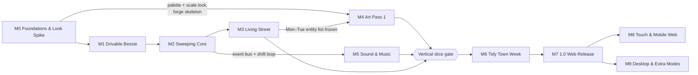

# Street Sweeper Pro: Roadmap

> **Status:** v1.0 of the roadmap, written 2026-10-18, before the first line of code.
> **Owner:** the project lead (human) approves milestone exits. Claude does the build work, records the evidence and proposes each exit.
> **Authority:** milestone IDs, names and canonical exit criteria come from the Canonical Facts Sheet v1.0 and appear here unchanged. Everything else in this file (task breakdowns, sizes, extra measurable checks, the risk register) is planning detail that we update as we learn.

This document answers four questions:

1. **What do we build, and in what order?** Milestones M0 to M9, each with a goal, deliverables, exit criteria and a task checklist.
2. **When do we know the game is real?** The [vertical slice](#3-vertical-slice) definition.
3. **What could sink us?** The [risk register](#6-risk-register).
4. **What are we deliberately *not* doing?** The ["not now" list](#7-not-now-list).

Related documents:

| For | Read |
|---|---|
| What the game is (rules, numbers, modes) | [GDD.md](GDD.md) |
| How the code is structured, tested and deployed | [TECHNICAL_DESIGN.md](TECHNICAL_DESIGN.md) |
| How every asset is produced and verified | [ASSET_PIPELINE.md](ASSET_PIPELINE.md) |
| What the game must look like | [ART_BIBLE.md](ART_BIBLE.md) |
| What the game must sound like | [AUDIO_DESIGN.md](AUDIO_DESIGN.md) |
| District layouts and level format | [LEVEL_DESIGN.md](LEVEL_DESIGN.md) |
| Every canonical entity ID and its stats | [ENTITY_CATALOG.md](ENTITY_CATALOG.md) |
| Why three.js, and why a hybrid AI asset pipeline | [adr/0001-tech-stack.md](adr/0001-tech-stack.md), [adr/0002-ai-authored-asset-pipeline.md](adr/0002-ai-authored-asset-pipeline.md) |
| Terms used below (Golden, Ingest, Forge, Replay hash...) | [GLOSSARY.md](GLOSSARY.md) |
| Agent rules and the done-checklist | [../CLAUDE.md](../CLAUDE.md) |
| Quick start and command table | [../README.md](../README.md) |

---

## Contents

1. [Planning principles](#1-planning-principles)
2. [Milestone overview](#2-milestone-overview)
3. [Vertical slice](#3-vertical-slice)
4. [Milestones in detail](#4-milestones-in-detail)
   - [M0 Foundations & Look Spike](#m0-foundations--look-spike)
   - [M1 Drivable Bessie](#m1-drivable-bessie)
   - [M2 Sweeping Core](#m2-sweeping-core)
   - [M3 Living Street](#m3-living-street)
   - [M4 Art Pass 1](#m4-art-pass-1)
   - [M5 Sound & Music](#m5-sound--music)
   - [M6 Tidy Town Week](#m6-tidy-town-week)
   - [M7 1.0 Web Release](#m7-10-web-release)
   - [M8 Touch & Mobile Web](#m8-touch--mobile-web)
   - [M9 Desktop & Extra Modes](#m9-desktop--extra-modes)
5. [Cross-milestone ramps](#5-cross-milestone-ramps)
6. [Risk register](#6-risk-register)
7. ["Not now" list](#7-not-now-list)
8. [M0 spike decision log](#8-m0-spike-decision-log)
9. [Changing this roadmap](#9-changing-this-roadmap)

---

## 1. Planning principles

1. **Ordered by dependency, not by date.** This roadmap has no calendar dates. Sizes are given as T-shirt sizes relative to each other (S < M < L < XL). Dates can be added once M0 and M1 give us a measured velocity.
2. **Lock the look before making assets.** World scale (16 px/m, 32 px tiles, 40 px storeys), the sprite size sheet and the Kerbside-32 palette, including its `night` and `shadow` remaps, are locked in M0. No production asset is generated before that lock. A change after the lock needs an ADR.
3. **Placeholder first, behind final IDs.** From M1 onwards, every entity appears on screen under its canonical asset ID and frame IDs, drawn with code-defined placeholders. Real art replaces placeholders one asset class at a time, with no gameplay code changes. Because `src/gen/assets.ts` is typed, a missing sprite is a compile error, never a runtime surprise.
4. **Simulation first, juice last.** Deterministic sim plus replay tests come before polish. Squash-and-stretch, screen shake and hit-stop are M7 work. M3 reaction animations may be placeholders.
5. **Every milestone ends playable.** From M1, `npm run dev` always launches something you can drive. From M2, it always runs a complete 240 s shift.
6. **Evidence, not assertion.** Every exit criterion names its proof: a test, a golden, a replay hash, a contact sheet or a recorded decision. A milestone closes with a PR titled `Close Mx: <name>`, which ticks each criterion and links to its evidence, followed by a git tag `m<x>` (e.g. `m0`, `m1`).
7. **Generators never run in builds or CI.** Blender and image models run only on the dev Mac, by hand, through the forge wrappers. Their outputs are committed as goldens. See [ASSET_PIPELINE.md](ASSET_PIPELINE.md).

### 1.1 Definition of done (every task, every milestone)

A task is done when all of these hold. They mirror the done-checklist in [CLAUDE.md](../CLAUDE.md):

- [ ] `npm run typecheck` passes.
- [ ] `npm run lint` passes (Biome, including the sim-purity import ban).
- [ ] `npm test` passes (Vitest unit and fast-check property tests).
- [ ] `npm run assets:lint` passes, once the forge lint exists (M0 skeleton, complete in M4).
- [ ] `npm run test:visual` passes, or the changed goldens were opened with Read, judged correct and approved with `npm run test:visual:update` and a one-line reason in the commit.
- [ ] If sim behaviour changed on purpose, the replay hashes were regenerated, and the commit message says why.
- [ ] Any new or changed asset batch was reviewed on its contact sheet (`npm run assets:sheets`) **and** in the asset zoo (`?test=1&scene=zoo`) with Read, and the PR notes what was checked.
- [ ] No trademark appears in prompts, in-game text or asset names (IP hygiene; see the facts sheet).

---

## 2. Milestone overview

| ID | Name | One-line goal | Size | Key proof of exit |
|---|---|---|---|---|
| **M0** | **Foundations & Look Spike** | Prove the camera, palette and asset pipeline produce a coherent look, and lock the look | L | `lean_quadrants` SwiftShader golden; M0 decision-log entries (D-01 to D-13) filled in |
| **M1** | **Drivable Bessie** | Bessie handles like a heavy, honest machine in Puddle Lane | M | fast-check no-tunnelling property; first replay hash |
| **M2** | **Sweeping Core** | A complete 240 s shift: sweep, fill, dump, score | L | Scripted e2e shift with score > 0 and hopper filled; tally numbers on screen |
| **M3** | **Living Street** | Mon–Tue pedestrians, animals and traffic make the street funny and dangerous | L | Per-behaviour unit tests; SACKED and TOWED replays |
| **M4** | **Art Pass 1** | Every asset class used by Mon–Tue is real art, and the forge is complete | XL | `assets:verify` + `assets:lint` in CI; zoo golden; reviewed contact sheets |
| **M5** | **Sound & Music** | Puddle Lane and High Street sound finished | M | All `sfx.*` rendered; adaptive stems demonstrably switching |
| — | **Vertical slice gate** | One district at ship quality, end to end | — | [§3](#3-vertical-slice) acceptance table |
| **M6** | **Tidy Town Week** | The whole week is playable, start to trophy | XL | A scripted full-week save progression; all district replays |
| **M7** | **1.0 Web Release** | Polished, accessible and fast; live on itch.io | L | Budgets met in `perf.spec.ts`; itch.io HTML5 page live |
| **M8** | **Touch & Mobile Web** | Playable on phones in landscape | M | iOS Safari audio unlock verified on device |
| **M9** | **Desktop & Extra Modes** | Tauri desktop builds; Daily Shift and Rival Sweep | M | Signed or unsigned Tauri 2.12.3 builds for macOS and Windows; mode replays |

### 2.1 Dependency graph

The numbering is the default build order. The graph shows what *really* depends on what, so that work can be pulled forward when the current milestone is blocked (for example, while waiting on a human review).

**Parallelism notes:**

- **M5 audio tooling** (`tools/audio/`, the zzfx/jsfxr renderers, the tracker synth) depends only on the M2 event bus. It can be built during M3 or M4 whenever a long Blender or Codex review loop is pending.
- **M4 asset production** for classes whose entity list is already final (ground tiles, roofs, facades, Bessie, litter, fonts) can start as soon as M0 locks the look. Only the Mon–Tue character list waits for M3.
- **M8 and M9 are independent** of each other. Both follow 1.0.

### 2.2 Releases and builds

| Build | From | Audience | Where |
|---|---|---|---|
| Dev build | M0 | Claude and the project lead | `npm run dev` (Vite) |
| Preview build | M2 | The project lead, plus trusted playtesters after the vertical slice | `vite build` → `dist/`, shared privately (any static host, or a restricted itch.io page from M7) |
| **1.0** | M7 | Public | itch.io HTML5 page, pushed with butler |
| Mobile web update | M8 | Public | Same itch.io page |
| Desktop builds | M9 | Public | itch.io downloads (macOS, Windows) |

---

## 3. Vertical slice

The vertical slice is the point where Street Sweeper Pro stops being a tech demo and becomes a game that can be judged. It is a **gate between M5 and M6**, not a milestone of its own. M6 does not start until the slice passes, because M6 multiplies content by seven, and multiplying a design that isn't fun only multiplies the problem.

### 3.1 Definition

> **One Monday shift in Puddle Lane, playable from the title screen to the tally and back, with every pixel and every sound on screen at 1.0 quality, running inside the 1.0 performance budgets.**

### 3.2 What is in the slice

| Area | In the slice | Source milestone |
|---|---|---|
| Flow | Title screen → shift intro card (Big Pam, 2 expressions) → 240 s shift → tally numbers page → retry or quit | M2, M4 |
| District | `district.puddle_lane`, 64×48 tiles, 2–3 storey Old Town terraces, dawn → morning, clear | M1, M4 |
| Vehicle | Bessie: full handling model, brush, suction, hopper weight, water spray, damage, dented variant below 40 HP | M1, M2, M4 |
| Sweeping | Every `litter.*` item that Puddle Lane spawns, grime mask with gutter grime, Kerb Hugger, fling, `stain.splat` spraying (Puddle Lane has no authored stains), depot and skip dumping | M2 |
| Street life | `npc.shopper`, `npc.old_woman` (Doris), `npc.old_man_frame`, `npc.postie`, `npc.mum_pushchair`, `npc.dog_walker` (with its dog), `npc.cat`, traffic (`veh.hatchback`, `veh.saloon`, `veh.van_white`, `veh.mobility_scooter`), puddles, speed bumps, knockable props, power-ups | M3 |
| Rules | Combo tiers, penalties, Council Complaints meter, SACKED and TOWED end states, stars computed from Tidy % | M2, M3 |
| Art | Real assets for everything listed above, through the full forge, including Kerbside 5×7 and Kerbside Bold 8×8, HUD, panels, VFX and title art | M4 |
| Audio | Every `sfx.*` triggered in Puddle Lane; live engine, brush, spray and reverse-beeper synths; `mus.title`; `mus.puddle_lane` with adaptive `drums` and `lead` stems; `amb.town_morning`; `jng.shift_start`, `jng.tally`, `jng.sacked` | M5 |
| Input | Keyboard and standard-mapping gamepad | M1 |
| Tech | Palette pass, sub-pixel camera, look-ahead, the speed zoom decision from D-01, ≤ 10 draw calls, zero allocations per tick in the sim hot path | M0–M2 |

### 3.3 What is not in the slice

- The *Muckleford Mercury* front-page tally. The slice uses the M2 numbers page, restyled with the real fonts and 9-slice panels. The Mercury arrives in M6.
- Week map, Workshop, £ economy, upgrades, save/load (M6).
- Weather, night, other districts, Skip Run, Free Sweep (M6).
- Juice pass, settings and remapping, assists (M7).
- Touch input (M8).

### 3.4 Acceptance

The slice passes when every row holds. The design-pillar rows are judged by the project lead after at least **five** full shifts. The technical rows are automated.

| # | Check | Pass condition | Proof |
|---|---|---|---|
| VS-1 | **Visibly Satisfying Clean** | A completed shift visibly changes the district. A before/after capture at the same camera position shows grime cleared along the driven route. | Two `?test=1&freeze=1` frames attached to the gate PR |
| VS-2 | **Heavy, Honest Machine** | At a full hopper, the extra 1,500 kg is noticeable without the HUD: slower acceleration, lower top speed, slower steering. Hitting a lamp post at 6 m/s hurts (16 HP). | Lead's playtest notes; unit test on damage formula |
| VS-3 | **Thorough vs. Fast** | Two scripted replays on seed 1: a slow route (≤ 4.0 m/s) and a fast route (brush-up transit between hotspots). The slow route has higher Tidy %, the fast route covers more tiles, and neither is strictly better on score. | `tests/replay/replays/vs_slow.json`, `vs_fast.json` |
| VS-4 | **Charming Chaos** | Doris, the cat and a shopper each produce a readable comic reaction the lead can describe without explanation. | Lead's playtest notes |
| VS-5 | **Every Pixel Reproducible** | `npm run assets:verify` byte-compares clean. `npm run assets:lint` passes. Every AI golden in use has a complete `meta.json`. | CI log |
| VS-6 | Difficulty | A first-time player earns 1★ (Tidy % ≥ 60). A practised player can reach 3★ (Tidy % ≥ 92) in Puddle Lane. | Lead's playtest notes + a scripted "practised" replay reaching ≥ 92 |
| VS-7 | Performance | `perf.spec.ts` meets the p99 frame-time budget calibrated in M0 (D-08) in the local `gpu` project, with ≤ 10 draw calls in the `ci` project. | `npm run test:e2e` + a local `gpu` run attached to the gate PR |
| VS-8 | Stability | 20 consecutive automated 240 s shifts on random seeds produce no console errors and no invariant failures. | `npm run test:replay` + e2e soak |
| VS-9 | Visual goldens | `zoo` and `hud_specimen` goldens pass at pixelmatch threshold 0. | `npm run test:visual` |
| VS-10 | Look | The lead signs off a 1080p fullscreen (4×) capture of Puddle Lane against [ART_BIBLE.md](ART_BIBLE.md) and its do/don't examples. | Gate PR |

If VS-1 to VS-4 fail, we iterate on tuning (`src/data/tuning.json`) and NPC behaviour **before** producing any more content. That loop is allowed to take as long as it needs.

---

## 4. Milestones in detail

Each milestone has the same shape:

- **Goal**: why the milestone exists.
- **Depends on**: what must already be done.
- **Deliverables**: what exists at the end.
- **Exit criteria**: the canonical criteria from the facts sheet, quoted unchanged, followed by the measurable checks we use to prove them.
- **Task checklist**: concrete work items, grouped. Tick them in the milestone PR.
- **Explicitly deferred**: things people will be tempted to do now, and which milestone owns them instead.

---

### M0 Foundations & Look Spike

**Goal.** Before anyone makes an asset, prove that a perspective camera looking straight down, a palette pass and the hybrid asset pipeline (Blender + Codex + procedural + text grids) produce one coherent pixel-art look. Then lock that look. M0 is the cheapest place to discover that a core assumption is wrong.

**Depends on.** Nothing. The **first task** is importing the probe artefacts (see R-06). The probe ran in a temporary scratch directory. The four artefacts below, plus each run's `report.json`, were copied on 2026-10-18 into the git-tracked `assets-src/_probe/` (excluded from the manifest and lint), so import from there. If it is missing, follow R-06's contingency.

**Size.** L.

**Deliverables.**

- A scaffolded repo with every version pinned exactly as in [TECHNICAL_DESIGN.md](TECHNICAL_DESIGN.md) and [adr/0001-tech-stack.md](adr/0001-tech-stack.md).
- `npm run ci` green locally, and a committed GitHub Actions workflow that goes green as soon as a remote exists.
- Forge skeleton (`tools/forge/`) with working `blender` and `gen-ai` wrappers, palette/LUT code, imported `pixelize.py`, a prototype `ingest`, and `build` for the `grid` and `blender` techniques.
- `assets-src/palette/kerbside32.json` with tuned `night[32]` and `shadow[32]` tables.
- `assets-src/STYLE.md` v1, locking scale, palette and people style.
- `assets-src/ai/ref.people_style/` golden with complete provenance.
- A spike scene: 1-, 3- and 6-storey blocks, Blender Bessie, one Codex-derived pedestrian, palette pass, shadow mask, sub-pixel camera and speed zoom.
- [Decision log](#8-m0-spike-decision-log) entries D-01 to D-13 filled in (D-11 is measured in M0 and applied in M5).

**Exit criteria (canonical).**

> Repo scaffolded with pinned versions. CI green. Forge, Blender and Codex wrappers working. Probe artefacts imported (§5.8). **Kerbside-32 night and shadow tables, the scale sheet and `ref.people_style` golden locked** in STYLE.md. A spike scene of 1-, 3- and 6-storey blocks with the Blender Bessie and one Codex pedestrian in-engine, with palette pass, sub-pixel camera and speed zoom. Recorded decisions on zoom (on/off), vehicle tilt (0° vs ≤ 8°) and the 480×270 base. Headless SwiftShader visual golden passing.

**Measurable checks.**

| Criterion | Proof |
|---|---|
| Pinned versions | `npm ls --depth=0` matches the pin table exactly. `.npmrc` has `save-exact=true`. `uv.lock` committed. `blender --version` reports 5.2.2 LTS through `forge blender --version`. |
| CI green | `npm run ci` exits 0 on the dev Mac. `.github/workflows/ci.yml` contains the `ubuntu-latest` and `macos-latest` jobs. |
| Wrappers working | `npm run assets:blender -- veh.sweeper` reproduces the committed `h00..h31.png` with zero pixel diff (`--check`). `npm run gen:ai -- concept.spike_street --candidates 1` produces a candidate in `build/ai-candidates/` and a draft `meta.json`. |
| Look locked | STYLE.md v1 merged. `kerbside32.json` contains all 32 colours, ramps, `night` and `shadow`. |
| Spike scene | `?test=1&scene=lean_quadrants` shows the 1/3/6-storey blocks at four screen offsets, with Bessie and the pedestrian. |
| Visual golden | `lean_quadrants` and `scale_1440` pass at threshold 0, **10 runs in a row** with byte-identical frames (determinism check for D-09). |

**Task checklist.**

*Probe import (do this first)*

- [x] Copy `assets-src/_probe/blender/sweeper_v2.py` → `assets-src/blender/vehicles/sweeper.py` (body and dented) plus `sweeper_brush.py` (the 96×96 brush overlay). Refactor them onto `assets-src/blender/rig.py`, at 0° tilt, with Kerbside-32 palette names via `rig.toon_material`/`rig.pal()` (no hex literals).
- [x] Copy `assets-src/_probe/tools/pixelize.py` → `tools/forge/forge/pixelize.py`, with pytest coverage of the FFT period detector (expect 9.22/9.38 px on the old-woman sheet, 10.8 px on the rubbish sheet). *(SSP-004: `tools/forge/tests/test_pixelize.py` pins 9.22–9.38 px on the old-woman sheet and 10.81–10.87 px on the rubbish sheet.)*
- [x] Copy `assets-src/_probe/codex/old_woman_sheet.png` → candidate for `assets-src/ai/ref.people_style/golden.png`, with a retro-filled `meta.json` (`tool_version: "codex-cli 0.160.1"`, `seed: null`, `golden_sha256`).
- [x] Copy `assets-src/_probe/codex4/rubbish_sheet.png` → candidate for `assets-src/ai/litter.sheet_01/golden.png`, with a retro-filled `meta.json`.

*Repo scaffold*

- [x] `package.json` with exact pins for `three` 0.186.1, `@types/three` 0.186.0, `vite` 8.3.4, `vitest` 5.0.5, `fast-check` 4.10.2, `@playwright/test` 1.64.1, `pixelmatch` 8.0.0, `pngjs` 7.0.0, `@biomejs/biome` 2.5.15, `typescript` 7.0.2, `@types/node` 24.19.2. Also `.nvmrc` = `24.21.0`.
- [x] `jsfxr` 1.4.1 is added in M5, not now (nothing uses it yet). `zzfx` is never installed: its `buildSamples` is vendored into `tools/audio/synth/zzfx.ts` in M5 ([AUDIO_DESIGN §5.3](AUDIO_DESIGN.md#53-determinism-rule-for-zzfx-and-jsfxr)).
- [x] `tsconfig.json` (one project for `src/`, `tools/`, `tests/`): strict, `erasableSyntaxOnly: true`, `noEmit`, `allowImportingTsExtensions: true`, `module`/`moduleResolution: "nodenext"`. Relative imports use explicit `.ts` extensions everywhere. Confirm that `node tools/...ts` runs through native type stripping, including a tool that imports `src/sim`.
- [x] Verify TypeScript 7.0.2 with Vite, Vitest and Biome. Fall back to 6.0.3 if any tool breaks, and record the outcome in D-10.
- [x] `biome.json` with the `noRestrictedImports` override on `src/sim/**` (bans `three` and DOM modules) and bans on the `Math.random`, `Date` and `performance` globals.
- [x] `tests/unit/simPurity.test.ts` (as in [TECHNICAL_DESIGN §18.1](TECHNICAL_DESIGN.md#181-unit-tests-examples)): scans every file under `src/sim/` and fails on imports of `three` or DOM modules, on the regex `\bMath\.random\b|\bDate\b|\bperformance\b`, and on any import outside `src/sim/`, `src/data/` or a type-only import of `src/gen/assets.ts`.
- [x] `vite.config.ts` (`base: './'`), `vitest.config.ts`, `playwright.config.ts` (Chromium; the visual and `ci` perf projects use `--use-angle=swiftshader --enable-unsafe-swiftshader`; a local-only `gpu` perf project runs headed with no SwiftShader flags, see [TECHNICAL_DESIGN §18.6](TECHNICAL_DESIGN.md#186-e2e)). *(SSP-002, SSP-006, SSP-023: `playwright.config.ts` has the `visual`, `ci` and `gpu` projects.)*
- [x] `.gitignore` exactly: `node_modules/`, `dist/`, `build/`, `test-results/`, `playwright-report/`, `tools/forge/.venv/`.
- [x] npm scripts from the command tables in [README.md](../README.md), wired to real implementations or to stubs that exit non-zero with a "not implemented until Mx" message. A stub must never pass silently. *(SSP-006. Changed: `audio` and `levels` are input-count guards, not blanket stubs, because `npm run assets` must succeed in M0. With 0 sources they log "0 sources; nothing to render" and exit 0; with any source present they exit non-zero with "not implemented until M1" (levels) or "M5" (audio). `tests/unit/npmScripts.test.ts` pins the scripts.)*
- [x] `.github/workflows/ci.yml`: an `ubuntu-latest` job (typecheck, lint, unit, replay) and a `macos-latest` job (Playwright). `assets:verify` and `assets:lint` join CI in M4. *(SSP-006: jobs `checks` and `visual`. Not yet run on GitHub: there is no remote, so CI parity (D-09) and the Linux halves of D-11/D-12 are pending SSP-296.)*
- [x] `tests/unit/ipHygiene.test.ts`: fails if `assets-src/ai/**/prompt.md`, `_style_preamble.md`, `src/data/*.json` or asset IDs contain a blocked trademark term.

*Forge skeleton (`tools/forge/`)*

- [x] `pyproject.toml` pinning `python ==3.13.*`, `numpy ==2.5.4`, `pillow ==13.0.0`, `pytest ==9.1.1` (dev). Commit `uv.lock`. *(SSP-004.)*
- [x] `forge/__main__.py` CLI: `build`, `ingest`, `blender`, `gen-ai`, `lint`, `sheets` (lint and sheets can be minimal for now). *(SSP-004, SSP-009 to SSP-013. Also `pack` and `verify`, pulled forward from M1 by SSP-010.)*
- [x] `forge/palette.py`: load `kerbside32.json`, OKLab nearest-colour mapping, deterministic tie-breaking (lower index wins). *(SSP-005.)*
- [x] A shared test vector file of 4,096 RGB samples → expected index, used by **both** pytest (forge) and Vitest (the 64³ LUT builder in `src/render/palettePass.ts`), so the two languages can never disagree. *(SSP-005: `tests/fixtures/palette_oklab_4096.json`, read by `tools/forge/tests/test_palette.py` and `tests/unit/palettePass.test.ts`.)*
- [x] `forge/blender.py`: wraps the exact command in [ASSET_PIPELINE.md](ASSET_PIPELINE.md), writes `render.json`, and implements `--check`. *(SSP-007; `--check` re-run at M0 close: 0 changed px in 0 of 64 frames.)*
- [x] `forge/genai.py`: Codex wrapper (prompt on stdin with `-`, stdin always redirected, model pinned with `-m` from `CODEX_MODEL`, fallback to `~/.codex/generated_images/<thread-id>/exec-*.png`). Implements `--candidates N` and `--accept <n>`. Cursor: document the raw command only; `--tool cursor` exits non-zero with "not implemented until needed". The Cursor gen-ai wrapper is deferred to the first milestone that actually needs a concept A/B.
- [x] `forge/ingest.py` prototype: steps 1–10 of the ingest spec, enough to turn `ref.people_style` into one grid. *(SSP-013, used for real by SSP-014 on the accepted golden.)*
- [x] `forge/build.py` for the `grid` and `blender` techniques. `forge/outline.py`: 1 px ink, 4-connected, outside the silhouette. Byte-identical PNG encode, with no metadata.
- [x] Deterministic Pillow encode test: build twice and compare SHA-256.

*Look lock*

- [x] `assets-src/palette/kerbside32.json`: the 32 colours and ramps from [ART_BIBLE.md](ART_BIBLE.md), verbatim. *(SSP-005.)*
- [x] Tune `night[32]` and `shadow[32]` in the spike scene. Every entry must map within its own ramp, or to the next ramp down. Record the tables in the file and in D-05/D-06. *(SSP-021: D-05/D-06.)*
- [x] `assets-src/ai/_style_preamble.md` v1 (overhead, characters about 20 px tall head to feet, 1 px dark outline, top-left light, palette hex list, transparent background, no text, no logos).
- [x] Accept `ref.people_style` (from the probe candidate, or regenerate with Codex if it fails review). Open it with Read before accepting.
- [x] `assets-src/STYLE.md` v1: scale sheet (16 px/m, 32×32 tiles, 32×40 facade module, sprite size table), palette and ramps, sun at azimuth 315° and elevation 50°, outline rule, people style reference. [ART_BIBLE.md](ART_BIBLE.md) mirrors it.

*Spike scene*

- [x] `src/render/camera.ts`: `PerspectiveCamera`, vertical FOV 30°, H = 31.5 m, XZ snap to 1/16 m, a (W+2)×272 target, fractional blit offset.
- [x] Speed zoom: H eases 31.5 → 37.8 m on a critically damped spring (ω = 3 rad/s), driven by a dev-panel speed slider (no vehicle sim yet).
- [x] `src/render/upscale.ts`: `W = clampEven(round(270 × aspect), 432, 640)`, integer scale, `#0f0e12` letterbox, devicePixelRatio handling.
- [x] `src/render/palettePass.ts`: 64³ LUT, night remap, shadow remap. A test asserts that no output pixel lies outside Kerbside-32. *(SSP-016: `tests/property/palettePass.prop.test.ts` asserts palette-only output for any input.)*
- [x] `src/render/cityMesh.ts` (simple): merged boxes for 1-, 3- and 6-storey blocks, `_lit`/`_base`/`_dark` facade ramp variants, flat placeholder facade and roof textures.
- [x] `src/render/shadows.ts`: SE shadow polygons (length 0.84 × height) into the mask target.
- [x] `src/render/spriteBatch.ts`: one `InstancedMesh` per atlas, per-instance frame rects. Bessie drawn from the Blender build at all 32 headings, cycling. One ingested pedestrian. *(SSP-018. Changed: atlas frame rects come from `forge/pack.py` and `src/gen/assets.ts`, pulled forward from M1 by SSP-010; the lamp post (SSP-020) added an `items` atlas beside `actors`.)*
- [x] Sprite-stack prototype with one lamp post (4 slices), to check that its lean matches the building lean (input to D-02).
- [x] `src/debug/testHooks.ts`: `?test=1&scene=<id>&freeze=1`, `window.__ssp.readFrame()` and `setCamera()`.
- [x] Visual specs and goldens for `lean_quadrants` and `scale_1440`.
- [x] `tests/e2e/perf.spec.ts` baseline on the dev Mac in the local `gpu` project (headed, real GPU). Record the p99 frame time and set the budget (D-08). The `ci` project asserts only draw calls and sim step time.

*Decisions*

- [x] Fill in D-01 to D-13 in [§8](#8-m0-spike-decision-log), each with evidence (screenshots under `build/`, attached to the PR and summarised in the log). *(Verified at M0 close by SSP-027: every row has a Decision, Evidence and Date. Evidence PNGs live under `build/spikes/` (git-ignored, regenerated by the `tools/spikes/*.ts` scripts named in each row) and are summarised in the log, since there is no PR host to attach them to.)*

**Explicitly deferred.** Vehicle physics (M1). Procedural tiles (M1). Real facades (M4). Audio of any kind (M5). The Cursor gen-ai wrapper (first milestone that needs a concept A/B). Any production asset beyond Bessie, `ref.people_style`, the one spike pedestrian and the imported litter candidate.

---

### M1 Drivable Bessie

**Goal.** Bessie feels heavy, honest and controllable in a real street layout. Pillar 2 is either true at the end of M1 or the tuning work continues. Everything after this sits on the deterministic sim foundation laid here.

**Depends on.** M0.

**Size.** M.

**Deliverables.**

- The pure sim core: `rng.ts` (sfc32), `constants.ts`, `map.ts`, `vehicle.ts` (kinematic bicycle model), `collision/{obb,sat,grid,sweep}.ts`, `tuning.ts`, `replay.ts`.
- `src/app/loop.ts`: fixed 60 Hz accumulator, at most 5 steps per frame, render interpolation.
- `tools/levels/compile-level.ts` and `assets-src/levels/puddle_lane.{map.txt,level.json}`, compiled to `public/assets/levels/puddle_lane.json`.
- Procedural placeholder ground tiles, including the 47-tile kerb blob autotile set, and procedural placeholder facades.
- Camera look-ahead and speed zoom driven by real vehicle speed (or look-ahead only, if D-01 turned zoom off).
- Keyboard and gamepad input. A 50-line F1 dev panel for live tuning.

**Exit criteria (canonical).**

> Bicycle model + OBB/SAT collision. Puddle Lane compiled from ASCII and rendered with procedural placeholder tiles and facades. Camera and look-ahead done. fast-check "never ends a tick inside a solid / no tunnelling at 11 m/s" passing. First replay hash committed.

**Measurable checks.**

| Criterion | Proof |
|---|---|
| Handling matches tuning | Unit tests: brush-down top speed 6.0 m/s; transit 11.0 m/s; brake 6.0 m/s²; reverse capped at 2.5 m/s; turning circle (diameter, rear axle) 7.1 m ± 0.2 at v = 0.1 m/s and 8.7 m ± 0.3 at 1.4 m/s; kerb crossing loses 30% speed. |
| Collision | `tests/property/collision.prop.test.ts`: over 10,000 generated scenarios (random headings, speeds up to 17.2 m/s, random wall layouts), Bessie never ends a tick overlapping a solid and never passes through one. 17.2 m/s is the real maximum (transit 11 m/s × Bacon Butty 1.3 × Engine L2 1.2), so this is stricter than the canonical "no tunnelling at 11 m/s". |
| Damage | 4 HP per m/s of normal impact speed above 2 m/s, with restitution 0.2 (unit test). |
| Level compile | `npm run levels` is deterministic (compile twice, compare hashes). Puddle Lane is 64×48 tiles. The autotile output covers every kerb configuration in the map. |
| Replay | `tests/replay/replays/m1_drive_puddle_lane.json` (3,600 ticks) and its final-state hash are committed. `npm run test:replay` passes. |
| Camera | Look-ahead leads by up to 3.0 m. At or below 6.0 m/s, the ground renders at exactly 1 texel = 1 px (visual check at a frozen tick). |

**Task checklist.**

*Sim*

- [ ] `src/sim/rng.ts`: sfc32 with known-answer tests.
- [ ] `src/data/tuning.json` → `vehicle.sweeper`, with every value from the handling table in [GDD.md](GDD.md). `src/sim/tuning.ts` gives it typed access.
- [ ] `src/sim/vehicle.ts`: kinematic bicycle model (wheelbase 2.4 m, max steer 34° scaled by `1/(1 + v/8)`, steer rate 120°/s, return 180°/s), drag (0.3 m/s² + 0.012·v²), per-surface lateral grip decay, and mass scaling with hopper fill (hook only; the hopper arrives in M2).
- [ ] `src/sim/collision/obb.ts`, `sat.ts`, `grid.ts` (static collision grid from the compiled level), `sweep.ts` (sub-step when speed > 0.5 tile/tick).
- [ ] `src/sim/world.ts` and `map.ts`: tile types, building columns, surface lookups.
- [ ] `src/sim/replay.ts`: input log format, state hash quantised to 1e-4.
- [ ] Fixed tick order steps 1–3 (input, vehicle, static collision) and step 11 (emit events). The other steps exist as empty, ordered calls.
- [ ] Health: 100 HP, with a stub "TOWED!" event at 0 (the end-of-shift flow arrives in M2/M3).

*Level*

- [ ] `tools/levels/compile-level.ts`: legend parse, building columns, autotile, collision grid. The lane graph and pavement nav graph are stubbed until M3. *(The file exists since M0 as an input-count guard (SSP-006): it exits non-zero with "not implemented until M1" once a map exists. SSP-033 replaces it.)*
- [ ] Author `puddle_lane.map.txt` (64×48) and `puddle_lane.level.json` following [LEVEL_DESIGN.md](LEVEL_DESIGN.md): terraces of 2–3 storeys, `site.depot_bay` reachable, at least one `site.skip` and one `prop.hydrant` placed (for M2).

*Placeholder art (forge `procedural` technique, placeholder quality)*

- [x] `tools/forge/forge/procedural/tiles.py` with seeded PCG64: asphalt, pavement slabs, kerb blob set (47 tiles generated by rule), lane markings, grass. Real final IDs (`tile.*`), placeholder looks. *(SSP-040: plus setts, apron, zebra, double yellows, parking bays and `haz.speed_bump`; IDs in [ART_BIBLE §9.1](ART_BIBLE.md#91-ground-tiles).)*
- [ ] `assets-src/procedural/facades/*.json` and simple `assets-src/sprites/facade/*.sprite.txt` modules (32×40) with `_lit`/`_base`/`_dark` variants.
- [ ] `forge/pack.py`: deterministic maxrects packer, at least the `world` and `actors` atlases. Generate `src/gen/assets.ts` with `FRAME`, `FrameId` and `AssetId`. *(Partly done in M0, an agreed deviation: SSP-010 pulled `forge/pack.py` and the `FRAME`/`FrameId`/`AssetId` generation forward, with the `actors` and `items` atlases, because M0's sprite batch needed frame rects. M1 adds only the `world` atlas (SSP-039).)*

*Render and app*

- [x] `src/render/groundLayer.ts`: chunked merged ground geometry sampling the `world` atlas. *(SSP-045: with the marking overlays; ground and city share one draw.)*
- [x] `src/render/cityMesh.ts`: full cell merge, walls only toward lower or open cells, UVs in world metres. *(SSP-045: `src/render/levelCity.ts` builds a compiled level's city and shadows; the test-only `level_preview` scene shows Puddle Lane until ShiftScene, SSP-046.)*
- [ ] `src/render/camera.ts`: look-ahead (up to 3.0 m, damped spring) and speed zoom from real speed.
- [ ] `src/app/loop.ts`, `Game.ts`, `SceneManager.ts`, `events.ts` (typed event bus), and `ShiftScene` (drive-only).
- [ ] `src/input/actions.ts`, `keyboard.ts`, `gamepad.ts` (standard mapping, left-stick deadzone 0.15).
- [ ] `src/debug/devPanel.ts` (F1, dev builds only): live-edit tuning values, show speed, steer angle and surface.

**Explicitly deferred.** Brush, litter and grime (M2). NPCs and traffic (M3). Real tile art (M4). Engine sound (M5).

---

### M2 Sweeping Core

**Goal.** The core loop exists: drive, sweep, fill, dump, score, end of shift. This is **first playable**. It is still grey-box, but you can play a full 240 s shift and argue about whether it is fun. Pillars 1 and 3 are first tested here.

**Depends on.** M1.

**Size.** L.

**Deliverables.**

- `brush.ts`, `litter.ts` (LitterField spatial hash, 4 m cells), `dirt.ts` (grime mask), `hopper.ts`, `water.ts`, `scoring.ts`, `combo.ts`, `shift.ts`.
- The grime mask uploaded to the ground shader, so cleaning is visible pixel by pixel.
- Placeholder grid sprites under the final IDs for every `litter.*`, `stain.*`, `pwr.*` and `site.*` marker that Puddle Lane uses.
- Basic HUD (timer, score, combo, hopper %, water, HP) in a first draft of Kerbside 5×7.
- Tally numbers screen.

**Exit criteria (canonical).**

> Brush (gutter, suction, inlet), LitterField, grime mask, Tidy %, hopper weight, depot and skip dumping, water spray and hydrants, fling mechanic, combo, basic HUD. A complete 240 s shift with tally numbers on screen.

**Measurable checks.**

| Criterion | Proof |
|---|---|
| Brush geometry | Unit tests on the vehicle-local shapes: gutter circles r = 0.45 m at (±0.85, +1.75); swept width 2.6 m; suction rect y +1.6 to +2.8; inlet 1.0 × 0.4 m at y +1.2. Collects only with RPM ≥ 80%. |
| Fling | Property test: pickup probability is 1 at ≤ 4.0 m/s, 0 at ≥ 6.0 m/s, and linear in between (statistical check over 10,000 seeded trials). |
| Tidy % | Unit test of `0.6 × grime fraction + 0.4 × litter fraction` over the route area only. |
| Hopper | 100 LU capacity; 80% HUD warning; "bulldozer" behaviour when full; mass +1,500 kg at full, scaling accel ×0.70, top speed ×0.90, steer rate ×0.85. |
| Dumping | Depot: speed < 0.5 m/s, hold 1.0 s, drain 2.0 s, water refilled to full. Skip: hold 1.0 s, drain 3.0 s, no tipping fee. |
| Water | 100 units; spray uses 6/s; hydrant refills 25/s when adjacent; required to clear `stain.*`. |
| Combo | Chain timer 2.0 s; tier thresholds 10/25/50/100; any penalty resets the chain (hook only; penalties arrive in M3). |
| Full shift | `tests/e2e/smoke.spec.ts`: a 60 s scripted run with no console errors, score > 0 and the hopper filled. A replay of a full 240 s shift ends on the tally scene. |
| Budget | LitterField stress test: 2,000 items, zero allocations per tick in the sim hot path (measured with a heap-delta test in Vitest). |

**Task checklist.**

*Sim*

- [ ] `src/sim/litter.ts`: struct-of-arrays store, 4 m spatial hash, kinematic fling arc (1.5–3 m sideways), wind drift hook (used by `litter.newspaper` and `litter.crisp_packet` later).
- [ ] `src/sim/brush.ts`: raise/lower 0.5 s, RPM spin-up 0.6 s, gutter sweep-in, suction pull at 3.0 m/s × RPM × multiplier, inlet collection.
- [ ] `src/sim/dirt.ts`: an 8×8 grid of 4 px grime cells per tile, a `Uint8` mask per district, gutter grime strip along kerbs, the Kerb Hugger check (gutter brush within 0.2 m of a kerb edge).
- [ ] `src/sim/hopper.ts`: LU accounting, mass coupling into `vehicle.ts`, bulldozer state.
- [ ] `src/sim/water.ts`: tank, 2.6 m spray cone, hydrant refill, stain clearing.
- [ ] Depot and skip dumping in `src/sim/shift.ts`, plus the 240 s timer and end-of-shift event.
- [ ] `src/sim/scoring.ts` and `combo.ts`: item points × multiplier, grime 1 pt per cell (2 for gutter grime), Kerb Hugger +50 per 3 s, Clean Sweep frontage +100 (the frontage segments come from `level.json`).
- [ ] Fill in tick order steps 5, 6, 9 and 10.
- [ ] Replays: `m2_full_shift_puddle_lane.json` (3,600 ticks) and a dump-cycle replay. Commit their hashes.

*Content*

- [ ] `src/data/entities.json` seeded with every `litter.*` and `stain.*` from [ENTITY_CATALOG.md](ENTITY_CATALOG.md) (points, LU, notes).
- [ ] Puddle Lane `level.json`: litter density, spawn tables, frontages and pledge list.
- [ ] Placeholder `assets-src/sprites/litter/*.sprite.txt` for all 15 litter IDs (simple shapes in the right palette ramps, 16×16 cells), and placeholder `stain.*` procedural params.

*Render, UI and flow*

- [ ] Ground shader samples the grime mask texture. The upload is incremental: only dirty chunks are re-uploaded each frame.
- [ ] `src/render/spriteBatch.ts`: an `items` atlas instance batch for litter. Per-instance 4 rotations and the 2-frame wobble.
- [ ] `src/ui/bitmapText.ts` with a first draft of `assets-src/fonts/kerbside5x7.glyphs.txt` (ASCII 32–126 plus £ ★ → ← ↑ ↓).
- [ ] `src/ui/hud.ts`: timer, score, combo tier popup text, hopper bar with 80% warning, water, HP.
- [ ] `TallyScene` (numbers only): Tidy %, items collected, grime cleaned, score, would-be stars.
- [ ] `ShiftIntroScene` placeholder card (text only).

**Explicitly deferred.** Pedestrians, coughing and dust complaints (M3, which needs NPCs). Power-ups (M3). The Mercury layout (M6). £ economy (M6). Pickup SFX pitch rise (M5).

---

### M3 Living Street

**Goal.** The street fights back, comically. Pillar 4 is first tested. Every penalty path, the complaints meter and both failure states exist, so the risk/reward of Pillar 3 is real.

**Depends on.** M2.

**Size.** L.

**Mon–Tue entity scope** (frozen at the start of M3, because M4 art depends on it):

| Kind | IDs |
|---|---|
| People | `npc.shopper`, `npc.old_woman`, `npc.old_man_frame`, `npc.mum_pushchair`, `npc.postie`, `npc.dog_walker` (with its dog, which reuses the `npc.dog_loose` grid with a coat swap), `npc.businessman`, `npc.litterbug`, `npc.market_trader` |
| Animals | `npc.cat`, `npc.pigeon` (needed on Tuesday in Market Square) |
| Vehicles | `veh.hatchback`, `veh.saloon`, `veh.van_white`, `veh.taxi`, `veh.bus`, `veh.bicycle`, `veh.mobility_scooter`, plus `_parked` variants of hatchback, saloon, van_white and taxi |
| Props | All knockables (`prop.wheelie_bin`, `prop.traffic_cone`, `prop.a_board`, `prop.shopping_trolley`, `prop.recycling_box`) and all statics |
| Hazards | `haz.puddle`, `haz.oil_slick`, `haz.pothole`, `haz.speed_bump`, `haz.broken_glass`, `haz.open_manhole`, `haz.wet_leaves` (`haz.wind_gust` arrives with weather in M6) |
| Sites | `site.zebra`, `site.bus_stop`, `site.frontage`, `site.pledge_frontage` |
| Power-ups | All six `pwr.*` |

**Deliverables.**

- `npc/steering.ts` and one `npc/behaviours/<npc>.ts` per M3 NPC type.
- `traffic.ts` with the lane graph. The pavement nav graph is compiled by `compile-level.ts`.
- `bodies.ts` (knockable impulse bodies), `complaints.ts`, and the end states SACKED and TOWED.
- Horn, near-miss detection, dust coughing, puddle splashing, power-ups.
- Reaction animations: placeholder grids allowed, but every state (walk, idle, startle, fall, angry) exists as frames under the final frame IDs.
- `npm run levels` also compiles a first grey-box High Street (80×60), so Tuesday's NPCs have a home.

**Exit criteria (canonical).**

> All §7.3 NPC behaviours for Mon–Tue types, traffic lane graph, knockables, hazards, penalties, complaints, SACKED and TOWED states, reaction animations (placeholders allowed).

**Measurable checks.**

| Criterion | Proof |
|---|---|
| Behaviours | One unit test file per behaviour, covering each rule in [ENTITY_CATALOG.md](ENTITY_CATALOG.md): e.g. Doris never yields; horn makes her slower; spray makes her chase at 1.2 m/s with 2 HP per handbag hit. The cat darts at 6–10 m with 40% probability; a hit makes it ride the roof for 3 s. |
| Penalties | A table-driven test asserts every hit penalty and complaint count against `entities.json`. The police "+1 extra complaint within 15 m" rule is tested when `veh.police` arrives in M6. |
| Complaints | Horn spam (> 3 honks in 5 s) = 1 complaint. Blocking traffic over 10 s = 1 complaint. Running an occupied zebra = −200 + 1 complaint. 5 complaints = SACKED. |
| End states | Replays `m3_sacked.json` and `m3_towed.json` reach SACKED and TOWED deterministically. TOWED keeps 50% of the score and awards no stars. |
| NPC budget | Stress scene with 80 NPCs + 30 vehicles + 2,000 litter: sim tick stays allocation-free, and its time fits the budget derived from D-08. |
| Determinism | fast-check property: for any seed and random input log, replaying the same log yields the same state hash. |

**Task checklist.**

- [ ] `src/sim/npc/steering.ts`: seek, flee, separation, path following on the pavement nav graph, crossing logic at `site.zebra`.
- [ ] Behaviours: `shopper.ts`, `oldWoman.ts`, `oldManFrame.ts`, `mumPushchair.ts`, `postie.ts`, `dogWalker.ts` (lead as a line obstacle; Lead Tangle; the dog drops `litter.dog_mess`), `businessman.ts`, `litterbug.ts`, `marketTrader.ts`, `cat.ts`, `pigeon.ts`. Traffic kinds in `traffic.ts`: taxi (abrupt fare stops), white van (parks half on the pavement), bicycle (filters between lanes), mobility scooter (1.5 m/s on pavements).
- [ ] `src/sim/traffic.ts`: lane graph following, stopping behind Bessie, honk after 3 s blocked, the 10 s Road Rage complaint, bus stops at `site.bus_stop` for 5 s.
- [ ] `src/sim/bodies.ts`: knockable impulse bodies with masses and spill counts from `entities.json`.
- [ ] Hazards in `world.ts`/`vehicle.ts`: grip overrides, jolts, LU spills behind the vehicle, the broken-glass HP drain, open-manhole hard stop.
- [ ] `src/sim/complaints.ts`: 0–5 meter, horn-spam window, SACKED at 5.
- [ ] Horn (8 m radius), near miss (+25), Pigeon Scatter (+25), Caught! (+100), dust coughing (−10 per pedestrian per 2 s).
- [ ] Power-up spawning (1–3 per shift on pavements) and effects with durations.
- [ ] Fill in tick order steps 4, 7 and 8.
- [ ] `litter.spilled_shopping` drops on knocked-over NPCs (0 points).
- [ ] Placeholder grids for all M3 NPCs: 24×24 humans with 13 frames per direction (S, SW, W, NW, N authored; SE, E, NE mirrored); cat 16×16; pigeon 12×12; the walker's dog 20×20 (`npc.dog_loose` grid).
- [ ] Placeholder renders for `veh.hatchback`, `veh.saloon`, `veh.van_white`, `veh.taxi`, `veh.bus`, `veh.bicycle`, `veh.mobility_scooter`: run the Blender rig with flat-colour primitive boxes, so the 32-heading frame IDs are final from day one.
- [ ] `src/render/fx.ts` placeholder particles (palette colours only) for dust, splash and sparkle.
- [ ] Grey-box `assets-src/levels/high_street.{map.txt,level.json}`.

**Explicitly deferred.** The remaining NPCs and vehicles (M6). `npc.dog_loose` behaviour (M6; only its grid is needed now, for the walker's dog). Juice such as hit-stop and screen shake (M7). Final animation quality (M4).

---

### M4 Art Pass 1

**Goal.** Make the game look like the game. Every asset class that Monday and Tuesday use moves from placeholder to final, through a complete, linted, verified forge. This milestone is where Pillar 5 (Every Pixel Reproducible) either holds in production or fails.

**Depends on.** M0 (look lock, forge skeleton). M3 (frozen Mon–Tue entity list). Classes with a final entity list can start early (see [§2.1](#21-dependency-graph)).

**Size.** XL. This is the largest single block of review-heavy work before M6.

**Deliverables.**

- A complete forge: `ingest`, `build` (all five techniques: grid, procedural, blender, ai-ingest, ai-art), `lint` (every rule in [ASSET_PIPELINE.md](ASSET_PIPELINE.md)), `sheets`, and `assets:verify`.
- All 5 atlases (`world`, `actors`, `items`, `ui`, `fx`) at ≤ 2048×2048, plus `public/assets/asset-hashes.json`.
- Real assets for every class in the "M4" column of the [asset readiness matrix](#51-asset-readiness-by-milestone).
- Final fonts (Kerbside 5×7, Kerbside Bold 8×8, auto-generated outlined variants, kerning metrics), the HUD, 9-slice panels, and portraits.
- `ZooScene` and its golden.

**Exit criteria (canonical).**

> Forge complete (ingest, build, lint, sheets, verify). Real assets for every class used by Mon–Tue. Fonts, UI and portraits in place. `assets:lint` + `assets:verify` in CI. Contact sheets reviewed and noted in PRs. Zoo golden.

**Measurable checks.**

| Criterion | Proof |
|---|---|
| Forge complete | pytest suite under `tools/forge/tests/` covers each command. `npm run assets` twice in a row produces zero diff. |
| Verify | `npm run assets:verify` rebuilds into a temp dir and byte-compares. It is part of the `ubuntu-latest` CI job. |
| Lint | `npm run assets:lint` passes with zero warnings, including "re-render needed". It is part of CI. |
| No placeholders in Mon–Tue | `tests/unit/noPlaceholders.test.ts`: every asset referenced by `puddle_lane` and `high_street` has a manifest `technique` other than the placeholder marker (`"placeholder": true` is removed per entry as it is upgraded). |
| Provenance | Every `assets-src/ai/<id>/` has `prompt.md`, `meta.json` and `golden.png`, and `golden_sha256` matches. |
| Review | Each asset-batch PR links its `build/sheets/<atlas>.png` review notes and a zoo screenshot. |
| Goldens | `zoo` and `hud_specimen` visual goldens pass at threshold 0. |

**Task checklist.**

*Forge completion*

- [ ] `forge ingest`: full 10-step pipeline, one scale factor per sheet, refusal to overwrite an edited grid without `--force`.
- [ ] `forge build`: `procedural` (tiles, roofs, facades, stains, fx frame generators), `ai-art` (crop, pixelize at the detected period, palette map, optional 4×4 Bayer), swaps (up to 8 per atlas).
- [ ] `forge pack`: all 5 atlases, with the sort rule (area descending, then id).
- [ ] `forge lint`: every rule, each with a failing fixture under `tools/forge/tests/fixtures/`.
- [ ] `forge sheets`: 4×, labelled, on light `#c3c1c0` and dark `#24222a`, with a palette strip and Bessie h00 for scale.
- [ ] `npm run assets:verify`, and add it plus `assets:lint` to `.github/workflows/ci.yml`.

*World (procedural)*

- [ ] Final ground tiles: asphalt, lane markings, double yellows, kerbs (47-tile blob), pavement slabs, zebra, drains, manholes, grass, cobbles, tactile paving. Each passes the wrap-edge seam lint.
- [ ] Roof surfaces: felt, gravel, slate, corrugated.
- [ ] Facades for Old Town terraces and High Street shopfronts, `_lit`/`_base`/`_dark`.
- [ ] Stains and grime variants.

*Blender*

- [ ] `veh.sweeper` final: body at 32 headings and dented variant below 40 HP (64×64), plus `veh.sweeper_brush`, the brush overlay at 32 headings × 4 spin frames (96×96, rendered `--size 384`, bristle bars 19 on 18).
- [ ] `veh.hatchback` (8 paint swaps), `veh.saloon`, `veh.van_white`, `veh.taxi`, `veh.bus`, `veh.bicycle`, `veh.mobility_scooter`, and the `_parked` aliases of hatchback, saloon, van_white and taxi.
- [ ] `assets-src/blender/props/*.py`: bus shelter, phone box, bench, tree canopy, market stall, skip, with sprite-stack slices for tall props (lamp posts, phone boxes, trees).
- [ ] `assets-src/blender/roofkit/*.py`: AC units, vents, skylights, water tanks, chimneys, stair housings, plus the seeded roof layout script.

*Codex → ingest → grid*

- [ ] Characters: `npc.shopper` (8 outfit swaps), `npc.old_woman`, `npc.old_man_frame`, `npc.mum_pushchair`, `npc.postie`, `npc.dog_walker`, `npc.businessman`, `npc.litterbug`, `npc.market_trader`. Generate a key-pose sheet with `-i assets-src/ai/ref.people_style/golden.png`, ingest it, then hand-author the remaining frames (walk 4, idle 2, startle 2, fall 3, angry 2) in each grid.
- [ ] Litter: accept `litter.sheet_01` (and further 4×2 sheets as needed). Ingest at one scale per sheet with the largest item at 14 px. Hand-redraw `litter.drink_can`. Ship `litter.cigarette_butts` as a cluster sprite.
- [ ] Signs (`sign.*`) for High Street shops, with lettering in Kerbside fonts. Road decals (`decal.*`) for oil, posters and graffiti.
- [ ] Portraits: `portrait.big_pam` with 2 expressions, 64×64.
- [ ] `art.title` key art at 480×270.

*Text grids written directly*

- [ ] `npc.cat`, `npc.pigeon`, and the `npc.dog_loose` grid used by the walker's dog with a coat swap (all frames).
- [ ] Small props: bollard, cone, hydrant, wheelie bin, A-board, recycling box, litter bin, post box.
- [ ] Pickups: all `pwr.*` and the Mon–Tue `collect.*` (`collect.false_teeth`, `collect.lost_wallet`, `collect.golden_crisp`).
- [ ] UI: HUD icons (16×16), 9-slice panels (24×24, 8 px corners).
- [ ] Fonts: finalise `kerbside5x7.glyphs.txt`, write `kerbsidebold8x8.glyphs.txt`, generate outlined variants, define kerning pairs.

*VFX*

- [ ] Procedural frame generators (4–8 frames each, exact loops) for dust, spray, sparkle, skid marks, score popups, splash and leaf swirl.

*Review*

- [ ] For each batch, open the contact sheet and the zoo with Read. Note the checks against the [ART_BIBLE.md](ART_BIBLE.md) review checklist in the PR.

**Explicitly deferred.** Wed–Sun assets (M6, same pipeline, no new techniques). The Mercury newspaper art (M6). Midnight Gold, Racing Green and Seaside Stripes liveries (M6, as ramp swaps).

---

### M5 Sound & Music

**Goal.** Make the game sound like the game: chunky, comic and readable. Audio is fully code-authored and reproducible, like the art.

**Depends on.** M2 (event bus, shift loop). Tooling can start earlier (see [§2.1](#21-dependency-graph)).

**Size.** M.

**Deliverables.**

- `tools/audio/render-sfx.ts`, `render-music.ts`, `synth/*.ts` and `wav.ts`, run natively on Node 24.
- Every `sfx.*` from [AUDIO_DESIGN.md](AUDIO_DESIGN.md) as a JSON source, rendered to Opus (`.ogg`, 64 kbps) and AAC-LC (`.m4a`, 96 kbps).
- `src/audio/mixer.ts` (~200 lines, buses and ducking), `sfx.ts`, `music.ts`, `engineSynth.ts`, `brushSynth.ts`, `unlock.ts`.
- Songs `mus.title` ("Brush With Greatness"), `mus.puddle_lane` ("Milk Float Shuffle") and `mus.high_street` ("Window Shopping"), with `base`, `drums` and `lead` stems.
- Jingles `jng.tally` and `jng.sacked`. Also `jng.shift_start` and `amb.town_morning` for the vertical slice.

**Exit criteria (canonical).**

> All `sfx.*` rendered. Live engine, brush, spray and beeper synths. Mixer with ducking. Title + Puddle Lane + High Street songs with adaptive stems. Tally and sacked jingles.

**Measurable checks.**

| Criterion | Proof |
|---|---|
| All SFX | A test cross-checks every ID in the SFX reference list against `assets-src/audio/sfx/*.json` and `public/assets/audio/sfx/`. |
| Reproducible | `assets:verify` compares WAV hashes. Encoded files are not compared (D-11: WAV only), so verify needs no ffmpeg. |
| Adaptive stems | A unit test on the music state machine: `drums` fades in at combo ×3 or higher, `lead` enters when the timer is under 60 s. |
| Pitch rise | The pickup SFX pitch rises one semitone every 5 chain, capped at +12 (unit test on the sfx parameter function). |
| Live synths | Engine pitch follows speed and load (hopper fill). Brush whirr follows RPM. Reverse beeper plays while reversing. Spray loops while held. Each is verified by an `OfflineAudioContext` render test in Playwright. |
| Codec choice | At runtime, `canPlayType('audio/ogg; codecs=opus')` picks `.ogg` or `.m4a`, tested in Chromium and in WebKit (Playwright). |

**Task checklist.**

- [ ] Add `jsfxr` 1.4.1 at an exact pin (imported from `jsfxr/sfxr.mjs`). Vendor ZzFX `buildSamples` from zzfx 1.4.0 into `tools/audio/synth/zzfx.ts` (MIT, with attribution, `Math.random` replaced by an injected `sfc32`); the `zzfx` package constructs an `AudioContext` at import, so it is never imported in Node.
- [ ] `render-sfx.ts`: pure sample generation (no WebAudio) → 44.1 kHz 16-bit WAV → ffmpeg 9.0.2 with `-bitexact -map_metadata -1`.
- [ ] Author all 32 SFX JSON sources, with variants and `pitchJitterCents`.
- [ ] `render-music.ts`: tracker with `pulse1`, `pulse2`, `tri`, `noise` and `bass` (2-op FM) channels; instruments; note-string patterns; order list; loop row; stems → WAV → Opus 96 kbps + AAC 128 kbps; loop points in `public/assets/audio/music.json`.
- [ ] Compose the three songs and three jingles above. Listening review by the project lead (see R-04).
- [ ] `mixer.ts`: master, music, jingle, sfx, voice, live, amb and ui buses ([AUDIO_DESIGN §4.1](AUDIO_DESIGN.md#41-bus-graph)); music ducking under jingles and big events.
- [ ] `engineSynth.ts`, `brushSynth.ts`, spray and beeper synths sharing DSP code with `tools/audio/synth/`.
- [ ] `unlock.ts`: resume the `AudioContext` on the first `pointerdown`, `keydown` or `touchend`; gamepad-only players get the "Click or press a key for sound" prompt.
- [ ] Wire `sfx.*` to sim events through the event bus. Audio never writes sim state.

**Explicitly deferred.** `mus.workshop`, `mus.gasworks`, `mus.conker_hill`, `jng.star` and `jng.towed` (M6); `mus.promenade`, `mus.kebab_mile`, `mus.civic_quarter` and `jng.trophy` (M7). Ambiences other than `amb.town_morning` (M6, with their districts). iOS Safari unlock verification on a real device (M8).

---

### M6 Tidy Town Week

**Goal.** The complete 1.0 game: seven districts, the Depot Yard, the week structure, the economy and every remaining entity. It is content-complete but not yet polished.

**Depends on.** The vertical slice gate passing.

**Size.** XL. Tracked internally as three tranches, so that progress is visible and each tranche ends playable:

| Tranche | Contents |
|---|---|
| **6A** | Meta loop first: week map, Mercury tally, stars and unlocks, £ economy, Workshop and upgrades, save/load, Depot Yard and Skip Run, Free Sweep. Then High Street to final quality and Gasworks Estate (rain). |
| **6B** | Conker Hill (wind, leaf fall), The Promenade (gusts, seagulls, ice cream van, Sid cameo), Kebab Mile (night). |
| **6C** | Civic Quarter, the Inspector and the Sunday finale, the Tidy Town Trophy, collectibles and liveries complete, full-week balance pass. |

**Deliverables.**

- All 7 districts plus `district.depot_yard`, at the sizes in [LEVEL_DESIGN.md](LEVEL_DESIGN.md), each with level JSON, NPC schedules, spawn tables and frontages (8–20 pledges per district).
- Every remaining NPC behaviour and vehicle from [ENTITY_CATALOG.md](ENTITY_CATALOG.md).
- Weather and time-of-day systems: rain (all roads grip 6.0, many puddles), wind and leaf fall, gusts (`haz.wind_gust`), night (the night remap, with street lamps and headlights lifting the light mask).
- `WeekMapScene`, `WorkshopScene`, `TallyScene` as the *Muckleford Mercury* front page, `SkipRunScene`, Free Sweep, `save.ts` (`ssp.save.v1`).
- Art Pass 2: real assets for every class introduced by Wed–Sun, produced by the M4 pipeline with no new techniques. Mercury newspaper art. Remaining portraits.
- Ambiences `amb.rain`, `amb.wind_leaves`, `amb.seafront` and `amb.night_town`.

**Exit criteria (canonical).**

> All 7 districts + Depot Yard. Week map, Mercury tally, stars and unlocks, £ economy, Workshop upgrades, collectibles, rain, wind, leaves and night, save/load. A full playthrough possible.

**Measurable checks.**

| Criterion | Proof |
|---|---|
| Full playthrough | `tests/e2e/week.spec.ts`: drives a scripted save through Mon → Sun using test hooks (replayed inputs per district), reaching the trophy. |
| Unlock rules | Unit tests: next district needs 1★ on the previous one; Sunday needs ≥ 12★ across Mon–Sat. |
| Economy | Unit tests for wage £60, pledge tip £10, tipping fee £1 per 5 LU, star bonus £50 first time only, Lost Property £25. Simulated full upgrade-and-livery list totals the sum of `src/data/upgrades.json` (currently £6,500; the £7,350 target in GDD §12.2 is reconciled in the M6 economy pass, GDD §20 Q1, and this assertion is updated with it). |
| Balance | Replay-based check: a "competent" scripted run earns £250–450 per shift (Monday at the low end), and £2,100–2,600 over a first week including Skip Runs (target about £2,500, GDD §12.3). |
| District replays | One committed 3,600-tick replay per district plus the Skip Run. |
| Save | Round-trip and corrupted-data tests. The game runs with `localStorage` throwing (Playwright with storage blocked). |
| Goldens | `night_kebab_mile` and `mercury_tally` pass at threshold 0. |
| Assets | `assets:lint` and `assets:verify` remain clean. No `placeholder: true` entry is left in the manifest. |

**Task checklist.**

*Meta and flow (6A)*

- [ ] `src/app/save.ts`: versioned schema, every access wrapped in try/catch, migration stub for v2.
- [ ] `WeekMapScene`: districts, stars, unlock state, Gleaming badges.
- [ ] `TallyScene` as the Mercury front page: headline, district map with frontages green or red, stars, £ earned, Lost Property thank-you line.
- [ ] `WorkshopScene`: all `upg.*` from [ENTITY_CATALOG.md](ENTITY_CATALOG.md), applied through `tuning.ts` modifiers. Liveries as ramp swaps.
- [ ] Skip Run (45 s, cone slalom, reverse-park bays, £5 per clean bay, £50 per clean run) on `district.depot_yard`.
- [ ] Free Sweep: no timer, no complaints, `mus.workshop` ("Tea Break"), ended from Pause → Finish Sweep with a cut-down Mercury ([GDD §13.2](GDD.md#132-free-sweep)).

*Districts*

- [ ] Author and compile `high_street` (final), `gasworks`, `conker_hill`, `promenade`, `kebab_mile`, `civic_quarter`, `depot_yard`.
- [ ] Lost Property `collect.*` and one `collect.golden_crisp` placed per district. Collecting all 7 unlocks Midnight Gold.

*Remaining behaviours*

- [ ] People: `npc.jogger`, `npc.kid_skateboard`, `npc.kid_chalk`, `npc.lollipop_lady`, `npc.reveller`, `npc.inspector`.
- [ ] Animals: `npc.dog_loose` (behaviour), `npc.seagull` (chip theft, litter snatching).
- [ ] Vehicles: `veh.bin_lorry`, `veh.ice_cream_van`, `veh.police` (+1 complaint within 15 m), `veh.rival_sweeper` (Friday cameo), plus the `_parked` variants of police and ice cream van.
- [ ] `site.school_crossing`, `haz.wind_gust`.

*Weather and night*

- [ ] Rain: grip override 6.0, puddle density, rain particles, `amb.rain`.
- [ ] Wind and leaf fall: drifting litter, `litter.leaf_pile` respawn, `haz.wet_leaves`.
- [ ] Night: the night remap from `palette.json`; light mask from street lamps and headlights.

*Art Pass 2 and audio*

- [ ] All Wed–Sun assets, batched by class, each batch reviewed via contact sheets and the zoo.
- [ ] Landmark roofs (`roof.*` for the Town Hall, Pier and Depot) via Codex goldens.
- [ ] Mercury art, portraits for the remaining cast (`portrait.spotless_sid`, `portrait.doris`, `portrait.inspector`).
- [ ] Audio: `mus.workshop` (Free Sweep, Workshop and the fallback track), `mus.gasworks`, `mus.conker_hill`, `jng.star`, `jng.towed`, and the four ambiences above. Any district without its song at M6 exit falls back to `mus.workshop`, and the song is owed to M7.

**Explicitly deferred.** Juice, settings, remapping, assists (M7). All songs complete (M7). Daily Shift and Rival Sweep (M9).

---

### M7 1.0 Web Release

**Goal.** Ship. Make it feel great, accessible and fast, then put it on itch.io.

**Depends on.** M6.

**Size.** L.

**Deliverables.**

- Juice pass: squash-and-stretch, screen shake, hit-stop, combo popups, the cat roof-ride.
- `SettingsScene`: volumes, remapping for every action (`ssp.settings.v1`), rumble toggle, assists.
- Assists: auto-brush, +60 s timer, "Chill Shift" (no complaints).
- Performance budgets met.
- All 9 songs and all 6 jingles.
- butler installed, and an itch.io HTML5 page live.

**Exit criteria (canonical).**

> Juice pass (squash-and-stretch, screen shake, hit-stop). Settings and remapping. Assists (auto-brush, +60 s timer, "Chill Shift" no complaints). Performance budgets met. All songs. butler installed. itch.io HTML5 page live.

**Measurable checks.**

| Criterion | Proof |
|---|---|
| Budgets | `perf.spec.ts` on the heaviest district (Civic Quarter, 128×96): p99 frame time within the D-08 budget (local `gpu` project); ≤ 10 draw calls (`ci` project); zero allocations per tick in the sim hot path; 2,000 litter, 80 NPCs, 30 vehicles in the stress scene. |
| Browsers | Manual pass on desktop Chrome, Firefox, Safari and Edge, with keyboard and gamepad, recorded in the release PR. |
| Scaling | `scale_1440` golden passes. Spot checks at 1080p fullscreen (4×), 1080p windowed (3×), the itch.io 960×540 embed (2×) and 4K (8×). The Fullscreen toggle works. |
| Remapping | Every action is rebindable for keyboard and gamepad and persists across reloads. The game still runs with storage blocked. |
| Audio complete | All `mus.*` and `jng.*` IDs exist, rendered and verified. |
| Content rating | Review against PEGI 7 / ESRB E10+: nobody is injured, no blood, no gore, no ragdolls. |
| IP hygiene | `ipHygiene.test.ts` passes. The itch.io page text is reviewed for trademarks. |
| Release | `butler push dist <account>/street-sweeper-pro:html5` succeeds. The page loads and plays in a clean browser profile. |

**Task checklist.**

- [ ] Juice: squash-and-stretch on Bessie and NPC reactions; screen shake on impacts (respects a "reduce motion" setting); hit-stop 2–4 frames on big impacts; rumble where supported.
- [ ] `src/scenes/SettingsScene.ts` and `src/app/settings.ts`: remapping, volumes, assists, reduce motion, reduce flashing, Fullscreen toggle.
- [ ] Assists wired into `shift.ts` and `complaints.ts`, flagged on the Mercury tally.
- [ ] Profiling and optimisation pass until budgets hold. Fix any allocation in the hot path.
- [ ] Remaining songs: `mus.promenade`, `mus.kebab_mile`, `mus.civic_quarter`. Remaining jingles: `jng.trophy`.
- [ ] `CreditsScene` (from the Title, and once after `jng.trophy` on the first win), including how every asset was made (pipeline and tool versions), consistent with Pillar 5.
- [ ] Install butler (latest at M7), and record its version in [TECHNICAL_DESIGN.md](TECHNICAL_DESIGN.md).
- [ ] itch.io page: title, primary tagline "Somebody's got to do it.", screenshots captured through test hooks, controls, content rating note.
- [ ] Release tag `v1.0.0` in addition to `m7`.

**Explicitly deferred.** Touch controls (M8). Desktop builds (M9). Daily Shift and Rival Sweep (M9). See also the ["not now" list](#7-not-now-list).

---

### M8 Touch & Mobile Web

**Goal.** Play on phones and tablets, in landscape, in the browser.

**Depends on.** M7.

**Size.** M.

**Exit criteria (canonical).**

> Touch controls, adaptive width on phones (landscape), audio unlock on iOS Safari verified

**Task checklist.**

- [ ] `src/input/touch.ts`: left-half drag steering slider, right pedal (throttle), left pedal (brake/reverse), brush, spray and horn buttons, a contextual Interact/Dump button, map and pause icons (see the controls table in [GDD.md](GDD.md)).
- [ ] Touch UI drawn in internal pixel space with the 9-slice panels, so it passes through the palette pass like everything else.
- [ ] Adaptive width at phone aspect ratios: confirm `clampEven(round(270 × aspect), 432, 640)` letterboxes cleanly on 19.5:9 screens.
- [ ] A "rotate to landscape" prompt in portrait.
- [ ] iOS Safari: verify `unlock.ts` on a real device, plus audio resume after the app is backgrounded.
- [ ] Performance check on a mid-range phone. The budget is recorded in the M8 PR.
- [ ] Playwright mobile-emulation smoke test (touch events, viewport).

**Explicitly deferred.** A native mobile wrapper (Capacitor) is deferred indefinitely. Portrait play.

---

### M9 Desktop & Extra Modes

**Goal.** Desktop builds for players who prefer a download, plus two replayability modes.

**Depends on.** M7. Independent of M8.

**Size.** M.

**Exit criteria (canonical).**

> Tauri 2.12.3 builds for macOS and Windows. Daily Shift. Rival Sweep.

**Task checklist.**

- [ ] Add `@tauri-apps/cli` 2.12.3. Wrap `dist/` with no gameplay code changes. Save data goes through the same `localStorage` keys inside the webview.
- [ ] macOS (arm64 and x64) and Windows builds. Code signing is decided at the time (see the "not now" list).
- [ ] Linux build as a stretch goal (the identity section lists Linux; the exit criterion requires only macOS and Windows).
- [ ] Daily Shift: seed = UTC date `YYYYMMDD`, random district and modifiers, local best only.
- [ ] Rival Sweep: versus `veh.rival_sweeper` (Spotless Sid), most LU dumped in 180 s. Rival AI reuses the traffic and litter systems.
- [ ] Replays for both modes. The Daily Shift replay pins a fixed date seed.

---

## 5. Cross-milestone ramps

### 5.1 Asset readiness by milestone

Key: **P** = placeholder under the final ID, **S** = spike sample (M0 only), **R** = real/final, blank = not yet needed. Technique per class is defined in [ASSET_PIPELINE.md](ASSET_PIPELINE.md). This table only tracks *when* each class turns real.

| Asset class | M0 | M1 | M2 | M3 | M4 | M6 |
|---|---|---|---|---|---|---|
| Ground tiles, kerb blob autotile | S | P | P | P | **R** | R (new district sets) |
| Roof surfaces, roof furniture | S | P | P | P | **R** | R |
| Facades | S | P | P | P | **R** (Old Town, High Street) | R (all styles) |
| Landmark roofs | | | | | | **R** |
| `veh.sweeper` (Bessie) | **S** (Blender) | S | S | S | **R** | R (liveries) |
| Traffic vehicles | | | | P | **R** (hatchback, saloon, van_white, taxi, bus, bicycle, mobility scooter) | R (all) |
| Humans (`npc.*` people) | **S** (1 pedestrian) | | | P | **R** (Mon–Tue cast) | R (all) |
| Animals | | | | P | **R** (cat, pigeon, the walker's dog) | R (loose dog, seagull) |
| Litter | S (sheet_01 candidate) | | P | P | **R** | R |
| Stains | | | P | P | **R** | R |
| Props (small + volumetric + stacks) | S (1 lamp post) | | P | P | **R** | R |
| Pickups and collectibles | | | P | P | **R** (Mon–Tue) | R (all) |
| Fonts | | | P (5×7 draft) | P | **R** | R |
| HUD and panels | | | P | P | **R** | R (Workshop, week map, Mercury) |
| VFX | | | | P | **R** | R (rain, leaves, night) |
| Portraits, title art | | | | | **R** (Big Pam, title) | R (Sid, Inspector, Mercury art) |
| Signs, decals | | | | | **R** (High Street) | R (all) |

### 5.2 Test and verification ramp

| Suite | Introduced | Grows in |
|---|---|---|
| Unit (Vitest), `simPurity`, `ipHygiene` | M0 | Every milestone |
| Property (fast-check) | M1 (collision) | M2 (fling), M3 (determinism) |
| Replays (3,600 ticks) | M1 (first hash) | One or more per milestone; one per district in M6 |
| Visual goldens | M0 (`lean_quadrants`, `scale_1440`) | M4 (`zoo`, `hud_specimen`), M6 (`night_kebab_mile`, `mercury_tally`) |
| e2e smoke | M2 | M6 (`week.spec.ts`) |
| e2e perf | M0 (baseline, D-08) | Enforced as a gate at the vertical slice and M7 |
| Forge pytest | M0 | M4 (every command and lint rule) |
| `assets:verify`, `assets:lint` in CI | M4 | — |

### 5.3 Replay-hash policy

Replay hashes are a tripwire, not a museum. When a commit changes sim behaviour **on purpose** (tuning, a new rule), it regenerates the affected hashes in the same commit and says why in the message. A hash that changes **without** an intended behaviour change is a determinism bug, and blocks the milestone until it is understood.

---

## 6. Risk register

Likelihood (L) and impact (I) are rated 1 (low) to 3 (high). Score = L × I. The register is reviewed at every milestone close. The first five rows are the risks the documentation set calls out by name. L, I and Score show the values at the latest close (M0, 2026-10-19, SSP-027); the last column says what changed and why. Retired risks keep their row, with `–` for L and I.

| ID | Risk | L | I | Score | Early warning | Mitigation | Contingency | Owner | M0 close (2026-10-19) |
|---|---|---|---|---|---|---|---|---|---|
| **R-01** | **Art consistency.** Assets from four techniques (Blender, Codex ingest, procedural, hand grids) look like four different games. | 2 | 3 | **6** | The zoo screenshot "reads" as mixed. Characters look softer or more detailed than vehicles. Outline weights differ. | One palette enforced by lint and by the runtime palette pass. One sun direction (315°/50°) for every technique. The 1 px ink outline applied by the forge, not by the source. Reference-locked Codex characters (`-i ref.people_style`). Contact-sheet and zoo review with Read before any batch is accepted. Bessie h00 on every sheet for scale. | Fall back to hand-authored text grids for any class that fails review. Grids are already the source of truth after ingest, so this costs time, not architecture. | M0, M4 | Re-scored 9 → 6 (L 3 → 2). Two of the four techniques (Blender Bessie, Codex-ingested Doris) plus hand grids (the banana skin) and placeholder geometry already sit together in `lean_quadrants` and `scale_sheet` through one palette pass, one sun and the forge outline, and read as one game at 1× and 4× (D-04, D-07, [docs/img/m0-spike.png](img/m0-spike.png)). Procedural tiles and production batches are untested until M1/M4, so it stays a top risk. |
| **R-02** | **Perspective shimmer.** A perspective camera over pixel art crawls and shimmers while moving or zooming, and buildings lean inconsistently. | 1 | 3 | 3 | Visible texel crawl in `lean_quadrants` while panning. Roofs swim at 1.91× magnification. | Exact 1:1 ground at H = 31.5 m. Camera XZ snapped to 1/16 m, with the sub-pixel blit offset. Speed zoom only above brush-down speed, where shimmer is accepted. Sprite stacks for tall props, so the lean matches buildings. Vehicles rendered at 0° tilt unless D-02 approves up to 8°. | D-01 disables speed zoom (look-ahead only). If roofs swim, clamp landmark heights. Last resort: ADR to switch to an orthographic camera with faked walls. | M0 | Re-scored 6 → 3 (L 2 → 1). At H = 31.5 m the flat scene has **0** crawl px/frame, sprites are pixel-identical across a 30-frame pan, and sprite stacks lean exactly like walls (D-01, D-02). Zoom shimmer was measured (about 1,100 px/frame at 37.8 m) and accepted. What is left is the zoom call, re-judged in SSP-047 (M1), and its contingency is one flag (`SPEED_ZOOM_DEFAULT`). |
| **R-03** | **Image-generation drift.** Codex output changes between runs, CLI versions or model updates, so later batches don't match earlier ones. The `image_gen` call is invisible in `--json` events, and there is no seed or size control. | 3 | 2 | **6** | Rejected candidates per accepted golden rising above about 4. The style reference stops "locking". The output path or file naming changes. | Goldens are committed, so builds never depend on a model again. Full provenance in `meta.json` (tool version, model, prompt hash, preamble version, reference hashes). Always pass the `ref.people_style` reference. Batch related assets into one 4×2 sheet with one scale factor. The wrapper encodes the known gotchas and fails loudly on a missing output. | Cursor Agent is a fallback for concept work only, never for sprite goldens. For sprites, hand-author grids from the nearest accepted golden. Pin the Codex CLI version until a batch is finished. | M0, M4, M6 | Unchanged at M0 close. The early warning fired once: `ref.people_style` took 8 candidates over 2 rounds (7 rejected) until the prompt asked for near-native resolution (D-04, D-13). The wrapper works (the `concept.spike_street` smoke run at M0 close produced its candidate first time, in 64 s). Real batches start in M4. |
| **R-04** | **Music quality.** Code-authored tracker music sounds amateurish, repetitive or grating over a 240 s loop. | 2 | 2 | **4** | The lead mutes music during playtests. Songs fatigue within two loops. | A small, well-made instrument set (pulse, triangle, noise, 2-op FM bass). Short songs with A/B sections and adaptive stems that add variety (`drums` at combo ×3, `lead` under 60 s). A listening review with the lead for every song before merge. Reference tracks are described in [AUDIO_DESIGN.md](AUDIO_DESIGN.md) by genre and tempo only. | Ship fewer, better songs: districts can share a track, with `mus.workshop` as the fallback. Ambience beds carry more of the soundscape. | M5, M7 | Unchanged at M0 close (no audio until M5). |
| **R-05** | **SwiftShader parity.** Headless SwiftShader frames differ from GPU frames, or differ between the dev Mac and `macos-latest`, so threshold-0 goldens are flaky or meaningless. | 2 | 2 | **4** | Golden diffs on CI that don't reproduce locally. Pixel differences confined to edges or the palette LUT boundaries. | Goldens compare the **palette-mapped** internal frame (`readFrame()`), which absorbs small colour differences. NearestFilter everywhere, no MSAA, no mipmaps. M0 runs each golden 10 times and on both machines (D-09). Canonical goldens come from the dev Mac. | Keep threshold 0, but compare palette **indices** rather than RGB, which is equivalent and more robust. If CI still differs, run visual jobs only on a pinned self-hosted Mac. | M0 | Unchanged at M0 close. The local half is retired: 10 of 10 separate runs byte-identical in SSP-022 and again at M0 close, and a 1 px change is caught (D-09). The `macos-latest` half is unmeasured until a remote exists (SSP-296). |
| R-06 | Probe artefacts are lost before import. The probe ran in a temporary scratch directory that has since been discarded. | – | – | **Retired** | `assets-src/_probe/` missing from the first commit. | Copied on 2026-10-18 into the git-tracked `assets-src/_probe/` (the four artefacts, the Codex `events.jsonl` and every run's `report.json`). Commit it in the first commit. Importing them is the first M0 task. | Regenerate: the Blender sweeper and pixelize can be rewritten from the probe notes in [adr/0002-ai-authored-asset-pipeline.md](adr/0002-ai-authored-asset-pipeline.md). Codex sheets can be regenerated (costing about 60 s each, plus review). | M0 | Retired at M0 close: every probe artefact is imported and committed (SSP-001), with `assets-src/_probe/` kept as the record. |
| R-07 | **Handling isn't fun.** Bessie feels sluggish rather than satisfyingly heavy, and Pillar 2 fails. | 2 | 3 | 6 | Playtesters stay in transit mode and never lower the brush. Collisions feel random. | Every value lives in `tuning.json`, live-editable in the F1 dev panel. The M1 exit requires a lead playtest. Replays let us retune and compare. | Soften the full-hopper penalties, raise steer rate, add a small amount of drift assist. Each change is recorded in tuning, with the GDD updated. | M1, VS | Unchanged at M0 close (no vehicle sim until M1). |
| R-08 | **Thorough vs. Fast has a dominant strategy.** Always slow, or always fast, wins. | 2 | 3 | 6 | VS-3 replays show one route strictly better. | Tune fling probability, timer, Tidy % weights and combo pressure against the VS-3 scripted routes. | Adjust the 0.6/0.4 Tidy % weighting through an ADR, or add per-district litter clustering that rewards transit between hotspots. | M2, VS | Unchanged at M0 close (no scoring until M2). |
| R-09 | **Determinism breaks across browsers or JIT tiers.** Floating-point differences change replay hashes. | 1 | 3 | 3 | A replay passes in Node but fails in Chromium. | The sim is pure TS with no `Math.random`/`Date`/`performance`. Hashes use state quantised to 1e-4. No transcendental functions whose results differ across engines in hash-relevant paths (use lookup tables or polynomial approximations if needed). | Run replays only in Node (the canonical environment) and treat browser replays as smoke tests. | M1 | Unchanged at M0 close (no sim; the sim-purity scan and Biome bans are in place, SSP-003). |
| R-10 | **Performance:** 2,000 litter, 80 NPCs and 30 vehicles break the frame budget, or the grime mask upload stalls. | 2 | 2 | 4 | p99 creeps up in `perf.spec.ts` milestone by milestone. | Budgets tracked from M0. Struct-of-arrays stores, a 4 m spatial hash, instanced batches, incremental grime uploads, zero allocations per tick. | Lower litter density per district; cap NPCs off-screen; reduce simulation rate for distant NPCs (sim LOD). | M2, M7 | Unchanged at M0 close. Baseline only: p99 10.3 ms against a 20.6 ms budget, 7 draw calls of 10, heap threshold set (D-08, SSP-292). The real load arrives in M2/M3. |
| R-11 | **TypeScript 7.0.2 tooling breaks** (Vite, Vitest or Biome). | – | – | **Retired** | Type errors from tooling, not code. | Verified in M0 (D-10). | Fall back to the pinned 6.0.3. | M0 | Retired at M0 close: TypeScript 7.0.2 works with Vite 8.3.4, Vitest 5.0.5 and Biome 2.5.15 and every M0 check ran on it (D-10). Versions are pinned, so it only returns with an upgrade, which needs an ADR. |
| R-12 | **Blender or CLI tool updates** change render output or wrapper behaviour (Blender 5.2.2 LTS, codex-cli 0.160.1, cursor-agent 2026.10.16-e3cb207). | 1 | 2 | 2 | `assets:blender -- all --check` shows pixel diffs. A wrapper's output collection fails. | Versions recorded in `render.json` and `meta.json`. Lint warns "re-render needed" when a script hash changes. Do not upgrade tools mid-batch. | Keep the committed renders and goldens (builds never need the tools). Re-render deliberately in one PR, reviewed on contact sheets. | M0+ | Re-scored 4 → 2 (L 2 → 1). `forge blender` refuses any Blender but 5.2.2 LTS, `forge gen-ai` pins the Codex model with `-m`, versions are recorded in `render.json`/`meta.json`, `forge lint` flags "re-render needed", and `assets:blender -- veh.sweeper --check` reproduced all 64 frames with 0 changed px at M0 close. |
| R-13 | **Scope creep in M6.** Seven districts and about 20 more entity types swamp the schedule. | 3 | 2 | 6 | Tranche 6A takes longer than M3 + M4 combined. | Tranches 6A/6B/6C, each ending playable. The "not now" list is enforced. Entities reuse behaviour building blocks from M3. | Ship 1.0 with fewer pledge frontages, and move nice-to-have NPC behaviours (e.g. postie door stops) to a 1.1 patch. Districts are not cut: the week structure is the game. | M6 | Unchanged at M0 close. |
| R-14 | **ffmpeg encodes are not byte-deterministic**, so `assets:verify` cannot compare encoded audio. | – | – | **Retired** | Two encodes of the same WAV differ. | `-bitexact -map_metadata -1`. Compare WAV hashes regardless (D-11). | Verify WAVs only; treat encoded files as derived artefacts that are rebuilt on demand. **Adopted by D-11** (SSP-025): the Mac encodes are byte-stable, but cross-platform identity can't be pinned. | M0, M5 | Retired at M0 close by D-11 (WAV only): `assets:verify` never encodes or compares OGG/M4A, so encoder determinism no longer matters to verification. Mac encodes were byte-stable anyway (SSP-025). |
| R-15 | **IP slip.** A trademark ends up in a prompt, asset name or store text, or an AI image reproduces a recognisable brand or logo. | 1 | 3 | 3 | `ipHygiene.test.ts` failure; review notes mention a logo. | Preamble says "no logos or brands". The test scans prompts and data. Contact-sheet review checks for lettering and logos. | Reject the golden and regenerate. Shop signs use Kerbside lettering drawn in code. | M0+ | Unchanged at M0 close. `ipHygiene.test.ts` scans prompts, the preamble, data and asset IDs; no hit in M0. |
| R-16 | **iOS Safari audio** fails to unlock or resume after backgrounding. | 2 | 2 | 4 | Silent game on iPhone. | `unlock.ts` resumes on first gesture. Visibility-change handling. | A "tap for sound" prompt. | M8 | Unchanged at M0 close (M8). |
| R-17 | **Human review bottleneck.** Pillar acceptance and listening reviews wait on the project lead. | 2 | 2 | 4 | PRs waiting on sign-off for more than a few days. | Batch reviews per milestone. Automate every check that can be automated. Pull parallel work forward (see [§2.1](#21-dependency-graph)). | Continue on independent tracks (audio tooling, forge, level authoring) while waiting. | All | Unchanged at M0 close. The owner delegated lead calls, so M0 did not wait on review, but 11 decisions (D-01 to D-09, D-13 and the M0 exit itself) are marked **pending owner review**: one batched review at the start of M1 keeps that backlog from growing. |

### 6.1 Risk heat map

At M0 close (2026-10-19). Retired: R-06, R-11, R-14.

| | **Impact 1** | **Impact 2** | **Impact 3** |
|---|---|---|---|
| **Likelihood 3** | | R-03, R-13 | |
| **Likelihood 2** | | R-04, R-05, R-10, R-16, R-17 | R-01, R-07, R-08 |
| **Likelihood 1** | | R-12 | R-02, R-09, R-15 |

---

## 7. "Not now" list

Things we have decided **not** to do for 1.0. Each has a reason and the earliest point at which it may be reconsidered. Reconsidering means proposing an ADR, not starting work.

| Item | Why not now | Earliest reconsideration |
|---|---|---|
| Native mobile wrapper (Capacitor) | Deferred indefinitely; mobile web covers phones | After M8, only with clear demand |
| Electron | Tauri 2 covers desktop at a fraction of the size | Not planned |
| PWA plugin / offline install | Not needed until the game is fun on the web | After M7 |
| tweakpane | The 50-line F1 dev panel covers live tuning | Not planned |
| zod (runtime schema validation) | Data files are generated or hand-reviewed JSON, with typed loaders and tests | If save-data migrations get complex |
| Rapier2D physics | Hand-written OBB/SAT is deterministic and enough; Rapier (`@dimforge/rapier2d-deterministic-compat` 0.21.0) is a documented escape hatch, **not installed** | Only if R-07 shows our collision is the cause |
| Howler / Tone.js / node-web-audio-api | Our ~200-line mixer plus the offline TS synth covers everything | Not planned |
| sharp / image-q | The forge is Python (numpy + Pillow) | Not planned |
| Tiled / LDtk editors | ASCII maps plus a JSON legend are what an AI author can write and diff | Tiled **export** as an optional post-1.0 extra |
| Bun as runtime or package manager | One runtime (Node 24) avoids drift; Bun 1.4.2 is installed but unused | Not planned |
| ECS library | Typed struct-of-arrays per entity kind is enough | Not planned |
| "Paperboy tilt" route views (`camera.tiltDeg` > 0) | Reserved for optional route views; not used in the 1.0 districts | Post-1.0 |
| Online leaderboards, accounts, cloud saves | Daily Shift is local-best only; no backend | Post-M9 |
| Multiplayer of any kind | Out of scope for a single-player score-attack game | Not planned |
| Level editor or user-generated content | ASCII levels are an authoring format, not a player feature | Post-1.0 |
| Localisation | British English only; the humour is local | Post-1.0, if demand |
| Portrait-orientation play | The camera and HUD are designed for landscape | Not planned |
| Steam, consoles, app stores | itch.io is the canonical store | After M9 |
| Desktop code signing and notarisation | Decided at M9 with real distribution numbers | M9 |
| Telemetry / analytics | No backend, and privacy matters for a 10+ audience | Not planned |
| Any shipped Cursor-generated sprite | Lossy JPEG, soft pixel grid, poor camera adherence | Not planned (concept A/B use only) |
| AI-generated fonts | Fonts are always code-defined text grids | Never |
| AI-generated ground tiles | They fail the seam test; only code guarantees seams | Never |
| Image models or Blender in CI or `npm run assets` | Breaks reproducibility and needs local tools | Never |

---

## 8. M0 spike decision log

These decisions are made in M0 from evidence, and recorded here and in `assets-src/STYLE.md` (for look decisions) or [TECHNICAL_DESIGN.md](TECHNICAL_DESIGN.md) (for technical ones). Until M0 closed, every **Decision** cell read `TBD (M0 spike)`; all thirteen were filled in by the M0 issues (SSP-002, SSP-014 and SSP-020 to SSP-025) and verified at M0 close (SSP-027, 2026-10-19). Several are lead calls made by Claude under the owner's delegation and are marked **pending owner review**; halves that need a remote CI runner (D-09, D-11, D-12) are stated as pending in their rows. A decision changed after M0 needs an ADR under `docs/adr/`.

| ID | Question | Options | How we decide | Decision | Evidence | Date |
|---|---|---|---|---|---|---|
| **D-01** | Speed zoom on or off? | On (H 31.5 → 37.8 m, ω = 3 rad/s) / Off (look-ahead only) | Pan and zoom in the spike scene at transit speed. Judge shimmer and readability at 4×. | **On** (the design as written: H 31.5 → 37.8 m, ω = 3 rad/s). The default is set in code (`SPEED_ZOOM_DEFAULT = true`, `src/render/camera.ts`, unit-tested against [TECHNICAL_DESIGN §12.2](TECHNICAL_DESIGN.md#122-camera-rendercamerats)), so GDD open item 7 and LEVEL_DESIGN keep the zoomed transit view. **Why:** zooming out resamples the ground and every flat sprite below 1:1 (16 → 13.33 px/m at 37.8 m), so they shimmer while panning. ART_BIBLE §4.2 accepts that, and the evidence shows the shimmer is real but small and every actor stays readable at 4×. At 1:1 nothing flat moves except by whole pixels. Measured over a 30-frame pan at transit top speed (11 m/s, 0.183 m per 1/60 s frame): on `scale_sheet` (no buildings) the crawl (pixels that a whole-pixel scroll of the previous frame does not explain) is **0** px/frame at 31.5 m, 167 at 32.13 m (10% zoomed), 753 at 34.65 m (50%) and 1,097 at 37.8 m, mostly the 05/06 checker edges and sprite outlines. On `lean_quadrants` the roofs and walls already crawl 10,537 px/frame at 31.5 m (perspective parallax of buildings, inherent and accepted), so zoom adds about a tenth of what the buildings already do. Sprites: at 31.5 m the north-east Bessie and Doris are pixel-identical in all 30 frames. Zoomed, they cycle through 12–18 (Bessie) and 7–11 (Doris) variants. At 37.8 m Doris keeps 55–65 of her 89 ink pixels and 13–16 of 19 skin pixels (outline thinned and broken in places, eyes kept in most frames), and Bessie keeps 143–169 of 208 ink. Read at 4×, zoomed: Bessie, Doris with her trolley, the banana skin, the lamp posts and the buildings all read in every frame; the cost is a flicker of outline pixels. **Revisit trigger:** SSP-047 (M1) judges it again with procedural asphalt (speckle will crawl more than flat placeholders) and real driving. That includes cruising at 6–11 m/s, which holds the camera at partial zoom (50% gave the most sprite variants). If it fails there, flip `SPEED_ZOOM_DEFAULT` (R-02 contingency) and SSP-027 updates GDD/LEVEL_DESIGN (transit view 11.4 m, telegraph 24 m). Lead call delegated by the owner and made by Claude from the evidence; **pending owner review**. | SSP-024, `node tools/spikes/lookDecisions.ts` (shipping bundle, SwiftShader, 1920×1080, `?test=1&freeze=1` frames positioned with `__ssp.setCamera`; report `build/spikes/look/report.json`). Read with Read: `build/spikes/look/d01_h31p5_ne_4x.png` / `d01_h37p8_ne_4x.png` (the north-east quadrant at 4×, 1:1 vs fully zoomed), `d01_h31p5_4x.png` / `d01_h37p8_4x.png` (whole page), `d01_bessie_pan_strip_4x.png` and `d01_human_pan_strip_4x.png` (frames 0–7 of the pan realigned to the anchor, one row per height 31.5 / 32.13 / 34.65 / 37.8 m: row 1 identical, rows 2–4 flicker), `d01_litter_pan_strip_6x.png` (the same for the litter sample), `d01_flat_crawl_h37p8_k1_2x.png` (crawl pixels in red on `scale_sheet`: checker edges and sprite rims), `d01_crawl_h31p5_k1_2x.png` (red on every roof and wall at 1:1: building parallax), `d01_pan_h*_k0_1x.png`, and `d07_trios_zoomed_4x.png` (the scale trios at 37.8 m). | 2026-10-19 |
| **D-02** | Vehicle render tilt | 0° (default) / up to 8° | Render Bessie at 0° and 8°. Place both in `lean_quadrants` beside 1/3/6-storey blocks and a sprite-stack lamp post. Pick the one whose lean matches the buildings in all four quadrants. | **0°** (pure overhead, as committed). `render.json` `tilt_deg` stays 0 for `veh.sweeper` and `veh.sweeper_brush`, `forge blender` still refuses any other tilt, and no 8° render was committed. **Why:** an 8° render puts the camera south of the model, so Bessie always shows her **south** side (a 3–5 px band of 14 ochre bodywork below the roof) and her roof shifts north, the same way in every quadrant. The buildings and lamp posts lean radially outward: they show their south walls only in the top half of the screen and their **north** walls in the bottom half. Measured per quadrant: the 8° silhouette's centroid moves 2.5–3.0 px north (top edge 3–5 px) against 0°, while the perspective lean of a 2.2 m point (her hopper top) at her screen positions is (±9.9, ±6.9) px, radially outward. The angle between them is 55° in the two north quadrants and **125°** in the two south quadrants (32° / 148° against the lamp-post top). So 8° leans against the buildings in half the screen, and in the other half it is too small (3 px against 12 px) to match them. 0° has no lean anywhere, like every other flat actor (people, litter), and reads as pure overhead in all four quadrants. 8° also overflows the 64 px cell: at 16 of 32 body headings (and 19 dented frames) the top edge reaches row 0, so it would need a bigger cell or per-heading pivots. Lead call delegated by the owner and made by Claude from the evidence; **pending owner review**. | **0° vs 8° (SSP-024):** the 8° renders came from the raw ASSET_PIPELINE §7.1 command (`--tilt 8 --out build/tmp/tilt8/veh.sweeper --size 256`; the brush with `--out build/tmp/tilt8/veh.sweeper_brush --size 384`). `tools/spikes/tilt8Atlas.py` built them into a temporary atlas under `build/tmp/tilt8/out/`, whose `actors.json` is byte-identical to the committed one. For the spike it cleared the outermost pixel ring: 1–8 px at the 16 overflowing body headings, none at h00/h08/h16/h24. `node tools/spikes/lookDecisions.ts` served that atlas in place of `actors.png` through Playwright request routing, so `assets-src/rendered/` and `public/` were never touched. Each in-engine Bessie matches the atlas shown texel for texel (0° 1,446–1,450 px, 8° 1,408–1,564 px, 0 mismatches) in `lean_quadrants` at tick 0 (h24/h00/h16/h08 for NW/NE/SW/SE) and tick 120 (h00/h08/h24/h16). Read with Read: `build/spikes/look/d02_quadrants_t0_0vs8_2x.png` and `d02_quadrants_t120_0vs8_2x.png` (each screen quadrant with its blocks and lamp post, 0° left, 8° right), `d02_bessie_t0_0vs8_4x.png` and `d02_bessie_t120_0vs8_4x.png` (Bessie close-ups, 0° top row, 8° bottom row: the south band at the bottom of every 8° sprite), and `d02_lean_quadrants_t*_{0,8}deg_{1,4}x.png`. After the decision: `npm run assets:blender -- veh.sweeper --check` reports 0 changed px in 0 of 64 frames, and `-- veh.sweeper_brush --check` 0 in 0 of 128. **Lamp post input (SSP-020):** `prop.lamp_post` (Blender, 4 slices drawn at real heights 0.6 / 2.4 / 3.6 / 4.4 m in the items batch) stands beside the 6-storey tower in every quadrant of `lean_quadrants`, at (±4, ±6.5) m. `node tools/spikes/lampPostStackFrame.ts` (shipping bundle, SwiftShader): each stack leans outward along the radial through its foot (0.0° off it; top slice +10.4, −16.9 px in the NE), in the same screen sense as the quadrant's buildings (the tower's outer roof corner moves ±43.6, ±43.6 px; 13.4° apart only because the two points sit on different radials); every lamp pixel matches a CPU model of the perspective projection (0 mismatches away from texel-edge ties; 2 of 21 tie pixels round the other way); with `setCamera` over a lamp post all slices land on one pixel (0 px offset, 0 mismatches, and a 1 px shift of one slice in the model gives 6); 7 draw calls. So the camera leans stacks exactly like walls and roofs, and Bessie at 0° (flat, never leaning) sits beside them; the 0° vs 8° comparison itself is SSP-024. Evidence read with Read: `build/spikes/lamp-post/lean_quadrants_4x.png`, `lamps_8x.png`, `centred_ne_8x.png`, `edge_ne_8x.png`. Slice-count and slice-shadow findings: ART_BIBLE §6.4, §8.6. | 2026-10-19 |
| **D-03** | Base internal resolution | 480×270 (adaptive width 432–640) / alternatives | Check readability of 24×24 humans and 16×16 litter at 1080p (4×) and 1440p (5×); check the `scale_1440` letterbox. | **480×270 holds** (height 270, adaptive width 432–640, integer scale only, `#0f0e12` letterbox); no change. At 1080p (4×), 1440p (5×) and 4K (8×) the player sees the same 480×270 image at a larger integer scale. Read at true device size, the 24×24 human (Doris, a 17×17 figure) shows her two-pixel eyes, mouth, headscarf, handbag and tartan trolley, and the 16×16 litter item (the banana skin, 14×12) shows its star shape and 08 tips. Both read at 1×, and nothing is lost to filtering. Physical size of Doris / the banana: 18.8 / 15.5 mm on a 24" 1080p display, 19.8 / 16.3 mm on 27" 1440p and 21.2 / 17.5 mm on 27" 4K (an art pixel is 1.10–1.25 mm on all three), and 12.2 / 10.1 mm on a 15.6" 1080p laptop. The itch.io 960×540 embed (2×) gives 9.4 / 7.7 mm: Doris still reads as a figure with a trolley, but her face is down to single-pixel features, so the embed's fullscreen button stays enabled (TECHNICAL_DESIGN §12.1). Doris's ink outline is low-contrast on 02 asphalt (already noted in D-04); that is a palette and art question, not a resolution one. Lead call delegated by the owner and made by Claude from the evidence; **pending owner review**. | SSP-024, `node tools/spikes/lookDecisions.ts`: `lean_quadrants` and `scale_sheet` (`?test=1&freeze=1`) at 960×540, 1920×1080, 2560×1440, 3840×2160 and 2560×1080 (ultrawide, W = 640). In all ten pages the canvas is exactly W·k × 270·k at the centred offset (W = 480 with k = 2/4/5/8; ultrawide W = 640 with k = 4), the image area equals `readFrame()` upscaled by k with **0** mismatched device pixels, and every letterbox pixel is index 00 (at 1440p: 446,400 bar pixels, 80 px left/right and 45 px top/bottom, all `#0f0e12`; the `scale_1440` golden still passes). Read with Read: `build/spikes/look/d03_human_litter_540p_2x.png`, `d03_human_litter_1080p_4x.png`, `d03_human_litter_1440p_5x.png`, `d03_human_litter_4k_8x.png`, `d03_human_litter_ultrawide_4x.png` (device-pixel crops), `d03_lean_quadrants_1080p_4x.png`, `d03_lean_quadrants_1440p_5x.png` (with its bars), `d03_lean_quadrants_4k_8x.png`, and `d03_scale_sheet_{540p_2x,1080p_4x,1440p_5x,4k_8x,ultrawide_4x}.png`. | 2026-10-19 |
| **D-04** | `ref.people_style` golden | Probe `old_woman_sheet.png` / a new Codex generation | Ingest it, place it in-engine beside Bessie, review on a contact sheet. | **A new Codex generation**: `forge gen-ai` candidate `run_04` (round 2), accepted as `assets-src/ai/ref.people_style/golden.png` (`112e30d9…`) with complete provenance (pinned `-m gpt-6.1-sol`, `prompt_sha256` over `prompt.md`, preamble v1). Its cells feed the spike pedestrian `npc.old_woman`. Lead sign-off delegated by the owner and made by Claude from the evidence; **pending owner review**. | SSP-014. **Provenance trade-off:** the probe sheet could only carry a retro `meta.json` (null `prompt_sha256`/`preamble_version`, model inferred, argv reconstructed), short of the M0 "complete provenance" deliverable and VS-5; regenerating cost about 8 min of Codex time (2 rounds × 4 candidates, 53–116 s each) plus review, inside ADR 0002 §5.2's 3-round budget. **Review of the probe** (Read, plus its dry-run ingest at 0.58×): no trolley (the hunch + trolley signature silhouette), no headscarf, a brown handbag instead of 19 maroon, the face hidden under the hair (14×18 after ingest, a 1 px skin strip and no eyes). **Round 1** (`run_00`–`03`, rejected): coats shaded near-black with heavy interior ink, 35–46 px natives, sheet factor 0.41–0.54, so coat and face collapsed to ink; the prompt was then revised (brighter coat, "about 200 × 100 art pixels", almost no interior lines) rather than looping. **Round 2**: `run_04` won with the chunkiest grid (colour runs modal at 13–14 px on both axes) and a 0.9048 factor; `run_05`–`07` lost at 0.61–0.73× or on an anisotropic period (reasons per candidate in `meta.json` `acceptance_notes`). Checked against ASSET_PIPELINE §11.1, ART_BIBLE §4.4 (high three-quarter view, face visible S/SW, feet at the bottom, no painted floor or shadow), §7.2 (figures 16–18 × 17–19 px with feet on row 22; the front row is drawn about 10% shorter, so `idle:s:0` is 17 px) and the §7.3 Doris key (headscarf 31, coat 31/30, handbag 19, tartan trolley 18/25, hair 06, skin 12/11). The detected period is 14.30 × 12.10 px (an FFT harmonic in x), so `ingest.json` commits `period_override: 13.5`. **Contact sheet:** `npm run assets:sheets -- --only npc.old_woman` → `build/sheets/only_npc.old_woman.png` read at 1:1 beside Bessie `h00` on light 06 and dark 01: all 8 idle directions (SE/E/NE mirrored) read as Doris with her trolley at 1×; the figure is about a third of Bessie's 52 px length; the ink outline is complete; the face reads on light, less so on dark 01. **In-engine evidence (SSP-018):** `node tools/spikes/spriteBatchFrame.ts` → `build/spikes/sprite-batch/actors_4x.png` (Doris idle `s` on the slab pavement beside Bessie `h00`, 4×), `frame_h00.png` (full 1920×1080 dev-build canvas), `headings.png` (all 32 headings) and `brush.png` (4 spin frames), read with Read. Doris draws at 1:1 with her feet pivot (12, 22) and a +2,+2 px SE drop shadow through `shadow[32]`; every one of the 32 heading frames and 4 spin frames matches a CPU 1:1 composition pixel for pixel (0 mismatches over the whole 480×270 frame). Beside Bessie she reads as a person at a believable scale (about a third of Bessie's length) and the three-quarter figure does not clash with the overhead vehicle at 1×. Lead sign-off delegated; **pending owner review**. | 2026-10-19 |
| **D-05** | `night[32]` remap table | Tuned values | Spike scene with night active; every entry must stay within its ramp or step to a darker ramp; lit areas read clearly. | **Tuned table in `kerbside32.json`** (mirrored in full in [ART_BIBLE §5.7](ART_BIBLE.md#57-shadow-and-night-remaps-intent)): neutrals drop 2–3 steps, the darkest one (`00 01 02 03 04 05 06 07 → 00 00 01 02 02 02 03 04`); brick/skin down their own ramps (`08→00, 09→01, 10→08, 11→09, 12→13, 13→08`); yellow `14→13, 15→14, 16→14`; orange/red toward maroon and plum (`17→13, 18→19, 19→30, 20→19`); greens to hedge and navy (`21→25, 22→21, 23→21, 24→22`); blues stay blue (`25→25, 26→25, 27→25, 28→26`); `29→25, 30→25, 31→30`. Every entry passes the ramp rule, and value order holds within every ramp (pytest). **Bessie stays the brightest non-light object:** her body 15 → 14 ochre (L 0.6801); the brightest other night colour is 07 → 04 slab_dk (L 0.5565), 0.124 below; only her own lemon highlight shares 14. **Light-pool radius: 5 m** (80 px, a pool 10 m across; `LIGHT_POOL_RADIUS_M` in `src/render/lightPools.ts`), hard-edged stepped circles, no dither on the edge: confirms the LEVEL_DESIGN assumption (lamps every 10–12 m on main streets just meet or leave 2 m gaps; back alleys stay dark); 4 m was compared and rejected (darker streets, but it would break the overlap the level rules assume, and darkness between lamps is better set by lamp spacing). Lead call delegated by the owner and made by Claude from the evidence; **pending owner review**. | SSP-021, `node tools/spikes/nightShadowFrame.ts` on the shipping bundle (SwiftShader, 1920×1080, W = 480): `/?test=1&scene=lean_quadrants&freeze=1` with and without the new documented `night=1` (TECHNICAL_DESIGN §18.5). Day 7 draw calls, night 8 (light pools in the fx slot). Every night pixel is a remap of its day pixel (0 inconsistent); all 25,272 open-ground pixels the CPU model puts in the 4 pools keep their day colours and none outside does; the lamp heads (`SpriteFlag.Lit`) keep theirs (`crops.png`). Unlit colour classes in the night frame, by L: 14 ochre 0.6801 (176 px, 92 of them Bessie's body outside the pools), 04 slab_dk 0.5565, 13 umber 0.5132, 03 0.4466, 19 0.4201, 09 0.4062, 30, 02, 21, 25, 01, 00 0.1668. **Iterations** (each read with Read at 1× and 3×): r0, the provisional table: lemon highlights became 15 and outshone her 14 body (84 px), kerb and terracotta stayed at day brightness; r1: `11→19` turned every lit wall saturated red, `03→01` erased slate courses and asphalt speckle, and shadowed night grass went navy; r2 (final) fixed all three. Evidence read: `build/spikes/night-shadow/day_1x.png`, `night_1x.png`, `day_3x.png`, `night_3x.png`, `crops.png` (each pedestrian, Bessie and lamp post, day beside night), `r2_radius4/night_3x.png` (4 m pools, Bessies half in the light: the unlit half is 14 with 13 shading, still the brightest), and `r0/`, `r1/`. | 2026-10-19 |
| **D-06** | `shadow[32]` remap table | Tuned values | Building shadows (0.84 × height, SE) and actor drop shadows (+2, +2 px) read clearly on every ground tile type. | **Tuned table in `kerbside32.json`** (mirrored in ART_BIBLE §5.7): about two steps down, cooling where a cooler darker colour exists. Neutrals `00 01 02 03 04 05 06 07 → 00 00 01 01 02 03 04 05`; brick/skin `08→00, 09→08, 10→09, 11→13, 12→11, 13→08`; yellow `14→13, 15→14, 16→15`; `17→18, 18→19, 19→30` (cools to plum), `20→31`; greens `21→01, 22→21, 23→22, 24→23`; blues `25→00, 26→25, 27→26, 28→27`; `29→26, 30→25, 31→30`. Every colour but ink darkens; value order holds within every ramp, so detail in shade survives. On the four spike ground types: 02 → 01 (ΔL 0.088), 05 → 03 (0.236), 06 → 04 (0.256), 22 → 21 (0.153); at night (shadow after night) 01 → 00 (0.091), 02 → 01 (0.088), 03 → 01 (0.189), 21 → 01 (0.064). 02 → 01 is under the 0.12 separation guide, but it is the only darker neutral short of ink, which would merge drop shadows with the 1 px outline; whole building shadows and the 2 px fringe both read at 1×. **Shadow-length multiplier (proposed):** overcast (Gasworks Estate) **×0.5** (0.42 × h, as a 67° sun), dawn (Puddle Lane) and golden hour (The Promenade) **×1.5** (1.26 × h, a 38° sun), every other district ×1.0 (0.84 × h); direction stays SE, as the NW sun is baked into every asset. Hard shadows stay hard: ×0.5 still grounds the buildings, ×0 would float them. Provisional until the real districts exist: confirm on Puddle Lane (M1) and in SSP-202 (overcast) / the Promenade (M6); applying it needs a per-district value, not built in M0. Lead call delegated by the owner and made by Claude from the evidence; **pending owner review**. | SSP-021, same script and frames as D-05. `lean_quadrants` gained ground swatches: 05 slab in the east, 06 kerb (`k`) north-west, 22 grass (`,`) south-west, so building shadows and the pedestrians' +2,+2 px drop shadows fall on all of 02/05/06/22 in one frame (unit-tested: each type has ≥ 2 m² of open ground under a building shadow). Day pixels, plain / shadowed: asphalt 24,337 / 20,779, slab 6,183 / 5,269, kerb 4,841 / 974, grass 3,468 / 2,169; unlit night: 19,581 / 12,883, 4,797 / 4,293, 3,762 / 931, 2,516 / 1,881. Read with Read: `build/spikes/night-shadow/day_1x.png`, `day_3x.png`, `crops.png` (the drop-shadow fringe on 05, 06, 22 and 02 beside each pedestrian and Bessie), and the multiplier comparison `shadow_x0.5/day_3x.png`, `shadow_x1.5/day_3x.png` (rendered with `SHADOW_LENGTH_PER_HEIGHT` temporarily 0.42 and 1.26; at ×1.5 the 6-storey towers shade most of the central crossing, which still reads because shade keeps its detail). | 2026-10-19 |
| **D-07** | Scale sheet sign-off | As locked: 16 px/m, 32×32 tiles, 32×40 facade module, sprite size sheet | Bessie (28×52), a 24×24 human and a 16×16 litter item side by side on asphalt and pavement tiles at 1:1. | **Signed off as locked**: 16 px/m, 32×32 px (2 m) tiles, the 32×40 px facade module and the ART_BIBLE §7.1 size sheet, unchanged. Side by side at 1:1, Bessie's body (28×52, a 3.25 m sweeper) is about three times Doris's height. The human (a 17×17 figure in the 24×24 cell, feet on row 22) reads as a person beside her. The litter item (14×12 in the 16×16 cell) is clearly smaller than the human and reads as rubbish on both asphalt and pavement. A 32 px tile is about a third of Bessie's length and twice the human's height, which matches the scale cheats of ART_BIBLE §3.2. **Litter sample:** one cell of the `litter.sheet_01` candidate was ingested (cell 1, `litter.banana_skin`) instead of using the documented crisp_packet grid, because it exercises the real ingest path and is the sheet's largest item, so it sits at the size sheet's 14 px maximum. `ingest.json` now maps the other seven cells to null; the factor is still computed over all eight (0.4516). The sheet stays an unaccepted candidate, which SSP-139 reviews in M4. At 0.45× the peel merged into ink masses (as D-13 predicts below 0.65×), so the grid was redrawn by hand in its ingested footprint: a 15/16 star with 08 tips, a complete outline, top-lit and rotation-symmetric. **Note for SSP-139:** a 14 px banana skin is nearly as tall as Doris. The ART_BIBLE §8.4 relative sizes (pizza box 13–14, crisp packet 9–10) need the largest item, the pizza box, on each sheet, so that a banana steps down to about 10–11 px. Lead call delegated by the owner and made by Claude from the evidence; **pending owner review**. | SSP-024, new test scene `?test=1&scene=scale_sheet` (`src/scenes/ScaleSheetScene.ts`: flat 02 asphalt in the west, a 05/06 checkerboard pavement in the east) with visual golden `tests/visual/__goldens__/scale_sheet.png` (10/10 identical runs with `visualStability.ts`), and `node tools/spikes/lookDecisions.ts`. The scene draws 6 calls. All six sprites land 1:1: every opaque atlas texel is the frame pixel at its anchor (Bessie 1,556, Doris 202, banana 76 px, 0 mismatches). Measured opaque sizes: Bessie 28×52 body (30×54 with the forge outline), Doris 17×17, banana 14×12. The pavement tile pitch is 32 px along x (5 intervals) and y (7 intervals). The 32×40 module is the city atlas's `FACADE_MODULE_W_PX × FACADE_MODULE_H_PX`, judged foreshortened in `lean_quadrants` (D-02 evidence). Read with Read: `build/spikes/look/d07_scale_sheet_1x.png`, `d07_scale_sheet_4x.png` (the page), `d07_trios_1x.png` and `d07_trios_4x.png` (each trio, asphalt above pavement), `d07_trios_zoomed_4x.png` and `d07_scale_sheet_zoomed_1x.png` (at 37.8 m), and `build/spikes/look/banana_ingested_12x.png` / `banana_repaired_12x.png` (the grid before and after the hand repair, on 02, 05, 06 and 01). | 2026-10-19 |
| **D-08** | p99 frame-time budget for `perf.spec.ts` | Measured on the dev Mac | Baseline the spike scene, add headroom for M6 content, record the number. | **p99 frame time ≤ 20.6 ms** in the local `gpu` project: baseline p99 **10.3 ms** × M6 headroom **2** (`P99_FRAME_TIME_BUDGET_MS` in `tests/e2e/perf.spec.ts`, mirrored in [TECHNICAL_DESIGN §17](TECHNICAL_DESIGN.md#17-performance-budgets)). **Headroom ×2, why:** the spike draws 12 sprites over 12 one-cell buildings in 6 draw calls with no sim, and its frame callback costs 0.2 ms p99, so the baseline is only the platform's rAF jitter around the 8.33 ms vsync. M6 (Kebab Mile at night, max litter) brings the §17 capacities (2,000 litter, 80 NPCs, 30 vehicles: about 175× the spike's sprites), 9 draw calls and a ≤ 2 ms sim. GPU fill hardly grows (the world pass is a 482×272 target; the 1920×1080 blit is unchanged), so M6 adds about 3–4 ms of CPU a frame. That fits one vsync on average, but tail frames (GC, grime uploads, catch-up sim steps) will spill into a second. ×2 allows one extra 120 Hz vsync at p99 (16.7 ms + ~2 ms jitter passes; 25 ms, i.e. 40 fps, fails), so the budget reads "60 fps, the sim rate, holds for 99% of frames" on the dev display and "≤ 1% of frames miss vsync" at 60 Hz. ×1.5 (15.5 ms) would demand 120 fps and fail the empty spike on a 60 Hz display; ×3 (30.9 ms) would pass 40 fps. **Sim step:** not measurable in M0 (no sim), so the `ci` project asserts draw calls only (≤ 10). The binding sim-step number is **re-deferred to M3 (SSP-106)**, the first scene with 2,000 litter / 80 NPCs / 30 vehicles; the initial target ≤ 2 ms p99 stands until then, and SSP-247 carries the assertion to Civic Quarter in M7. The §17 heap threshold is SSP-292's, not this decision's. Perf is not a gate until VS-7 and M7. Lead call delegated by the owner and made by Claude from the measurements; **pending owner review**. | SSP-023, dev Mac: MacBook Pro M4 Pro (Mac16,8), built-in 120 Hz Liquid Retina XDR, macOS 27.0.1, Playwright 1.64.1 Chromium 156, `ANGLE (Apple, ANGLE Metal Renderer: Apple M4 Pro)`. `caffeinate -dims npx playwright test tests/e2e/perf.spec.ts --project=gpu --workers=1 --repeat-each=5` on `/?test=1&seed=1&scene=lean_quadrants` (animating), 1920×1080 at DPR 1, 3 s warm-up, five 30 s windows: **18,003 frames** (3,600–3,601 each), p99 10.2 / 10.3 / 10.3 / 10.3 / 10.2 ms (baseline = the worst), p50 8.3 ms, p95 9.7–9.9 ms, max 10.4 ms, mean 8.33 ms (no dropped frame), callback CPU 0.05 ms mean / 0.2 ms p99, 6 draw calls. Without `caffeinate` the idle laptop cycled maintenance sleep and dark wake every few seconds (`pmset -g log`): windows lost 4–5 s of page clock and gained 300–500 ms hitches (p99 unchanged at 10.3 ms), so the spec now fails a window that ran short. `ci` project (SwiftShader, `npm run test:e2e`): 6 draw calls on every one of 33 frames (all 32 headings). **Bundle size** (`npm run build`, Vite 8.3.4, this commit): JS `dist/assets/index-*.js` **585,584 B** raw, **145,933 B gzip** (`cat dist/assets/*.js \| gzip -c \| wc -c`; Vite reports 147.65 kB); `dist/` total **653,365 B** (`du -sh dist`: 648K), of which the actors atlas PNG is 47,630 B, its JSON 19,382 B, `index.html` 466 B and `asset-hashes.json` 303 B. Mirrored in [ADR 0001 §4.4](adr/0001-tech-stack.md#44-m0-spike-decisions-this-adr-depends-on). | 2026-10-19 |
| **D-09** | SwiftShader flags and golden stability | `--use-angle=swiftshader --enable-unsafe-swiftshader` | 10 consecutive identical runs locally; same frame on `macos-latest` once a remote exists. | **Keep `--use-angle=swiftshader --enable-unsafe-swiftshader`, compare RGB at pixelmatch threshold 0.** Local stability is proven: 10 of 10 separate invocations byte-identical for both goldens, so the R-05 contingency (palette-index compare, pinned self-hosted Mac) is not needed. **CI parity (`macos-latest`): pending**, as there is no remote; SSP-296 runs it once one exists, and a mismatch there triggers R-05 (index compare first, threshold stays 0). Lead call delegated by the owner and made by Claude from the measurements; **pending owner review**. | SSP-022, dev Mac: MacBook Pro M4 Pro (arm64), macOS 27.0.1, Playwright 1.64.1, Chromium 156.0.8078.4 headless, renderer `ANGLE (Google, Vulkan 1.3.0 (SwiftShader Device (LLVM 10.0.0) (0x0000C0DE)), SwiftShader driver)` (the `lean_quadrants` spec now asserts `SwiftShader` in the renderer string). Specs: `tests/visual/lean_quadrants.spec.ts` (`/?test=1&seed=1&scene=lean_quadrants&freeze=1` at 1920×1080, `__ssp.readFrame()` 480×270) and `tests/visual/scale_1440.spec.ts` (2560×1440 page screenshot at DPR 1; also asserts the 2400×1350 canvas at (80, 45), all-index-00 bars of 45 px top/bottom and 80 px left/right, and that the image area is `readFrame()` at exactly 5×); helper `tests/support/visualGolden.ts` (pngjs 7.0.0 + pixelmatch 8.0.0 at threshold 0 with `includeAA: true`, plus an exact RGBA byte count). **Hashes** (SHA-256 of the RGBA pixels, identical in every run): `lean_quadrants` 480×270 `8711595a2c90d3d1b7eb4ad9143460c677891bbdda39ead0a70f24b26ca1f808`, `scale_1440` 2560×1440 `75063f4e65cf4632760956ee9624deca70b153139f72699b0960dbe4f091565d`. Golden files: `__goldens__/lean_quadrants.png` `a04b0aafcc8d309b4cbdeb505859ddfa186102c32a2638fa15cbad67ee03425d`, `__goldens__/scale_1440.png` `16f64cbd979e20f21119da69683fe32d72c2aa45bb9c91915fc2060180fb6cfe`. **Runs:** `CI=1 node tools/spikes/visualStability.ts --runs 10` (10 separate `npx playwright test tests/visual --project=visual` processes, each with its own `vite build` + `vite preview` and a fresh browser): 10/10 passed, 1 distinct hash per scene (`build/spikes/visual-stability/report.json`); the issue's shell loop `for i in $(seq 1 10); do npx playwright test tests/visual --project=visual \|\| break; done`: 10/10 passed, same hashes; supplementary `--repeat-each=10` in one process: 20/20 passed, same hashes. **Sensitivity:** moving the NE pedestrian 1 px east (`+1/16 m`, temporary, reverted) failed both specs: `lean_quadrants` 142 px (pixelmatch and exact counts agree), `scale_1440` 3,550 px (= 142 × 25); expected/actual/diff PNGs written to `test-results/` and read with Read (copies in `build/spikes/visual-stability/one_px/`): the red diff is confined to the NE pedestrian's outline. Earlier partial evidence (SSP-016, MRT and `MaxEquation` under these flags, palette-mapped frame equals the CPU reference): `node tools/spikes/swiftShaderPalettePass.ts`. | 2026-10-19 (local; CI half pending) |
| **D-10** | TypeScript version | 7.0.2 / fallback 6.0.3 | Typecheck, Vite build, Vitest and Biome all work. | **7.0.2.** No fallback; 6.0.3 stays the documented escape pin only. | SSP-002, Node 24.21.0 / npm 11.19.0 on the dev Mac (darwin-arm64), from `npm ci`: `tsc --noEmit` (7.0.2) exits 0 over `src/`, `tools/`, `tests/` and both config files, and a throwaway probe proved it still rejects `enum`/`namespace`/parameter properties (TS1294), extensionless relative imports (TS2835), unchecked index access and `exactOptionalPropertyTypes` violations. `vite build` (8.3.4) emits `dist/` with `./assets/…` URLs and the `__SSP_VERSION__`/`__SSP_COMMIT__` stamps; `vitest run` (5.0.5) passes 5 unit tests that read both stamps. `biome check .` (2.5.15) parses every file and reports only formatter-default differences (house formatter config lands in SSP-003). `node tools/check-type-strip.ts` imports `src/sim/constants.ts` on plain type stripping. Nothing broke. Vite and Vitest never import the `typescript` package (grep of their `dist/`), so `tsc` is its only consumer. | 2026-10-18 |
| D-11 | Encoded-audio determinism (measured in the M0 spike, applied in M5) | Compare WAV + encoded / WAV only | Encode the same WAV twice with `-bitexact -map_metadata -1`, on the Mac and on `ubuntu-latest`; compare bytes. | **WAV only.** `assets:verify` compares WAV SHA-256s (plus the audio JSON). OGG/M4A are encoded on the dev Mac by `npm run assets` and committed, but verify never encodes or byte-compares them, so CI needs no ffmpeg ([TECHNICAL_DESIGN §19](TECHNICAL_DESIGN.md#19-ci), [AUDIO_DESIGN §11.4](AUDIO_DESIGN.md#114-determinism)). Applied in M5 (SSP-161, SSP-168). Adding an encoded-file compare later needs an ADR and a passing cross-platform run. Why not "WAV + encoded": no pinned ffmpeg 9.0.2 binary exists for linux64 (BtbN ships rolling `n9.0-latest` builds, johnvansickle.com stops at 7.0.2, Ubuntu 24.04 apt has 6.1), so even a matching run could not be pinned. Both encoders are float DSP with per-architecture SIMD, too. This is the R-14 fallback. | SSP-025, `node tools/spikes/pipelineDeterminism.ts --runs 5`. **Mac half (measured):** darwin-arm64 (Apple M4 Pro, macOS 27.0.1), Homebrew ffmpeg 9.0.2_1 with libopus 1.6.1 and the native `aac` encoder. Each profile was encoded 5 times and all 5 were byte-identical (6 of 6 profiles stable). Issue flags (`-c:a libopus\|aac -bitexact -map_metadata -1`) on the lavfi 440 Hz sine `build/tmp/test.wav` (`9dff692f9fee7f17e11c46b7a096759a8d2385dac46eb0bc29ffecef8241d09c`): OGG `a03418280724057b85583df45ffa1cf63be9dcaa14ca0e067836e0c429fd0e46`, M4A `a8c711b3b992710b3b6720c7d6ddd1b4ae64907874c1db41090bfbcea6a7f1c9`. The exact AUDIO_DESIGN §11.3 flags were run on integer-synthesised WAVs (44.1 kHz `802ccff7342adeebf2223d8a6e934a29c6fab58b1dfdf6043b6470aae646b5f1`, 48 kHz `54579b8dfc806e20f69f8ed559327eb81444a5865763ad9a7b066a22c1574a93`, identical on any platform by construction): SFX Opus 64k `f0d858e24112005f401f6cb1512670a012019a2be8d15d4659db4856a1a9b4c4`, SFX AAC 96k `7b7230bbca617e0ba360fa8a675f4066ae0654408b0a7bd278320f0606427c53`, music Opus 96k `ddd3abbeb7beb2f1eb8dd32f15bf2ea70e609f55a38b6aea00ebaa5271743239`, music AAC 128k `7bf39f0e99d86dde2ddb7af807a575198d47f193d3bb4704c507940702104710`. **Linux amd64 half: pending, not run.** There is no GitHub remote, and OrbStack is installed on the dev Mac but its docker socket was not reachable from the agent sandbox. To run it on the dev Mac: `node tools/spikes/pipelineDeterminism.ts && node tools/spikes/pipelineDeterminism.ts --docker` (emulated `linux/amd64` `ubuntu:24.04` with BtbN `n9.0-latest`), then `diff build/tmp/determinism/darwin-arm64/hashes.txt build/tmp/determinism/linux-x64/hashes.txt`. To run it on `ubuntu-latest`: after setup-node 24.21.0, setup-uv 0.12.23 + Python 3.13.15 and `uv sync --project tools/forge`, run `FFMPEG=<btbn>/bin/ffmpeg node tools/spikes/pipelineDeterminism.ts`. The result is informational, because the decision does not depend on it. | 2026-10-19 (Mac half) |
| D-12 | Cross-platform PNG byte identity (Pillow 13.0.0 wheels on macOS arm64 vs `ubuntu-latest`) | Byte compare (`forge verify`) / decoded-pixel compare (`forge verify --pixels`) | Build the M0 assets on the Mac, rebuild on Linux, compare bytes. If only the encoded bytes differ, CI uses `--pixels` ([ASSET_PIPELINE §13.5](ASSET_PIPELINE.md#135-verify-ci)). | **CI runs `forge verify --pixels`** (`npm run assets:verify -- --pixels`). Locally on the dev Mac, `npm run assets:verify` and `npm run ci` stay in byte mode. This is provisional on the Linux half. If that half shows byte mode passing, SSP-296 may tighten CI to byte mode (with an ADR if M0 has closed). If `--pixels` fails there, that is a determinism bug ([ASSET_PIPELINE §13.5](ASSET_PIPELINE.md#135-verify-ci)), never a reason to loosen. Why: `--pixels` gives the right answer whichever way Linux turns out. It still fails on any pixel, size, JSON or TS difference, and tolerates only PNG encoder bytes, which the game never sees. Byte mode is only right if identity holds, and that is unmeasured. The deflate inside Pillow 13.0.0's PNG writer is zlib-ng (`PIL.features.version("zlib")` = `1.3.1.zlib-ng` on the Mac), which picks CPU-specific SIMD code at run time, so arm64 vs x86-64 identity cannot be assumed. | SSP-025, `node tools/spikes/pipelineDeterminism.ts`. **Mac half (measured):** darwin-arm64 (Apple M4 Pro, macOS 27.0.1), uv 0.12.23, Python 3.13.15, numpy 2.5.4, Pillow 13.0.0 (zlib 1.3.1.zlib-ng). Two `forge build --no-cache --out build/tmp/a\|b` runs give an empty `diff -r` (198 files: 192 frame PNGs, 2 `asset.json`, 4 outputs), and both equal the committed outputs. `forge verify` and `forge verify --pixels` both exit 0. SHA-256 values: `public/assets/asset-hashes.json` `d2d27dd79cac76076091856ee4ab3d1e5a2b7901d1ba116327a37da30562e995`, `public/assets/atlas/actors.json` `16d7c879da1d4f99cb31327a4c3050bd649f8ffe7451cf910d8d04243774d118`, `public/assets/atlas/actors.png` `af08bcea63f836d416695d21e2dbdcc522e57980d44e3d3f94eac331d4b12dfa`, `src/gen/assets.ts` `63423663401c5d79682bd1485fa226c64d71768759b49725a4619395a9252ddb`, `frames/` tree digest `3cde262471a6a75e71cf9f84e890339b23a8853507bdc5a1b1b74e9a95151691`. The script rewrites the full listing to `build/tmp/determinism/darwin-arm64/forge-tree.sha256`. **Linux amd64 half: pending, not run** (same reason and the same commands as D-11; the `linux/amd64` platform is required, because an arm64 container loads different wheels). The verdict comes from the two `forge verify` lines in the Linux `hashes.txt`, which run against the Mac-built committed outputs. Bytes pass means byte identity. Bytes FAIL with `--pixels` passing means encoder-only drift, and the decision stands. `--pixels` FAIL means pixel non-determinism, which is a bug to fix. | 2026-10-19 (Mac half) |
| D-13 | People ingest step-down quality at a 20–22 px figure height | Accept the block-mode step-down (~0.7×) / redraw rate too high, change approach | Ingest `ref.people_style` and the spike pedestrian; count the pixels Claude has to repair per frame and judge the result on a contact sheet. | **Accept the block-mode step-down**, on one condition: people prompts must ask for near-native resolution ("about 200 × 100 art pixels", a ~19 px figure, almost no interior lines), so the sheet factor stays at about 0.8× or above. Below about 0.65× the face and interior detail collapse and the redraw rate is too high. No change of approach; the ingest code is unchanged. Pending owner review. | SSP-014, `npm run assets:ingest -- ref.people_style` on the accepted golden (period override 13.5 px, one sheet factor **0.9048**), then hand repair in `assets-src/sprites/npc/old_woman.sprite.txt`. **Repaired pixels per frame** (diff against the frames as ingested; pinned by `tools/forge/tests/test_ingest.py`): `idle:s:0` **13** of 202 opaque (6.4%: two eyes split from an ink bar, a 2 px mouth, an inked arm, the trolley top row, shoes), `idle:sw:0` **12** of 215 (5.6%: eye, mouth, a stray 17 hivis pixel, two hands, a 2×2 ink blob by the handle cleared, shoes), `idle:w:0` **7** of 216 (3.2%), `idle:nw:0` **6** of 230 (2.6%), `idle:n:0` **7** of 213 (3.3%); **45 of 1,076 px (4.2%) over 5 frames**, mostly faces, hands and shoes. Despeckle changed 1–6 px per cell. Silhouette, palette, the two-tone coat, headscarf, handbag and tartan survived ingest untouched, and the 4-connected ink outline was already complete. **Low factors, for contrast** (judged on scratch dry-run previews, not repaired): the probe at 0.58× kept a silhouette but lost the face; the round-1 candidates at 0.41–0.54× turned dark coats and interior lines into ink masses, which would mean redrawing most of the figure. Contact sheet as in D-04. | 2026-10-19 |

---

## 9. Changing this roadmap

- **Task checklists** may change freely. Add, split or reorder tasks in the milestone PR as you learn.
- **Milestone order** may change when the dependency graph allows it, with a one-line note in the PR.
- **Canonical milestone names, IDs and exit criteria** change only with an ADR under `docs/adr/`, because the rest of the documentation set refers to them.
- **The risk register** is re-scored at every milestone close. Retired risks stay in the table with a note, so the history stays visible.
- **The "not now" list** grows freely. Removing an item needs an ADR.
