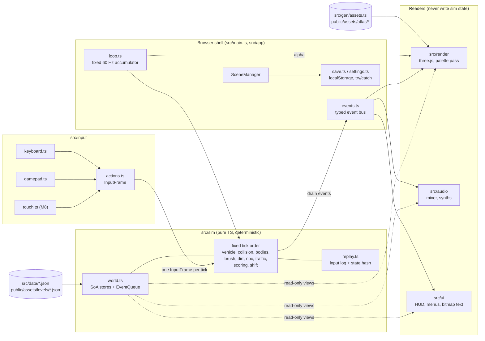
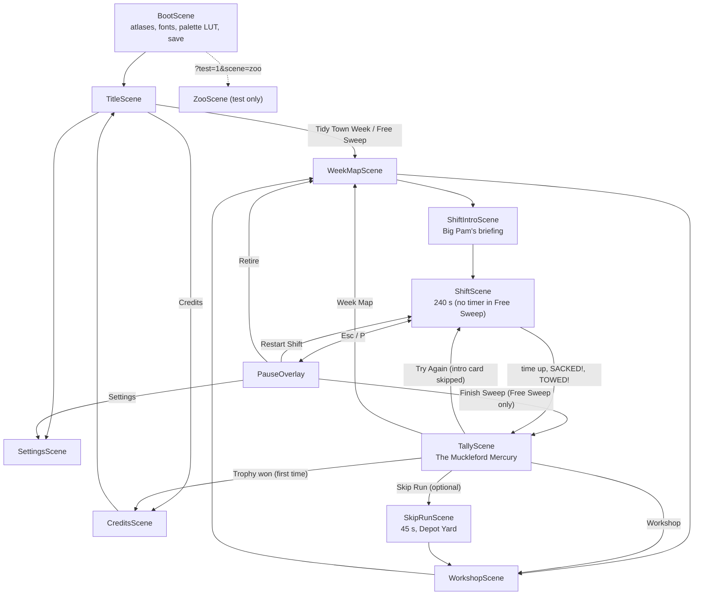
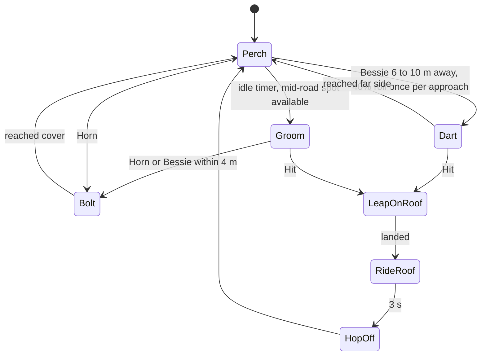
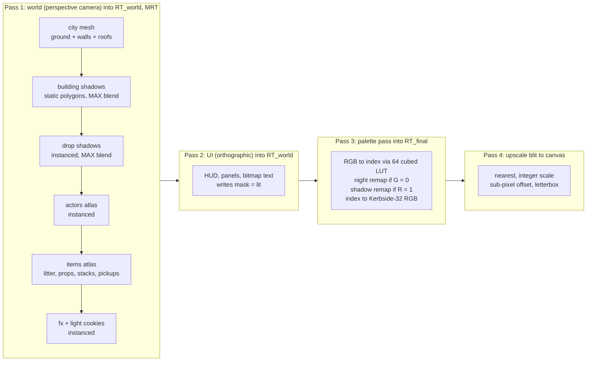

# Street Sweeper Pro: Technical Design

> **Status:** v1.0 (2026-10-18). Owner: engineering. Binding for M0–M7.
> **Source of truth for numbers:** the canonical facts sheet. Game rules live in [GDD.md](GDD.md), asset tooling in [ASSET_PIPELINE.md](ASSET_PIPELINE.md), visual rules in [ART_BIBLE.md](ART_BIBLE.md), audio in [AUDIO_DESIGN.md](AUDIO_DESIGN.md), map authoring in [LEVEL_DESIGN.md](LEVEL_DESIGN.md), per-entity stats in [ENTITY_CATALOG.md](ENTITY_CATALOG.md), schedule in [ROADMAP.md](ROADMAP.md). The stack decision record is [adr/0001-tech-stack.md](adr/0001-tech-stack.md). Terms are defined in [GLOSSARY.md](GLOSSARY.md).
>
> This document covers **how the game is built**: what runs, in what order, in which module, with which data, and how we prove it still works. Anything once marked **TBD (M0 spike)** was decided by the M0 *Foundations & Look Spike* and recorded in [ROADMAP.md](ROADMAP.md); none remain since M0 closed (SSP-027).

---

## Contents

1. [Stack and pinned versions](#1-stack-and-pinned-versions)
2. [Directory layout](#2-directory-layout)
3. [Architecture overview](#3-architecture-overview)
4. [Coordinate systems and units](#4-coordinate-systems-and-units)
5. [Game loop and fixed timestep](#5-game-loop-and-fixed-timestep)
6. [Scenes](#6-scenes)
7. [Simulation core](#7-simulation-core)
8. [Vehicle model](#8-vehicle-model)
9. [Collision](#9-collision)
10. [Brush, LitterField, grime and hopper](#10-brush-litterfield-grime-and-hopper)
11. [NPC and traffic behaviour](#11-npc-and-traffic-behaviour)
12. [Rendering pipeline](#12-rendering-pipeline)
13. [Input abstraction](#13-input-abstraction)
14. [Audio engine integration](#14-audio-engine-integration)
15. [Map data format](#15-map-data-format)
16. [Save data and settings](#16-save-data-and-settings)
17. [Performance budgets](#17-performance-budgets)
18. [Testing strategy](#18-testing-strategy)
19. [CI](#19-ci)
20. [Build and deploy](#20-build-and-deploy)
21. [Coding conventions](#21-coding-conventions)

---

## 1. Stack and pinned versions

**Decision:** three.js + TypeScript + Vite, rendering with a **perspective camera looking straight down** into a low-res, palette-mapped render target. The core is deliberately lean: we write our own collision code and audio mixer, and defer everything else until a game feature needs it. The reasoning, the judges' vote and the rejected alternatives (Phaser, Godot, PixiJS, Rapier as core physics, Howler/Tone.js and others) are in [adr/0001-tech-stack.md](adr/0001-tech-stack.md).

### 1.1 Versions (exact pins, verified 2026-10-18)

| Area | Package / tool | Version |
|---|---|---|
| Runtime / package manager | Node.js + npm (`package-lock.json`) | Node **24.21.0**, npm **11.19.0** |
| Language | TypeScript, strict (verified with Vite, Vitest and Biome in M0, [D-10](ROADMAP.md#8-m0-spike-decision-log); fallback pin **6.0.3** if a tool breaks) | **7.0.2** |
| Renderer | `three` | **0.186.1** |
| Types | `@types/three` | **0.186.0** |
| Build / dev server | `vite` | **8.3.4** |
| Unit / sim tests | `vitest` | **5.0.5** |
| Property tests | `fast-check` | **4.10.2** |
| E2E / visual | `@playwright/test` (Chromium) | **1.64.1** |
| Image diff | `pixelmatch` | **8.0.0** |
| PNG I/O (tests, tools) | `pngjs` | **7.0.0** |
| Lint + format | `@biomejs/biome` | **2.5.15** |
| SFX synthesis | `zzfx` (reference for vendored `buildSamples`; not imported in Node) / `jsfxr` | **1.4.0** / **1.4.1** |
| Node types (for `tools/**` and Vitest under `tsc --noEmit`) | `@types/node` | **24.19.2** |
| Asset forge | Python via uv; numpy, Pillow, pytest | Python **3.13.15**, uv **0.12.23**, numpy **2.5.4**, Pillow **13.0.0**, pytest **9.1.1** |
| 3D pre-render (local only) | Blender | **5.2.2 LTS** at `/Applications/Blender.app/Contents/MacOS/Blender` |
| Image generation (local only) | Codex CLI (primary) / Cursor Agent CLI (fallback, concept only) | **codex-cli 0.160.1** / **2026.10.16-e3cb207** |
| Audio encoding | ffmpeg (Homebrew) | **9.0.2** at `/opt/homebrew/bin/ffmpeg` |
| Desktop wrapper (M9, deferred) | `@tauri-apps/cli` | **2.12.3** |
| Physics escape hatch (**not installed**) | `@dimforge/rapier2d-deterministic-compat` | **0.21.0** |
| itch.io uploader (M7, **not installed yet**) | butler | latest at M7 |

All npm dependencies are pinned with exact versions (no `^` or `~`) in `package.json`, and `npm ci` is the only install command used in CI. Bun 1.4.2 is installed on the dev machine but **not used**: one runtime avoids drift.

### 1.2 Stack-wide consequences

| Rule | Why | Consequence in code |
|---|---|---|
| TS tools run natively on Node 24 type stripping (`node tools/audio/render-sfx.ts`) | No tsx, no build step for tools | `tsconfig.json` sets `erasableSyntaxOnly: true`: **no `enum`, `namespace` or parameter properties**. Use `as const` objects plus union types. |
| JSON for every data file (manifest, levels, tuning, palette, songs, SFX) | Neither TS nor Python needs a parser dependency | JSON imports use import attributes: `import tuning from '../data/tuning.json' with { type: 'json' }` (works in Vite and in Node). |
| Hand-written `sfc32` PRNG in `src/sim/rng.ts` | Deterministic, tiny, fast, seedable | No seedrandom, simplex-noise or pure-rand. The forge uses `numpy.random.Generator(PCG64(seed))`; the two never need to agree. |
| `WebGLRenderer` (WebGL2), not `WebGPURenderer` | Headless SwiftShader visual tests, Safari parity, MRT and `Data3DTexture` are mature on WebGL2 | Revisit after 1.0 only if a measured need appears. |
| Blender and image generation never run in a build or in CI | Reproducibility (pillar 5) | Their outputs are committed **golden** sources. See [adr/0002-ai-authored-asset-pipeline.md](adr/0002-ai-authored-asset-pipeline.md). |

---

## 2. Directory layout

The layout is canonical. New top-level directories need an ADR.

```
/
├─ index.html  package.json  package-lock.json  tsconfig.json  biome.json
├─ vite.config.ts  vitest.config.ts  playwright.config.ts  .gitignore
├─ README.md  CLAUDE.md
├─ src/
│  ├─ main.ts
│  ├─ app/        Game.ts, loop.ts (fixed 60 Hz accumulator, max 5 steps/frame, render interpolation),
│  │              SceneManager.ts, shiftFlow.ts (intro → shift → tally), events.ts (typed event bus), save.ts,
│  │              settings.ts
│  ├─ scenes/     BootScene, TitleScene, WeekMapScene, WorkshopScene, ShiftIntroScene, ShiftScene,
│  │              SkipRunScene, TallyScene (Mercury), PauseOverlay, SettingsScene, CreditsScene, ZooScene (test)
│  ├─ sim/        PURE TS, with no three/DOM/Date/Math.random:
│  │              rng.ts, constants.ts, fmath.ts, coords.ts, inputFrame.ts, world.ts, map.ts, vehicle.ts,
│  │              collision/{obb,sat,grid,sweep}.ts,
│  │              bodies.ts (knockables), litter.ts (LitterField spatial hash), brush.ts, dirt.ts,
│  │              hopper.ts, water.ts, stains.ts, npc/{steering.ts, behaviours/<npc>.ts}, traffic.ts,
│  │              scoring.ts, combo.ts, complaints.ts, shift.ts, replay.ts, tuning.ts
│  ├─ render/     Renderer.ts, camera.ts, cityMesh.ts, groundLayer.ts, spriteBatch.ts, spriteStack.ts,
│  │              shadows.ts, palettePass.ts, upscale.ts, fx.ts
│  ├─ audio/      mixer.ts, sfx.ts, music.ts, engineSynth.ts, brushSynth.ts, unlock.ts
│  ├─ input/      actions.ts, keyboard.ts, gamepad.ts, touch.ts
│  ├─ ui/         bitmapText.ts, hud.ts, hudModel.ts, panels.ts, menus.ts, minimap.ts, popups.ts, uiItems.ts,
│  │              introCard.ts, tallyPage.ts (M2 placeholder screens)
│  ├─ data/       tuning.json, entities.json, upgrades.json, districts.json
│  ├─ gen/        assets.ts (GENERATED, committed)
│  └─ debug/      devPanel.ts, testHooks.ts
├─ assets-src/
│  ├─ STYLE.md  manifest.json
│  ├─ _probe/   (asset-probe artefacts copied 2026-10-18; git-tracked, not in the manifest)
│  ├─ palette/kerbside32.json
│  ├─ sprites/{npc,litter,prop,pickup,ui,facade}/*.sprite.txt
│  ├─ fonts/*.glyphs.txt
│  ├─ procedural/{tiles,roofs,facades,stains,fx}/*.json
│  ├─ blender/{rig.py, vehicles/*.py, props/*.py, roofkit/*.py}
│  ├─ rendered/<asset-id>/{h00..h31.png, render.json}     (committed Blender goldens)
│  ├─ ai/{_style_preamble.md, <asset-id>/{prompt.md, meta.json, golden.png, refs/}}
│  ├─ levels/<district>.{map.txt,level.json}
│  └─ audio/{sfx/*.json, music/*.song.json, amb/*.json}
├─ tools/
│  ├─ forge/      pyproject.toml, uv.lock, forge/{__main__,build,ingest,pixelize,palette,outline,
│  │              pack,lint,sheets,blender,genai}.py, forge/procedural/*.py, tests/
│  ├─ audio/      render-sfx.ts, render-music.ts, synth/*.ts, wav.ts
│  └─ levels/     compile-level.ts, schema.ts, kerbBlob.ts, tileLayers.ts, layoutChecks.ts
├─ public/assets/ atlas/, fonts/, art/, audio/{sfx,music}/, levels/, asset-hashes.json   (GENERATED, committed)
├─ tests/
│  ├─ unit/       *.test.ts (Vitest)
│  ├─ property/   *.prop.test.ts (fast-check)
│  ├─ replay/     replays/*.json + replay.test.ts
│  ├─ visual/     *.spec.ts + __goldens__/*.png (Playwright)
│  └─ e2e/        smoke.spec.ts, perf.spec.ts
├─ docs/
└─ build/         (git-ignored: .forge-cache, sheets, ai-candidates, tmp)
```

`.gitignore`: `node_modules/`, `dist/`, `build/`, `test-results/`, `playwright-report/`, `tools/forge/.venv/`. A nested `tools/forge/.gitignore` additionally ignores `__pycache__/` and `.pytest_cache/` (Python bytecode and pytest cache written when the forge and its tests run).

**Additions this document makes to the sim layout:**

- `src/sim/fmath.ts`, a thin wrapper for the transcendental maths the sim uses (`sin`, `cos`, `tan`, `atan2`, `exp`, `sqrt`, `hypot`). `tan` joined the list in SSP-028 because the vehicle yaw step uses `tan(δ)` ([§8.2](#82-per-tick-integration-phase-2)). See [§7.4](#74-determinism).
- `src/sim/coords.ts`, the [§4](#4-coordinate-systems-and-units) conventions as allocation-free helpers: heading → forward/right vectors (into a caller-supplied out object), heading → vehicle frame index (`h00`–`h31`), heading → 8-way actor direction, metres → tile and grime cell (SSP-028).
- `src/sim/inputFrame.ts`, the `InputFrame` type and its `BUTTON`/`PRESSED` bit constants ([§13.1](#131-actions-and-the-inputframe)). It lives in the sim because `src/input` may import only this type from `src/sim` ([§2.1](#21-who-may-import-whom)) (SSP-028).
- `src/sim/entities.ts`, the types, canonical ID lists and hand-written guards for `src/data/entities.json` (`loadEntities`). It does not import the JSON: `tuning.ts`, the only sim file allowed to import `src/data/` ([§2.1](#21-who-may-import-whom)), loads it as `DEFAULT_ENTITIES` and re-exports the module. `src/sim/dataGuards.ts` holds the small helpers both loaders share (SSP-053).
- `src/sim/base64.ts`, pure RFC 4648 base64 for the compiled-level grid layers ([§15.2](#152-compiled-schema-v1)). The sim runs in the browser and on Node type stripping, so it uses neither Node's `Buffer` nor the DOM's `atob`/`btoa` (SSP-032).

### 2.1 Who may import whom

| Module | May import | Must not import |
|---|---|---|
| `src/sim/**` | `src/sim/**`, `src/data/*.json` (via `tuning.ts` only), `src/gen/assets.ts` (types only) | `three`, any DOM API, `src/app`, `src/render`, `src/audio`, `src/ui`, `src/input` |
| `src/render/**` | `three`, `src/sim` (read-only types and state views), `src/gen` | `src/audio`, `src/ui` internals |
| `src/audio/**` | WebAudio, `src/sim` (read-only), `src/app/events.ts` | `three` |
| `src/ui/**` | `src/render/spriteBatch.ts`, `src/gen/assets.ts` (frame IDs; SSP-069), `src/sim` (read-only), `src/app/events.ts` | direct sim mutation, `three` and every other render module (enforced by `tests/unit/uiImports.test.ts`) |
| `src/input/**` | DOM, `src/sim/inputFrame.ts` only (the `InputFrame` type and its `BUTTON`/`PRESSED`/range constants) | everything else, including `src/app/events.ts` (`Game.ts` wires rumble to the bus) |
| `src/app/**`, `src/scenes/**` | everything | none (composition root) |
| `tools/**` | `src/sim/**` and `src/data/**` (the level compiler reuses `map.ts`), Node built-ins | `three`, `src/render` |

The sim rule is **enforced**, not advisory: see [§21.3](#213-enforced-rules).

---

## 3. Architecture overview

### 3.1 Module diagram



### 3.2 Core principles

1. **A run is a pure function:** `run = f(seed, district, inputLog)`. Everything that affects gameplay is in `src/sim`, and everything in `src/sim` is deterministic.
2. **One-way data flow.** Input → sim → (state views + events) → render, audio, UI. Readers never write sim state. If the UI needs to change something (for example "buy upgrade"), it calls a command on the **meta layer** (`save.ts`, Workshop logic), never inside a running shift.
3. **No ECS library.** Each entity kind has a typed struct-of-arrays store. Engine code is written only when a feature needs it.
4. **Data-driven numbers.** Every gameplay constant lives in `src/data/tuning.json` or `src/data/entities.json`. Code holds no magic numbers except unit conversions (`PX_PER_M = 16`) in `src/sim/constants.ts`.
5. **Generated code is a compile-time contract.** `src/gen/assets.ts` exports the `FRAME` const plus `FrameId`/`AssetId` unions, so referencing a missing sprite is a type error.

---

## 4. Coordinate systems and units

Getting this wrong once costs a week, so it is fixed here and asserted in unit tests.

| Space | Origin | Axes | Units |
|---|---|---|---|
| **Sim world** | NW corner of the district map | **+x east, +y south** (rows of the ASCII map grow downward) | metres, seconds, radians |
| **Tile** | NW corner | col = `floor(x / 2)`, row = `floor(y / 2)` | 2 m tiles (32 px) |
| **Grime cell** | NW corner | `cx = floor(x / 0.25)`, `cy = floor(y / 0.25)` | 0.25 m (4 px) |
| **Render (three.js)** | same as sim | `render.x = sim.x`, `render.z = sim.y`, buildings extrude along **+Y** | metres |
| **Vehicle local** | body centre | **+y forward**, +x right | metres (the brush geometry in [§10.1](#101-brush-hitbox) uses this) |
| **Internal screen** | top-left of the W×270 frame | +x right, +y down | internal pixels |

- **Heading** `θ`: radians, **0 = north (screen up), increasing clockwise** (compass convention). Forward vector in sim space: `(sin θ, −cos θ)`. Right vector: `(cos θ, sin θ)`.
- **Vehicle sprite frame** = `((round(θ / (2π/32)) % 32) + 32) % 32` → `h00`…`h31`. This matches the Blender rig: `h00` faces north, stepping 11.25° clockwise.
- **Actor direction** (8-way) = `round(θ / (π/4)) mod 8` → `n, ne, e, se, s, sw, w, nw`.
- **Camera:** positioned at `(x, H, z)`, looking at `(x, 0, z)` with `camera.up = (0, 0, −1)`. Screen up is then −Z = north and screen right is +X = east. Nothing is mirrored.
- **Pixel ↔ metre:** `PX_PER_M = 16`. Ground is 1 texel = 1 px at H = 31.5 m, to within 0.03% (see [§12.2](#122-camera-rendercamerats)).

---

## 5. Game loop and fixed timestep

### 5.1 Loop

`src/app/loop.ts` runs a fixed **60 Hz** simulation (`DT = 1/60` s) behind a variable-rate renderer. It is the only place outside `src/debug` that reads `performance.now()`.

```ts
const DT = 1 / 60;
const MAX_STEPS = 5;     // per rendered frame
const MAX_FRAME = 0.25;  // s; clamp after tab switches and breakpoints

let acc = 0;
let last = performance.now();

function frame(nowMs: number): void {
  let ft = (nowMs - last) / 1000;
  last = nowMs;
  if (ft > MAX_FRAME) ft = MAX_FRAME;
  acc += ft;

  let steps = 0;
  while (acc >= DT && steps < MAX_STEPS) {
    const input = actions.sampleForTick();   // latched edges, see §13
    scenes.fixedUpdate(input);               // ShiftScene → sim.step(input)
    events.drain(sim.world.events);          // dispatch to audio/UI/render
    acc -= DT;
    steps++;
  }
  if (steps === MAX_STEPS && acc > DT) acc = DT; // drop backlog: slow down, never spiral

  scenes.render(acc / DT);                   // alpha in [0, 1) for interpolation
  requestAnimationFrame(frame);
}
```

| Rule | Value / behaviour |
|---|---|
| Sim rate | 60 Hz fixed, independent of the display (60, 120 and 144 Hz monitors all run 60 ticks/s) |
| Max sim steps per frame | 5. Below 12 fps the game runs in slow motion instead of freezing. |
| Render interpolation | Sim stores `prevX/prevY/prevHeading` per entity, copied at the start of each tick with `TypedArray.set`. The renderer lerps with `alpha` (angles take the shortest arc). As built for Bessie (SSP-046): `src/render/interpolate.ts` `interpolatePose(vehicle, alpha, out)` lerps x and y and turns the heading by `wrap(θ − θprev) · alpha` (wrap into [−π, π)), alpha clamped to [0, 1]; ShiftScene draws and follows that pose. |
| Time in the sim | An integer **tick counter**. A shift is 240 s = **14,400 ticks**; the timer is `ticksRemaining`, never a float. |
| Tab hidden | `visibilitychange` → the ShiftScene opens the PauseOverlay. The loop keeps running for menus but the accumulator is reset on resume. |
| Test mode | With `?test=1&freeze=1` the loop renders but never steps; `window.__ssp.step(n)` advances the sim synchronously ([§18.5](#185-test-hooks)). |

*As implemented (SSP-043, `src/app/loop.ts`):* the accumulator maths is the pure `advance(acc, frameS)`, which clamps the frame time (`clampFrameS`: negative and non-finite times count as 0, anything over `MAX_FRAME_S = 0.25` s counts as 0.25 s), runs whole `DT_S` steps up to `MAX_STEPS_PER_FRAME` (both from `src/sim/constants.ts`), drops the backlog to `acc = DT_S` when the cap is hit, and returns the step count. After a capped frame `alpha` can therefore be exactly 1 (it lies in [0, 1], not [0, 1)). `createLoop(target, options)` drives a `LoopTarget` (`sampleForTick`, `fixedUpdate`, `drainEvents`, `render(alpha, frameS)`, where `frameS` is the clamped render time for render-only springs such as the camera's) through an injected `LoopClock` (`now`, `requestFrame`, `cancelFrame`; `browserClock()` is `performance.now()` + `requestAnimationFrame`), so unit tests (`tests/unit/loop.test.ts`) need no rAF. Options: `fixedFrameS` (test mode: every frame lasts exactly 1/60 s, so one tick per frame whatever the timestamps), `frozen` (render but never step; `setFrozen(false)` restarts the frame clock) and `onFrameTimed(nowMs, workMs)` (the frame callback's CPU time for `__ssp.perf()`). `runTicks(n)` and `renderNow()` are what `__ssp.step(n)` calls. `handleVisibilityChange(hidden)` resets the accumulator and the frame clock on resume; `Game.ts` wires it to `visibilitychange`. The rule that only the loop reads `performance.now()` outside `src/debug` is checked by `tests/unit/performanceNow.test.ts`. `LoopTarget.beginFrame()` (optional, SSP-044) runs at the start of every frame, before its ticks and also while frozen; `Game.ts` points it at `actions.beginFrame()` (the gamepad poll). `runTicks(n)` does not call it.

### 5.2 Fixed tick order

`World.step(input)` runs these phases in this order every tick. The order is canonical: changing it changes replay hashes and must be called out in the PR.

| # | Phase | Module(s) | Notes |
|---|---|---|---|
| 1 | Input | `world.ts` | Copy the `InputFrame` into the sim; append it to the replay log |
| 2 | Vehicle | `brush.ts` (state machine), `vehicle.ts`, `hopper.ts` | Brush raise/lower and RPM (sets the brush-down top speed), steering, drive, drag, grip, handling scaled by hopper fill |
| 3 | Static collision | `collision/{obb,sat,grid,sweep}.ts` | OBB vs grid AABB with SAT, sub-stepped when speed > 0.5 tile/tick |
| 4 | Knockable bodies | `bodies.ts` | Bins, cones, A-boards, trolleys, recycling boxes |
| 5 | Brush / litter | `brush.ts`, `litter.ts`, `water.ts` | Gutter, suction, inlet, fling, spray, collection |
| 6 | Dirt | `dirt.ts` | Grime footprint erase, stain cleaning, dust |
| 7 | NPC AI | `npc/steering.ts`, `npc/behaviours/*.ts` | FSMs, perception, reactions |
| 8 | Traffic | `traffic.ts` | Lane graph followers, blocking timers |
| 9 | Scoring / combo / complaints | `scoring.ts`, `combo.ts`, `complaints.ts` | Consume this tick's gameplay facts |
| 10 | Shift timer | `shift.ts` | Countdown, SACKED/TOWED/time-up transitions |
| 11 | Emit events | `world.ts` | Seal the `EventQueue` for this tick |

*As implemented (SSP-035, `src/sim/world.ts`):* `createWorld(level, seed, tuning)` builds the World; `world.step(input)` (the same as `stepWorld(world, input)`) resets the event queue, runs the eleven phases above and increments the integer `tick`. The `Phase` const numbers them 1–11. `world.phaseTrace` is an optional callback, `null` by default, called with the phase number at the start of every phase (the tick-order test uses it). `world.recordInput` is the phase-1 hook that the replay recorder fills (`attachInputLog`, SSP-038, [§18.3](#183-deterministic-replay-tests)). In M1, phases 2 and 3 are real (phase 3 since SSP-036, [§9.2](#92-vehicle-vs-static-phase-3)), phase 10 holds only the TOWED stub (SSP-036), and phases 4–9 are empty functions called in order, each named after the issue that fills it. Since SSP-059 phase 2 starts with `stepBrushState` (the BRUSH pressed edge and the brush timers, [§8.3](#83-brush-mechanics-state)) before the surface sample and `stepVehicle`; the brush's litter step (`stepBrushLitter`) joins phase 5 with SSP-065, between `beginLitterTick` and `stepLitter`. Since SSP-062 phase 10 is `stepShift` (`shift.ts`: TOWED, the timer, the dump FSM and the knock-off, [§10.5](#105-hopper-and-dumping-srcsimhopperts)) instead of the TOWED stub, and phase 1 ends with `gateShiftInput`, which replaces the recorded input with the knock-off brake once the timer has run out. Since SSP-093 phase 2 ends with the hazard contacts ([§8.2](#82-per-tick-integration-phase-2) step 10: jolts, LU spills, the open-manhole hard stop) after the kerb crossings, its surface sample reads the hazard grip overrides, and phase 5 runs the leaf-pile brush-up hook (`stepBrushUpLeaves`, `src/sim/hazards.ts`); SSP-065 orders it with the other phase-5 systems (after `stepBrushLitter`, beside the dog-mess splats, before `stepLitter`). **Since SSP-065 phases 5, 6, 9 and 10 are all real**, in this order inside each: phase 5 `beginLitterTick` → `stepBrushLitter` (`brush.ts`) → `stepBrushUpLeaves` (`hazards.ts`) → `stepBrushUpSplats` (`stains.ts`) → `stepLitter` (`litter.ts`) → `stepWater` (`water.ts`: hydrant refill, then the spray; it touches no litter); phase 6 `stepDirt` (`dirt.ts`, with the brush's `collecting` flag that phase 5 set) → `cleanStainsInCone` (`water.ts`); phase 9 `stepScoring` (`scoring.ts`, `combo.ts`; the combo freeze reads `isShiftDraining` before phase 10 runs) → `stepTidy` (`tidy.ts`); `complaints.ts` joins phase 9 in M3 (SSP-078). **Since SSP-080 phase 7 is real** ([§11.1](#111-behaviour-system)): `beginNpcTick` (`npc/store.ts`: prevX/prevY) → `updateViewRect` (`viewRect.ts`, [§7.4](#74-determinism), from Bessie's pose after phase 3) → `stepNpcSpawner` (`npc/spawner.ts`) → `deliverStimuli` (`npc/stimuli.ts`) → `perceiveNpcs` (`npc/perception.ts`) → `tickNpcBehaviours` (`npc/npcAi.ts`). Phases 4 and 8 stay empty until their M3 issues (SSP-092, SSP-089). `tests/unit/tickOrder.test.ts` wraps every system function the tick calls (`vi.mock`) and checks the full per-tick call sequence against this list, phase markers included (and, since SSP-080, that every phase-7 system runs after phase 6 and before phase 8); `tests/unit/world.test.ts` keeps the phase-trace test.

---

## 6. Scenes

### 6.1 SceneManager

`SceneManager` holds a **stack** of scenes. The top scene receives input; scenes below it keep rendering (so `PauseOverlay` draws over a frozen `ShiftScene`). Each scene implements:

```ts
interface Scene {
  readonly id: SceneId;                       // 'boot' | 'title' | ... | 'zoo'
  enter(params: SceneParams): Promise<void>;  // async asset loads happen here
  exit(): void;                               // release GPU resources and audio nodes
  fixedUpdate(input: InputFrame): void;       // 60 Hz
  render(alpha: number): void;                // per display frame
  readonly blocksUpdateBelow: boolean;        // true for PauseOverlay
  readonly simEvents: ReadonlyEventQueue | null; // the sim queue fixedUpdate seals (ShiftScene: world.events)
}
```

*As implemented (SSP-043, `src/app/SceneManager.ts`):* `SCENE_IDS` lists the [§6.2](#62-scene-flow) scenes in snake_case (`boot`, `title`, `week_map`, `workshop`, `shift_intro`, `shift`, `skip_run`, `tally`, `pause`, `settings`, `credits`, `zoo`) plus the M0 test scenes (`spike_city`, `lean_quadrants`, `scale_1440`, `scale_sheet`); `SceneId` is its union. `SceneParams` holds the run `seed` and, since SSP-046, an optional `district` (`district.<name>`) that ShiftScene requires. The manager has `push`, `replace` and `pop`:

- A scene joins the stack only when its `enter()` resolves; until then the old stack keeps updating and rendering. A second transition while one is pending throws, and a scene whose `enter()` rejects never joins (it must release what it loaded). `replace()` enters the new scene before it exits the old one.
- `fixedUpdate(input)` updates from the top down: the top scene gets the player's input, the scenes below it get a frozen neutral `InputFrame`, down to and including the first scene with `blocksUpdateBelow`. Everything under that scene neither updates nor emits events. A scene may pop itself during its update.
- `render(alpha)` renders every scene, bottom first, so overlays draw on top.
- `drainEvents(bus)` drains `simEvents` only for the scenes updated in the last tick. A scene frozen under an overlay never has its last tick dispatched again.

`Game.ts` builds the renderer on a world-pass root `Group` and hands each scene a `SceneContext` (renderer, root, atlas loader). The M0 spike scenes run on the manager through `src/scenes/SpikeScene.ts`, which adapts their content without changing what they draw. Their actor counter is now the scene's tick count (advanced by `fixedUpdate` at 60 Hz) instead of the render-frame count, so 120/144 Hz displays animate at the same speed as 60 Hz ones.

*As built (SSP-046, `src/scenes/ShiftScene.ts`):* the drive-only `ShiftScene` (`id` `shift`) was the default boot scene in every build in M1 (since SSP-071 the shift flow boots at the intro card, below), and `?test=1&scene=district.<name>` boots it for that district. `enter({ seed, district })` loads `assets/levels/<name>.json` through `src/app/levelLoader.ts` (relative to `import.meta.env.BASE_URL`, decoded by `map.ts`; it refuses a file whose `id` is another district) together with the `world` and `actors` atlases, calls `createWorld(level, seed, tuning)` (tuning.json unless the constructor is given a copy), builds the level city (`levelCity.ts`) and Bessie's sprites (`render/bessieSprite.ts`, [§12.5](#125-sprites-spritebatchts-spritestackts)), and places the camera over Bessie's start. `fixedUpdate(input)` is `world.step(input)`; `simEvents` is the World's queue. `render(alpha)` interpolates Bessie's pose ([§5.1](#51-loop)), calls the scene context's `followCamera(x, y, vx, vy, speed)` with it, her ground velocity and her vLong, and poses her sprites; it never writes the World. The `SceneContext` gained `followCamera` and `releaseCamera`: from a scene's first `followCamera` call the Game stops its own camera pan (which the spike scenes still use), and the rig follows the given point with the frame's render time, snapped to 1/16 m with the sub-pixel remainder in the blit; a pinned camera (`__ssp.setCamera`) ignores it. Since SSP-047 the rig leads her along her velocity and zooms from her vLong ([§12.2](#122-camera-rendercamerats)). Dev builds (`recordInputs`) attach a full-shift `InputLog` to the World's phase-1 hook ([§18.3](#183-deterministic-replay-tests)) for the dev panel's Save replay (SSP-048); M1's shift never ends, so recording stops (without error) once 14,400 ticks are logged. Draw calls: city, building shadows, Bessie's drop shadow, actors batch, palette pass, blit (6). `npm run dev` with `?world=spike_city`, `?world=empty|palette_test`, `?actors=0` or `?actorFrame=N` still boots the M0 spike city for the spike scripts.

*As built (SSP-071, `src/app/shiftFlow.ts`, `src/scenes/ShiftIntroScene.ts`, `src/scenes/TallyScene.ts`):* the drive-only boot is replaced by the **shift flow**, the part of [§6.2](#62-scene-flow) that exists before Boot, Title, Week Map and Workshop: `ShiftIntroScene` → `ShiftScene` → (`EV.ShiftEnd`) → `TallyScene` → Try Again → `ShiftScene`, or Back to Briefing → `ShiftIntroScene`. `ShiftFlow` owns which scene comes next and makes every transition a `SceneManager.replace` (a push onto the empty stack at boot); a failed transition is logged and leaves the old scene up. Every build boots it at the intro card for Puddle Lane (`DEFAULT_DISTRICT`), so `npm run dev` always runs a complete 240 s shift (ROADMAP §1 principle 5).

- **ShiftIntroScene** (`shift_intro`): loads the `ui` atlas and the Kerbside 5×7 font (`src/scenes/uiScreen.ts`: one `UiSpriteBatch` on the UI root, released in `exit()`), joins the stack, and only then starts loading the compiled level, so the card is on screen while it loads ([§6.3](#63-loading)). The card (`src/ui/introCard.ts`) is a `ui.panel_council` panel with the district name (15, outlined), a one-line briefing placeholder (07) and the prompt (16): 'Loading...', then 'Press Space to start' ('Level failed to load' in 18 if it failed). A select pressed while loading is kept and the shift starts when the level arrives. The flow keeps the decoded level, so later shifts and cards fetch none.
- **ShiftScene** takes the preloaded level (`options.level`) and loads only its atlases. It stops stepping its World on the tick `EV.ShiftEnd` fires (after the knock-off coast, or on TOWED), so the state the tally shows is the state the shift ended in.
- **TallyScene** (`tally`): `ShiftFlow` subscribes to `EV.ShiftEnd` on the bus, takes the ShiftScene's `SimSnapshot` on that tick and enters the tally with it (`TallyResult`: district, seed, snapshot). The numbers-only page (`src/ui/tallyPage.ts`, a `ui.panel_paper` panel in 00 ink): the end reason ('TIME UP!', or 'TOWED!' in 18), the district, Tidy % to one decimal, items collected / spawned, grime cells cleaned / laid, the score with thousands separators, and three ★ (the would-be stars earned outlined in 15, the rest plain 04), then Try Again (default focus) and Back to Briefing. TOWED's tally rules are SSP-079. Try Again replaces the tally with a new ShiftScene on the same district and seed, the intro card skipped: a fresh World at tick 0 (`tests/e2e/flow.spec.ts` measured 36 ms from the key press to the shift scene active, against GDD §11.3's 3 s).
- **Menu input** is read per tick by the menu scenes from `Actions.takeMenuEdges()` ([§13.1](#131-actions-and-the-inputframe)) and never reaches a sim. A menu scene drops the edges latched before it showed, and the tally ignores menu input for its first `TALLY_INPUT_LOCK_TICKS` (30, 0.5 s) so a brush press made as the shift ended cannot pick a button.
- **Draw calls** on the card and the tally: the UI batch, the palette pass and the blit (3); the world pass is empty, so the frame behind them is index 00.
- `SceneManager.onEntered` (observer, null by default) is called with each scene as it joins the stack; test mode records the IDs for `__ssp.sceneHistory()` ([§18.5](#185-test-hooks)). The dev panel edits and saves the flow's current shift (`ShiftFlow.devShift`), and its tuning edits carry into Try Again.

### 6.2 Scene flow

This diagram mirrors [GDD §15.1](GDD.md#151-scene-flow), which owns the flow; the GDD diagram and this one change together.



*As built in M2 (SSP-071):* only the shift flow exists: `ShiftIntroScene` → `ShiftScene` → `TallyScene` → Try Again → `ShiftScene` ([§6.1](#61-scenemanager)). The tally's second button, Back to Briefing, returns to the intro card and stands in for the Week Map until a TitleScene exists ([GDD §15.1](GDD.md#151-scene-flow)).

`ZooScene` lays out every frame from `FRAME` in a grid at 1:1 for the `zoo` visual golden and for contact-sheet review in-engine (see [ASSET_PIPELINE.md](ASSET_PIPELINE.md)).

### 6.3 Loading

| Asset | When loaded | Size class |
|---|---|---|
| `ui`, `actors`, `items`, `fx` atlases, fonts, palette | BootScene | ≤ 2048² PNG each |
| `world` atlas | BootScene | ≤ 2048² PNG |
| `public/assets/levels/<district>.json` | ShiftIntroScene (while the briefing card is shown; since SSP-071 the card joins the stack first, then starts the load, and ShiftScene takes the decoded level). ShiftScene still loads it itself when it is booted straight (`?test=1&scene=district.<name>`, SSP-046). Until BootScene (SSP-284) each ShiftScene loads the `world` and `actors` atlases in its own `enter()`, and the intro card and the tally load the `ui` atlas and the font in theirs | tens of KB |
| District music stems + ambience bed | ShiftIntroScene, decoded in the background | 1–3 MB |
| SFX | BootScene (all are short) | < 500 KB total |

---

## 7. Simulation core

### 7.1 World and stores

`World` (`src/sim/world.ts`) owns all mutable shift state. Each entity kind has a fixed-capacity **struct-of-arrays** store allocated once at shift start from the budgets in [§17](#17-performance-budgets):

```ts
// src/sim/world.ts (shape, abridged)
export type NpcStore = {
  count: number;
  readonly kind: Uint8Array;        // index into entities.json npc table
  readonly state: Uint8Array;       // behaviour state id (per-kind const object)
  readonly stateTicks: Uint32Array; // ticks since entering state
  readonly x: Float64Array; readonly y: Float64Array;
  readonly prevX: Float64Array; readonly prevY: Float64Array;
  readonly heading: Float64Array; readonly speed: Float64Array;
  readonly targetNode: Int32Array;  // pavement nav graph node, -1 = none
  readonly swap: Uint8Array;        // ramp-swap index (outfit) for the renderer
  readonly flags: Uint16Array;      // FALLEN, ON_ROOF, YIELDING, ...
};
```

- Sim state uses **`Float64Array`** (JS numbers are doubles, so there is no `Math.fround` noise). Render instance buffers are `Float32Array`.
- Removal is **swap-remove** with the last live slot. Entity identity across ticks, where needed (for example "the dog belongs to this walker"), uses a generation-checked handle `(index, gen)`.
- Capacities: litter 2,000, NPCs 80, vehicles 30, knockables 128, hazards 64, stains 256, pickups 16. Exceeding a capacity is a level-authoring error caught by `compile-level.ts` and by the replay invariants.
- *M1 contents (SSP-035):* the decoded `Level` (grids), the `Tuning` it was given, the uint32 `seed`, the integer `tick`, its own copy of this tick's `InputFrame`, Bessie's `VehicleState` and `VehicleParams`, the surface sample phase 2 used (`surface`: k and rollMult), the `EventQueue`, and preallocated scratch (surface table, kerb crossings). SSP-036 adds the static collision grid (`staticGrid`, [§9.1](#91-static-world)), the phase-3 scratch and contact log (`staticResolver`) and `shiftEndReason` (0 while the shift runs). Bessie spawns at `level.player` (body centre, heading). Render, audio and UI take `viewWorld(world)`, a `WorldView` that is the same object typed read-only (nothing is copied). SSP-058 adds `hopper` ([§10.5](#105-hopper-and-dumping-srcsimhopperts)), whose capacity comes from `tuning.json` `hopper.capacityLu`; nothing in the tick adds to it until SSP-065 wires the brush in, and since SSP-062 the dump in phase 10 drains it. SSP-059 adds `brush` (`createBrush(tuning, seed)`, [§8.3](#83-brush-mechanics-state)): its state machine runs in phase 2; `WorldView.brush` is the read-only `BrushView`. SSP-062 replaces `shiftEndReason` with `shift` (`shift.ts`, [§10.5](#105-hopper-and-dumping-srcsimhopperts)), which phase 10 steps and whose `endReason` is 0 while the shift runs; `createWorld` takes the shift start parameters (`{ firstPlay }`) as an optional fourth argument. SSP-093 adds `litter` (a `LitterField` of capacity 2,000, [§10.2](#102-litterfield-srcsimlitterts); empty at shift start until SSP-065 spawns the shift's litter into it, so in M3 it holds only the litter hazard jolts spill), `hazards` (the `HazardStore`, capacity 64, spawned by `createWorld`; see [§8.2](#82-per-tick-integration-phase-2) step 10 and LEVEL_DESIGN §9.3) and `eventsRng` (the `events` stream, shared by every dynamic-litter source). `createWorld(level, seed, tuning, shift?, entities?)` takes the validated entities.json as an optional fifth argument (after SSP-062's shift start parameters), defaulting to `DEFAULT_ENTITIES` (unlike the tuning, nothing edits it at runtime); `WorldView` exposes `litter` and `hazards` read-only. **SSP-065** adds `stains` (the `StainStore`, capacity 256), `water` (the `Water` over `vehicle.water`, which the shift's depot dump now refills through the same object), `dirt` (the grime mask), `scoring` (with its `combo`) and `tidy`, each allocated once by `createWorld`, and runs **shift setup** there, in this order: `spawnInitialLitter` (the `litter` stream; Puddle Lane 130 items), `spawnHazards` with the stain store (each `haz.oil_slick` gets its `stain.oil`), `initGrime` (the `grime` stream; Puddle Lane 9,000 cells), `initTidy` (counts and attaches the frontage tally), `refillWater` (full tank) and `stains.onPenalty = scoring.penaltyHook`; the hopper starts empty (a new `VehicleState` holds 0 LU). Each spawner draws on its own stream, so the order changes no layout; `initTidy` must follow the litter and the grime. `setWorldTuning` also calls `setWaterTuning`, `setDirtTuning`, `setScoringTuning` and `setTidyTuning`. `WorldView` exposes the new stores read-only (`StainStoreView`, `WaterView`, `DirtView`, `ScoringView`, `TidyView`). **SSP-080** adds `npc` (the `NpcStore` above, `src/sim/npc/store.ts`, capacity 80, empty at shift start; phase 7's spawner fills it from the first tick), `npcAi` (the `npc` stream, the stimulus queue, the behaviours by kind and the spawner, `npc/npcAi.ts`) and `viewRect` ([§7.4](#74-determinism)); `WorldView` has `npc` (`NpcStoreView`) and `viewRect` read-only. *As built,* the store has the shape above plus `radius` (the circle that the view-rect tests and actor hits use, `streetLife.npcRadius`), `origin` (`NpcOrigin`: Ambient, Named, Perch, Flock, Companion), `group` (the named NPC's index in `spawns.npc.named`, a flock's placement number, or a cat's wall perch), `link` (a handle: walker ↔ dog), the perception outputs (§11.1) and the handle table. A **handle** is `(gen << 7) | slot`: each live NPC owns a stable handle slot that does not move when swap-remove moves its index; removing the NPC bumps the slot's generation (so every old handle stops resolving, `resolveNpcHandle` → −1) and pushes the slot on a free stack, from which the next NPC takes it. The store keeps a 4 m spatial hash with the litter store's intrusive lists (`updateNpcCell` after a move, `queryNpcs` for neighbour queries).

### 7.2 Event queue

The sim never calls out. Each tick it appends facts to a preallocated `EventQueue` (struct-of-arrays ring, 512 events per tick):

| Field | Type | Example |
|---|---|---|
| `type` | `Uint16` | `EV.LitterCollected`, `EV.Fling`, `EV.Impact`, `EV.NpcHit`, `EV.Complaint`, `EV.ComboTier`, `EV.HopperFull`, `EV.DumpStart`, `EV.Horn`, `EV.ShiftEnd` |
| `entity` | `Int32` | store index or −1 |
| `a`, `b`, `c` | `Float64` | position x/y, magnitude (impact speed, points, combo tier) |

*As implemented (SSP-035, `src/sim/eventQueue.ts`):* `EVENTS_PER_TICK = 512`. The `EV` ids are hashed into replays, so new types are appended, never renumbered; 0 is never a type. M1 defined the first four and M2 appends from 5 (`entity` is −1 for Bessie):

| `EV` | id | `a`, `b`, `c` | Emitted by |
|---|---|---|---|
| `Impact` | 1 | contact x, y; normal speed vn | phase 3 (SSP-036) |
| `KerbJolt` | 2 | crossing point x, y on the kerb edge; \|vLong\| just before the crossing | phase 2, each axle crossing ([§8.2](#82-per-tick-integration-phase-2) step 9) |
| `ReverseBeeper` | 3 | Bessie's x, y; 0 | phase 2, once per engagement of REV |
| `ShiftEnd` | 4 | reason (`ShiftEndReason.Towed` = 1, `TimeUp` = 2; SACKED is appended in M3); 0; 0 | `stepShift` (SSP-062, `shift.ts`), phase 10, once per shift: TOWED on the first tick that ends with HP at 0 (the SSP-036 stub's rule), TIME_UP on the first tick Bessie is at rest after the timer reaches 0 |
| `HopperFull` | 5 | Bessie's x, y; capacity (LU) | `addToHopper` (SSP-058), on the add that reaches capacity: once per fill, again only after LU has dropped below capacity |
| `LitterCollected` | 6 | the item's x, y; kind (`LITTER_IDS` index). `entity` is the item's LitterField index just before it is swap-removed | `stepBrushLitter` (SSP-059), phase 5, at the inlet; emitted before the `addToHopper` that may emit `HopperFull` |
| `Fling` | 7 | where the arc starts x, y; kind (`LITTER_IDS` index). `entity` is the item's index | `stepBrushLitter` (SSP-059), phase 5, when the fling roll flings an item |
| `StainCleaned` | 8 | the stain's x, y; its points (`entities.json` `pts`, before the combo; a splat is 0). `entity` is the stain's kind (`STAIN_IDS` index), because the stain is swap-removed as the event is emitted | `cleanStainsInCone` (SSP-061, `water.ts`), phase 6, once per stain |
| `DumpStart` | 9 | the site kind (`DumpSite`: 1 depot bay, 2 skip); LU in the hopper as the drain starts; the drain length in ticks. `entity` is the site's index in `level.sites` | `stepShift` (SSP-062), phase 10, on the tick the 1.0 s hold completes |
| `DumpEnd` | 10 | the site kind; LU this drain removed; 1 if it completed, 0 if cut short (Bessie left the site, time up, TOWED). `entity` as DumpStart | `stepShift` (SSP-062), phase 10, once per `DumpStart` |
| `HazardJolt` | 11 | Bessie's x, y; the LU spilled out of the hopper (0 when it was empty). `entity` is the hazard's `HazardStore` index | `stepHazardContacts` (SSP-093), phase 2 step 10: once per crossing episode of a `haz.pothole`, or of a `haz.speed_bump` entered above 6 m/s |
| `HazardStop` | 12 | Bessie's x, y; \|vLong\| just before the stop. `entity` is the hazard's index | `stepHazardContacts` (SSP-093), phase 2 step 10: once per episode of driving into a `haz.open_manhole` |
| `ComboTier` | 13 | the new multiplier (1..5); the previous multiplier; the chain after the change. A rise is a tier reached, a drop an expiry or a penalty | `combo.ts` from `stepScoring` (SSP-063), phase 9, on every multiplier change ([§10.6](#106-scoring-and-combo-srcsimscoringts-srcsimcombots)) |

Lifecycle: the World calls `resetEvents` before phase 1 (the queue is empty and unsealed when phase 1 runs), systems emit during phases 1–10, and phase 11 calls `sealEvents`. Readers see the sealed queue (`count` events from index 0, in emission order, as `ReadonlyEventQueue`) until the next step. An emit after the seal, or a 513th emit in one tick, throws a descriptive error in every build (the sim cannot read `import.meta.env`). Per-tick sim code emits with `emitEvent(queue, type, entity)`, which returns the slot index for the caller to write `a`/`b`/`c` into: it takes no doubles, so it never allocates even when V8 does not inline it ([§17](#17-performance-budgets)). `pushEvent(queue, type, entity, a, b, c)` is the convenience form for tests and cold paths.

`src/app/events.ts` drains the queue after each tick and dispatches strongly typed events to subscribers (`audio/sfx.ts`, `ui/popups.ts`, `render/fx.ts`). Scoring reads the same facts **inside** the sim during phase 9; the bus is for presentation only. Events are part of the replay hash input, so "the same run produces the same sounds" is tested for free.

*As implemented (SSP-043, `src/app/events.ts`):* `EventBus.on(EV.X, listener)` subscribes to one type with a strongly typed payload (`ImpactEvent`, `KerbJoltEvent`, `ReverseBeeperEvent`, `ShiftEndEvent`, since SSP-058 `HopperFullEvent` and since SSP-059 `LitterCollectedEvent` and `FlingEvent` (whose `kind` is decoded to the `LitterId`; an index outside `LITTER_IDS` throws), and since SSP-061 `StainCleanedEvent` (`entity` decoded to the `StainId` as `kind`, `c` as `pts`; an index outside `STAIN_IDS` throws), and since SSP-062 `DumpStartEvent` (`site`, `lu`, `drainTicks`) and `DumpEndEvent` (`site`, `luDumped`, `completed`; a site kind other than 1 or 2 throws), and since SSP-093 `HazardJoltEvent` (`c` as `spilledLU`) and `HazardStopEvent` (`c` as `speedMps`), and since SSP-063 `ComboTierEvent` (`multiplier`, `previousMultiplier`, `chain`), each carrying `type`, `tick` and `entity`, with `a`/`b`/`c` decoded into named fields such as `x`, `y`, `speedMps`, `reason` and `capacityLU`). `onAny(listener)` gets the `SimEvent` union. Both return an unsubscribe function. `drain(queue)` dispatches one sealed tick in emission order: for each event, that type's listeners in subscription order, then the `onAny` listeners. It throws on an unsealed queue or on a type it cannot decode. A tick already drained (same queue, same tick) dispatches nothing. Each type has one preallocated payload object that is rewritten for every event, so subscribers copy what they need and never keep the object. Subscription changes made during dispatch take effect from the next event. A new `EV` type does not compile until `SimEventByType` decodes it.

### 7.3 Randomness

- `sfc32` per subsystem, seeded as `sfc32(seed ^ hash32(streamName))` ([LEVEL_DESIGN §9](LEVEL_DESIGN.md#9-spawn-rules)). **Each subsystem gets its own stream**: `litter`, `grime`, `stains`, `hazards`, `npc`, `traffic`, `events`, `brush`, `weather`. Adding a new NPC type therefore never reshuffles litter spawns.
- **sfc32** is the PractRand 0.95 reference by Chris Doty-Humphrey (`src/RNGs/sfc.cpp`): four uint32 words `a, b, c, counter`; the shift constants are 21/9/3. `sfc32(seed)` uses PractRand's `seed(Uint64)` with the 32-bit game seed zero-extended (`a = 0`, `b = seed`, `c = 0`, `counter = 1`, then 12 discarded rounds). `tests/unit/rng.test.ts` holds known-answer vectors produced by compiling the reference. Helpers: `nextU32`, `nextFloat` (`u32 / 2^32`, in [0, 1)), `nextRange` and `nextInt(n)` (multiply-shift, exact for n ≤ 2^21). All are allocation-free; generator state is a plain `{ a, b, c, counter }` object.
- **`hash32`** (decided in SSP-028) is **FNV-1a 32-bit over the UTF-8 bytes** of the stream name: offset basis `0x811c9dc5`, prime `0x01000193`. It is the same family as the replay state hash ([§18.3](#183-deterministic-replay-tests)) and is encoded by hand, so it needs no `TextEncoder`. Each stream's seed depends only on the run seed and its own name, so adding a stream never reshuffles another. The stream list is the `RNG_STREAMS` const in `src/sim/rng.ts`; new streams are appended there and here.
- Presentation randomness (particle jitter, SFX variant choice, pitch jitter) uses a **separate render-side `sfc32`** and never touches sim streams.
- Daily Shift (M9) seed = UTC date `YYYYMMDD` as an integer.

### 7.4 Determinism

- **Contract:** the same build, seed, district and input log gives the same final-state hash on Node 24 (CI) and on Chromium (dev). Replay hashes use state quantised to **1e-4**.
- **Banned in `src/sim`:** `Math.random`, `Date`, `performance`, `setTimeout`, iteration over objects with numeric-looking keys, `Array.prototype.sort` with a comparator that can return 0 for distinct entities (use an id tiebreak), and any read of render or camera state.
- **Transcendentals:** ECMAScript does not require `Math.sin`/`exp`/`atan2` to be bit-identical across engines. All sim code calls them through `src/sim/fmath.ts`, which exports `sin`, `cos`, `tan`, `atan2`, `exp`, `sqrt` and `hypot` (two-argument). `tan` was added in SSP-028 for the vehicle yaw step's `tan(δ)` ([§8.2](#82-per-tick-integration-phase-2)). The sim purity scan fails if any other `src/sim` file touches `Math.sin|cos|tan|atan2|exp|sqrt|hypot` directly ([§18.1](#181-unit-tests-examples)); a sim feature that needs another non-exact `Math` function adds it to `fmath.ts`, to this list and to the scan. Version 1 forwards to `Math.*` (Node and Chromium are both V8). Measured in SSP-031: V8's `Math.hypot` boxes its result on every call even in optimised code (~32 B), so per-tick hot paths use `sqrt(x * x + y * y)` instead. If cross-engine replays are ever needed (shared ghosts, Firefox/Safari replay checks), `fmath.ts` swaps to fixed polynomial approximations in one file.
- **Off-screen logic:** the sim never reads the render camera. Rules such as "spawn traffic off-screen" use `world.viewRect`, a deterministic proxy: the sweeper's position plus look-ahead, expanded to ±(24.0 + 4) × ±(10.2 + 4) m, i.e. **±28 × ±14.2 m** (the widest view, at W = 640 and H = 37.8 m, is ±24.0 × ±10.13 m; the 4 m margin covers half a bus length). Spawn and despawn test the entity's full OBB, not its centre, against `viewRect`.
- *As built (SSP-080, `src/sim/viewRect.ts`):* `world.viewRect` is `{ focusX, focusY, minX, minY, maxX, maxY }`. The focus is Bessie's body centre plus the camera's look-ahead *target* computed from sim state: her ground velocity (`forward·vLong + right·vLat`) × 0.75 s, capped at 3.0 m (`VIEW_LOOK_AHEAD_S`, `VIEW_LOOK_AHEAD_MAX_M`, the `render/camera.ts` constants of [§12.2](#122-camera-rendercamerats), which `tests/unit/viewRect.test.ts` ties together); the rect is the focus ±28 × ±14.2 m, margin included. Phase 7 updates it first thing (after `beginNpcTick`), so phases 7 and 8 test against Bessie's pose after this tick's collision; `createWorld` initialises it. NPCs test their circle (`circleTouchesViewRect`, boundary counted as touching). The rendered camera springs towards the same target (ω = 3 rad/s), so after a sudden change of direction it can lag the proxy by up to the 3.0 m lead; the 4 m margin covers it in practice, and nothing on screen depends on the exact rect.

---

## 8. Vehicle model

Bessie (`veh.sweeper`) is a **kinematic bicycle** with a separately tracked velocity vector, so low-grip surfaces produce drift without a tyre model. All values come from `src/data/tuning.json` → `vehicle.sweeper`, which owns them since SSP-029 ([GDD §7](GDD.md#7-vehicle-handling) mirrors the handling table); the parameters used below are copied from it. `src/sim/tuning.ts` validates the JSON with hand-written guards (`loadTuning(raw: unknown): Tuning` throws an error naming the JSON path of any missing, unknown, mistyped or out-of-range value), converts degrees to radians once at load, and returns a fresh object on every call. The sim never reads the exported `DEFAULT_TUNING` implicitly: the composition root passes a `Tuning` into `createWorld(level, seed, tuning)`, so the dev panel can hand the World an edited copy. Since SSP-048, `setWorldTuning(world, tuning)` (`world.ts`) swaps the tuning of a running World between ticks: it replaces `world.tuning` and `world.vehicleParams.tuning` (every phase reads its numbers through them each tick), refills the per-surface grip/drag table in place and clamps HP to the new `health.maxHp`; Bessie's pose, speed and gear carry on. The static grid is built once from `propFootprints`, so a tuning whose footprints differ throws (it needs a new World). `tuningSourceCopy()` returns a deep copy of the parsed JSON for editing, and `tuningsEqual(a, b)` compares plain data structurally.

**Wheel geometry (provisional, SSP-029; confirmed for M1 by the lead playtest, SSP-050, approved by the owner at the M0/M1 close, 2026-10-19).** Steps 7 and 9 need the four wheel contact points and the axle midpoints, which no design doc fixes. `tuning.json` holds `body.wheelTrackM = 1.75` (wheels at the body corners, [ART_BIBLE §8.1](ART_BIBLE.md#81-bessie-vehsweeper)) and the axle midpoints at vehicle-local `body.frontAxleOffsetM = +1.2` / `body.rearAxleOffsetM = −1.2` (a symmetric 2.4 m wheelbase). They are listed in `vehicle.sweeper.provisional`, and the loader checks that the axle offsets span exactly `wheelbaseM`. At M1 close the lead accepted them. The playtest found nothing wrong with where surface grip and kerb jolts register, and ART_BIBLE §8.1 puts the wheels at the body corners. They stay listed as provisional until M4 can measure them on the final `veh.sweeper` renders. Changing them later is a tuning change: it re-records the replay hashes.

### 8.1 State

`x, y, heading, vLong, vLat, steer (δ), yawRate, gear (FWD|REV), brushDown, brushPos (0..1), rpm (0..1), hp, hopperLU, water`. `src/sim/vehicle.ts` (`VehicleState`, SSP-030) adds `prevX, prevY, prevHeading` (copied at the start of each tick for render interpolation), the derived `massKg`, the reverse-hold tick counter and the one-tick `reverseEngaged` flag. Hooks that are not state (`hopperCapacityLU`, `topSpeedMult`, `damageMult`) live in `VehicleParams`; `hopperLU` and `hopperCapacityLU` are written only by `hopper.ts` (SSP-058), and step 1's fill fraction is its `hopperFillFraction`; `brushDown`, `brushPos` and `rpm` are written only by `brush.ts` (SSP-059; `stepVehicle` no longer reads the BRUSH edge, it only reads `brushDown` for step 2); the surface sample (`gripPerS` = k, `rollMult`) is passed in per tick.

### 8.2 Per-tick integration (phase 2)

1. **Handling scale from hopper fill** `f = hopperLU / capacity` (0..1; capacity changes with `upg.hopper`, the 1,500 kg extra mass at full does not):
   - `mass = 4200 + 1500·f`
   - `accel = 2.4 · lerp(1, 0.70, f)`, `vTop = vTopBase · lerp(1, 0.90, f)`, `steerRate = 120°/s · lerp(1, 0.85, f)`
2. **Top speed selection:** `vTopBase` = **6.0 m/s** brush down, **11.0 m/s** brush up (transit). Modifiers multiply: `pwr.bacon_butty` ×1.3, `upg.engine` ×1.1/×1.2 (transit only). *As implemented (SSP-059):* "brush down" is `brushDown`, which `stepBrushState` sets in every brush state except `Raised`, so the 6.0 m/s cap applies from the tick lowering starts until the brush is fully raised again ([GDD §8.2](GDD.md#82-brush-states)).
3. **Steering:** target `δ* = steerInput · 34° / (1 + |vLong| / 8)`. `δ` moves toward `δ*` at `steerRate`, or at **180°/s** when the input is centred (return).
4. **Drive:**
   - throttle: `vLong += accel · throttle · DT`, clamped to `vTop`;
   - brake: `vLong → 0` at **6.0 m/s²**;
   - reverse: brake held with `|vLong| < 0.2 m/s` for 0.25 s ([GDD §6.2](GDD.md#62-control-design-notes), confirmed at M1 close) engages `REV` (max **2.5 m/s**, accel **1.5 m/s²**) and emits `EV.ReverseBeeper`.
   - *As implemented (SSP-030, `src/sim/vehicle.ts`):* inputs scale the rates (throttle/brake 0..255 → 0..1). Throttle only pushes while `vLong < vTop`; above it (brush lowered at speed, hopper filling) the engine stops pushing and drag bleeds the excess off, so speed is never snapped down. The reverse hold counts ticks that **end** below 0.2 m/s with brake held (15 ticks; releasing resets it); `state.reverseEngaged` is true only on the engaging tick, for the World to turn into `EV.ReverseBeeper`. In `REV`, brake accelerates backwards (1.5 m/s², capped at 2.5 m/s) and throttle brakes at 6.0 m/s²; throttle at `|vLong| < 0.2 m/s` returns to `FWD` at once. Hopper fill does not scale the reverse numbers. Bessie spawns in `FWD` with the brush up.
5. **Drag:** `a = 0.3·sign(v) + 0.012·v²` (rolling drag ×2.5 on grass), clamped so it never reverses the sign of `vLong`. Both terms oppose motion, so the implemented form is `a = sign(vLong)·(0.3·rollMult + 0.012·vLong²)` with `rollMult` from the caller (2.5 on grass); in reverse it slows Bessie, never speeds her up (SSP-030). Drag runs after the throttle clamp, so at full throttle the end-of-tick speed settles at `vTop − drag(vTop)·DT` (6.0 − 0.012, 11.0 − 0.029 m/s).
6. **Yaw:** `yawRate = vLong / 2.4 · tan(δ)` (wheelbase 2.4 m; minimum turning circle about 7 m). `heading += yawRate · DT`.
7. **Grip:** re-express the previous world velocity in the new heading frame. The longitudinal part becomes `vLong`; the lateral part decays: `vLat *= exp(−k · DT)`. `k` is the average lateral grip under the four wheel contact points:

   | Surface | k (/s) |
   |---|---|
   | asphalt | 9.0 (6.0 on all roads when it rains in `district.gasworks`) |
   | pavement | 8.0 |
   | grass | 5.0 |
   | wet / puddle | 4.0 |
   | wet leaves | 3.0 |
   | oil | 1.2 |

   `upg.tyres` multiplies all values by 1.15. Surfaces come from the tile surface grid, overridden by hazard footprints (`haz.oil_slick`, `haz.puddle`, `haz.wet_leaves`).

   *As implemented (SSP-035, `src/sim/surface.ts`):* before `stepVehicle`, the World samples the `surface` layer under the four wheel contact points of the pose the tick starts from, at vehicle-local (±`wheelTrackM`/2, `frontAxleOffsetM`) and (±`wheelTrackM`/2, `rearAxleOffsetM`) (the provisional geometry above). `k` is the mean of the four grips and `rollMult` is the **mean of the four per-wheel multipliers** (2.5 on grass, 1 elsewhere), so two wheels on the verge give 1.75. Averaging rather than a majority vote was SSP-035's proposal: it keeps the drag change continuous as Bessie rolls onto grass; it awaits lead review. Points outside the map read as void, which takes asphalt grip. The rain switch to `rainAsphalt` is a later hook.

   *As implemented (SSP-093, `src/sim/hazards.ts`, `surface.ts`):* the hazard store keeps a per-tile `surfaceOverride` layer (w·h, `NO_SURFACE` = 255 where no grip hazard lies), and `sampleSurface(…, override)` reads it per wheel before the tile's compiled surface: a wheel on `haz.puddle` takes `Surface.Puddle` (k = `lateralGripPerS.wet`, 4.0), on `haz.oil_slick` `Surface.Oil` (1.2), on `haz.wet_leaves` `Surface.WetLeaves` (3.0). A hazard's footprint is whole 2 m tiles: one tile for placed, random and created hazards (ENTITY_CATALOG §10: "use the tile"), the site rectangle for a map-placed speed bump. The numbers stay in the per-surface table built from `tuning.json`, so `upg.tyres` (×1.15, M6) reaches hazards through the same tuning modifier as the other surfaces.
8. **Position:** `pos += (forward · vLong + right · vLat) · DT` (semi-implicit Euler). `pos` is the **rear-axle midpoint** (`body.rearAxleOffsetM`), the kinematic reference point of the bicycle model, and the stored body centre `x, y` is rebuilt from it with the new heading (SSP-030). The rear axle therefore traces radius `wheelbase / tan δ` with no slip, which is the turning circle [§18.1](#181-unit-tests-examples) measures; integrating the body centre instead would put the rear axle on a circle about 0.4 m wider in diameter. Heading is not wrapped, so `prevHeading → heading` interpolates without a seam.
9. **Kerb crossing:** when the **front axle** midpoint crosses a road ↔ pavement edge, `vLong *= 0.7` and `EV.KerbJolt` fires. The rear axle crossing fires the jolt event (shake and `sfx.bump_kerb`) without the speed loss.
   - *As implemented (SSP-035, `src/sim/kerb.ts`, `world.ts`):* runs in phase 2 after `stepVehicle`. Each axle midpoint's segment runs from the tick's starting pose (`prevX/prevY/prevHeading`) to the integrated pose and is walked through the 2 m tile grid in crossing order (grid DDA). An edge is a raised kerb when either cell beside it carries the `KERB_EDGE` bit for that side; dropped kerbs carry none and do nothing. A point exactly on an edge belongs to tile `floor(x / 2)`, so the walk takes exactly |Δcol| + |Δrow| steps, and a segment through a tile corner crosses the column edge first. Every raised edge the front axle crosses keeps `kerb.speedKeepMul` (0.7) of `vLong` and emits `EV.KerbJolt`; every one the rear axle crosses emits `EV.KerbJolt` only. Front crossings are applied before rear ones. The loss applies to `vLong` only, after drag, so it is visible the moment the tick ends (5 m/s with no drag → 3.5 m/s).
10. **Scripted impulses:** banana skin with the brush up adds a 180° spin-out (`yawRate` impulse over 0.6 s); potholes and speed bumps spill LU and emit events.
   - *As implemented (SSP-093, `src/sim/hazards.ts` `stepHazardContacts`):* runs at the end of phase 2, after the kerb crossings, at the integrated pose. Bessie is **on** a hazard while the rectangle spanned by her four wheel contact points (1.75 × 2.4 m on the provisional geometry above) overlaps its footprint with positive area (SAT). A **crossing episode** runs from the first tick she is on it to the first tick she is not (`HazardFlag.Contact`, hashed), so the front and then the rear wheels through one pothole are one episode, and every effect happens once per episode, on its first tick, judged at that tick's |vLong| (after drag and any kerb loss). `haz.pothole`: −2 HP (never below 0), then 2 LU spilled, then `EV.HazardJolt`. `haz.speed_bump`: only above `minSpeedMps` (6.0 m/s; the brush-down cap of 6.0 m/s therefore never spills), 3 LU spilled and `EV.HazardJolt`; at or below it nothing at all. `haz.open_manhole`: `EV.HazardStop` (carrying the speed), −10 HP (never below 0) and a hard stop, `vLong = vLat = 0`; driving on through the same manhole is the same episode. HP 0 from a hazard ends the shift TOWED in phase 10 like any other damage. A jolt emits its event even when the hopper is empty (`c` = 0), so the shake and `bump_kerb` still play. Hazards are visited in store order.
   - *LU spills:* `spillHopperLitter` moves `min(spillLu, hopperLU)` out of the hopper as whole small-litter items added with `addLitter` (they count toward `litterSpawned`). The **small-litter table** is the level's `litter.table` restricted to kinds of at most 1 LU with no brush-up rule (no banana skins, dog mess or leaf piles, nothing bulky), at their weights; a level with no litter table spills `litter.crisp_packet`. Each item draws on the World's `events` stream (LEVEL_DESIGN §9.1 rule 7): its kind (`nextInt` over the weights; a kind bigger than the LU left is replaced by the biggest table kind that fits), its distance behind the rear bumper (0.3 m + [0, 1.0) m), its offset across (±0.8 m) and its rotation. It stops when less than the smallest table kind is left or the LitterField is full, and exactly the LU of the items added leaves the hopper (`spillFromHopper`, `hopper.ts`, which also clears `full`), so LU is conserved and never goes below 0. The three spill-geometry numbers are code constants (`SPILL_GAP_M`, `SPILL_DEPTH_M`, `SPILL_HALF_WIDTH_M`) chosen in SSP-093 for lead review; they place the items in the strip Bessie has just driven over.

### 8.3 Brush mechanics state

- Raise/lower takes **0.5 s** (`brushPos` 0↔1). RPM spins up over **0.6 s**.
- **Collecting requires `brushPos == 1 && rpm >= 0.8`.** The same condition gates the grime footprint.

*As implemented (SSP-059, `src/sim/brush.ts`):* `BrushState` is `Raised` 0, `Lowering` 1, `SpinningUp` 2, `Collecting` 3, `Bulldozing` 4, `Raising` 5 (an `as const` object). `stepBrushState(brush, vehicle, input, hopperFull)` runs at the start of phase 2. The BRUSH pressed edge sends `Raised`/`Raising` to `Lowering` and every other state to `Raising` (so Space reverses a lower or raise mid-travel). The travel is an integer `posTicks` (0..30, `brushPos = posTicks / 30`, exactly 0 or 1 at the ends): the press tick is the first of the 30, so `brushPos` reaches 1 on tick 30 and the state becomes `SpinningUp`. RPM counts spin-up ticks (`rpm = rpmTicks / 36`) and rises only in `SpinningUp`, `Collecting` and `Bulldozing`, starting on the tick after the brush is down (full RPM on tick 66). `SpinningUp` becomes `Collecting` once `rpm ≥ collectMinRpm` (29/36, tick 59), or `Bulldozing` if the hopper is full; `Collecting` ⇄ `Bulldozing` follows the hopper's `full` flag. In every other state RPM spins down over `vehicle.sweeper.brush.spinDownS` from full; 0 (the committed value) drops it to 0 when Raising starts. The tick counts are `round(seconds × 60)` of the tuning, recomputed each tick, so a dev-panel change applies at once (a timer past a shortened end is clamped). `isBrushCollecting(brush, vehicle, tuning)` is the collect condition above, for `dirt.ts` (SSP-060) too. `brush.suctionMult` (default 1) and `brush.flingThresholdMps` (null = `cleanPickupMaxMps`) are the hooks `upg.suction` and `pwr.super_suction` set later.

---

## 9. Collision

Hand-written, synchronous, deterministic. Rapier2D stays a documented escape hatch, not a dependency.

### 9.1 Static world

- `compile-level.ts` produces a per-cell **collision grid** (`Uint8`: `SOLID`, `KERB_EDGE_N/E/S/W` bits, surface type in a parallel grid) and merges solid cells into **maximal rectangles** (greedy merge). Merging removes the internal edges that cause "ghost" snagging when sliding along a terrace. The bit constants (`COLLIDE`) and the merge (`mergeSolids`) live in `src/sim/map.ts`, shared by the compiler, static collision and the property tests: in fixed row-major order, the first unclaimed SOLID cell grows right as far as it can, then down while the whole span stays SOLID, so the rects cover the SOLID cells exactly, never overlap and come out in the same order every time. *As built (SSP-034):* SOLID is every cell Bessie may not drive on (buildings, `w e r`, water, sand, void and 1-tile footways); a raised kerb (road ↔ pavement, cobbles or grass, never a dropped kerb `d`) sets `KERB_EDGE_<side>` on both cells ([LEVEL_DESIGN §7.2](LEVEL_DESIGN.md#72-pavements-and-kerbs)).
- Static props (`prop.lamp_post`, `prop.bollard`, `prop.bench`, `prop.bus_shelter`, `prop.phone_box`, `prop.post_box`, `prop.hydrant`, `prop.tree`, `prop.planter`, `prop.market_stall`, `prop.litter_bin`, `prop.roadworks_barrier`) are OBBs or circles registered in `collision/grid.ts` buckets (one bucket per tile).
- Parked vehicles (`veh.<type>_parked`) are static OBBs. Denting one costs −100 and 5 HP.

*As implemented (SSP-036, `src/sim/collision/grid.ts`):* `createStaticGrid(level, tuning.propFootprints)` builds the static world once per shift, as shapes in a fixed order (the shape index breaks every tie): the level's merged `solids` (tiles → metres), then the **map boundary** as four 4-tile-thick strips outside the map (N and S span the corners, so Bessie cannot leave the map, even diagonally), then one shape per `level.props` entry. Each shape is registered in every tile bucket its AABB overlaps; the buckets cover the map plus a one-tile ring and are stored as a CSR list. `queryStatic(grid, aabb)` gathers each overlapping shape once (a per-query stamp dedupes) into the preallocated `grid.candidates`.

- **Prop footprints (provisional until M4).** ENTITY_CATALOG §9 defines the shape as the opaque bounding box of the lowest slice, which does not exist yet, so `src/data/tuning.json` → `propFootprints` holds one table keyed by the twelve static prop ids above (`STATIC_PROP_IDS` in `tuning.ts`, which requires exactly those keys), each a `circle` (`radiusM`) or a `box` (`widthM` along the prop's local +x, `lengthM` along its local +y, turned by the prop's `rot`). `provisional: true` marks it; the sizes come from the nominal widths in STYLE.md §8, `prop.bollard` is the 0.3 m-diameter circle of [§9.5](#95-property-tests), and every footprint fits its 2 m tile. SSP-075 (M3) added the prop entries to `entities.json` but left this table in `tuning.json`: it is provisional collision data, so it moves into the prop entries when M4 re-measures it from the real slices. A level prop with no footprint is a load error.
- **Ghost edges between merged rects.** The greedy merge cannot remove every internal edge: a terrace whose houses differ in depth merges into several rects with flush fronts. The grid keeps a solid-cell raster (outside the map counts as solid), and `rectOpenMask` closes the features of a rect that lie inside the solid union: a face is closed when every cell beyond it, along the rows (or columns) of the rect that Bessie's AABB overlaps, is solid, and a corner is closed unless both cells beside it outside the rect are empty. `obbVsRectMasked` (`sat.ts`) then takes the shallowest axis whose rect feature is open (falling back to the plain minimum only if every overlapping axis is closed). Together with resolving the deepest contact first ([§9.2](#92-vehicle-vs-static-phase-3)), sliding along a flush front never produces a sideways "ghost" normal; the unit tests show plain SAT picking the internal side face at a seam where the masked test does not.

### 9.2 Vehicle vs static (phase 3)

1. Build Bessie's OBB (1.75 × 3.25 m) at the integrated pose.
2. **Sub-step** when the per-tick displacement exceeds 0.5 tile (1.0 m): split into `ceil(d / 1.0)` steps. *(Against tiles alone, at every speed in the game, including Bacon Butty and Engine L2, which give about 0.29 m/tick, Bessie needs one step. As built (SSP-037), thin props lower the step: see below.)*
3. Query the grid cells overlapped by the OBB's AABB, gather solid rects and static props.
4. **SAT** for each candidate: 2 OBB axes + 2 world axes for rects (or the closest-point axis for circles). Keep the minimum-penetration axis.
   - **MTV sign convention** (`collision/sat.ts`, SSP-031): the returned unit normal points **from the obstacle toward the OBB**, so moving the OBB centre by `normal × depth` pushes it out and leaves the shapes exactly touching. Touching (zero penetration) is not an overlap. Ties go to a fixed axis order (world x, world y, OBB right, OBB forward), so results are deterministic. A circle whose centre is inside the box leaves through the shallower face.
   - The primitives write into caller-supplied `Obb`, `Aabb`, `Contact` and `Pose` objects and never allocate per call. `obbVsObb` (SSP-036) tests the box-shaped prop footprints with both boxes' axes (obstacle first); M3 reuses it for traffic and parked vehicles.
5. Resolve by the MTV (iterate up to 4 times for corners), then apply the impact response:
   - normal speed `vn` = velocity · normal; reflect with **restitution 0.2**;
   - **damage = 4 HP per m/s of `vn` above 2 m/s** (×0.6 with `upg.bumper`);
   - emit `EV.Impact { vn, x, y }` (audio picks `sfx.bump_wall` or `sfx.crash`, the renderer shakes).
6. HP ≤ 0 → `shift.ts` ends the shift with TOWED!.

*As implemented (SSP-036, `src/sim/collision/resolveStatic.ts`, called from `world.ts` phase 3):* the move from the tick's start pose (`prevXM/prevYM/prevHeadingRad`) to the integrated pose is split by the sub-step rule (`sweep.ts`). At each sub-step Bessie's OBB (`body.widthM` × `body.lengthM`) is tested against every candidate the grid returns, and the **deepest** contact is pushed out (plus a 1e-10 m slop, so a residual overlap of a few ULPs cannot survive), up to 4 times; ties go to the lower shape index. The correction accumulates across sub-steps and is added to the integrated pose. Phase 3 never changes the heading (no angular response in M1). Per push:

- `vn` is the **incoming** normal speed, `−(v · n)`, with `v` the world velocity rebuilt from `vLong`/`vLat` and the end-of-tick heading. Only a contact with `vn > 0` is an impact: the normal part of `v` is reflected with `collision.restitution` (outgoing normal speed `e · vn`), the tangential part is kept, and the result is re-expressed as `vLong`/`vLat`. Damage is `collision.damageHpPerMps × max(0, vn − collision.damageThresholdMps) × vehicleParams.damageMult` (36 / 16 / 8 / 0 HP at 11 / 6 / 4 / ≤ 2 m/s; 21.6 HP at 11 m/s with `damageMult` 0.6), HP is clamped to [0, `health.maxHp`], and one `EV.Impact` is emitted with a = x, b = y, c = `vn`.
- A contact with `vn ≤ 0` (already separating, e.g. after a bounce or a spawn overlap) is only pushed out: no velocity change, no damage, no event. **Decision (SSP-036 OPEN, awaiting lead review):** this is the "approaching contacts only" rule. Bessie held against a wall with the stick still approaches it every tick, so a scrape still emits a low-`vn` `EV.Impact` each tick; consumers threshold on `vn` (no damage at ≤ 2 m/s, and audio can pick a scrape loop below it).
- The contact point is the point of a circle footprint toward Bessie, or else Bessie's deepest point along −n (the midpoint of her face when two corners tie), clamped into the obstacle's AABB, so a head-on wall hit reports the middle of the bumper on the wall face.
- `world.staticResolver.log` lists every push of the tick (shape, normal, depth, point, `vn`) for tests and debug draw.

*As fixed (SSP-037, found by the [§9.5](#95-property-tests) properties):*

- **Sub-step against thin props.** The grid's `subStepMaxM` is the smaller of 1.0 m and half the smallest extent of any prop footprint (a circle's radius, half a box's shorter side); merged rects are whole tiles and never lower it. With a `prop.bollard` (r = 0.15 m) in the level, Bessie sub-steps above 9 m/s (two 0.143 m steps at 17.2 m/s). A single 0.287 m step could carry the bollard's centre inside her OBB, nearer a side face than the front, so the MTV pushed her sideways and she drove straight through it at speed. No committed replay hash changed.
- **Unresolvable moves.** With no angular response, MTV push-out cannot free every pose: a turn can swing Bessie into both sides of a pocket barely wider than she is, and a move can wedge her where pushes from opposite sides undo each other. When the end pose still overlaps after the last iteration, the attempt is undone (velocity, HP, events and log restored) and the move is resolved again with the heading held at the tick's start heading and the yaw rate zeroed (`ResolveOutcome.HeadingHeld`). If that still overlaps and the start pose was clear, Bessie stops at the furthest clear point of the straight move from the start pose, found by 16 bisection steps (≈ 4 µm at 0.29 m), with `vLong = vLat = 0` (`ResolveOutcome.Stopped`); if the start pose was not clear (a spawn overlap), the heading-held result stands so she keeps working her way out. `world.staticResolver.outcome` reports which. A tick that starts clear therefore never ends inside a solid. **Decision (SSP-037, awaiting lead review):** a `Stopped` tick emits no `EV.Impact` and costs no HP, because it has no single contact normal; it happens only when Bessie is wedged in a pocket or gap she cannot fit (under 0.5% of property 1’s ticks, on its dense random grids), never in the wall or bollard approaches.

The TOWED stub runs in phase 10, which `shift.ts` owns since SSP-062 (the M3 tally rules are SSP-079): in the rollout or while the timer runs, the first tick that ends with HP at 0 sets `world.shift.endReason = ShiftEndReason.Towed` and emits `EV.ShiftEnd` (a = 1) once; later impacts keep HP at 0 and emit no further `ShiftEnd`. The World keeps stepping afterwards with the driver's input gated to the knock-off brake ([§10.5](#105-hopper-and-dumping-srcsimhopperts)).

### 9.3 Knockables (phase 4)

`bodies.ts` simulates `prop.wheelie_bin` (30 kg), `prop.traffic_cone` (2 kg), `prop.a_board` (8 kg), `prop.shopping_trolley` (15 kg) and `prop.recycling_box` (5 kg; the last three chosen in M3 tuning, SSP-075; masses, penalties and spill counts from `entities.json`) as circles or small OBBs with linear and angular velocity, ground friction and restitution against the static grid. Bessie is treated as an infinite-mass mover. Bodies do not stack. **Supplementary sub-step rule:** a knockable sub-steps when its displacement exceeds half its smallest extent, so a flung cone (about 0.4 m) cannot tunnel through a bollard. Spills (bin: 4 items; recycling box: 2 items) spawn litter through `litter.ts` on the first hit only.

### 9.4 Dynamic actors

| Pair | Shape | Response |
|---|---|---|
| Bessie vs NPC | OBB vs circle (human r = 0.3 m, cat 0.2 m, dog 0.25 m; `tuning.json` → `streetLife.npcRadius`) | No physics push. The NPC enters `Fallen` (or the cat's `LeapOnRoof`), the penalty is applied once per contact episode, and contact is ignored for 1.5 s. |
| Bessie vs dog lead | OBB vs segment (walker → dog, up to 5 m) | Lead Tangle penalty, the dog walker goes `Angry` |
| Bessie vs traffic | OBB vs OBB (SAT) | Traffic is kinematic and stops. Bessie resolves as against static geometry, with damage. |
| Bessie vs pigeons | circle query | Never a hit: scatter + Pigeon Scatter bonus |

### 9.5 Property tests

M1 exit criterion, in `tests/property/collision.prop.test.ts`:

- *Never ends a tick inside a solid:* for random maps (fast-check generated 8×8 to 32×32 grids), random spawn poses and random 600-tick input sequences, Bessie's OBB never overlaps a solid rect by more than 1 mm at the end of any tick.
- *No tunnelling at 17.2 m/s* (transit 11 m/s × Bacon Butty 1.3 × Engine L2 1.2, the real maximum; stricter than the canonical M1 wording of 11 m/s): from random poses aimed at a 1-tile wall (and at a 0.3 m bollard) at speeds up to 17.2 m/s, the swept centre never crosses the obstacle.
- *Resolution is idempotent:* resolving an already-resolved pose changes it by < 1e-9 m.

*As built (SSP-037):* 10,000 scenarios with fixed seeds, split 2,000 (never inside: random 8×8 to 32×32 grids of SOLID noise plus blocks, a spawn whose OBB's AABB cells are cleared, 600 ticks of random held-input segments, top-speed multiplier 1 to 17.2/11) + 3,000 (no tunnelling through a full-height 1-tile wall: aim within ±75° of its normal, any constant steer) + 3,000 (no tunnelling through a `prop.bollard`, wheel straight, the bollard ahead within Bessie's half-width) + 2,000 (idempotence: every pose phase 3 pushed out of something during a random drive of up to 240 ticks, plus the final pose, re-resolved twice as a zero move on a copy). The tunnelling properties set `topSpeedMult = 17.2 / 11`, write the initial `vLong` directly and zero both drag terms, so Bessie meets the obstacle at the generated speed (0 to 17.2 m/s, with 17.2 exactly as explicit examples); "never crosses" means both ends of every tick's centre segment stay west of the wall face, and for the bollard that the segment misses the circle and the bollard stays ahead of the centre. Overlap is measured by the test-side SAT in `tests/support/solidOverlap.ts`, not the resolver. Each property also asserts coverage floors (how many scenarios hit something, and how hard), so a generator that stopped colliding fails. Worlds come from `tests/support/collisionWorld.ts` (`mergeSolids` + `encodeLevel`/`decodeLevel` + `createWorld`); `tests/support/fcCheck.ts` puts the seed and path first in any failure and replays one with `SSP_FC_SEED=<seed> SSP_FC_PATH=<path>`. The file runs in about 6 s on the dev Mac.

---

## 10. Brush, LitterField, grime and hopper

### 10.1 Brush hitbox

Vehicle-local (origin at the body centre, +y forward, metres). Since SSP-053 the numbers live in `src/data/tuning.json` → `sweeping` (brush timings and the fling ramp in `vehicle.sweeper.brush`); this table and [GDD §8.1](GDD.md#81-brush-geometry) mirror them:

| Part | Shape | Behaviour per tick (when collecting) |
|---|---|---|
| Gutter brushes | Two circles, r = 0.45 m, at (±0.85, +1.75). Reach ±1.30 m; **swept width 2.6 m (≈ 42 px)** | Item velocity is pushed toward `x = 0` and slightly backward |
| Suction zone | Rect x ∈ [−1.3, 1.3], y ∈ [+1.6, +2.8] | Item pulled toward the inlet centre at **3.0 m/s × rpm × suctionMult** (`upg.suction` +25%/+50%, `pwr.super_suction` ×2) |
| Inlet | Rect 1.0 × 0.4 m centred at (0, +1.2) | Item whose centre enters is collected, unless the hopper is full |
| Grime footprint | Rect x ∈ [−1.3, 1.3], y ∈ [+1.3, +2.2] (the band the brush circles sweep) | Erases grime cells |

`upg.gutter_brooms` moves the brush centres outward by +0.15/+0.30 m per side and widens the suction zone and grime footprint to match.

*As implemented (SSP-059):* the gutter push is `sweeping.gutterBrush.sweepInMps` (3.0 m/s) toward `x = 0` plus `sweepBackMps` (0.5 m/s) backward, added to the suction pull for an item in both. The pull also acts in the **throat** between the suction rect and the inlet (x ∈ [−1.3, 1.3], y ∈ [+1.4, +1.6)), so with Bessie stopped the suction still delivers an item to the inlet instead of leaving it 0.2 m short; one tick's pull never carries an item past the inlet centre. The **brush zone** (for the fling roll and the brush flags) is the union of the gutter circles, the suction rect, the throat and the inlet. Inlet items are tested before any push, so an item placed in the inlet of a collecting brush is collected on that tick.

```
            +y (forward)
   y=+2.8  ┌───────────────────┐
           │   suction zone    │
   y=+2.2  ├──( )─────────( )──┤   gutter brushes r=0.45 at (±0.85, +1.75)
           │                   │
   y=+1.6  └──┬───────────┬────┘
   y=+1.625   ├── body front ─┤      body 1.75 × 3.25 m
   y=+1.2     │  [ inlet ]  │       1.0 × 0.4 m
              │             │
             x=-0.875     x=+0.875
```

### 10.2 LitterField (`src/sim/litter.ts`)

- Store: `x, y, vx, vy, kind, flags (FLUNG, IN_SUCTION, PINNED), arcT, arcDur, rot`.
- **Spatial hash, 4 m cells**, rebuilt incrementally (an item re-buckets only when it crosses a cell boundary). Shared design with NPC lookup.
- **Brush query:** transform the brush AABB to world space, visit only the overlapped cells (typically 2–4), and transform each item into vehicle-local space with one rotation.
- **Fling:** the first time an item touches the brush or suction zone in a contact episode, roll `p = clamp((v − t0) / 2.0, 0, 1)` on `rng.brush`, with `t0 = 4.0 m/s` (6.0 m/s under `pwr.super_suction`). On a fling the item gets a kinematic arc **1.5–3 m sideways** (side chosen by the sign of local x). It is uncollectable until it lands. A flung `litter.glass_bottle` lands as `haz.broken_glass`.
- **Bulldozer:** at full hopper, items reaching the inlet are pinned just ahead of the front bumper and pushed along. `EV.HopperFull` fires once per fill (clunk SFX).
- **Drift:** wind and gusts (`haz.wind_gust`, Friday) apply 1.5 m/s to drifting kinds for 4 s.

*As implemented (SSP-057, `src/sim/litter.ts`; since SSP-065 the World allocates the field and spawns it at shift start):*

- **Store.** `createLitterField(level, tuning, entities)` allocates every array once at `LITTER_CAPACITY` (2,000): `x, y, prevX, prevY, vx, vy, arcT, arcDur, arcX0, arcY0, arcX1, arcY1` (`Float64Array`), `kind` (the `LITTER_IDS` index), `flags` and `rot` (`Uint8Array`), `driftTicks` (`Int32Array`) and the hash links. `LitterFlag` is `Flung` 1, `InSuction` 2, `Pinned` 4. `arcT` and `arcDur` count ticks (integer-valued), so a landing never depends on float accumulation. `addLitter(field, kind, x, y, rot)` (shift start and every dynamic drop) returns the index, or −1 when the store is full; it counts toward `litterSpawned`. `collectLitter` counts toward `litterCollected` and swap-removes; it refuses (returns false) a flung item. `removeLitter` swap-removes without touching either counter (M3's glass, M6's thieves). `beginLitterTick` copies x/y into prevX/prevY with `TypedArray.set` before anything moves litter. Render, audio and UI read `LitterFieldView`.
- **Spatial hash.** 4 m cells over the level (`ceil(w·2/4) × ceil(h·2/4)`, 32 × 24 for Puddle Lane); a position off the map falls in the nearest edge cell. Each cell is an intrusive doubly linked list in `Int32Array`s (`cellHead`, `cellNext`, `cellPrev`, `cellOf`), so add, re-bucket and swap-remove are O(1); the swapped-in item takes over the removed item's place in its own cell's list. Whoever writes `x[i]`/`y[i]` calls `updateLitterCell(field, i)`, which does nothing unless the item crossed a boundary. `queryLitter(field, box, out)` visits the overlapped cells in row-major order and then each list in order (no unordered collection anywhere, so the result order is deterministic) and keeps items inside the box, edges inclusive. `localRectToWorldAabb(pose, localRect, out)` is the brush query box: the world AABB of a vehicle-local rect; the suction rect overlaps at most 4 cells (`lastQueryCells`).
- **Fling.** `flingLitter(field, i, source, rng)`: side = +1 (the sweeper's right) when the item's vehicle-local x ≥ 0, else −1; distance = one `nextRange` draw on the caller's stream (the brush stream) in [`minDistanceM`, `maxDistanceM`); the arc runs along the sweeper's right axis at constant speed for `sweeping.fling.arcDurationS` (0.5 s, 30 ticks, decided in SSP-057 and tunable) and stays flat on the ground. It clears `InSuction`, `Pinned` and any drift. `stepLitter` lands the item exactly on its end point on the last tick, clears `Flung` and, for a kind with a `flung` rule (`litter.glass_bottle` → `haz.broken_glass`), calls `field.onFlungLand(field, i, hazard)` if a hook is attached. SSP-094 attaches it with the hazard store; until then a flung bottle lands as litter (Puddle Lane spawns no glass).
- **Movement.** `stepLitter` walks the items in index order: arcs, then `x += v·dt` for items that are neither flung nor pinned. A velocity is a **one-tick push** (the brush's sweep-in and suction set it each tick they act; it is zeroed once applied), except during a drift. `startLitterDrift(field, dir)` (the gust hook, no caller until M6) gives every non-flung, non-pinned item whose kind has a `drift` rule in `entities.json` (newspaper, crisp packet: 1.5 m/s for 4 s) that speed along `dir` for that many ticks.
- **Spawn.** `spawnInitialLitter(field, level, seed)` ([LEVEL_DESIGN §9.1](LEVEL_DESIGN.md#91-litter) has the draw order): weighted sampling without replacement over the compiled sub-cell weights with a Fenwick tree in row-major sub-cell order, on `sfc32(seed ^ hash32('litter'))`.
- **Brush step** (SSP-059, `stepBrushLitter(brush, field, vehicle, hopper, events)` in `brush.ts`; phase 5 after `beginLitterTick`, before `stepLitter`). It queries the brush zone's local bounding box grown by `BRUSH_QUERY_MARGIN_M` (1 m), turned into a world AABB with `localRectToWorldAabb`, and moves each hit into vehicle-local space with one rotation (sin and cos once per tick). Flung items are skipped. An item outside the zone, or any item while the brush is not collecting, loses its brush flags (`InSuction`, `Pinned` and `BrushContact` = 8, appended by SSP-059); the margin is what finds items that have just left (nothing moves an item 1 m relative to Bessie in a tick except a fling, which clears the flags itself), and `brush.anyFlagged` skips the query once a stopped brush has nothing left to clear. In the zone, in this order: (1) the **fling roll** if `BrushContact` is clear: set it, `p = clamp((|vLong| − t0) / (flingCertainMps − cleanPickupMaxMps), 0, 1)`, one `nextFloat` on `brush.rng` (`sfc32(seed ^ hash32('brush'))`) only when 0 < p < 1, and on a fling `flingLitter` (the distance is the stream's next draw) and `EV.Fling`; (2) at a full hopper, the **bulldozer**: an item already `Pinned`, or in the inlet mouth (inlet width, from the inlet's back edge to the pin line), is put on the pin line `body.lengthM / 2 + sweeping.bulldozer.pinAheadM` (1.725 m) at its own x clamped to the inlet width, with zero velocity, and `Pinned` (re-bucketed with `updateLitterCell`); when the hopper is not full `Pinned` is dropped; (3) **collection** of an inlet item: `EV.LitterCollected`, `addToHopper` with `field.kinds.lu[kind]` (the `lu` table SSP-059 added to `LitterKinds`; if that fills the hopper the state becomes `Bulldozing` at once, so later inlet items this tick are bulldozed), then `collectLitter`; a later hit on the item the swap-remove moved is re-pointed at its new index; (4) otherwise the gutter and suction **push**, as the one-tick velocity `stepLitter` applies (any drift is cancelled), with `InSuction` set in the suction rect and throat. Since SSP-065 the step copies the tuning numbers it reads onto the Brush (`applyBrushConsts`, rerun whenever `brush.tuning` is a different object; the brush zone box is built there too), computes the fling probability inline, takes the pull's length through scratch fields (`pullLength`) and records `brush.collecting` (the `isBrushCollecting` result) for phase 6: per-tick stores derived from tuning loads, `flingProbability`'s and `sqrt`'s double arguments and an inlined `isBrushCollecting` whose feedback went missing all allocated in the World heap check ([§17](#17-performance-budgets)).
- **Tests.** `tests/unit/brush.test.ts` (geometry numbers and boundaries, the 30 + 36 tick timing and tick 59 collection from a Space press, raise and reversal, spin-down, Collecting ⇄ Bulldozing, the 6.0 m/s cap from lowering until raised in a World, one-tick inlet collection and none before `brushPos == 1 && rpm ≥ 0.8`, pull and sweep-in speeds, full 2.6 m coverage at 1, 3 and 4 m/s, every item flung at 6 m/s, one roll per contact episode counted in RNG draws, the bulldozer with no LU added and release after a dump, determinism and a 2,000-item heap-delta check); `tests/property/fling.prop.test.ts` (10,000 first touches per speed for random seeds and poses: 0 flings at 3.0 and 4.0 m/s, all at 6.0, 0.25/0.50/0.75 ± 0.02 at 4.5/5.0/5.5, and the ramp moved up 2 m/s under the 6.0 m/s threshold).
- **Tests.** `tests/unit/litter.test.ts` (store, re-bucketing, swap-remove, fling side/distance/landing and the hook, drift, the brush box, Puddle Lane spawn determinism, count 130 over 40 seeds, spacing, per-tile cap and type constraints, and a 2,000-item heap-delta check of the per-tick functions); `tests/property/litter.prop.test.ts` (hash query = brute force; the hash stays consistent over random add/remove/collect/move/fling sequences; flings land 1.5–3 m on the correct side for any pose).

### 10.3 Grime mask (`src/sim/dirt.ts`)

- Each 32 px tile holds an **8×8 grid of 4 px grime cells**. The district mask is a `Uint8Array` of `(tilesW·8) × (tilesH·8)`. Civic Quarter (128×96 tiles) is 1024×768 = 786,432 bytes.
- **Encoding:** `0` = clean or never grimy; bits 0–6 = grime intensity 1–127 (drives the overlay strength in the ground shader); **bit 7 = gutter grime** (dense strip along kerbs, 2 pts per cell).
- **Initial state:** `compile-level.ts` bakes the deterministic components and `dirt.ts` adds the seeded one (the split decided in SSP-054, [LEVEL_DESIGN §9.2](LEVEL_DESIGN.md#92-grime)). The compiler writes, per grime cell, the `gutter` layer's `GRIME_CELL` bits (`OPEN`: grime may spawn here; `GUTTER`: the cell is in the gutter band) and, per tile, the zone density `grimeDensity`; it writes `spawns.grime` = `{ cells, gutterCells, speckle }` ([§15.2](#152-compiled-schema-v1)). At shift start `dirt.ts` scores every `OPEN` cell `grimeDensity[tile] / 255 + speckle × valueNoise(cell)` with lattice value noise seeded from the `grime` stream, then takes exactly `gutterCells` of the `GUTTER` cells and `cells − gutterCells` of the other `OPEN` cells, each by `(score desc, index asc)`. The initial grime count, and therefore the Tidy % denominator, is identical on every attempt, and the gutter share is exact.
- **Erase:** while collecting, rasterise the grime footprint (rotated rect) into cells each tick. At 6 m/s Bessie moves 0.1 m/tick and the band is 0.9 m deep, so there are no gaps. **Kerb Hugger:** a gutter brush centre within 0.2 m of a kerb edge erases gutter cells.
- **Tidy %** = `0.6 × (grime cells cleaned ÷ initial grime cells) + 0.4 × (litter collected ÷ litter spawned)`, both counted over the route area (roads + pavements) only. Counters are maintained incrementally; nothing rescans the mask.
- **GPU upload:** `dirt.ts` records a dirty bounding rectangle per tick. `render/groundLayer.ts` uploads that sub-rectangle of the `R8` `DataTexture` once per rendered frame. If three 0.186's texture update-range API cannot express a sub-rectangle upload, it falls back to a full upload of at most 786 KB (decided in the M0 spike).

*As built (SSP-060, `src/sim/dirt.ts`):*

- **Store.** `createDirt(level, tuning)` allocates the `Uint8Array` mask once (Puddle Lane 512 × 384 = 196,608 B) and keeps the level's `collide` layer for the kerb search. It copies the numbers the tick reads (footprint rect, gutter brush circle, Kerb Hugger distance²) onto the `Dirt` (`setDirtTuning` refreshes them), so the per-tick loads stay monomorphic whatever object shapes a tuning arrives in. Render, audio and UI read `DirtView`.
- **Selection.** `initGrime(dirt, level, seed)` scores every `OPEN` cell with `grimeScores`: `round((grimeDensity / 255 + speckle × grimeNoise) × 2^20)`, an integer, so no branch depends on raw float noise. `grimeNoise` is two-octave lattice value noise on the `grime` stream (lattice spacing 16 cells weight 0.625, then 4 cells weight 0.375; each lattice drawn row-major, one `nextFloat` per node, coarse octave first; smoothstep-faded bilinear interpolation). Each part (gutter, other) is ordered by sorting the integer keys `(2^21 − q) · cells + index` in a `Float64Array`, which is exactly (score desc, index asc), and the first `gutterCells` / `cells − gutterCells` are laid. A laid cell's intensity is `64 + round(63 × min(score, 1))` (`GRIME_INTENSITY_MIN` = 64, so every grimy cell reads); gutter cells also get bit 7. Puddle Lane lays 9,000 cells, 1,350 of them gutter, for every seed, in about 12 ms on the dev Mac. `initGrime` throws if a level cannot supply the counts (the compiler's L051 already refuses such a level).
- **Erase.** `stepDirt(dirt, pose, collecting)` is phase 6, with `collecting = isBrushCollecting(brush, vehicle, tuning)` (Collecting or Bulldozing, `brushPos` 1, `rpm` ≥ 0.8). It visits the cells of the world AABB of the vehicle-local footprint (`sweeping.grimeFootprint`, x ∈ [−1.3, 1.3], y ∈ [+1.3, +2.2]) in row-major order and clears a **non-gutter** cell whose centre is inside the rotated rect (edges inclusive). One pass clears a cell ([GDD §20 Q2](GDD.md#20-open-design-questions)).
- **Kerb Hugger.** Each gutter brush centre is tested against the `KERB_EDGE` tile edges of the 3 × 3 tiles around it (distance to the edge segment ≤ `sweeping.kerbHugger.maxKerbDistanceM`, 0.2 m; the tuning must stay under one tile). A hugging brush clears the **gutter** cells whose centre is inside its 0.45 m circle; the footprint never clears gutter cells. `kerbContact` (and `kerbContactLeft` / `kerbContactRight`) is true on a tick in which the brush collects and a brush hugs; SSP-063 turns 180 continuous ticks of it into +50.
- **Counters and dirty rect.** `initialCells`, `initialGutterCells`, `cleanedCells` and `cleanedGutterCells` (gutter cells counted in both), and per tick `tickCleanedCells` and `tickCleanedGutterCells`: grime points are `(tickCleanedCells − tickCleanedGutterCells) × 1 + tickCleanedGutterCells × 2`. `dirtyMinX..dirtyMaxX`, `dirtyMinY..dirtyMaxY` (inclusive cells) is the bounding box of the cells changed this tick, empty (`hasDirtyRect` false) when none were; after `initGrime` it is the whole mask until the next `stepDirt`.
- **Wired (SSP-065).** The World creates the Dirt and lays it at shift start, calls `stepDirt` in phase 6 with `brush.collecting` (the `isBrushCollecting` result phase 5's brush step recorded; nothing between the two changes it) and `setDirtTuning` from `setWorldTuning`; the counters, the dirty rectangle and the mask are in the replay hash ([§18.3](#183-deterministic-replay-tests)).
- **Tests.** `tests/unit/dirt.test.ts` (Puddle Lane count and gutter share for five seeds, determinism, placement off grass, aprons, solid tiles and solid props, the (score desc, index asc) order, tie-breaks, the noise, the footprint erase at seven headings, counters, dirty rect, map-edge clipping, erasing while Bulldozing, Kerb Hugger at 0.19 m vs 0.21 m on both brushes and both kerb orientations, segment ends, a heap-delta check and a source scan of the per-tick functions); `tests/property/dirt.prop.test.ts` (no gap in the swept band driving straight at up to 6.0 m/s at any heading; the dirty rect is the bounding box of the changed cells; the counters match the mask).

*As built (SSP-064, `src/sim/tidy.ts`, `src/sim/zoneTally.ts`):*

- **Global Tidy %.** `stepTidy(tidy, dirt, litter, scoring)` reads the Dirt's `initialCells` / `cleanedCells` and the LitterField's `litterSpawned` / `litterCollected`. "Route area only" holds by construction: grime is laid only on `OPEN` cells (route tiles) and litter spawns only on route sub-cells ([LEVEL_DESIGN §9.1, §9.2](LEVEL_DESIGN.md#9-spawn-rules)). A share with a zero denominator is left out and the other takes the whole weight; with neither the result is 1 ([GDD §9.2](GDD.md#92-tidy-)). The weights are `tuning.json` → `tidy`.
- **Quantisation.** `tidyPpm` returns the % as an integer in parts per million (`round(f × 1e6)`, clamped to [0, 1e6]); `tidy` and `frontageClean` are that ÷ 1e6, and stars (`tidy.stars`, `starsForTidy`) and the 90% "good" test (`tidy.frontageGoodMinClean`) compare ppm integers against thresholds rounded the same way, so no branch depends on the last bit of a double sum. Each step is monotone, so a % never falls on a tick without spawns ([§18.2](#182-property-tests)).
- **Frontage counters.** `createTidy(level, tuning)` builds a `ZoneTally` from the compiled `frontages` (zone index = frontage index): a CSR tile → zones map (12 Puddle Lane tiles lie in two zones) and per-zone `grimeInitial`, `grimeCleaned`, `litterSpawned`, `litterCollected` (`Int32Array`). `initTidy(tidy, dirt, litter)` runs at shift start after `initGrime` and `spawnInitialLitter` (it throws once litter has been collected or grime cleaned): it counts each zone's grime from the mask and its items from their `spawnTile`, then attaches the tally with `attachDirtZones` / `attachLitterZones`. From then on `stepDirt` bumps `grimeCleaned` for each zone holding an erased cell's tile, `addLitter` bumps `litterSpawned` and `collectLitter` `litterCollected`, so nothing rescans the mask or the store. Each item's `spawnTile` (`LitterField.spawnTile`, `Int32Array`, −1 off the map, carried through swap-removes) fixes the zone it counts for: flings, drift and the bulldozer never move its count ([GDD §9.3](GDD.md#93-frontages-and-pledges)). The tally lists the zones whose counters moved (`changedList`), and `stepTidy` recomputes only those frontages.
- **Clean Sweep.** A non-empty zone whose integer counts are all complete (`grimeCleaned = grimeInitial`, `litterCollected = litterSpawned`; `isFrontageSpotless`) the first time sets `cleanSwept[z]` and calls `awardBonus(scoring, scoring.cleanSweepPts)` (+100, [§10.6](#106-scoring-and-combo-srcsimscoringts-srcsimcombots)); `cleanSwept` is cleared only by `initTidy`, so it fires at most once per frontage per shift. An empty zone (no grime, no litter) reads 100% but is never eligible. No bonus event exists yet (§10.6). `pledgeMet` / `pledgesMet` mark pledge frontages at ≥ 90% now (the £10 tip is M6).
- **Views and tuning.** `viewTidy` returns the same object typed read-only (`tidy`, `tidyPpm`, `stars`, `frontageIds`, `frontageClean`, `frontageCleanPpm`, `cleanSwept`, `cleanSweeps`, `pledge`, `pledgeMet`, `pledgesMet`, and the `zones` counters) for the HUD, the tally and `__ssp.state()`. `setTidyTuning` re-reads the weights and thresholds and recomputes every %, keeping Clean Sweeps. `stepTidy` allocates nothing; the % helper takes and returns small integers.
- **Wired (SSP-065).** The World creates the Tidy at shift start (after the grime and the litter), calls `stepTidy` in phase 9 straight after `stepScoring` and `setTidyTuning` from `setWorldTuning`; `__ssp.state()` reports `tidy`, `stars` and each frontage's clean % and Clean Sweep ([§18.5](#185-test-hooks)), and the replay hash covers the tally, `cleanSwept`, `pledgeMet` and `LitterField.spawnTile`. `tidyPpm` now rounds and clamps inline instead of calling `toPpm` with a double (V8 trap 1, [§17](#17-performance-budgets)).
- **Tests.** `tests/unit/tidy.test.ts` (9,000 / 4,500 / 130 / 65 → 0.5 and other hand-computed values, the empty-share rule, the stars helper at 0.599 / 0.60 / 0.80 / 0.92, per-frontage clean % on a hand-built map with overlapping zones, a flung item counting where it spawned, pledges at 90%, Clean Sweep once even after more litter spawns, two zones completed on one tick, empty zones and exact counts, a removed item, tuning, the tally against a recount on Puddle Lane under the real `stepDirt`, and a heap-delta check); `tests/property/tidy.prop.test.ts` (random maps, overlapping zones, masks and ticks of sweeps, collections, flings, spawns and removals: every % in [0, 1], non-decreasing without spawns, counters equal a brute-force recount, Clean Sweep exactly once per spotless non-empty zone).

*As built (SSP-066, `src/render/groundLayer.ts` `GroundGrime`, `src/render/cityMesh.ts`):*

- **Texture.** `GroundGrime` wraps the sim's own mask array (no copy; render only reads it) in an R8 `DataTexture` of `maskW × maskH` (Puddle Lane 512 × 384 = 196,608 B), NearestFilter, clamp, no mipmaps, `unpackAlignment` 1, `flipY` off, so texel (x, y) is mask cell (x, y) with row 0 north. `createLevelCity(level, world, palette, dirt)` builds it in a shift and binds it to the city material (`uGrime`, `uGrimeSize`, `uGrimeRects`); without a mask (`level_preview`, the M0 placeholder city) the size is 0 × 0 and nothing samples it. Its `needsUpdate` is set once, at creation, so the first render uploads the whole mask (after `initGrime`, whose dirty rect is the whole mask anyway).
- **Sub-rectangle upload.** three 0.186.1's `Texture.addUpdateRange` cannot express it: it uploads each range as a one-row strip, assumes 4 bytes per texel (RGBA) and allocates a range object per call. `WebGLRenderer.copyTextureToTexture(src, dst, srcRegion, dstPosition)` can: when `src` is a `DataTexture` the renderer has never bound, its CPU path sets `UNPACK_ROW_LENGTH` / `SKIP_PIXELS` / `SKIP_ROWS` to the region and issues **one `texSubImage2D`** of exactly that rectangle from `src.image.data`. `GroundGrime` keeps such a never-bound wrapper (`source`) of the same array beside the bound texture. So the full-upload fallback was not needed and was not built.
- **Per tick and per frame.** `ShiftScene.fixedUpdate` calls `grime.accumulate(world.dirt)` after every `world.step`, merging that tick's dirty rect into a pending union (`mergeDirtyRect`, the bounding box; an empty tick rect is ignored). `ShiftScene.render` calls `grime.upload(renderer.webgl)` once per rendered frame, before the frame draws: nothing when no tick changed the mask, else one copy of the union (clipped to the mask) with a preallocated `Box2` / `Vector2`, after which the union is empty. No frame sets `needsUpdate` or creates a three.js object. A tick of brush-down driving at 6 m/s dirties a footprint-sized rect (measured with the real `stepDirt`: 10 B, one row of 10 cells, heading north; 57 B on average and at most 64 B at 45°), so a frame uploads tens of bytes instead of the 196,608 B mask; the unit test bounds every frame of its drive below 2,000 B.
- **Tests.** `tests/unit/grimeUpload.test.ts`: the union helper (hand cases, empty rects, a randomised check against a brute-force bounding box); on Puddle Lane with the real `stepDirt` and 1 to 3 ticks per frame, exactly one upload per frame that changed the mask, of exactly the union, from `source` into `texture`, never `needsUpdate`, the same `Box2`/`Vector2` every frame, and a CPU copy of "GPU memory" (each recorded call applied like `texSubImage2D`) equal to the mask after every frame; two far-apart erasures merging into one box; no upload with the brush up; clipping; and a heap-delta check of `accumulate` + `upload`. `tests/unit/shiftScene.test.ts` checks the scene wiring against the World's own dirty rects.

### 10.4 Water, stains and dust

- Water tank 100 units (`upg.water_tank` 150/200). Spray uses 6 units/s over a **2.6 m cone** ahead; it cleans `stain.*`, sprays `haz.oil_slick` (+30) and suppresses dust. Refill at `prop.hydrant` (stopped adjacent: 25 units/s) or at the depot (full).
- Stains are entities with a `cleanProgress` (seconds of spray received). A stain is clean when it reaches the stain's `sprayS` in `entities.json` (1.0 s gum, 1.5 s milkshake, 2.0 s oil and chalk art, splat = gum; [ENTITY_CATALOG §5](ENTITY_CATALOG.md#5-stains-stain)).
- Dust: brush down on dusty tiles without spray emits a cloud. Pedestrians within 3 m cough: −10 pts per pedestrian per 2 s (no complaint).

*As implemented (SSP-061, `src/sim/water.ts` and `src/sim/stains.ts`; since SSP-065 the World allocates both at shift start, fills the tank, attaches the penalty hook and calls them in phases 5 and 6):*

- **Tank.** The water is `VehicleState.water` ([§8.1](#81-state), already hashed); `createWater(vehicle, tuning, level)` holds a reference to the vehicle, the `tuning.json` → `water` group and the hydrant centres (`prop.hydrant` entries of the compiled `props`, in level order). The capacity is `water.tankUnits` (`upg.water_tank` changes it through the tuning modifiers, SSP-188; `setWaterTuning` clamps to a smaller tank). Every change is rounded to `WATER_QUANTUM` (1/600 unit, so any whole number of units per second is a whole number of quanta per tick) and clamped to [0, capacity]: 60 ticks of spray from 100 leave exactly 94, and 240 hydrant ticks from 0 reach exactly 100. `refillWater` fills it (the depot dump, SSP-062, and shift setup, SSP-065).
- **Phase 5, `stepWater(water, input)`.** It records Bessie's right and forward axes for the tick, then the **hydrant refill**: when Bessie's speed `sqrt(vLong² + vLat²)` is below `hydrantMaxSpeedMps` (0.5) and a hydrant centre is within `hydrantReachM` (1.5 m) of her body OBB, the tank gains `hydrantRefillUnitsPerS × DT_S` (`refilling` is set when it added water). Then the **spray**: SPRAY held (`InputFrame.buttons` `BUTTON.SPRAY`; `sprayHeld`) with water in the tank sets `spraying`, uses `sprayUnitsPerS × DT_S` (never below 0) and records the cone's world pose. With an empty tank nothing happens (the dry pump of SSP-182 reads `sprayHeld && !spraying`).
- **Cone.** Vehicle-local triangle: apex at (0, `sprayConeApexYM` = +1.625, the front bumper), `sprayConeLengthM` (2.6 m) long, widening linearly to `sprayConeEndWidthM` (2.6 m, the brush band) at y = +4.225. `isInSprayCone` tests a point's centre, edges inclusive.
- **Stain store** (`stains.ts`). Struct-of-arrays at `STAIN_CAPACITY` (256): `x, y` (`Float64Array`), `kind` (`STAIN_IDS` index) and `cleanTicks` (`Int32Array`): the clean progress in whole ticks of spray, because 60 additions of 1/60 s are not exactly 1.0 s in a double (`stainCleanProgressS` = `cleanTicks × DT_S`). Spray times in ticks (`sprayS × 60`) and points come from `entities.json`. `addStain` returns −1 when full; `removeStain` swap-removes; counters `stainsSpawned` and `stainsCleaned`. No spatial hash: at most 256 stains, scanned in index order only while spraying. The sprite variant is chosen by the renderer from the stain's position.
- **Phase 6, `cleanStainsInCone(water, stains, events)`.** While spraying, each stain whose centre is in the cone gets one tick (progress is kept when it leaves the cone). On reaching its spray time it emits `EV.StainCleaned` ([§7.2](#72-event-queue)), counts in `stainsCleaned` and is swap-removed (the stain moved into its slot is tested next). Scoring (SSP-063) applies the points and the chain from the event.
- **Dog-mess splat, `stepBrushUpSplats(stains, field, brush, vehicle, sweeper)`** (phase 5, after `beginLitterTick`, before `stepLitter`). Only while the brush is `Raised`: it queries the LitterField with the world AABB of Bessie's body and, for each non-flung item whose kind has a `brushUp` stain rule (`litter.dog_mess` → `stain.splat`, −20) and whose centre is inside the 1.75 × 3.25 m body OBB, removes it (`removeLitter`: neither litter counter changes), adds the stain at its position and calls `stains.onPenalty(pts, x, y)`. `onPenalty` is scoring's penalty API (SSP-063 attaches it once; it applies the points and resets the chain); until then the splat happens without a score effect. A full stain store drops the stain, not the penalty.
- **Tests.** `tests/unit/water.test.ts` (6.0 units in 60 ticks, nothing at 0, never negative, 240 ticks to fill at both Puddle Lane hydrants and never above capacity, the speed and reach limits at any heading, the cone boundaries at any heading, gum clean after 60 ticks with exactly one event and stains outside untouched, kind spray times and progress across passes, splat = 0 pts, the store, the splat rule's OBB edges, brush states, flung items and penalty hook, and a heap-delta check over 2,000 litter and 256 stains); `tests/property/water.prop.test.ts` (any sequence of ticks, poses, speeds, refills and tank sizes keeps 0 ≤ water ≤ capacity in whole quanta, and a spraying tick away from a hydrant uses exactly its rate).
- **Heap note.** The hydrant reach test runs its loop only on the ticks Bessie is stopped, so those ticks can still find it in Maglev code; there its `cos`/`sin` calls boxed their double argument and result (~23 KB pre-final-GC per 3,600 ticks in the heap check, over the 32 KiB threshold with the rest of the step). `stepWater` therefore writes Bessie's axes into the Water once per tick (`writeAxes`) and the reach test (`hydrantInReach`) only reads them and calls nothing; the check now reads ~10 KB. The quantise-and-clamp and the cone test are written out inline on the hot path for the same reason.
- **Replay hash.** `vehicle.water` was already hashed; since SSP-065 the tank starts full and the stain store (`count`, `stainsSpawned`, `stainsCleaned`, then per stain `x`, `y`, `kind`, `cleanTicks`) and the Water's per-tick flags and cone apex are in `absorbTick`. `stepBrushUpSplats` (and `hazards.ts`'s `stepBrushUpLeaves`) build Bessie's body box only when the tuning object changes and take the heading's cos and sin through scratch fields (`writeBodyAxes`), because per-tick stores derived from tuning loads and non-inlined `cos`/`sin` calls boxed doubles in the World heap check (SSP-065).

### 10.5 Hopper and dumping (`src/sim/hopper.ts`)

- Base capacity **100 LU**; HUD warning at 80%.
- `site.depot_bay`: stop (< 0.5 m/s), hold Dump **1.0 s**, drain **2.0 s**, pays the tipping fee, refills water.
- `site.skip`: hold 1.0 s, drain **3.0 s**, no fee.
- Dump state is a small FSM: `Idle → Holding → Draining → Idle`, cancelled if speed exceeds 0.5 m/s during `Holding`.

*As implemented (SSP-058, `src/sim/hopper.ts`; the dump FSM itself is `shift.ts`, SSP-062):*

- **Where the numbers live.** The LU in the hopper is `VehicleState.hopperLU` ([§8.1](#81-state), already hashed) and the capacity is the vehicle hook `VehicleParams.hopperCapacityLU`, set from `tuning.json` `hopper.capacityLu` (100) at `createWorld` and by `setWorldTuning` (which clamps LU to a lower capacity and recomputes `full` without an event; `upg.hopper` will set it at shift start, SSP-188). `world.hopper` (`createHopper(vehicle, params, tuning.hopper)`) holds references to both plus its own state: `full`, the drain in progress and the counters `luDumpedTotal` and `luDumpedDepot` (the tipping-fee base, £1 per 5 LU, M6). Render, audio and UI see it as `HopperView`.
- **Handling.** `computeHandling` takes `f = hopperFillFraction(hopperLU, capacity)` (clamped to 0..1), so every penalty scales with fill fraction, not absolute LU ([§8.2](#82-per-tick-integration-phase-2) step 1). Phase 2 sees the fill left by the previous tick's phases 5 and 10.
- **Queries.** `hopperFill`, `isHopperFull` (the bulldozer state: `full` is always exactly `hopperLU ≥ capacity`), `isHopperWarning` (fill ≥ `hopper.warnFraction`, 0.8, including full; the HUD reads it, there is no warning event) and `isHopperDraining`.
- **Adding.** `addToHopper(hopper, lu, events)` returns `false` and changes nothing when the hopper is full (the brush bulldozes instead, SSP-059). Otherwise the item is collected (`true`); if LU reaches or passes capacity it is clamped to exactly capacity, the excess is lost, `full` is set and `EV.HopperFull` is emitted ([GDD §8.4](GDD.md#84-hopper) overflow rule). An item LU that is not a finite number > 0 throws.
- **Draining.** `startHopperDrain(hopper, DumpSite.Depot | DumpSite.Skip, drainTicks)` (the site's `drainS` × 60: 120 or 180 ticks; throws if a drain is running), then `stepHopperDrain(hopper)` once per tick, which returns `true` on the tick the drain completes. Tick k of N has removed `round(start · k / N)` to a 2^−10 LU quantum in total, and exactly `start` at k = N, so LU fall linearly, every value is exact in a double and the hopper ends at exactly 0. Each tick's share (never more than the hopper holds) is added to `luDumpedTotal`, and to `luDumpedDepot` at a depot bay. `full` clears on the first drain tick that takes LU below capacity. `cancelHopperDrain` stops a drain part-way: what has drained stays dumped and counted. LU collected during a drain stay in the hopper.
- **Tests.** `tests/unit/hopper.test.ts` (the GDD §7.4 table parsed from the doc and reproduced within 0.01 through the World, 99.5 + 1 LU → exactly 100 and full, `EV.HopperFull` once per fill, drains to the tick, zero allocation); `tests/property/hopper.prop.test.ts` (any sequence of adds, drains, cancels and capacity changes keeps 0 ≤ LU ≤ capacity, `full` consistent, one event per fill and LU conserved; a drain with no adds always ends at exactly 0).
- **Replay hash.** `hopperLU` was already hashed; since SSP-065 the hopper's own fields (`full`, the drain state and both dumped counters) are in `absorbTick` too.

*As implemented (SSP-062, `src/sim/shift.ts`): the shift, its timer and the dump FSM.* `world.shift` (`createShift(level, vehicle, hopper, tank, tuning, options)`, made by `createWorld(level, seed, tuning, { firstPlay })`) replaces M1's `world.shiftEndReason` (now `world.shift.endReason`). Phase 10 is `stepShift(shift, world.input, world.events)`; phase 1 ends with `gateShiftInput`. The header of `shift.ts` is the full rule set; GDD [§5.3](GDD.md#53-per-shift) and [§8.7](GDD.md#87-dumping) and LEVEL_DESIGN [§4.1](LEVEL_DESIGN.md#41-phases) hold the design decisions.

- **Phases.** `ShiftPhase` Rollout → Running → KnockOff → Ended (Rollout or Running → Ended on TOWED). The timer is the integer `ticksRemaining` ([§5.1](#51-loop)): `durationTicks` (`shift.durationS` × 60 = 14,400) until it starts, then one less per tick. It starts on the first tick with throttle > 0 or on tick `rolloutTicks` (180), whichever is first; that tick is its first, so `ticksRemaining` is 0 at the end of the 14,400th timer tick. With `firstPlay` only the first BRUSH press edge starts it (the M6 hook, SSP-186). `shiftElapsedTicks` is the event clock.
- **Order inside phase 10.** TOWED (Rollout/Running, HP ≤ 0: cut any drain, `EV.ShiftEnd` TOWED) → timer start → dump FSM → countdown (at 0: KnockOff, cut any drain) → in KnockOff, if speed < `REST_SPEED_MPS` (1e-4 m/s, the hash quantum: vLong reaches exactly 0 but lateral slip only decays), `EV.ShiftEnd` TIME_UP. So a stationary Bessie ends on the knock-off tick itself, and a drain's last tick still counts on the timer's last tick.
- **Knock-off gate (phase 1).** In KnockOff and Ended, after the recorder has logged the player's frame, `gateShiftInput` rewrites `world.input`: no steer, buttons or presses, and while |vLong| ≥ `reverse.engageBelowMps` the knock-off brake (`round(shift.knockOffBrake × 255)` = 128) on the brake (FWD) or the throttle (REV, where the throttle brakes). Below that speed it applies nothing, so the reverse-engage hold can never start and the gate never changes gear. A replay stays `f(seed, district, inputs)`: the log holds the raw input and the gate is a pure function of the state.
- **Dump FSM.** `DumpState` Idle → Holding → Draining → Idle on `BUTTON.INTERACT`. Sites are the level's `site.depot_bay` and `site.skip` entries (rectangles in metres, kind, `level.sites` index), tested in level order. At a bay: the body centre inside its rectangle; at a skip: the body OBB overlapping the rectangle grown by `dumping.skip.reachM` (2 m), by a four-axis SAT test; stopped: speed below the site's `maxSpeedMps` (0.5). Holding counts `holdTicks` from 1; at `holdS` × 60 (60) it calls `startHopperDrain(hopper, site, drainS × 60)`, `refillWater` at a bay, and emits `EV.DumpStart`; from the next tick `stepHopperDrain` runs once per tick while Bessie is at the site (no speed limit while draining). Completion or leaving emits `EV.DumpEnd` (leaving calls `cancelHopperDrain`) and latches `dumpNeedsRelease` until INTERACT is released. `isShiftDraining` (Draining) is the combo freeze ([GDD §20](GDD.md#20-open-design-questions) Q4).
- **Tuning.** `setShiftTuning` (from `setWorldTuning`) copies every number onto the Shift as whole ticks or plain doubles, so the per-tick loads stay monomorphic; `tuning.ts` rejects hold and drain times that are not whole 60 Hz ticks. `dumping.skip.maxSpeedMps`, `dumping.skip.reachM` and `shift.knockOffBrake` were added by SSP-062.
- **Tests.** `tests/unit/shift.test.ts`: the start rule (no input → tick 180; throttle on ticks 0/1/57/179; firstPlay), the 14,400-tick countdown with ShiftEnd on the knock-off tick, the roll to rest from 11, 6 and 0.3 m/s ignoring a mashing driver (ShiftEnd on the first tick at rest, no reverse), REV, lateral slip, TOWED in the rollout, while running and mid-drain, both dumps to the tick (DumpStart on hold tick 60, empty on drain tick 120 / 180, depot water refill), the cancels, leaving mid-drain, the release latch, the bay and skip geometry, time up mid-drain, determinism and a heap-delta check of hold/drain/cancel/ended. World tests that step more than 14,400 ticks build their World on `tests/support/endlessShift.ts`.
- **Replay hash.** Since SSP-065 the shift's state (`phase`, `ticksRun`, `timerStartTick`, `ticksRemaining`, `knockOffTick`, `endReason`, `endTick`, the dump state, site, hold ticks, `drainLuDumpedAtStart`, `dumpNeedsRelease`, `dumpsCompleted`) is in `absorbTick`. Wiring phase 10 (SSP-062) left the M1 replay hash unchanged: that replay starts no dump and ends long before the timer runs out. `createShift` now gets the World's `Water` as its tank, so a tuning change of `water.tankUnits` reaches the depot refill.

### 10.6 Scoring and combo (`src/sim/scoring.ts`, `src/sim/combo.ts`)

*As implemented (SSP-063).* `createScoring(tuning, entities)` builds the shift's `Scoring`, which owns its `Combo` (`scoring.combo`) and a per-kind litter points table from `entities.json`. Tick phase 9 is `stepScoring(scoring, events, dirt, draining)`, where `dirt` is the `DirtView` (or anything with `tickCleanedCells`, `tickCleanedGutterCells` and `kerbContact`) and `draining` is `isShiftDraining(world.shift)`, read before phase 10 runs. Since SSP-065 the World creates both, calls phase 9, sets `stains.onPenalty = scoring.penaltyHook` at shift start and hashes the score, its parts, the Kerb Hugger counters, the pending penalties and the combo (SSP-063 itself changed no replay hash). The rules are [GDD §9.1 and §10](GDD.md#10-scoring-and-combos); the numbers are `tuning.json` `combo` and `scoring` and the `pts` of `entities.json`.

- **Order inside phase 9.** (1) The chain timer: unless `draining`, a running chain loses one tick and expires (chain 0, ×1) when it reaches 0. (2) Pickups, reading the events already in this tick's queue in emission order (litter from phase 5 before stains from phase 6): each `EV.LitterCollected` and `EV.StainCleaned` adds 1 to the chain, refreshes the timer to `combo.chainS` × 60 = 120 ticks, and scores its points × the multiplier **after** that increment. Litter points come from `entities.json` by the event's kind; stain points are the event's `c`. 0-point pickups (`litter.spilled_shopping`, a cleaned `stain.splat`) still count for the chain. (3) Grime: `(tickCleanedCells − tickCleanedGutterCells) × 1 + tickCleanedGutterCells × 2`. (4) Kerb Hugger: `kerbContactTicks` counts consecutive ticks of `dirt.kerbContact` (0 on a tick without it); each multiple of `scoring.kerbHuggerEveryS` × 60 = 180 awards +50 through the bonus API. (5) Penalties recorded this tick are added and reset the chain. The `EV.ComboTier` events this loop emits are appended after the facts it reads and are never read back as facts.
- **Timer boundary.** A pickup on tick T leaves the timer at 120 at the end of T. With no further pickup the chain is still alive at the end of T + 119 (timer 1) and expires on tick T + 120, before that tick's pickups: a pickup on T + 119 extends the chain, one on T + 120 starts a new chain at 1. The freeze covers phase 9 of the drain's ticks (the ticks after `EV.DumpStart` up to and including the `EV.DumpEnd` tick); pickups during a drain still count and refresh.
- **Penalties.** `addPenalty(scoring, pts)` (an integer ≤ 0) records a penalty during phases 1–8; the stain store's brush-up splat calls it through `scoring.penaltyHook` (−20, made once at `createScoring`). Phase 9 applies the tick's penalties **after** its pickups, so the pickups score at the old multiplier and every tick with a penalty ends at chain 0 and ×1 (decided in SSP-063). M3's penalty pipeline (SSP-078) adds complaints and `EV.Complaint` on the same API. The score is not clamped: penalties can take it below 0.
- **Bonuses.** `awardBonus(scoring, pts)` (a positive integer) adds a style bonus immediately: never multiplied, never touching the chain or its timer ([GDD §20](GDD.md#20-open-design-questions) Q3, resolved in SSP-063). Kerb Hugger uses it; SSP-064 awards Clean Sweep (`scoring.cleanSweepPts`, +100) through it; M3 adds near miss, Pigeon Scatter and Caught!. No bonus event exists yet: the presentation cues for bonuses (`combo_tier:bonus`, the +50 popup) need one, added by the issue that first consumes it (SSP-176 or SSP-288).
- **Combo API (`combo.ts`).** `addComboPickup` (returns the multiplier the pickup scores at), `resetCombo` (penalty), `stepComboTimer(combo, frozen, events)`, `comboMultiplierFor(combo, chain)`, `comboTimerFraction` (the HUD's shrinking bar, `timerTicks / refreshTicks`) and the `pwr.flask_of_tea` hook `setComboTimerMultiplier(combo, mul)`: later refreshes are `round(120 × mul)` ticks (2 → 240); the running timer is left as it is. `bestChain` is the shift's longest chain (the Mercury tally's "best chain", [GDD §15](GDD.md#15-ux-hud-menus-and-flow)).
- **`EV.ComboTier`** (id 13; [§7.2](#72-event-queue)) fires on every multiplier change, up or down: a = the new multiplier, b = the previous one, c = the chain after the change. A rise is a tier reached (the HUD popup "TIDY!" … "SWEEPING BEAUTY!", SSP-070, and `sfx.combo_tier`, M5); a drop is an expiry or a penalty (the music state machine's `drums` stem, SSP-177). Several pickups in one tick emit one event at the pickup that crosses each threshold.
- **Views and tuning.** `viewScoring`/`viewCombo` return the same objects typed read-only (score and its parts `itemPts`, `stainPts`, `grimePts`, `bonusPts`, `penaltyPts`; `kerbContactTicks`, `kerbHuggerAwards`; chain, multiplier, `timerTicks`, `refreshTicks`, `bestChain`). `setScoringTuning` (for `setWorldTuning`) re-reads `scoring` and `combo` and keeps the running totals and chain.
- **Hot path.** `stepScoring`, `awardBonus`, `addPenalty` and the combo functions allocate nothing; every count and points total is a small integer (whole-tick values are `| 0`'d so the fields stay small integers).
- **Tests.** `tests/unit/combo.test.ts` (×1..×5 at 10/25/50/100, the multiplier after the increment, `EV.ComboTier` up and down, expiry exactly 120 ticks after the last pickup and the T + 119 / T + 120 boundary, the freeze, the reset, the timer-multiplier hook, tuning, zero allocation) and `tests/unit/scoring.test.ts` (the [GDD §10.4](GDD.md#104-example-10-seconds) worked example: 10, then 30 and `EV.ComboTier` ×2 at chain 10, six items at ×2, +50, expiry; a gum stain at ×2 scores 20 and extends the chain; 0-point pickups; grime 1/2; Kerb Hugger at 180 and not 179, unmultiplied and not extending; Clean Sweep through the bonus API; penalties after pickups and the −20 splat through the stain store's hook; the freeze; zero allocation). Both zero-allocation tests pre-warm with a discarded 30,000-tick `measureHeapDelta` run first: without it the window measured V8 compiling the rare paths (a penalty every 613 ticks), 100–870 KB, not the tick.

---

## 11. NPC and traffic behaviour

### 11.1 Behaviour system

Each NPC kind has one module in `src/sim/npc/behaviours/` (camelCase file name: `oldWoman.ts` for `npc.old_woman`). A module is a **table-driven finite state machine** with no classes and no allocation:

```ts
// src/sim/npc/behaviours/cat.ts (shape)
export const CAT = { Perch: 0, Dart: 1, Groom: 2, Bolt: 3, LeapOnRoof: 4, RideRoof: 5, HopOff: 6 } as const;

export const catBehaviour: Behaviour = {
  initial: CAT.Perch,
  tick(w: World, i: number): void {
    switch (w.npc.state[i]) {
      case CAT.Perch: return perch(w, i);
      case CAT.Dart:  return dart(w, i);
      // ...
    }
  },
  onStimulus(w: World, i: number, s: Stimulus): void { /* horn, spray, hit, hiVis */ },
};
```

- **Shared states** across humans: `Walk`, `Idle`, `Cross`, `Startle`, `Fallen`, `GetUp`, `Angry`, `Yield`. They map 1:1 to animation states (walk 4, idle 2, startle 2, fall 3, angry 2 frames), so the renderer picks frames from `state` and `stateTicks` alone.
- **Steering** (`npc/steering.ts`): seek/arrive along the **pavement nav graph** (from the compiled level), separation from other NPCs via the spatial hash, and sidestep of Bessie's predicted path. Crossings happen only at nav-graph crossing edges (`site.zebra`, `site.school_crossing`, or dropped kerbs) except for behaviours that explicitly jaywalk (cat, businessman, kid on skateboard, jogger swerves).
- **Perception:** each NPC runs its perception query every 4 ticks, staggered by `index mod 4` (deterministic), against Bessie's pose, velocity and predicted path 1.5 s ahead.
- **Stimuli** are pushed by the sim, not polled: `Horn` (radius 8 m, 12 m with `upg.two_tone_horn`), `Spray`, `Hit`, `NearMiss`, `HiVis` (`pwr.hi_vis`: all pedestrians yield and part), `BeaconYield` (pedestrians start yielding at 6 m, 10 m with `upg.led_beacon`).
- *As built (SSP-080):* `src/sim/npc/behaviour.ts` defines `Behaviour = { initial, tick(w, i), onStimulus(w, i, s, slot) }` (`slot` indexes the stimulus queue for its position and radius) and the `Stimulus` const (Horn 1, Spray 2, Hit 3, NearMiss 4, HiVis 5, BeaconYield 6; hashed, append only). `npc/registry.ts` maps every entities.json `behaviour` key to its module; until SSP-083–SSP-088 land, every key maps to the no-op behaviour (`npc/behaviours/noop.ts`: one state, `Idle`, stands still, ignores stimuli). The World resolves it once into `npcAi.behaviours` (by NPC_IDS index; tests may swap entries). Phase 7 calls `tick` for every live NPC in index order and then advances `stateTicks` (`setNpcState` restarts it at 0, so an NPC that changed state this tick ends it at 1). Behaviours never add or remove NPCs: only the spawner does. **Stimuli** go through a preallocated queue (`npc/stimuli.ts`, 256 slots; overflow throws): `pushStimulus(queue, type, target)` returns a slot whose `x`, `y`, `radiusM` the caller writes; `target` is an NPC handle (that NPC only; a stale handle delivers nothing) or `NO_NPC_HANDLE` (every NPC within `radiusM` of (x, y), or everyone when `radiusM` < 0, `STIMULUS_EVERYONE`). Phase 7 delivers the queue in push order and empties it; a stimulus pushed after that (phase 8 onwards) is delivered next tick. **Perception** (`npc/perception.ts`) runs for index i on ticks with `tick mod 4 == i mod 4` and writes `seenDistM` (to Bessie's centre), `pathGapM` (closest distance to the segment from her centre along her ground velocity for 1.5 s), `pathEtaS` (when she gets there, 0–1.5 s) and `perceivedTick`. The **population controller** is LEVEL_DESIGN §9.4's (as built there). `tests/unit/npcAlloc.test.ts` runs the §17 heap check with the store full (80) and churning.
- **Stats** (speeds, penalties, per-type behaviour numbers under `rules`, the `behaviour` module key and the `yields` flag) come from `entities.json`; the shared rules (awareness and horn radii, near miss, dust, splash, the actor-hit closing speed, NPC radii, traffic and complaint timers) come from `tuning.json` → `streetLife`, `complaints` and `endStates` (SSP-075). Per-NPC behaviour descriptions are in [ENTITY_CATALOG.md](ENTITY_CATALOG.md); this section only defines the machinery.

### 11.2 Example: Doris (`npc.old_woman`)

```mermaid
stateDiagram-v2
  [*] --> Walk
  Walk --> Glare: Bessie's path blocked within 4 m
  Glare --> Walk: path clear for 1 s
  Glare --> FistShake: Horn
  FistShake --> Walk: after 1.5 s, slower walk (0.4 m/s, M3 tuning; duration TBD (M3 tuning, SSP-083))
  Walk --> Chase: Spray hits her
  Glare --> Chase: Spray hits her
  Chase --> Chase: handbag whack in reach, 2 HP per hit (every 1.0 s, M3 tuning)
  Chase --> Walk: Bessie beyond the give-up distance (8 m, M3 tuning)
  Walk --> Fallen: Hit
  Glare --> Fallen: Hit
  Chase --> Fallen: Hit
  Fallen --> GetUp: 15 + 72 ticks (fall frames, then hold)
  GetUp --> Angry: 10 ticks
  Angry --> Walk: 54 ticks
```

State durations follow the animation timings in [ART_BIBLE §10.2](ART_BIBLE.md#102-timing-table) (fall frames 3 × 5 ticks, hold 72 ticks, get-up 10 ticks, angry 54 ticks). Doris's gameplay values are owned by [ENTITY_CATALOG §6.3](ENTITY_CATALOG.md#63-doris-npcold_woman) and live in `entities.json` → `npc.old_woman.rules`; the 0.4 m/s, 1.0 s and 8 m values were chosen in M3 tuning (SSP-075).

On `Hit`: −500, 2 complaints, spawn 6 `litter.spilled_shopping`. Doris **never yields** to Bessie: she ignores `BeaconYield`. The one exception is `HiVis` (`pwr.hi_vis`), which makes her yield and part, grudgingly, for its 12 s duration.

### 11.3 Example: Cat (`npc.cat`)



While `RideRoof`, the cat's pose is parented to Bessie's (the renderer draws it on top of the sweeper sprite with squash and stretch). The hit penalty is −300 and 1 complaint.

### 11.4 Traffic (`src/sim/traffic.ts`)

- Vehicles follow the compiled **lane graph** (directed edges with a speed limit and stop lines at `site.zebra`, `site.school_crossing` and `site.bus_stop`; [§15.2](#152-compiled-schema-v1) has the format). The speed limits are M3 tuning (SSP-076), baked into each edge by road class from `tuning.json` → `streetLife.laneSpeed`: residential 7 m/s, main road 9 m/s, one-way 6 m/s, junction 4 m/s, roundabout 4 m/s.
- Car-following: target speed is capped by the gap to the leader on the same lane, where the leader may be Bessie projected onto the lane. Simple constant-deceleration rule: `vMax = sqrt(2 · 3.0 m/s² · max(0, gap − 2.5 m))`.
- **Blocking timers:** a car blocked by Bessie honks after **3 s**; **blocking traffic over 10 s = 1 complaint** ("Road Rage").
- Special behaviours (bus dwell 5 s at `site.bus_stop`, bin lorry at 4 m/s stopping at bins, ice cream van 20 s with chimes, police witness radius 15 m adding +1 complaint) are per-kind hooks in the same module, data from `entities.json`.
- Spawning and despawning happen only outside `world.viewRect` ([§7.4](#74-determinism)).

---

## 12. Rendering pipeline

The canonical rendering spec (world scale, camera numbers, palette, sprite sizes) is shared with [ART_BIBLE.md](ART_BIBLE.md). This section describes the implementation.

### 12.1 Internal resolution and scaling

| Quantity | Value |
|---|---|
| Base internal resolution | **480×270**. Height is always 270. |
| Internal width | `W = clampEven(round(270 × aspect), 432, 640)` |
| Render target | **(W+2)×272** (1 px margin each side for the sub-pixel camera). `NearestFilter`, no MSAA, no mipmaps. |
| Integer scale | `floor(min(winW / W, winH / 270))`, with `winW`/`winH` in **device** pixels (CSS size × `devicePixelRatio`); never below 1 (a window smaller than one frame shows it at 1×, centred and cropped) |
| Presentation | Centred, letterboxed with `#0f0e12`, CSS `image-rendering: pixelated`. 1080p fullscreen → 4× (windowed ≈ 3×), 1440p → 5× (1350 tall, 45 px bars), 4K → 8×. |

`render/upscale.ts` owns the canvas: it sets `canvas.width/height` in device pixels and the CSS size in CSS pixels, and recomputes on `resize` and on DPR changes (`matchMedia('(resolution: …dppx)')`).

- **Fullscreen is required for 4× at 1080p.** A Fullscreen toggle (in Settings, plus an F11 hint; `element.requestFullscreen()` on the canvas container) is part of 1.0. In a windowed 1080p browser the viewport is about 1920×950, so expect 3× (`floor(950 / 270)`) with bars.
- **itch.io embed:** 960×540 (2×), with itch's fullscreen button enabled.

### 12.2 Camera (`render/camera.ts`)

| Feature | Implementation |
|---|---|
| Projection | `PerspectiveCamera`, vertical FOV **30°**, `near = 1.0`, `far = 45` (the tallest landmark is 20 m, the highest camera 37.8 m) |
| Sweep height | **H = 31.5 m** → ground is 1 texel = 1 px at 270 px tall (16.875 m × 30 m visible at W = 480). Strictly, 2 · 31.5 · tan 15° = 16.881 m, so the ground scale is **15.995 px/m** (0.034% short of 16); the drift is 0.05 px at the top/bottom edge and 0.08 px (W = 480) to 0.11 px (W = 640) at the side edges. That is under half a pixel, so no ground texel is doubled or dropped anywhere in the frame, and H stays 31.5 m (exact 16 px/m would need H = 31.489 m). Measured and accepted in SSP-015; `tests/unit/camera.test.ts` pins 16 px/m within 0.1%. |
| Speed zoom | H eases from **31.5 m** (at or below the brush-down top speed) to **37.8 m** (at transit top speed) on a critically damped spring, ω = 3 rad/s. Behind a flag (`SPEED_ZOOM_DEFAULT` in `render/camera.ts`), default **On** (D-01, decided in SSP-024): zoomed frames resample the ground and flat sprites below 1:1 and shimmer, which is accepted (ART_BIBLE §4.2); turning it off leaves look-ahead only (R-02's contingency). |
| Speed → H | Linear in speed between the two: `H = 31.5 + 6.3 · clamp((|vLong| − 6.0) / 5.0, 0, 1)`, so 8.5 m/s → 34.65 m (SSP-047; the docs left the curve open). The speed is Bessie's vLong, either sign. Once the target is 31.5 m and the spring is within 0.1 mm of it and nearly at rest (< 1 mm/s), H settles onto exactly 31.5 m (`HEIGHT_SETTLE_M`), so the ground really is back at 1:1 (about 4.6 s after dropping from full zoom) |
| Look-ahead | Lead the sweeper by up to **3.0 m** along its velocity, damped spring. *As built (SSP-047):* target offset = velocity × **0.75 s**, capped at 3.0 m (the full lead from 4.0 m/s, the sweeping speed §7.9 of LEVEL_DESIGN reads its view ahead at; a parked Bessie is centred). The velocity is Bessie's ground velocity `forward·vLong + right·vLat` at her drawn heading. One critically damped spring per ground axis (ω = **3 rad/s**, `LOOK_AHEAD_SPRING_OMEGA_RAD_S`), stepped in closed form, then clamped to the 3.0 m circle (an offset swung beyond it is scaled back and loses its outward velocity), so the bound holds for any input. The 0.75 s and ω are SSP-047's values, tunable. `LOOK_AHEAD_DEFAULT = true` |
| Sub-pixel smoothing | Snap camera XZ to the ground-texel grid (1/16 m); keep the fractional remainder `(fx, fy)` in internal pixels; the upscale blit offsets by `fraction × scale` device pixels |
| Tilt | `camera.tiltDeg` default **0**, max 12. Not used in 1.0 districts. |

Camera state lives in the renderer, so springs integrate on render time (interpolated from sim state), never in the sim. `updateCameraRig(rig, x, z, vx, vz, vLong, dt)` takes the subject (Bessie's interpolated body centre), its velocity and vLong; the focus is subject + offset, snapped. `ShiftScene.render` passes them through `SceneContext.followCamera(x, y, vx, vy, speed)`; `releaseCamera` puts the springs back at rest (`resetCameraSprings`), and `setCamera` (pinning) clears the offset. **Bounds:** the camera is not clamped to the map: its focus stays within 3.0 m of Bessie, collision keeps her inside the map, and the 512 m asphalt skirt (§12.4) covers the widest view (±24 m) beyond any edge (SSP-047). Snapping is exact only at H = 31.5 m; while speed-zoomed, ground shimmer is accepted. Roofs at height `h` move `H/(H − h)` times faster than the ground, so roof edges always have a sub-pixel component. This is inherent to the perspective approach and accepted (1-storey 1.09×, 3-storey 1.31×, 6-storey 1.91× magnification).

### 12.3 Frame graph



**RT_world** is a `WebGLRenderTarget((W+2), 272, { count: 2, depthBuffer: true, depthTexture: null })`:

| Attachment | Format | Content |
|---|---|---|
| 0 | RGBA8 | Unlit colour (already Kerbside-32 colours from the atlases) |
| 1 | RGBA8 | Mask: **R = shadow**, **G = light**, **B = UI** (written only by the UI pass, SSP-069) |
| depth | 24-bit | Shared by passes 1 and 2 (cleared before UI) |

**UI pass as built (SSP-069, `Renderer.ts`).** The renderer owns a second `Scene` (`renderer.ui`, reached by scenes as `SceneContext.ui`) and an `OrthographicCamera` over the whole render target in internal pixels: x from −1 to W + 1, y **down** from −1 to 271, so internal pixel (x, y) is RT texel (x + 1, y + 1) from the top-left (`setUiCameraFrame`, re-run on resize). After the world pass it clears depth only (`autoClear` off for that one render, so colour and mask stay) and renders the UI scene into RT_world. UI quads come from `UiSpriteBatch` (`spriteBatch.ts`, [§12.5](#125-sprites-spritebatchts-spritestackts)): no depth test, no blending, so draw order is instance order, and every opaque texel writes mask **(0, 1, 1)**: never shadowed, lit (so night never remaps it), and flagged as UI in B. With no UI content the pass draws nothing, so frames without UI are unchanged (every existing golden passes at threshold 0).

**UI and the sub-pixel blit (SSP-069).** The upscale blit shifts the whole RT by the camera's sub-pixel remainder ([§12.2](#122-camera-rendercamerats)); UI drawn into RT_world would ride that shift and wobble by up to one internal pixel against the screen as the camera moves. The blit therefore also samples RT_world's mask: where the **unshifted** texel or the shifted texel carries the UI flag, it shows the unshifted texel. UI pixels thus cover exactly their own device block at every offset, and the world scrolls smoothly under them; the price is that up to `offset` device pixels of world beside a UI pixel show the unshifted world texel (sub-internal-pixel and only at UI edges; panels hide it). No extra draw call. `blitUiAwareTexel` in `upscale.ts` mirrors the shader and is unit-tested at every offset; `tests/e2e/bitmapText.spec.ts` checks it on a canvas screenshot with the camera at a sub-pixel position (and fails, 82,688 text device pixels off, with the shift applied to UI).

All world materials are `ShaderMaterial`s (`glslVersion: GLSL3`) writing two outputs. Shadow and light draws use **`blendEquation = MaxEquation`** and output `vec4(0)` to attachment 0: `max(0, dst) = dst`, so they write only the mask without needing per-attachment colour masks (which WebGL2 lacks). **Verified in SSP-016** (three 0.186.1, Playwright 1.64.1 Chromium with `--use-angle=swiftshader --enable-unsafe-swiftshader`, ANGLE Vulkan SwiftShader on the dev Mac): a `count: 2` target reads back both attachments, MAX-blended mask draws leave attachment 0 untouched and take the per-channel maximum in attachment 1 (0.25, 0.5, 0.25 → 128/255, not the 255 an ADD would give), with no GL error. Re-run with `node tools/spikes/swiftShaderPalettePass.ts`. World materials share the output declarations, the depth-layer offset and the MAX-blend parameters through `render/worldMaterial.ts`.

### 12.4 City mesh and ground (`cityMesh.ts`, `groundLayer.ts`)

- The map is a grid of 2 m cells. Each cell has a ground tile type and an optional building column (`storeys`, `roof`, `wall` styles).
- **Merging:** adjacent building cells with equal storeys merge into boxes. Only walls facing lower or open cells are emitted; back-facing walls are removed by backface culling (with a straight-down camera, a wall is visible exactly when the camera is on its outward side).
- **UVs in world metres**, so the 32×40 px facade modules tile (2 m × 2.5 m). Facade variant by face normal: N/W faces use `_lit`, E/S faces use `_dark`, roofs use `_base`. A wall's `facade.*` frame is one **bay** (SSP-041, [ASSET_PIPELINE §10.9](ASSET_PIPELINE.md#109-facade-module-grid--procedural-assembly)): `B` modules wide, upper storey in the top 40 rows and ground storey in the bottom 40, so `u` wraps every `2 × B` m, the ground storey samples the bottom half and every higher storey the top half (wrapping every 2.5 m). Roof textures (`roof.*:v:-:n`) are 32×32 seamless tiles, one per building cell.
- **Roof edges:** roofs are one quad per building cell carrying a 4-bit mask of the edges that drop to a lower or open neighbour, so the 1 px parapet line ([ART_BIBLE §9.3](ART_BIBLE.md#93-building-language)) follows the real roof outline and never the seams between merged boxes. The fragment shader clamps the roof texel to its own cell and adds 1/256 texel before flooring, because magnified roofs put texel edges exactly on pixel centres at some camera positions (SSP-017).
- **Ground → frames** (SSP-040): which `tile.*` frame each ground id, kerb autotile index, `markings` bit and site draws, the overlay tiles stacked over the ground for markings, and the M1 fallbacks are tabled in [ART_BIBLE §9.1](ART_BIBLE.md#91-ground-tiles) (*As built*).
- **Ground** uses the world atlas through per-vertex tile rects, plus the **grime mask** sampled per fragment (one texel per 4 px cell) to blend the grime overlay; a per-vertex flag disables grime on walls and roofs.
  - **As built (SSP-066).** `aInfo.w` is a **grime code** rather than a flag: 0 (`GRIME_NONE`) on walls, roofs, the skirt, grass, yards, aprons and every quad of the M0 placeholder city, so they never show grime whatever the mask holds; on a route cell's ground quad and each of its marking overlays it is `1 + surfaceSlot + 16 × gutterSlot` (`grimeCode`), two indices into the material's `uGrimeRects[12]` table of pattern rects (family f's variant v is slot 4f + v; families asphalt, slab, gutter; [ART_BIBLE §9.2](ART_BIBLE.md#92-grime-and-the-clean-reveal) has the surface mapping). The variant is `cellVariant(x, y, count, VariantSalt.Grime)`. For a non-zero code the fragment shader takes the fragment's world texel (the cell corner in texels plus the clamped tile texel `t`), its grime cell (texel / 4) and the mask byte there; intensity 0 is clean; otherwise it samples the pattern (the gutter slot when bit 7 is set, else the surface slot) at the same `t` and, if that texel is opaque and the texel's **rank** passes the intensity, draws the pattern index instead of the clean one. The rank is `cellHash(texelX, texelY, VariantSalt.GrimeRank) & 127` (the GLSL `cellHash` is the JS one in `uint` arithmetic), and a texel shows when `rank < 65 + ⌊intensity / 2⌋`: every opaque pattern texel at intensity 126–127, about 76% at 64 (`GRIME_INTENSITY_MIN`). A marking overlay applies the same step to its own opaque texels, so the drawn pixel is the pattern where grime shows and the marked or plain ground elsewhere. Cells are 4 × 4 texels aligned to the tile, so the clean edge is stepped in 4 px blocks. `grimeTexelIndex` and friends in `cityMesh.ts` are the CPU mirror; `tests/support/groundReference.ts` builds whole tiles from it, and `tests/e2e/grimeReveal.spec.ts` and `camera_follow.spec.ts` match frames against it cell for cell (0 mismatches under SwiftShader). Grime adds no draw call (the city stays one draw) and no extra vertex attribute.
- **Chunking:** geometry is generated in **16×16-tile chunks** (the unit of build caching and of CPU-side bounds) and then concatenated into **one `BufferGeometry` per district** with `frustumCulled = false`. Civic Quarter is about 25k ground triangles plus building walls, trivial for any GPU, and this keeps the city to **one draw call**. If a district ever exceeds 250k vertices, switch to per-chunk draws with culling and revisit the draw-call budget.
- **Building shadows** are polygons projected toward the SE with length **0.84 × height** (sun azimuth 315°, elevation 50°), built once per district into a single mesh at y = 0 with depth layer 1 ([§12.5](#125-sprites-spritebatchts-spritestackts)), drawn with MAX blending into the mask. They are depth-tested, so roofs occlude them. Shadows falling onto lower roofs are not modelled in 1.0.
- **As built (SSP-045).** One renderer serves compiled levels and the M0 test grids:
  - `cityMesh.ts` owns the box merge, wall emission (a wall run along a box edge also splits where the facade style of the cells behind it changes; styles never split boxes, so shadows keep the plain massing), roofs, the shared vertex writer and the one city `ShaderMaterial`. Geometry is **indexed** (4 vertices, 6 indices per quad). Per vertex: `position`, `aUvM` (world metres), `aRect` (the frame's atlas rect from `FRAME`), `aCellM` (the cell's NW corner; ground, marking and roof texels are clamped to their cell) and `aInfo` = (surface kind, roof edge bits, SE parapet index, grime flag). Since SSP-066 the last component is the grime code (above): non-zero only on route ground and markings. The material samples an R8 index atlas (255 = transparent, discarded) through the palette texture, as sprites do.
  - Walls sample their bay with `u` wrapping across the frame width and the ground-storey/upper-storey split of [ASSET_PIPELINE §10.9](ASSET_PIPELINE.md#109-facade-module-grid--procedural-assembly). Roof parapets: NW edges 06 kerb, SE edges the roof's dark step, computed as `shadow[d]` of the roof frame's dominant index `d` (slate 02 → 01, felt 01 → 00, depot 05 → 03).
  - `groundLayer.ts` writes the compiled ground in 16×16-tile chunks (each `GroundChunk` records its tile range, metre bounds and quad range) into the same writer: per open cell one ground quad, then one **overlay quad per marking** (`tile.lane_marking`, `tile.double_yellow`, `tile.parking_bay`; alpha-tested, depth layer 0 with sort bias 0.5 so they sit a hair in front of their ground). Ground ids, kerb blobs, sites and markings map to frames as tabled in [ART_BIBLE §9.1](ART_BIBLE.md#91-ground-tiles); speed bumps and zebras use `v:0` when the merged site rect is at least as wide as it is deep (a north–south road), `v:1` otherwise. Centre lines dash on even rows (north–south lines) or even columns (east–west lines). An open cell whose ground has no M1 tile (void, water, sand) throws at build time. Beyond the map the ground continues as a 512 m skirt of `tile.asphalt:v:-:0` (repeated, not clamped), which covers the widest view beyond any edge: the camera is not clamped to the map (SSP-047, [§12.2](#122-camera-rendercamerats)).
  - **Variant choice** (the issue's OPEN item, lead decision approved by the owner at the M0/M1 close, 2026-10-19): a stateless integer hash of the cell (x, y) and a salt (`cellHash`, salt 0 ground, 1 roofs), modulo the family's frame count. It never touches the sim RNG, so a cell always draws the same variant and replays are unaffected. Over Puddle Lane's 3,072 cells each of 4 variants lands within 15% of an even share (unit-tested).
  - `levelCity.ts` resolves the compiled `wallIds`/`roofIds` (`facade.*` → `lit`/`base`/`dark` bay frames; `roof.*` → its `v` variants) through `worldFrames.ts`, which throws on any frame missing from `FRAME` or outside the `world` atlas, and builds the city mesh (render order 0, one draw) plus the building shadows (render order 1, one draw). Compiled Puddle Lane is 1,529 ground, 550 marking, 78 wall and 1,543 roof quads plus the 4-quad skirt: 14,816 vertices, far below the 250k single-draw limit.
  - `placeholderCity.ts` keeps the M0 ASCII grids and the code-defined placeholder atlas (now an R8 index texture; the facade column is a one-module, two-storey bay) for `lean_quadrants`, `scale_1440`, `scale_sheet` and the spike city. They draw through the same material and their goldens are unchanged at threshold 0.

### 12.5 Sprites (`spriteBatch.ts`, `spriteStack.ts`)

- **Actors** (vehicles, characters, animals) and **items** (litter, props, pickups) are textured quads **lying flat**, not billboards. One `InstancedMesh` per atlas. Per-instance attributes: `offset (vec3)`, `rotation`, `frameRect (vec4, from FRAME)`, `pivot`, `swap (uint8)`, `flags`.
  - **As built in SSP-018** (`src/render/spriteBatch.ts`): all per-instance attributes live in **one interleaved `Float32Array`** (stride 16 floats), so a batch costs exactly one `needsUpdate` per frame and the whole capacity-sized buffer is uploaded (no update ranges, which allocate per call); `swap` and `flags` hold small integers as floats. Beside the listed attributes each instance carries its `layer`, its `sortBias` and, for drop shadows, an `atlas` selector. `offset` is `(sim x, height, sim y)` metres (height 0 for flat sprites). `rotation` is in **quarter turns clockwise** (pixel-exact; vehicle headings come from the frame, never from rotating the quad). `flags` bit 0 mirrors the frame about its pivot; bit 1 (`SpriteFlag.Lit`, SSP-021) makes the sprite a light source that writes mask `(0, 1)`. The vertex shader snaps the anchor to the 1/16 m pixel grid and pivots are whole pixels, so with the snapped camera every pixel centre falls on a texel centre and sprites draw 1:1 (verified pixel for pixel by `tools/spikes/spriteBatchFrame.ts`). The batch computes `sortBias` itself from each sprite's sim y and the camera y passed to `begin(camY)`: `clamp(0.5 + (y − camY) / 32 m, 0, 1 − 1/1024)` (the widest frame is ±10.2 m, so on-screen actors never clamp). With a 24-bit depth buffer the bias separates actors about 0.4 m or more apart in y; closer pairs tie and the later instance wins (`LessEqual`), so add a layer's sprites north to south. Sprites write mask `(0, 0)`, so an actor is not darkened by a drop or building shadow drawn under it.
- **Depth layers, not heights.** All flat layers are positioned at **y = 0** in world space, so they share the ground's exact 1:1 projection (a quad lifted to y = 0.05 m would be scaled by H/(H − y) = 1.0016 and drift by up to 0.38 px at the screen edge). Layer order is applied in the vertex shader as a clip-space depth offset:

  ```glsl
  gl_Position.z -= (layer * 8.0 + sortBias) * 1e-5 * gl_Position.w;
  ```

  | Layer | Index |
  |---|---|
  | ground | 0 |
  | building shadows (mask only) | 1 |
  | road decals, stains | 2 |
  | litter, pickups | 3 |
  | drop shadows (mask only) | 4 |
  | pedestrians, animals | 5 |
  | traffic vehicles | 6 |
  | Bessie body (`veh.sweeper`) | 7 |
  | brush overlay (`veh.sweeper_brush`) | 8 |
  | cat riding on roof | 9 |
  | fx | 10 |

  Within a layer, `sortBias` in [0, 1) grows with `(y_sim − camY_sim)`, so southern actors draw on top, which reads correctly from above. Actors are alpha-tested (binary alpha), so no transparency sorting is needed. Walls, roofs and sprite-stack slices keep their real heights.
- **Ramp swaps:** at load, the `actors` and `items` atlases are converted to **R8 index textures** (exact hex → index lookup; a non-palette pixel is a load-time error). The fragment shader reads the index, applies the instance's swap row from a 32×8 swap texture (up to 8 swap tables per atlas), then looks up the palette texture. This gives car paint variants, pedestrian outfits, the beacon flash and liveries.
  - **As built (SSP-018, SSP-297; `src/render/spriteAtlas.ts`):** R8 has no alpha channel, so a fully transparent pixel (alpha 0) becomes the sentinel index **255**, which the sprite and drop-shadow shaders discard (the binary alpha test); a semi-transparent pixel is a load error, like a non-palette pixel, and both errors name the atlas and the pixel x, y. The atlas JSON must match the generated `FRAME` table. The swap texture is an R8 `DataTexture` 32 wide (source index) by 8 high (swap row); the per-instance `swap` attribute picks the row, clamped to 0..7.
  - **Provisional `swaps` parsing** (until SSP-114 settles named vs slot tables between [ASSET_PIPELINE §9.3](ASSET_PIPELINE.md#93-packing-and-outputs) and [ART_BIBLE §5.6](ART_BIBLE.md#56-ramp-swaps-per-instance-palette-variants), and updates the parser if it locks another form): the atlas JSON `swaps` is an object of at most 8 tables keyed `slot_0`..`slot_7`, each `{ "<srcIndex>": dstIndex }` with both indices in 0..31. A missing slot, and every index a table does not name, is identity; slot 0 is always identity. More than 8 tables, any other key, an index outside 0..31 (a destination ≥ 32 included) or a non-identity `slot_0` is a load error. Until M4 every atlas has `swaps: {}`, so the swap texture is identity and drawing through it is pixel-identical.
  - The drop-shadow shader skips the swap row: a table maps 0..31 to 0..31, so it can never change which texels are opaque, and the shadow writes no colour. `node tools/spikes/swapRowFrame.ts` draws Bessie with fixture rows 0, 1 (i → i + 1) and 7 (i → 31 − i) under SwiftShader and matches a CPU composition pixel for pixel.
- **UI quads and text colour (SSP-069).** `UiSpriteBatch` (`spriteBatch.ts`) is the UI pass's one instanced draw (draw #7, [§12.7](#127-draw-call-allocation)) from the `ui` atlas (R8 index texture, loaded like the others). Per instance, one interleaved Float32 buffer of stride 10: `offset` (vec2, the frame pivot's position in whole internal pixels, y down; non-integers throw), `frameRect` (vec4), `pivot` (vec2) and `recolour` (vec2: palette index *from* → *to*; `from` = 255 is none). **Decision (the issue's proposal):** text is coloured by this per-instance recolour pair, not by ramp-swap rows. Glyph ink is authored as 07 `chalk` ([ASSET_PIPELINE §6.3](ASSET_PIPELINE.md#63-glyph-files-glyphstxt)), and a string's quads carry (07 → its colour), so any of the 32 colours works without spending the atlas's 8 swap rows (popups alone need 07, 18, 23, 28, 16 and the 16 → 17 → 20 → 28 → 23 cycle) and without forge-authored tables; the 00 outline ring is never recoloured. Swap rows stay free for multi-colour UI art (M4).
- **Bitmap text (SSP-069, `src/ui/bitmapText.ts`).** `loadBitmapFont(name)` fetches and validates `public/assets/fonts/<name>.json` (every frame must exist in `FRAME`, in the font's atlas and of its variant's state; both variants list the same characters; the fallback must be inked). `BitmapFont.measure(text, variant)` is the sum of advances plus kerning of the widest line (kerning added to the left glyph's advance; the outlined variant is one pixel per glyph wider). `draw(sink, text, x, y, colour, variant, align, spacing)` places each glyph's pivot (the top-left of its ink box) on the pen at whole pixels; `align` is left, centre (start x − ⌊width / 2⌋) or right (start x − width) per line; `'\n'` drops one line height (HUD 8 or paragraph 9, +1 outlined). Outlined text is two layers, every outline frame then every plain frame at the same pens, so a ring never covers a neighbour's ink. An unknown character draws the fallback `?` and warns once per character in dev builds. Strings are walked with `codePointAt` and glyph data lives in typed arrays and number-keyed Maps, so `draw` and `measure` allocate nothing (heap-delta test `tests/unit/bitmapTextHeap.test.ts`; the per-frame regions of both files are also scanned for `new` and array literals). The sink is a structural `GlyphSink` interface: `UiSpriteBatch` in the game, a recorder or a CPU rasteriser (`tests/support/textRaster.ts`) in tests.
- **9-slice panels and buttons (SSP-285, `src/ui/panels.ts`).** `Panels(sink, font)` draws `drawPanel(style, x, y, w, h)` and `drawButton(state, rect, label)` as quads of the same UI draw. A panel source is 24×24 with 8 px corners (ART_BIBLE §12.3); a w × h panel (any whole-pixel size ≥ 16×16) is `cols × rows` slices with `cols = 2 + ⌈(w − 16) / 8⌉`: the four corners copied unchanged, edges and centre **repeated** in 8 px steps from offset 8, the last repeat clipped to what is left. `UiSpriteBatch.addRegion(frame, sx, sy, w, h, x, y, from, to)` draws a sub-rectangle of a frame at its own size (frameRect = the region, pivot (0, 0)), so a clipped repeat is a sub-rect UV and no texel is ever scaled. `panelSlice(w, h, i, out)` computes slice i directly, so drawing needs no slice buffer. Buttons are `ui.panel_council` with one recolour pair per state: normal as authored (26 fill, 07 inner border, label 07); focus 07 → 17 (hi-vis inner border) plus a `→` cursor glyph in 17 at x + 6; pressed 26 → 25 with label and cursor shifted (+1, +1) (the cursor stays, since a press only lands on the focused button); disabled 26 → 03 with the label in 04. Labels are centred on their ink and the 7 px cap height; `buttonWidthFor(font, label)` is the narrowest width that keeps a centred label clear of the cursor slot. The draw path allocates nothing (heap-delta test `tests/unit/panelsHeap.test.ts`, and its marked regions are scanned for `new` and array literals). Evidence scene: `panel_sample` ([§18.5](#185-test-hooks)).
- **HUD (SSP-070, `src/ui/hud.ts`, `src/ui/hudModel.ts`).** `hudModel(snapshot, tick, out)` is a pure function from a `HudSnapshot` (plain numbers: ticks remaining, score, combo, hopper, water, HP, the last tier popup and the dump FSM) to every element's text, palette index, fill and visibility; `readHudSnapshot(view, out)` fills the snapshot from a `WorldView`, read-only. `Hud(sink, font)` keeps the HUD's own state: the shown score, rolled towards the sim's by ⌈gap / 8⌉ per sim tick (`tick(view)`, called from `ShiftScene.fixedUpdate` after `world.step`, so it is deterministic per tick), and the last tier rise, which `attach(bus)` records from `EV.ComboTier` (rises only; `SceneContext.events` is the Game's bus). `draw(view, W)` reads, models and draws; `drawModel(model, W)` draws any model (the `hud_sample` evidence scene). Positions are ART_BIBLE §12.2 (`hudLayout(font, W)`, cached per width, also gives each element's reserved box: tests check the boxes stay inside the 4 px margin and apart at every W = 432..640). Text is the outlined Kerbside 5×7; the score is formatted into a byte buffer and drawn one character at a time from a table of one-character strings (every glyph is 5 px on a 7 px outlined advance, so the result equals drawing the whole string); every other string comes from tables built at load. Bars are sub-rectangles of the solid 66×8 `ui.bar_fill` frame recoloured 07 → the wanted index through `addRegion` (the 00 frame, the 03 track, the fill), and the hold-to-dump prompt is one of the nine `ui.dump_ring` frames plus the key label. The draw path allocates nothing (`tests/unit/hudHeap.test.ts`, plus the marked-region scan). The dump prompt reads `shift.ts availableDumpSite(shift)`: the site a hold would dump at now, by the same stopped/at-site/something-to-dump tests `stepDump` runs over `ShiftView` (no logic moved out of the sim), −1 while draining or after the timer. The HUD is one more UI draw: ShiftScene takes 8 draw calls with the SSP-067 items batch in view (7 without).
- **Drop shadows:** the same sprite silhouette offset **+2, +2 px** (SE, 0.125 m in world units), drawn as one instanced draw that can sample either atlas (per-instance selector), writing R = 1 into the mask. Built in SSP-018 as `DropShadowBatch` (depth layer 4, MAX blend, mask only). Bessie's brush overlay casts none: its discs run on the road surface.
- **Bessie in a shift** (SSP-046, `src/render/bessieSprite.ts`): the body on layer 7 (`veh.sweeper:body:hNN:0`, or `veh.sweeper:dented:hNN:0` while `hp < health.dentedBelowHp`, 40), the brush overlay on layer 8 while `brushDown` (`veh.sweeper_brush:brush:hNN:S`, spin frame `S` from the RPM, below) and the body's drop shadow, in an actors `SpriteBatch` and a `DropShadowBatch` of their own (render orders 3 and 2, after the city's 0 and 1). `NN` is `headingIndex(θ)` of the interpolated heading with **no hysteresis**: ART_BIBLE §4.5's 2° hysteresis is still proposed. Every frame ID comes from the typed tables in `headings.ts` (`BESSIE_BODY_FRAMES`, `BESSIE_DENTED_FRAMES`, `BESSIE_BRUSH_FRAMES`). `update()` creates no objects per frame (the batches' heap-delta test is in `spriteBatch.test.ts`).
- **Sprite stacks** for tall thin props (lamp posts, phone boxes, bollards, trees): 4 to 8 slice instances at increasing heights in the items batch. The perspective camera leans them like the buildings.
  - **As built in SSP-020** (`src/render/spriteStack.ts`): a `SpriteStack` lists its slices bottom to top, each `{ frame, heightM, castsShadow, lightsAtNight }`. `addSpriteStack` adds every slice with `SpriteBatch.addAtHeight`, which writes the real height into `offset.y`; the vertex shader is unchanged (anchor snapped to 1/16 m, then projected at that height), so a slice is magnified by H/(H − h) and leans exactly like a roof at its height, and with the camera over the prop every slice lands on one pixel. Real depth also orders slices: anything about 0.4 m or more up is nearer than every flat layer's depth offset (the fx layer's 81e-5 in NDC equals about 0.39 m of height at H = 31.5 m; the lowest lamp slice is at 0.6 m), so slices draw over flat actors and higher slices over lower ones, and walls and roofs in front of them still hide them (the depth layer passed, `Litter`, only breaks ties). A slice's height is the **top of the band** it was rendered from (its caps are there); the Blender script and `spriteStack.ts` both list the bands and a unit test keeps them equal. Slices with `castsShadow` add their drop shadow with `DropShadowBatch.addAtHeight` at the slice's own height (lowest and highest only, ART_BIBLE §6.4), so the drop-shadow batch samples the actors and items atlases. A `lightsAtNight` slice (the lamp head) is added with `SpriteFlag.Lit` (SSP-021), so it writes the light mask (below, §12.6). Magnified slices put some texel edges within about 1/256 texel of a pixel centre off-centre, where a rasteriser's sub-pixel snapping decides the rounding (a 1/256 texel bias, as roofs use, only moved the tie point in SwiftShader, so it is not applied); the lamp post's band tops have an even tenths digit, so a centred slice is never that close to a tie. `lean_quadrants` draws 7 calls with its lamp posts (8 at night, with the light pools). `node tools/spikes/lampPostStackFrame.ts` checks the stack against a CPU model of the projection.
  - **Brush spin (SSP-067, `src/render/brushSpin.ts`):** the spin frame follows ART_BIBLE §10.2: a render-side phase advances by `rpm` full-speed ticks per sim tick (`VehicleState.rpm`, 0..1) and the frame is `floor(phase / 3) mod 4`, so each frame shows for 3 ticks at 100% RPM and 3 / rpm ticks below it, without a jump when the RPM changes; below 10% RPM the phase resets and the overlay is frozen on frame 0. The scene advances it by the World ticks since the last rendered frame (`brushSpinFrameAt`), never by wall-clock time. The sim holds no animation state.
- **The items batch in a shift (SSP-067, `src/render/itemsBatch.ts`):** one `SpriteBatch` of the `items` atlas (render order 4, after Bessie's sprites and every shadow) draws:
  - **litter** at its interpolated position (`prevX/prevY → x/y` by the render alpha; a flung item at its arc position, still flat), depth layer 3. Rotation is a **frame choice**, never a quad rotation: `rot` 0..3 draws `litter.<name>:idle:h00|h08|h16|h24:0`; while the item is `IN_SUCTION` it draws `litter.<name>:wobble:<dir>:0|1`, alternating every 12 World ticks (wind and gusts join in M6). Every frame comes from the typed `LITTER_FRAMES[kind][rot][anim]` table;
  - **stains** (`stain.<kind>:v:-:n`) on the decal layer 2. **Decision (the issue's open question):** stains live in the `world` atlas, so the items batch takes the `world` atlas as a **secondary atlas** and picks it per instance with the `atlas` selector (as the drop-shadow batch does; GLSL ES 3.0 selects between two samplers and their two swap textures). This keeps stains in the items draw (no new draw call), leaves the atlases as packed (no ASSET_PIPELINE §9.3 change) and avoids rebuilding the static city mesh whenever a stain is cleaned. The variant `n` is `cellHash` of the stain's 1/16 m texel (salt `VariantSalt.Stain`), a presentation choice the sim does not hold;
  - **static flat markers** built once from the compiled level: `prop.hydrant:flat:-:0` at each `prop.hydrant` prop (layer 3, quarter turns from its `rot`), `site.skip:flat:-:0` (layer 3) and the `site.depot_bay:flat:-:0` bay markings (layer 2), each centred on its site rect and quarter-turned when the rect is the frame's footprint on its side; a rect that fits neither way fails the build.
  - **Ground-lying sprites receive shadows.** The batch is made with `receiveShadows`: its material blends `SRC_ALPHA, ONE_MINUS_SRC_ALPHA` (alpha `ONE, ONE_MINUS_SRC_ALPHA`) and the fragment writes colour with alpha 1 and the mask with alpha 0 (alpha 1, mask `(0, 1)`, for a `Lit` sprite). Without per-attachment colour masks this replaces the colour and keeps the mask under every texel, so the building and drop shadows drawn before it darken litter, stains and bay markings exactly as they darken the ground (verified on the depot frame: the bay lines under the shed's shadow read 05/04, `shadow[07]`/`shadow[06]`). Actor batches keep writing mask `(0, 0)`, so actors are never darkened. The single-atlas, mask-writing shader text is unchanged, so every golden is unchanged.
  - `update()` allocates nothing: positions are handed to the batch through typed arrays (`SpriteBatch.addFrom(frame, xs, ys, i, …)`), because a fresh metre double passed to a call V8 does not inline is boxed (an earlier version passing `x, y` measured 2.2 MB of garbage over 3,600 frames); the per-frame region is scanned for `new`, array and object literals and heap-measured in `tests/unit/itemsBatch.test.ts`. Capacity is litter + stain store capacity + markers (2,261 instances, 145 KB per upload, on Puddle Lane).
- **Culling:** visible instances are gathered by querying the sim spatial hash with the camera's ground rect (plus a 4 m margin for leaning stacks). Only those are written to the instance buffers, with one `needsUpdate` per batch per frame. *As built (SSP-067):* `cameraGroundRect(rig, margin, out)` (`camera.ts`) is the ground the whole (W+2)×272 target sees at the camera height; the items batch grows it by `ITEMS_CULL_MARGIN_M` = 4 m and queries the litter hash with `queryLitterView` (`litter.ts`: the same query as the sim's `queryLitter`, on the read-only view, writing nothing). Stains (at most 256, no hash, [§10.4](#104-water-stains-and-dust)) and markers are tested against the same rect.

### 12.6 Lighting, night and the palette pass (`shadows.ts`, `fx.ts`, `palettePass.ts`)

- Everything is **unlit**. Light direction is baked into assets (NW sun) and into the facade variant choice.
- **Night** (`district.kebab_mile`): street lamp and headlight **light cookies** (procedural shapes in the fx atlas) write G = 1 into the mask via MAX blending.
  - **As built in M0 (SSP-021, the night/shadow tuning spike):** `src/render/lightPools.ts` draws each street-lamp pool as a **hard-edged stepped circle**, radius `LIGHT_POOL_RADIUS_M` = **5 m** (80 px; ROADMAP §8 D-05): one quad per pool at y = 0 on the fx depth layer, all pools in one mesh (the fx slot of §12.7), MAX-blended, depth-tested, no depth write. The fragment shader keeps a ground pixel when its centre lies within the radius of the pool's anchor (the lamp's foot snapped to the 1/16 m grid like a sprite pivot); the squared distance of a pixel centre from a grid corner is always n + 0.5, so no pixel sits on the edge. Walls, roofs and stack slices in front of the ground hide the pool; flat actors inside it (layers 5–8, below fx) are lit. Lamp heads write the light mask themselves: sprites flagged `SpriteFlag.Lit` output mask `(0, 1)` instead of `(0, 0)`. `lean_quadrants` hangs a pool under each lamp post and shows them only at night (`?test=1&night=1`, §18.5), so its day frame is unchanged; at night it draws 8 calls. SSP-190 moves the radius into the one constant shared with the level compiler; the cookie atlas and headlight cones are SSP-210. Evidence and the CPU checks of the remaps: `node tools/spikes/nightShadowFrame.ts`.
- **Palette pass**, the consistency guarantee, a full-screen pass over RT_world into **RT_final** ((W+2)×272):
  1. `idx = LUT[r>>2][g>>2][b>>2]` from a **64³ `Data3DTexture` (R8)**, built at boot from `assets-src/palette/kerbside32.json` by nearest colour in **OKLab** (about 262k entries × 32 colours, ~15 ms measured on the dev Mac under Node 24; cached in memory).
     - `buildLut(palette)` feeds each cell's representative colour, the cell's upper integer midpoint `4·c + 2` per channel, through the exact `nearestIndex`; then the cell holding each palette colour is overridden with that colour's own index (it throws if two palette colours share a cell; Kerbside-32 has none), so every Kerbside-32 colour maps to itself. Over all 16.7M RGB values the LUT agrees with the exact nearest for 97.32% (SSP-016 measurement; alternatives: `4c + 1` 97.31%, `round(c·255/63)` 97.15%, `4c` 95.83%, `4c + 3` 95.88%). The parity test is against `nearestIndex`, never the LUT.
     - Mask channels are binary in practice (0 or 255 from MAX-blended draws); the pass treats a channel ≥ 0.5 (byte ≥ 128) as set, so "R == 1" and "G == 0" are `R ≥ 0.5` and `G < 0.5`.
  2. If night is active and `G == 0`: `idx = night[idx]`.
  3. If `R == 1`: `idx = shadow[idx]`.
  4. Output `palette[idx]`.
  - Optional 4×4 Bayer dither, computed from internal pixel coordinates, is applied only to fog and transitions.
  - The `night[32]` and `shadow[32]` remaps are uploaded as a 32×2 texture. The game can never show a colour outside **Kerbside-32**.
- **UI** renders in the same internal pixel space with an orthographic camera after a depth clear, writing mask `(0, 1)` ("lit, unshadowed") so the HUD is never darkened. As built (SSP-069) it writes `(0, 1, 1)`: B flags UI texels for the upscale blit ([§12.3](#123-frame-graph)).
- **Upscale blit** samples the inner W×270 window of RT_final, shifted by the camera's fractional remainder, at nearest, into the letterboxed canvas.

**Unit tests** for the palette pass: every Kerbside-32 colour maps to itself through the LUT; the TS OKLab nearest-colour result matches the forge's Python result for 4,096 sampled RGB values (fixture generated by the forge and committed: `tests/fixtures/palette_oklab_4096.json`, entries `[r, g, b, expected_index]`, written by `uv run --project tools/forge python -m forge.palette --write-fixture <path>`). Both sides use float64, Ottosson's OKLab matrices, squared distance summed as dL² + da² + db², and the lower index on an exact tie; the fixture has no near-ties (smallest best/second-best gap > 1e-9), so no distance quantisation is needed (SSP-016: zero mismatches without it, `tests/unit/palettePass.test.ts`). A fast-check property runs the CPU reference of the pass (`palettePassReference`) over random RGB and mask buffers and asserts that only Kerbside-32 colours come out, and that shadow applies after night (`palette[shadow[night[i]]]`) for arbitrary remap tables. `tests/unit/noHexColours.test.ts` keeps raw colour literals out of `src/render` (the letterbox constant is the one exception).

### 12.7 Draw-call allocation

Target **≤ 10 draw calls per frame** (`renderer.info.render.calls`, asserted in `perf.spec.ts`). `renderer.info` resets on every `renderer.render()` call by default, which with four passes would report only the last one, so the renderer sets `renderer.info.autoReset = false` and calls `renderer.info.reset()` once at the start of each frame; `render.calls` then counts all passes.

| # | Draw | Count |
|---|---|---|
| 1 | City mesh (ground + walls + roofs) | 1 |
| 2 | Building shadows (mask) | 1 |
| 3 | Drop shadows (mask, instanced) | 1 |
| 4 | Actors atlas (instanced) | 1 |
| 5 | Items atlas (instanced, includes sprite stacks; litter, `world`-atlas stains through the per-instance atlas selector, hydrants, skips and depot-bay markings since SSP-067) | 1 |
| 6 | FX + light cookies (instanced) | 1 |
| 7 | UI (instanced quads from the `ui` atlas, including text, 9-slice panels and buttons (SSP-285), and minimap; `UiSpriteBatch`, SSP-069) | 1 |
| 8 | Palette pass | 1 |
| 9 | Upscale blit | 1 |
| | **Total** | **9** (1 spare for the dev panel in dev builds) |

The minimap is rendered once per district from map data into a small texture region of a UI-owned canvas texture; per frame only the player and objective markers move, as UI instances.

---

## 13. Input abstraction

### 13.1 Actions and the InputFrame

Devices never talk to the sim. `src/input/actions.ts` merges devices into one `InputFrame` per **tick**:

```ts
export type InputFrame = {
  throttle: number;   // 0..255  (quantised analogue)
  brake: number;      // 0..255
  steer: number;      // -127..127
  buttons: number;    // bitfield of held actions: SPRAY, INTERACT, ...
  pressed: number;    // bitfield of rising edges since the last tick: BRUSH, HORN, MAP, PAUSE
};
```

- **Quantised at the boundary:** analogue values are stored as integers, so replays record exactly what the sim saw.
- **Edge latching:** a key pressed and released between two ticks still produces one `pressed` edge on the next tick. If several ticks run in one frame, the edge is delivered to the first only.
- **Pause, Map and Dev panel** are consumed by the scene layer and never reach the sim (pausing is not part of a replay).

| Action | Default keyboard | Gamepad (standard mapping) |
|---|---|---|
| `throttle` | W / ↑ | RT (`buttons[7].value`) |
| `brake` (reverse when held at standstill) | S / ↓ | LT (`buttons[6].value`) |
| `steer` | A, D / ←, → | Left stick X, deadzone 0.15, rescaled to full range outside it |
| `brush` (toggle) | Space | A (south) |
| `spray` (hold) | Left Shift | X (west) |
| `horn` | H | B (east) |
| `interact` / dump (hold) | E | Y (north) |
| `map` | Tab | View/Back |
| `pause` | Esc / P | Start/Menu |
| `devPanel` (dev only) | F1 | — |
| `menuUp` / `menuDown` (menus only, SSP-071) | W / ↑, S / ↓ | D-pad up / down (`buttons[12]` / `[13]`) |
| `menuSelect` (menus only) | Space / Enter | A (south), Start |
| `menuBack` (menus only) | Esc / Backspace | B (east) |

The full controls table including touch (M8) is in [GDD.md](GDD.md).

*As built (SSP-071):* the menu actions are `ACTION.MENU_UP`, `MENU_DOWN`, `MENU_SELECT` and `MENU_BACK` (`MENU_ACTIONS`). They share keys and buttons with driving (Space is BRUSH and MENU_SELECT), so a key or button carries both bits and each consumer takes its own. They never enter the `InputFrame` and are not scene-layer `sceneActions`: they stay latched in the device until a menu scene takes them, once per tick in its `fixedUpdate`, with `Actions.takeMenuEdges()` (the `MenuInputSource` the scenes are given), so a press is never lost to a frame that ran no tick and `__ssp.step(n)` delivers it on its first tick. The left stick and hold-repeat on menus, and mouse clicks, are SSP-286 (an axis read added to the pad poll boxed a double per poll and failed `tests/unit/inputAllocation.test.ts`, so it waits for that issue's sampler). `tests/unit/menuInput.test.ts` checks the mapping.

### 13.2 Devices

- **Keyboard** (`keyboard.ts`): listens on `KeyboardEvent.code` (layout independent; a remap stores codes). Digital steering ramps to full over 80 ms so keyboard players do not snap the wheel. `preventDefault` for bound keys only.
- **Gamepad** (`gamepad.ts`): polled once per rendered frame via `navigator.getGamepads()`; first connected pad with `mapping === 'standard'` wins. Rumble uses `vibrationActuator.playEffect('dual-rumble', …)` where supported, driven by `EV.Impact` magnitude.
- **Touch** (`touch.ts`, M8): drag wheel slider on the left half, pedals and buttons on the right. Produces the same `InputFrame`.
- **Remapping:** stored in `ssp.settings.v1` ([§16](#16-save-data-and-settings)). Conflicts are rejected in the UI. Defaults are restorable.

*As implemented (SSP-044, `src/input/`):*

- **`actions.ts`**: `Actions` merges `InputDevice`s. `beginFrame()` (once per rendered frame, before its ticks) polls the devices and moves this frame's scene-layer edges into `actions.sceneActions` (`ACTION.MAP | PAUSE | DEV_PANEL` bits, held for that one frame, then replaced). `sampleForTick()` advances per-tick device state, quantises, takes the latched sim edges (`BRUSH`, `HORN`) and rewrites one reused `InputFrame`, so it allocates nothing. Merge: throttle and brake take the strongest device, steer the largest quantised deflection (ties go to the keyboard), held buttons and edges are OR-ed. `MAP`/`PAUSE` bits of `PRESSED` are never set by `Actions`.
- **Rounding rule:** `quantiseAxis(v, max) = sign(v) · Math.round(min(1, |v|) · max + 1e-6)`, with `max` = 255 (throttle, brake) or 127 (steer). Rounding the magnitude makes halves round away from zero, so left and right mirror. The 1e-6 absorbs binary error: `(0.575 − 0.15) / 0.85 · 127` is `63.49999999999999` in doubles, and stick 0.575 must give 64.
- **`keyboard.ts`**: `KEY_BINDINGS` maps `KeyboardEvent.code` to the §13.1 column. The steer ramp runs per sim tick at `DT_S / 0.08` per tick (26, 53, 79, 106, 127 at 60 Hz), and release and reversal ramp at the same rate. `preventDefault` only for bound keys, and a keydown with Ctrl, Cmd or Alt is left to the browser. Window `blur` releases every key. Key repeat never makes an edge.
- **`gamepad.ts`**: the first connected `standard` pad wins (A → brush, B → horn, X → spray, Y → interact, View → map, Start → pause, RT/LT `value` → throttle/brake, `axes[0]` through `applyDeadzone`). The first poll of a newly connected pad only sets the edge baseline. A throwing `getGamepads()`, a null slot, `connected: false` or a getter that throws mid-read all give a neutral pad. `rumbleImpact(speedMps)` plays the AUDIO_DESIGN §12.5 cue (no rumble below 0.5 m/s, `bump_wall` 0.3–0.6 / 0.2 for 90 ms up to 3 m/s, `crash` 0.9 / 0.6 for 220 ms above), swallowing failures. `Game.ts` subscribes it to `EV.Impact`. The settings gates (Rumble, Reduce loud sounds) arrive with SSP-241.
- **Tests:** `tests/unit/input*.test.ts` (fake `KeyboardEvent`s and `Gamepad`s in `tests/support/fakeInput.ts`), including `inputImports.test.ts`, which enforces the §2.1 row for `src/input`.

---

## 14. Audio engine integration

Direction, the SFX list, synth specs and stem rules belong to [AUDIO_DESIGN.md](AUDIO_DESIGN.md). This section covers integration.

### 14.1 Mixer (`audio/mixer.ts`)

A ~200-line WebAudio graph, no library. The bus list, levels and slider mapping are owned by [AUDIO_DESIGN §4.1](AUDIO_DESIGN.md); this is the shape:

```
stems    → bus(music)  ─┐
jingles  → bus(jingle) ─┤
sources  → bus(sfx)    ─┤
barks    → bus(voice)  ─┼─→ master gain → DynamicsCompressor (safety limiter) → destination
synths   → bus(live)   ─┤
beds     → bus(amb)    ─┤
sources  → bus(ui)     ─┘
```

- Bus volumes come from settings (0–10 slider steps mapped to gain as in [AUDIO_DESIGN §4.2](AUDIO_DESIGN.md)). Ducking (for example music under jingles and SACKED!) is a gain automation on the music bus scheduled with `setTargetAtTime`. Depths and times are in [AUDIO_DESIGN.md](AUDIO_DESIGN.md).
- **Unlock** (`unlock.ts`): the `AudioContext` is created suspended and resumed on the first `pointerdown`, `keydown` or `touchend` (gamepad buttons are not a user activation; gamepad-only players see the "Click or press a key for sound" prompt, see [AUDIO_DESIGN §12.4](AUDIO_DESIGN.md)). Until then, events are dropped (not queued), so no burst of sound plays on unlock.
- **Format choice** at boot: `.ogg` (Opus) if `canPlayType('audio/ogg; codecs=opus')` is non-empty, otherwise `.m4a` (AAC-LC).

### 14.2 Event → sound

- `audio/sfx.ts` subscribes to the event bus and maps sim events to `sfx.*` ids (`EV.LitterCollected` → `pickup_small`/`pickup_big`/`pickup_glass`; `EV.Impact` → `bump_wall` or `crash` by `vn`; `EV.Complaint` → `complaint_stamp`, and so on).
- Variant choice and `pitchJitterCents` use the **render-side RNG**. Combo pitch rises one semitone every 5 chain up to +12 (`playbackRate = 2^(semitones/12)`).
- **Voice limits:** per-ID `maxVoices`/`cooldownMs` from each SFX source and a 24-voice pool with priority-based stealing ([AUDIO_DESIGN §4.4](AUDIO_DESIGN.md)). Positional attenuation is a simple distance gain plus stereo pan from screen x (no `PannerNode` HRTF).

### 14.3 Music and live synths

- `audio/music.ts` starts all stems of a song (`base`, `drums`, `lead`) as looping `AudioBufferSourceNode`s at the **same** `ctx.currentTime + 0.1`, with loop points from `public/assets/audio/music.json`. Adaptive rules: the `drums` stem fades in at combo ×3 or higher, the `lead` stem enters when the timer is under 60 s. Fades are 0.5 s gain ramps aligned to the next bar.
- **Live synths** (`engineSynth.ts`, `brushSynth.ts`): built once per shift, parameters set **per rendered frame** from read-only sim state (`vLong`, throttle, `rpm`, `brushPos`, spray on). The DSP building blocks are shared with `tools/audio/synth/*.ts` used by the offline renderer.
- **Node safety:** nothing in `src/sim` or `tools/` imports `src/audio`. Tests never construct an `AudioContext`; `?test=1` uses a null mixer.

---

## 15. Map data format

Authoring (ASCII `assets-src/levels/<district>.map.txt`, one character per 2 m tile, plus `<district>.level.json` legend, building columns, spawn tables, frontages and pledges, NPC schedules, litter density, weather and timer) is specified in [LEVEL_DESIGN.md](LEVEL_DESIGN.md). This section specifies the **compiled** output the game loads.

### 15.1 Compile step

`npm run levels` → `node tools/levels/compile-level.ts` → `public/assets/levels/<district>.json`. The compiler:

1. Parses the map and legend; validates map size against `districts.json` (for example Puddle Lane 64×48, Civic Quarter 128×96). Until a task creates `districts.json`, the size is checked against `level.json` → `size` (SSP-033).
2. Resolves the **47-tile kerb blob autotile** index per cell (from the shared table in `assets-src/procedural/tiles/kerb_blob.json`, read by `tools/levels/kerbBlob.ts`) and the road **markings** bits (SSP-034).
3. Builds the collision grid and merged solid rects ([§9.1](#91-static-world)).
4. Builds the **lane graph** (traffic) and **pavement nav graph** (pedestrians) from road and pavement cells plus legend annotations. *As built (SSP-076):* `tools/levels/laneGraph.ts` and `tools/levels/navGraph.ts`, with L011–L013 ([LEVEL_DESIGN §7.1–§7.4, §10.3](LEVEL_DESIGN.md#103-validation-rules) has the rules).
5. Bakes grime density, gutter mask and the route-area mask used by Tidy %, and the litter spawn weight field (SSP-054, `tools/levels/spawnLayers.ts`).
6. Checks budgets (litter, NPC and vehicle capacities, frontage count, 8–20 pledges) and fails with file:line errors. *As built (SSP-054):* L050's litter part and L051; the NPC and vehicle peaks need the M3 specs. *As built (SSP-077):* the NPC and vehicle peaks and the expected dynamic litter (L050), entity membership and milestones over every spawn list (L005, L007), hazard placement (L073), anchors and routes (L080) and the late-event warning (L081), in `tools/levels/spawnSpecs.ts`; the par report is printed by `tools/levels/parReport.ts` ([LEVEL_DESIGN §10.3–§10.4](LEVEL_DESIGN.md#103-validation-rules)). *As built (SSP-055):* generates the frontages and resolves the pledges (`tools/levels/frontages.ts`), with L030 (8–20 pledges, known ids), the L031 street-spread warning, L040 (1–3 power-ups) and L041 (collectible placement) ([LEVEL_DESIGN §7.10, §10.3](LEVEL_DESIGN.md#103-validation-rules)).
7. Writes JSON with stable key order and no timestamps, so the output is byte-reproducible and verified by `assets:verify`.

### 15.2 Compiled schema (v1)

Grid layers are base64-encoded raw `Uint8` arrays in row-major order (compact and diff-stable; JSON number arrays would be about 4× larger).

```jsonc
{
  "format": "ssp.level",
  "version": 1,
  "id": "district.puddle_lane",
  "size": [64, 48],                       // tiles
  "roofIds": ["roof.slate", "roof.felt"],               // roof layer value n → roofIds[n − 1]
  "wallIds": ["facade.brick_terrace"],                  // wall layer value n → wallIds[n − 1]
  "layers": {
    "ground":   "<base64 Uint8[w*h]>",    // ground tile type id
    "autotile": "<base64 Uint8[w*h]>",    // kerb blob index 0..46, 255 = none
    "markings": "<base64 Uint8[w*h]>",    // MARKING bits: bay, double yellow, centre line (SSP-034)
    "surface":  "<base64 Uint8[w*h]>",    // surface id: asphalt | pavement | grass (+ M3 hazard ids)
    "storeys":  "<base64 Uint8[w*h]>",    // 0 = no building, 1..8
    "roof":     "<base64 Uint8[w*h]>",    // 0 = none, else 1-based index into roofIds
    "wall":     "<base64 Uint8[w*h]>",    // 0 = none, else 1-based index into wallIds
    "collide":  "<base64 Uint8[w*h]>",    // SOLID + KERB_EDGE bits
    "route":    "<base64 Uint8[w*h]>",    // 1 = counts toward Tidy %
    "grimeDensity": "<base64 Uint8[w*h]>",   // zone density 0..255 = 0..1 on route tiles (SSP-054)
    "gutter":   "<base64 Uint8[(w*8)*(h*8)]>"   // GRIME_CELL bits per grime cell: OPEN, GUTTER (SSP-054)
  },
  "solids": [[x0, y0, x1, y1]],           // merged rects in tiles, x1/y1 exclusive
  "props":  [{ "id": "prop.hydrant", "x": 21.0, "y": 14.0, "rot": 0 }],
  "sites":  [{ "id": "site.depot_bay", "rect": [6, 42, 8, 45] }],   // one per bay and per skip (SSP-055)
  "frontages": [{ "id": "fr_0_3", "pledge": true, "rect": [0, 3, 3, 5], "face": "s",
                  "cells": [[0, 3], [1, 3], [2, 3], [0, 4], [1, 4], [2, 4]] }],  // fr_<x>_<y>, LEVEL_DESIGN §7.10
  "lanes":  { "nodes": [[x, y]], "edges": [[from, to, speedLimit, flags]],   // SSP-076, below
              "bays": [{ "rect": [28, 6, 34, 7], "heading": 4.71238898038469 }] },
  "nav":    { "nodes": [[x, y]], "edges": [[from, to, flags]],
              "portals": [n], "doors": [{ "frontage": "fr_3_3", "node": 10 }],
              "anchors": [{ "char": "1", "name": "doris_home", "node": 10 }] },
  "spawns": {                             // keys sorted
    "grime": { "cells": 9000, "gutterCells": 1350, "speckle": 0.03 },              // SSP-054
    "litter": {                                                                    // SSP-054
      "initial": 130,
      "minSpacingM": 0.5,
      "table": [{ "id": "litter.crisp_packet", "weight": 30, "requires": 0 }],   // sorted by id
      "places": "<base64 Uint8[(w*4)*(h*4)]>",        // LITTER_PLACE bits per 0.5 m sub-cell
      "weights": "<base64 Uint16 little-endian[(w*4)*(h*4)]>"   // relative, heaviest = 65535
    },
    "hazards": { "place": [{ "id": "haz.pothole", "x": 61.0, "y": 7.0 }],          // SSP-077, below
                 "random": [{ "id": "haz.puddle", "count": 8, "rule": "kerbside_low_points" }],
                 "candidates": "<base64 Uint8[w*h]>" },       // HAZARD_RULE bits per tile
    "knockables": [{ "id": "prop.wheelie_bin", "x": 43.0, "y": 19.0 }],             // SSP-077
    "npc": { "population": [{ "fromS": 0, "toS": 60, "target": 12 }],              // SSP-077, below
             "mix": [{ "id": "npc.shopper", "weight": 70 }], "caps": [{ "id": "npc.shopper", "cap": 9 }],
             "named": [{ "id": "npc.old_woman", "count": 1, "spawnAtS": 70, "anchor": 10, "route": [10, 52, 81], "loop": false }],
             "perches": { "id": "npc.cat", "count": 4, "on": ["walls", "carRoofs"], "walls": [[1.0, 43.0]] },
             "flocks": [] },
    "pickups": { "count": 1, "table": [{ "id": "pwr.flask_of_tea", "weight": 1 }], "at": [] },   // SSP-077
    "traffic": { "densityPerKm": 4, "laneKm": 1.101, "moving": 5,                   // SSP-077, below
                 "mix": [{ "id": "veh.hatchback", "weight": 55 }], "parkedFill": 0.6, "parkedBays": 24, "parked": 15,
                 "parkedMix": [{ "id": "veh.hatchback_parked", "weight": 50 }],
                 "pavement": [{ "id": "veh.mobility_scooter", "count": 1 }], "taxiRank": [], "busRoute": [], "busEveryS": null }
  },
  "schedules": [                          // level.json events, in order (SSP-077)
    { "type": "dawn", "atS": [0], "untilS": null, "trigger": null, "params": { "durationS": 20 } }
  ],
  "weather": "clear",
  "timerS": 240,
  "music": "mus.puddle_lane",             // optional: omitted when level.json names no music
  "ambience": "amb.town_morning",         // optional: omitted when level.json names no ambience
  "player": { "x": 8.0, "y": 84.0, "heading": 0 }   // metres, radians
}
```

`src/sim/map.ts` decodes this into typed arrays once per shift. The same module is imported by the compiler, so the decoder and encoder can never disagree.

**Units (SSP-032).** Grid layers, `size`, `solids` and every `rect` (sites, frontages) are in **tiles**. Rects are `[x0, y0, x1, y1]` with x0/y0 inclusive and x1/y1 **exclusive**, so one cell is `[x, y, x+1, y+1]` and a rect scales to metres by ×2. `props[].x/y` and `player.x/y` are sim **metres** ([§4](#4-coordinate-systems-and-units)); `props[].rot` and `player.heading` are **radians** (0 = north, clockwise). The example player (8.0, 84.0) is metres: it is tile (4, 42), inside Puddle Lane's depot rect `[0, 38, 14, 10]`. `level.json` authors tile coordinates and a 0..31 heading index ([LEVEL_DESIGN §8.4](LEVEL_DESIGN.md#84-leveljson-schema)); the compiler converts. Lane and nav **nodes** are sim **metres** and lane speed limits m/s (SSP-076); `lanes.bays[].rect` is in tiles like every rect and its `heading` in radians.

**Style tables (SSP-032).** `roofIds` and `wallIds` are header string tables of `roof.*` and `facade.*` asset ids. A `roof`/`wall` layer value of 0 means no building and n names entry n − 1, so the renderer resolves frames without a hard-coded list (`resolveStyle`) and a level can name at most 255 styles of each.

**Id tables (SSP-032).** `map.ts` owns the numeric ids written into the layers, as `as const` objects that may be appended to but never renumbered: `Ground` (0 void, 1 road, 2–5 one-way road flowing E/W/N/S, 6 pavement, 7 cobbles, 8 alley, 9 grass, 10 yard, 11 apron, 12 water, 13 sand), `Surface` (0 asphalt, 1 pavement, 2 grass; 3 puddle, 4 wet leaves and 5 oil are reserved for the M3 runtime hazard overrides and never baked), the ground → surface table `GROUND_SURFACE` (cobbles and apron take asphalt; yard and alley take pavement, alley by the SSP-034 `;` grip decision in [LEVEL_DESIGN §8.3](LEVEL_DESIGN.md#83-default-legend); solid grounds read as asphalt), `COLLIDE` (bit 0 `SOLID`, bits 1–4 `KERB_EDGE_N/E/S/W`), `MARKING` (SSP-034, below), `AUTOTILE_NONE = 255` and `STYLE_NONE = 0`.

**Markings (SSP-034).** The `markings` layer is how road markings reach the renderer ([LEVEL_DESIGN §7.1](LEVEL_DESIGN.md#71-roads) has the decision and its reasons): the compiler derives them, the procedural tile set (SSP-040) draws them and `groundLayer.ts` (SSP-045) maps bits to frames. `MARKING` bits: 0 `PARKING_BAY` (a `p` cell), 1 `DOUBLE_YELLOW` (along each `KERB_EDGE` side of the cell's `collide` value), 2 `CENTRE_NS` and 3 `CENTRE_EW` (a two-way road's centre line through the middle of the cell), 4 `CENTRE_E_EDGE` and 5 `CENTRE_S_EDGE` (along the cell's east or south edge, for even road widths). Bits 6–7 are reserved for M3's give-way lines and one-way arrows. Zebras, school crossings, bus boxes and depot bays are `sites`, not markings. The encoder and decoder reject unknown bits. The layer was added to v1 before any compiled level was committed, so the version stays 1.

**Audio theme (SSP-033).** `music` (`mus.*`) and `ambience` (`amb.*`) are copied from level.json ([LEVEL_DESIGN §8.4](LEVEL_DESIGN.md#84-leveljson-schema)) and omitted when the level names none (the Depot Yard has no `music`). `map.ts` exports their shapes (`MUSIC_ID_PATTERN` `^mus\.[a-z0-9_]+$`, `AMBIENCE_ID_PATTERN` `^amb\.[a-z0-9_]+$`); the encoder and decoder reject a malformed value and the compiler reports one as L005. Whether the id names a rendered song or bed is checked once music.json/amb.json exist (M5). M5's music.ts and the ambience bed player read them from the compiled level.

**Spawn layers (SSP-054).** The compiler bakes grime and litter as data the sim samples at shift start; it never places items. The decisions, with the rules in [LEVEL_DESIGN §9.1–§9.2](LEVEL_DESIGN.md#91-litter):
- **`gutter`** holds `GRIME_CELL` bits per 0.25 m grime cell (`map.ts`): bit 0 `OPEN` (a route-area tile, not a `site.skip`, and no solid prop footprint from `tuning.json` → `propFootprints` overlapping the cell) and bit 1 `GUTTER` (an `OPEN` cell of a road tile in the **2-cell (0.5 m, 8 px) band** on the road side of one of its `KERB_EDGE` sides). Every other cell is 0. The encoder and decoder reject unknown bits and `GUTTER` without `OPEN`. The grime cells are geometric, so they are baked for every level, with or without a `grime` spec.
- **`grimeDensity`** is the zone component per tile: the highest `grime.zones` density covering a route tile, × 255 and rounded; 0 off route. With no `grime` spec it is all 0.
- **`spawns.grime`** is `{ cells, gutterCells, speckle }`, with `gutterCells = round(cells × gutterShare)` computed once by the compiler, so `dirt.ts` never re-rounds a float ([§10.3](#103-grime-mask-srcsimdirtts) has the selection). Omitted when level.json has no `grime`.
- **`spawns.litter`** is one object, not a list: `initial` and `minSpacingM` from level.json, the type `table` (`{ id, weight, requires }` sorted by id, `requires` = the `LITTER_PLACE` bits a sub-cell needs for that type), `places` (base64 `Uint8`, `LITTER_PLACE` bits per 0.5 m sub-cell: 0 `GUTTER` road within 1 tile of a raised kerb, 1 `PAVEMENT`, 2 `NEAR_TREE` within 4 m of a `prop.tree`, 3 `NEAR_KERB` within 2 tiles of a raised kerb) and `weights` (base64 of little-endian `Uint16`, one per sub-cell, row-major over (w·4) × (h·4)). Weights are relative: the heaviest sub-cell is 65,535, any non-zero weight is at least 1, and 0 means litter never spawns there. Integer weights keep the shift-start sampler free of float sums. Omitted when level.json has no `litter`.
- `map.ts` decodes both into the typed `Level.litter` (`places: Uint8Array`, `weights: Uint16Array`) and `Level.grime`; `Level.spawns` may not use the names `litter` or `grime` (SSP-077 typed the M3 kinds as well, below). The fields were added to v1 with a regenerated Puddle Lane and no reader yet, so the version stays 1.

**Frontages and sites (SSP-055).** The open question was how to store a frontage zone, which is not always a rectangle (pavement depth varies at corners, junction mouths and where a wide pavement meets a narrow one). The choice: each frontage lists its zone tiles in `cells` (`[x, y]` tile pairs, row-major, unique, at least one) and keeps `rect` as their bounding box, x1/y1 exclusive like every rect. A clipped rect alone would either drop zone tiles or take in road tiles beyond the gutter, and SSP-064's per-frontage clean % needs exactly the zone; zones of different frontages may overlap at corners, so the list cannot be a per-tile index layer. `face` is the compass direction the facade looks along (n, e, s, w), and `pledge` is true for the ids in level.json → `pledges`. The encoder and decoder check that every cell is an integer tile inside the frontage's `rect`, sorted row-major with no repeats. Frontages are sorted by their ID tile. `sites` holds one entry per depot bay and per skip (each 4-connected group of `$` or `s` cells, a filled rectangle by L020), so `site.depot_bay` and `site.skip` entries can be counted as bays and skips; zebras, school crossings, bus stops and speed bumps are still merged rectangles. `cells` was added to v1 with a regenerated Puddle Lane and no reader yet (SSP-064 is the first), so the version stays 1.

**Lane and nav graphs (SSP-076).** The rules that build them are in [LEVEL_DESIGN §7.1–§7.4](LEVEL_DESIGN.md#71-roads); this is the file format.
- **`lanes`**: `nodes` are `[x, y]` in metres, and `edges` are **directed** `[from, to, speedLimitMps, flags]`, sorted by (from, to) with no repeats and no self-loops. `flags` are `LANE_FLAG` bits (`map.ts`): 0 `ZEBRA`, 1 `SCHOOL_CROSSING`, 2 `BUS_STOP` (the lane tiles at the edge's `to` node hold that site, so along a path the `from` node of the first flagged edge is the stop line), 3 `GIVE_WAY` (a connector from a minor arm into a junction, or onto a mini-roundabout), 4 `PORTAL_IN` (the `from` node is an entry portal on the map edge: traffic spawns there), 5 `PORTAL_OUT` (the `to` node is an exit portal: traffic despawns there), 6 `JUNCTION`, 7 `ROUNDABOUT` (the clockwise ring and its connectors) and 8 `U_TURN` (a dead-end turn-around). `speedLimitMps` is baked from `tuning.json` → `streetLife.laneSpeed` ([§11.4](#114-traffic-srcsimtrafficts)). `bays` lists each run of `p` cells beside one lane: its tile `rect` and the `heading` of that lane (radians), which is how a car parked there faces; SSP-090 cuts the runs into car slots.
- **`nav`**: `nodes` are walkable tile centres in metres, row-major, and `edges` are **two-way** `[from, to, flags]`, each listed once with from < to, sorted. `flags` are `NAV_FLAG` bits: 0 `ZEBRA`, 1 `SCHOOL_CROSSING`, 2 `DROPPED_KERB`; an edge with any of them is a **crossing** (the only edges over a road), every other edge joins two touching walkable tiles. `portals` are the nodes on the map edge (ascending), `doors` one per frontage (the node in front of its facade's centre), and `anchors` one per anchor digit and node, sorted by (char, node): the anchors resolved since SSP-033 are written here.
- **Decoded** (`map.ts`), `Level.lanes` and `Level.nav` are typed arrays built once per shift load: node positions as `Float64Array`, edge endpoints `Uint32Array`, lane speeds `Float64Array`, flags `Uint16Array`/`Uint8Array`, and CSR offsets: the edges leaving lane node n are `outStart[n]` up to `outStart[n + 1]`, and nav node n's neighbours are `adjNode[k]` (over edge `adjEdge[k]`) for k from `adjStart[n]` up to `adjStart[n + 1]`, each two-way edge listed from both ends. Traffic and steering walk them without allocating. `buildLaneGraph`/`buildNavGraph` validate the lists (node references, order, flags, positions inside the map) on decode and again on encode. `lanes.bays` and the nav tags were added to v1 with a regenerated Puddle Lane and no reader yet, so the version stays 1.

**M3 spawn specs and schedules (SSP-077).** The compiler validates level.json → `npcs`, `traffic`, `powerups`, `hazards`, `knockables` and `events` and writes what the runtime spawners need; spawning stays a runtime job, a pure function of (seed, compiled level, elapsed ticks, sim state) on the per-subsystem `sfc32` streams ([LEVEL_DESIGN §9](LEVEL_DESIGN.md#9-spawn-rules)). The rules are in LEVEL_DESIGN §8.4 and §9.3–§9.6; this is the file format.
- **Shapes.** Every kind is an object (`knockables` a list), omitted when level.json has none, and decoded to null (`Level.npc`, `traffic`, `pickups`, `hazards`, `knockables`). Weight tables are `{ id, weight }` lists sorted by id. Times are **elapsed seconds** as authored (`fromS`, `toS`, `spawnAtS`, `atS`, `untilS`; the sim converts with `SIM_HZ`); positions are **metres**; anchors are **graph node indices**: nav nodes for people (`npc.named[].anchor` and `route`, the `nav` event params), lane nodes for vehicles (`traffic.busRoute`, the `lane` event params; `EVENT_ANCHOR_PARAMS` in `map.ts` names which params are which).
- **`npc`**: `population` windows ascend without overlapping; `perches.on` lists `PERCH_SURFACES` in order, and `walls` (the centres of every `w` tile) is filled only for `walls`; each flock carries its `near` points.
- **`traffic`**: `laneKm` (every directed lane edge, km, to the metre), `moving` = ⌈densityPerKm × laneKm⌉, `parkedBays` (the `p` cells of `lanes.bays`), `parked` = ⌈parkedBays × parkedFill⌉ (≤ parkedBays), the mixes, `pavement` vehicles with counts, `taxiRank`, `busRoute` and `busEveryS` (null exactly when there is no bus route).
- **`hazards`**: `place` (metres), `random` requests in level.json order, and `candidates`, base64 `Uint8` of `HAZARD_RULE` bits per tile (bit n = `HAZARD_RULES[n]`: `kerbside_low_points`, `carriageway`, `near_parking`), with the §9.3 exclusions already removed.
- **`schedules`**: one `ScheduledEvent` per level.json event in its order: `type` (`EVENT_TYPES`, the LEVEL_DESIGN §4.3 catalogue), `atS` (ascending, `[]` for a trigger or whole-shift event), `untilS` and `trigger` (null when absent) and `params` (every other field, keys sorted, anchors as node indices).
- The encoder and decoder share one check (`checkM3Spawns`): id prefixes, sorted unique weight ids, integer counts, positions inside the map, node indices inside their graph, known rule and perch names, ascending windows and times. `Level.spawns` keeps only kinds a later milestone defines (none so far) and may not use the typed names (`TYPED_SPAWN_KINDS`). The fields were added to v1 with a regenerated Puddle Lane (`spawns.pickups` only) and no reader yet, so the version stays 1.

**Encoding (SSP-032).** `encodeLevel` writes the keys in the order above, layers as padded standard base64, one top-level key per line, one list entry per line (each entry compact) and a trailing newline; opaque spawn entries (kinds a later milestone defines) and schedule `params` are written with their object keys sorted. `spawns.grime` and `spawns.litter` (SSP-054) and the M3 kinds and schedule entries (SSP-077) are written with their keys in the order shown above. `decodeLevel` accepts the text or the parsed value, checks every field with hand-written guards, the layer lengths (`gutter` is (w·8)·(h·8)) and the id ranges, and throws a message naming the field. Re-encoding a decoded level is byte-identical (`tests/unit/map.test.ts`).

---

## 16. Save data and settings

- **Keys:** `ssp.save.v1` (progress) and `ssp.settings.v1` (preferences), both JSON in `localStorage`.
- **Every access is wrapped in try/catch.** If storage is unavailable (private mode, blocked site data, quota), the game runs with in-memory state and shows a one-time "Progress won't be saved" notice. **The game must run without storage.**
- **Versioned schema:** each document has `"v": 1`. Loading runs a migration chain (`migrations[v]` → `v + 1`). A future breaking change moves to a new key (`ssp.save.v2`) after migrating from v1.
- **Validation:** hand-written structural checks (no zod). An invalid or unparsable document is logged to the console, replaced by defaults and the player is told.
- **Write policy:** save at well-defined points only: tally committed, Workshop purchase, settings change, week map entry. Never during a shift.

```jsonc
// ssp.save.v1
{
  "v": 1,
  "week": { "unlocked": ["district.puddle_lane", "district.high_street"], "trophy": false,
            "inspectionBest": 0 },
  "districts": {
    "district.puddle_lane": { "stars": 3, "gleaming": true, "best": 18420, "bestAssisted": 0,
                              "tidyBest": 0.94, "lostProperty": true, "goldenCrisp": true }
  },
  "tutorial": { "learned": ["brush", "fling", "combo"] },
  "introSeen": { "district.puddle_lane": true },
  "money": 1240,
  "upgrades": { "upg.hopper": 1, "upg.suction": 0, "upg.tyres": 1 },
  "liveries": { "owned": ["upg.livery_council"], "equipped": "upg.livery_council" },
  "starBonusPaid": { "district.puddle_lane": 3 },
  "skipRun": { "best": 95 },
  "stats": { "shifts": 9, "luDumped": 2210 }
}
```

```jsonc
// ssp.settings.v1
{
  "v": 1,
  "volume": { "master": 8, "music": 7, "sfx": 8, "amb": 7 },   // 0–10 steps, AUDIO_DESIGN §4.2
  "bindings": { "throttle": ["KeyW", "ArrowUp"], "brush": ["Space"], "...": [] },
  "padBindings": { "brush": 0, "spray": 2 },
  "screenShake": 1.0,
  "assists": { "autoBrush": false, "extraTime": false, "chillShift": false },
  "access": { "reduceFlashing": false, "reduceMotion": false, "toggleSpray": false,
              "instantDump": false, "rumble": true, "showTips": false },
  "display": { "speedUnits": "mph", "speedZoom": true, "fullscreen": false },
  "scaleOverride": null
}
```

Adding fields with defaults does not bump `v`; the loader fills missing fields from defaults. Only a breaking change (a rename, removal or changed meaning) bumps the version.

The desktop build (M9) keeps the same schema; the Tauri store adapter implements the same two-method interface (`read(key)`, `write(key, json)`).

---

## 17. Performance budgets

| Budget | Value | Enforced by |
|---|---|---|
| Sim rate | 60 Hz fixed, max 5 steps per frame | `loop.ts` |
| Litter items | **2,000** | store capacity, `compile-level.ts` |
| NPCs | **80** | store capacity |
| Vehicles | **30** | store capacity |
| Draw calls | **≤ 10** per frame (allocation of 9 in [§12.7](#127-draw-call-allocation)) | `perf.spec.ts` via `renderer.info` |
| Sim hot-path allocations | **zero per tick**: retained heap growth ≤ **32,768 B** and pre-final-GC heap growth ≤ **32,768 B** over 3,600 ticks (SSP-292) | heap-delta check (below): replay runner, `tests/unit/heapDelta.test.ts`, the stress tests and, from M2, `tests/unit/simAlloc.test.ts` (2,000 litter, SSP-065) |
| Atlases | 5 atlases (`world`, `actors`, `items`, `ui`, `fx`), each ≤ 2048×2048 | forge pack step |
| p99 frame time | **20.6 ms** on the dev Mac (D-08): baseline p99 **10.3 ms** × M6 headroom **2** ([below](#p99-frame-time-budget-d-08)); `P99_FRAME_TIME_BUDGET_MS` in `tests/e2e/perf.spec.ts` | `perf.spec.ts`, local `gpu` project only (`npx playwright test tests/e2e/perf.spec.ts --project=gpu`); a gate from the vertical slice (VS-7) and M7 |
| Sim step time (2,000 litter, 80 NPCs, 30 vehicles) | initial target ≤ 2 ms p99 on the dev Mac; binding number **re-deferred to M3** (SSP-106, the first scene with these counts): M0 has no sim to time (D-08) | `perf.spec.ts` `ci` project from SSP-106 (reads `__ssp` timing counters); not asserted in M0 |

**Zero-allocation check** (helper `tests/support/heapDelta.ts`, `measureHeapDelta(step)` + `assertHeapDeltaWithinThresholds`): under `node --expose-gc`, run 600 warm-up ticks, force a full GC and read `heapUsed`, run 3,600 ticks, read `heapUsed` again (garbage still resident), force a full GC and read it a third time. The check fails if **either** delta exceeds its threshold:

| Delta | Definition | Threshold | Catches |
|---|---|---|---|
| Retained | after final GC − after first GC | **32,768 B** (`HEAP_RETAINED_THRESHOLD_BYTES`) | anything a tick keeps alive (growing arrays, caches, listeners) |
| Pre-final-GC | before final GC − after first GC | **32,768 B** (`HEAP_PRE_GC_THRESHOLD_BYTES`) | per-tick transient garbage, which the final GC sweeps before the retained delta is read |

The pre-final-GC delta is required: the retained delta alone cannot tell per-tick transient garbage from a clean tick (measured below), and SSP-038's runner must fail when an allocation is added inside `step()`. The measured window is synchronous, so nothing else in the process allocates inside it. Without `--expose-gc` the helper throws `globalThis.gc is unavailable…`; it never skips. In Vitest the `unit` and `replay` projects run in the `forks` pool with `execArgv: ['--expose-gc']` (`GC_EXPOSED` in `vitest.config.ts`; Vitest 5.0.5 has no `poolOptions`), so `npm test`, `npm run test:replay` and CI's `checks` job run the heap tests.

*The replay runner's heap check (SSP-038, `tests/support/replayCheck.ts`).* `npm run test:replay` applies both thresholds above, unchanged, to every replay (the committed files and the built-in synthetic one). Each check runs in a fresh `node --expose-gc tests/support/replayHeapProcess.ts` child on Node's type stripping, not in the Vitest worker: V8 optimisation state is per process, and in one worker a hand-built level checked after a decoded one ran partly unoptimised and read 5.2 MB pre-final-GC. In the child, a branch-free stepper plays the replay back to back on fresh Worlds (absolute tick k runs replay tick k mod `ticks` on World ⌊k / `ticks`⌋) with the state hash absorbing every tick: 30,000 ticks of pre-warm (150,000 since SSP-065, below), then `measureHeapDelta` twice with the first pass discarded (the first call in a process reads tens of KB of harness compilation; a no-op step read ~100 KB). Its 600 warm-up ticks are replay ticks 0–599 and its 3,600 measured ticks run every replay tick once. A third V8 trap, found here: a branch whose first execution falls inside the window (an earlier stepper switched from a scratch World to the measured one at tick 600) deoptimises the step there, and the recompilation read ~60 KB. A fourth, found when SSP-036 added phase 3: every World (pre-warm and both passes) is created before the first tick. A World created after the pre-warm gets a `VehicleState` whose map the run has since generalised (Smi to double fields), which changes `World.vehicle`'s field type and deoptimises every function that reads it; the bigger tick then re-tiered only to Maglev inside the window and read 121,248 B pre-final-GC (12,000 B with the Worlds created up front). *Measured (dev Mac, Node 24.21.0, 20 fresh children each):* the synthetic replay and a decoded-level replay of the same route read retained −16 / 80 / 6,384 B and pre-final-GC 6,048 / 6,048 / 17,368 B (min / median / max; bimodal 6 KB or 17 KB with JIT timing), so about 1.9× margin. Verified failing, then reverted: one escaping 16 B boxed number per tick added to `stepWorld` reads 61,312 B in-process and 75,496 B in the child, and one `{ t }` object per tick reads 118,912 B.

*Measurement (SSP-292, dev Mac, Node 24.21.0 darwin-arm64, 2026-10-18).* Synthetic stand-in tick over `Float64Array` stores at the capacities above (2,000 litter, 80 NPCs, 30 vehicles; `tests/support/syntheticTicks.ts`), plus two bad variants that add one `{ x, y }` per tick: *transient* (written to a module-level sink, overwritten next tick) and *retained* (pushed to a module-level array). Bytes, min / median / max:

| Variant | Runs | Retained delta | Pre-final-GC delta | Verdict |
|---|---|---|---|---|
| Clean, 1 measurement per fresh process (`node tools/spikes/heapThreshold.ts`) | 20 | −4,448 / −4,448 / −4,128 | 3,376 / 3,376 / 3,376 | 20/20 pass |
| Transient, fresh process | 20 | −936 / −936 / −264 | 265,096 / 266,072 / 266,072 | 20/20 fail (pre-GC) |
| Retained, fresh process | 20 | 286,944 / 286,944 / 287,872 | 350,096 / 351,072 / 351,072 | 20/20 fail |
| Clean, 20 per Vitest process × 20 consecutive `npx vitest run tests/unit/heapDelta.test.ts` | 400 | −6,656 / 32 / 15,120 | 256 / 256 / 17,688 | 400/400 pass |
| Transient, same | 400 | −9,368 / 32 / 14,792 | 259,456 / 259,456 / 278,216 | 400/400 fail (pre-GC) |
| Retained, same | 400 | 277,400 / 287,912 / 302,840 | 344,464 / 344,496 / 363,704 | 400/400 fail |

The clean tick's worst case (~15–19 KB) comes from V8 compiling optimised code inside the measured window (seen with `--trace-opt` when the harness loop is re-optimised on a later in-process run), not from the tick. The smallest heap object a tick can allocate on 64-bit Node (no pointer compression) is a 16-byte boxed number, i.e. ≥ 57,600 B over 3,600 ticks; a 2-field object literal is 40 B (144,000 B). 32 KiB sits at about the geometric mean of the worst clean reading (~19 KB) and that 57.6 KB floor, so one heap allocation per tick always fails while JIT noise passes with about 1.7× margin (about 10× in a fresh process); the bad variants fail by about 8×. An allocation only every k-th tick is caught when 3,600 / k × its size exceeds 32 KiB. A non-escaping temporary that V8's escape analysis removes in optimised code is invisible, and costs nothing once optimised, so a deliberate test allocation must escape (store it in a module-level variable). In code review, `new`, array/object literals, closures and `Array.prototype.map/filter` are not allowed inside per-tick functions in `src/sim`; scratch vectors are module-level preallocated objects.

*Two V8 traps found by the World's heap-delta test (SSP-035, Node 24.21.0).* (1) A call that V8 does not inline boxes every double argument and double return value as a 16 B heap number. Whether a call is inlined depends on the caller's size, so per-tick helpers take objects or small integers (tile indices), never metre doubles: `sampleSurface` takes the pose object, `findKerbCrossings` reads its segment from its scratch object, and events are emitted with `emitEvent` (the fmath one-liners are small enough to be always inlined). (2) V8 shares hidden-class transitions between objects that add the same keys in the same order. An object holding `Float64Array`s under the keys `gripPerS, rollMult` turned every `VehicleSurface` `{ gripPerS, rollMult }` into tagged fields, so each per-tick double store allocated; a sim object whose double fields are written per tick must not share its leading key sequence with an object holding non-numbers. Large functions also take long to tier up: the World test warms up 30,000 ticks (3,000 left Maglev code that still boxed) before `measureHeapDelta`'s own 600.

*Phase 3 (SSP-036).* Trap (1) bit again once one optimised tick mixed rects, circles and boxes: each alone was clean, but with all three live V8 stopped inlining small helpers, and `colOf(grid, xM)`, `setContact(out, nx, ny, depth)` and `obbExtentX(obb)` boxed about one number per tick. The collision hot path therefore passes no doubles across calls: `obbVsRectMasked` takes the rect as an `Aabb`, `obbVsCircleShape` a `Circle`, `sweepStepCount`/`sweepPose` a `Sweep`, `refreshObbAxes` reads the heading from the OBB, grid cell ranges go through an `Int32Array` scratch, and contacts are written field by field (the number-argument forms `obbVsRect`, `obbVsCircle`, `subStepCount` and `subStepPose` remain for tests and cold paths). The heap test steps three Worlds in steady contact (wedged in an inside corner, pressed into a lamp post, pressed into a bench) together. A scenario whose contact pattern changes inside the measured window (Bessie drifting into a new corner) measures V8 tiering up the new path, not the sim.

*Deprecated hidden classes (SSP-049, the first real replay).* `m1_drive_puddle_lane` read **78–81 KB** pre-final-GC (retained ≈ 0): Bessie passes close enough to Puddle Lane's lamp posts and post box for their circles to be candidates on only ~150 of its 3,600 ticks, and `obbVsCircleShape` ran in Sparkplug baseline code for the whole window, boxing every double it computed (~450 B per call; heap sampling put 66 KB of the window in it). It never tiered up, even after 150,000 ticks of pre-warm: `--log-ic` showed its `circle.x` load missing again (`^`→`1`, same map) at every new cluster of circle tests, and V8 waits `--minimum-invocations-after-ic-update` (500) calls after any IC update before optimising. `%DebugPrint` of a grid circle showed why: its map was `deprecated_map`. The grid built circles from a `{ x: 0, y: 0, radiusM: 0 }` literal, so `x` and `y` started with small-integer representation (prop positions are whole metres), and `Circle` shares its hidden-class tree with every other `{ x, y, … }` object in the sim; the first double written into one of their `x` fields generalised the field and deprecated the circles' map. Fix: circles come from `createCircle()` (`collision/sat.ts`), which builds the literal with fractional values and then zeroes it, so the fields are doubles from the start and the map is never deprecated. With it the replay reads ~16 KB pre-final-GC (5 of 5 fresh children: 15,640–16,144 B) and its hashes are unchanged. The rule: an object read by a rarely-run per-tick function must be created with its final field representations (doubles as doubles), not from integer zeros. `createAabb` and `createObb` still start from integer zeros; they are read on hot paths that tier up regardless, so they are left as they are until a heap check says otherwise.

*The M2 tick (SSP-065).* `tests/unit/simAlloc.test.ts` is the ROADMAP M2 budget check: a hand-built 128 × 128-tile open district with 262,144 grime cells and four frontages, 2,000 litter items and 256 stains kept topped up, Bessie sweeping east along 2.6 m lanes at 3.5 m/s (below the fling threshold, so the brush collects), spraying 2 s in 3 and raising the brush 2 s in 20 (splats and wet leaves), with the harness emptying a full hopper as a skip would. After 150,000 ticks of pre-warm it reads **retained 2.6 KB, pre-final-GC 18 KB** (dev Mac, Node 24); a sampling heap profile of the same window puts ~1.5 KB of it in `World.step` and the rest in the harness's own `addLitter` calls (their double arguments box, ~340 a minute). Sim step time over the following minute: p50 0.007 ms, p99 0.011 ms (initial target ≤ 2 ms p99; the binding number is SSP-106's). What the World heap checks found on the way, all of it fixed in `src/sim`: (a) **stores derived from tuning loads** (the brush zone box, Bessie's body box for the brush-up rules) boxed doubles every tick: tuning objects hold whole and fractional numbers in the same fields, which leaves them tagged; numbers the tick needs are copied onto the sim object when the tuning changes (as `dirt.ts` and `shift.ts` already did); (b) **trap 1 on cold call sites**: TurboFan does not inline a call site that runs on a small share of a function's calls, so `sqrt` in the suction pull, `cos`/`sin` after the brush-up queries, `flingProbability`'s argument and `toPpm`'s argument boxed; the pull's length and the body axes go through scratch fields and the other two are written out inline; (c) the **replay hash** passed the running hash across ~19 `fnvInt32` calls per litter item, more call sites than the function's inlining budget covers: `absorbTick` now writes each section's words into the hasher's `Int32Array` buffer and mixes them in one loop (`mixWords`), same stream, no call per word. The replay runner's pre-warm (`REPLAY_HEAP_PREWARM_TICKS`) went from 30,000 to **150,000** ticks: with the M2 phases the rarely run paths (the brush collects on part of the M1 route; static contacts near lamp posts) were still tiering up after 30,000 and `m1_drive_puddle_lane` read 37 KB pre-final-GC; after 90,000 ticks 25 KB, from 120,000 on 12.5–12.8 KB in-process and 17.6 KB in the runner's child (synthetic replay 10.4 KB). A child now takes about 3 s.

*Phase 7 (SSP-080).* `tests/unit/npcAlloc.test.ts` runs the heap check over a World holding **80 NPCs** (ambient people, dog walkers with their dogs, a pigeon flock, two perched cats) on a 192 m open district, with the spawner recycling people every second as Bessie circles and is moved round four spots of the map, a test behaviour walking them through the spatial hash, a Horn stimulus every 0.5 s and a Hit every 1.5 s: after 150,000 ticks of pre-warm it reads **retained −5.4 KB, pre-final-GC 3.5 KB** with the store full on all 3,600 measured ticks, 70 spawns and 70 retirements (dev Mac, Node 24). The World heap test in `tests/unit/world.test.ts` found trap (b) again: the look-ahead cap's `sqrt` in `updateViewRect` ran only past the 3.0 m cap, its call was not inlined there, and it boxed one number per tick (57 KB, only when the file's earlier tests had run first); `sqrt` now runs every tick and the cap is a multiply.

*Long replays (SSP-072).* A rare path (a pickup, a dump) runs a few times per play of a replay, and V8 tiers a function up by its own call count, so 150,000 ticks are too few plays of a long replay: the 14,600-tick full shift read 42 KB pre-final-GC (10 plays), and the dump cycle 24–28 KB with `collectLitter`, `removeLitter` and `addComboPickup` reaching Maglev for the first time inside the window (`--trace-opt`; a sampling heap profile of the window shows nothing allocated in `World.step`). The pre-warm is now `max(150,000, 60 plays)` (`REPLAY_HEAP_PREWARM_PLAYS`): 216,000 ticks for a 3,600-tick replay, 432,000 for the dump cycle, 876,000 for the full shift. A replay longer than one 4,200-tick window is measured over its first and its last 4,200 ticks in the same child (the stepper plays each measured World up to its window first, unmeasured, through the same loop as the pre-warm), so the knock-off, the shift's end and a late dump are measured too. Each window takes three passes and keeps the last: with two, the second window read 12–16 KB retained (the harness still tiering up through its third and fourth `measureHeapDelta` calls); with three, 32 B. *Measured (dev Mac, Node 24.21.0, in the runner):* `m1_drive_puddle_lane` retained 2.0 KB / pre-final-GC 19.3 KB; the dump cycle 0.5 / 17.6 KB (start) and 0.03 / 3.2 KB (end); the full shift 0.2 / 9.8 KB and 0.03 / 0.3 KB; synthetic 0.7 / 11.6 KB. The full shift's child takes about 14 s; `npm run test:replay` about 30 s.

<a id="p99-frame-time-budget-d-08"></a>**p99 frame-time budget (D-08, SSP-023).** *What is measured:* `perf.spec.ts` in the `gpu` project opens `/?test=1&seed=1&scene=lean_quadrants` (animating, no freeze) in headed Chromium at 1920×1080, DPR 1, waits for `ready`, discards 3 s, then samples 30 s of requestAnimationFrame timestamp deltas through `__ssp.perf()` ([§18.5](#185-test-hooks)) and takes the nearest-rank p99 (`tests/support/frameStats.ts`). It refuses a SwiftShader or llvmpipe renderer, a hidden page, fewer than 1,000 frames, and a window whose page clock ran short of 30 s (an idle Mac drops into maintenance sleep every few seconds, which stops the page clock and puts 300–500 ms hitches in the samples; run it under `caffeinate -dims`, as the baseline was).

*Baseline (dev Mac, 2026-10-19):* MacBook Pro M4 Pro (Mac16,8), built-in 120 Hz Liquid Retina XDR display, macOS 27.0.1, Playwright 1.64.1 Chromium 156 (`ANGLE (Apple, ANGLE Metal Renderer: Apple M4 Pro)`), the M0 bundle. Five 30 s windows (`caffeinate -dims npx playwright test tests/e2e/perf.spec.ts --project=gpu --workers=1 --repeat-each=5`): **18,003 frames**, p99 10.2 / 10.3 / 10.3 / 10.3 / 10.2 ms, p50 8.3 ms, p95 9.7–9.9 ms, max 10.4 ms, mean 8.33 ms (120 Hz, no dropped frame), 6 draw calls. The frame callback's CPU time was 0.05 ms mean and 0.2 ms p99 (`performance.now()` is coarsened to 0.1 ms), so the baseline is the platform's rAF jitter around the 8.33 ms vsync, not the game's work. **Baseline p99 = 10.3 ms** (worst window).

*Headroom ×2 (for M6 content).* The spike draws 12 sprites (4 Bessies, 4 brushes, 4 pedestrians) plus their drop shadows over 12 one-cell buildings in 6 draw calls, with no sim. The M6 perf scene (Kebab Mile at night, max litter) carries the capacities above: 2,000 litter, 80 NPCs and 30 vehicles (about 175 times the spike's sprite count, of which only the on-screen subset is written to instance buffers), 9 draw calls (adding items, fx and UI), night light cookies and a sim at ≤ 2 ms p99 per tick. GPU fill barely changes: the world and palette passes cover a (W+2)×272 target, about 131k pixels, and the 1920×1080 blit is the same pass as today. M6's growth is CPU: about 2 ms of sim plus, at an estimated 1–2 ms, instance writes, culling and UI, so about 3–4 ms a frame against 0.2 ms now. That fits one 8.33 ms vsync on average, but GC pauses, grime dirty-rect uploads and catch-up sim steps will push tail frames into a second vsync. A factor of 2 allows exactly that at p99: two 120 Hz vsyncs (16.7 ms) plus the measured ~2 ms jitter pass, three (25 ms, 40 fps) fail. So the budget means "60 fps (the sim rate) holds for 99% of frames" on the dev display, and "no more than 1% of frames miss vsync" on a 60 Hz display, where a dropped frame is 33.3 ms. ×1.5 (15.5 ms) would demand 120 fps from M6 and fail even the empty spike on a 60 Hz display; ×3 (30.9 ms) would pass 40 fps at p99. **Budget = 10.3 × 2 = 20.6 ms**, checked against the docs by `tests/unit/perfBudget.test.ts`. The same number applies when the dev Mac drives a 60 Hz external display.

**Rules of thumb for the renderer:** no per-frame `new THREE.*`; instance buffers sized to capacity once; one `needsUpdate` per batch per frame; the grime texture uploads only its dirty rect.

---

## 18. Testing strategy

| Layer | Tool | Location | Runs in |
|---|---|---|---|
| Unit | Vitest 5.0.5 (`forks` pool, `--expose-gc` for the [§17](#17-performance-budgets) heap check) | `tests/unit/*.test.ts` | `npm test`, CI ubuntu |
| Property | fast-check 4.10.2 under Vitest | `tests/property/*.prop.test.ts` | `npm test`, CI ubuntu |
| Deterministic replay | Vitest (`forks` pool, `--expose-gc`; each heap check in a fresh Node child) | `tests/replay/` | `npm run test:replay`, CI ubuntu |
| Visual | Playwright 1.64.1 + pixelmatch 8.0.0 + pngjs 7.0.0 | `tests/visual/` | `npm run test:visual`, CI macos |
| E2E smoke + perf | Playwright | `tests/e2e/` | `npm run test:e2e`, CI macos |
| Asset forge | pytest 9.1.1 | `tools/forge/tests/` | `assets:verify` job; see [ASSET_PIPELINE.md](ASSET_PIPELINE.md) |

### 18.1 Unit tests (examples)

- Coordinate conventions: heading 0 → forward `(0, −1)`; heading 90° → frame `h08`; actor dir mapping.
- Vehicle: turning circle (diameter, rear axle) at v = 0.1 m/s is 7.1 m ± 0.2, and at 1.4 m/s it is 8.7 m ± 0.3 (steering is scaled by `1/(1 + v/8)`); top speeds 6.0/11.0 m/s reached and not exceeded; hopper-full multipliers.
- Brush: an item placed in the inlet at `rpm = 1` is collected in one tick; fling probability is 0 at 4.0 m/s and 1 at 6.0 m/s.
- Tidy %: formula against hand-computed fixtures.
- Combo thresholds (×1 to ×5 at 10/25/50/100), chain timer 2.0 s, any penalty resets (`tests/unit/combo.test.ts`, `tests/unit/scoring.test.ts`, SSP-063; [§10.6](#106-scoring-and-combo-srcsimscoringts-srcsimcombots)).
- Palette LUT identity and OKLab parity ([§12.6](#126-lighting-night-and-the-palette-pass-shadowsts-fxts-palettepassts)).
- **Sim purity scan:** `tests/unit/simPurity.test.ts` reads every file under `src/sim/` and fails on imports of `three` or DOM modules, on the regex `\bMath\.random\b|\bDate\b|\bperformance\b`, and on any direct use of `Math.sin|cos|tan|atan2|exp|sqrt|hypot` outside `src/sim/fmath.ts` ([§7.4](#74-determinism)).
- Save migrations and storage-throws fallbacks (a fake `Storage` whose methods throw).

### 18.2 Property tests

- Collision invariants ([§9.5](#95-property-tests)).
- Hopper LU never exceeds capacity; water never negative; HP in [0, 100].
- Tidy % is in [0, 1] and non-decreasing across any tick in which no grime cell is added and no litter is spawned (mid-shift litter grows the denominator, so Tidy % may legitimately fall).
- Level compiler round-trip: random legal ASCII maps compile, decode and re-encode byte-identically.

### 18.3 Deterministic replay tests

A replay file (`tests/replay/replays/<name>.json`):

```jsonc
{
  "format": "ssp.replay", "version": 1,
  "district": "district.puddle_lane", "seed": 1234, "ticks": 3600,
  "inputs": "<base64 RLE of InputFrame changes: [tickDelta, throttle, brake, steer, buttons, pressed]>",
  "checkpoints": { "600": "9f1c2a7e", "1200": "…", "3600": "c03b88d1" },
  "invariants": { "minScore": 1, "minLitterCollected": 20 }
}
```

- `npm run test:replay` runs each replay for **its own `ticks`** in Node and asserts the **final-state hash**, the checkpoint hashes (every 600 ticks, to localise divergence) and the invariants. **Tick-count rule (SSP-072):** 3,600 ticks (one minute) is the standard length, and every replay is at least that long (the dev panel refuses a shorter Save replay, below); a replay whose point is a later moment of the shift runs on to it and a little past it. The M2 full-shift replay runs **14,600 ticks**: the 14,400-tick timer from tick 0, the knock-off roll to rest (EV.ShiftEnd TIME_UP at tick 14,493) and a margin, and it asserts `shiftEnded: "TimeUp"`. The tally scene that follows is not a sim state: e2e checks it (`smoke.spec.ts`, SSP-073).
- **Hash:** FNV-1a 32-bit over a canonical byte stream: every store field of every live entity, the grime mask, counters and the tick's event queue, with floats quantised to **1e-4** (`Math.round(v * 1e4)` as Int32).
- **Recording:** dev builds record the input log of every shift; the dev panel's "Save replay" writes it as JSON. M1 commits the first replay (driving loop of Puddle Lane); M2 adds a full-shift sweeping replay; each later milestone adds at least one.
- **Changing a hash** (tuning, tick order, new behaviour) is allowed but must be deliberate: re-record with `npm run test:replay -- --update` and explain why in the PR description.

*As implemented (SSP-038, `src/sim/replay.ts`, `tests/replay/replay.test.ts`):*

- **Input log.** `createInputLog(capacity)` preallocates one `Int32Array` per `InputFrame` field (default capacity: one shift, 14,400 ticks). `attachInputLog(world, log)` sets the World's phase-1 hook (`world.recordInput`) at tick 0 to `appendInput`, which range-checks every value against [§13.1](#131-actions-and-the-inputframe) (throttle and brake 0..255, steer −127..127, `buttons`/`pressed` non-negative Int32) and throws on a gap, a full log or a bad value, so a log can always be encoded. It allocates nothing.
- **`inputs` encoding.** Only changes are stored; before tick 0 the input is neutral. Each entry is `tickDelta` (unsigned LEB128; ticks since the previous entry, or the first entry's tick, so only the first may be 0), `throttle` u8, `brake` u8, `steer` int8, `buttons` LEB128, `pressed` LEB128; the bytes are padded base64 (`src/sim/base64.ts`). A neutral log encodes as `""`. Decoding is strict: an entry that does not change the frame, a tick past `ticks`, truncation, a varint over 5 bytes or `steer` −128 throws, so every log has exactly one encoding.
- **File.** Keys exactly `format`, `version`, `district` (`district.<name>`), `seed` (uint32), `ticks` (1..144,000; 3,600 is the standard length), `inputs`, `checkpoints`, `invariants`; an unknown key anywhere fails the load. `checkpoints` maps every 600th tick, plus the final tick, to 8 lowercase hex characters, or is `{}` when not yet recorded (the plain runner then fails, asking for `--update`). The final checkpoint is the final-state hash. `serialiseReplay` writes a fixed key order with 2-space indentation; `recordReplay(level, tuning, district, seed, log, invariants)` runs a recorded log headlessly and returns a complete file (for the dev panel's Save replay, SSP-048, and scripted generators, SSP-049).
- **Hash.** One FNV-1a 32-bit stream per run, chained over every tick: a header (`REPLAY_VERSION`, seed), then after each tick (`absorbTick`) the tick count, the World's copy of the `InputFrame` (5 ints), every `VehicleState` field in declaration order (the 16 floats quantised, `gear` and `reverseHoldTicks` as ints, `brushDown` and `reverseEngaged` as 0/1), the event count and each event's `type`, `entity`, `a`, `b`, `c`. Floats are `Math.round(v * 1e4)` written as little-endian Int32 (ToInt32 wraps beyond ±214,748 m and maps NaN to 0). `world.surface` is not hashed (phase 2 resamples it every tick). The checkpoint at tick T is the stream's value after tick T, so a divergence changes every later checkpoint even if the state reconverges, and an input with no effect yet (the M1 horn) still changes the hash. New store fields are appended to `absorbTick` in the commit that adds them, which re-records every replay; M2 adds the litter store, the grime mask and the shift counters. SSP-093 appended, after the events, the hazard store (`count`, `hazardsSpawned`, then per hazard `kind`, `col0`, `row0`, `col1`, `row1`, `flags` as ints) and the LitterField (`count`, `litterSpawned`, `litterCollected`, then per item `x`, `y` quantised and `kind`, `flags`, `rot` as ints); **SSP-065** appended the rest of the litter store (per item, after `rot`: `prevX`, `prevY`, `vx`, `vy` quantised, `arcT`, `arcDur` as ints, the arc end points quantised, `driftTicks`, `spawnTile`) and then the M2 state: the brush (`state`, `posTicks`, `rpmTicks`, `suctionMult`, `flingThresholdMps` or −1, `anyFlagged`, its `brush` stream's four words) and the `events` stream's four words; the hopper (`full`, `luDumpedTotal`, `luDumpedDepot`, `drainSite`, `drainStartLU`, `drainTicks`, `drainTicksDone`, `drainScheduledLU`); the Water (`sprayHeld`, `spraying`, `refilling`, the cone apex); the stain store; the Dirt's counters, Kerb Hugger flags and dirty rectangle, then the **grime mask**; the score, its parts and the Kerb Hugger and penalty counters; the combo (`chain`, `multiplier`, `timerTicks`, `bestChain`, `refreshTicks`); the Tidy (`tidyPpm`, `stars`, `cleanSweeps`, `pledgesMet`, then per frontage its clean ppm, `cleanSwept`, `pledgeMet` and the four zone counters); and the shift's state (§10.5). **SSP-080** appended the NPC state after the shift: the store (`count`, `npcsAdded`, `npcsRemoved`, `freeCount`, the free stack, every slot's generation, then per NPC every column of §7.1, perception and the handle slot included), the `npc` stream's four words, the stimulus queue (`count`, `delivered`, each queued stimulus) and the spawner's progress (cats and flocks still to place, flocks placed, ambient spawns and retirements, the ambient count, and per spec entry the named NPCs still to come and the wall perches taken); hand-set hash `ada67916` → `0449a66a`. The exact order is the comment on `absorbTick`. The grime mask is absorbed **whole once per hasher** (its first `absorbTick`, as little-endian Int32 words) and then, every tick, as the bytes of that tick's dirty rectangle, which holds every cell the tick changed: the stream determines the mask after every tick without hashing 196,608 bytes (Puddle Lane; 786,432 for the Civic Quarter) per tick. Not hashed: `world.surface`, `world.viewRect` (phase 7 recomputes it from the pose) and per-tick scratch the pose determines (query boxes, hit lists, axes). Since SSP-065 `absorbTick` writes each section's words into the hasher's buffer and mixes them with one loop (`mixWords`, [§17](#17-performance-budgets)); the byte stream is the same FNV-1a over little-endian Int32s. A unit test pins the hash of a hand-set World (since SSP-065 it also has a frontage, a stain and a grime cell: `648c18d0` → `ada67916`), so a layout change is caught; layout changes so far kept `REPLAY_VERSION` 1 and re-recorded every committed replay in the same commit, as SSP-093 did. Unit tests also mutate every hashed field of the M2 state one at a time, check the mask rule, and on Puddle Lane show that two sweeping runs give identical per-tick hashes and that moving one litter item by 1e-3 m changes the hash from that tick on and not before.
- **Invariants** (all optional). `hpMin`: Bessie's HP at the end of every tick is ≥ the value. `maxSolidOverlapM`: Bessie's body OBB (`body.widthM` × `body.lengthM`) never penetrates a merged solid rect or the area outside the map deeper than the value (M1 replays use 0.001 m); measured by test-side SAT (`tests/support/solidOverlap.ts`), independent of the resolver; props join when their footprints exist (SSP-036). `minEvents`: `{ <EV name>: n }`, at least n events of that type over the whole replay, e.g. `{ "Impact": 1, "KerbJolt": 1, "ReverseBeeper": 1 }`. `minScore` and `minLitterCollected` (since SSP-065): the score and the litter collected at the end of the replay are at least the value (before SSP-065 they failed the run with "not supported until M2" instead of passing vacuously). **Since SSP-072:** `shiftEnded` (`"TimeUp"` or `"Towed"`, a `ShiftEndReason` name): exactly one `EV.ShiftEnd` over the replay, with that reason; `minLuDumped`: `hopper.luDumpedTotal` at the end of the replay is at least the value; `minDumpsCompleted`: at least this many `EV.DumpEnd` with c = 1 (the drain ran to its end); `emptyAfterDump` (only `true`): at the end of every completed dump's tick the hopper holds exactly 0 LU and, at a depot bay, the tank is full (`water.tankUnits`). The keys serialise in that order after the M1 ones, so existing files are unchanged.
- **Runner.** For each `tests/replay/replays/*.json`, it loads `public/assets/levels/<name>.json` for `district.<name>` through `decodeLevel`, runs a World with `DEFAULT_TUNING`, and asserts every checkpoint (a mismatch names the first diverging checkpoint, the tick window it diverged in, and every later mismatch), the invariants, and the [§17](#17-performance-budgets) heap check (over the replay's first 4,200 ticks and, for a replay longer than that, its last 4,200 too, SSP-072). Since SSP-072 it also proves each committed file is guarded by its inputs: changing one InputFrame field of one tick in the middle of the run (before any knock-off, after which the shift replaces the input) fails the hash check, and changing one byte in the middle of the encoded `inputs` either fails the strict decoder or the hash check. A built-in synthetic replay (hand-built 48 × 48 town, `tests/replay/synthetic.ts`) always runs too, so the project never has zero tests; it checks the format round trip, run-twice identity, mismatch reporting and the heap check, and its hashes are compared run against run, not committed.
- **First committed replay (SSP-049): `tests/replay/replays/m1_drive_puddle_lane.json`.** 3,600 ticks of `district.puddle_lane`, seed 1001 (the level's campaign seed), invariants `hpMin` 90, `maxSolidOverlapM` 0.001 and `minEvents { Impact: 1, KerbJolt: 1, ReverseBeeper: 1 }`. Its inputs come from a committed scripted generator, `node tools/replays/record-m1-drive-puddle-lane.ts` (`--check` regenerates in memory and fails if the committed file differs). The generator's route is a readable list of steps (drive a polyline at a speed, press a button, stop, reverse until an impact); a small closed-loop driver (pure-pursuit steering, braking-distance speed plan) turns them into integer InputFrames each tick, and only those inputs are recorded, so the replay is `f(seed, district, inputs)` like a dev-panel recording. Route: horn, then from the depot north up Mangle Street (transit), east along Soapsud Terrace with the brush down (6.0 m/s cap), north up Gutter Row (sweeping), east along Puddle Lane with the brush up (11.0 m/s cap), south down Drain Close, west along Soapsud Terrace over the Gutter Row crossing (the north loop of the figure-of-eight), then a stop, a reverse with full left lock onto the south pavement until the tail touches the terrace wall, and off again west to Mangle Street. As recorded: Impact 1, KerbJolt 2 (rear axle up the kerb in reverse and back down), ReverseBeeper 1; top speeds 5.988 m/s brush down and 10.971 m/s brush up; lowest HP 98.0; deepest solid overlap 0.0000 m. Because the driver is closed-loop, a deliberate sim change can make the generator produce different inputs: re-record the committed inputs' hashes with `--update` (ROADMAP §5.3), and re-run the generator only to change the route or when the committed inputs stop meeting the invariants, saying which in the commit. **Re-recorded in SSP-059** (inputs unchanged, `--check` still passes): the brush state machine now animates `brushPos` and `rpm` (hashed vehicle fields) after the BRUSH presses at ticks 589 and 1470, and keeps `brushDown` set through the 30 ticks of Raising. The hash first differs at tick 589; Bessie's pose and speed are bit-identical on every tick, because she never exceeds 6.0 m/s while the brush is raising. Final hash `832647ca` (was `99839f9b`). **Re-recorded in SSP-093** (inputs unchanged, `--check` passes): the hazard store and the LitterField joined the hashed state. Puddle Lane's three speed bumps spawn, but the route never puts a wheel on one, so no hazard episode, event or spill happens; the pre-SSP-093 hash layout recomputed over the run still reproduces every old checkpoint. Final hash `2cdf4ad6` (was `832647ca`). **Re-generated in SSP-065** (inputs changed, `--check` passes): phases 5, 6 and 9 joined the tick, so the brush now collects on Soapsud Terrace and Gutter Row (3 items, 3 LU, which make Bessie 45 kg heavier and change her handling through the hopper fill, §8.2 step 1), grime is erased and scored (76 cells; score 106 at the end), the tank starts full, and the M2 state joined the hash. Replayed open-loop, the old inputs drifted on the heavier Bessie into a second, harder wall contact at tick 3426 and broke `hpMin` 90 (HP 85.9), so the generator was re-run rather than only the hashes re-recorded: same route and events (Impact 1, KerbJolt 2, ReverseBeeper 1), lowest HP 98.0, deepest overlap 0.0000 m. The inputs are identical up to at least tick 600 (that checkpoint matches the old inputs replayed on the new sim). Final hash `fa60e7c5` (was `2cdf4ad6`). **Re-recorded in SSP-080** (inputs unchanged, `--check` passes): the NPC state joined the hashed state. Puddle Lane has no `npcs` spec until SSP-104, so the store stays empty and the run is unchanged: the pre-SSP-080 hash layout recomputed over it still reproduces every old checkpoint. Final hash `4e7f8049` (was `fa60e7c5`).
- **M2 replays (SSP-072).** `node tests/replay/scripts/build-m2-replays.ts` (`--check` regenerates in memory and fails if a committed file differs) writes both from scripted routes; running it twice writes byte-identical files. The closed-loop driver of the M1 generator now lives in `tools/replays/routeDriver.ts`, shared by both generators (the M1 file is unchanged: `--check` passes), with two additions: a drive step can hold `buttons` (SPRAY), and a `dump` step holds INTERACT, braking only down to 0.2 m/s so a held brake never engages REV, until `EV.DumpEnd`; once the shift ignores input (knock-off) the driver records neutral frames. Routes are built from Puddle Lane's junction centres: every street in the kerb lane on Bessie's left (2.0 m left of the centre line, 1.0 m from the kerb) at 3.8 m/s, under the 4.0 m/s at which every pickup is certain, and every corner a 5.5 m quarter circle between the two centre lines at 2.2 m/s (her tightest rear-axle radius at that speed is 4.8 m; on the centre lines the arc clears a left turn's inside corner by 0.77 m and the far kerb of an L or T junction by 1.5 m: a first try that cornered straight from the kerb lane at 3 m/s ran wide into the lamp post at Drain Close and the back road and stuck there for 800 ticks). Both seed 1001.
  - `m2_full_shift_puddle_lane.json`, **14,600 ticks**: brush down in the depot, throttle on tick 0 (the timer starts there), Mangle Street north in the west kerb lane, Soapsud Terrace east, then the whole figure-of-eight with every street in both directions (the north loop anticlockwise, the south loop clockwise, the north loop clockwise, the south loop anticlockwise; about 710 m) and into a second lap, until the knock-off at tick 14,399 stops her at tick 14,493. As recorded: score 6,316 (items 475, grime 2,591, bonuses 3,250 of which Kerb Hugger 27 × 50 and Clean Sweep 19 × 100), 47 of 130 items (45.5 LU, the hopper never fills), 2,195 grime cells (396 gutter), Tidy 29.09 % (0★), best chain 4, no impact, kerb jolt or fling, HP 100, top speed 3.703 m/s. Invariants: `minScore` 4,000, `minLitterCollected` 35, `hpMin` 90, `maxSolidOverlapM` 0.001, `shiftEnded` `"TimeUp"`. No `ComboTier` is asserted: Monday's 130 initial items are too sparse along a kerb route for the ×2 tier's 10 pickups at most 2 s apart. Final hash `b2b24f6b`.
  - `m2_dump_cycle_puddle_lane.json`, **7,200 ticks**: brush down, Mangle Street north, the north loop clockwise with SPRAY held along Soapsud Terrace east (the tank falls to 28.4 units), Soapsud Terrace west, Mangle Street south in the east kerb lane, brush up at the gate, round the apron into the east bay (`site.depot_bay` x 9–10, rows 42–44) and INTERACT held: DumpStart at tick 6,999 (hold tick 60), the tank refilled to 100, the hopper empty at DumpEnd (completed) on tick 7,119. As recorded: score 4,356, 17 items (16.5 LU, all dumped at the depot), 2,807 grime cells, HP 100, no impact. Invariants: `minScore` 3,000, `minLitterCollected` 12, `hpMin` 90, `maxSolidOverlapM` 0.001, `minEvents { DumpStart: 1, DumpEnd: 1 }`, `minLuDumped` 10, `minDumpsCompleted` 1, `emptyAfterDump`. Final hash `4b89c5b1`.
  - The rule of the M1 generator holds: a deliberate sim change re-records the committed inputs' hashes with `--update` (ROADMAP §5.3); the generator is re-run only to change a route or when the committed inputs stop meeting their invariants, saying which in the commit. The generator also refuses to write a file whose goal it missed (the shift or the dump not over 60 ticks before the end, a brush-down speed over 4.0 m/s).
- **Dev panel (SSP-048, `src/debug/devPanel.ts`).** F1 (a scene-layer action, [§13.1](#131-actions-and-the-inputframe)) toggles a plain-DOM panel; `main.ts` imports it dynamically inside `if (import.meta.env.DEV && !testMode)`, so release builds contain none of it (`npm run build && ! grep -r 'ssp-dev-panel' dist/`, plus a unit test that the marker lives only in `devPanel.ts` and nothing imports the module statically). The Game calls its `frame()` from `Game.afterFrame` after every drawn frame, with that frame's `sceneActions`. It edits a copy of the parsed tuning.json: one number input per `vehicle.sweeper` value, validated by `loadTuning` on change (a rejected value is shown, not applied) and handed to `ShiftScene.setTuning`, which calls `setWorldTuning` ([§8](#8-vehicle-model)); the panel never writes sim state. Readouts every frame: tick, gear, brush, HP; speed in m/s and mph; the top speed reached since the last tuning change against the current limit; steer angle and the lock available at this speed in degrees; the surface under Bessie's body centre with the wheels' average grip k and rolling multiplier; the log length and whether the tuning is tuning.json. **Save replay** downloads `<district>_seed<n>_<ticks>t.json`: the shift's whole input log through `recordReplay` on the committed `DEFAULT_TUNING`, with no invariants (add them before committing a file). **Copy tuning JSON** puts the whole edited tuning.json on the clipboard (console if the clipboard is refused) and names the changed values; paste it into `src/data/tuning.json`, run `npm run format`, and update GDD §7 in the same commit (R-07). Nothing is persisted. **Lead decision on the issue's OPEN point (2026-10-19, owner to review): refuse, then allow on a second click.** `ShiftScene` tracks whether any recorded tick ran on a tuning that is not `tuningsEqual` to `DEFAULT_TUNING` (`logMatchesCommittedTuning`, which stays false after reverting) and whether the tuning is edited now (`tuningIsCommitted`); either makes the first click refuse with the reason, and a second click saves anyway (the file still passes `test:replay`, since it is hashed on tuning.json, but it no longer shows the drive as played). A log shorter than `REPLAY_TICKS` (3,600) is refused the same way: the runner's heap check cycles a short replay through a fresh World every `ticks` ticks of its 4,200-tick window, and those World switches allocate past its threshold (measured: 390 ticks 3.5 MB, 1,200 ticks 414 KB, 3,600 ticks 21 KB pre-final-GC, threshold 32 KB), so a short file fails `test:replay` although its hashes match. For a clean recording: Reset tuning, reload, drive at least 60 s. A DOM overlay costs no draw call (frames stay at 6 in the shift).
- **`--update`.** `vitest.config.ts` reads `--update` / `-u` from the main process's argv (`REPLAY_UPDATE`) and passes it to the replay project with `provide`; the runner reads `inject('replayUpdate')` and only then rewrites a file's `checkpoints` (other keys untouched; invariants still checked). A plain run never writes files.

### 18.4 Visual (headless screenshot) tests

- Playwright launches **Chromium headless** with `--use-angle=swiftshader --enable-unsafe-swiftshader`. Canonical goldens come from the dev Mac (arm64); CI visual jobs run on `macos-latest`.
- Each spec opens e.g. `/?test=1&seed=1&scene=zoo&freeze=1` at a 1920×1080 viewport (so W = 480), waits for `__ssp.ready`, and calls **`__ssp.readFrame()`**, which returns the raw **W×270 palette-mapped pixels** from RT_final (independent of canvas scaling and DPR). The spec encodes them with pngjs and compares against `tests/visual/__goldens__/<scene>.png` with **pixelmatch, threshold 0**. The exception is `scale_1440`, which takes a 2560×1440 page screenshot to test letterboxing and scaling.
- Scenes: `zoo`, `lean_quadrants`, `night_kebab_mile`, `hud_specimen`, `mercury_tally`, `scale_1440`, plus `scale_sheet` (M0, SSP-024: the D-07 scale sheet) and `level_preview` (M1, SSP-045: compiled Puddle Lane from a pinned camera; its spec pins two goldens, `level_preview` over a crossroads and `level_preview_station` over the speed bump and bays via `__ssp.setCamera`, and asserts the frame takes exactly 4 draw calls). `tests/visual/shift_drive.spec.ts` (M1, SSP-046) has **no golden**: it writes review captures of the drive-only ShiftScene (`shift_start.png`, `shift_driven.png`) into `test-results/` and asserts two loads give the same frame byte for byte, 6 draw calls (8 since the SSP-067 items batch and the SSP-070 HUD), and the `step`/`state`/`tick` contract of [§18.5](#185-test-hooks). `tests/visual/camera_follow.spec.ts` (M1, SSP-047) has no golden either: with `springs=1` it drives Bessie at brush-down speed for 4 s and, at that frozen tick, checks H is exactly 31.5 m, the offset leads her north by up to 3.0 m, and every ground tile wholly on screen and clear of Bessie, projected buildings and building shadows equals its `world` atlas frame(s) pixel for pixel (the ROADMAP M1 camera check; 15 tiles, 11 since SSP-070 leaves out the tiles under the HUD's reserved boxes; since SSP-066 each 4 px grime cell must equal the tile with its seed-1 grime or swept clean, from `tests/support/groundReference.ts`); then a transit run (offset ≤ 3.0 m every tick, H rising without overshoot, settling to exactly 31.5 m after a stop) and the springs-off default.
- On failure the spec writes `expected.png`, `actual.png` and `diff.png` into `test-results/`. **Claude opens all three with the Read tool** before deciding whether to fix code or approve with `npm run test:visual:update`.
- Because everything is palette-mapped and nearest-filtered, diffs are exact: a single wrong pixel is a real change.

**As built in M0 (SSP-022).** `tests/visual/lean_quadrants.spec.ts` and `tests/visual/scale_1440.spec.ts` share `tests/support/visualGolden.ts`: it encodes and decodes with pngjs 7.0.0 (typed by the minimal local `tests/types/pngjs.d.ts`; pixelmatch 8.0.0 bundles its own types) and runs pixelmatch at `threshold: 0` with `includeAA: true` (the default skips pixels it takes for anti-aliasing), and it also counts pixels whose RGBA bytes differ at all: a frame passes only if both counts are 0. Each spec logs `[visual] <scene> <W>x<H> sha256=<hex>` (SHA-256 of the RGBA pixels). Goldens are written only by `npm run test:visual:update` (`--update-snapshots=all`, or `=changed`); a matching golden is left untouched, and a missing golden fails under Playwright's default mode rather than being created unreviewed. `lean_quadrants` also asserts that the renderer string contains `SwiftShader`. `scale_1440` checks, besides its golden, the 2400×1350 canvas at (80, 45), bars of index 00 (45 px top and bottom, 80 px left and right) and that the image area is `readFrame()` at exactly 5×. `node tools/spikes/visualStability.ts [--runs N]` runs the visual project N times (default 10) as separate processes and fails unless every run passes with one hash per scene; results in [ROADMAP §8 D-09](ROADMAP.md#8-m0-spike-decision-log).

### 18.5 Test hooks

Active **only with `?test=1`** (`src/debug/testHooks.ts`; present but inert in release builds):

| Parameter | Effect |
|---|---|
| `seed=<n>` | Run seed |
| `scene=<id>` | Boot straight into a scene (`zoo`, `lean_quadrants`, …; `shift_intro`, the default, for the shift flow's intro card; `shift` or a district, `district.puddle_lane`, for the flow straight into a shift with the intro card skipped, SSP-071) |
| `tick=<n>` | Advance the sim `n` ticks synchronously after load |
| `freeze=1` | Loop renders but never steps |
| `night=1` | Night on: the palette pass applies `night[32]` outside the light mask and the scene draws its light pools (SSP-021). `0` or absent: day |
| `springs=1` | Keep the follow camera's look-ahead and speed-zoom springs on (SSP-047). `0` or absent: off, so frames never depend on timing. With the fixed 1/60 s frames (and `step(n)` handing the springs n/60 s of render time) the live camera stays deterministic |

```ts
window.__ssp = {
  ready: boolean,                     // true once assets are loaded and the first frame is rendered
  step(n: number): void,              // advance n ticks synchronously, then render once
  state(): SimSnapshot & { camera },   // JSON-safe summary: tick, Bessie's pose and speed, hp (M1); score, tidy, hopper (M2);
                                      // camera = { x, y (focus), h, leadX, leadY (look-ahead offset, SSP-047), pinned }
  readFrame(): Uint8Array,            // raw (W)×270 palette-mapped RGBA pixels, row 0 at the top
  setCamera(x: number, y: number, h: number): void, // pin the render camera (springs off)
  perf(): { drawCalls, renders, frameMs, workMs, overflow }, // perf counters (SSP-023, below)
  perfReset(): void,                  // clear the recorded frame timings
  scene(): string | null,             // the active (top) scene's ID: 'shift_intro', 'shift', 'tally', … (SSP-071)
  sceneHistory(): string[],           // IDs of every scene that joined the stack since boot, oldest first (SSP-071)
};
```

Test mode also disables audio output, the speed-zoom spring and look-ahead (unless `springs=1` enables them, SSP-047) and uses a fixed 1/60 render step, so screenshots are reproducible.

**As built in M0 (SSP-019).** Without `test=1` the installer touches nothing and `window.__ssp` is undefined (unit-tested). Malformed parameters throw at boot rather than defaulting: `seed` is an unsigned 32-bit integer, `tick` a non-negative integer, `freeze` and `night` are `0` or `1`, and an unknown `scene` ID throws. `night=1` (SSP-021) sets the renderer's night switch at boot and asks the scene to show its light pools; `lean_quadrants` is the night-tuning scene (D-05/D-06). Scenes: `lean_quadrants` (`src/scenes/LeanQuadrantsScene.ts`: the 1/3/6-storey trio mirrored into all four screen quadrants, with a Bessie and a pedestrian in each) and `scale_1440` (the same scene, viewed in a 2560×1440 page), plus `scale_sheet` (SSP-024, `src/scenes/ScaleSheetScene.ts`: Bessie's body, Doris and the litter sample side by side at 1:1 on asphalt and on a 05/06 pavement checkerboard, the D-07 scale sheet; it has its own visual golden) `text_sample` (SSP-069, `src/scenes/TextSampleScene.ts`: Kerbside 5×7 strings in 07 and 18, plain and outlined, inside a building shadow and in the sun, plus alignment, the character set, tier colours, paragraphs and a fallback character, over a pinned camera at the origin; 5 draw calls; no golden, its evidence is `tests/e2e/bitmapText.spec.ts`), `panel_sample` (SSP-285, `src/scenes/PanelSampleScene.ts`: the three 9-slice panels at 24×24, 61×37, 200×19 and 16×16, the four button states at two sizes, a pause-style dark panel with buttons and paper and council notices, over the `text_sample` street with the top rows half in the building shadow; 5 draw calls; no golden, its evidence is `tests/e2e/panels.spec.ts`) `hud_sample` (SSP-070, `src/scenes/HudSampleScene.ts`: the HUD drawn from a fixed snapshot with every element at its widest (the timer flashing, a ten-character score, ×5 with its chain bar and popup, a full hopper, low water and Dignity, the dump ring half full) over a wide placeholder street; 5 draw calls; no golden, its evidence is `tests/e2e/hud.spec.ts`) and `level_preview` (SSP-045, `src/scenes/LevelPreviewScene.ts`: loads `public/assets/levels/puddle_lane.json` through `src/app/levelLoader.ts` and the `world` atlas, draws the level city and pins the camera at (47, 44) m, H = 31.5 m, through the scene context's `pinCamera`; no sim, so ticks change nothing); without `scene` the spike city booted (since SSP-046 it is the ShiftScene, since SSP-071 the shift flow's intro card; the spike city is `scene=spike_city`). Since SSP-043 `main.ts` pushes the chosen scene onto the SceneManager (`src/scenes/SpikeScene.ts`, [§6.1](#61-scenemanager)). There was no sim in M0, so **`step(n)` and `state()` were stubs** (still what the spike scenes report): a tick is one fixed loop tick of the spike scene, which advances the counter that drives the actors (heading cycle, brush spin). `step(n)` runs n loop ticks synchronously and renders once, and `state()` returns only `{ tick, camera: { x, y, h, pinned } }`. SSP-046 binds both to the World in M1. `tick=<n>` calls `step(n)` after load, before `ready`. The loop also stays frozen until `ready`, so the first ready frame never depends on load time. After `ready`, `freeze` applies; unfrozen, every frame is exactly one tick. `readFrame()` reads RT_final's inner window (x 1..W, y 1..270) with `readRenderTargetPixels` and flips the bottom-up rows. Test mode does not mount the dev panel. `node tools/spikes/leanQuadrantsFrame.ts` checks all of this against the shipping bundle (`vite build` + `vite preview`).

**As built in M1 (SSP-046): `SimSnapshot`.** In a shift (`scene=district.<name>`, or no `scene`), `step(n)` runs n loop ticks, each exactly one `world.step`, synchronously (also while frozen) and then renders exactly once; `state()` returns the World's `SimSnapshot` (`src/sim/snapshot.ts`, `snapshotWorld`) plus `camera`; `seed` seeds the World (0 when absent) and `tick=<n>` gives `state().tick === n` at `ready`. Scenes without a World (spike scenes, `level_preview`) still return `{ tick, camera }`; `isShiftTestState(state)` tells them apart. The snapshot is JSON-safe (`JSON.parse(JSON.stringify(s))` deep-equals it: finite numbers only, −0 folded to 0, a non-finite value throws) and grows with the sim:

| Field | Type | From | Meaning |
|---|---|---|---|
| `tick` | integer | M1 (SSP-046) | `World.tick`: ticks completed since shift start |
| `bessie.x`, `bessie.y` | m | M1 (SSP-046) | Body centre in sim metres (+x east, +y south), the sim pose (not interpolated) |
| `bessie.heading` | rad | M1 (SSP-046) | 0 = north, clockwise, unwrapped as the sim keeps it |
| `bessie.speed` | m/s | M1 (SSP-046) | `vLong`: along the heading, negative while reversing |
| `hp` | 0..100 | M1 (SSP-046) | Bessie's Dignity |
| `score` | integer | M2 (SSP-065) | The shift's score (`scoring.score`): items and stains × the combo, grime, bonuses, penalties |
| `tidy` | 0..1 | M2 (SSP-065) | Tidy % (`tidy.tidy`) |
| `stars` | 0..3 | M2 (SSP-065) | Would-be stars for the current Tidy % |
| `hopper.lu`, `hopper.capacityLu`, `hopper.full` | LU, bool | M2 (SSP-065) | Litter units in the hopper, its capacity, the bulldozer state |
| `water.units`, `water.capacity` | units | M2 (SSP-065) | Water in the tank (`vehicle.water`) and the tank size |
| `combo.chain`, `combo.multiplier`, `combo.timerTicks`, `combo.bestChain` | integers | M2 (SSP-065) | The chain, its multiplier (1..5), ticks before it expires (the HUD bar is `timerTicks / 120`), the shift's longest chain |
| `litter.spawned`, `litter.collected` | integers | M2 (SSP-065) | Items added this shift (spawn and dynamic) and collected by the brush |
| `grime.initial`, `grime.cleaned` | integers | M2 (SSP-065) | Grime cells laid at shift start and cleaned since |
| `frontages[]` | `{ id, clean, cleanSwept }` | M2 (SSP-065) | Each frontage in compiled order: clean % 0..1 and whether its Clean Sweep was awarded |
| `shift.phase` | `'rollout'`, `'running'`, `'knock_off'`, `'ended'` | M2 (SSP-071) | The shift's phase (`shift.ts`) |
| `shift.ticksRemaining` | integer | M2 (SSP-071) | Timer ticks left (14,400 until the timer starts) |
| `shift.endReason`, `shift.endTick` | `'time_up'`, `'towed'` or null; integer | M2 (SSP-071) | Why and on which tick `EV.ShiftEnd` fired (null and −1 while the shift runs) |
| `npcs[]` | `{ id, origin, x, y, heading, state, stateTicks }` | M3 (SSP-080) | Every live NPC in store index order: its entities.json id (a walker's dog carries the walker's id), where it came from (`ambient`, `named`, `perch`, `flock`, `companion`), position and heading, behaviour state and ticks in it |
| `complaints` | | M3 (SSP-078) | not yet present |

**As built in M2 (SSP-071): the active scene.** `SimSnapshot` has no field for the scene, so `__ssp.scene()` returns the top scene's ID (null while the stack is empty) and `__ssp.sceneHistory()` a copy of the IDs that joined the stack since boot (recorded through `SceneManager.onEntered`), so a spec can tell that Try Again skipped the intro card. Without `scene`, test mode boots the shift flow at the intro card (`shift_intro`), like every other build; `tick=<n>` then steps the card. `state()` is the top scene's: a ShiftScene's World snapshot, or, while the tally shows, the snapshot the shift ended with (so a spec reads the tally's figures from it); the intro card has no sim and returns `{ tick, camera }`. `scene=tally` is not bootable (a tally needs a finished shift): boot the flow and step to the end.

`perf().renders` counts the frames the renderer has drawn since boot (`Renderer.renderCount`), so a spec can check that one `step(n)` renders exactly once by reading it before and after inside a single `page.evaluate` (no animation frame can run in between).

**Perf counters (SSP-023).** `perf()` returns `{ drawCalls, frameMs, workMs, overflow }`, JSON-safe: `drawCalls` is `renderer.info.render.calls` for the last rendered frame over every pass ([§12.7](#127-draw-call-allocation)); `frameMs` holds the requestAnimationFrame timestamp deltas and `workMs` the CPU time of each frame callback (camera, scene update, render submission; WebGL is asynchronous, so GPU time is not in it), index-aligned and oldest first, recorded once `ready` is true. `perfReset()` empties both. The samples live in two preallocated `Float64Array`s of 8,192 entries (`src/debug/perfCounters.ts`), created only in test mode, so recording never allocates; once full, further frames are dropped and counted in `overflow`. The counters only observe: nothing they record feeds back into what is drawn. `tests/e2e/perf.spec.ts` reads them ([§18.6](#186-e2e)). A sim-step timing series joins them with the `ci` sim-step assertion (SSP-106, M3). Since SSP-046 `perf()` also reports `renders` (above).

### 18.6 E2E

- `smoke.spec.ts`: 60 s scripted drive on Puddle Lane with a canned input sequence. Asserts no console errors, score > 0, hopper filled (LU > 0).
- `flow.spec.ts` (SSP-071): boots the default flow (`?test=1&seed=5&freeze=1`), checks every UI pixel of the intro card against a CPU rasterisation of `introCardLayout`, presses Space, drives with the brush down for 1.5 s, steps past the end of the shift, and on the tally checks the end reason, Tidy %, items, grime, score and would-be stars against `__ssp.state()` (formatted independently in the spec) and every UI pixel against `tallyPageLayout`; then Enter on Try Again must make the shift scene active with `state().tick` 0, the first shift's start state and no second intro in `sceneHistory()`, within 3 s of the key press. 3 draw calls on the card and the tally; frames saved to `test-results/`.
- `bitmapText.spec.ts` (SSP-069): opens `text_sample` by day and at night, saves the frames to `test-results/` with `tests/e2e/helpers/saveFrame.ts` (shared PNG capture helper), and checks every text pixel against the same layout rasterised on the CPU from `ui.png` (0 mismatches day and night, while the asphalt beside the text is shadow- and night-remapped), 5 draw calls, and, from a canvas screenshot with the camera 0.48 px and 0.32 px off the texel grid, that every text pixel fills exactly its own 4×4 device block while the world matches only at blit offset (2, 1).
- `grimeReveal.spec.ts` (SSP-066): opens `/?test=1&seed=1&scene=district.puddle_lane&freeze=1`, pins the camera over the depot road at (7, 70) m, saves `test-results/grime_before.png` (via `tests/e2e/helpers/saveFrame.ts`, which can also copy a capture to the root of `test-results/`), presses Space for the brush, holds W between `__ssp.step(10)` calls until Bessie has left the top of the view, and saves `grime_after.png`. Before: every unblocked ground tile equals the CPU reference (`tests/support/groundReference.ts`: tiles, markings and the seed-1 grime through the shader's grime step) cell for cell, skipping the grime cells under the items batch's litter, stains and markers (`itemsCover`, SSP-067) and under the HUD's reserved boxes (`tests/support/hudCover.ts`, SSP-070). After: at least 500 pixels in the driven band differ (7,271 measured before the HUD; 5,802 with its boxes left out) and none outside it (HUD boxes aside: the timer runs), every grime cell shows its initial grime or the clean ground, the swept cells lie in the band (pixels under the shift-start items aside), and the frame takes 8 draw calls (the items draw and the HUD are in view). A second test checks the frozen depot frame (`grime_depot.png`, aprons) and a park view (`grime_park.png`, grass beside a grimy street) against the reference: no grime off route.
- `hud.spec.ts` (SSP-070): at 1920×1080, 1440×1080 and 2560×1080 (W = 480, 432, 640) opens `hud_sample` and the Puddle Lane shift, saves the frames to `test-results/`, checks every HUD pixel against the same model drawn on the CPU from `ui.png`, that every `hud_sample` HUD pixel is inside the 4 px margin and its element's reserved box, and the draw calls (5 and, with the depot bays' items draw, 8); then drives Bessie into a depot bay, sprays the tank below full and holds E: the prompt appears with an empty ring, shows step 4 after 30 hold ticks and is gone once the drain starts.
- `panels.spec.ts` (SSP-285): opens `panel_sample` by day and at night, saves the internal frame and the 4× canvas to `test-results/`, and checks every panel, button and label pixel against the same layout drawn on the CPU from `ui.png` (0 mismatches day and night, while the street beside the top panels is shadow-remapped), and 5 draw calls.
- `perf.spec.ts`: drives a dense scene (Kebab Mile at night, max litter) and runs in **two Playwright projects**. The `ci` project (SwiftShader, as for visual tests) asserts draw calls ≤ 10 and sim step time only, because a CPU rasteriser on a shared runner says nothing about GPU frame time. The `gpu` project is headed Chromium with no SwiftShader flags, local only and not in CI; it samples frame times via `requestAnimationFrame` timestamps and asserts p99 against the M0-calibrated budget (D-08).
  - **As built in M0 (SSP-023).** The scene is `lean_quadrants` (there is no district yet); SSP-247 moves it to the Civic Quarter stress load in M7. Tests pick their project by tag (`playwright.config.ts`): `@gpu` tests run only in `gpu` (`grep`), every other e2e test only in `ci` (`grepInvert`). The `ci` test steps one frame per Bessie heading (32 frames) and asserts that `__ssp.perf().drawCalls` stays ≤ 10 and ≥ 3 (fewer would mean the counter missed a pass); M0 draws 7 (city, building shadows, drop shadows, actors, items with the SSP-020 lamp posts, palette pass, blit; measured 7 on all 33 frames in SSP-021). It asserts no sim-step time until SSP-106 (D-08). The `gpu` test asserts p99 ≤ **20.6 ms** (`P99_FRAME_TIME_BUDGET_MS`), measured as in [§17](#p99-frame-time-budget-d-08). Both fail on any console or page error. Run the `gpu` test with `npx playwright test tests/e2e/perf.spec.ts --project=gpu` (under `caffeinate -dims` on an idle laptop), one worker at a time: parallel headed windows share the GPU and the display.

---

## 19. CI

GitHub Actions, once a remote exists. Blender and AI generation **never** run in CI.

| Job | Runner | Steps |
|---|---|---|
| `checks` | `ubuntu-latest` | checkout → `actions/setup-node` (Node 24.21.0, npm cache) → `npm ci` → `npm run typecheck` → `npm run lint` → `npm test` → `npm run test:replay` → setup uv 0.12.23 + Python 3.13.15 → `uv sync --project tools/forge` → `npm run assets:verify -- --pixels` (D-12) → `npm run assets:lint` |
| `visual` | `macos-latest` (arm64) | checkout → setup-node → `npm ci` → `npx playwright install chromium` → `npm run test:visual` → `npm run test:e2e` → on failure upload `test-results/` and `playwright-report/` as artefacts |

- **Triggers:** every push to a PR branch and to `main`. `main` is protected: both jobs must pass.
- **ffmpeg in CI: none.** Decision D-11 ([ROADMAP §8](ROADMAP.md#8-m0-spike-decision-log)) is **WAV only**. `assets:verify` compares rendered **WAV hashes** and the audio JSON, and never encodes or compares OGG/M4A. In verify mode (`--out <dir>`, as `forge verify` passes it), the audio renderers render WAVs and JSON and skip the ffmpeg encode, so the ubuntu runner installs no ffmpeg. Committed encoded files are derived artefacts that `npm run assets` on the dev Mac (ffmpeg 9.0.2) rebuilds; M5 (SSP-168) makes verify treat them as such rather than as missing or stale. The SSP-025 spike found repeated encodes on the Mac byte-stable (5 of 5 per profile), but there is no pinned linux64 ffmpeg 9.0.2 build to compare against (BtbN ships only rolling `n9.0-latest` builds).
- **Cross-platform byte identity: CI verifies in `--pixels` mode.** Assets are built on macOS and verified on ubuntu. Decision D-12 ([ROADMAP §8](ROADMAP.md#8-m0-spike-decision-log)) has CI run `forge verify --pixels`, which compares decoded RGBA for PNGs and the bytes of JSON/TS. It fails on any pixel difference but tolerates PNG encoder drift between Pillow 13.0.0's macOS-arm64 and ubuntu-x86_64 wheels; their bundled deflate is zlib-ng, which dispatches SIMD per CPU. On the dev Mac, `npm run assets:verify` (and so `npm run ci`) stays a byte compare, which SSP-025 measured as byte-stable. The Linux half of the measurement is pending (no remote; `node tools/spikes/pipelineDeterminism.ts --docker`). If it shows byte identity, CI may tighten to byte mode. The policy is in [ASSET_PIPELINE §13.5](ASSET_PIPELINE.md#135-verify-ci).
- **Caching:** npm cache via setup-node; uv cache via setup-uv; Playwright browsers cached by version key `1.64.1`.
- **Local parity:** `npm run ci` runs everything both jobs run.

---

## 20. Build and deploy

### 20.1 Scripts

| Script | Command |
|---|---|
| `dev` | `vite` |
| `build` | `vite build` |
| `preview` | `vite preview` |
| `typecheck` | `tsc --noEmit` |
| `lint` / `format` | `biome check .` / `biome format --write .` |
| `test` | Vitest unit + property projects |
| `test:replay` | Vitest replay project |
| `test:visual` / `test:visual:update` | Playwright `tests/visual` (update rewrites goldens) |
| `test:e2e` | Playwright `tests/e2e` |
| `assets`, `assets:verify`, `assets:lint`, `assets:sheets`, `assets:ingest`, `assets:blender`, `gen:ai`, `audio`, `levels` | As defined in [ASSET_PIPELINE.md](ASSET_PIPELINE.md) |
| `ci` | All of the above checks + `assets:verify` + `assets:lint` |

All forge commands run as `uv run --project tools/forge python -m forge <cmd>`.

### 20.2 Vite configuration

- `base: './'`, so `dist/` works from any sub-path (itch.io iframe, any static host).
- Output `dist/`, hashed JS/CSS filenames. `public/assets/**` is copied verbatim; runtime URLs are resolved relative to `import.meta.env.BASE_URL`.
- `define: { __SSP_VERSION__: package.json version, __SSP_COMMIT__: short git SHA }`, shown on the title screen and in bug reports.
- Dev-only code (`src/debug/devPanel.ts`, replay recording UI) is behind `import.meta.env.DEV` and tree-shaken out of release builds. `testHooks.ts` stays in release builds but does nothing without `?test=1`, so Playwright tests the shipping bundle.
- Playwright's `webServer` runs `npm run build && npx vite preview --port 4173 --strictPort`. Set `SSP_PREVIEW_PORT` to use another port when several checkouts (git worktrees) run Playwright at once; otherwise `reuseExistingServer` would test whichever build already holds 4173.

### 20.3 Release

- **Canonical public build:** itch.io HTML5 game, pushed with **butler from M7** (`butler push dist <itch-user>/street-sweeper-pro:html5 --userversion <version>`; the itch account name is set at M7). butler is not installed before M7.
- Release checklist: `npm run ci` green → `npm run build` → manual smoke on Chrome, Firefox, Safari, Edge (keyboard + gamepad) → butler push → tag `vX.Y.Z` on `main`.
- **Post-1.0:** touch and mobile web (M8); Tauri 2.12.3 desktop builds for macOS and Windows (M9, Linux where feasible). Capacitor is deferred indefinitely.

---

## 21. Coding conventions

[CLAUDE.md](../CLAUDE.md) is the agent's operating manual and repeats the hard rules; this section is the reference.

### 21.1 TypeScript

- One `tsconfig.json` for `src/`, `tools/` and `tests/`: `strict: true`, `noUncheckedIndexedAccess: true`, `exactOptionalPropertyTypes: true`, `erasableSyntaxOnly: true`, `verbatimModuleSyntax: true`, `resolveJsonModule: true`, `noEmit: true`, `allowImportingTsExtensions: true` (valid with `noEmit`), `module`/`moduleResolution: "nodenext"`.
- **Relative imports carry an explicit `.ts` extension everywhere** (`import { sfc32 } from './rng.ts'`). `tools/levels/compile-level.ts` imports `src/sim/map.ts` (and through it other sim modules) and runs on Node type stripping, which does not resolve extensionless imports. Vite resolves `.ts` specifiers natively.
- **No `enum`, `namespace` or parameter properties.** Use `as const` objects with a derived union: `export const GEAR = { FWD: 0, REV: 1 } as const; export type Gear = (typeof GEAR)[keyof typeof GEAR];`
- **Named exports only**, no default exports. No barrel `index.ts` files (they hide import cycles and slow tooling).
- `type` aliases over `interface` except for scene/behaviour contracts.
- Prefer plain functions over classes in `src/sim`. Classes are allowed for long-lived owners of resources (`Game`, `SceneManager`, `Renderer`, mixer).

### 21.2 Naming

| Thing | Convention | Example |
|---|---|---|
| Class modules | PascalCase file and class | `SceneManager.ts`, `Renderer.ts` |
| Other TS modules | camelCase | `bitmapText.ts`, `engineSynth.ts`, `behaviours/oldWoman.ts` |
| Functions, variables | camelCase | `stepVehicle`, `hopperLU` |
| Const tables | SCREAMING_CASE | `FRAME`, `EV`, `CAT` |
| Domain nouns | British English | `kerb`, `tyre`, `litter`, `hopper`, `colour` in our own identifiers; `color` where three.js names it |
| Units | SI by default; suffix anything else | `speed` (m/s), `angleDeg`, `durationTicks`, `sizePx` |
| Asset and frame IDs | as in [ASSET_PIPELINE.md](ASSET_PIPELINE.md) | `npc.old_woman`, `veh.sweeper:body:h07:0` |
| Python (forge) | PEP 8, snake_case | `forge/procedural/tiles.py` |

### 21.3 Enforced rules

- **Sim purity** is enforced three ways:
  1. a Biome override for `src/sim/**` with `noRestrictedImports` banning `three` and DOM-facing modules;
  2. banned globals in the same override (`Date`, `performance`, `window`, `document`, `requestAnimationFrame`, `setTimeout`);
  3. the Vitest purity scan ([§18.1](#181-unit-tests-examples)), which also catches `Math.random` (a member access that Biome's global rule does not see).

  The live `biome.json` (SSP-003) goes further than the excerpt below: it also bans `three/**`, `node:*`, `vite` and relative imports of `render|audio|ui|input|app|scenes|debug`, denies `navigator`, `localStorage`, `setInterval`, `cancelAnimationFrame`, `crypto` and `globalThis`, and uses Biome 2.5's nursery `noJsRestrictedProperties` to flag `Math.random` too. Nursery rules can change between Biome releases, so the Vitest scan (`tests/unit/simPurity.test.ts`, scanner in `tests/unit/simPurityScan.ts`) stays the guarantee. It ignores comments, enforces the §2.1 import table (type-only `src/gen/assets.ts` included, and `src/data/**` reachable only from `src/sim/tuning.ts`, SSP-029), keeps `Math.sin|cos|tan|atan2|exp|sqrt|hypot` inside `src/sim/fmath.ts` ([§7.4](#74-determinism)) and fails if `src/sim/` has no `.ts` files.

  ```jsonc
  // biome.json (excerpt; exact option shape per Biome 2.5 docs)
  {
    "overrides": [{
      "includes": ["src/sim/**"],
      "linter": { "rules": { "style": {
        "noRestrictedImports": { "level": "error", "options": { "paths": {
          "three": "src/sim must stay pure: no rendering imports"
        }}},
        "noRestrictedGlobals": { "level": "error", "options": { "deniedGlobals": {
          "Date": "Use the tick counter", "performance": "Use the tick counter",
          "window": "No DOM in src/sim", "document": "No DOM in src/sim"
        }}}
      }}}
    }]
  }
  ```
- **IP hygiene** (CLAUDE.md hard rule 7): `tests/unit/ipHygiene.test.ts` scans `assets-src/ai/**/prompt.md`, `assets-src/ai/_style_preamble.md`, `src/data/*.json`, the `assets-src/manifest.json` IDs and the `assets-src/ai/<id>/` folder names. Missing paths are skipped and logged. It never scans `docs/**` or `assets-src/_probe/`. The blocked terms live in one shared list, `tools/ipDenylist.json`, which the forge gen-ai wrapper also reads (SSP-012). The file states its matching rules (case-insensitive, `word` or `substring`), and it must never move under a scanned path.
- **Generated files** (`src/gen/assets.ts`, `public/assets/**`) are excluded from Biome formatting and are only changed by `npm run assets`. `src/gen/assets.ts` starts with the header `// GENERATED by forge build. Do not edit. Source: assets-src/manifest.json` ([ASSET_PIPELINE §9.3](ASSET_PIPELINE.md#93-packing-and-outputs)). PNG and JSON outputs cannot carry a comment, so `asset-hashes.json` is what marks them as generated.
- **No new runtime dependency** without an ADR. Tooling dev-dependencies need a line in the PR description explaining why.

### 21.4 Style

- Biome formats everything (2-space indent, single quotes, trailing commas, 110-column lines). No Prettier, no ESLint.
- Comments explain **why**, not what. Every tuning constant read from JSON is named after its key.
- Errors: throw for programmer errors (bad frame id, capacity exceeded in dev); recover for player-environment problems (storage, audio unlock, gamepad disconnect).
- Commits follow Conventional Commits (`feat(sim): kerb hugger detection`, `fix(render): drop-shadow offset at 5x`). A PR that changes replay hashes, visual goldens or committed assets says so in its description, and asset PRs note that the contact sheets were reviewed.
