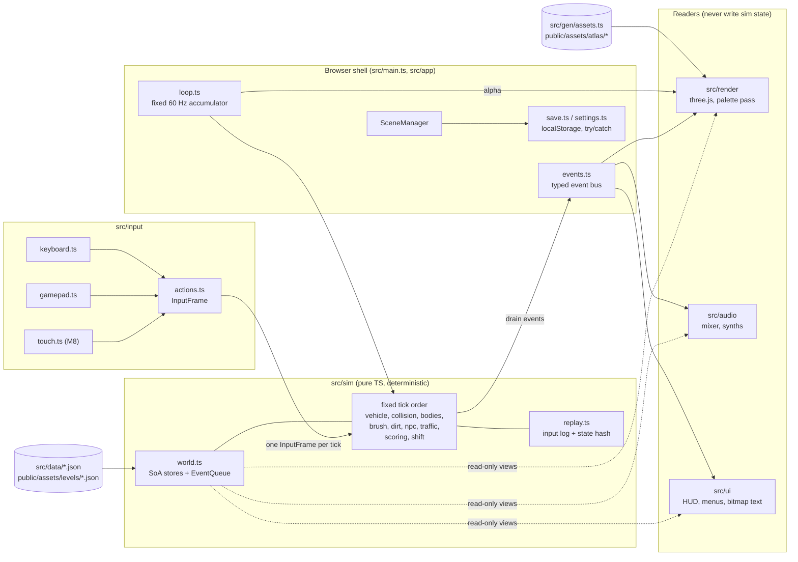
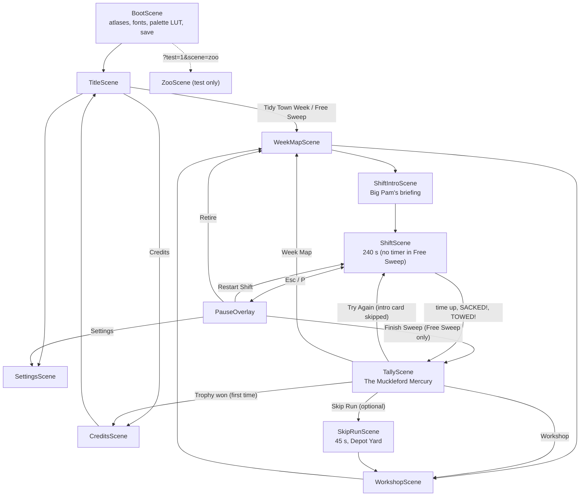
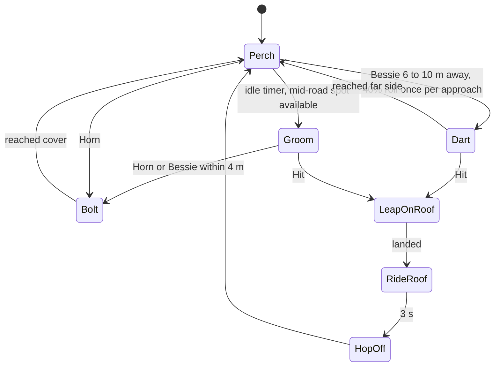
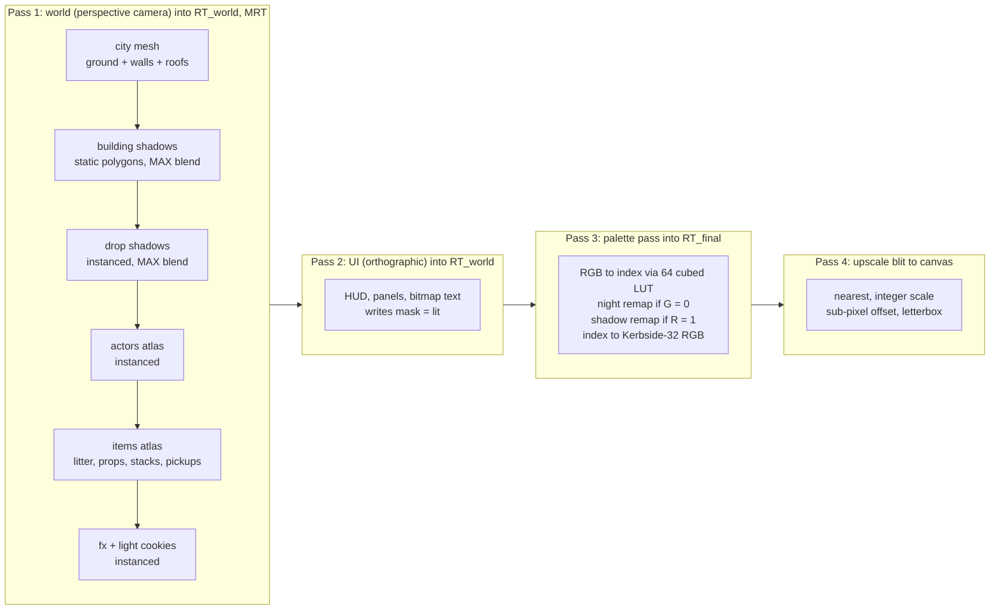

# Street Sweeper Pro: Technical Design

> **Status:** v1.0 (2026-10-18). Owner: engineering. Binding for M0–M7.
> **Source of truth for numbers:** the canonical facts sheet. Game rules live in [GDD.md](GDD.md), asset tooling in [ASSET_PIPELINE.md](ASSET_PIPELINE.md), visual rules in [ART_BIBLE.md](ART_BIBLE.md), audio in [AUDIO_DESIGN.md](AUDIO_DESIGN.md), map authoring in [LEVEL_DESIGN.md](LEVEL_DESIGN.md), per-entity stats in [ENTITY_CATALOG.md](ENTITY_CATALOG.md), schedule in [ROADMAP.md](ROADMAP.md). The stack decision record is [adr/0001-tech-stack.md](adr/0001-tech-stack.md). Terms are defined in [GLOSSARY.md](GLOSSARY.md).
>
> This document covers **how the game is built**: what runs, in what order, in which module, with which data, and how we prove it still works. Anything once marked **TBD (M0 spike)** was decided by the M0 *Foundations & Look Spike* and recorded in [ROADMAP.md](ROADMAP.md); none remain since M0 closed (SSP-027).

---

## Contents

1. [Stack and pinned versions](#1-stack-and-pinned-versions)
2. [Directory layout](#2-directory-layout)
3. [Architecture overview](#3-architecture-overview)
4. [Coordinate systems and units](#4-coordinate-systems-and-units)
5. [Game loop and fixed timestep](#5-game-loop-and-fixed-timestep)
6. [Scenes](#6-scenes)
7. [Simulation core](#7-simulation-core)
8. [Vehicle model](#8-vehicle-model)
9. [Collision](#9-collision)
10. [Brush, LitterField, grime and hopper](#10-brush-litterfield-grime-and-hopper)
11. [NPC and traffic behaviour](#11-npc-and-traffic-behaviour)
12. [Rendering pipeline](#12-rendering-pipeline)
13. [Input abstraction](#13-input-abstraction)
14. [Audio engine integration](#14-audio-engine-integration)
15. [Map data format](#15-map-data-format)
16. [Save data and settings](#16-save-data-and-settings)
17. [Performance budgets](#17-performance-budgets)
18. [Testing strategy](#18-testing-strategy)
19. [CI](#19-ci)
20. [Build and deploy](#20-build-and-deploy)
21. [Coding conventions](#21-coding-conventions)

---

## 1. Stack and pinned versions

**Decision:** three.js + TypeScript + Vite, rendering with a **perspective camera looking straight down** into a low-res, palette-mapped render target. The core is deliberately lean: we write our own collision code and audio mixer, and defer everything else until a game feature needs it. The reasoning, the judges' vote and the rejected alternatives (Phaser, Godot, PixiJS, Rapier as core physics, Howler/Tone.js and others) are in [adr/0001-tech-stack.md](adr/0001-tech-stack.md).

### 1.1 Versions (exact pins, verified 2026-10-18)

| Area | Package / tool | Version |
|---|---|---|
| Runtime / package manager | Node.js + npm (`package-lock.json`) | Node **24.21.0**, npm **11.19.0** |
| Language | TypeScript, strict (verified with Vite, Vitest and Biome in M0, [D-10](ROADMAP.md#8-m0-spike-decision-log); fallback pin **6.0.3** if a tool breaks) | **7.0.2** |
| Renderer | `three` | **0.186.1** |
| Types | `@types/three` | **0.186.0** |
| Build / dev server | `vite` | **8.3.4** |
| Unit / sim tests | `vitest` | **5.0.5** |
| Property tests | `fast-check` | **4.10.2** |
| E2E / visual | `@playwright/test` (Chromium) | **1.64.1** |
| Image diff | `pixelmatch` | **8.0.0** |
| PNG I/O (tests, tools) | `pngjs` | **7.0.0** |
| Lint + format | `@biomejs/biome` | **2.5.15** |
| SFX synthesis | `zzfx` (reference for vendored `buildSamples`; not imported in Node) / `jsfxr` | **1.4.0** / **1.4.1** |
| Node types (for `tools/**` and Vitest under `tsc --noEmit`) | `@types/node` | **24.19.2** |
| Asset forge | Python via uv; numpy, Pillow, pytest | Python **3.13.15**, uv **0.12.23**, numpy **2.5.4**, Pillow **13.0.0**, pytest **9.1.1** |
| 3D pre-render (local only) | Blender | **5.2.2 LTS** at `/Applications/Blender.app/Contents/MacOS/Blender` |
| Image generation (local only) | Codex CLI (primary) / Cursor Agent CLI (fallback, concept only) | **codex-cli 0.160.1** / **2026.10.16-e3cb207** |
| Audio encoding | ffmpeg (Homebrew) | **9.0.2** at `/opt/homebrew/bin/ffmpeg` |
| Desktop wrapper (M9, deferred) | `@tauri-apps/cli` | **2.12.3** |
| Physics escape hatch (**not installed**) | `@dimforge/rapier2d-deterministic-compat` | **0.21.0** |
| itch.io uploader (M7, **not installed yet**) | butler | latest at M7 |

All npm dependencies are pinned with exact versions (no `^` or `~`) in `package.json`, and `npm ci` is the only install command used in CI. Bun 1.4.2 is installed on the dev machine but **not used**: one runtime avoids drift.

### 1.2 Stack-wide consequences

| Rule | Why | Consequence in code |
|---|---|---|
| TS tools run natively on Node 24 type stripping (`node tools/audio/render-sfx.ts`) | No tsx, no build step for tools | `tsconfig.json` sets `erasableSyntaxOnly: true`: **no `enum`, `namespace` or parameter properties**. Use `as const` objects plus union types. |
| JSON for every data file (manifest, levels, tuning, palette, songs, SFX) | Neither TS nor Python needs a parser dependency | JSON imports use import attributes: `import tuning from '../data/tuning.json' with { type: 'json' }` (works in Vite and in Node). |
| Hand-written `sfc32` PRNG in `src/sim/rng.ts` | Deterministic, tiny, fast, seedable | No seedrandom, simplex-noise or pure-rand. The forge uses `numpy.random.Generator(PCG64(seed))`; the two never need to agree. |
| `WebGLRenderer` (WebGL2), not `WebGPURenderer` | Headless SwiftShader visual tests, Safari parity, MRT and `Data3DTexture` are mature on WebGL2 | Revisit after 1.0 only if a measured need appears. |
| Blender and image generation never run in a build or in CI | Reproducibility (pillar 5) | Their outputs are committed **golden** sources. See [adr/0002-ai-authored-asset-pipeline.md](adr/0002-ai-authored-asset-pipeline.md). |

---

## 2. Directory layout

The layout is canonical. New top-level directories need an ADR.

```
/
├─ index.html  package.json  package-lock.json  tsconfig.json  biome.json
├─ vite.config.ts  vitest.config.ts  playwright.config.ts  .gitignore
├─ README.md  CLAUDE.md
├─ src/
│  ├─ main.ts
│  ├─ app/        Game.ts, loop.ts (fixed 60 Hz accumulator, max 5 steps/frame, render interpolation),
│  │              SceneManager.ts, events.ts (typed event bus), save.ts, settings.ts
│  ├─ scenes/     BootScene, TitleScene, WeekMapScene, WorkshopScene, ShiftIntroScene, ShiftScene,
│  │              SkipRunScene, TallyScene (Mercury), PauseOverlay, SettingsScene, CreditsScene, ZooScene (test)
│  ├─ sim/        PURE TS, with no three/DOM/Date/Math.random:
│  │              rng.ts, constants.ts, fmath.ts, coords.ts, inputFrame.ts, world.ts, map.ts, vehicle.ts,
│  │              collision/{obb,sat,grid,sweep}.ts,
│  │              bodies.ts (knockables), litter.ts (LitterField spatial hash), brush.ts, dirt.ts,
│  │              hopper.ts, water.ts, npc/{steering.ts, behaviours/<npc>.ts}, traffic.ts,
│  │              scoring.ts, combo.ts, complaints.ts, shift.ts, replay.ts, tuning.ts
│  ├─ render/     Renderer.ts, camera.ts, cityMesh.ts, groundLayer.ts, spriteBatch.ts, spriteStack.ts,
│  │              shadows.ts, palettePass.ts, upscale.ts, fx.ts
│  ├─ audio/      mixer.ts, sfx.ts, music.ts, engineSynth.ts, brushSynth.ts, unlock.ts
│  ├─ input/      actions.ts, keyboard.ts, gamepad.ts, touch.ts
│  ├─ ui/         bitmapText.ts, hud.ts, panels.ts, menus.ts, minimap.ts, popups.ts
│  ├─ data/       tuning.json, entities.json, upgrades.json, districts.json
│  ├─ gen/        assets.ts (GENERATED, committed)
│  └─ debug/      devPanel.ts, testHooks.ts
├─ assets-src/
│  ├─ STYLE.md  manifest.json
│  ├─ _probe/   (asset-probe artefacts copied 2026-10-18; git-tracked, not in the manifest)
│  ├─ palette/kerbside32.json
│  ├─ sprites/{npc,litter,prop,pickup,ui,facade}/*.sprite.txt
│  ├─ fonts/*.glyphs.txt
│  ├─ procedural/{tiles,roofs,facades,stains,fx}/*.json
│  ├─ blender/{rig.py, vehicles/*.py, props/*.py, roofkit/*.py}
│  ├─ rendered/<asset-id>/{h00..h31.png, render.json}     (committed Blender goldens)
│  ├─ ai/{_style_preamble.md, <asset-id>/{prompt.md, meta.json, golden.png, refs/}}
│  ├─ levels/<district>.{map.txt,level.json}
│  └─ audio/{sfx/*.json, music/*.song.json, amb/*.json}
├─ tools/
│  ├─ forge/      pyproject.toml, uv.lock, forge/{__main__,build,ingest,pixelize,palette,outline,
│  │              pack,lint,sheets,blender,genai}.py, forge/procedural/*.py, tests/
│  ├─ audio/      render-sfx.ts, render-music.ts, synth/*.ts, wav.ts
│  └─ levels/     compile-level.ts
├─ public/assets/ atlas/, fonts/, art/, audio/{sfx,music}/, levels/, asset-hashes.json   (GENERATED, committed)
├─ tests/
│  ├─ unit/       *.test.ts (Vitest)
│  ├─ property/   *.prop.test.ts (fast-check)
│  ├─ replay/     replays/*.json + replay.test.ts
│  ├─ visual/     *.spec.ts + __goldens__/*.png (Playwright)
│  └─ e2e/        smoke.spec.ts, perf.spec.ts
├─ docs/
└─ build/         (git-ignored: .forge-cache, sheets, ai-candidates, tmp)
```

`.gitignore`: `node_modules/`, `dist/`, `build/`, `test-results/`, `playwright-report/`, `tools/forge/.venv/`. A nested `tools/forge/.gitignore` additionally ignores `__pycache__/` and `.pytest_cache/` (Python bytecode and pytest cache written when the forge and its tests run).

**Additions this document makes to the sim layout:**

- `src/sim/fmath.ts`, a thin wrapper for the transcendental maths the sim uses (`sin`, `cos`, `tan`, `atan2`, `exp`, `sqrt`, `hypot`). `tan` joined the list in SSP-028 because the vehicle yaw step uses `tan(δ)` ([§8.2](#82-per-tick-integration-phase-2)). See [§7.4](#74-determinism).
- `src/sim/coords.ts`, the [§4](#4-coordinate-systems-and-units) conventions as allocation-free helpers: heading → forward/right vectors (into a caller-supplied out object), heading → vehicle frame index (`h00`–`h31`), heading → 8-way actor direction, metres → tile and grime cell (SSP-028).
- `src/sim/inputFrame.ts`, the `InputFrame` type and its `BUTTON`/`PRESSED` bit constants ([§13.1](#131-actions-and-the-inputframe)). It lives in the sim because `src/input` may import only this type from `src/sim` ([§2.1](#21-who-may-import-whom)) (SSP-028).
- `src/sim/base64.ts`, pure RFC 4648 base64 for the compiled-level grid layers ([§15.2](#152-compiled-schema-v1)). The sim runs in the browser and on Node type stripping, so it uses neither Node's `Buffer` nor the DOM's `atob`/`btoa` (SSP-032).

### 2.1 Who may import whom

| Module | May import | Must not import |
|---|---|---|
| `src/sim/**` | `src/sim/**`, `src/data/*.json` (via `tuning.ts` only), `src/gen/assets.ts` (types only) | `three`, any DOM API, `src/app`, `src/render`, `src/audio`, `src/ui`, `src/input` |
| `src/render/**` | `three`, `src/sim` (read-only types and state views), `src/gen` | `src/audio`, `src/ui` internals |
| `src/audio/**` | WebAudio, `src/sim` (read-only), `src/app/events.ts` | `three` |
| `src/ui/**` | `src/render/spriteBatch.ts`, `src/sim` (read-only), `src/app/events.ts` | direct sim mutation |
| `src/input/**` | DOM, `src/sim` (the `InputFrame` type only) | everything else |
| `src/app/**`, `src/scenes/**` | everything | none (composition root) |
| `tools/**` | `src/sim/**` and `src/data/**` (the level compiler reuses `map.ts`), Node built-ins | `three`, `src/render` |

The sim rule is **enforced**, not advisory: see [§21.3](#213-enforced-rules).

---

## 3. Architecture overview

### 3.1 Module diagram



### 3.2 Core principles

1. **A run is a pure function:** `run = f(seed, district, inputLog)`. Everything that affects gameplay is in `src/sim`, and everything in `src/sim` is deterministic.
2. **One-way data flow.** Input → sim → (state views + events) → render, audio, UI. Readers never write sim state. If the UI needs to change something (for example "buy upgrade"), it calls a command on the **meta layer** (`save.ts`, Workshop logic), never inside a running shift.
3. **No ECS library.** Each entity kind has a typed struct-of-arrays store. Engine code is written only when a feature needs it.
4. **Data-driven numbers.** Every gameplay constant lives in `src/data/tuning.json` or `src/data/entities.json`. Code holds no magic numbers except unit conversions (`PX_PER_M = 16`) in `src/sim/constants.ts`.
5. **Generated code is a compile-time contract.** `src/gen/assets.ts` exports the `FRAME` const plus `FrameId`/`AssetId` unions, so referencing a missing sprite is a type error.

---

## 4. Coordinate systems and units

Getting this wrong once costs a week, so it is fixed here and asserted in unit tests.

| Space | Origin | Axes | Units |
|---|---|---|---|
| **Sim world** | NW corner of the district map | **+x east, +y south** (rows of the ASCII map grow downward) | metres, seconds, radians |
| **Tile** | NW corner | col = `floor(x / 2)`, row = `floor(y / 2)` | 2 m tiles (32 px) |
| **Grime cell** | NW corner | `cx = floor(x / 0.25)`, `cy = floor(y / 0.25)` | 0.25 m (4 px) |
| **Render (three.js)** | same as sim | `render.x = sim.x`, `render.z = sim.y`, buildings extrude along **+Y** | metres |
| **Vehicle local** | body centre | **+y forward**, +x right | metres (the brush geometry in [§10.1](#101-brush-hitbox) uses this) |
| **Internal screen** | top-left of the W×270 frame | +x right, +y down | internal pixels |

- **Heading** `θ`: radians, **0 = north (screen up), increasing clockwise** (compass convention). Forward vector in sim space: `(sin θ, −cos θ)`. Right vector: `(cos θ, sin θ)`.
- **Vehicle sprite frame** = `((round(θ / (2π/32)) % 32) + 32) % 32` → `h00`…`h31`. This matches the Blender rig: `h00` faces north, stepping 11.25° clockwise.
- **Actor direction** (8-way) = `round(θ / (π/4)) mod 8` → `n, ne, e, se, s, sw, w, nw`.
- **Camera:** positioned at `(x, H, z)`, looking at `(x, 0, z)` with `camera.up = (0, 0, −1)`. Screen up is then −Z = north and screen right is +X = east. Nothing is mirrored.
- **Pixel ↔ metre:** `PX_PER_M = 16`. Ground is 1 texel = 1 px at H = 31.5 m, to within 0.03% (see [§12.2](#122-camera-rendercamerats)).

---

## 5. Game loop and fixed timestep

### 5.1 Loop

`src/app/loop.ts` runs a fixed **60 Hz** simulation (`DT = 1/60` s) behind a variable-rate renderer. It is the only place outside `src/debug` that reads `performance.now()`.

```ts
const DT = 1 / 60;
const MAX_STEPS = 5;     // per rendered frame
const MAX_FRAME = 0.25;  // s; clamp after tab switches and breakpoints

let acc = 0;
let last = performance.now();

function frame(nowMs: number): void {
  let ft = (nowMs - last) / 1000;
  last = nowMs;
  if (ft > MAX_FRAME) ft = MAX_FRAME;
  acc += ft;

  let steps = 0;
  while (acc >= DT && steps < MAX_STEPS) {
    const input = actions.sampleForTick();   // latched edges, see §13
    scenes.fixedUpdate(input);               // ShiftScene → sim.step(input)
    events.drain(sim.world.events);          // dispatch to audio/UI/render
    acc -= DT;
    steps++;
  }
  if (steps === MAX_STEPS && acc > DT) acc = DT; // drop backlog: slow down, never spiral

  scenes.render(acc / DT);                   // alpha in [0, 1) for interpolation
  requestAnimationFrame(frame);
}
```

| Rule | Value / behaviour |
|---|---|
| Sim rate | 60 Hz fixed, independent of the display (60, 120 and 144 Hz monitors all run 60 ticks/s) |
| Max sim steps per frame | 5. Below 12 fps the game runs in slow motion instead of freezing. |
| Render interpolation | Sim stores `prevX/prevY/prevHeading` per entity, copied at the start of each tick with `TypedArray.set`. The renderer lerps with `alpha` (angles take the shortest arc). |
| Time in the sim | An integer **tick counter**. A shift is 240 s = **14,400 ticks**; the timer is `ticksRemaining`, never a float. |
| Tab hidden | `visibilitychange` → the ShiftScene opens the PauseOverlay. The loop keeps running for menus but the accumulator is reset on resume. |
| Test mode | With `?test=1&freeze=1` the loop renders but never steps; `window.__ssp.step(n)` advances the sim synchronously ([§18.5](#185-test-hooks)). |

### 5.2 Fixed tick order

`World.step(input)` runs these phases in this order every tick. The order is canonical: changing it changes replay hashes and must be called out in the PR.

| # | Phase | Module(s) | Notes |
|---|---|---|---|
| 1 | Input | `world.ts` | Copy the `InputFrame` into the sim; append it to the replay log |
| 2 | Vehicle | `vehicle.ts`, `hopper.ts` | Steering, drive, drag, grip, handling scaled by hopper fill |
| 3 | Static collision | `collision/{obb,sat,grid,sweep}.ts` | OBB vs grid AABB with SAT, sub-stepped when speed > 0.5 tile/tick |
| 4 | Knockable bodies | `bodies.ts` | Bins, cones, A-boards, trolleys, recycling boxes |
| 5 | Brush / litter | `brush.ts`, `litter.ts`, `water.ts` | Gutter, suction, inlet, fling, spray, collection |
| 6 | Dirt | `dirt.ts` | Grime footprint erase, stain cleaning, dust |
| 7 | NPC AI | `npc/steering.ts`, `npc/behaviours/*.ts` | FSMs, perception, reactions |
| 8 | Traffic | `traffic.ts` | Lane graph followers, blocking timers |
| 9 | Scoring / combo / complaints | `scoring.ts`, `combo.ts`, `complaints.ts` | Consume this tick's gameplay facts |
| 10 | Shift timer | `shift.ts` | Countdown, SACKED/TOWED/time-up transitions |
| 11 | Emit events | `world.ts` | Seal the `EventQueue` for this tick |

*As implemented (SSP-035, `src/sim/world.ts`):* `createWorld(level, seed, tuning)` builds the World; `world.step(input)` (the same as `stepWorld(world, input)`) resets the event queue, runs the eleven phases above and increments the integer `tick`. The `Phase` const numbers them 1–11. `world.phaseTrace` is an optional callback, `null` by default, called with the phase number at the start of every phase (the tick-order test uses it). `world.recordInput` is the phase-1 hook that SSP-038's replay recorder fills. In M1, phase 2 is real, phase 3 is a call site for SSP-036, and phases 4–10 are empty functions called in order, each named after the issue that fills it.

---

## 6. Scenes

### 6.1 SceneManager

`SceneManager` holds a **stack** of scenes. The top scene receives input; scenes below it keep rendering (so `PauseOverlay` draws over a frozen `ShiftScene`). Each scene implements:

```ts
interface Scene {
  readonly id: SceneId;                       // 'boot' | 'title' | ... | 'zoo'
  enter(params: SceneParams): Promise<void>;  // async asset loads happen here
  exit(): void;                               // release GPU resources and audio nodes
  fixedUpdate(input: InputFrame): void;       // 60 Hz
  render(alpha: number): void;                // per display frame
  readonly blocksUpdateBelow: boolean;        // true for PauseOverlay
}
```

### 6.2 Scene flow

This diagram mirrors [GDD §15.1](GDD.md#151-scene-flow), which owns the flow; the GDD diagram and this one change together.



`ZooScene` lays out every frame from `FRAME` in a grid at 1:1 for the `zoo` visual golden and for contact-sheet review in-engine (see [ASSET_PIPELINE.md](ASSET_PIPELINE.md)).

### 6.3 Loading

| Asset | When loaded | Size class |
|---|---|---|
| `ui`, `actors`, `items`, `fx` atlases, fonts, palette | BootScene | ≤ 2048² PNG each |
| `world` atlas | BootScene | ≤ 2048² PNG |
| `public/assets/levels/<district>.json` | ShiftIntroScene (while the briefing card is shown) | tens of KB |
| District music stems + ambience bed | ShiftIntroScene, decoded in the background | 1–3 MB |
| SFX | BootScene (all are short) | < 500 KB total |

---

## 7. Simulation core

### 7.1 World and stores

`World` (`src/sim/world.ts`) owns all mutable shift state. Each entity kind has a fixed-capacity **struct-of-arrays** store allocated once at shift start from the budgets in [§17](#17-performance-budgets):

```ts
// src/sim/world.ts (shape, abridged)
export type NpcStore = {
  count: number;
  readonly kind: Uint8Array;        // index into entities.json npc table
  readonly state: Uint8Array;       // behaviour state id (per-kind const object)
  readonly stateTicks: Uint32Array; // ticks since entering state
  readonly x: Float64Array; readonly y: Float64Array;
  readonly prevX: Float64Array; readonly prevY: Float64Array;
  readonly heading: Float64Array; readonly speed: Float64Array;
  readonly targetNode: Int32Array;  // pavement nav graph node, -1 = none
  readonly swap: Uint8Array;        // ramp-swap index (outfit) for the renderer
  readonly flags: Uint16Array;      // FALLEN, ON_ROOF, YIELDING, ...
};
```

- Sim state uses **`Float64Array`** (JS numbers are doubles, so there is no `Math.fround` noise). Render instance buffers are `Float32Array`.
- Removal is **swap-remove** with the last live slot. Entity identity across ticks, where needed (for example "the dog belongs to this walker"), uses a generation-checked handle `(index, gen)`.
- Capacities: litter 2,000, NPCs 80, vehicles 30, knockables 128, hazards 64, stains 256, pickups 16. Exceeding a capacity is a level-authoring error caught by `compile-level.ts` and by the replay invariants.
- *M1 contents (SSP-035):* the decoded `Level` (grids), the `Tuning` it was given, the uint32 `seed`, the integer `tick`, its own copy of this tick's `InputFrame`, Bessie's `VehicleState` and `VehicleParams`, the surface sample phase 2 used (`surface`: k and rollMult), the `EventQueue`, and preallocated scratch (surface table, kerb crossings). Bessie spawns at `level.player` (body centre, heading). Render, audio and UI take `viewWorld(world)`, a `WorldView` that is the same object typed read-only (nothing is copied). The base hopper capacity (100 LU, GDD §8.4) is a constant in `world.ts` until SSP-058 moves it into `tuning.json`; only the fill fraction reaches the handling and the hopper stays empty in M1.

### 7.2 Event queue

The sim never calls out. Each tick it appends facts to a preallocated `EventQueue` (struct-of-arrays ring, 512 events per tick):

| Field | Type | Example |
|---|---|---|
| `type` | `Uint16` | `EV.LitterCollected`, `EV.Fling`, `EV.Impact`, `EV.NpcHit`, `EV.Complaint`, `EV.ComboTier`, `EV.HopperFull`, `EV.DumpStart`, `EV.Horn`, `EV.ShiftEnd` |
| `entity` | `Int32` | store index or −1 |
| `a`, `b`, `c` | `Float64` | position x/y, magnitude (impact speed, points, combo tier) |

*As implemented (SSP-035, `src/sim/eventQueue.ts`):* `EVENTS_PER_TICK = 512`. The `EV` ids are hashed into replays, so new types are appended, never renumbered; 0 is never a type. M1 defines four (`entity` is −1 for Bessie):

| `EV` | id | `a`, `b`, `c` | Emitted by |
|---|---|---|---|
| `Impact` | 1 | contact x, y; normal speed vn | phase 3 (SSP-036) |
| `KerbJolt` | 2 | crossing point x, y on the kerb edge; \|vLong\| just before the crossing | phase 2, each axle crossing ([§8.2](#82-per-tick-integration-phase-2) step 9) |
| `ReverseBeeper` | 3 | Bessie's x, y; 0 | phase 2, once per engagement of REV |
| `ShiftEnd` | 4 | reason (`ShiftEndReason.Towed` = 1; SSP-062 appends the others); 0; 0 | TOWED stub (SSP-036) |

Lifecycle: the World calls `resetEvents` before phase 1 (the queue is empty and unsealed when phase 1 runs), systems emit during phases 1–10, and phase 11 calls `sealEvents`. Readers see the sealed queue (`count` events from index 0, in emission order, as `ReadonlyEventQueue`) until the next step. An emit after the seal, or a 513th emit in one tick, throws a descriptive error in every build (the sim cannot read `import.meta.env`). Per-tick sim code emits with `emitEvent(queue, type, entity)`, which returns the slot index for the caller to write `a`/`b`/`c` into: it takes no doubles, so it never allocates even when V8 does not inline it ([§17](#17-performance-budgets)). `pushEvent(queue, type, entity, a, b, c)` is the convenience form for tests and cold paths.

`src/app/events.ts` drains the queue after each tick and dispatches strongly typed events to subscribers (`audio/sfx.ts`, `ui/popups.ts`, `render/fx.ts`). Scoring reads the same facts **inside** the sim during phase 9; the bus is for presentation only. Events are part of the replay hash input, so "the same run produces the same sounds" is tested for free.

### 7.3 Randomness

- `sfc32` per subsystem, seeded as `sfc32(seed ^ hash32(streamName))` ([LEVEL_DESIGN §9](LEVEL_DESIGN.md#9-spawn-rules)). **Each subsystem gets its own stream**: `litter`, `grime`, `stains`, `hazards`, `npc`, `traffic`, `events`, `brush`, `weather`. Adding a new NPC type therefore never reshuffles litter spawns.
- **sfc32** is the PractRand 0.95 reference by Chris Doty-Humphrey (`src/RNGs/sfc.cpp`): four uint32 words `a, b, c, counter`; the shift constants are 21/9/3. `sfc32(seed)` uses PractRand's `seed(Uint64)` with the 32-bit game seed zero-extended (`a = 0`, `b = seed`, `c = 0`, `counter = 1`, then 12 discarded rounds). `tests/unit/rng.test.ts` holds known-answer vectors produced by compiling the reference. Helpers: `nextU32`, `nextFloat` (`u32 / 2^32`, in [0, 1)), `nextRange` and `nextInt(n)` (multiply-shift, exact for n ≤ 2^21). All are allocation-free; generator state is a plain `{ a, b, c, counter }` object.
- **`hash32`** (decided in SSP-028) is **FNV-1a 32-bit over the UTF-8 bytes** of the stream name: offset basis `0x811c9dc5`, prime `0x01000193`. It is the same family as the replay state hash ([§18.3](#183-deterministic-replay-tests)) and is encoded by hand, so it needs no `TextEncoder`. Each stream's seed depends only on the run seed and its own name, so adding a stream never reshuffles another. The stream list is the `RNG_STREAMS` const in `src/sim/rng.ts`; new streams are appended there and here.
- Presentation randomness (particle jitter, SFX variant choice, pitch jitter) uses a **separate render-side `sfc32`** and never touches sim streams.
- Daily Shift (M9) seed = UTC date `YYYYMMDD` as an integer.

### 7.4 Determinism

- **Contract:** the same build, seed, district and input log gives the same final-state hash on Node 24 (CI) and on Chromium (dev). Replay hashes use state quantised to **1e-4**.
- **Banned in `src/sim`:** `Math.random`, `Date`, `performance`, `setTimeout`, iteration over objects with numeric-looking keys, `Array.prototype.sort` with a comparator that can return 0 for distinct entities (use an id tiebreak), and any read of render or camera state.
- **Transcendentals:** ECMAScript does not require `Math.sin`/`exp`/`atan2` to be bit-identical across engines. All sim code calls them through `src/sim/fmath.ts`, which exports `sin`, `cos`, `tan`, `atan2`, `exp`, `sqrt` and `hypot` (two-argument). `tan` was added in SSP-028 for the vehicle yaw step's `tan(δ)` ([§8.2](#82-per-tick-integration-phase-2)). The sim purity scan fails if any other `src/sim` file touches `Math.sin|cos|tan|atan2|exp|sqrt|hypot` directly ([§18.1](#181-unit-tests-examples)); a sim feature that needs another non-exact `Math` function adds it to `fmath.ts`, to this list and to the scan. Version 1 forwards to `Math.*` (Node and Chromium are both V8). Measured in SSP-031: V8's `Math.hypot` boxes its result on every call even in optimised code (~32 B), so per-tick hot paths use `sqrt(x * x + y * y)` instead. If cross-engine replays are ever needed (shared ghosts, Firefox/Safari replay checks), `fmath.ts` swaps to fixed polynomial approximations in one file.
- **Off-screen logic:** the sim never reads the render camera. Rules such as "spawn traffic off-screen" use `world.viewRect`, a deterministic proxy: the sweeper's position plus look-ahead, expanded to ±(24.0 + 4) × ±(10.2 + 4) m, i.e. **±28 × ±14.2 m** (the widest view, at W = 640 and H = 37.8 m, is ±24.0 × ±10.13 m; the 4 m margin covers half a bus length). Spawn and despawn test the entity's full OBB, not its centre, against `viewRect`.

---

## 8. Vehicle model

Bessie (`veh.sweeper`) is a **kinematic bicycle** with a separately tracked velocity vector, so low-grip surfaces produce drift without a tyre model. All values come from `src/data/tuning.json` → `vehicle.sweeper`, which owns them since SSP-029 ([GDD §7](GDD.md#7-vehicle-handling) mirrors the handling table); the parameters used below are copied from it. `src/sim/tuning.ts` validates the JSON with hand-written guards (`loadTuning(raw: unknown): Tuning` throws an error naming the JSON path of any missing, unknown, mistyped or out-of-range value), converts degrees to radians once at load, and returns a fresh object on every call. The sim never reads the exported `DEFAULT_TUNING` implicitly: the composition root passes a `Tuning` into `createWorld(level, seed, tuning)`, so the dev panel can hand the World an edited copy.

**Wheel geometry (provisional, SSP-029, awaiting lead confirmation).** Steps 7 and 9 need the four wheel contact points and the axle midpoints, which no design doc fixes. `tuning.json` holds `body.wheelTrackM = 1.75` (wheels at the body corners, [ART_BIBLE §8.1](ART_BIBLE.md#81-bessie-vehsweeper)) and the axle midpoints at vehicle-local `body.frontAxleOffsetM = +1.2` / `body.rearAxleOffsetM = −1.2` (a symmetric 2.4 m wheelbase). They are listed in `vehicle.sweeper.provisional`, and the loader checks that the axle offsets span exactly `wheelbaseM`.

### 8.1 State

`x, y, heading, vLong, vLat, steer (δ), yawRate, gear (FWD|REV), brushDown, brushPos (0..1), rpm (0..1), hp, hopperLU, water`. `src/sim/vehicle.ts` (`VehicleState`, SSP-030) adds `prevX, prevY, prevHeading` (copied at the start of each tick for render interpolation), the derived `massKg`, the reverse-hold tick counter and the one-tick `reverseEngaged` flag. Hooks that are not state (`hopperCapacityLU`, `topSpeedMult`, `damageMult`) live in `VehicleParams`; the surface sample (`gripPerS` = k, `rollMult`) is passed in per tick.

### 8.2 Per-tick integration (phase 2)

1. **Handling scale from hopper fill** `f = hopperLU / capacity` (0..1; capacity changes with `upg.hopper`, the 1,500 kg extra mass at full does not):
   - `mass = 4200 + 1500·f`
   - `accel = 2.4 · lerp(1, 0.70, f)`, `vTop = vTopBase · lerp(1, 0.90, f)`, `steerRate = 120°/s · lerp(1, 0.85, f)`
2. **Top speed selection:** `vTopBase` = **6.0 m/s** brush down, **11.0 m/s** brush up (transit). Modifiers multiply: `pwr.bacon_butty` ×1.3, `upg.engine` ×1.1/×1.2 (transit only).
3. **Steering:** target `δ* = steerInput · 34° / (1 + |vLong| / 8)`. `δ` moves toward `δ*` at `steerRate`, or at **180°/s** when the input is centred (return).
4. **Drive:**
   - throttle: `vLong += accel · throttle · DT`, clamped to `vTop`;
   - brake: `vLong → 0` at **6.0 m/s²**;
   - reverse: brake held with `|vLong| < 0.2 m/s` for 0.25 s (proposed, [GDD §6.2](GDD.md#62-control-design-notes)) engages `REV` (max **2.5 m/s**, accel **1.5 m/s²**) and emits `EV.ReverseBeeper`.
   - *As implemented (SSP-030, `src/sim/vehicle.ts`):* inputs scale the rates (throttle/brake 0..255 → 0..1). Throttle only pushes while `vLong < vTop`; above it (brush lowered at speed, hopper filling) the engine stops pushing and drag bleeds the excess off, so speed is never snapped down. The reverse hold counts ticks that **end** below 0.2 m/s with brake held (15 ticks; releasing resets it); `state.reverseEngaged` is true only on the engaging tick, for the World to turn into `EV.ReverseBeeper`. In `REV`, brake accelerates backwards (1.5 m/s², capped at 2.5 m/s) and throttle brakes at 6.0 m/s²; throttle at `|vLong| < 0.2 m/s` returns to `FWD` at once. Hopper fill does not scale the reverse numbers. Bessie spawns in `FWD` with the brush up.
5. **Drag:** `a = 0.3·sign(v) + 0.012·v²` (rolling drag ×2.5 on grass), clamped so it never reverses the sign of `vLong`. Both terms oppose motion, so the implemented form is `a = sign(vLong)·(0.3·rollMult + 0.012·vLong²)` with `rollMult` from the caller (2.5 on grass); in reverse it slows Bessie, never speeds her up (SSP-030). Drag runs after the throttle clamp, so at full throttle the end-of-tick speed settles at `vTop − drag(vTop)·DT` (6.0 − 0.012, 11.0 − 0.029 m/s).
6. **Yaw:** `yawRate = vLong / 2.4 · tan(δ)` (wheelbase 2.4 m; minimum turning circle about 7 m). `heading += yawRate · DT`.
7. **Grip:** re-express the previous world velocity in the new heading frame. The longitudinal part becomes `vLong`; the lateral part decays: `vLat *= exp(−k · DT)`. `k` is the average lateral grip under the four wheel contact points:

   | Surface | k (/s) |
   |---|---|
   | asphalt | 9.0 (6.0 on all roads when it rains in `district.gasworks`) |
   | pavement | 8.0 |
   | grass | 5.0 |
   | wet / puddle | 4.0 |
   | wet leaves | 3.0 |
   | oil | 1.2 |

   `upg.tyres` multiplies all values by 1.15. Surfaces come from the tile surface grid, overridden by hazard footprints (`haz.oil_slick`, `haz.puddle`, `haz.wet_leaves`).

   *As implemented (SSP-035, `src/sim/surface.ts`):* before `stepVehicle`, the World samples the `surface` layer under the four wheel contact points of the pose the tick starts from, at vehicle-local (±`wheelTrackM`/2, `frontAxleOffsetM`) and (±`wheelTrackM`/2, `rearAxleOffsetM`) (the provisional geometry above). `k` is the mean of the four grips and `rollMult` is the **mean of the four per-wheel multipliers** (2.5 on grass, 1 elsewhere), so two wheels on the verge give 1.75. Averaging rather than a majority vote was SSP-035's proposal: it keeps the drag change continuous as Bessie rolls onto grass; it awaits lead review. Points outside the map read as void, which takes asphalt grip. The hazard overrides (SSP-093) and the rain switch to `rainAsphalt` are later hooks.
8. **Position:** `pos += (forward · vLong + right · vLat) · DT` (semi-implicit Euler). `pos` is the **rear-axle midpoint** (`body.rearAxleOffsetM`), the kinematic reference point of the bicycle model, and the stored body centre `x, y` is rebuilt from it with the new heading (SSP-030). The rear axle therefore traces radius `wheelbase / tan δ` with no slip, which is the turning circle [§18.1](#181-unit-tests-examples) measures; integrating the body centre instead would put the rear axle on a circle about 0.4 m wider in diameter. Heading is not wrapped, so `prevHeading → heading` interpolates without a seam.
9. **Kerb crossing:** when the **front axle** midpoint crosses a road ↔ pavement edge, `vLong *= 0.7` and `EV.KerbJolt` fires. The rear axle crossing fires the jolt event (shake and `sfx.bump_kerb`) without the speed loss.
   - *As implemented (SSP-035, `src/sim/kerb.ts`, `world.ts`):* runs in phase 2 after `stepVehicle`. Each axle midpoint's segment runs from the tick's starting pose (`prevX/prevY/prevHeading`) to the integrated pose and is walked through the 2 m tile grid in crossing order (grid DDA). An edge is a raised kerb when either cell beside it carries the `KERB_EDGE` bit for that side; dropped kerbs carry none and do nothing. A point exactly on an edge belongs to tile `floor(x / 2)`, so the walk takes exactly |Δcol| + |Δrow| steps, and a segment through a tile corner crosses the column edge first. Every raised edge the front axle crosses keeps `kerb.speedKeepMul` (0.7) of `vLong` and emits `EV.KerbJolt`; every one the rear axle crosses emits `EV.KerbJolt` only. Front crossings are applied before rear ones. The loss applies to `vLong` only, after drag, so it is visible the moment the tick ends (5 m/s with no drag → 3.5 m/s).
10. **Scripted impulses:** banana skin with the brush up adds a 180° spin-out (`yawRate` impulse over 0.6 s); potholes and speed bumps spill LU and emit events.

### 8.3 Brush mechanics state

- Raise/lower takes **0.5 s** (`brushPos` 0↔1). RPM spins up over **0.6 s**.
- **Collecting requires `brushPos == 1 && rpm >= 0.8`.** The same condition gates the grime footprint.

---

## 9. Collision

Hand-written, synchronous, deterministic. Rapier2D stays a documented escape hatch, not a dependency.

### 9.1 Static world

- `compile-level.ts` produces a per-cell **collision grid** (`Uint8`: `SOLID`, `KERB_EDGE_N/E/S/W` bits, surface type in a parallel grid) and merges solid cells into **maximal rectangles** (greedy merge). Merging removes the internal edges that cause "ghost" snagging when sliding along a terrace. The bit constants (`COLLIDE`) and the merge (`mergeSolids`) live in `src/sim/map.ts`, shared by the compiler, static collision and the property tests: in fixed row-major order, the first unclaimed SOLID cell grows right as far as it can, then down while the whole span stays SOLID, so the rects cover the SOLID cells exactly, never overlap and come out in the same order every time.
- Static props (`prop.lamp_post`, `prop.bollard`, `prop.bench`, `prop.bus_shelter`, `prop.phone_box`, `prop.post_box`, `prop.hydrant`, `prop.tree`, `prop.planter`, `prop.market_stall`, `prop.litter_bin`, `prop.roadworks_barrier`) are OBBs or circles registered in `collision/grid.ts` buckets (one bucket per tile).
- Parked vehicles (`veh.<type>_parked`) are static OBBs. Denting one costs −100 and 5 HP.

### 9.2 Vehicle vs static (phase 3)

1. Build Bessie's OBB (1.75 × 3.25 m) at the integrated pose.
2. **Sub-step** when the per-tick displacement exceeds 0.5 tile (1.0 m): split into `ceil(d / 1.0)` steps. *(At every speed in the game, including Bacon Butty and Engine L2, which give about 0.29 m/tick, Bessie needs one step. The rule exists for knockables and for safety.)*
3. Query the grid cells overlapped by the OBB's AABB, gather solid rects and static props.
4. **SAT** for each candidate: 2 OBB axes + 2 world axes for rects (or the closest-point axis for circles). Keep the minimum-penetration axis.
   - **MTV sign convention** (`collision/sat.ts`, SSP-031): the returned unit normal points **from the obstacle toward the OBB**, so moving the OBB centre by `normal × depth` pushes it out and leaves the shapes exactly touching. Touching (zero penetration) is not an overlap. Ties go to a fixed axis order (world x, world y, OBB right, OBB forward), so results are deterministic. A circle whose centre is inside the box leaves through the shallower face.
   - The primitives write into caller-supplied `Obb`, `Aabb`, `Contact` and `Pose` objects and never allocate per call. OBB vs OBB waits for M3 traffic and parked vehicles.
5. Resolve by the MTV (iterate up to 4 times for corners), then apply the impact response:
   - normal speed `vn` = velocity · normal; reflect with **restitution 0.2**;
   - **damage = 4 HP per m/s of `vn` above 2 m/s** (×0.6 with `upg.bumper`);
   - emit `EV.Impact { vn, x, y }` (audio picks `sfx.bump_wall` or `sfx.crash`, the renderer shakes).
6. HP ≤ 0 → `shift.ts` ends the shift with TOWED!.

### 9.3 Knockables (phase 4)

`bodies.ts` simulates `prop.wheelie_bin` (30 kg), `prop.traffic_cone` (2 kg), `prop.a_board`, `prop.shopping_trolley` and `prop.recycling_box` as circles or small OBBs with linear and angular velocity, ground friction and restitution against the static grid. Bessie is treated as an infinite-mass mover. Bodies do not stack. **Supplementary sub-step rule:** a knockable sub-steps when its displacement exceeds half its smallest extent, so a flung cone (about 0.4 m) cannot tunnel through a bollard. Spills (bin: 4 items; recycling box: 2 items) spawn litter through `litter.ts` on the first hit only.

### 9.4 Dynamic actors

| Pair | Shape | Response |
|---|---|---|
| Bessie vs NPC | OBB vs circle (human r = 0.3 m, cat 0.2 m, dog 0.25 m) | No physics push. The NPC enters `Fallen` (or the cat's `LeapOnRoof`), the penalty is applied once per contact episode, and contact is ignored for 1.5 s. |
| Bessie vs dog lead | OBB vs segment (walker → dog, up to 5 m) | Lead Tangle penalty, the dog walker goes `Angry` |
| Bessie vs traffic | OBB vs OBB (SAT) | Traffic is kinematic and stops. Bessie resolves as against static geometry, with damage. |
| Bessie vs pigeons | circle query | Never a hit: scatter + Pigeon Scatter bonus |

### 9.5 Property tests

M1 exit criterion, in `tests/property/collision.prop.test.ts`:

- *Never ends a tick inside a solid:* for random maps (fast-check generated 8×8 to 32×32 grids), random spawn poses and random 600-tick input sequences, Bessie's OBB never overlaps a solid rect by more than 1 mm at the end of any tick.
- *No tunnelling at 17.2 m/s* (transit 11 m/s × Bacon Butty 1.3 × Engine L2 1.2, the real maximum; stricter than the canonical M1 wording of 11 m/s): from random poses aimed at a 1-tile wall (and at a 0.3 m bollard) at speeds up to 17.2 m/s, the swept centre never crosses the obstacle.
- *Resolution is idempotent:* resolving an already-resolved pose changes it by < 1e-9 m.

---

## 10. Brush, LitterField, grime and hopper

### 10.1 Brush hitbox

Vehicle-local (origin at the body centre, +y forward, metres). The numbers are canonical (see [GDD.md](GDD.md)):

| Part | Shape | Behaviour per tick (when collecting) |
|---|---|---|
| Gutter brushes | Two circles, r = 0.45 m, at (±0.85, +1.75). Reach ±1.30 m; **swept width 2.6 m (≈ 42 px)** | Item velocity is pushed toward `x = 0` and slightly backward |
| Suction zone | Rect x ∈ [−1.3, 1.3], y ∈ [+1.6, +2.8] | Item pulled toward the inlet centre at **3.0 m/s × rpm × suctionMult** (`upg.suction` +25%/+50%, `pwr.super_suction` ×2) |
| Inlet | Rect 1.0 × 0.4 m centred at (0, +1.2) | Item whose centre enters is collected, unless the hopper is full |
| Grime footprint | Rect x ∈ [−1.3, 1.3], y ∈ [+1.3, +2.2] (the band the brush circles sweep) | Erases grime cells |

`upg.gutter_brooms` moves the brush centres outward by +0.15/+0.30 m per side and widens the suction zone and grime footprint to match.

```
            +y (forward)
   y=+2.8  ┌───────────────────┐
           │   suction zone    │
   y=+2.2  ├──( )─────────( )──┤   gutter brushes r=0.45 at (±0.85, +1.75)
           │                   │
   y=+1.6  └──┬───────────┬────┘
   y=+1.625   ├── body front ─┤      body 1.75 × 3.25 m
   y=+1.2     │  [ inlet ]  │       1.0 × 0.4 m
              │             │
             x=-0.875     x=+0.875
```

### 10.2 LitterField (`src/sim/litter.ts`)

- Store: `x, y, vx, vy, kind, flags (FLUNG, IN_SUCTION, PINNED), arcT, arcDur, rot`.
- **Spatial hash, 4 m cells**, rebuilt incrementally (an item re-buckets only when it crosses a cell boundary). Shared design with NPC lookup.
- **Brush query:** transform the brush AABB to world space, visit only the overlapped cells (typically 2–4), and transform each item into vehicle-local space with one rotation.
- **Fling:** the first time an item touches the brush or suction zone in a contact episode, roll `p = clamp((v − t0) / 2.0, 0, 1)` on `rng.brush`, with `t0 = 4.0 m/s` (6.0 m/s under `pwr.super_suction`). On a fling the item gets a kinematic arc **1.5–3 m sideways** (side chosen by the sign of local x). It is uncollectable until it lands. A flung `litter.glass_bottle` lands as `haz.broken_glass`.
- **Bulldozer:** at full hopper, items reaching the inlet are pinned just ahead of the front bumper and pushed along. `EV.HopperFull` fires once per fill (clunk SFX).
- **Drift:** wind and gusts (`haz.wind_gust`, Friday) apply 1.5 m/s to drifting kinds for 4 s.

### 10.3 Grime mask (`src/sim/dirt.ts`)

- Each 32 px tile holds an **8×8 grid of 4 px grime cells**. The district mask is a `Uint8Array` of `(tilesW·8) × (tilesH·8)`. Civic Quarter (128×96 tiles) is 1024×768 = 786,432 bytes.
- **Encoding:** `0` = clean or never grimy; bits 0–6 = grime intensity 1–127 (drives the overlay strength in the ground shader); **bit 7 = gutter grime** (dense strip along kerbs, 2 pts per cell).
- **Initial state:** `compile-level.ts` bakes per-cell grime scores and a gutter mask. At shift start `dirt.ts` takes exactly `grime.cells` cells by `(score desc, index asc)` using the `grime` stream ([LEVEL_DESIGN §9.2](LEVEL_DESIGN.md#92-grime)), so the initial grime count, and therefore the Tidy % denominator, is identical on every attempt.
- **Erase:** while collecting, rasterise the grime footprint (rotated rect) into cells each tick. At 6 m/s Bessie moves 0.1 m/tick and the band is 0.9 m deep, so there are no gaps. **Kerb Hugger:** a gutter brush centre within 0.2 m of a kerb edge erases gutter cells.
- **Tidy %** = `0.6 × (grime cells cleaned ÷ initial grime cells) + 0.4 × (litter collected ÷ litter spawned)`, both counted over the route area (roads + pavements) only. Counters are maintained incrementally; nothing rescans the mask.
- **GPU upload:** `dirt.ts` records a dirty bounding rectangle per tick. `render/groundLayer.ts` uploads that sub-rectangle of the `R8` `DataTexture` once per rendered frame. If three 0.186's texture update-range API cannot express a sub-rectangle upload, it falls back to a full upload of at most 786 KB (decided in the M0 spike).

### 10.4 Water, stains and dust

- Water tank 100 units (`upg.water_tank` 150/200). Spray uses 6 units/s over a **2.6 m cone** ahead; it cleans `stain.*`, sprays `haz.oil_slick` (+30) and suppresses dust. Refill at `prop.hydrant` (stopped adjacent: 25 units/s) or at the depot (full).
- Stains are entities with a `cleanProgress` (seconds of spray needed per stain: TBD (M2 tuning), proposed defaults in [ENTITY_CATALOG §5](ENTITY_CATALOG.md#5-stains-stain), stored in `entities.json`).
- Dust: brush down on dusty tiles without spray emits a cloud. Pedestrians within 3 m cough: −10 pts per pedestrian per 2 s (no complaint).

### 10.5 Hopper and dumping (`src/sim/hopper.ts`)

- Base capacity **100 LU**; HUD warning at 80%.
- `site.depot_bay`: stop (< 0.5 m/s), hold Dump **1.0 s**, drain **2.0 s**, pays the tipping fee, refills water.
- `site.skip`: hold 1.0 s, drain **3.0 s**, no fee.
- Dump state is a small FSM: `Idle → Holding → Draining → Idle`, cancelled if speed exceeds 0.5 m/s during `Holding`.

---

## 11. NPC and traffic behaviour

### 11.1 Behaviour system

Each NPC kind has one module in `src/sim/npc/behaviours/` (camelCase file name: `oldWoman.ts` for `npc.old_woman`). A module is a **table-driven finite state machine** with no classes and no allocation:

```ts
// src/sim/npc/behaviours/cat.ts (shape)
export const CAT = { Perch: 0, Dart: 1, Groom: 2, Bolt: 3, LeapOnRoof: 4, RideRoof: 5, HopOff: 6 } as const;

export const catBehaviour: Behaviour = {
  initial: CAT.Perch,
  tick(w: World, i: number): void {
    switch (w.npc.state[i]) {
      case CAT.Perch: return perch(w, i);
      case CAT.Dart:  return dart(w, i);
      // ...
    }
  },
  onStimulus(w: World, i: number, s: Stimulus): void { /* horn, spray, hit, hiVis */ },
};
```

- **Shared states** across humans: `Walk`, `Idle`, `Cross`, `Startle`, `Fallen`, `GetUp`, `Angry`, `Yield`. They map 1:1 to animation states (walk 4, idle 2, startle 2, fall 3, angry 2 frames), so the renderer picks frames from `state` and `stateTicks` alone.
- **Steering** (`npc/steering.ts`): seek/arrive along the **pavement nav graph** (from the compiled level), separation from other NPCs via the spatial hash, and sidestep of Bessie's predicted path. Crossings happen only at nav-graph crossing edges (`site.zebra`, `site.school_crossing`, or dropped kerbs) except for behaviours that explicitly jaywalk (cat, businessman, kid on skateboard, jogger swerves).
- **Perception:** each NPC runs its perception query every 4 ticks, staggered by `index mod 4` (deterministic), against Bessie's pose, velocity and predicted path 1.5 s ahead.
- **Stimuli** are pushed by the sim, not polled: `Horn` (radius 8 m, 12 m with `upg.two_tone_horn`), `Spray`, `Hit`, `NearMiss`, `HiVis` (`pwr.hi_vis`: all pedestrians yield and part), `BeaconYield` (pedestrians start yielding at 6 m, 10 m with `upg.led_beacon`).
- **Stats** (speeds, radii, penalties) come from `entities.json`. Per-NPC behaviour descriptions are in [ENTITY_CATALOG.md](ENTITY_CATALOG.md); this section only defines the machinery.

### 11.2 Example: Doris (`npc.old_woman`)

```mermaid
stateDiagram-v2
  [*] --> Walk
  Walk --> Glare: Bessie's path blocked within 4 m
  Glare --> Walk: path clear for 1 s
  Glare --> FistShake: Horn
  FistShake --> Walk: after 1.5 s, slower walk (0.4 m/s proposed; duration TBD (M3 tuning))
  Walk --> Chase: Spray hits her
  Glare --> Chase: Spray hits her
  Chase --> Chase: handbag whack in reach, 2 HP per hit (every 1.0 s proposed)
  Chase --> Walk: Bessie beyond the give-up distance (8 m proposed, TBD (M3 tuning))
  Walk --> Fallen: Hit
  Glare --> Fallen: Hit
  Chase --> Fallen: Hit
  Fallen --> GetUp: 15 + 72 ticks (fall frames, then hold)
  GetUp --> Angry: 10 ticks
  Angry --> Walk: 54 ticks
```



State durations follow the animation timings in [ART_BIBLE §10.2](ART_BIBLE.md#102-timing-table) (fall frames 3 × 5 ticks, hold 72 ticks, get-up 10 ticks, angry 54 ticks). Gameplay values marked proposed are owned by [ENTITY_CATALOG](ENTITY_CATALOG.md) and settled in M3 tuning.

On `Hit`: −500, 2 complaints, spawn 6 `litter.spilled_shopping`. Doris **never yields** to Bessie: she ignores `BeaconYield`. The one exception is `HiVis` (`pwr.hi_vis`), which makes her yield and part, grudgingly, for its 12 s duration.

### 11.3 Example: Cat (`npc.cat`)



While `RideRoof`, the cat's pose is parented to Bessie's (the renderer draws it on top of the sweeper sprite with squash and stretch). The hit penalty is −300 and 1 complaint.

### 11.4 Traffic (`src/sim/traffic.ts`)

- Vehicles follow the compiled **lane graph** (directed edges with a speed limit and stop lines at `site.zebra`, `site.school_crossing` and `site.bus_stop`).
- Car-following: target speed is capped by the gap to the leader on the same lane, where the leader may be Bessie projected onto the lane. Simple constant-deceleration rule: `vMax = sqrt(2 · 3.0 m/s² · max(0, gap − 2.5 m))`.
- **Blocking timers:** a car blocked by Bessie honks after **3 s**; **blocking traffic over 10 s = 1 complaint** ("Road Rage").
- Special behaviours (bus dwell 5 s at `site.bus_stop`, bin lorry at 4 m/s stopping at bins, ice cream van 20 s with chimes, police witness radius 15 m adding +1 complaint) are per-kind hooks in the same module, data from `entities.json`.
- Spawning and despawning happen only outside `world.viewRect` ([§7.4](#74-determinism)).

---

## 12. Rendering pipeline

The canonical rendering spec (world scale, camera numbers, palette, sprite sizes) is shared with [ART_BIBLE.md](ART_BIBLE.md). This section describes the implementation.

### 12.1 Internal resolution and scaling

| Quantity | Value |
|---|---|
| Base internal resolution | **480×270**. Height is always 270. |
| Internal width | `W = clampEven(round(270 × aspect), 432, 640)` |
| Render target | **(W+2)×272** (1 px margin each side for the sub-pixel camera). `NearestFilter`, no MSAA, no mipmaps. |
| Integer scale | `floor(min(winW / W, winH / 270))`, with `winW`/`winH` in **device** pixels (CSS size × `devicePixelRatio`); never below 1 (a window smaller than one frame shows it at 1×, centred and cropped) |
| Presentation | Centred, letterboxed with `#0f0e12`, CSS `image-rendering: pixelated`. 1080p fullscreen → 4× (windowed ≈ 3×), 1440p → 5× (1350 tall, 45 px bars), 4K → 8×. |

`render/upscale.ts` owns the canvas: it sets `canvas.width/height` in device pixels and the CSS size in CSS pixels, and recomputes on `resize` and on DPR changes (`matchMedia('(resolution: …dppx)')`).

- **Fullscreen is required for 4× at 1080p.** A Fullscreen toggle (in Settings, plus an F11 hint; `element.requestFullscreen()` on the canvas container) is part of 1.0. In a windowed 1080p browser the viewport is about 1920×950, so expect 3× (`floor(950 / 270)`) with bars.
- **itch.io embed:** 960×540 (2×), with itch's fullscreen button enabled.

### 12.2 Camera (`render/camera.ts`)

| Feature | Implementation |
|---|---|
| Projection | `PerspectiveCamera`, vertical FOV **30°**, `near = 1.0`, `far = 45` (the tallest landmark is 20 m, the highest camera 37.8 m) |
| Sweep height | **H = 31.5 m** → ground is 1 texel = 1 px at 270 px tall (16.875 m × 30 m visible at W = 480). Strictly, 2 · 31.5 · tan 15° = 16.881 m, so the ground scale is **15.995 px/m** (0.034% short of 16); the drift is 0.05 px at the top/bottom edge and 0.08 px (W = 480) to 0.11 px (W = 640) at the side edges. That is under half a pixel, so no ground texel is doubled or dropped anywhere in the frame, and H stays 31.5 m (exact 16 px/m would need H = 31.489 m). Measured and accepted in SSP-015; `tests/unit/camera.test.ts` pins 16 px/m within 0.1%. |
| Speed zoom | H eases from **31.5 m** (at or below the brush-down top speed) to **37.8 m** (at transit top speed) on a critically damped spring, ω = 3 rad/s. Behind a flag (`SPEED_ZOOM_DEFAULT` in `render/camera.ts`), default **On** (D-01, decided in SSP-024): zoomed frames resample the ground and flat sprites below 1:1 and shimmer, which is accepted (ART_BIBLE §4.2); turning it off leaves look-ahead only (R-02's contingency). |
| Look-ahead | Lead the sweeper by up to **3.0 m** along its velocity, damped spring |
| Sub-pixel smoothing | Snap camera XZ to the ground-texel grid (1/16 m); keep the fractional remainder `(fx, fy)` in internal pixels; the upscale blit offsets by `fraction × scale` device pixels |
| Tilt | `camera.tiltDeg` default **0**, max 12. Not used in 1.0 districts. |

Camera state lives in the renderer, so springs integrate on render time (interpolated from sim state), never in the sim. Snapping is exact only at H = 31.5 m; while speed-zoomed, ground shimmer is accepted. Roofs at height `h` move `H/(H − h)` times faster than the ground, so roof edges always have a sub-pixel component. This is inherent to the perspective approach and accepted (1-storey 1.09×, 3-storey 1.31×, 6-storey 1.91× magnification).

### 12.3 Frame graph



**RT_world** is a `WebGLRenderTarget((W+2), 272, { count: 2, depthBuffer: true, depthTexture: null })`:

| Attachment | Format | Content |
|---|---|---|
| 0 | RGBA8 | Unlit colour (already Kerbside-32 colours from the atlases) |
| 1 | RGBA8 | Mask: **R = shadow**, **G = light** |
| depth | 24-bit | Shared by passes 1 and 2 (cleared before UI) |

All world materials are `ShaderMaterial`s (`glslVersion: GLSL3`) writing two outputs. Shadow and light draws use **`blendEquation = MaxEquation`** and output `vec4(0)` to attachment 0: `max(0, dst) = dst`, so they write only the mask without needing per-attachment colour masks (which WebGL2 lacks). **Verified in SSP-016** (three 0.186.1, Playwright 1.64.1 Chromium with `--use-angle=swiftshader --enable-unsafe-swiftshader`, ANGLE Vulkan SwiftShader on the dev Mac): a `count: 2` target reads back both attachments, MAX-blended mask draws leave attachment 0 untouched and take the per-channel maximum in attachment 1 (0.25, 0.5, 0.25 → 128/255, not the 255 an ADD would give), with no GL error. Re-run with `node tools/spikes/swiftShaderPalettePass.ts`. World materials share the output declarations, the depth-layer offset and the MAX-blend parameters through `render/worldMaterial.ts`.

### 12.4 City mesh and ground (`cityMesh.ts`, `groundLayer.ts`)

- The map is a grid of 2 m cells. Each cell has a ground tile type and an optional building column (`storeys`, `roof`, `wall` styles).
- **Merging:** adjacent building cells with equal storeys merge into boxes. Only walls facing lower or open cells are emitted; back-facing walls are removed by backface culling (with a straight-down camera, a wall is visible exactly when the camera is on its outward side).
- **UVs in world metres**, so the 32×40 px facade modules tile (2 m × 2.5 m). Facade variant by face normal: N/W faces use `_lit`, E/S faces use `_dark`, roofs use `_base`. A wall's `facade.*` frame is one **bay** (SSP-041, [ASSET_PIPELINE §10.9](ASSET_PIPELINE.md#109-facade-module-grid--procedural-assembly)): `B` modules wide, upper storey in the top 40 rows and ground storey in the bottom 40, so `u` wraps every `2 × B` m, the ground storey samples the bottom half and every higher storey the top half (wrapping every 2.5 m). Roof textures (`roof.*:v:-:n`) are 32×32 seamless tiles, one per building cell.
- **Roof edges:** roofs are one quad per building cell carrying a 4-bit mask of the edges that drop to a lower or open neighbour, so the 1 px parapet line ([ART_BIBLE §9.3](ART_BIBLE.md#93-building-language)) follows the real roof outline and never the seams between merged boxes. The fragment shader clamps the roof texel to its own cell and adds 1/256 texel before flooring, because magnified roofs put texel edges exactly on pixel centres at some camera positions (SSP-017).
- **Ground** uses the world atlas through per-vertex tile rects, plus the **grime mask** sampled per fragment (one texel per 4 px cell) to blend the grime overlay; a per-vertex flag disables grime on walls and roofs.
- **Chunking:** geometry is generated in **16×16-tile chunks** (the unit of build caching and of CPU-side bounds) and then concatenated into **one `BufferGeometry` per district** with `frustumCulled = false`. Civic Quarter is about 25k ground triangles plus building walls, trivial for any GPU, and this keeps the city to **one draw call**. If a district ever exceeds 250k vertices, switch to per-chunk draws with culling and revisit the draw-call budget.
- **Building shadows** are polygons projected toward the SE with length **0.84 × height** (sun azimuth 315°, elevation 50°), built once per district into a single mesh at y = 0 with depth layer 1 ([§12.5](#125-sprites-spritebatchts-spritestackts)), drawn with MAX blending into the mask. They are depth-tested, so roofs occlude them. Shadows falling onto lower roofs are not modelled in 1.0.

### 12.5 Sprites (`spriteBatch.ts`, `spriteStack.ts`)

- **Actors** (vehicles, characters, animals) and **items** (litter, props, pickups) are textured quads **lying flat**, not billboards. One `InstancedMesh` per atlas. Per-instance attributes: `offset (vec3)`, `rotation`, `frameRect (vec4, from FRAME)`, `pivot`, `swap (uint8)`, `flags`.
  - **As built in SSP-018** (`src/render/spriteBatch.ts`): all per-instance attributes live in **one interleaved `Float32Array`** (stride 16 floats), so a batch costs exactly one `needsUpdate` per frame and the whole capacity-sized buffer is uploaded (no update ranges, which allocate per call); `swap` and `flags` hold small integers as floats. Beside the listed attributes each instance carries its `layer`, its `sortBias` and, for drop shadows, an `atlas` selector. `offset` is `(sim x, height, sim y)` metres (height 0 for flat sprites). `rotation` is in **quarter turns clockwise** (pixel-exact; vehicle headings come from the frame, never from rotating the quad). `flags` bit 0 mirrors the frame about its pivot; bit 1 (`SpriteFlag.Lit`, SSP-021) makes the sprite a light source that writes mask `(0, 1)`. The vertex shader snaps the anchor to the 1/16 m pixel grid and pivots are whole pixels, so with the snapped camera every pixel centre falls on a texel centre and sprites draw 1:1 (verified pixel for pixel by `tools/spikes/spriteBatchFrame.ts`). The batch computes `sortBias` itself from each sprite's sim y and the camera y passed to `begin(camY)`: `clamp(0.5 + (y − camY) / 32 m, 0, 1 − 1/1024)` (the widest frame is ±10.2 m, so on-screen actors never clamp). With a 24-bit depth buffer the bias separates actors about 0.4 m or more apart in y; closer pairs tie and the later instance wins (`LessEqual`), so add a layer's sprites north to south. Sprites write mask `(0, 0)`, so an actor is not darkened by a drop or building shadow drawn under it.
- **Depth layers, not heights.** All flat layers are positioned at **y = 0** in world space, so they share the ground's exact 1:1 projection (a quad lifted to y = 0.05 m would be scaled by H/(H − y) = 1.0016 and drift by up to 0.38 px at the screen edge). Layer order is applied in the vertex shader as a clip-space depth offset:

  ```glsl
  gl_Position.z -= (layer * 8.0 + sortBias) * 1e-5 * gl_Position.w;
  ```

  | Layer | Index |
  |---|---|
  | ground | 0 |
  | building shadows (mask only) | 1 |
  | road decals, stains | 2 |
  | litter, pickups | 3 |
  | drop shadows (mask only) | 4 |
  | pedestrians, animals | 5 |
  | traffic vehicles | 6 |
  | Bessie body (`veh.sweeper`) | 7 |
  | brush overlay (`veh.sweeper_brush`) | 8 |
  | cat riding on roof | 9 |
  | fx | 10 |

  Within a layer, `sortBias` in [0, 1) grows with `(y_sim − camY_sim)`, so southern actors draw on top, which reads correctly from above. Actors are alpha-tested (binary alpha), so no transparency sorting is needed. Walls, roofs and sprite-stack slices keep their real heights.
- **Ramp swaps:** at load, the `actors` and `items` atlases are converted to **R8 index textures** (exact hex → index lookup; a non-palette pixel is a load-time error). The fragment shader reads the index, applies the instance's swap row from a 32×8 swap texture (up to 8 swap tables per atlas), then looks up the palette texture. This gives car paint variants, pedestrian outfits, the beacon flash and liveries.
  - **As built (SSP-018, SSP-297; `src/render/spriteAtlas.ts`):** R8 has no alpha channel, so a fully transparent pixel (alpha 0) becomes the sentinel index **255**, which the sprite and drop-shadow shaders discard (the binary alpha test); a semi-transparent pixel is a load error, like a non-palette pixel, and both errors name the atlas and the pixel x, y. The atlas JSON must match the generated `FRAME` table. The swap texture is an R8 `DataTexture` 32 wide (source index) by 8 high (swap row); the per-instance `swap` attribute picks the row, clamped to 0..7.
  - **Provisional `swaps` parsing** (until SSP-114 settles named vs slot tables between [ASSET_PIPELINE §9.3](ASSET_PIPELINE.md#93-packing-and-outputs) and [ART_BIBLE §5.6](ART_BIBLE.md#56-ramp-swaps-per-instance-palette-variants), and updates the parser if it locks another form): the atlas JSON `swaps` is an object of at most 8 tables keyed `slot_0`..`slot_7`, each `{ "<srcIndex>": dstIndex }` with both indices in 0..31. A missing slot, and every index a table does not name, is identity; slot 0 is always identity. More than 8 tables, any other key, an index outside 0..31 (a destination ≥ 32 included) or a non-identity `slot_0` is a load error. Until M4 every atlas has `swaps: {}`, so the swap texture is identity and drawing through it is pixel-identical.
  - The drop-shadow shader skips the swap row: a table maps 0..31 to 0..31, so it can never change which texels are opaque, and the shadow writes no colour. `node tools/spikes/swapRowFrame.ts` draws Bessie with fixture rows 0, 1 (i → i + 1) and 7 (i → 31 − i) under SwiftShader and matches a CPU composition pixel for pixel.
- **Drop shadows:** the same sprite silhouette offset **+2, +2 px** (SE, 0.125 m in world units), drawn as one instanced draw that can sample either atlas (per-instance selector), writing R = 1 into the mask. Built in SSP-018 as `DropShadowBatch` (depth layer 4, MAX blend, mask only). Bessie's brush overlay casts none: its discs run on the road surface.
- **Sprite stacks** for tall thin props (lamp posts, phone boxes, bollards, trees): 4 to 8 slice instances at increasing heights in the items batch. The perspective camera leans them like the buildings.
  - **As built in SSP-020** (`src/render/spriteStack.ts`): a `SpriteStack` lists its slices bottom to top, each `{ frame, heightM, castsShadow, lightsAtNight }`. `addSpriteStack` adds every slice with `SpriteBatch.addAtHeight`, which writes the real height into `offset.y`; the vertex shader is unchanged (anchor snapped to 1/16 m, then projected at that height), so a slice is magnified by H/(H − h) and leans exactly like a roof at its height, and with the camera over the prop every slice lands on one pixel. Real depth also orders slices: anything about 0.4 m or more up is nearer than every flat layer's depth offset (the fx layer's 81e-5 in NDC equals about 0.39 m of height at H = 31.5 m; the lowest lamp slice is at 0.6 m), so slices draw over flat actors and higher slices over lower ones, and walls and roofs in front of them still hide them (the depth layer passed, `Litter`, only breaks ties). A slice's height is the **top of the band** it was rendered from (its caps are there); the Blender script and `spriteStack.ts` both list the bands and a unit test keeps them equal. Slices with `castsShadow` add their drop shadow with `DropShadowBatch.addAtHeight` at the slice's own height (lowest and highest only, ART_BIBLE §6.4), so the drop-shadow batch samples the actors and items atlases. A `lightsAtNight` slice (the lamp head) is added with `SpriteFlag.Lit` (SSP-021), so it writes the light mask (below, §12.6). Magnified slices put some texel edges within about 1/256 texel of a pixel centre off-centre, where a rasteriser's sub-pixel snapping decides the rounding (a 1/256 texel bias, as roofs use, only moved the tie point in SwiftShader, so it is not applied); the lamp post's band tops have an even tenths digit, so a centred slice is never that close to a tie. `lean_quadrants` draws 7 calls with its lamp posts (8 at night, with the light pools). `node tools/spikes/lampPostStackFrame.ts` checks the stack against a CPU model of the projection.
- **Culling:** visible instances are gathered by querying the sim spatial hash with the camera's ground rect (plus a 4 m margin for leaning stacks). Only those are written to the instance buffers, with one `needsUpdate` per batch per frame.

### 12.6 Lighting, night and the palette pass (`shadows.ts`, `fx.ts`, `palettePass.ts`)

- Everything is **unlit**. Light direction is baked into assets (NW sun) and into the facade variant choice.
- **Night** (`district.kebab_mile`): street lamp and headlight **light cookies** (procedural shapes in the fx atlas) write G = 1 into the mask via MAX blending.
  - **As built in M0 (SSP-021, the night/shadow tuning spike):** `src/render/lightPools.ts` draws each street-lamp pool as a **hard-edged stepped circle**, radius `LIGHT_POOL_RADIUS_M` = **5 m** (80 px; ROADMAP §8 D-05): one quad per pool at y = 0 on the fx depth layer, all pools in one mesh (the fx slot of §12.7), MAX-blended, depth-tested, no depth write. The fragment shader keeps a ground pixel when its centre lies within the radius of the pool's anchor (the lamp's foot snapped to the 1/16 m grid like a sprite pivot); the squared distance of a pixel centre from a grid corner is always n + 0.5, so no pixel sits on the edge. Walls, roofs and stack slices in front of the ground hide the pool; flat actors inside it (layers 5–8, below fx) are lit. Lamp heads write the light mask themselves: sprites flagged `SpriteFlag.Lit` output mask `(0, 1)` instead of `(0, 0)`. `lean_quadrants` hangs a pool under each lamp post and shows them only at night (`?test=1&night=1`, §18.5), so its day frame is unchanged; at night it draws 8 calls. SSP-190 moves the radius into the one constant shared with the level compiler; the cookie atlas and headlight cones are SSP-210. Evidence and the CPU checks of the remaps: `node tools/spikes/nightShadowFrame.ts`.
- **Palette pass**, the consistency guarantee, a full-screen pass over RT_world into **RT_final** ((W+2)×272):
  1. `idx = LUT[r>>2][g>>2][b>>2]` from a **64³ `Data3DTexture` (R8)**, built at boot from `assets-src/palette/kerbside32.json` by nearest colour in **OKLab** (about 262k entries × 32 colours, ~15 ms measured on the dev Mac under Node 24; cached in memory).
     - `buildLut(palette)` feeds each cell's representative colour, the cell's upper integer midpoint `4·c + 2` per channel, through the exact `nearestIndex`; then the cell holding each palette colour is overridden with that colour's own index (it throws if two palette colours share a cell; Kerbside-32 has none), so every Kerbside-32 colour maps to itself. Over all 16.7M RGB values the LUT agrees with the exact nearest for 97.32% (SSP-016 measurement; alternatives: `4c + 1` 97.31%, `round(c·255/63)` 97.15%, `4c` 95.83%, `4c + 3` 95.88%). The parity test is against `nearestIndex`, never the LUT.
     - Mask channels are binary in practice (0 or 255 from MAX-blended draws); the pass treats a channel ≥ 0.5 (byte ≥ 128) as set, so "R == 1" and "G == 0" are `R ≥ 0.5` and `G < 0.5`.
  2. If night is active and `G == 0`: `idx = night[idx]`.
  3. If `R == 1`: `idx = shadow[idx]`.
  4. Output `palette[idx]`.
  - Optional 4×4 Bayer dither, computed from internal pixel coordinates, is applied only to fog and transitions.
  - The `night[32]` and `shadow[32]` remaps are uploaded as a 32×2 texture. The game can never show a colour outside **Kerbside-32**.
- **UI** renders in the same internal pixel space with an orthographic camera after a depth clear, writing mask `(0, 1)` ("lit, unshadowed") so the HUD is never darkened.
- **Upscale blit** samples the inner W×270 window of RT_final, shifted by the camera's fractional remainder, at nearest, into the letterboxed canvas.

**Unit tests** for the palette pass: every Kerbside-32 colour maps to itself through the LUT; the TS OKLab nearest-colour result matches the forge's Python result for 4,096 sampled RGB values (fixture generated by the forge and committed: `tests/fixtures/palette_oklab_4096.json`, entries `[r, g, b, expected_index]`, written by `uv run --project tools/forge python -m forge.palette --write-fixture <path>`). Both sides use float64, Ottosson's OKLab matrices, squared distance summed as dL² + da² + db², and the lower index on an exact tie; the fixture has no near-ties (smallest best/second-best gap > 1e-9), so no distance quantisation is needed (SSP-016: zero mismatches without it, `tests/unit/palettePass.test.ts`). A fast-check property runs the CPU reference of the pass (`palettePassReference`) over random RGB and mask buffers and asserts that only Kerbside-32 colours come out, and that shadow applies after night (`palette[shadow[night[i]]]`) for arbitrary remap tables. `tests/unit/noHexColours.test.ts` keeps raw colour literals out of `src/render` (the letterbox constant is the one exception).

### 12.7 Draw-call allocation

Target **≤ 10 draw calls per frame** (`renderer.info.render.calls`, asserted in `perf.spec.ts`). `renderer.info` resets on every `renderer.render()` call by default, which with four passes would report only the last one, so the renderer sets `renderer.info.autoReset = false` and calls `renderer.info.reset()` once at the start of each frame; `render.calls` then counts all passes.

| # | Draw | Count |
|---|---|---|
| 1 | City mesh (ground + walls + roofs) | 1 |
| 2 | Building shadows (mask) | 1 |
| 3 | Drop shadows (mask, instanced) | 1 |
| 4 | Actors atlas (instanced) | 1 |
| 5 | Items atlas (instanced, includes sprite stacks) | 1 |
| 6 | FX + light cookies (instanced) | 1 |
| 7 | UI (instanced quads from the `ui` atlas, including text and minimap) | 1 |
| 8 | Palette pass | 1 |
| 9 | Upscale blit | 1 |
| | **Total** | **9** (1 spare for the dev panel in dev builds) |

The minimap is rendered once per district from map data into a small texture region of a UI-owned canvas texture; per frame only the player and objective markers move, as UI instances.

---

## 13. Input abstraction

### 13.1 Actions and the InputFrame

Devices never talk to the sim. `src/input/actions.ts` merges devices into one `InputFrame` per **tick**:

```ts
export type InputFrame = {
  throttle: number;   // 0..255  (quantised analogue)
  brake: number;      // 0..255
  steer: number;      // -127..127
  buttons: number;    // bitfield of held actions: SPRAY, INTERACT, ...
  pressed: number;    // bitfield of rising edges since the last tick: BRUSH, HORN, MAP, PAUSE
};
```

- **Quantised at the boundary:** analogue values are stored as integers, so replays record exactly what the sim saw.
- **Edge latching:** a key pressed and released between two ticks still produces one `pressed` edge on the next tick. If several ticks run in one frame, the edge is delivered to the first only.
- **Pause, Map and Dev panel** are consumed by the scene layer and never reach the sim (pausing is not part of a replay).

| Action | Default keyboard | Gamepad (standard mapping) |
|---|---|---|
| `throttle` | W / ↑ | RT (`buttons[7].value`) |
| `brake` (reverse when held at standstill) | S / ↓ | LT (`buttons[6].value`) |
| `steer` | A, D / ←, → | Left stick X, deadzone 0.15, rescaled to full range outside it |
| `brush` (toggle) | Space | A (south) |
| `spray` (hold) | Left Shift | X (west) |
| `horn` | H | B (east) |
| `interact` / dump (hold) | E | Y (north) |
| `map` | Tab | View/Back |
| `pause` | Esc / P | Start/Menu |
| `devPanel` (dev only) | F1 | — |

The full controls table including touch (M8) is in [GDD.md](GDD.md).

### 13.2 Devices

- **Keyboard** (`keyboard.ts`): listens on `KeyboardEvent.code` (layout independent; a remap stores codes). Digital steering ramps to full over 80 ms so keyboard players do not snap the wheel. `preventDefault` for bound keys only.
- **Gamepad** (`gamepad.ts`): polled once per rendered frame via `navigator.getGamepads()`; first connected pad with `mapping === 'standard'` wins. Rumble uses `vibrationActuator.playEffect('dual-rumble', …)` where supported, driven by `EV.Impact` magnitude.
- **Touch** (`touch.ts`, M8): drag wheel slider on the left half, pedals and buttons on the right. Produces the same `InputFrame`.
- **Remapping:** stored in `ssp.settings.v1` ([§16](#16-save-data-and-settings)). Conflicts are rejected in the UI. Defaults are restorable.

---

## 14. Audio engine integration

Direction, the SFX list, synth specs and stem rules belong to [AUDIO_DESIGN.md](AUDIO_DESIGN.md). This section covers integration.

### 14.1 Mixer (`audio/mixer.ts`)

A ~200-line WebAudio graph, no library. The bus list, levels and slider mapping are owned by [AUDIO_DESIGN §4.1](AUDIO_DESIGN.md); this is the shape:

```
stems    → bus(music)  ─┐
jingles  → bus(jingle) ─┤
sources  → bus(sfx)    ─┤
barks    → bus(voice)  ─┼─→ master gain → DynamicsCompressor (safety limiter) → destination
synths   → bus(live)   ─┤
beds     → bus(amb)    ─┤
sources  → bus(ui)     ─┘
```

- Bus volumes come from settings (0–10 slider steps mapped to gain as in [AUDIO_DESIGN §4.2](AUDIO_DESIGN.md)). Ducking (for example music under jingles and SACKED!) is a gain automation on the music bus scheduled with `setTargetAtTime`. Depths and times are in [AUDIO_DESIGN.md](AUDIO_DESIGN.md).
- **Unlock** (`unlock.ts`): the `AudioContext` is created suspended and resumed on the first `pointerdown`, `keydown` or `touchend` (gamepad buttons are not a user activation; gamepad-only players see the "Click or press a key for sound" prompt, see [AUDIO_DESIGN §12.4](AUDIO_DESIGN.md)). Until then, events are dropped (not queued), so no burst of sound plays on unlock.
- **Format choice** at boot: `.ogg` (Opus) if `canPlayType('audio/ogg; codecs=opus')` is non-empty, otherwise `.m4a` (AAC-LC).

### 14.2 Event → sound

- `audio/sfx.ts` subscribes to the event bus and maps sim events to `sfx.*` ids (`EV.LitterCollected` → `pickup_small`/`pickup_big`/`pickup_glass`; `EV.Impact` → `bump_wall` or `crash` by `vn`; `EV.Complaint` → `complaint_stamp`, and so on).
- Variant choice and `pitchJitterCents` use the **render-side RNG**. Combo pitch rises one semitone every 5 chain up to +12 (`playbackRate = 2^(semitones/12)`).
- **Voice limits:** per-ID `maxVoices`/`cooldownMs` from each SFX source and a 24-voice pool with priority-based stealing ([AUDIO_DESIGN §4.4](AUDIO_DESIGN.md)). Positional attenuation is a simple distance gain plus stereo pan from screen x (no `PannerNode` HRTF).

### 14.3 Music and live synths

- `audio/music.ts` starts all stems of a song (`base`, `drums`, `lead`) as looping `AudioBufferSourceNode`s at the **same** `ctx.currentTime + 0.1`, with loop points from `public/assets/audio/music.json`. Adaptive rules: the `drums` stem fades in at combo ×3 or higher, the `lead` stem enters when the timer is under 60 s. Fades are 0.5 s gain ramps aligned to the next bar.
- **Live synths** (`engineSynth.ts`, `brushSynth.ts`): built once per shift, parameters set **per rendered frame** from read-only sim state (`vLong`, throttle, `rpm`, `brushPos`, spray on). The DSP building blocks are shared with `tools/audio/synth/*.ts` used by the offline renderer.
- **Node safety:** nothing in `src/sim` or `tools/` imports `src/audio`. Tests never construct an `AudioContext`; `?test=1` uses a null mixer.

---

## 15. Map data format

Authoring (ASCII `assets-src/levels/<district>.map.txt`, one character per 2 m tile, plus `<district>.level.json` legend, building columns, spawn tables, frontages and pledges, NPC schedules, litter density, weather and timer) is specified in [LEVEL_DESIGN.md](LEVEL_DESIGN.md). This section specifies the **compiled** output the game loads.

### 15.1 Compile step

`npm run levels` → `node tools/levels/compile-level.ts` → `public/assets/levels/<district>.json`. The compiler:

1. Parses the map and legend; validates map size against `districts.json` (for example Puddle Lane 64×48, Civic Quarter 128×96). Until a task creates `districts.json`, the size is checked against `level.json` → `size` (SSP-033).
2. Resolves the **47-tile kerb blob autotile** index per cell.
3. Builds the collision grid and merged solid rects ([§9.1](#91-static-world)).
4. Builds the **lane graph** (traffic) and **pavement nav graph** (pedestrians) from road and pavement cells plus legend annotations.
5. Bakes grime density, gutter mask and the route-area mask used by Tidy %.
6. Checks budgets (litter, NPC and vehicle capacities, frontage count, 8–20 pledges) and fails with file:line errors.
7. Writes JSON with stable key order and no timestamps, so the output is byte-reproducible and verified by `assets:verify`.

### 15.2 Compiled schema (v1)

Grid layers are base64-encoded raw `Uint8` arrays in row-major order (compact and diff-stable; JSON number arrays would be about 4× larger).

```jsonc
{
  "format": "ssp.level",
  "version": 1,
  "id": "district.puddle_lane",
  "size": [64, 48],                       // tiles
  "roofIds": ["roof.slate", "roof.felt"],               // roof layer value n → roofIds[n − 1]
  "wallIds": ["facade.brick_terrace"],                  // wall layer value n → wallIds[n − 1]
  "layers": {
    "ground":   "<base64 Uint8[w*h]>",    // ground tile type id
    "autotile": "<base64 Uint8[w*h]>",    // kerb blob index 0..46, 255 = none
    "surface":  "<base64 Uint8[w*h]>",    // surface id: asphalt | pavement | grass (+ M3 hazard ids)
    "storeys":  "<base64 Uint8[w*h]>",    // 0 = no building, 1..8
    "roof":     "<base64 Uint8[w*h]>",    // 0 = none, else 1-based index into roofIds
    "wall":     "<base64 Uint8[w*h]>",    // 0 = none, else 1-based index into wallIds
    "collide":  "<base64 Uint8[w*h]>",    // SOLID + KERB_EDGE bits
    "route":    "<base64 Uint8[w*h]>",    // 1 = counts toward Tidy %
    "grimeDensity": "<base64 Uint8[w*h]>",
    "gutter":   "<base64 Uint8[(w*8)*(h*8)]>"
  },
  "solids": [[x0, y0, x1, y1]],           // merged rects in tiles, x1/y1 exclusive
  "props":  [{ "id": "prop.hydrant", "x": 21.0, "y": 14.0, "rot": 0 }],
  "sites":  [{ "id": "site.depot_bay", "rect": [2, 40, 6, 44] }],
  "frontages": [{ "id": "fr_10_3", "pledge": true, "rect": [10, 3, 14, 4], "face": "s" }],  // fr_<x>_<y>, LEVEL_DESIGN §7.10
  "lanes":  { "nodes": [[x, y]], "edges": [[from, to, speedLimit, flags]] },
  "nav":    { "nodes": [[x, y]], "edges": [[from, to, flags]] },
  "spawns": { "litter": [...], "npc": [...], "traffic": [...], "pickups": [...] },
  "schedules": [...],
  "weather": "clear",
  "timerS": 240,
  "music": "mus.puddle_lane",             // optional: omitted when level.json names no music
  "ambience": "amb.town_morning",         // optional: omitted when level.json names no ambience
  "player": { "x": 8.0, "y": 84.0, "heading": 0 }   // metres, radians
}
```

`src/sim/map.ts` decodes this into typed arrays once per shift. The same module is imported by the compiler, so the decoder and encoder can never disagree.

**Units (SSP-032).** Grid layers, `size`, `solids` and every `rect` (sites, frontages) are in **tiles**. Rects are `[x0, y0, x1, y1]` with x0/y0 inclusive and x1/y1 **exclusive**, so one cell is `[x, y, x+1, y+1]` and a rect scales to metres by ×2. `props[].x/y` and `player.x/y` are sim **metres** ([§4](#4-coordinate-systems-and-units)); `props[].rot` and `player.heading` are **radians** (0 = north, clockwise). The example player (8.0, 84.0) is metres: it is tile (4, 42), inside Puddle Lane's depot rect `[0, 38, 14, 10]`. `level.json` authors tile coordinates and a 0..31 heading index ([LEVEL_DESIGN §8.4](LEVEL_DESIGN.md#84-leveljson-schema)); the compiler converts. Lane and nav node units are set with the graphs in M3 (SSP-076).

**Style tables (SSP-032).** `roofIds` and `wallIds` are header string tables of `roof.*` and `facade.*` asset ids. A `roof`/`wall` layer value of 0 means no building and n names entry n − 1, so the renderer resolves frames without a hard-coded list (`resolveStyle`) and a level can name at most 255 styles of each.

**Id tables (SSP-032).** `map.ts` owns the numeric ids written into the layers, as `as const` objects that may be appended to but never renumbered: `Ground` (0 void, 1 road, 2–5 one-way road flowing E/W/N/S, 6 pavement, 7 cobbles, 8 alley, 9 grass, 10 yard, 11 apron, 12 water, 13 sand), `Surface` (0 asphalt, 1 pavement, 2 grass; 3 puddle, 4 wet leaves and 5 oil are reserved for the M3 runtime hazard overrides and never baked), the ground → surface table `GROUND_SURFACE` (cobbles and apron take asphalt; yard and, provisionally, alley take pavement; solid grounds read as asphalt), `COLLIDE` (bit 0 `SOLID`, bits 1–4 `KERB_EDGE_N/E/S/W`), `AUTOTILE_NONE = 255` and `STYLE_NONE = 0`.

**Audio theme (SSP-033).** `music` (`mus.*`) and `ambience` (`amb.*`) are copied from level.json ([LEVEL_DESIGN §8.4](LEVEL_DESIGN.md#84-leveljson-schema)) and omitted when the level names none (the Depot Yard has no `music`). `map.ts` exports their shapes (`MUSIC_ID_PATTERN` `^mus\.[a-z0-9_]+$`, `AMBIENCE_ID_PATTERN` `^amb\.[a-z0-9_]+$`); the encoder and decoder reject a malformed value and the compiler reports one as L005. Whether the id names a rendered song or bed is checked once music.json/amb.json exist (M5). M5's music.ts and the ambience bed player read them from the compiled level.

**Encoding (SSP-032).** `encodeLevel` writes the keys in the order above, layers as padded standard base64, one top-level key per line, one list entry per line (each entry compact) and a trailing newline; spawn and schedule entries, whose shape later milestones define, are written with their object keys sorted. `decodeLevel` accepts the text or the parsed value, checks every field with hand-written guards, the layer lengths (`gutter` is (w·8)·(h·8)) and the id ranges, and throws a message naming the field. Re-encoding a decoded level is byte-identical (`tests/unit/map.test.ts`).

---

## 16. Save data and settings

- **Keys:** `ssp.save.v1` (progress) and `ssp.settings.v1` (preferences), both JSON in `localStorage`.
- **Every access is wrapped in try/catch.** If storage is unavailable (private mode, blocked site data, quota), the game runs with in-memory state and shows a one-time "Progress won't be saved" notice. **The game must run without storage.**
- **Versioned schema:** each document has `"v": 1`. Loading runs a migration chain (`migrations[v]` → `v + 1`). A future breaking change moves to a new key (`ssp.save.v2`) after migrating from v1.
- **Validation:** hand-written structural checks (no zod). An invalid or unparsable document is logged to the console, replaced by defaults and the player is told.
- **Write policy:** save at well-defined points only: tally committed, Workshop purchase, settings change, week map entry. Never during a shift.

```jsonc
// ssp.save.v1
{
  "v": 1,
  "week": { "unlocked": ["district.puddle_lane", "district.high_street"], "trophy": false,
            "inspectionBest": 0 },
  "districts": {
    "district.puddle_lane": { "stars": 3, "gleaming": true, "best": 18420, "bestAssisted": 0,
                              "tidyBest": 0.94, "lostProperty": true, "goldenCrisp": true }
  },
  "tutorial": { "learned": ["brush", "fling", "combo"] },
  "introSeen": { "district.puddle_lane": true },
  "money": 1240,
  "upgrades": { "upg.hopper": 1, "upg.suction": 0, "upg.tyres": 1 },
  "liveries": { "owned": ["upg.livery_council"], "equipped": "upg.livery_council" },
  "starBonusPaid": { "district.puddle_lane": 3 },
  "skipRun": { "best": 95 },
  "stats": { "shifts": 9, "luDumped": 2210 }
}
```

```jsonc
// ssp.settings.v1
{
  "v": 1,
  "volume": { "master": 8, "music": 7, "sfx": 8, "amb": 7 },   // 0–10 steps, AUDIO_DESIGN §4.2
  "bindings": { "throttle": ["KeyW", "ArrowUp"], "brush": ["Space"], "...": [] },
  "padBindings": { "brush": 0, "spray": 2 },
  "screenShake": 1.0,
  "assists": { "autoBrush": false, "extraTime": false, "chillShift": false },
  "access": { "reduceFlashing": false, "reduceMotion": false, "toggleSpray": false,
              "instantDump": false, "rumble": true, "showTips": false },
  "display": { "speedUnits": "mph", "speedZoom": true, "fullscreen": false },
  "scaleOverride": null
}
```

Adding fields with defaults does not bump `v`; the loader fills missing fields from defaults. Only a breaking change (a rename, removal or changed meaning) bumps the version.

The desktop build (M9) keeps the same schema; the Tauri store adapter implements the same two-method interface (`read(key)`, `write(key, json)`).

---

## 17. Performance budgets

| Budget | Value | Enforced by |
|---|---|---|
| Sim rate | 60 Hz fixed, max 5 steps per frame | `loop.ts` |
| Litter items | **2,000** | store capacity, `compile-level.ts` |
| NPCs | **80** | store capacity |
| Vehicles | **30** | store capacity |
| Draw calls | **≤ 10** per frame (allocation of 9 in [§12.7](#127-draw-call-allocation)) | `perf.spec.ts` via `renderer.info` |
| Sim hot-path allocations | **zero per tick**: retained heap growth ≤ **32,768 B** and pre-final-GC heap growth ≤ **32,768 B** over 3,600 ticks (SSP-292) | heap-delta check (below): replay runner, `tests/unit/heapDelta.test.ts` and the stress tests |
| Atlases | 5 atlases (`world`, `actors`, `items`, `ui`, `fx`), each ≤ 2048×2048 | forge pack step |
| p99 frame time | **20.6 ms** on the dev Mac (D-08): baseline p99 **10.3 ms** × M6 headroom **2** ([below](#p99-frame-time-budget-d-08)); `P99_FRAME_TIME_BUDGET_MS` in `tests/e2e/perf.spec.ts` | `perf.spec.ts`, local `gpu` project only (`npx playwright test tests/e2e/perf.spec.ts --project=gpu`); a gate from the vertical slice (VS-7) and M7 |
| Sim step time (2,000 litter, 80 NPCs, 30 vehicles) | initial target ≤ 2 ms p99 on the dev Mac; binding number **re-deferred to M3** (SSP-106, the first scene with these counts): M0 has no sim to time (D-08) | `perf.spec.ts` `ci` project from SSP-106 (reads `__ssp` timing counters); not asserted in M0 |

**Zero-allocation check** (helper `tests/support/heapDelta.ts`, `measureHeapDelta(step)` + `assertHeapDeltaWithinThresholds`): under `node --expose-gc`, run 600 warm-up ticks, force a full GC and read `heapUsed`, run 3,600 ticks, read `heapUsed` again (garbage still resident), force a full GC and read it a third time. The check fails if **either** delta exceeds its threshold:

| Delta | Definition | Threshold | Catches |
|---|---|---|---|
| Retained | after final GC − after first GC | **32,768 B** (`HEAP_RETAINED_THRESHOLD_BYTES`) | anything a tick keeps alive (growing arrays, caches, listeners) |
| Pre-final-GC | before final GC − after first GC | **32,768 B** (`HEAP_PRE_GC_THRESHOLD_BYTES`) | per-tick transient garbage, which the final GC sweeps before the retained delta is read |

The pre-final-GC delta is required: the retained delta alone cannot tell per-tick transient garbage from a clean tick (measured below), and SSP-038's runner must fail when an allocation is added inside `step()`. The measured window is synchronous, so nothing else in the process allocates inside it. Without `--expose-gc` the helper throws `globalThis.gc is unavailable…`; it never skips. In Vitest the `unit` project runs in the `forks` pool with `execArgv: ['--expose-gc']` (`GC_EXPOSED` in `vitest.config.ts`; Vitest 5.0.5 has no `poolOptions`), so `npm test` and CI's `checks` job run the heap tests; another project that needs the check (e.g. `replay`, SSP-038) adds the same two options.

*Measurement (SSP-292, dev Mac, Node 24.21.0 darwin-arm64, 2026-10-18).* Synthetic stand-in tick over `Float64Array` stores at the capacities above (2,000 litter, 80 NPCs, 30 vehicles; `tests/support/syntheticTicks.ts`), plus two bad variants that add one `{ x, y }` per tick: *transient* (written to a module-level sink, overwritten next tick) and *retained* (pushed to a module-level array). Bytes, min / median / max:

| Variant | Runs | Retained delta | Pre-final-GC delta | Verdict |
|---|---|---|---|---|
| Clean, 1 measurement per fresh process (`node tools/spikes/heapThreshold.ts`) | 20 | −4,448 / −4,448 / −4,128 | 3,376 / 3,376 / 3,376 | 20/20 pass |
| Transient, fresh process | 20 | −936 / −936 / −264 | 265,096 / 266,072 / 266,072 | 20/20 fail (pre-GC) |
| Retained, fresh process | 20 | 286,944 / 286,944 / 287,872 | 350,096 / 351,072 / 351,072 | 20/20 fail |
| Clean, 20 per Vitest process × 20 consecutive `npx vitest run tests/unit/heapDelta.test.ts` | 400 | −6,656 / 32 / 15,120 | 256 / 256 / 17,688 | 400/400 pass |
| Transient, same | 400 | −9,368 / 32 / 14,792 | 259,456 / 259,456 / 278,216 | 400/400 fail (pre-GC) |
| Retained, same | 400 | 277,400 / 287,912 / 302,840 | 344,464 / 344,496 / 363,704 | 400/400 fail |

The clean tick's worst case (~15–19 KB) comes from V8 compiling optimised code inside the measured window (seen with `--trace-opt` when the harness loop is re-optimised on a later in-process run), not from the tick. The smallest heap object a tick can allocate on 64-bit Node (no pointer compression) is a 16-byte boxed number, i.e. ≥ 57,600 B over 3,600 ticks; a 2-field object literal is 40 B (144,000 B). 32 KiB sits at about the geometric mean of the worst clean reading (~19 KB) and that 57.6 KB floor, so one heap allocation per tick always fails while JIT noise passes with about 1.7× margin (about 10× in a fresh process); the bad variants fail by about 8×. An allocation only every k-th tick is caught when 3,600 / k × its size exceeds 32 KiB. A non-escaping temporary that V8's escape analysis removes in optimised code is invisible, and costs nothing once optimised, so a deliberate test allocation must escape (store it in a module-level variable). In code review, `new`, array/object literals, closures and `Array.prototype.map/filter` are not allowed inside per-tick functions in `src/sim`; scratch vectors are module-level preallocated objects.

*Two V8 traps found by the World's heap-delta test (SSP-035, Node 24.21.0).* (1) A call that V8 does not inline boxes every double argument and double return value as a 16 B heap number. Whether a call is inlined depends on the caller's size, so per-tick helpers take objects or small integers (tile indices), never metre doubles: `sampleSurface` takes the pose object, `findKerbCrossings` reads its segment from its scratch object, and events are emitted with `emitEvent` (the fmath one-liners are small enough to be always inlined). (2) V8 shares hidden-class transitions between objects that add the same keys in the same order. An object holding `Float64Array`s under the keys `gripPerS, rollMult` turned every `VehicleSurface` `{ gripPerS, rollMult }` into tagged fields, so each per-tick double store allocated; a sim object whose double fields are written per tick must not share its leading key sequence with an object holding non-numbers. Large functions also take long to tier up: the World test warms up 30,000 ticks (3,000 left Maglev code that still boxed) before `measureHeapDelta`'s own 600.

<a id="p99-frame-time-budget-d-08"></a>**p99 frame-time budget (D-08, SSP-023).** *What is measured:* `perf.spec.ts` in the `gpu` project opens `/?test=1&seed=1&scene=lean_quadrants` (animating, no freeze) in headed Chromium at 1920×1080, DPR 1, waits for `ready`, discards 3 s, then samples 30 s of requestAnimationFrame timestamp deltas through `__ssp.perf()` ([§18.5](#185-test-hooks)) and takes the nearest-rank p99 (`tests/support/frameStats.ts`). It refuses a SwiftShader or llvmpipe renderer, a hidden page, fewer than 1,000 frames, and a window whose page clock ran short of 30 s (an idle Mac drops into maintenance sleep every few seconds, which stops the page clock and puts 300–500 ms hitches in the samples; run it under `caffeinate -dims`, as the baseline was).

*Baseline (dev Mac, 2026-10-19):* MacBook Pro M4 Pro (Mac16,8), built-in 120 Hz Liquid Retina XDR display, macOS 27.0.1, Playwright 1.64.1 Chromium 156 (`ANGLE (Apple, ANGLE Metal Renderer: Apple M4 Pro)`), the M0 bundle. Five 30 s windows (`caffeinate -dims npx playwright test tests/e2e/perf.spec.ts --project=gpu --workers=1 --repeat-each=5`): **18,003 frames**, p99 10.2 / 10.3 / 10.3 / 10.3 / 10.2 ms, p50 8.3 ms, p95 9.7–9.9 ms, max 10.4 ms, mean 8.33 ms (120 Hz, no dropped frame), 6 draw calls. The frame callback's CPU time was 0.05 ms mean and 0.2 ms p99 (`performance.now()` is coarsened to 0.1 ms), so the baseline is the platform's rAF jitter around the 8.33 ms vsync, not the game's work. **Baseline p99 = 10.3 ms** (worst window).

*Headroom ×2 (for M6 content).* The spike draws 12 sprites (4 Bessies, 4 brushes, 4 pedestrians) plus their drop shadows over 12 one-cell buildings in 6 draw calls, with no sim. The M6 perf scene (Kebab Mile at night, max litter) carries the capacities above: 2,000 litter, 80 NPCs and 30 vehicles (about 175 times the spike's sprite count, of which only the on-screen subset is written to instance buffers), 9 draw calls (adding items, fx and UI), night light cookies and a sim at ≤ 2 ms p99 per tick. GPU fill barely changes: the world and palette passes cover a (W+2)×272 target, about 131k pixels, and the 1920×1080 blit is the same pass as today. M6's growth is CPU: about 2 ms of sim plus, at an estimated 1–2 ms, instance writes, culling and UI, so about 3–4 ms a frame against 0.2 ms now. That fits one 8.33 ms vsync on average, but GC pauses, grime dirty-rect uploads and catch-up sim steps will push tail frames into a second vsync. A factor of 2 allows exactly that at p99: two 120 Hz vsyncs (16.7 ms) plus the measured ~2 ms jitter pass, three (25 ms, 40 fps) fail. So the budget means "60 fps (the sim rate) holds for 99% of frames" on the dev display, and "no more than 1% of frames miss vsync" on a 60 Hz display, where a dropped frame is 33.3 ms. ×1.5 (15.5 ms) would demand 120 fps from M6 and fail even the empty spike on a 60 Hz display; ×3 (30.9 ms) would pass 40 fps at p99. **Budget = 10.3 × 2 = 20.6 ms**, checked against the docs by `tests/unit/perfBudget.test.ts`. The same number applies when the dev Mac drives a 60 Hz external display.

**Rules of thumb for the renderer:** no per-frame `new THREE.*`; instance buffers sized to capacity once; one `needsUpdate` per batch per frame; the grime texture uploads only its dirty rect.

---

## 18. Testing strategy

| Layer | Tool | Location | Runs in |
|---|---|---|---|
| Unit | Vitest 5.0.5 (`forks` pool, `--expose-gc` for the [§17](#17-performance-budgets) heap check) | `tests/unit/*.test.ts` | `npm test`, CI ubuntu |
| Property | fast-check 4.10.2 under Vitest | `tests/property/*.prop.test.ts` | `npm test`, CI ubuntu |
| Deterministic replay | Vitest | `tests/replay/` | `npm run test:replay`, CI ubuntu |
| Visual | Playwright 1.64.1 + pixelmatch 8.0.0 + pngjs 7.0.0 | `tests/visual/` | `npm run test:visual`, CI macos |
| E2E smoke + perf | Playwright | `tests/e2e/` | `npm run test:e2e`, CI macos |
| Asset forge | pytest 9.1.1 | `tools/forge/tests/` | `assets:verify` job; see [ASSET_PIPELINE.md](ASSET_PIPELINE.md) |

### 18.1 Unit tests (examples)

- Coordinate conventions: heading 0 → forward `(0, −1)`; heading 90° → frame `h08`; actor dir mapping.
- Vehicle: turning circle (diameter, rear axle) at v = 0.1 m/s is 7.1 m ± 0.2, and at 1.4 m/s it is 8.7 m ± 0.3 (steering is scaled by `1/(1 + v/8)`); top speeds 6.0/11.0 m/s reached and not exceeded; hopper-full multipliers.
- Brush: an item placed in the inlet at `rpm = 1` is collected in one tick; fling probability is 0 at 4.0 m/s and 1 at 6.0 m/s.
- Tidy %: formula against hand-computed fixtures.
- Combo thresholds (×1 to ×5 at 10/25/50/100), chain timer 2.0 s, any penalty resets.
- Palette LUT identity and OKLab parity ([§12.6](#126-lighting-night-and-the-palette-pass-shadowsts-fxts-palettepassts)).
- **Sim purity scan:** `tests/unit/simPurity.test.ts` reads every file under `src/sim/` and fails on imports of `three` or DOM modules, on the regex `\bMath\.random\b|\bDate\b|\bperformance\b`, and on any direct use of `Math.sin|cos|tan|atan2|exp|sqrt|hypot` outside `src/sim/fmath.ts` ([§7.4](#74-determinism)).
- Save migrations and storage-throws fallbacks (a fake `Storage` whose methods throw).

### 18.2 Property tests

- Collision invariants ([§9.5](#95-property-tests)).
- Hopper LU never exceeds capacity; water never negative; HP in [0, 100].
- Tidy % is in [0, 1] and non-decreasing across any tick in which no grime cell is added and no litter is spawned (mid-shift litter grows the denominator, so Tidy % may legitimately fall).
- Level compiler round-trip: random legal ASCII maps compile, decode and re-encode byte-identically.

### 18.3 Deterministic replay tests

A replay file (`tests/replay/replays/<name>.json`):

```jsonc
{
  "format": "ssp.replay", "version": 1,
  "district": "district.puddle_lane", "seed": 1234, "ticks": 3600,
  "inputs": "<base64 RLE of InputFrame changes: [tickDelta, throttle, brake, steer, buttons, pressed]>",
  "checkpoints": { "600": "9f1c2a7e", "1200": "…", "3600": "c03b88d1" },
  "invariants": { "minScore": 1, "minLitterCollected": 20 }
}
```

- `npm run test:replay` runs each replay for **3,600 ticks** in Node and asserts the **final-state hash**, the checkpoint hashes (every 600 ticks, to localise divergence) and the invariants.
- **Hash:** FNV-1a 32-bit over a canonical byte stream: every store field of every live entity, the grime mask, counters and the tick's event queue, with floats quantised to **1e-4** (`Math.round(v * 1e4)` as Int32).
- **Recording:** dev builds record the input log of every shift; the dev panel's "Save replay" writes it as JSON. M1 commits the first replay (driving loop of Puddle Lane); M2 adds a full-shift sweeping replay; each later milestone adds at least one.
- **Changing a hash** (tuning, tick order, new behaviour) is allowed but must be deliberate: re-record with `npm run test:replay -- --update` and explain why in the PR description.

### 18.4 Visual (headless screenshot) tests

- Playwright launches **Chromium headless** with `--use-angle=swiftshader --enable-unsafe-swiftshader`. Canonical goldens come from the dev Mac (arm64); CI visual jobs run on `macos-latest`.
- Each spec opens e.g. `/?test=1&seed=1&scene=zoo&freeze=1` at a 1920×1080 viewport (so W = 480), waits for `__ssp.ready`, and calls **`__ssp.readFrame()`**, which returns the raw **W×270 palette-mapped pixels** from RT_final (independent of canvas scaling and DPR). The spec encodes them with pngjs and compares against `tests/visual/__goldens__/<scene>.png` with **pixelmatch, threshold 0**. The exception is `scale_1440`, which takes a 2560×1440 page screenshot to test letterboxing and scaling.
- Scenes: `zoo`, `lean_quadrants`, `night_kebab_mile`, `hud_specimen`, `mercury_tally`, `scale_1440`, plus `scale_sheet` (M0, SSP-024: the D-07 scale sheet).
- On failure the spec writes `expected.png`, `actual.png` and `diff.png` into `test-results/`. **Claude opens all three with the Read tool** before deciding whether to fix code or approve with `npm run test:visual:update`.
- Because everything is palette-mapped and nearest-filtered, diffs are exact: a single wrong pixel is a real change.

**As built in M0 (SSP-022).** `tests/visual/lean_quadrants.spec.ts` and `tests/visual/scale_1440.spec.ts` share `tests/support/visualGolden.ts`: it encodes and decodes with pngjs 7.0.0 (typed by the minimal local `tests/types/pngjs.d.ts`; pixelmatch 8.0.0 bundles its own types) and runs pixelmatch at `threshold: 0` with `includeAA: true` (the default skips pixels it takes for anti-aliasing), and it also counts pixels whose RGBA bytes differ at all: a frame passes only if both counts are 0. Each spec logs `[visual] <scene> <W>x<H> sha256=<hex>` (SHA-256 of the RGBA pixels). Goldens are written only by `npm run test:visual:update` (`--update-snapshots=all`, or `=changed`); a matching golden is left untouched, and a missing golden fails under Playwright's default mode rather than being created unreviewed. `lean_quadrants` also asserts that the renderer string contains `SwiftShader`. `scale_1440` checks, besides its golden, the 2400×1350 canvas at (80, 45), bars of index 00 (45 px top and bottom, 80 px left and right) and that the image area is `readFrame()` at exactly 5×. `node tools/spikes/visualStability.ts [--runs N]` runs the visual project N times (default 10) as separate processes and fails unless every run passes with one hash per scene; results in [ROADMAP §8 D-09](ROADMAP.md#8-m0-spike-decision-log).

### 18.5 Test hooks

Active **only with `?test=1`** (`src/debug/testHooks.ts`; present but inert in release builds):

| Parameter | Effect |
|---|---|
| `seed=<n>` | Run seed |
| `scene=<id>` | Boot straight into a scene (`zoo`, `lean_quadrants`, …, or a district shift) |
| `tick=<n>` | Advance the sim `n` ticks synchronously after load |
| `freeze=1` | Loop renders but never steps |
| `night=1` | Night on: the palette pass applies `night[32]` outside the light mask and the scene draws its light pools (SSP-021). `0` or absent: day |

```ts
window.__ssp = {
  ready: boolean,                     // true once assets are loaded and the first frame is rendered
  step(n: number): void,              // advance n ticks synchronously, then render once
  state(): SimSnapshot,               // JSON-safe summary: score, tidy, hopper, hp, tick, positions
  readFrame(): Uint8Array,            // raw (W)×270 palette-mapped RGBA pixels, row 0 at the top
  setCamera(x: number, y: number, h: number): void, // pin the render camera (springs off)
  perf(): { drawCalls, frameMs, workMs, overflow }, // perf counters (SSP-023, below)
  perfReset(): void,                  // clear the recorded frame timings
};
```

Test mode also disables audio output, the speed-zoom spring and look-ahead (unless a scene enables them) and uses a fixed 1/60 render step, so screenshots are reproducible.

**As built in M0 (SSP-019).** Without `test=1` the installer touches nothing and `window.__ssp` is undefined (unit-tested). Malformed parameters throw at boot rather than defaulting: `seed` is an unsigned 32-bit integer, `tick` a non-negative integer, `freeze` and `night` are `0` or `1`, and an unknown `scene` ID throws. `night=1` (SSP-021) sets the renderer's night switch at boot and asks the scene to show its light pools; `lean_quadrants` is the night-tuning scene (D-05/D-06). Scenes: `lean_quadrants` (`src/scenes/LeanQuadrantsScene.ts`: the 1/3/6-storey trio mirrored into all four screen quadrants, with a Bessie and a pedestrian in each) and `scale_1440` (the same scene, viewed in a 2560×1440 page), plus `scale_sheet` (SSP-024, `src/scenes/ScaleSheetScene.ts`: Bessie's body, Doris and the litter sample side by side at 1:1 on asphalt and on a 05/06 pavement checkerboard, the D-07 scale sheet; it has its own visual golden); without `scene` the spike city boots. `main.ts` dispatches with a minimal switch until the SceneManager (SSP-043). There is no sim yet, so **`step(n)` and `state()` are stubs**: a tick is one render frame of the counter that drives the actors (heading cycle, brush spin), `step(n)` advances it and renders once, and `state()` returns only `{ tick, camera: { x, y, h, pinned } }`. SSP-046 binds both to the World in M1. `tick=<n>` calls `step(n)` after load, before `ready`; the counter also holds until `ready`, so the first ready frame never depends on load time. `readFrame()` reads RT_final's inner window (x 1..W, y 1..270) with `readRenderTargetPixels` and flips the bottom-up rows. Test mode does not mount the dev panel. `node tools/spikes/leanQuadrantsFrame.ts` checks all of this against the shipping bundle (`vite build` + `vite preview`).

**Perf counters (SSP-023).** `perf()` returns `{ drawCalls, frameMs, workMs, overflow }`, JSON-safe: `drawCalls` is `renderer.info.render.calls` for the last rendered frame over every pass ([§12.7](#127-draw-call-allocation)); `frameMs` holds the requestAnimationFrame timestamp deltas and `workMs` the CPU time of each frame callback (camera, scene update, render submission; WebGL is asynchronous, so GPU time is not in it), index-aligned and oldest first, recorded once `ready` is true. `perfReset()` empties both. The samples live in two preallocated `Float64Array`s of 8,192 entries (`src/debug/perfCounters.ts`), created only in test mode, so recording never allocates; once full, further frames are dropped and counted in `overflow`. The counters only observe: nothing they record feeds back into what is drawn. `tests/e2e/perf.spec.ts` reads them ([§18.6](#186-e2e)). From M1 (SSP-046) a sim-step timing series joins them, for the `ci` sim-step assertion (SSP-106).

### 18.6 E2E

- `smoke.spec.ts`: 60 s scripted drive on Puddle Lane with a canned input sequence. Asserts no console errors, score > 0, hopper filled (LU > 0).
- `perf.spec.ts`: drives a dense scene (Kebab Mile at night, max litter) and runs in **two Playwright projects**. The `ci` project (SwiftShader, as for visual tests) asserts draw calls ≤ 10 and sim step time only, because a CPU rasteriser on a shared runner says nothing about GPU frame time. The `gpu` project is headed Chromium with no SwiftShader flags, local only and not in CI; it samples frame times via `requestAnimationFrame` timestamps and asserts p99 against the M0-calibrated budget (D-08).
  - **As built in M0 (SSP-023).** The scene is `lean_quadrants` (there is no district yet); SSP-247 moves it to the Civic Quarter stress load in M7. Tests pick their project by tag (`playwright.config.ts`): `@gpu` tests run only in `gpu` (`grep`), every other e2e test only in `ci` (`grepInvert`). The `ci` test steps one frame per Bessie heading (32 frames) and asserts that `__ssp.perf().drawCalls` stays ≤ 10 and ≥ 3 (fewer would mean the counter missed a pass); M0 draws 7 (city, building shadows, drop shadows, actors, items with the SSP-020 lamp posts, palette pass, blit; measured 7 on all 33 frames in SSP-021). It asserts no sim-step time until SSP-106 (D-08). The `gpu` test asserts p99 ≤ **20.6 ms** (`P99_FRAME_TIME_BUDGET_MS`), measured as in [§17](#p99-frame-time-budget-d-08). Both fail on any console or page error. Run the `gpu` test with `npx playwright test tests/e2e/perf.spec.ts --project=gpu` (under `caffeinate -dims` on an idle laptop), one worker at a time: parallel headed windows share the GPU and the display.

---

## 19. CI

GitHub Actions, once a remote exists. Blender and AI generation **never** run in CI.

| Job | Runner | Steps |
|---|---|---|
| `checks` | `ubuntu-latest` | checkout → `actions/setup-node` (Node 24.21.0, npm cache) → `npm ci` → `npm run typecheck` → `npm run lint` → `npm test` → `npm run test:replay` → setup uv 0.12.23 + Python 3.13.15 → `uv sync --project tools/forge` → `npm run assets:verify -- --pixels` (D-12) → `npm run assets:lint` |
| `visual` | `macos-latest` (arm64) | checkout → setup-node → `npm ci` → `npx playwright install chromium` → `npm run test:visual` → `npm run test:e2e` → on failure upload `test-results/` and `playwright-report/` as artefacts |

- **Triggers:** every push to a PR branch and to `main`. `main` is protected: both jobs must pass.
- **ffmpeg in CI: none.** Decision D-11 ([ROADMAP §8](ROADMAP.md#8-m0-spike-decision-log)) is **WAV only**. `assets:verify` compares rendered **WAV hashes** and the audio JSON, and never encodes or compares OGG/M4A. In verify mode (`--out <dir>`, as `forge verify` passes it), the audio renderers render WAVs and JSON and skip the ffmpeg encode, so the ubuntu runner installs no ffmpeg. Committed encoded files are derived artefacts that `npm run assets` on the dev Mac (ffmpeg 9.0.2) rebuilds; M5 (SSP-168) makes verify treat them as such rather than as missing or stale. The SSP-025 spike found repeated encodes on the Mac byte-stable (5 of 5 per profile), but there is no pinned linux64 ffmpeg 9.0.2 build to compare against (BtbN ships only rolling `n9.0-latest` builds).
- **Cross-platform byte identity: CI verifies in `--pixels` mode.** Assets are built on macOS and verified on ubuntu. Decision D-12 ([ROADMAP §8](ROADMAP.md#8-m0-spike-decision-log)) has CI run `forge verify --pixels`, which compares decoded RGBA for PNGs and the bytes of JSON/TS. It fails on any pixel difference but tolerates PNG encoder drift between Pillow 13.0.0's macOS-arm64 and ubuntu-x86_64 wheels; their bundled deflate is zlib-ng, which dispatches SIMD per CPU. On the dev Mac, `npm run assets:verify` (and so `npm run ci`) stays a byte compare, which SSP-025 measured as byte-stable. The Linux half of the measurement is pending (no remote; `node tools/spikes/pipelineDeterminism.ts --docker`). If it shows byte identity, CI may tighten to byte mode. The policy is in [ASSET_PIPELINE §13.5](ASSET_PIPELINE.md#135-verify-ci).
- **Caching:** npm cache via setup-node; uv cache via setup-uv; Playwright browsers cached by version key `1.64.1`.
- **Local parity:** `npm run ci` runs everything both jobs run.

---

## 20. Build and deploy

### 20.1 Scripts

| Script | Command |
|---|---|
| `dev` | `vite` |
| `build` | `vite build` |
| `preview` | `vite preview` |
| `typecheck` | `tsc --noEmit` |
| `lint` / `format` | `biome check .` / `biome format --write .` |
| `test` | Vitest unit + property projects |
| `test:replay` | Vitest replay project |
| `test:visual` / `test:visual:update` | Playwright `tests/visual` (update rewrites goldens) |
| `test:e2e` | Playwright `tests/e2e` |
| `assets`, `assets:verify`, `assets:lint`, `assets:sheets`, `assets:ingest`, `assets:blender`, `gen:ai`, `audio`, `levels` | As defined in [ASSET_PIPELINE.md](ASSET_PIPELINE.md) |
| `ci` | All of the above checks + `assets:verify` + `assets:lint` |

All forge commands run as `uv run --project tools/forge python -m forge <cmd>`.

### 20.2 Vite configuration

- `base: './'`, so `dist/` works from any sub-path (itch.io iframe, any static host).
- Output `dist/`, hashed JS/CSS filenames. `public/assets/**` is copied verbatim; runtime URLs are resolved relative to `import.meta.env.BASE_URL`.
- `define: { __SSP_VERSION__: package.json version, __SSP_COMMIT__: short git SHA }`, shown on the title screen and in bug reports.
- Dev-only code (`src/debug/devPanel.ts`, replay recording UI) is behind `import.meta.env.DEV` and tree-shaken out of release builds. `testHooks.ts` stays in release builds but does nothing without `?test=1`, so Playwright tests the shipping bundle.
- Playwright's `webServer` runs `npm run build && npx vite preview --port 4173 --strictPort`. Set `SSP_PREVIEW_PORT` to use another port when several checkouts (git worktrees) run Playwright at once; otherwise `reuseExistingServer` would test whichever build already holds 4173.

### 20.3 Release

- **Canonical public build:** itch.io HTML5 game, pushed with **butler from M7** (`butler push dist <itch-user>/street-sweeper-pro:html5 --userversion <version>`; the itch account name is set at M7). butler is not installed before M7.
- Release checklist: `npm run ci` green → `npm run build` → manual smoke on Chrome, Firefox, Safari, Edge (keyboard + gamepad) → butler push → tag `vX.Y.Z` on `main`.
- **Post-1.0:** touch and mobile web (M8); Tauri 2.12.3 desktop builds for macOS and Windows (M9, Linux where feasible). Capacitor is deferred indefinitely.

---

## 21. Coding conventions

[CLAUDE.md](../CLAUDE.md) is the agent's operating manual and repeats the hard rules; this section is the reference.

### 21.1 TypeScript

- One `tsconfig.json` for `src/`, `tools/` and `tests/`: `strict: true`, `noUncheckedIndexedAccess: true`, `exactOptionalPropertyTypes: true`, `erasableSyntaxOnly: true`, `verbatimModuleSyntax: true`, `resolveJsonModule: true`, `noEmit: true`, `allowImportingTsExtensions: true` (valid with `noEmit`), `module`/`moduleResolution: "nodenext"`.
- **Relative imports carry an explicit `.ts` extension everywhere** (`import { sfc32 } from './rng.ts'`). `tools/levels/compile-level.ts` imports `src/sim/map.ts` (and through it other sim modules) and runs on Node type stripping, which does not resolve extensionless imports. Vite resolves `.ts` specifiers natively.
- **No `enum`, `namespace` or parameter properties.** Use `as const` objects with a derived union: `export const GEAR = { FWD: 0, REV: 1 } as const; export type Gear = (typeof GEAR)[keyof typeof GEAR];`
- **Named exports only**, no default exports. No barrel `index.ts` files (they hide import cycles and slow tooling).
- `type` aliases over `interface` except for scene/behaviour contracts.
- Prefer plain functions over classes in `src/sim`. Classes are allowed for long-lived owners of resources (`Game`, `SceneManager`, `Renderer`, mixer).

### 21.2 Naming

| Thing | Convention | Example |
|---|---|---|
| Class modules | PascalCase file and class | `SceneManager.ts`, `Renderer.ts` |
| Other TS modules | camelCase | `bitmapText.ts`, `engineSynth.ts`, `behaviours/oldWoman.ts` |
| Functions, variables | camelCase | `stepVehicle`, `hopperLU` |
| Const tables | SCREAMING_CASE | `FRAME`, `EV`, `CAT` |
| Domain nouns | British English | `kerb`, `tyre`, `litter`, `hopper`, `colour` in our own identifiers; `color` where three.js names it |
| Units | SI by default; suffix anything else | `speed` (m/s), `angleDeg`, `durationTicks`, `sizePx` |
| Asset and frame IDs | as in [ASSET_PIPELINE.md](ASSET_PIPELINE.md) | `npc.old_woman`, `veh.sweeper:body:h07:0` |
| Python (forge) | PEP 8, snake_case | `forge/procedural/tiles.py` |

### 21.3 Enforced rules

- **Sim purity** is enforced three ways:
  1. a Biome override for `src/sim/**` with `noRestrictedImports` banning `three` and DOM-facing modules;
  2. banned globals in the same override (`Date`, `performance`, `window`, `document`, `requestAnimationFrame`, `setTimeout`);
  3. the Vitest purity scan ([§18.1](#181-unit-tests-examples)), which also catches `Math.random` (a member access that Biome's global rule does not see).

  The live `biome.json` (SSP-003) goes further than the excerpt below: it also bans `three/**`, `node:*`, `vite` and relative imports of `render|audio|ui|input|app|scenes|debug`, denies `navigator`, `localStorage`, `setInterval`, `cancelAnimationFrame`, `crypto` and `globalThis`, and uses Biome 2.5's nursery `noJsRestrictedProperties` to flag `Math.random` too. Nursery rules can change between Biome releases, so the Vitest scan (`tests/unit/simPurity.test.ts`, scanner in `tests/unit/simPurityScan.ts`) stays the guarantee. It ignores comments, enforces the §2.1 import table (type-only `src/gen/assets.ts` included, and `src/data/**` reachable only from `src/sim/tuning.ts`, SSP-029), keeps `Math.sin|cos|tan|atan2|exp|sqrt|hypot` inside `src/sim/fmath.ts` ([§7.4](#74-determinism)) and fails if `src/sim/` has no `.ts` files.

  ```jsonc
  // biome.json (excerpt; exact option shape per Biome 2.5 docs)
  {
    "overrides": [{
      "includes": ["src/sim/**"],
      "linter": { "rules": { "style": {
        "noRestrictedImports": { "level": "error", "options": { "paths": {
          "three": "src/sim must stay pure: no rendering imports"
        }}},
        "noRestrictedGlobals": { "level": "error", "options": { "deniedGlobals": {
          "Date": "Use the tick counter", "performance": "Use the tick counter",
          "window": "No DOM in src/sim", "document": "No DOM in src/sim"
        }}}
      }}}
    }]
  }
  ```
- **IP hygiene** (CLAUDE.md hard rule 7): `tests/unit/ipHygiene.test.ts` scans `assets-src/ai/**/prompt.md`, `assets-src/ai/_style_preamble.md`, `src/data/*.json`, the `assets-src/manifest.json` IDs and the `assets-src/ai/<id>/` folder names. Missing paths are skipped and logged. It never scans `docs/**` or `assets-src/_probe/`. The blocked terms live in one shared list, `tools/ipDenylist.json`, which the forge gen-ai wrapper also reads (SSP-012). The file states its matching rules (case-insensitive, `word` or `substring`), and it must never move under a scanned path.
- **Generated files** (`src/gen/assets.ts`, `public/assets/**`) are excluded from Biome formatting and are only changed by `npm run assets`. `src/gen/assets.ts` starts with the header `// GENERATED by forge build. Do not edit. Source: assets-src/manifest.json` ([ASSET_PIPELINE §9.3](ASSET_PIPELINE.md#93-packing-and-outputs)). PNG and JSON outputs cannot carry a comment, so `asset-hashes.json` is what marks them as generated.
- **No new runtime dependency** without an ADR. Tooling dev-dependencies need a line in the PR description explaining why.

### 21.4 Style

- Biome formats everything (2-space indent, single quotes, trailing commas, 110-column lines). No Prettier, no ESLint.
- Comments explain **why**, not what. Every tuning constant read from JSON is named after its key.
- Errors: throw for programmer errors (bad frame id, capacity exceeded in dev); recover for player-environment problems (storage, audio unlock, gamepad disconnect).
- Commits follow Conventional Commits (`feat(sim): kerb hugger detection`, `fix(render): drop-shadow offset at 5x`). A PR that changes replay hashes, visual goldens or committed assets says so in its description, and asset PRs note that the contact sheets were reviewed.
