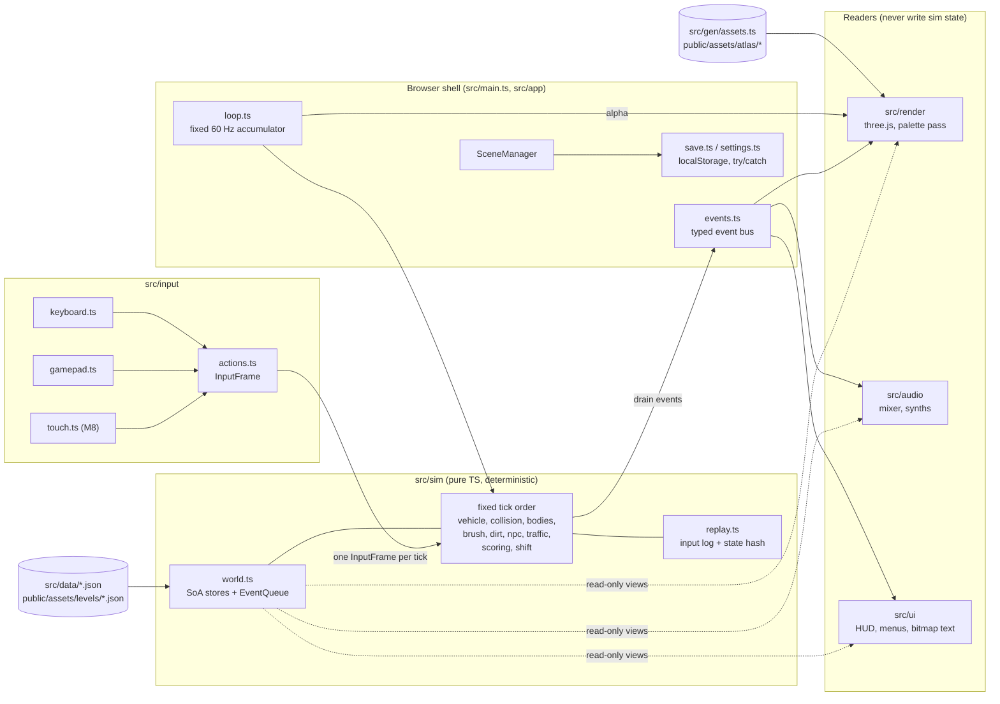
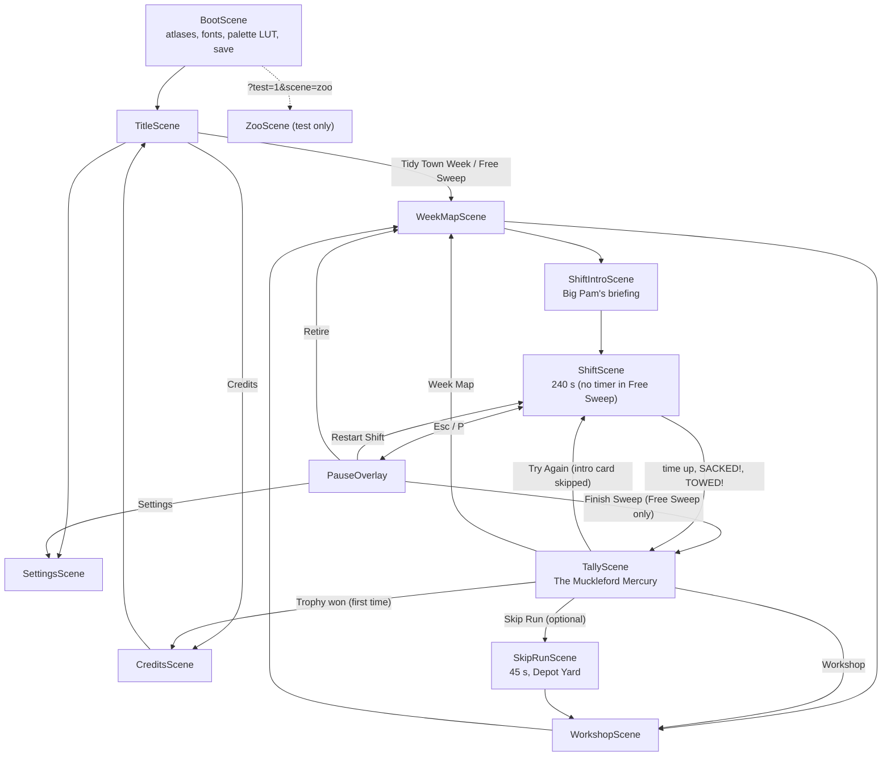
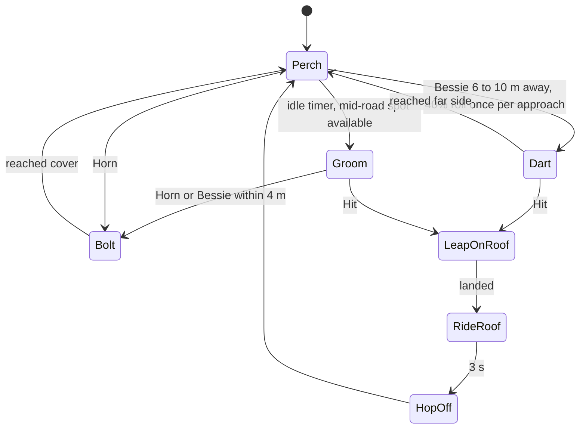
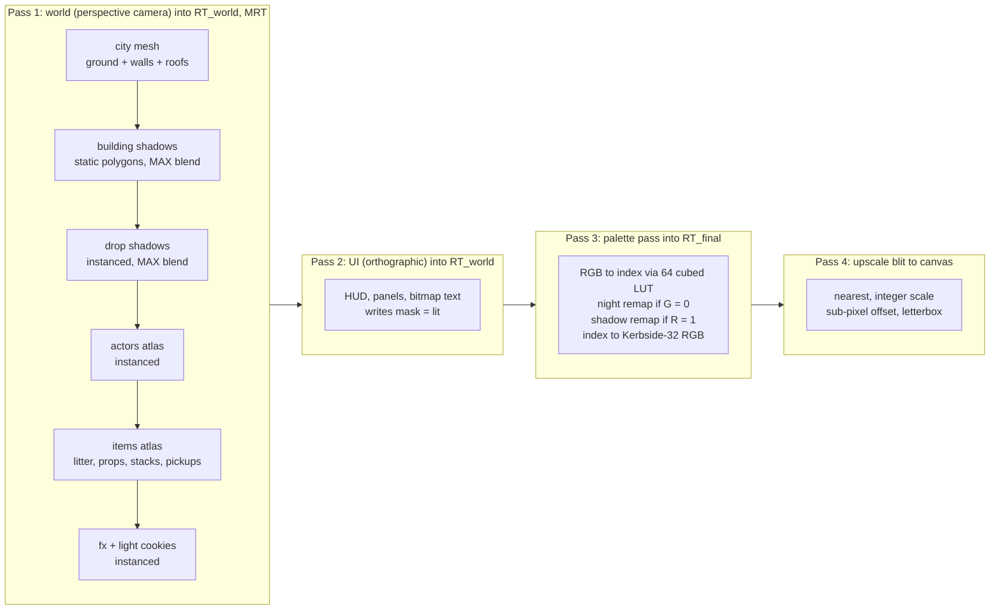

# Street Sweeper Pro: Technical Design

> **Status:** v1.0 (2026-10-18). Owner: engineering. Binding for M0–M7.
> **Source of truth for numbers:** the canonical facts sheet. Game rules live in [GDD.md](GDD.md), asset tooling in [ASSET_PIPELINE.md](ASSET_PIPELINE.md), visual rules in [ART_BIBLE.md](ART_BIBLE.md), audio in [AUDIO_DESIGN.md](AUDIO_DESIGN.md), map authoring in [LEVEL_DESIGN.md](LEVEL_DESIGN.md), per-entity stats in [ENTITY_CATALOG.md](ENTITY_CATALOG.md), schedule in [ROADMAP.md](ROADMAP.md). The stack decision record is [adr/0001-tech-stack.md](adr/0001-tech-stack.md). Terms are defined in [GLOSSARY.md](GLOSSARY.md).
>
> This document covers **how the game is built**: what runs, in what order, in which module, with which data, and how we prove it still works. Anything marked **TBD (M0 spike)** is decided by the M0 *Foundations & Look Spike* and recorded in [ROADMAP.md](ROADMAP.md).

---

## Contents

1. [Stack and pinned versions](#1-stack-and-pinned-versions)
2. [Directory layout](#2-directory-layout)
3. [Architecture overview](#3-architecture-overview)
4. [Coordinate systems and units](#4-coordinate-systems-and-units)
5. [Game loop and fixed timestep](#5-game-loop-and-fixed-timestep)
6. [Scenes](#6-scenes)
7. [Simulation core](#7-simulation-core)
8. [Vehicle model](#8-vehicle-model)
9. [Collision](#9-collision)
10. [Brush, LitterField, grime and hopper](#10-brush-litterfield-grime-and-hopper)
11. [NPC and traffic behaviour](#11-npc-and-traffic-behaviour)
12. [Rendering pipeline](#12-rendering-pipeline)
13. [Input abstraction](#13-input-abstraction)
14. [Audio engine integration](#14-audio-engine-integration)
15. [Map data format](#15-map-data-format)
16. [Save data and settings](#16-save-data-and-settings)
17. [Performance budgets](#17-performance-budgets)
18. [Testing strategy](#18-testing-strategy)
19. [CI](#19-ci)
20. [Build and deploy](#20-build-and-deploy)
21. [Coding conventions](#21-coding-conventions)

---

## 1. Stack and pinned versions

**Decision:** three.js + TypeScript + Vite, rendering with a **perspective camera looking straight down** into a low-res, palette-mapped render target. The core is deliberately lean: we write our own collision code and audio mixer, and defer everything else until a game feature needs it. The reasoning, the judges' vote and the rejected alternatives (Phaser, Godot, PixiJS, Rapier as core physics, Howler/Tone.js and others) are in [adr/0001-tech-stack.md](adr/0001-tech-stack.md).

### 1.1 Versions (exact pins, verified 2026-10-18)

| Area | Package / tool | Version |
|---|---|---|
| Runtime / package manager | Node.js + npm (`package-lock.json`) | Node **24.21.0**, npm **11.19.0** |
| Language | TypeScript, strict (verified with Vite, Vitest and Biome in M0, [D-10](ROADMAP.md#8-m0-spike-decision-log); fallback pin **6.0.3** if a tool breaks) | **7.0.2** |
| Renderer | `three` | **0.186.1** |
| Types | `@types/three` | **0.186.0** |
| Build / dev server | `vite` | **8.3.4** |
| Unit / sim tests | `vitest` | **5.0.5** |
| Property tests | `fast-check` | **4.10.2** |
| E2E / visual | `@playwright/test` (Chromium) | **1.64.1** |
| Image diff | `pixelmatch` | **8.0.0** |
| PNG I/O (tests, tools) | `pngjs` | **7.0.0** |
| Lint + format | `@biomejs/biome` | **2.5.15** |
| SFX synthesis | `zzfx` (reference for vendored `buildSamples`; not imported in Node) / `jsfxr` | **1.4.0** / **1.4.1** |
| Node types (for `tools/**` and Vitest under `tsc --noEmit`) | `@types/node` | **24.19.2** |
| Asset forge | Python via uv; numpy, Pillow, pytest | Python **3.13.15**, uv **0.12.23**, numpy **2.5.4**, Pillow **13.0.0**, pytest **9.1.1** |
| 3D pre-render (local only) | Blender | **5.2.2 LTS** at `/Applications/Blender.app/Contents/MacOS/Blender` |
| Image generation (local only) | Codex CLI (primary) / Cursor Agent CLI (fallback, concept only) | **codex-cli 0.160.1** / **2026.10.16-e3cb207** |
| Audio encoding | ffmpeg (Homebrew) | **9.0.2** at `/opt/homebrew/bin/ffmpeg` |
| Desktop wrapper (M9, deferred) | `@tauri-apps/cli` | **2.12.3** |
| Physics escape hatch (**not installed**) | `@dimforge/rapier2d-deterministic-compat` | **0.21.0** |
| itch.io uploader (M7, **not installed yet**) | butler | latest at M7 |

All npm dependencies are pinned with exact versions (no `^` or `~`) in `package.json`, and `npm ci` is the only install command used in CI. Bun 1.4.2 is installed on the dev machine but **not used**: one runtime avoids drift.

### 1.2 Stack-wide consequences

| Rule | Why | Consequence in code |
|---|---|---|
| TS tools run natively on Node 24 type stripping (`node tools/audio/render-sfx.ts`) | No tsx, no build step for tools | `tsconfig.json` sets `erasableSyntaxOnly: true`: **no `enum`, `namespace` or parameter properties**. Use `as const` objects plus union types. |
| JSON for every data file (manifest, levels, tuning, palette, songs, SFX) | Neither TS nor Python needs a parser dependency | JSON imports use import attributes: `import tuning from '../data/tuning.json' with { type: 'json' }` (works in Vite and in Node). |
| Hand-written `sfc32` PRNG in `src/sim/rng.ts` | Deterministic, tiny, fast, seedable | No seedrandom, simplex-noise or pure-rand. The forge uses `numpy.random.Generator(PCG64(seed))`; the two never need to agree. |
| `WebGLRenderer` (WebGL2), not `WebGPURenderer` | Headless SwiftShader visual tests, Safari parity, MRT and `Data3DTexture` are mature on WebGL2 | Revisit after 1.0 only if a measured need appears. |
| Blender and image generation never run in a build or in CI | Reproducibility (pillar 5) | Their outputs are committed **golden** sources. See [adr/0002-ai-authored-asset-pipeline.md](adr/0002-ai-authored-asset-pipeline.md). |

---

## 2. Directory layout

The layout is canonical. New top-level directories need an ADR.

```
/
├─ index.html  package.json  package-lock.json  tsconfig.json  biome.json
├─ vite.config.ts  vitest.config.ts  playwright.config.ts  .gitignore
├─ README.md  CLAUDE.md
├─ src/
│  ├─ main.ts
│  ├─ app/        Game.ts, loop.ts (fixed 60 Hz accumulator, max 5 steps/frame, render interpolation),
│  │              SceneManager.ts, events.ts (typed event bus), save.ts, settings.ts
│  ├─ scenes/     BootScene, TitleScene, WeekMapScene, WorkshopScene, ShiftIntroScene, ShiftScene,
│  │              SkipRunScene, TallyScene (Mercury), PauseOverlay, SettingsScene, CreditsScene, ZooScene (test)
│  ├─ sim/        PURE TS, with no three/DOM/Date/Math.random:
│  │              rng.ts, constants.ts, world.ts, map.ts, vehicle.ts, collision/{obb,sat,grid,sweep}.ts,
│  │              bodies.ts (knockables), litter.ts (LitterField spatial hash), brush.ts, dirt.ts,
│  │              hopper.ts, water.ts, npc/{steering.ts, behaviours/<npc>.ts}, traffic.ts,
│  │              scoring.ts, combo.ts, complaints.ts, shift.ts, replay.ts, tuning.ts
│  ├─ render/     Renderer.ts, camera.ts, cityMesh.ts, groundLayer.ts, spriteBatch.ts, spriteStack.ts,
│  │              shadows.ts, palettePass.ts, upscale.ts, fx.ts
│  ├─ audio/      mixer.ts, sfx.ts, music.ts, engineSynth.ts, brushSynth.ts, unlock.ts
│  ├─ input/      actions.ts, keyboard.ts, gamepad.ts, touch.ts
│  ├─ ui/         bitmapText.ts, hud.ts, panels.ts, menus.ts, minimap.ts, popups.ts
│  ├─ data/       tuning.json, entities.json, upgrades.json, districts.json
│  ├─ gen/        assets.ts (GENERATED, committed)
│  └─ debug/      devPanel.ts, testHooks.ts
├─ assets-src/
│  ├─ STYLE.md  manifest.json
│  ├─ _probe/   (asset-probe artefacts copied 2026-10-18; git-tracked, not in the manifest)
│  ├─ palette/kerbside32.json
│  ├─ sprites/{npc,litter,prop,pickup,ui,facade}/*.sprite.txt
│  ├─ fonts/*.glyphs.txt
│  ├─ procedural/{tiles,roofs,facades,stains,fx}/*.json
│  ├─ blender/{rig.py, vehicles/*.py, props/*.py, roofkit/*.py}
│  ├─ rendered/<asset-id>/{h00..h31.png, render.json}     (committed Blender goldens)
│  ├─ ai/{_style_preamble.md, <asset-id>/{prompt.md, meta.json, golden.png, refs/}}
│  ├─ levels/<district>.{map.txt,level.json}
│  └─ audio/{sfx/*.json, music/*.song.json, amb/*.json}
├─ tools/
│  ├─ forge/      pyproject.toml, uv.lock, forge/{__main__,build,ingest,pixelize,palette,outline,
│  │              pack,lint,sheets,blender,genai}.py, forge/procedural/*.py, tests/
│  ├─ audio/      render-sfx.ts, render-music.ts, synth/*.ts, wav.ts
│  └─ levels/     compile-level.ts
├─ public/assets/ atlas/, fonts/, art/, audio/{sfx,music}/, levels/, asset-hashes.json   (GENERATED, committed)
├─ tests/
│  ├─ unit/       *.test.ts (Vitest)
│  ├─ property/   *.prop.test.ts (fast-check)
│  ├─ replay/     replays/*.json + replay.test.ts
│  ├─ visual/     *.spec.ts + __goldens__/*.png (Playwright)
│  └─ e2e/        smoke.spec.ts, perf.spec.ts
├─ docs/
└─ build/         (git-ignored: .forge-cache, sheets, ai-candidates, tmp)
```

`.gitignore`: `node_modules/`, `dist/`, `build/`, `test-results/`, `playwright-report/`, `tools/forge/.venv/`. A nested `tools/forge/.gitignore` additionally ignores `__pycache__/` and `.pytest_cache/` (Python bytecode and pytest cache written when the forge and its tests run).

**One addition this document makes:** `src/sim/fmath.ts`, a thin wrapper for the transcendental maths the sim uses (`sin`, `cos`, `atan2`, `exp`, `sqrt`, `hypot`). See [§7.4](#74-determinism).

### 2.1 Who may import whom

| Module | May import | Must not import |
|---|---|---|
| `src/sim/**` | `src/sim/**`, `src/data/*.json` (via `tuning.ts` only), `src/gen/assets.ts` (types only) | `three`, any DOM API, `src/app`, `src/render`, `src/audio`, `src/ui`, `src/input` |
| `src/render/**` | `three`, `src/sim` (read-only types and state views), `src/gen` | `src/audio`, `src/ui` internals |
| `src/audio/**` | WebAudio, `src/sim` (read-only), `src/app/events.ts` | `three` |
| `src/ui/**` | `src/render/spriteBatch.ts`, `src/sim` (read-only), `src/app/events.ts` | direct sim mutation |
| `src/input/**` | DOM, `src/sim` (the `InputFrame` type only) | everything else |
| `src/app/**`, `src/scenes/**` | everything | none (composition root) |
| `tools/**` | `src/sim/**` and `src/data/**` (the level compiler reuses `map.ts`), Node built-ins | `three`, `src/render` |

The sim rule is **enforced**, not advisory: see [§21.3](#213-enforced-rules).

---

## 3. Architecture overview

### 3.1 Module diagram



### 3.2 Core principles

1. **A run is a pure function:** `run = f(seed, district, inputLog)`. Everything that affects gameplay is in `src/sim`, and everything in `src/sim` is deterministic.
2. **One-way data flow.** Input → sim → (state views + events) → render, audio, UI. Readers never write sim state. If the UI needs to change something (for example "buy upgrade"), it calls a command on the **meta layer** (`save.ts`, Workshop logic), never inside a running shift.
3. **No ECS library.** Each entity kind has a typed struct-of-arrays store. Engine code is written only when a feature needs it.
4. **Data-driven numbers.** Every gameplay constant lives in `src/data/tuning.json` or `src/data/entities.json`. Code holds no magic numbers except unit conversions (`PX_PER_M = 16`) in `src/sim/constants.ts`.
5. **Generated code is a compile-time contract.** `src/gen/assets.ts` exports the `FRAME` const plus `FrameId`/`AssetId` unions, so referencing a missing sprite is a type error.

---

## 4. Coordinate systems and units

Getting this wrong once costs a week, so it is fixed here and asserted in unit tests.

| Space | Origin | Axes | Units |
|---|---|---|---|
| **Sim world** | NW corner of the district map | **+x east, +y south** (rows of the ASCII map grow downward) | metres, seconds, radians |
| **Tile** | NW corner | col = `floor(x / 2)`, row = `floor(y / 2)` | 2 m tiles (32 px) |
| **Grime cell** | NW corner | `cx = floor(x / 0.25)`, `cy = floor(y / 0.25)` | 0.25 m (4 px) |
| **Render (three.js)** | same as sim | `render.x = sim.x`, `render.z = sim.y`, buildings extrude along **+Y** | metres |
| **Vehicle local** | body centre | **+y forward**, +x right | metres (the brush geometry in [§10.1](#101-brush-hitbox) uses this) |
| **Internal screen** | top-left of the W×270 frame | +x right, +y down | internal pixels |

- **Heading** `θ`: radians, **0 = north (screen up), increasing clockwise** (compass convention). Forward vector in sim space: `(sin θ, −cos θ)`. Right vector: `(cos θ, sin θ)`.
- **Vehicle sprite frame** = `((round(θ / (2π/32)) % 32) + 32) % 32` → `h00`…`h31`. This matches the Blender rig: `h00` faces north, stepping 11.25° clockwise.
- **Actor direction** (8-way) = `round(θ / (π/4)) mod 8` → `n, ne, e, se, s, sw, w, nw`.
- **Camera:** positioned at `(x, H, z)`, looking at `(x, 0, z)` with `camera.up = (0, 0, −1)`. Screen up is then −Z = north and screen right is +X = east. Nothing is mirrored.
- **Pixel ↔ metre:** `PX_PER_M = 16`. Ground is exactly 1 texel = 1 px at H = 31.5 m.

---

## 5. Game loop and fixed timestep

### 5.1 Loop

`src/app/loop.ts` runs a fixed **60 Hz** simulation (`DT = 1/60` s) behind a variable-rate renderer. It is the only place outside `src/debug` that reads `performance.now()`.

```ts
const DT = 1 / 60;
const MAX_STEPS = 5;     // per rendered frame
const MAX_FRAME = 0.25;  // s; clamp after tab switches and breakpoints

let acc = 0;
let last = performance.now();

function frame(nowMs: number): void {
  let ft = (nowMs - last) / 1000;
  last = nowMs;
  if (ft > MAX_FRAME) ft = MAX_FRAME;
  acc += ft;

  let steps = 0;
  while (acc >= DT && steps < MAX_STEPS) {
    const input = actions.sampleForTick();   // latched edges, see §13
    scenes.fixedUpdate(input);               // ShiftScene → sim.step(input)
    events.drain(sim.world.events);          // dispatch to audio/UI/render
    acc -= DT;
    steps++;
  }
  if (steps === MAX_STEPS && acc > DT) acc = DT; // drop backlog: slow down, never spiral

  scenes.render(acc / DT);                   // alpha in [0, 1) for interpolation
  requestAnimationFrame(frame);
}
```

| Rule | Value / behaviour |
|---|---|
| Sim rate | 60 Hz fixed, independent of the display (60, 120 and 144 Hz monitors all run 60 ticks/s) |
| Max sim steps per frame | 5. Below 12 fps the game runs in slow motion instead of freezing. |
| Render interpolation | Sim stores `prevX/prevY/prevHeading` per entity, copied at the start of each tick with `TypedArray.set`. The renderer lerps with `alpha` (angles take the shortest arc). |
| Time in the sim | An integer **tick counter**. A shift is 240 s = **14,400 ticks**; the timer is `ticksRemaining`, never a float. |
| Tab hidden | `visibilitychange` → the ShiftScene opens the PauseOverlay. The loop keeps running for menus but the accumulator is reset on resume. |
| Test mode | With `?test=1&freeze=1` the loop renders but never steps; `window.__ssp.step(n)` advances the sim synchronously ([§18.5](#185-test-hooks)). |

### 5.2 Fixed tick order

`World.step(input)` runs these phases in this order every tick. The order is canonical: changing it changes replay hashes and must be called out in the PR.

| # | Phase | Module(s) | Notes |
|---|---|---|---|
| 1 | Input | `world.ts` | Copy the `InputFrame` into the sim; append it to the replay log |
| 2 | Vehicle | `vehicle.ts`, `hopper.ts` | Steering, drive, drag, grip, handling scaled by hopper fill |
| 3 | Static collision | `collision/{obb,sat,grid,sweep}.ts` | OBB vs grid AABB with SAT, sub-stepped when speed > 0.5 tile/tick |
| 4 | Knockable bodies | `bodies.ts` | Bins, cones, A-boards, trolleys, recycling boxes |
| 5 | Brush / litter | `brush.ts`, `litter.ts`, `water.ts` | Gutter, suction, inlet, fling, spray, collection |
| 6 | Dirt | `dirt.ts` | Grime footprint erase, stain cleaning, dust |
| 7 | NPC AI | `npc/steering.ts`, `npc/behaviours/*.ts` | FSMs, perception, reactions |
| 8 | Traffic | `traffic.ts` | Lane graph followers, blocking timers |
| 9 | Scoring / combo / complaints | `scoring.ts`, `combo.ts`, `complaints.ts` | Consume this tick's gameplay facts |
| 10 | Shift timer | `shift.ts` | Countdown, SACKED/TOWED/time-up transitions |
| 11 | Emit events | `world.ts` | Seal the `EventQueue` for this tick |

---

## 6. Scenes

### 6.1 SceneManager

`SceneManager` holds a **stack** of scenes. The top scene receives input; scenes below it keep rendering (so `PauseOverlay` draws over a frozen `ShiftScene`). Each scene implements:

```ts
interface Scene {
  readonly id: SceneId;                       // 'boot' | 'title' | ... | 'zoo'
  enter(params: SceneParams): Promise<void>;  // async asset loads happen here
  exit(): void;                               // release GPU resources and audio nodes
  fixedUpdate(input: InputFrame): void;       // 60 Hz
  render(alpha: number): void;                // per display frame
  readonly blocksUpdateBelow: boolean;        // true for PauseOverlay
}
```

### 6.2 Scene flow

This diagram mirrors [GDD §15.1](GDD.md#151-scene-flow), which owns the flow; the GDD diagram and this one change together.



`ZooScene` lays out every frame from `FRAME` in a grid at 1:1 for the `zoo` visual golden and for contact-sheet review in-engine (see [ASSET_PIPELINE.md](ASSET_PIPELINE.md)).

### 6.3 Loading

| Asset | When loaded | Size class |
|---|---|---|
| `ui`, `actors`, `items`, `fx` atlases, fonts, palette | BootScene | ≤ 2048² PNG each |
| `world` atlas | BootScene | ≤ 2048² PNG |
| `public/assets/levels/<district>.json` | ShiftIntroScene (while the briefing card is shown) | tens of KB |
| District music stems + ambience bed | ShiftIntroScene, decoded in the background | 1–3 MB |
| SFX | BootScene (all are short) | < 500 KB total |

---

## 7. Simulation core

### 7.1 World and stores

`World` (`src/sim/world.ts`) owns all mutable shift state. Each entity kind has a fixed-capacity **struct-of-arrays** store allocated once at shift start from the budgets in [§17](#17-performance-budgets):

```ts
// src/sim/world.ts (shape, abridged)
export type NpcStore = {
  count: number;
  readonly kind: Uint8Array;        // index into entities.json npc table
  readonly state: Uint8Array;       // behaviour state id (per-kind const object)
  readonly stateTicks: Uint32Array; // ticks since entering state
  readonly x: Float64Array; readonly y: Float64Array;
  readonly prevX: Float64Array; readonly prevY: Float64Array;
  readonly heading: Float64Array; readonly speed: Float64Array;
  readonly targetNode: Int32Array;  // pavement nav graph node, -1 = none
  readonly swap: Uint8Array;        // ramp-swap index (outfit) for the renderer
  readonly flags: Uint16Array;      // FALLEN, ON_ROOF, YIELDING, ...
};
```

- Sim state uses **`Float64Array`** (JS numbers are doubles, so there is no `Math.fround` noise). Render instance buffers are `Float32Array`.
- Removal is **swap-remove** with the last live slot. Entity identity across ticks, where needed (for example "the dog belongs to this walker"), uses a generation-checked handle `(index, gen)`.
- Capacities: litter 2,000, NPCs 80, vehicles 30, knockables 128, hazards 64, stains 256, pickups 16. Exceeding a capacity is a level-authoring error caught by `compile-level.ts` and by the replay invariants.

### 7.2 Event queue

The sim never calls out. Each tick it appends facts to a preallocated `EventQueue` (struct-of-arrays ring, 512 events per tick):

| Field | Type | Example |
|---|---|---|
| `type` | `Uint16` | `EV.LitterCollected`, `EV.Fling`, `EV.Impact`, `EV.NpcHit`, `EV.Complaint`, `EV.ComboTier`, `EV.HopperFull`, `EV.DumpStart`, `EV.Horn`, `EV.ShiftEnd` |
| `entity` | `Int32` | store index or −1 |
| `a`, `b`, `c` | `Float64` | position x/y, magnitude (impact speed, points, combo tier) |

`src/app/events.ts` drains the queue after each tick and dispatches strongly typed events to subscribers (`audio/sfx.ts`, `ui/popups.ts`, `render/fx.ts`). Scoring reads the same facts **inside** the sim during phase 9; the bus is for presentation only. Events are part of the replay hash input, so "the same run produces the same sounds" is tested for free.

### 7.3 Randomness

- `sfc32` per subsystem, seeded as `sfc32(seed ^ hash32(streamName))` ([LEVEL_DESIGN §9](LEVEL_DESIGN.md#9-spawn-rules)). **Each subsystem gets its own stream**: `litter`, `grime`, `stains`, `hazards`, `npc`, `traffic`, `events`, `brush`, `weather`. Adding a new NPC type therefore never reshuffles litter spawns.
- Presentation randomness (particle jitter, SFX variant choice, pitch jitter) uses a **separate render-side `sfc32`** and never touches sim streams.
- Daily Shift (M9) seed = UTC date `YYYYMMDD` as an integer.

### 7.4 Determinism

- **Contract:** the same build, seed, district and input log gives the same final-state hash on Node 24 (CI) and on Chromium (dev). Replay hashes use state quantised to **1e-4**.
- **Banned in `src/sim`:** `Math.random`, `Date`, `performance`, `setTimeout`, iteration over objects with numeric-looking keys, `Array.prototype.sort` with a comparator that can return 0 for distinct entities (use an id tiebreak), and any read of render or camera state.
- **Transcendentals:** ECMAScript does not require `Math.sin`/`exp`/`atan2` to be bit-identical across engines. All sim code calls them through `src/sim/fmath.ts`. Version 1 forwards to `Math.*` (Node and Chromium are both V8). If cross-engine replays are ever needed (shared ghosts, Firefox/Safari replay checks), `fmath.ts` swaps to fixed polynomial approximations in one file.
- **Off-screen logic:** the sim never reads the render camera. Rules such as "spawn traffic off-screen" use `world.viewRect`, a deterministic proxy: the sweeper's position plus look-ahead, expanded to ±(24.0 + 4) × ±(10.2 + 4) m, i.e. **±28 × ±14.2 m** (the widest view, at W = 640 and H = 37.8 m, is ±24.0 × ±10.13 m; the 4 m margin covers half a bus length). Spawn and despawn test the entity's full OBB, not its centre, against `viewRect`.

---

## 8. Vehicle model

Bessie (`veh.sweeper`) is a **kinematic bicycle** with a separately tracked velocity vector, so low-grip surfaces produce drift without a tyre model. All values come from `src/data/tuning.json` → `vehicle.sweeper`. The table of handling numbers belongs to [GDD.md](GDD.md); the parameters used below are copied from it.

### 8.1 State

`x, y, heading, vLong, vLat, steer (δ), yawRate, gear (FWD|REV), brushDown, brushPos (0..1), rpm (0..1), hp, hopperLU, water`.

### 8.2 Per-tick integration (phase 2)

1. **Handling scale from hopper fill** `f = hopperLU / capacity` (0..1; capacity changes with `upg.hopper`, the 1,500 kg extra mass at full does not):
   - `mass = 4200 + 1500·f`
   - `accel = 2.4 · lerp(1, 0.70, f)`, `vTop = vTopBase · lerp(1, 0.90, f)`, `steerRate = 120°/s · lerp(1, 0.85, f)`
2. **Top speed selection:** `vTopBase` = **6.0 m/s** brush down, **11.0 m/s** brush up (transit). Modifiers multiply: `pwr.bacon_butty` ×1.3, `upg.engine` ×1.1/×1.2 (transit only).
3. **Steering:** target `δ* = steerInput · 34° / (1 + |vLong| / 8)`. `δ` moves toward `δ*` at `steerRate`, or at **180°/s** when the input is centred (return).
4. **Drive:**
   - throttle: `vLong += accel · throttle · DT`, clamped to `vTop`;
   - brake: `vLong → 0` at **6.0 m/s²**;
   - reverse: brake held with `|vLong| < 0.2 m/s` for 0.25 s (proposed, [GDD §6.2](GDD.md#62-control-design-notes)) engages `REV` (max **2.5 m/s**, accel **1.5 m/s²**) and emits `EV.ReverseBeeper`.
5. **Drag:** `a = 0.3·sign(v) + 0.012·v²` (rolling drag ×2.5 on grass), clamped so it never reverses the sign of `vLong`.
6. **Yaw:** `yawRate = vLong / 2.4 · tan(δ)` (wheelbase 2.4 m; minimum turning circle about 7 m). `heading += yawRate · DT`.
7. **Grip:** re-express the previous world velocity in the new heading frame. The longitudinal part becomes `vLong`; the lateral part decays: `vLat *= exp(−k · DT)`. `k` is the average lateral grip under the four wheel contact points:

   | Surface | k (/s) |
   |---|---|
   | asphalt | 9.0 (6.0 on all roads when it rains in `district.gasworks`) |
   | pavement | 8.0 |
   | grass | 5.0 |
   | wet / puddle | 4.0 |
   | wet leaves | 3.0 |
   | oil | 1.2 |

   `upg.tyres` multiplies all values by 1.15. Surfaces come from the tile surface grid, overridden by hazard footprints (`haz.oil_slick`, `haz.puddle`, `haz.wet_leaves`).
8. **Position:** `pos += (forward · vLong + right · vLat) · DT` (semi-implicit Euler).
9. **Kerb crossing:** when the **front axle** midpoint crosses a road ↔ pavement edge, `vLong *= 0.7` and `EV.KerbJolt` fires. The rear axle crossing fires the jolt event (shake and `sfx.bump_kerb`) without the speed loss.
10. **Scripted impulses:** banana skin with the brush up adds a 180° spin-out (`yawRate` impulse over 0.6 s); potholes and speed bumps spill LU and emit events.

### 8.3 Brush mechanics state

- Raise/lower takes **0.5 s** (`brushPos` 0↔1). RPM spins up over **0.6 s**.
- **Collecting requires `brushPos == 1 && rpm >= 0.8`.** The same condition gates the grime footprint.

---

## 9. Collision

Hand-written, synchronous, deterministic. Rapier2D stays a documented escape hatch, not a dependency.

### 9.1 Static world

- `compile-level.ts` produces a per-cell **collision grid** (`Uint8`: `SOLID`, `KERB_EDGE_N/E/S/W` bits, surface type in a parallel grid) and merges solid cells into **maximal rectangles** (greedy merge). Merging removes the internal edges that cause "ghost" snagging when sliding along a terrace.
- Static props (`prop.lamp_post`, `prop.bollard`, `prop.bench`, `prop.bus_shelter`, `prop.phone_box`, `prop.post_box`, `prop.hydrant`, `prop.tree`, `prop.planter`, `prop.market_stall`, `prop.litter_bin`, `prop.roadworks_barrier`) are OBBs or circles registered in `collision/grid.ts` buckets (one bucket per tile).
- Parked vehicles (`veh.<type>_parked`) are static OBBs. Denting one costs −100 and 5 HP.

### 9.2 Vehicle vs static (phase 3)

1. Build Bessie's OBB (1.75 × 3.25 m) at the integrated pose.
2. **Sub-step** when the per-tick displacement exceeds 0.5 tile (1.0 m): split into `ceil(d / 1.0)` steps. *(At every speed in the game, including Bacon Butty and Engine L2, which give about 0.29 m/tick, Bessie needs one step. The rule exists for knockables and for safety.)*
3. Query the grid cells overlapped by the OBB's AABB, gather solid rects and static props.
4. **SAT** for each candidate: 2 OBB axes + 2 world axes for rects (or the closest-point axis for circles). Keep the minimum-penetration axis.
5. Resolve by the MTV (iterate up to 4 times for corners), then apply the impact response:
   - normal speed `vn` = velocity · normal; reflect with **restitution 0.2**;
   - **damage = 4 HP per m/s of `vn` above 2 m/s** (×0.6 with `upg.bumper`);
   - emit `EV.Impact { vn, x, y }` (audio picks `sfx.bump_wall` or `sfx.crash`, the renderer shakes).
6. HP ≤ 0 → `shift.ts` ends the shift with TOWED!.

### 9.3 Knockables (phase 4)

`bodies.ts` simulates `prop.wheelie_bin` (30 kg), `prop.traffic_cone` (2 kg), `prop.a_board`, `prop.shopping_trolley` and `prop.recycling_box` as circles or small OBBs with linear and angular velocity, ground friction and restitution against the static grid. Bessie is treated as an infinite-mass mover. Bodies do not stack. **Supplementary sub-step rule:** a knockable sub-steps when its displacement exceeds half its smallest extent, so a flung cone (about 0.4 m) cannot tunnel through a bollard. Spills (bin: 4 items; recycling box: 2 items) spawn litter through `litter.ts` on the first hit only.

### 9.4 Dynamic actors

| Pair | Shape | Response |
|---|---|---|
| Bessie vs NPC | OBB vs circle (human r = 0.3 m, cat 0.2 m, dog 0.25 m) | No physics push. The NPC enters `Fallen` (or the cat's `LeapOnRoof`), the penalty is applied once per contact episode, and contact is ignored for 1.5 s. |
| Bessie vs dog lead | OBB vs segment (walker → dog, up to 5 m) | Lead Tangle penalty, the dog walker goes `Angry` |
| Bessie vs traffic | OBB vs OBB (SAT) | Traffic is kinematic and stops. Bessie resolves as against static geometry, with damage. |
| Bessie vs pigeons | circle query | Never a hit: scatter + Pigeon Scatter bonus |

### 9.5 Property tests

M1 exit criterion, in `tests/property/collision.prop.test.ts`:

- *Never ends a tick inside a solid:* for random maps (fast-check generated 8×8 to 32×32 grids), random spawn poses and random 600-tick input sequences, Bessie's OBB never overlaps a solid rect by more than 1 mm at the end of any tick.
- *No tunnelling at 17.2 m/s* (transit 11 m/s × Bacon Butty 1.3 × Engine L2 1.2, the real maximum; stricter than the canonical M1 wording of 11 m/s): from random poses aimed at a 1-tile wall (and at a 0.3 m bollard) at speeds up to 17.2 m/s, the swept centre never crosses the obstacle.
- *Resolution is idempotent:* resolving an already-resolved pose changes it by < 1e-9 m.

---

## 10. Brush, LitterField, grime and hopper

### 10.1 Brush hitbox

Vehicle-local (origin at the body centre, +y forward, metres). The numbers are canonical (see [GDD.md](GDD.md)):

| Part | Shape | Behaviour per tick (when collecting) |
|---|---|---|
| Gutter brushes | Two circles, r = 0.45 m, at (±0.85, +1.75). Reach ±1.30 m; **swept width 2.6 m (≈ 42 px)** | Item velocity is pushed toward `x = 0` and slightly backward |
| Suction zone | Rect x ∈ [−1.3, 1.3], y ∈ [+1.6, +2.8] | Item pulled toward the inlet centre at **3.0 m/s × rpm × suctionMult** (`upg.suction` +25%/+50%, `pwr.super_suction` ×2) |
| Inlet | Rect 1.0 × 0.4 m centred at (0, +1.2) | Item whose centre enters is collected, unless the hopper is full |
| Grime footprint | Rect x ∈ [−1.3, 1.3], y ∈ [+1.3, +2.2] (the band the brush circles sweep) | Erases grime cells |

`upg.gutter_brooms` moves the brush centres outward by +0.15/+0.30 m per side and widens the suction zone and grime footprint to match.

```
            +y (forward)
   y=+2.8  ┌───────────────────┐
           │   suction zone    │
   y=+2.2  ├──( )─────────( )──┤   gutter brushes r=0.45 at (±0.85, +1.75)
           │                   │
   y=+1.6  └──┬───────────┬────┘
   y=+1.625   ├── body front ─┤      body 1.75 × 3.25 m
   y=+1.2     │  [ inlet ]  │       1.0 × 0.4 m
              │             │
             x=-0.875     x=+0.875
```

### 10.2 LitterField (`src/sim/litter.ts`)

- Store: `x, y, vx, vy, kind, flags (FLUNG, IN_SUCTION, PINNED), arcT, arcDur, rot`.
- **Spatial hash, 4 m cells**, rebuilt incrementally (an item re-buckets only when it crosses a cell boundary). Shared design with NPC lookup.
- **Brush query:** transform the brush AABB to world space, visit only the overlapped cells (typically 2–4), and transform each item into vehicle-local space with one rotation.
- **Fling:** the first time an item touches the brush or suction zone in a contact episode, roll `p = clamp((v − t0) / 2.0, 0, 1)` on `rng.brush`, with `t0 = 4.0 m/s` (6.0 m/s under `pwr.super_suction`). On a fling the item gets a kinematic arc **1.5–3 m sideways** (side chosen by the sign of local x). It is uncollectable until it lands. A flung `litter.glass_bottle` lands as `haz.broken_glass`.
- **Bulldozer:** at full hopper, items reaching the inlet are pinned just ahead of the front bumper and pushed along. `EV.HopperFull` fires once per fill (clunk SFX).
- **Drift:** wind and gusts (`haz.wind_gust`, Friday) apply 1.5 m/s to drifting kinds for 4 s.

### 10.3 Grime mask (`src/sim/dirt.ts`)

- Each 32 px tile holds an **8×8 grid of 4 px grime cells**. The district mask is a `Uint8Array` of `(tilesW·8) × (tilesH·8)`. Civic Quarter (128×96 tiles) is 1024×768 = 786,432 bytes.
- **Encoding:** `0` = clean or never grimy; bits 0–6 = grime intensity 1–127 (drives the overlay strength in the ground shader); **bit 7 = gutter grime** (dense strip along kerbs, 2 pts per cell).
- **Initial state:** `compile-level.ts` bakes per-cell grime scores and a gutter mask. At shift start `dirt.ts` takes exactly `grime.cells` cells by `(score desc, index asc)` using the `grime` stream ([LEVEL_DESIGN §9.2](LEVEL_DESIGN.md#92-grime)), so the initial grime count, and therefore the Tidy % denominator, is identical on every attempt.
- **Erase:** while collecting, rasterise the grime footprint (rotated rect) into cells each tick. At 6 m/s Bessie moves 0.1 m/tick and the band is 0.9 m deep, so there are no gaps. **Kerb Hugger:** a gutter brush centre within 0.2 m of a kerb edge erases gutter cells.
- **Tidy %** = `0.6 × (grime cells cleaned ÷ initial grime cells) + 0.4 × (litter collected ÷ litter spawned)`, both counted over the route area (roads + pavements) only. Counters are maintained incrementally; nothing rescans the mask.
- **GPU upload:** `dirt.ts` records a dirty bounding rectangle per tick. `render/groundLayer.ts` uploads that sub-rectangle of the `R8` `DataTexture` once per rendered frame. If three 0.186's texture update-range API cannot express a sub-rectangle upload, it falls back to a full upload of at most 786 KB (decided in the M0 spike).

### 10.4 Water, stains and dust

- Water tank 100 units (`upg.water_tank` 150/200). Spray uses 6 units/s over a **2.6 m cone** ahead; it cleans `stain.*`, sprays `haz.oil_slick` (+30) and suppresses dust. Refill at `prop.hydrant` (stopped adjacent: 25 units/s) or at the depot (full).
- Stains are entities with a `cleanProgress` (seconds of spray needed per stain: TBD (M2 tuning), proposed defaults in [ENTITY_CATALOG §5](ENTITY_CATALOG.md#5-stains-stain), stored in `entities.json`).
- Dust: brush down on dusty tiles without spray emits a cloud. Pedestrians within 3 m cough: −10 pts per pedestrian per 2 s (no complaint).

### 10.5 Hopper and dumping (`src/sim/hopper.ts`)

- Base capacity **100 LU**; HUD warning at 80%.
- `site.depot_bay`: stop (< 0.5 m/s), hold Dump **1.0 s**, drain **2.0 s**, pays the tipping fee, refills water.
- `site.skip`: hold 1.0 s, drain **3.0 s**, no fee.
- Dump state is a small FSM: `Idle → Holding → Draining → Idle`, cancelled if speed exceeds 0.5 m/s during `Holding`.

---

## 11. NPC and traffic behaviour

### 11.1 Behaviour system

Each NPC kind has one module in `src/sim/npc/behaviours/` (camelCase file name: `oldWoman.ts` for `npc.old_woman`). A module is a **table-driven finite state machine** with no classes and no allocation:

```ts
// src/sim/npc/behaviours/cat.ts (shape)
export const CAT = { Perch: 0, Dart: 1, Groom: 2, Bolt: 3, LeapOnRoof: 4, RideRoof: 5, HopOff: 6 } as const;

export const catBehaviour: Behaviour = {
  initial: CAT.Perch,
  tick(w: World, i: number): void {
    switch (w.npc.state[i]) {
      case CAT.Perch: return perch(w, i);
      case CAT.Dart:  return dart(w, i);
      // ...
    }
  },
  onStimulus(w: World, i: number, s: Stimulus): void { /* horn, spray, hit, hiVis */ },
};
```

- **Shared states** across humans: `Walk`, `Idle`, `Cross`, `Startle`, `Fallen`, `GetUp`, `Angry`, `Yield`. They map 1:1 to animation states (walk 4, idle 2, startle 2, fall 3, angry 2 frames), so the renderer picks frames from `state` and `stateTicks` alone.
- **Steering** (`npc/steering.ts`): seek/arrive along the **pavement nav graph** (from the compiled level), separation from other NPCs via the spatial hash, and sidestep of Bessie's predicted path. Crossings happen only at nav-graph crossing edges (`site.zebra`, `site.school_crossing`, or dropped kerbs) except for behaviours that explicitly jaywalk (cat, businessman, kid on skateboard, jogger swerves).
- **Perception:** each NPC runs its perception query every 4 ticks, staggered by `index mod 4` (deterministic), against Bessie's pose, velocity and predicted path 1.5 s ahead.
- **Stimuli** are pushed by the sim, not polled: `Horn` (radius 8 m, 12 m with `upg.two_tone_horn`), `Spray`, `Hit`, `NearMiss`, `HiVis` (`pwr.hi_vis`: all pedestrians yield and part), `BeaconYield` (pedestrians start yielding at 6 m, 10 m with `upg.led_beacon`).
- **Stats** (speeds, radii, penalties) come from `entities.json`. Per-NPC behaviour descriptions are in [ENTITY_CATALOG.md](ENTITY_CATALOG.md); this section only defines the machinery.

### 11.2 Example: Doris (`npc.old_woman`)

```mermaid
stateDiagram-v2
  [*] --> Walk
  Walk --> Glare: Bessie's path blocked within 4 m
  Glare --> Walk: path clear for 1 s
  Glare --> FistShake: Horn
  FistShake --> Walk: after 1.5 s, slower walk (0.4 m/s proposed; duration TBD (M3 tuning))
  Walk --> Chase: Spray hits her
  Glare --> Chase: Spray hits her
  Chase --> Chase: handbag whack in reach, 2 HP per hit (every 1.0 s proposed)
  Chase --> Walk: Bessie beyond the give-up distance (8 m proposed, TBD (M3 tuning))
  Walk --> Fallen: Hit
  Glare --> Fallen: Hit
  Chase --> Fallen: Hit
  Fallen --> GetUp: 15 + 72 ticks (fall frames, then hold)
  GetUp --> Angry: 10 ticks
  Angry --> Walk: 54 ticks
```



State durations follow the animation timings in [ART_BIBLE §10.2](ART_BIBLE.md#102-timing-table) (fall frames 3 × 5 ticks, hold 72 ticks, get-up 10 ticks, angry 54 ticks). Gameplay values marked proposed are owned by [ENTITY_CATALOG](ENTITY_CATALOG.md) and settled in M3 tuning.

On `Hit`: −500, 2 complaints, spawn 6 `litter.spilled_shopping`. Doris **never yields** to Bessie: she ignores `BeaconYield`. The one exception is `HiVis` (`pwr.hi_vis`), which makes her yield and part, grudgingly, for its 12 s duration.

### 11.3 Example: Cat (`npc.cat`)



While `RideRoof`, the cat's pose is parented to Bessie's (the renderer draws it on top of the sweeper sprite with squash and stretch). The hit penalty is −300 and 1 complaint.

### 11.4 Traffic (`src/sim/traffic.ts`)

- Vehicles follow the compiled **lane graph** (directed edges with a speed limit and stop lines at `site.zebra`, `site.school_crossing` and `site.bus_stop`).
- Car-following: target speed is capped by the gap to the leader on the same lane, where the leader may be Bessie projected onto the lane. Simple constant-deceleration rule: `vMax = sqrt(2 · 3.0 m/s² · max(0, gap − 2.5 m))`.
- **Blocking timers:** a car blocked by Bessie honks after **3 s**; **blocking traffic over 10 s = 1 complaint** ("Road Rage").
- Special behaviours (bus dwell 5 s at `site.bus_stop`, bin lorry at 4 m/s stopping at bins, ice cream van 20 s with chimes, police witness radius 15 m adding +1 complaint) are per-kind hooks in the same module, data from `entities.json`.
- Spawning and despawning happen only outside `world.viewRect` ([§7.4](#74-determinism)).

---

## 12. Rendering pipeline

The canonical rendering spec (world scale, camera numbers, palette, sprite sizes) is shared with [ART_BIBLE.md](ART_BIBLE.md). This section describes the implementation.

### 12.1 Internal resolution and scaling

| Quantity | Value |
|---|---|
| Base internal resolution | **480×270**. Height is always 270. |
| Internal width | `W = clampEven(round(270 × aspect), 432, 640)` |
| Render target | **(W+2)×272** (1 px margin each side for the sub-pixel camera). `NearestFilter`, no MSAA, no mipmaps. |
| Integer scale | `floor(min(winW / W, winH / 270))`, with `winW`/`winH` in **device** pixels (CSS size × `devicePixelRatio`) |
| Presentation | Centred, letterboxed with `#0f0e12`, CSS `image-rendering: pixelated`. 1080p fullscreen → 4× (windowed ≈ 3×), 1440p → 5× (1350 tall, 45 px bars), 4K → 8×. |

`render/upscale.ts` owns the canvas: it sets `canvas.width/height` in device pixels and the CSS size in CSS pixels, and recomputes on `resize` and on DPR changes (`matchMedia('(resolution: …dppx)')`).

- **Fullscreen is required for 4× at 1080p.** A Fullscreen toggle (in Settings, plus an F11 hint; `element.requestFullscreen()` on the canvas container) is part of 1.0. In a windowed 1080p browser the viewport is about 1920×950, so expect 3× (`floor(950 / 270)`) with bars.
- **itch.io embed:** 960×540 (2×), with itch's fullscreen button enabled.

### 12.2 Camera (`render/camera.ts`)

| Feature | Implementation |
|---|---|
| Projection | `PerspectiveCamera`, vertical FOV **30°**, `near = 1.0`, `far = 45` (the tallest landmark is 20 m, the highest camera 37.8 m) |
| Sweep height | **H = 31.5 m** → ground is 1 texel = 1 px at 270 px tall (16.875 m × 30 m visible at W = 480) |
| Speed zoom | H eases from **31.5 m** (at or below the brush-down top speed) to **37.8 m** (at transit top speed) on a critically damped spring, ω = 3 rad/s. Behind a flag: the M0 spike may disable it, leaving look-ahead only. |
| Look-ahead | Lead the sweeper by up to **3.0 m** along its velocity, damped spring |
| Sub-pixel smoothing | Snap camera XZ to the ground-texel grid (1/16 m); keep the fractional remainder `(fx, fy)` in internal pixels; the upscale blit offsets by `fraction × scale` device pixels |
| Tilt | `camera.tiltDeg` default **0**, max 12. Not used in 1.0 districts. |

Camera state lives in the renderer, so springs integrate on render time (interpolated from sim state), never in the sim. Snapping is exact only at H = 31.5 m; while speed-zoomed, ground shimmer is accepted. Roofs at height `h` move `H/(H − h)` times faster than the ground, so roof edges always have a sub-pixel component. This is inherent to the perspective approach and accepted (1-storey 1.09×, 3-storey 1.31×, 6-storey 1.91× magnification).

### 12.3 Frame graph



**RT_world** is a `WebGLRenderTarget((W+2), 272, { count: 2, depthBuffer: true, depthTexture: null })`:

| Attachment | Format | Content |
|---|---|---|
| 0 | RGBA8 | Unlit colour (already Kerbside-32 colours from the atlases) |
| 1 | RGBA8 | Mask: **R = shadow**, **G = light** |
| depth | 24-bit | Shared by passes 1 and 2 (cleared before UI) |

All world materials are `ShaderMaterial`s (`glslVersion: GLSL3`) writing two outputs. Shadow and light draws use **`blendEquation = MaxEquation`** and output `vec4(0)` to attachment 0: `max(0, dst) = dst`, so they write only the mask without needing per-attachment colour masks (which WebGL2 lacks). M0 spike verifies MRT behaviour in three 0.186.1 under SwiftShader.

### 12.4 City mesh and ground (`cityMesh.ts`, `groundLayer.ts`)

- The map is a grid of 2 m cells. Each cell has a ground tile type and an optional building column (`storeys`, `roof`, `wall` styles).
- **Merging:** adjacent building cells with equal storeys merge into boxes. Only walls facing lower or open cells are emitted; back-facing walls are removed by backface culling (with a straight-down camera, a wall is visible exactly when the camera is on its outward side).
- **UVs in world metres**, so the 32×40 px facade modules tile (2 m × 2.5 m). Facade variant by face normal: N/W faces use `_lit`, E/S faces use `_dark`, roofs use `_base`.
- **Ground** uses the world atlas through per-vertex tile rects, plus the **grime mask** sampled per fragment (one texel per 4 px cell) to blend the grime overlay; a per-vertex flag disables grime on walls and roofs.
- **Chunking:** geometry is generated in **16×16-tile chunks** (the unit of build caching and of CPU-side bounds) and then concatenated into **one `BufferGeometry` per district** with `frustumCulled = false`. Civic Quarter is about 25k ground triangles plus building walls, trivial for any GPU, and this keeps the city to **one draw call**. If a district ever exceeds 250k vertices, switch to per-chunk draws with culling and revisit the draw-call budget.
- **Building shadows** are polygons projected toward the SE with length **0.84 × height** (sun azimuth 315°, elevation 50°), built once per district into a single mesh at y = 0 with depth layer 1 ([§12.5](#125-sprites-spritebatchts-spritestackts)), drawn with MAX blending into the mask. They are depth-tested, so roofs occlude them. Shadows falling onto lower roofs are not modelled in 1.0.

### 12.5 Sprites (`spriteBatch.ts`, `spriteStack.ts`)

- **Actors** (vehicles, characters, animals) and **items** (litter, props, pickups) are textured quads **lying flat**, not billboards. One `InstancedMesh` per atlas. Per-instance attributes: `offset (vec3)`, `rotation`, `frameRect (vec4, from FRAME)`, `pivot`, `swap (uint8)`, `flags`.
- **Depth layers, not heights.** All flat layers are positioned at **y = 0** in world space, so they share the ground's exact 1:1 projection (a quad lifted to y = 0.05 m would be scaled by H/(H − y) = 1.0016 and drift by up to 0.38 px at the screen edge). Layer order is applied in the vertex shader as a clip-space depth offset:

  ```glsl
  gl_Position.z -= (layer * 8.0 + sortBias) * 1e-5 * gl_Position.w;
  ```

  | Layer | Index |
  |---|---|
  | ground | 0 |
  | building shadows (mask only) | 1 |
  | road decals, stains | 2 |
  | litter, pickups | 3 |
  | drop shadows (mask only) | 4 |
  | pedestrians, animals | 5 |
  | traffic vehicles | 6 |
  | Bessie body (`veh.sweeper`) | 7 |
  | brush overlay (`veh.sweeper_brush`) | 8 |
  | cat riding on roof | 9 |
  | fx | 10 |

  Within a layer, `sortBias` in [0, 1) grows with `(y_sim − camY_sim)`, so southern actors draw on top, which reads correctly from above. Actors are alpha-tested (binary alpha), so no transparency sorting is needed. Walls, roofs and sprite-stack slices keep their real heights.
- **Ramp swaps:** at load, the `actors` and `items` atlases are converted to **R8 index textures** (exact hex → index lookup; a non-palette pixel is a load-time error). The fragment shader reads the index, applies the instance's swap row from a 32×8 swap texture (up to 8 swap tables per atlas), then looks up the palette texture. This gives car paint variants, pedestrian outfits, the beacon flash and liveries.
- **Drop shadows:** the same sprite silhouette offset **+2, +2 px** (SE, 0.125 m in world units), drawn as one instanced draw that can sample either atlas (per-instance selector), writing R = 1 into the mask.
- **Sprite stacks** for tall thin props (lamp posts, phone boxes, bollards, trees): 4 to 8 slice instances at increasing heights in the items batch. The perspective camera leans them like the buildings.
- **Culling:** visible instances are gathered by querying the sim spatial hash with the camera's ground rect (plus a 4 m margin for leaning stacks). Only those are written to the instance buffers, with one `needsUpdate` per batch per frame.

### 12.6 Lighting, night and the palette pass (`shadows.ts`, `fx.ts`, `palettePass.ts`)

- Everything is **unlit**. Light direction is baked into assets (NW sun) and into the facade variant choice.
- **Night** (`district.kebab_mile`): street lamp and headlight **light cookies** (procedural shapes in the fx atlas) write G = 1 into the mask via MAX blending.
- **Palette pass**, the consistency guarantee, a full-screen pass over RT_world into **RT_final** ((W+2)×272):
  1. `idx = LUT[r>>2][g>>2][b>>2]` from a **64³ `Data3DTexture` (R8)**, built at boot from `palette.json` by nearest colour in **OKLab** (about 262k entries × 32 colours, ~30 ms; cached in memory).
  2. If night is active and `G == 0`: `idx = night[idx]`.
  3. If `R == 1`: `idx = shadow[idx]`.
  4. Output `palette[idx]`.
  - Optional 4×4 Bayer dither, computed from internal pixel coordinates, is applied only to fog and transitions.
  - The `night[32]` and `shadow[32]` remaps are uploaded as a 32×2 texture. The game can never show a colour outside **Kerbside-32**.
- **UI** renders in the same internal pixel space with an orthographic camera after a depth clear, writing mask `(0, 1)` ("lit, unshadowed") so the HUD is never darkened.
- **Upscale blit** samples the inner W×270 window of RT_final, shifted by the camera's fractional remainder, at nearest, into the letterboxed canvas.

**Unit tests** for the palette pass: every Kerbside-32 colour maps to itself through the LUT; the TS OKLab nearest-colour result matches the forge's Python result for 4,096 sampled RGB values (fixture generated by the forge and committed: `tests/fixtures/palette_oklab_4096.json`, entries `[r, g, b, expected_index]`, written by `uv run --project tools/forge python -m forge.palette --write-fixture <path>`). Both sides use float64, Ottosson's OKLab matrices, squared distance summed as dL² + da² + db², and the lower index on an exact tie; the fixture has no near-ties (smallest best/second-best gap > 1e-9), so no distance quantisation is needed.

### 12.7 Draw-call allocation

Target **≤ 10 draw calls per frame** (`renderer.info.render.calls`, asserted in `perf.spec.ts`). `renderer.info` resets on every `renderer.render()` call by default, which with four passes would report only the last one, so the renderer sets `renderer.info.autoReset = false` and calls `renderer.info.reset()` once at the start of each frame; `render.calls` then counts all passes.

| # | Draw | Count |
|---|---|---|
| 1 | City mesh (ground + walls + roofs) | 1 |
| 2 | Building shadows (mask) | 1 |
| 3 | Drop shadows (mask, instanced) | 1 |
| 4 | Actors atlas (instanced) | 1 |
| 5 | Items atlas (instanced, includes sprite stacks) | 1 |
| 6 | FX + light cookies (instanced) | 1 |
| 7 | UI (instanced quads from the `ui` atlas, including text and minimap) | 1 |
| 8 | Palette pass | 1 |
| 9 | Upscale blit | 1 |
| | **Total** | **9** (1 spare for the dev panel in dev builds) |

The minimap is rendered once per district from map data into a small texture region of a UI-owned canvas texture; per frame only the player and objective markers move, as UI instances.

---

## 13. Input abstraction

### 13.1 Actions and the InputFrame

Devices never talk to the sim. `src/input/actions.ts` merges devices into one `InputFrame` per **tick**:

```ts
export type InputFrame = {
  throttle: number;   // 0..255  (quantised analogue)
  brake: number;      // 0..255
  steer: number;      // -127..127
  buttons: number;    // bitfield of held actions: SPRAY, INTERACT, ...
  pressed: number;    // bitfield of rising edges since the last tick: BRUSH, HORN, MAP, PAUSE
};
```

- **Quantised at the boundary:** analogue values are stored as integers, so replays record exactly what the sim saw.
- **Edge latching:** a key pressed and released between two ticks still produces one `pressed` edge on the next tick. If several ticks run in one frame, the edge is delivered to the first only.
- **Pause, Map and Dev panel** are consumed by the scene layer and never reach the sim (pausing is not part of a replay).

| Action | Default keyboard | Gamepad (standard mapping) |
|---|---|---|
| `throttle` | W / ↑ | RT (`buttons[7].value`) |
| `brake` (reverse when held at standstill) | S / ↓ | LT (`buttons[6].value`) |
| `steer` | A, D / ←, → | Left stick X, deadzone 0.15, rescaled to full range outside it |
| `brush` (toggle) | Space | A (south) |
| `spray` (hold) | Left Shift | X (west) |
| `horn` | H | B (east) |
| `interact` / dump (hold) | E | Y (north) |
| `map` | Tab | View/Back |
| `pause` | Esc / P | Start/Menu |
| `devPanel` (dev only) | F1 | — |

The full controls table including touch (M8) is in [GDD.md](GDD.md).

### 13.2 Devices

- **Keyboard** (`keyboard.ts`): listens on `KeyboardEvent.code` (layout independent; a remap stores codes). Digital steering ramps to full over 80 ms so keyboard players do not snap the wheel. `preventDefault` for bound keys only.
- **Gamepad** (`gamepad.ts`): polled once per rendered frame via `navigator.getGamepads()`; first connected pad with `mapping === 'standard'` wins. Rumble uses `vibrationActuator.playEffect('dual-rumble', …)` where supported, driven by `EV.Impact` magnitude.
- **Touch** (`touch.ts`, M8): drag wheel slider on the left half, pedals and buttons on the right. Produces the same `InputFrame`.
- **Remapping:** stored in `ssp.settings.v1` ([§16](#16-save-data-and-settings)). Conflicts are rejected in the UI. Defaults are restorable.

---

## 14. Audio engine integration

Direction, the SFX list, synth specs and stem rules belong to [AUDIO_DESIGN.md](AUDIO_DESIGN.md). This section covers integration.

### 14.1 Mixer (`audio/mixer.ts`)

A ~200-line WebAudio graph, no library. The bus list, levels and slider mapping are owned by [AUDIO_DESIGN §4.1](AUDIO_DESIGN.md); this is the shape:

```
stems    → bus(music)  ─┐
jingles  → bus(jingle) ─┤
sources  → bus(sfx)    ─┤
barks    → bus(voice)  ─┼─→ master gain → DynamicsCompressor (safety limiter) → destination
synths   → bus(live)   ─┤
beds     → bus(amb)    ─┤
sources  → bus(ui)     ─┘
```

- Bus volumes come from settings (0–10 slider steps mapped to gain as in [AUDIO_DESIGN §4.2](AUDIO_DESIGN.md)). Ducking (for example music under jingles and SACKED!) is a gain automation on the music bus scheduled with `setTargetAtTime`. Depths and times are in [AUDIO_DESIGN.md](AUDIO_DESIGN.md).
- **Unlock** (`unlock.ts`): the `AudioContext` is created suspended and resumed on the first `pointerdown`, `keydown` or `touchend` (gamepad buttons are not a user activation; gamepad-only players see the "Click or press a key for sound" prompt, see [AUDIO_DESIGN §12.4](AUDIO_DESIGN.md)). Until then, events are dropped (not queued), so no burst of sound plays on unlock.
- **Format choice** at boot: `.ogg` (Opus) if `canPlayType('audio/ogg; codecs=opus')` is non-empty, otherwise `.m4a` (AAC-LC).

### 14.2 Event → sound

- `audio/sfx.ts` subscribes to the event bus and maps sim events to `sfx.*` ids (`EV.LitterCollected` → `pickup_small`/`pickup_big`/`pickup_glass`; `EV.Impact` → `bump_wall` or `crash` by `vn`; `EV.Complaint` → `complaint_stamp`, and so on).
- Variant choice and `pitchJitterCents` use the **render-side RNG**. Combo pitch rises one semitone every 5 chain up to +12 (`playbackRate = 2^(semitones/12)`).
- **Voice limits:** per-ID `maxVoices`/`cooldownMs` from each SFX source and a 24-voice pool with priority-based stealing ([AUDIO_DESIGN §4.4](AUDIO_DESIGN.md)). Positional attenuation is a simple distance gain plus stereo pan from screen x (no `PannerNode` HRTF).

### 14.3 Music and live synths

- `audio/music.ts` starts all stems of a song (`base`, `drums`, `lead`) as looping `AudioBufferSourceNode`s at the **same** `ctx.currentTime + 0.1`, with loop points from `public/assets/audio/music.json`. Adaptive rules: the `drums` stem fades in at combo ×3 or higher, the `lead` stem enters when the timer is under 60 s. Fades are 0.5 s gain ramps aligned to the next bar.
- **Live synths** (`engineSynth.ts`, `brushSynth.ts`): built once per shift, parameters set **per rendered frame** from read-only sim state (`vLong`, throttle, `rpm`, `brushPos`, spray on). The DSP building blocks are shared with `tools/audio/synth/*.ts` used by the offline renderer.
- **Node safety:** nothing in `src/sim` or `tools/` imports `src/audio`. Tests never construct an `AudioContext`; `?test=1` uses a null mixer.

---

## 15. Map data format

Authoring (ASCII `assets-src/levels/<district>.map.txt`, one character per 2 m tile, plus `<district>.level.json` legend, building columns, spawn tables, frontages and pledges, NPC schedules, litter density, weather and timer) is specified in [LEVEL_DESIGN.md](LEVEL_DESIGN.md). This section specifies the **compiled** output the game loads.

### 15.1 Compile step

`npm run levels` → `node tools/levels/compile-level.ts` → `public/assets/levels/<district>.json`. The compiler:

1. Parses the map and legend; validates map size against `districts.json` (for example Puddle Lane 64×48, Civic Quarter 128×96).
2. Resolves the **47-tile kerb blob autotile** index per cell.
3. Builds the collision grid and merged solid rects ([§9.1](#91-static-world)).
4. Builds the **lane graph** (traffic) and **pavement nav graph** (pedestrians) from road and pavement cells plus legend annotations.
5. Bakes grime density, gutter mask and the route-area mask used by Tidy %.
6. Checks budgets (litter, NPC and vehicle capacities, frontage count, 8–20 pledges) and fails with file:line errors.
7. Writes JSON with stable key order and no timestamps, so the output is byte-reproducible and verified by `assets:verify`.

### 15.2 Compiled schema (v1)

Grid layers are base64-encoded raw `Uint8` arrays in row-major order (compact and diff-stable; JSON number arrays would be about 4× larger).

```jsonc
{
  "format": "ssp.level",
  "version": 1,
  "id": "district.puddle_lane",
  "size": [64, 48],                       // tiles
  "layers": {
    "ground":   "<base64 Uint8[w*h]>",    // ground tile type id
    "autotile": "<base64 Uint8[w*h]>",    // kerb blob index 0..46, 255 = none
    "surface":  "<base64 Uint8[w*h]>",    // asphalt | pavement | grass | cobbles | ...
    "storeys":  "<base64 Uint8[w*h]>",    // 0 = no building, 1..8
    "roof":     "<base64 Uint8[w*h]>",    // roof style id
    "wall":     "<base64 Uint8[w*h]>",    // facade style id
    "collide":  "<base64 Uint8[w*h]>",    // SOLID + KERB_EDGE bits
    "route":    "<base64 Uint8[w*h]>",    // 1 = counts toward Tidy %
    "grimeDensity": "<base64 Uint8[w*h]>",
    "gutter":   "<base64 Uint8[(w*8)*(h*8)]>"
  },
  "solids": [[x0, y0, x1, y1]],           // merged rects in tiles
  "props":  [{ "id": "prop.hydrant", "x": 21.0, "y": 14.0, "rot": 0 }],
  "sites":  [{ "id": "site.depot_bay", "rect": [2, 40, 6, 44] }],
  "frontages": [{ "id": "fr_10_3", "pledge": true, "rect": [10, 3, 14, 4], "face": "s" }],  // fr_<x>_<y>, LEVEL_DESIGN §7.10
  "lanes":  { "nodes": [[x, y]], "edges": [[from, to, speedLimit, flags]] },
  "nav":    { "nodes": [[x, y]], "edges": [[from, to, flags]] },
  "spawns": { "litter": [...], "npc": [...], "traffic": [...], "pickups": [...] },
  "schedules": [...],
  "weather": "clear",
  "timerS": 240,
  "player": { "x": 8.0, "y": 84.0, "heading": 0 }
}
```

`src/sim/map.ts` decodes this into typed arrays once per shift. The same module is imported by the compiler, so the decoder and encoder can never disagree.

---

## 16. Save data and settings

- **Keys:** `ssp.save.v1` (progress) and `ssp.settings.v1` (preferences), both JSON in `localStorage`.
- **Every access is wrapped in try/catch.** If storage is unavailable (private mode, blocked site data, quota), the game runs with in-memory state and shows a one-time "Progress won't be saved" notice. **The game must run without storage.**
- **Versioned schema:** each document has `"v": 1`. Loading runs a migration chain (`migrations[v]` → `v + 1`). A future breaking change moves to a new key (`ssp.save.v2`) after migrating from v1.
- **Validation:** hand-written structural checks (no zod). An invalid or unparsable document is logged to the console, replaced by defaults and the player is told.
- **Write policy:** save at well-defined points only: tally committed, Workshop purchase, settings change, week map entry. Never during a shift.

```jsonc
// ssp.save.v1
{
  "v": 1,
  "week": { "unlocked": ["district.puddle_lane", "district.high_street"], "trophy": false,
            "inspectionBest": 0 },
  "districts": {
    "district.puddle_lane": { "stars": 3, "gleaming": true, "best": 18420, "bestAssisted": 0,
                              "tidyBest": 0.94, "lostProperty": true, "goldenCrisp": true }
  },
  "tutorial": { "learned": ["brush", "fling", "combo"] },
  "introSeen": { "district.puddle_lane": true },
  "money": 1240,
  "upgrades": { "upg.hopper": 1, "upg.suction": 0, "upg.tyres": 1 },
  "liveries": { "owned": ["upg.livery_council"], "equipped": "upg.livery_council" },
  "starBonusPaid": { "district.puddle_lane": 3 },
  "skipRun": { "best": 95 },
  "stats": { "shifts": 9, "luDumped": 2210 }
}
```

```jsonc
// ssp.settings.v1
{
  "v": 1,
  "volume": { "master": 8, "music": 7, "sfx": 8, "amb": 7 },   // 0–10 steps, AUDIO_DESIGN §4.2
  "bindings": { "throttle": ["KeyW", "ArrowUp"], "brush": ["Space"], "...": [] },
  "padBindings": { "brush": 0, "spray": 2 },
  "screenShake": 1.0,
  "assists": { "autoBrush": false, "extraTime": false, "chillShift": false },
  "access": { "reduceFlashing": false, "reduceMotion": false, "toggleSpray": false,
              "instantDump": false, "rumble": true, "showTips": false },
  "display": { "speedUnits": "mph", "speedZoom": true, "fullscreen": false },
  "scaleOverride": null
}
```

Adding fields with defaults does not bump `v`; the loader fills missing fields from defaults. Only a breaking change (a rename, removal or changed meaning) bumps the version.

The desktop build (M9) keeps the same schema; the Tauri store adapter implements the same two-method interface (`read(key)`, `write(key, json)`).

---

## 17. Performance budgets

| Budget | Value | Enforced by |
|---|---|---|
| Sim rate | 60 Hz fixed, max 5 steps per frame | `loop.ts` |
| Litter items | **2,000** | store capacity, `compile-level.ts` |
| NPCs | **80** | store capacity |
| Vehicles | **30** | store capacity |
| Draw calls | **≤ 10** per frame (allocation of 9 in [§12.7](#127-draw-call-allocation)) | `perf.spec.ts` via `renderer.info` |
| Sim hot-path allocations | **zero per tick** | replay runner heap check (below) |
| Atlases | 5 atlases (`world`, `actors`, `items`, `ui`, `fx`), each ≤ 2048×2048 | forge pack step |
| p99 frame time | **TBD (M0 spike)**, calibrated on the dev Mac and recorded in `tests/e2e/perf.spec.ts` | `npm run test:e2e` |
| Sim step time (2,000 litter, 80 NPCs, 30 vehicles) | initial target ≤ 2 ms p99 on the dev Mac; binding number TBD (M0 spike) | `perf.spec.ts` (reads `__ssp` timing counters) |

**Zero-allocation check:** after a 600-tick warm-up, the replay runner (run with `node --expose-gc`) forces GC, runs 3,600 ticks, forces GC again, and fails if retained heap grew beyond a threshold (TBD (M0 spike)). In code review, `new`, array/object literals, closures and `Array.prototype.map/filter` are not allowed inside per-tick functions in `src/sim`; scratch vectors are module-level preallocated objects.

**Rules of thumb for the renderer:** no per-frame `new THREE.*`; instance buffers sized to capacity once; one `needsUpdate` per batch per frame; the grime texture uploads only its dirty rect.

---

## 18. Testing strategy

| Layer | Tool | Location | Runs in |
|---|---|---|---|
| Unit | Vitest 5.0.5 | `tests/unit/*.test.ts` | `npm test`, CI ubuntu |
| Property | fast-check 4.10.2 under Vitest | `tests/property/*.prop.test.ts` | `npm test`, CI ubuntu |
| Deterministic replay | Vitest | `tests/replay/` | `npm run test:replay`, CI ubuntu |
| Visual | Playwright 1.64.1 + pixelmatch 8.0.0 + pngjs 7.0.0 | `tests/visual/` | `npm run test:visual`, CI macos |
| E2E smoke + perf | Playwright | `tests/e2e/` | `npm run test:e2e`, CI macos |
| Asset forge | pytest 9.1.1 | `tools/forge/tests/` | `assets:verify` job; see [ASSET_PIPELINE.md](ASSET_PIPELINE.md) |

### 18.1 Unit tests (examples)

- Coordinate conventions: heading 0 → forward `(0, −1)`; heading 90° → frame `h08`; actor dir mapping.
- Vehicle: turning circle (diameter, rear axle) at v = 0.1 m/s is 7.1 m ± 0.2, and at 1.4 m/s it is 8.7 m ± 0.3 (steering is scaled by `1/(1 + v/8)`); top speeds 6.0/11.0 m/s reached and not exceeded; hopper-full multipliers.
- Brush: an item placed in the inlet at `rpm = 1` is collected in one tick; fling probability is 0 at 4.0 m/s and 1 at 6.0 m/s.
- Tidy %: formula against hand-computed fixtures.
- Combo thresholds (×1 to ×5 at 10/25/50/100), chain timer 2.0 s, any penalty resets.
- Palette LUT identity and OKLab parity ([§12.6](#126-lighting-night-and-the-palette-pass-shadowsts-fxts-palettepassts)).
- **Sim purity scan:** `tests/unit/simPurity.test.ts` reads every file under `src/sim/` and fails on imports of `three` or DOM modules, and on the regex `\bMath\.random\b|\bDate\b|\bperformance\b`.
- Save migrations and storage-throws fallbacks (a fake `Storage` whose methods throw).

### 18.2 Property tests

- Collision invariants ([§9.5](#95-property-tests)).
- Hopper LU never exceeds capacity; water never negative; HP in [0, 100].
- Tidy % is in [0, 1] and non-decreasing across any tick in which no grime cell is added and no litter is spawned (mid-shift litter grows the denominator, so Tidy % may legitimately fall).
- Level compiler round-trip: random legal ASCII maps compile, decode and re-encode byte-identically.

### 18.3 Deterministic replay tests

A replay file (`tests/replay/replays/<name>.json`):

```jsonc
{
  "format": "ssp.replay", "version": 1,
  "district": "district.puddle_lane", "seed": 1234, "ticks": 3600,
  "inputs": "<base64 RLE of InputFrame changes: [tickDelta, throttle, brake, steer, buttons, pressed]>",
  "checkpoints": { "600": "9f1c2a7e", "1200": "…", "3600": "c03b88d1" },
  "invariants": { "minScore": 1, "minLitterCollected": 20 }
}
```

- `npm run test:replay` runs each replay for **3,600 ticks** in Node and asserts the **final-state hash**, the checkpoint hashes (every 600 ticks, to localise divergence) and the invariants.
- **Hash:** FNV-1a 32-bit over a canonical byte stream: every store field of every live entity, the grime mask, counters and the tick's event queue, with floats quantised to **1e-4** (`Math.round(v * 1e4)` as Int32).
- **Recording:** dev builds record the input log of every shift; the dev panel's "Save replay" writes it as JSON. M1 commits the first replay (driving loop of Puddle Lane); M2 adds a full-shift sweeping replay; each later milestone adds at least one.
- **Changing a hash** (tuning, tick order, new behaviour) is allowed but must be deliberate: re-record with `npm run test:replay -- --update` and explain why in the PR description.

### 18.4 Visual (headless screenshot) tests

- Playwright launches **Chromium headless** with `--use-angle=swiftshader --enable-unsafe-swiftshader`. Canonical goldens come from the dev Mac (arm64); CI visual jobs run on `macos-latest`.
- Each spec opens e.g. `/?test=1&seed=1&scene=zoo&freeze=1` at a 1920×1080 viewport (so W = 480), waits for `__ssp.ready`, and calls **`__ssp.readFrame()`**, which returns the raw **W×270 palette-mapped pixels** from RT_final (independent of canvas scaling and DPR). The spec encodes them with pngjs and compares against `tests/visual/__goldens__/<scene>.png` with **pixelmatch, threshold 0**. The exception is `scale_1440`, which takes a 2560×1440 page screenshot to test letterboxing and scaling.
- Scenes: `zoo`, `lean_quadrants`, `night_kebab_mile`, `hud_specimen`, `mercury_tally`, `scale_1440`.
- On failure the spec writes `expected.png`, `actual.png` and `diff.png` into `test-results/`. **Claude opens all three with the Read tool** before deciding whether to fix code or approve with `npm run test:visual:update`.
- Because everything is palette-mapped and nearest-filtered, diffs are exact: a single wrong pixel is a real change.

### 18.5 Test hooks

Active **only with `?test=1`** (`src/debug/testHooks.ts`; present but inert in release builds):

| Parameter | Effect |
|---|---|
| `seed=<n>` | Run seed |
| `scene=<id>` | Boot straight into a scene (`zoo`, `lean_quadrants`, …, or a district shift) |
| `tick=<n>` | Advance the sim `n` ticks synchronously after load |
| `freeze=1` | Loop renders but never steps |

```ts
window.__ssp = {
  step(n: number): void,              // advance n ticks synchronously, then render once
  state(): SimSnapshot,               // JSON-safe summary: score, tidy, hopper, hp, tick, positions
  readFrame(): Uint8Array,            // raw (W)×270 palette-mapped RGBA pixels
  setCamera(x: number, y: number, h: number): void, // pin the render camera (springs off)
};
```

Test mode also disables audio output, the speed-zoom spring and look-ahead (unless a scene enables them) and uses a fixed 1/60 render step, so screenshots are reproducible.

### 18.6 E2E

- `smoke.spec.ts`: 60 s scripted drive on Puddle Lane with a canned input sequence. Asserts no console errors, score > 0, hopper filled (LU > 0).
- `perf.spec.ts`: drives a dense scene (Kebab Mile at night, max litter) and runs in **two Playwright projects**. The `ci` project (SwiftShader, as for visual tests) asserts draw calls ≤ 10 and sim step time only, because a CPU rasteriser on a shared runner says nothing about GPU frame time. The `gpu` project is headed Chromium with no SwiftShader flags, local only and not in CI; it samples frame times via `requestAnimationFrame` timestamps and asserts p99 against the M0-calibrated budget (D-08).

---

## 19. CI

GitHub Actions, once a remote exists. Blender and AI generation **never** run in CI.

| Job | Runner | Steps |
|---|---|---|
| `checks` | `ubuntu-latest` | checkout → `actions/setup-node` (Node 24.21.0, npm cache) → `npm ci` → `npm run typecheck` → `npm run lint` → `npm test` → `npm run test:replay` → setup uv 0.12.23 + Python 3.13.15 → `uv sync --project tools/forge` → `npm run assets:verify` → `npm run assets:lint` |
| `visual` | `macos-latest` (arm64) | checkout → setup-node → `npm ci` → `npx playwright install chromium` → `npm run test:visual` → `npm run test:e2e` → on failure upload `test-results/` and `playwright-report/` as artefacts |

- **Triggers:** every push to a PR branch and to `main`. `main` is protected: both jobs must pass.
- **ffmpeg in CI:** `assets:verify` compares rendered **WAV hashes**; encoded OGG/M4A are compared only if ffmpeg 9.0.2 proves bit-exact across platforms. How CI obtains ffmpeg 9.0.2 on ubuntu (static build vs skipping encode in verify mode) is TBD (M0 spike).
- **Cross-platform byte identity:** assets are built on macOS and verified on ubuntu. The M0 spike must confirm that Pillow 13.0.0 wheels produce byte-identical PNGs on both (same bundled zlib and fixed encoder parameters). If not, CI runs `forge verify --pixels` (decoded RGBA plus JSON/TS bytes) instead of a byte compare. The outcome is decision D-12 in [ROADMAP §8](ROADMAP.md#8-m0-spike-decision-log) and the policy is in [ASSET_PIPELINE §13.5](ASSET_PIPELINE.md#135-verify-ci).
- **Caching:** npm cache via setup-node; uv cache via setup-uv; Playwright browsers cached by version key `1.64.1`.
- **Local parity:** `npm run ci` runs everything both jobs run.

---

## 20. Build and deploy

### 20.1 Scripts

| Script | Command |
|---|---|
| `dev` | `vite` |
| `build` | `vite build` |
| `preview` | `vite preview` |
| `typecheck` | `tsc --noEmit` |
| `lint` / `format` | `biome check .` / `biome format --write .` |
| `test` | Vitest unit + property projects |
| `test:replay` | Vitest replay project |
| `test:visual` / `test:visual:update` | Playwright `tests/visual` (update rewrites goldens) |
| `test:e2e` | Playwright `tests/e2e` |
| `assets`, `assets:verify`, `assets:lint`, `assets:sheets`, `assets:ingest`, `assets:blender`, `gen:ai`, `audio`, `levels` | As defined in [ASSET_PIPELINE.md](ASSET_PIPELINE.md) |
| `ci` | All of the above checks + `assets:verify` + `assets:lint` |

All forge commands run as `uv run --project tools/forge python -m forge <cmd>`.

### 20.2 Vite configuration

- `base: './'`, so `dist/` works from any sub-path (itch.io iframe, any static host).
- Output `dist/`, hashed JS/CSS filenames. `public/assets/**` is copied verbatim; runtime URLs are resolved relative to `import.meta.env.BASE_URL`.
- `define: { __SSP_VERSION__: package.json version, __SSP_COMMIT__: short git SHA }`, shown on the title screen and in bug reports.
- Dev-only code (`src/debug/devPanel.ts`, replay recording UI) is behind `import.meta.env.DEV` and tree-shaken out of release builds. `testHooks.ts` stays in release builds but does nothing without `?test=1`, so Playwright tests the shipping bundle.
- Playwright's `webServer` runs `npm run build && npx vite preview --port 4173 --strictPort`.

### 20.3 Release

- **Canonical public build:** itch.io HTML5 game, pushed with **butler from M7** (`butler push dist <itch-user>/street-sweeper-pro:html5 --userversion <version>`; the itch account name is set at M7). butler is not installed before M7.
- Release checklist: `npm run ci` green → `npm run build` → manual smoke on Chrome, Firefox, Safari, Edge (keyboard + gamepad) → butler push → tag `vX.Y.Z` on `main`.
- **Post-1.0:** touch and mobile web (M8); Tauri 2.12.3 desktop builds for macOS and Windows (M9, Linux where feasible). Capacitor is deferred indefinitely.

---

## 21. Coding conventions

[CLAUDE.md](../CLAUDE.md) is the agent's operating manual and repeats the hard rules; this section is the reference.

### 21.1 TypeScript

- One `tsconfig.json` for `src/`, `tools/` and `tests/`: `strict: true`, `noUncheckedIndexedAccess: true`, `exactOptionalPropertyTypes: true`, `erasableSyntaxOnly: true`, `verbatimModuleSyntax: true`, `resolveJsonModule: true`, `noEmit: true`, `allowImportingTsExtensions: true` (valid with `noEmit`), `module`/`moduleResolution: "nodenext"`.
- **Relative imports carry an explicit `.ts` extension everywhere** (`import { sfc32 } from './rng.ts'`). `tools/levels/compile-level.ts` imports `src/sim/map.ts` (and through it other sim modules) and runs on Node type stripping, which does not resolve extensionless imports. Vite resolves `.ts` specifiers natively.
- **No `enum`, `namespace` or parameter properties.** Use `as const` objects with a derived union: `export const GEAR = { FWD: 0, REV: 1 } as const; export type Gear = (typeof GEAR)[keyof typeof GEAR];`
- **Named exports only**, no default exports. No barrel `index.ts` files (they hide import cycles and slow tooling).
- `type` aliases over `interface` except for scene/behaviour contracts.
- Prefer plain functions over classes in `src/sim`. Classes are allowed for long-lived owners of resources (`Game`, `SceneManager`, `Renderer`, mixer).

### 21.2 Naming

| Thing | Convention | Example |
|---|---|---|
| Class modules | PascalCase file and class | `SceneManager.ts`, `Renderer.ts` |
| Other TS modules | camelCase | `bitmapText.ts`, `engineSynth.ts`, `behaviours/oldWoman.ts` |
| Functions, variables | camelCase | `stepVehicle`, `hopperLU` |
| Const tables | SCREAMING_CASE | `FRAME`, `EV`, `CAT` |
| Domain nouns | British English | `kerb`, `tyre`, `litter`, `hopper`, `colour` in our own identifiers; `color` where three.js names it |
| Units | SI by default; suffix anything else | `speed` (m/s), `angleDeg`, `durationTicks`, `sizePx` |
| Asset and frame IDs | as in [ASSET_PIPELINE.md](ASSET_PIPELINE.md) | `npc.old_woman`, `veh.sweeper:body:h07:0` |
| Python (forge) | PEP 8, snake_case | `forge/procedural/tiles.py` |

### 21.3 Enforced rules

- **Sim purity** is enforced three ways:
  1. a Biome override for `src/sim/**` with `noRestrictedImports` banning `three` and DOM-facing modules;
  2. banned globals in the same override (`Date`, `performance`, `window`, `document`, `requestAnimationFrame`, `setTimeout`);
  3. the Vitest purity scan ([§18.1](#181-unit-tests-examples)), which also catches `Math.random` (a member access that Biome's global rule does not see).

  ```jsonc
  // biome.json (excerpt; exact option shape per Biome 2.5 docs)
  {
    "overrides": [{
      "includes": ["src/sim/**"],
      "linter": { "rules": { "style": {
        "noRestrictedImports": { "level": "error", "options": { "paths": {
          "three": "src/sim must stay pure: no rendering imports"
        }}},
        "noRestrictedGlobals": { "level": "error", "options": { "deniedGlobals": {
          "Date": "Use the tick counter", "performance": "Use the tick counter",
          "window": "No DOM in src/sim", "document": "No DOM in src/sim"
        }}}
      }}}
    }]
  }
  ```
- **Generated files** (`src/gen/assets.ts`, `public/assets/**`) start with a `GENERATED by forge — do not edit` header, are excluded from Biome formatting, and are only changed by `npm run assets`.
- **No new runtime dependency** without an ADR. Tooling dev-dependencies need a line in the PR description explaining why.

### 21.4 Style

- Biome formats everything (2-space indent, single quotes, trailing commas, 110-column lines). No Prettier, no ESLint.
- Comments explain **why**, not what. Every tuning constant read from JSON is named after its key.
- Errors: throw for programmer errors (bad frame id, capacity exceeded in dev); recover for player-environment problems (storage, audio unlock, gamepad disconnect).
- Commits follow Conventional Commits (`feat(sim): kerb hugger detection`, `fix(render): drop-shadow offset at 5x`). A PR that changes replay hashes, visual goldens or committed assets says so in its description, and asset PRs note that the contact sheets were reviewed.
