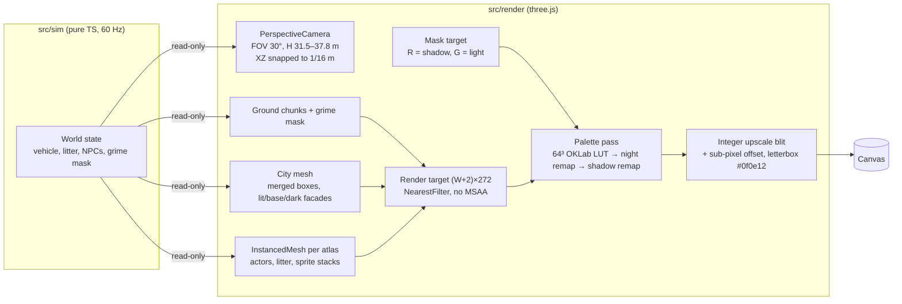

# ADR 0001: Tech stack — three.js lean core, perspective top-down camera

| Field | Value |
|---|---|
| **Status** | **Accepted** |
| **Date** | 2026-10-18 |
| **Deciders** | Project owner, plus a three-judge evaluation panel reviewing four competing stack proposals |
| **Supersedes** | — |
| **Related** | [ADR 0002: AI-authored asset pipeline](0002-ai-authored-asset-pipeline.md), [TECHNICAL_DESIGN.md](../TECHNICAL_DESIGN.md), [ART_BIBLE.md](../ART_BIBLE.md), [ROADMAP.md](../ROADMAP.md) |

> **TL;DR.** We use **three.js 0.186.1 + TypeScript 7.0.2 (strict) + Vite 8.3.4**. A `PerspectiveCamera` looks **straight down** into a low-res **480×270** render target, and a final palette pass maps every pixel onto **Kerbside-32**. The judges voted **three of three** for this. We then pruned it to a **lean core**, following the PixiJS proposal's dependency discipline: we write our own collision (OBB/SAT) and our own WebAudio mixer, and defer every other library until a feature actually needs it.

---

## 1. Context

*Street Sweeper Pro* is a top-down pixel-art arcade driving game (see [GDD.md](../GDD.md)). Two facts about the project shaped this decision more than any feature list did.

### 1.1 The look needs real building height

The visual targets are the classic overhead city games (internally: GTA 1/2, with a nod to Paperboy for an optional tilted view). Their signature is that **rooftops are closer to the camera than the street**. When you drive past a 6-storey block, its roof slides across the screen faster than the pavement, and its walls lean outward from the centre of the screen. Muckleford has buildings of 1 to 6 storeys, plus landmarks up to 8 storeys (the Town Hall tower in `district.civic_quarter`). That parallax is part of what makes the town readable and charming, so we cannot drop it.

At the same time, every pixel must be a **Kerbside-32** colour at a fixed **16 px per metre** ground density ([ART_BIBLE.md](../ART_BIBLE.md)). The game has to look like hand-placed pixel art while showing real 3D parallax.

### 1.2 The author is an AI coding agent

There is no human artist, composer or engine programmer. Claude writes all of the code and assets, headlessly, from a terminal. So the stack has to be:

| Requirement | Why it matters here |
|---|---|
| **Text-first.** Every source file is hand-writable and diffable. | Editor-only binary or uid-laden scene files are a constant source of silent breakage when written by hand. |
| **Well represented in model knowledge, with stable APIs.** | Every call to a misremembered API wastes a fix loop. A framework whose current major version differs sharply from the one most training data covers is a tax on every feature. |
| **Headlessly testable, pixel for pixel.** | Claude cannot "look at the game" except through screenshots it opens with Read. Playwright visual goldens at pixelmatch threshold 0, and replay hashes, are our eyes and our regression net ([TECHNICAL_DESIGN.md](../TECHNICAL_DESIGN.md)). |
| **Deterministic.** | A run = f(seed, district, input log). Replays, property tests and bug reports all depend on it. |
| **Lean.** | Each dependency is more surface for version drift and for wrong-API hallucination. Fewer, pinned dependencies mean fewer surprises. |
| **Available today on the dev machine.** | macOS, Node 24, npm. Blender 5.2.2 LTS, Codex CLI and Cursor Agent CLI are for assets, not runtime ([ADR 0002](0002-ai-authored-asset-pipeline.md)). |

### 1.3 Delivery target

1.0 is a **web** game for desktop Chrome, Firefox, Safari and Edge, with keyboard and gamepad, released as an itch.io HTML5 build at **M7**. Touch and mobile web follow at M8, and a Tauri 2 desktop wrapper at M9. A static `dist/` that runs anywhere is a hard requirement. A heavy runtime download is a cost on every first play.

---

## 2. Decision

### 2.1 The stack

**three.js + TypeScript + Vite**, rendering through a **perspective camera looking straight down (−Y)** into a low-res, palette-mapped render target.

- **Sim:** pure TypeScript in `src/sim/`, with no three.js, no DOM, no `Date`, no `Math.random`. Fixed 60 Hz tick. We write the collision code (OBB vs grid AABB with SAT, sub-stepped above 0.5 tile/tick) ourselves.
- **Render:** three.js scene with merged city geometry, one `InstancedMesh` per atlas for actors, sprite stacks for tall props, a shadow/light mask target, and a final palette pass. Target **≤ 10 draw calls per frame**.
- **Audio:** a ~200-line WebAudio mixer we write ourselves, plus an offline TypeScript tracker synth and `zzfx`/`jsfxr` for SFX ([AUDIO_DESIGN.md](../AUDIO_DESIGN.md)).
- **Tooling:** npm only, Vitest + fast-check, Playwright + pixelmatch, Biome. Images are built by a Python forge run through uv; see [ASSET_PIPELINE.md](../ASSET_PIPELINE.md).

### 2.2 Why a perspective camera, not an orthographic one

A perspective camera looking straight down gives us the GTA2 look for free:

- **Parallax and wall lean come from the projection itself.** Roof magnification is `H / (H − h)`. At sweep height H = 31.5 m that gives 1 storey **1.09×**, 3 storeys **1.31×**, 6 storeys **1.91×**. Walls facing toward the screen centre become visible automatically (a wall is visible exactly when the camera is on its outward side), and the depth buffer resolves every occlusion.
- **The ground stays exact.** With vertical FOV 30° and H = 31.5 m, the ground is exactly **1 texel = 1 px** at 270 px tall (16.875 m × 30 m visible, about 15 × 8.4 tiles). At sweeping speeds the street is pixel-perfect.
- **Tall thin props cost nothing extra.** Lamp posts, phone boxes, bollards and trees are sprite stacks (4 to 8 slice quads). The camera leans them in the same way it leans buildings, so props and architecture always agree.
- **Actors are flat quads at y = 0**, not billboards, layered by a clip-space depth offset rather than by height ([TECHNICAL_DESIGN §12.5](../TECHNICAL_DESIGN.md#125-sprites-spritebatchts-spritestackts)). Vehicles and people therefore share the ground's exact 1:1 projection and never shimmer at sweep speed.

The full pipeline, including the `(W+2)×272` margin for the sub-pixel camera and the integer-scale rules, is specified in [TECHNICAL_DESIGN.md](../TECHNICAL_DESIGN.md). The visual rules it serves are in [ART_BIBLE.md](../ART_BIBLE.md).

### 2.3 Pinned versions (verified 2026-10-18)

All versions are exact pins: no `^` or `~`, and `package-lock.json` is the only lockfile.

| Area | Choice | Version |
|---|---|---|
| Runtime / package manager | Node.js + **npm** | Node **24.21.0**, npm **11.19.0** |
| Language | TypeScript (strict, `erasableSyntaxOnly: true`). Fallback pin if a tool breaks: **6.0.3** | **7.0.2** |
| Renderer | `three` / `@types/three` | **0.186.1** / **0.186.0** |
| Build / dev server | `vite` | **8.3.4** |
| Unit / sim tests | `vitest` | **5.0.5** |
| Property tests | `fast-check` | **4.10.2** |
| E2E / visual tests | `@playwright/test` (Chromium) | **1.64.1** |
| Image diff / PNG I/O | `pixelmatch` / `pngjs` | **8.0.0** / **7.0.0** |
| Lint + format | `@biomejs/biome` | **2.5.15** |
| SFX synthesis | `zzfx` (reference for vendored `buildSamples`; not imported in Node) / `jsfxr` | **1.4.0** / **1.4.1** |
| Node types | `@types/node` | **24.19.2** |
| Desktop wrapper (M9, deferred) | `@tauri-apps/cli` | **2.12.3** |
| Physics escape hatch (documented, **not installed**) | `@dimforge/rapier2d-deterministic-compat` | **0.21.0** |

The asset-side tools (Python 3.13.15 via uv 0.12.23, numpy 2.5.4, Pillow 13.0.0, Blender 5.2.2 LTS, Codex CLI 0.160.1, Cursor Agent CLI 2026.10.16-e3cb207, ffmpeg 9.0.2) belong to [ADR 0002](0002-ai-authored-asset-pipeline.md) and [ASSET_PIPELINE.md](../ASSET_PIPELINE.md).

Supporting choices made alongside the stack:

- **TypeScript tools run natively on Node 24** through built-in type stripping (`node tools/audio/render-sfx.ts`). That is why `tsconfig.json` sets `erasableSyntaxOnly: true`: no enums, namespaces or parameter properties. We do not need tsx.
- **JSON for every data file** (manifest, levels, tuning, palette, songs, SFX). No YAML, so neither TypeScript nor Python needs a parser dependency.
- **PRNG:** a hand-written `sfc32` in `src/sim/rng.ts`. No seedrandom, simplex-noise or pure-rand.
- **Bun 1.4.2 is installed but not used.** One runtime means no drift between two.

### 2.4 The lean core: what we write vs. what we import

| Concern | Decision | Where it lives |
|---|---|---|
| Rendering | three.js (imported) | Our renderer layer: `src/render/*` |
| Collision and physics | **Written ourselves:** OBB/SAT vs a grid of AABBs, sub-stepped sweeps, simple impulse bodies for knockables | `src/sim/collision/{obb,sat,grid,sweep}.ts`, `bodies.ts` |
| Vehicle model | **Written ourselves:** kinematic bicycle model with grip decay ([GDD.md](../GDD.md) has the numbers) | `src/sim/vehicle.ts` |
| Entity storage | **Written ourselves:** typed struct-of-arrays per entity kind. **No ECS library.** | per-kind stores |
| Audio | **Written ourselves:** ~200-line WebAudio mixer with buses and ducking, plus live engine and brush synths | `src/audio/*` |
| Scenes, input, UI, bitmap text | **Written ourselves**, each only when a feature needs it | `src/app`, `src/input`, `src/ui` |
| Dev tuning panel | **Written ourselves:** ~50 lines, replacing tweakpane | `src/debug/devPanel.ts` |
| Levels | ASCII map + JSON legend, compiled by our own script. No Tiled or LDtk. | `tools/levels/compile-level.ts` |

### 2.5 Grafts adopted from the losing proposals

The panel's verdict was "three.js, but take the best ideas from the others". Two grafts came from the **PixiJS** proposal, the runner-up:

1. **Dependency discipline.** We own collision and audio, and we defer Rapier, Howler, Tone.js, zod, tweakpane, a PWA plugin, Electron and Capacitor (see §3.6). The original three.js proposal leaned on more libraries than this.
2. **The sub-pixel smooth camera.** Snap the camera XZ to the ground-texel grid (1/16 m), render 1 px larger on every side, and offset the final nearest-neighbour blit by the fractional remainder × scale. The camera glides smoothly at 4× to 8× scale, while the internal image stays on a strict pixel grid.

---

## 3. Alternatives considered

### 3.1 Panel evaluation

Four proposals went to three independent judges. Each proposal was a full stack-and-architecture plan written as if it were going to be built. The judges assessed them against the requirements in §1.

**Result: three.js 3 / 3 first-preference votes. PixiJS was the consensus close second.** Phaser and Godot received no first-preference votes.

The panel's per-judge numeric scores are not preserved in the project record. The matrix below summarises the panel's written rationale criterion by criterion, using a qualitative scale:

**Key:** ●●● strong · ●●○ adequate · ●○○ weak or blocking.

| Criterion | three.js 0.186.1 | PixiJS 8.22.0 | Phaser 4.2.1 | Godot 4.7.2 |
|---|---|---|---|---|
| Real building height and parallax | ●●● Native: perspective camera + depth buffer | ●●○ Possible, but needs hand-written 2.5D roof and wall projection and sorting | ●○○ Faked with affine Mesh2D walls | ●●● Native 3D |
| Strict pixel-art output (palette pass, integer scale) | ●●● Full control of render targets and shaders | ●●● Full control of filters and render textures | ●●○ Possible via pipelines and post-FX, but fights the framework | ●●○ Possible, but web export adds a layer |
| AI-authorability (model knowledge, text sources) | ●●● Mature, stable core API, plain TS | ●●○ Good, though v7→v8 API changes need care | ●○○ Most model knowledge is Phaser 3, so expect wrong-API calls | ●○○ Hand-written `.tscn`/`.tres` uid traps, Godot 3/4 confusion |
| Headless pixel-exact testing | ●●● Playwright + SwiftShader, `readFrame()` | ●●● Same | ●●● Same | ●○○ Headless mode has no renderer, so no visual goldens |
| Determinism (sim separated from engine) | ●●● Engine-free sim by construction | ●●● Same | ●●○ Pulls the user toward built-in arcade physics | ●●○ Built-in physics is not designed for replay hashes |
| Dependency weight and web payload | ●●○ One sizeable library, everything else ours | ●●● Smallest | ●●○ Batteries we mostly would not use | ●○○ Heavy wasm runtime |
| Available today, no install | ●●● npm | ●●● npm | ●●● npm | ●○○ Not installed |

### 3.2 three.js 0.186.1 (chosen)

**Pros**

- The perspective camera and depth buffer **give parallax, wall lean, occlusion and sprite-stack lean for free**. This is the single most important visual property of the game, and the other web options would have to emulate it.
- **Full control of the pipeline.** Render targets, custom `ShaderMaterial`s and `InstancedMesh` let us build the palette pass, the shadow/light mask target and the ramp-swap instancing exactly as specified, with ≤ 10 draw calls.
- **Mature, very widely used, and well represented in model knowledge.** The core APIs we rely on (`PerspectiveCamera`, `BufferGeometry`, `InstancedMesh`, `WebGLRenderTarget`, `ShaderMaterial`) have been stable for years.
- **Not a game framework**, so it imposes no physics, scene graph conventions or game loop. Our sim stays pure TypeScript and deterministic.
- Plain npm module with good TypeScript types and a fast Vite workflow.

**Cons (accepted)**

- **No game-framework batteries.** No scenes, input, audio, tweens, tilemaps or UI. We write them ourselves (§2.4). This is deliberate, but it is real work across M1–M3.
- **A monthly release cadence that breaks APIs.** Mitigated by the exact pin `0.186.1`. Upgrades go through a PR with a full visual golden run.
- **Colour management and filtering defaults are wrong for pixel art.** sRGB conversion, mipmaps, linear filtering and MSAA would all corrupt exact palette values. Every texture uses `NearestFilter` with no mipmaps, and the colour-space settings are locked in the M0 spike. The `zoo` visual golden (pixelmatch threshold 0) catches any drift, because a shifted source colour snaps to the wrong palette entry.
- **Perspective artefacts.** Ground shimmer while the speed zoom is pulled out (H up to 37.8 m), and roof magnification up to 1.91× at 6 storeys. Both are accepted as part of the look. The M0 spike may disable zoom.
- **Bundle size** is larger than PixiJS. The M0 production build's JS is 145,933 B gzipped (585,584 B raw; measured in SSP-023, [§4.4](#44-m0-spike-decisions-this-adr-depends-on)), and it grows with content. It is a one-off download and acceptable for an itch.io HTML5 game.

### 3.3 PixiJS 8.22.0 + custom 2.5D (close second)

**Pros**

- Excellent, lean 2D batching. Arguably the most natural fit for a sprite-heavy game.
- Smallest payload, and the most explicit about owning its code. **Its dependency discipline was adopted wholesale** (§2.5).
- Its proposal contributed the sub-pixel smooth camera design we now use.
- Render textures and filters make a palette pass straightforward.

**Cons (why it lost)**

- **The 2.5D roof and wall maths reinvents a perspective camera.** Each roof has to be scaled by `H/(H−h)` and offset from the screen centre. Each visible wall has to be emitted as a skewed quad. Everything has to be depth-sorted by height in software. Sprite stacks have to lean by hand. That is a lot of bespoke code, and it can get subtly out of step with the actors. three.js gives it all for free with a depth buffer.
- The v7→v8 API changes mean model knowledge is mixed, though less so than for Phaser.

**Custom WebGL2 with no library** was discussed as a variant of this route. It would have the smallest payload and no third-party API risk, but we would also own matrix maths, geometry buffers, instancing, render targets and context-loss handling. That spends AI effort on infrastructure instead of game features, so it was rejected.

### 3.4 Phaser 4.2.1

**Pros**

- The most "batteries included" web option: scenes, input, gamepad, audio, tweens, tilemaps with a Tiled loader, and arcade/matter physics.
- A large community and lots of example code.

**Cons (why it lost)**

- **It fakes building height with affine Mesh2D walls.** Affine (not perspective-correct) wall quads distort the 32×40 facade modules, and there is no depth buffer to resolve roof and actor occlusion.
- **Most model knowledge is Phaser 3.** Phaser 4 changed the renderer and several APIs, so an AI author would produce a steady stream of plausible but wrong calls. Each one costs a debug loop, across the entire project.
- Most of its batteries (physics, tilemaps, audio) would go unused or be replaced, because our sim must be deterministic and engine-free.

### 3.5 Godot 4.7.2

**Pros**

- A full engine with real 3D, a 2D/3D tilemap system, an animation system, physics, and one-click desktop exports, which would have made M9 trivial.
- GDScript is concise, and the engine is excellent for human-driven development.

**Cons (why it lost)**

- **Hand-written `.tscn`/`.tres` files are a trap for an AI author.** Resource uids, `ext_resource` ids and load-step counts must stay consistent. The editor normally manages them, and getting them wrong produces silent breakage or broken references.
- **Headless mode has no renderer**, so we cannot capture pixel-exact visual goldens in CI or on the dev Mac. That removes Claude's main way of verifying the look.
- **The web export is heavy:** a multi-megabyte wasm engine runtime before any game code, plus threads and cross-origin isolation caveats on some hosts. It is a poor fit for a "click and play in 3 seconds" HTML5 game.
- **It is not installed** on the dev machine, and GDScript model knowledge mixes Godot 3 and 4 syntax.

### 3.6 Supporting-library alternatives (rejected or deferred)

| Alternative | Reason |
|---|---|
| Rapier2D (as core physics) | It would mean gluing two physics paradigms together. A hand-written OBB/SAT is deterministic, synchronous and enough. `@dimforge/rapier2d-deterministic-compat` **0.21.0** is kept as a documented escape hatch only and is **not installed**. |
| Howler / Tone.js / node-web-audio-api | A ~200-line WebAudio mixer plus an offline TS tracker synth covers our needs, and needs no browser globals in Node. |
| sharp + image-q | The forge is Python, and the probe's proven pixelize stack is numpy + Pillow ([ADR 0002](0002-ai-authored-asset-pipeline.md)). |
| Electron / Capacitor / PWA plugin / tweakpane / zod | Deferred until the game is fun on the web. A 50-line dev panel replaces tweakpane. Tauri 2.12.3 is the M9 desktop route. |
| Bun as package manager | Playwright and Vitest tooling is most reliable on Node. One runtime only. |
| Tiled / LDtk | Levels are ASCII maps plus a JSON legend, which an AI author can write and diff ([LEVEL_DESIGN.md](../LEVEL_DESIGN.md)). A Tiled export is an optional post-1.0 extra. |

---

## 4. Consequences

### 4.1 Positive

- **The signature look is structural, not emulated.** Building parallax, wall lean, prop lean and occlusion all come from one camera and one depth buffer, so they can never disagree with each other.
- **The palette guarantee is enforceable.** The final palette pass plus the night and shadow index remaps mean the game **cannot** display a colour outside Kerbside-32, whatever any asset or shader does upstream.
- **Deterministic, testable sim.** Because three.js is only a renderer, `src/sim/**` stays pure. A Biome `noRestrictedImports` override bans `three` and DOM modules there, the globals `Math.random`, `Date` and `performance` are banned, and a Vitest import scan backs this up. Replays (3,600 ticks, quantised to 1e-4) and fast-check properties ("never ends a tick inside a solid / no tunnelling at 11 m/s") follow.
- **Claude can verify pixels headlessly.** Playwright 1.64.1 Chromium with `--use-angle=swiftshader --enable-unsafe-swiftshader` reads the raw internal frame through `window.__ssp.readFrame()` and diffs it at threshold 0 against goldens.
- **Small, auditable dependency surface.** At runtime the only third-party library of any size is `three`.

### 4.2 Negative (accepted costs)

- **We own more code.** Collision, the vehicle model, the mixer, scenes, input, bitmap text, the HUD and the dev panel are all ours. These are budgeted in M1–M3 ([ROADMAP.md](../ROADMAP.md)).
- **Pixel-art discipline inside a 3D engine.** Every texture, render target and material must avoid filtering, mipmaps, MSAA and colour-space conversion. The palette pass snaps any off-palette colour to its nearest Kerbside-32 entry, so a mistake shows up as *wrong* palette colours rather than off-palette ones. Only the threshold-0 visual goldens (`zoo`, `night_kebab_mile`, `hud_specimen`) and `forge lint` on the source atlases catch it.
- **Perspective shimmer while zoomed.** Accepted. At sweeping speeds the camera returns to exact 1:1. This is tracked as a risk in [ROADMAP.md](../ROADMAP.md).
- **SwiftShader parity risk.** Canonical goldens come from the dev Mac (arm64). CI visual jobs therefore run on `macos-latest`, not Ubuntu.
- **No editor.** Levels, scenes and tuning are all text. That suits the AI author, and it is the trade we chose.

### 4.3 Neutral / follow-ons

- `vite build` with `base: './'` produces a static `dist/` for itch.io (butler from M7) or any static host.
- **CI** (GitHub Actions, once a remote exists):
  - `ubuntu-latest`: typecheck, lint, unit, replay, `assets:verify`, `assets:lint`.
  - `macos-latest` (arm64): Playwright visual and e2e tests.
  - Blender and AI generation never run in CI.
- Desktop (M9) uses Tauri 2.12.3 around the same `dist/`. Nothing in this decision blocks it.
- `camera.tiltDeg` (default 0, max 12) reserves an optional tilted route view for post-1.0. The perspective camera supports it without new rendering code.

### 4.4 M0 spike: decisions this ADR depends on

The **M0 Foundations & Look Spike** must confirm the following and record the outcome in [ROADMAP.md](../ROADMAP.md):

| Question | Default | Recorded in M0 |
|---|---|---|
| Speed zoom (H 31.5 → 37.8 m) on or off? | On | TBD (M0 spike) |
| Vehicle render tilt: 0° vs ≤ 8° | 0° | TBD (M0 spike) |
| 480×270 base resolution holds up at 1080p / 1440p / 4K | Yes | TBD (M0 spike) |
| Headless SwiftShader golden is byte-stable across runs | Yes | TBD (M0 spike) |
| Production bundle size and p99 frame-time budget | — | **Bundle** (M0, SSP-023): JS 585,584 B raw, **145,933 B gzip**; `dist/` total 653,365 B (648K). **p99 frame time ≤ 20.6 ms** on the dev Mac (baseline 10.3 ms × 2). [ROADMAP D-08](../ROADMAP.md#8-m0-spike-decision-log) |

---

## 5. Revisit triggers

Reopen this ADR (as a new ADR that supersedes it) if any of the following happens:

1. **The M0 spike fails the look.** For example, the 1-, 3- and 6-storey spike blocks lean or shimmer unacceptably at the chosen FOV and height, and neither disabling zoom nor tuning the camera fixes it.
2. **The performance budget cannot be met:** more than 10 draw calls per frame are needed, or the p99 frame time fails on target desktop browsers with 2,000 litter items, 80 NPCs and 30 vehicles.
3. **Headless visual goldens prove non-deterministic** under SwiftShader in a way we cannot pin down.
4. **Hand-written collision is not enough.** If stacking, joints or many-body interactions become a real design need, adopt the Rapier escape hatch through its own ADR. Do not adopt it ad hoc.
5. **The M8 touch/mobile web build cannot hit frame rate** on mid-range phones, which would justify a lighter 2D renderer for mobile.
6. **A three.js upgrade** is needed for a security fix or a browser-compatibility break that cannot be patched on 0.186.1.

---

## 6. Compliance

- **Exact pins** are enforced by review and by `npm ci` against `package-lock.json`. Adding, upgrading or swapping a runtime dependency needs an ADR or an explicit request ([CLAUDE.md](../../CLAUDE.md)).
- **Sim purity** is enforced by Biome rules and a Vitest import scan (see §4.1).
- **Palette compliance** is enforced by the palette pass at runtime, `forge lint` at build time ([ASSET_PIPELINE.md](../ASSET_PIPELINE.md)), and the `zoo` visual golden.
- **Gate:** `npm run ci` runs typecheck, lint, unit, property, replay, visual, e2e, `assets:verify` and `assets:lint`, and must be green before a merge.

See also: [README.md](../../README.md) · [GLOSSARY.md](../GLOSSARY.md) for *Palette pass*, *Sub-pixel camera*, *Sprite stack*, *Replay hash*, *Test hooks* · [ENTITY_CATALOG.md](../ENTITY_CATALOG.md) · [AUDIO_DESIGN.md](../AUDIO_DESIGN.md).
