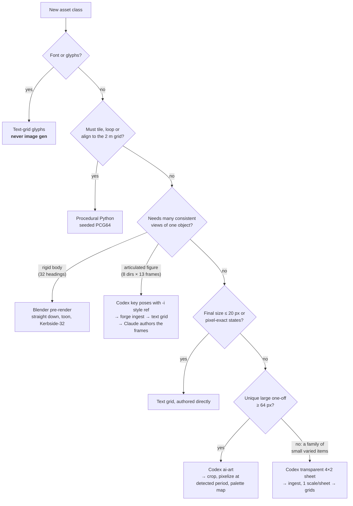
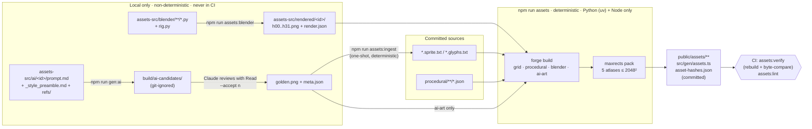
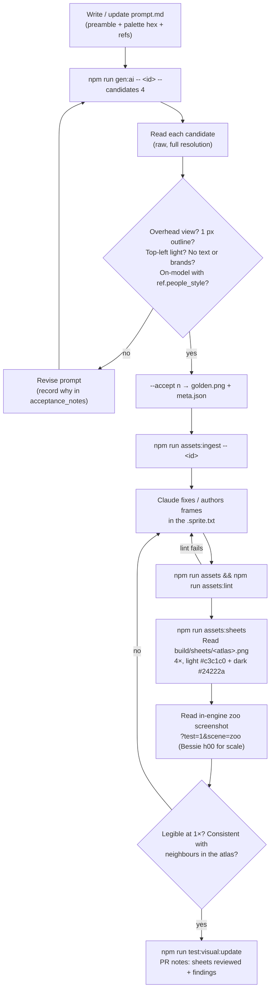

# ADR 0002: AI-authored, assets-as-code pipeline

| Field | Value |
|---|---|
| Status | **Accepted** |
| Date | 2026-10-18 |
| Deciders | Project owner, Claude (lead developer and sole asset author) |
| Supersedes | None |
| Related | [ADR 0001: Tech stack](0001-tech-stack.md), [Asset pipeline](../ASSET_PIPELINE.md), [Art bible](../ART_BIBLE.md), [Audio design](../AUDIO_DESIGN.md), [Roadmap](../ROADMAP.md) |
| Pillar served | **5. Every Pixel Reproducible** ([GDD](../GDD.md)) |

## Summary

Every image and sound in Street Sweeper Pro is made by an AI coding agent. No human artist or composer is involved. We therefore treat assets as code. Each asset class gets the technique that the 2026-10-18 probe showed works best for it:

- **text-grid pixel art** for tiny or state-exact sprites, fonts and UI;
- **procedural Python** for anything that must tile, loop or align to the grid;
- **headless Blender pre-renders** for rigid objects that need 32 consistent headings;
- **Codex image generation** for characters, litter, landmarks and key art. Its output is committed as a *golden* source and then post-processed deterministically.

Everything downstream of a committed source is a pure function of bytes. A normal build never calls Blender or an image model. CI rebuilds the assets and byte-compares them with the committed copies.

---

## 1. Context

### 1.1 The constraint

The project brief has one unusual property: **Claude creates all game assets.** That rules out the usual "artist hands over PSDs" workflow and imposes four requirements:

| Requirement | Why it matters |
|---|---|
| **Headless and scriptable** | The author is an agent in a terminal. Every tool must run from a command line with no GUI step and give a result Claude can inspect, either by opening an image with Read or by parsing a JSON report. |
| **Auditable** | A reviewer, human or agent, must be able to answer "where did this pixel come from?" for any shipped frame. Prompts, scripts, parameters and tool versions live in the repo. |
| **Regenerable** | If the palette, scale or style changes, a class of assets must be rebuildable without archaeology. Where regeneration cannot be bit-exact (image models), the accepted output is preserved and everything after it is exact. |
| **Consistent at tiny sizes** | The game renders at 480×270 with 24×24 people, 16×16 litter and 64×64 cars over 32 headings (see the sprite size sheet in [ART_BIBLE.md](../ART_BIBLE.md)). At this scale one stray pixel reads as a different object, and one off-palette colour breaks the [palette pass](../TECHNICAL_DESIGN.md). |

### 1.2 Tools available on the dev machine

| Tool | Version / path | Mode |
|---|---|---|
| Blender | **5.2.2 LTS**, `/Applications/Blender.app/Contents/MacOS/Blender` (not on PATH) | `-b --factory-startup -P script.py`, bpy |
| Codex CLI | **codex-cli 0.160.1**, `~/.local/bin/codex` | `codex exec`, built-in `image_gen` |
| Cursor Agent CLI | **2026.10.16-e3cb207**, `~/.local/bin/cursor-agent` | `cursor-agent -p`, built-in image generation |
| Python via uv | Python **3.13.15**, uv **0.12.23**, numpy **2.5.4**, Pillow **13.0.0**, pytest **9.1.1** | `uv run --project tools/forge python -m forge <cmd>` |
| ffmpeg | **9.0.2**, `/opt/homebrew/bin/ffmpeg` | audio encoding only |
| Node.js / npm | **24.21.0** / **11.19.0** | build orchestration, audio and level tools |

Aseprite, Photoshop, Stable Diffusion/ComfyUI and Tiled are **not** installed. None of the proprietary GUI tools can be driven reliably by an agent.

### 1.3 The forces in tension

- **Quality vs. consistency.** Image models produce the most charming pixels. They are also the least consistent, from one frame or rotation to the next and from one run to the next.
- **Consistency vs. reproducibility.** Blender and code are perfectly consistent and reproducible. Their results are only as good as the model or code behind them, and the author cannot "sketch".
- **Reproducibility vs. velocity.** Image generation takes about 60 s per call and has no seed control. Insisting on bit-exact regeneration of AI images would make AI images impossible to use.

We did not argue these trade-offs in the abstract. We measured them.

---

## 2. Evidence: the asset probe (2026-10-18)

Before writing this ADR we ran a throwaway probe in a temporary scratch directory (key artefacts preserved in [`assets-src/_probe/`](../../assets-src/_probe/README.md)). It exercised every candidate technique against real Street Sweeper Pro asset classes. Each Codex run used `codex exec` non-interactively. Each Cursor run used `cursor-agent -p`. The Blender runs were headless. Post-processing used a prototype `pixelize.py` (numpy FFT grid detection plus block-mode resampling), and each run wrote a `report.json`. The artefacts worth keeping were copied into the git-tracked `assets-src/_probe/` on 2026-10-18 and are imported in M0 (see §9).

### 2.1 Experiments

| # | Experiment | Tool | Wall time | Raw output | Measured result | Verdict |
|---|---|---|---|---|---|---|
| E1 | Procedural low-poly sweeper, toon material, 8 headings at a 22° tilt, 256 px hi-res + 48 px direct | Blender 5.2.2 headless (`sweeper.py`, `sweeper_v2.py`) | **2.0–4.5 s** per full rotation set. First frame about **3.3 s** (shader compile), then about **0.05 s/frame** | 256×256 RGBA, about 34 KB/frame | Crisp silhouettes, identical lighting on every heading, byte-identical on re-run. Flat top faces need a post outline to read. | **Adopt** for vehicles and volumetric props |
| E2 | Old-woman 4×2 key-pose sheet, magenta background | Codex | **60 s** | 1774×887 PNG (2:1) | Pseudo-pixel period **9.22 × 9.38 px**. Native cells 22–27 × 28–34 px. The background key drifted to `rgb(250,5,249)`, not `#ff00ff`. Walk frames are not a real cycle: the handbag swaps hands between frames. | **Adopt** for key poses only. The grid holds the animation. |
| E3 | Businessman sheet with E2 attached as the `-i` reference | Codex | **57 s** | 1774×887 PNG | Same period (**9.22 × 9.38**), same proportions, same outline weight and shading. Background `rgb(246,7,247)`. Style lock via reference image works. | **Adopt** a single committed style reference, `ref.people_style` |
| E4 | "Seamless" asphalt tile with centre-line dashes | Codex | **56 s** | 1254×1254 PNG (1:1) | Seam test failed. The wrap-edge difference was **11.4**, against an interior neighbour difference of **3.6**. At the vertical join the dashes merged into one **209 px** dash. | **Reject** AI for tiles. Ground is procedural. |
| E5 | 4×2 rubbish sheet, transparent background | Codex | **58 s** | 1774×887 RGBA PNG; 1,148,463 of 1,573,538 pixels fully transparent | Period **10.81 × 10.87 px**. Native items 15–31 px. Body alpha about **253**, with an **alpha = 1** haze around items. The best AI result of the probe: crisp, readable, on-model. The can and cigarette butts became illegible at 12 px. | **Adopt** for litter, one scale factor per sheet; hand-redraw failures |
| E6 | Old-woman sheet, same prompt as E2 | Cursor Agent | **93 s** | Lossy JPEG, 16:9 (1280×720) | Ignored the camera instruction and drew front and side views. Detected period **4.01 × 15.22 px**, which is anisotropic: no coherent pixel grid. | **Reject** for sprites |
| E7 | Retry of E6 with a stronger overhead instruction | Cursor Agent | **136 s** (the agent regenerated silently) | Lossy JPEG, 1280×720 | Overhead achieved. The pixel grid is soft and JPEG ringing bleeds into the key colour. The file was saved to `~/.cursor/projects/<slug>/assets/`, not the requested path. | **Fallback / concept A/B only** |
| E8 | 32-colour **median-cut** palette derived from the generated images | Pillow | <1 s | 32 colours | The palette was dominated by skin, mauve and near-black (darkest `#150b14`). It had **no green, blue or yellow entry**, so grass, council blue and sweeper yellow could not be represented. | **Reject** derived palettes. Curated **Kerbside-32** is required. |
| E9 | Same sprites mapped to a **curated** public 32-colour palette (probe stand-in, `endesga32.hex`) | Pillow, OKLab nearest | <1 s | — | Characters, litter and the sweeper all mapped cleanly with recognisable ramps. This proved the approach, so we authored our own palette tuned to British street colours. | **Adopt** curated palette ([ART_BIBLE.md](../ART_BIBLE.md)) |
| E10 | Downscale targets: humans at 24 px vs 14 px tall; litter normalised per cell to 12 px tall | pixelize.py | <1 s | — | At 24 px humans stayed readable. At 14 px the face, handbag and silhouette collapsed. Per-cell height normalisation broke relative scale: the bottle became **25×12** (wider than a 16 px cell) while the can became 8×12. | **Adopt** a 24×24 human cell and **one scale factor per sheet** (largest item = 14 px) |
| E11 | Blender downscale, nearest-sample vs 4×4 **block-mode** (majority) | pixelize.py | <1 s | 48×48 frames | Nearest sampling keeps one arbitrary sample per block, so the 1 px stripe and the beacon flicker between headings. Block-mode is stable. | **Adopt** block-mode for every downscale |
| E12 | Blender camera tilt of 22° (the GTA2-like "lean" the probe tried) | Blender | — | — | Vehicles look good in isolation. In a perspective-camera city, buildings lean *radially* from screen centre while a baked 22° vehicle always leans "north", and the two clash. | **0° by default.** Up to 8° only if the M0 spike approves it. |

### 2.2 What the evidence says, in one paragraph

**Code wins wherever an exact property is required:** seams, loops, grid alignment, legibility at 16 px and frame-to-frame identity. **Blender wins wherever a rigid object must be seen from many angles.** **Codex wins at charm.** It is strongest at characters (with a reference image), litter (transparent sheets) and large one-offs. It cannot animate, cannot hold 32 rotations and cannot tile. **Cursor works but is lossy and loose**, so it is a fallback, never a source of sprite goldens. **Palettes must be curated, never derived from images.** No single technique covers the game.

---

## 3. Decision

### 3.1 A hybrid pipeline, chosen per asset class

Each asset class gets exactly one primary technique. The full table, with source paths, lives in [ASSET_PIPELINE.md §Technique per asset class](../ASSET_PIPELINE.md). Its decision logic is:



The resulting assignment:

| Asset class | Technique | Primary evidence |
|---|---|---|
| Ground tiles, kerb blob autotile (47), roof surfaces, stains, VFX frames | Procedural Python | E4 (AI seams fail); loops must be exact |
| Facades (32×40 modules, `_lit/_base/_dark`) | Procedural assembly of text-grid modules | Exact ramp variants for sun direction |
| Vehicles (`veh.*`), volumetric props, roof furniture | Blender | E1, E11, E12 |
| Humans (`npc.*` people) | Codex key poses → ingest → **grid is the truth** | E2, E3, E10 |
| Animals (cat, dog, pigeon, seagull) | Text grids, authored directly | ≤ 20 px: hand-placed pixels beat downscales (E10) |
| Litter (`litter.*`) | Codex transparent sheets → ingest → grids; can and butts redrawn by hand | E5, E10 |
| Small props, pickups, HUD icons, 9-slice panels | Text grids | 16 px, exact states |
| Fonts (Kerbside 5×7, Kerbside Bold 8×8) | Text-grid glyphs | Exactness. **Never AI.** |
| Road decals, shop signs, landmark roofs | Codex golden → ingest at a common scale | One-offs where variety hides inconsistency |
| Title, key art, intro cards, Mercury art, portraits | Codex at full resolution → `ai-art` downscale | Image gen is strongest at large one-offs |
| Concept and mood boards | Codex (Cursor for A/B). **Never shipped.** | E6, E7 |
| SFX, music | TypeScript synthesis from JSON (zzfx, jsfxr, offline tracker) | Fully deterministic. See [AUDIO_DESIGN.md](../AUDIO_DESIGN.md). |

### 3.2 Two kinds of source, one determinism boundary

| Kind | Examples | Regenerable bit-exact? | What is committed |
|---|---|---|---|
| **(a) Deterministic text sources** | `*.sprite.txt`, `*.glyphs.txt`, `procedural/**/*.json`, bpy scripts, `*.song.json`, SFX JSON, level maps | Yes | The text |
| **(b) Golden sources** (non-deterministic tool outputs, accepted by review) | `assets-src/ai/<id>/golden.png`, `assets-src/rendered/<id>/h00…h31.png` | No (AI) / nearly (Blender: same version, same script; checked with `--check`) | The output **plus full provenance**: prompt, `meta.json` or `render.json`, hashes |

**Everything after a golden source is deterministic.** Pillow writes PNGs with fixed parameters and no metadata or timestamps. The packer sorts its inputs by area, then by ID. The forge cache is keyed by content hash.



Ingest sits on the boundary on purpose. It is deterministic: the same golden and parameters always give the same grid. But it runs **once**. After that the `.sprite.txt` is hand-edited truth, and ingest refuses to overwrite an edited grid without `--force`.

### 3.3 Tooling

| Role | Tool | Decision |
|---|---|---|
| Image forge | Python 3.13.15 + numpy 2.5.4 + Pillow 13.0.0 in `tools/forge/`, run via uv 0.12.23 with a committed `uv.lock` | Python because bpy is Python, the probe's working `pixelize.py` is numpy, and numpy suits grid and noise work. sharp and image-q are not used. |
| PRNG (forge) | `numpy.random.Generator(PCG64(seed))` | Seeds live in each procedural JSON. No global random state. |
| 3D pre-render | Blender 5.2.2 LTS, wrapped by `forge blender` | The wrapper owns the rig rules (§3.4) so scripts cannot drift. |
| Image generation (primary) | Codex CLI 0.160.1, wrapped by `forge gen-ai --tool codex` | Best sprite quality in the probe (E2, E3, E5). Transparent PNG output. |
| Image generation (fallback) | Cursor Agent 2026.10.16-e3cb207, `forge gen-ai --tool cursor` | Concept A/B, or when Codex is unavailable. **Its outputs may not become sprite goldens.** |
| Audio | TypeScript on Node 24 (`tools/audio/`), ZzFX `buildSamples` vendored from zzfx 1.4.0 (the package is not imported in Node), jsfxr 1.4.1, ffmpeg 9.0.2 with `-bitexact -map_metadata -1` | Shares DSP code with the in-game live synth. See [AUDIO_DESIGN.md](../AUDIO_DESIGN.md). |

The exact command lines and every probe-discovered gotcha are in [ASSET_PIPELINE.md](../ASSET_PIPELINE.md). The gotchas include: `-i` swallowing a positional prompt, `image_gen` not appearing in `--json` events, the `~/.codex/generated_images/<thread-id>/` fallback and Cursor's fixed JPEG location. They are encoded in the wrappers, never left to memory.

### 3.4 Locks that come before any asset is generated (M0)

These are fixed during **M0: Foundations & Look Spike** and recorded in `assets-src/STYLE.md`. Changing one later is a deliberate, whole-class regeneration event.

1. **World scale:** 16 px per metre, 32×32 px tiles (2 m), 40 px storeys, and the sprite size sheet ([ART_BIBLE.md](../ART_BIBLE.md)).
2. **Palette: Kerbside-32** (`assets-src/palette/kerbside32.json`) is the only legal set of colours. Blender materials use its **exact hex stops**, and AI prompts include its hex list. The forge maps every pixel to it by nearest colour in OKLab with no dither, so the in-game palette pass is a no-op for correct assets.
3. **Light:** sun from the north-west (azimuth 315°, elevation 50°) for every technique. "Light from the top-left" in prompts, `_lit/_base/_dark` facade ramps, and the Blender rig's sun.
4. **Outline:** a 1 px ink (`#0f0e12`) outline, 4-connected, outside the silhouette. It is applied by the forge to Blender output, and is part of the prompt and the lint for AI and grid output.
5. **Style reference:** the `ref.people_style` golden. Every human prompt passes it with `-i` (E3).
6. **Blender rig** (`assets-src/blender/rig.py`): orthographic and straight down (`--tilt 0`); `ortho_scale` = cell metres; 256×256 renders (4× target); `film_transparent=True`; `view_transform='Standard'` (never AgX); EEVEE with `taa_render_samples=1` and `filter_size=0.0`; an unlit toon material with three exact Kerbside-32 stops into Emission; `h00` = north, stepping 11.25° clockwise.

### 3.5 Build integration

| Command | Runs where | Calls Blender / image models? |
|---|---|---|
| `npm run assets` (`forge build` + `npm run audio` + `npm run levels`) | Dev and CI | **No** |
| `npm run assets:verify` | CI (`ubuntu-latest`) | No. Rebuilds into a temporary directory and byte-compares with the committed outputs. |
| `npm run assets:lint` | CI | No |
| `npm run assets:sheets` | Dev | No |
| `npm run assets:ingest -- <id>` | Dev | No |
| `npm run assets:blender -- <id\|all> [--check]` | **Local only** | Blender |
| `npm run gen:ai -- <id> [--tool codex\|cursor] [--candidates N]` | **Local only** | Image model |

- **Built outputs are committed:** `public/assets/**`, `src/gen/assets.ts` and `public/assets/asset-hashes.json`. That way `npm ci && npm run dev` works without uv, Python or Blender, and a reviewer sees the shipped pixels in the diff.
- `src/gen/assets.ts` exports a typed `FRAME` const and the `FrameId`/`AssetId` union types. A sprite that is referenced but missing is a **compile error**, not a runtime magenta square.
- **Placeholder first.** In M1 and M2 every class ships a code-defined placeholder under its final ID and frame IDs. It is upgraded one class at a time in **M4: Art Pass 1**, so gameplay never waits on art and art never breaks gameplay.

### 3.6 Grids are the truth after ingest

For humans and litter the AI image is **provenance, not truth**. After `forge ingest` writes `assets-src/sprites/<class>/<id>.sprite.txt`, Claude:

- fixes errors directly in the grid (stray pixels, handbag continuity, outline gaps);
- authors the frames the model cannot produce: walk 4, idle 2, startle 2, fall 3, angry 2, across the 5 authored directions (SE, E and NE are mirrored);
- never re-ingests over an edited grid without `--force` and a stated reason in the PR.

This is the decisive answer to E2's "walk frames are not real animation" finding. Animation is authored in text, where every frame is reviewable in a diff.

---

## 4. Handling non-determinism

Image generation is non-deterministic, and the Codex built-in `image_gen` exposes **no seed and no size control**. We do not pretend otherwise. We make it **auditable** instead of reproducible.

### 4.1 What each AI asset folder records

```
assets-src/ai/litter.sheet_01/
├─ prompt.md      # full prompt, including _style_preamble.md, stamped with its version
├─ meta.json      # provenance (below)
├─ golden.png     # the accepted raw output, byte-for-byte
└─ refs/          # optional committed reference images
```

Example `meta.json` (the schema is fixed. The values here are illustrative of what the wrapper writes):

```json
{
  "id": "litter.sheet_01",
  "tool": "codex",
  "tool_version": "codex-cli 0.160.1",
  "model": "gpt-6.1-sol (agent, pinned via -m); image model: Codex built-in image_gen, version not exposed",
  "date": "2026-10-18",
  "argv": ["~/.local/bin/codex", "exec", "-m", "gpt-6.1-sol", "--skip-git-repo-check", "--ephemeral", "-s", "workspace-write",
           "-C", "<WORKDIR>", "--json", "-o", "<WORKDIR>/last_message.txt", "-"],
  "prompt_sha256": "<sha256 of prompt.md>",
  "preamble_version": "v1",
  "reference_images": [],
  "original_output_path": "~/.codex/generated_images/<thread-id>/exec-<n>.png",
  "candidates_generated": 4,
  "accepted_index": 2,
  "acceptance_notes": "Crisp 1 px outline, overhead view, period 10.81 px. Can and butts illegible at 12 px: redraw in grid; butts ship as cluster sprite.",
  "golden_sha256": "<sha256 of golden.png>",
  "size": [1774, 887],
  "seed": null
}
```

Example `prompt.md` body. No trademarks appear in any prompt (see [CLAUDE.md](../../CLAUDE.md)):

```text
<!-- preamble v1 included above -->
Use your built-in image generation tool. Create a 2:1 sprite sheet on a fully
transparent background: 4 columns × 2 rows, one item per cell, centred, generous gaps.
Items, viewed from directly overhead, lying on a pavement: a squashed drink can,
a banana skin, a green glass bottle, a crumpled newspaper, a crumpled crisp packet,
a tied black bin bag, a dog mess, a small cluster of three cigarette butts.
All items drawn at the same scale. Chunky pixel art, 1 px dark outline, light from
the top-left, flat colours from the attached palette only. No text, no logos, no brands.
Copy the resulting PNG into the current working directory as litter_sheet_01.png.
Do not draw it with code.
```

### 4.2 Rules

1. **Rejected candidates are never committed.** They live in `build/ai-candidates/` (git-ignored). Only the count is recorded (`candidates_generated`).
2. **`golden.png` is immutable.** Changing it means a new generation with a new `meta.json`, never an edit in place. Cleanup happens downstream, in the grid or in the forge parameters.
3. **`forge lint` fails** if an AI folder lacks `meta.json` or if `golden_sha256` does not match the file.
4. **Blender renders are goldens too.** `render.json` stores `blender_version: "5.2.2 LTS"`, `script_sha256`, `argv`, `tilt_deg` and `pivots_px`. Lint warns "re-render needed" when the script hash changes. `assets:blender --check` re-renders locally and reports pixel diffs against the committed frames. This catches EEVEE drift after a Blender upgrade.
5. **Regeneration is a class-level event.** If the style preamble version is bumped, every golden that used the old version is listed by `forge lint` as *stale* (a warning, not an error). Regeneration is scheduled as a deliberate task, never as a side effect.

---

## 5. Quality-control loop

Image models fail silently: an agent will happily describe an image it never looked at. Every acceptance therefore requires Claude to **look**, using the Read tool on rendered evidence, at three magnifications.



### 5.1 Acceptance checklist (per golden or asset batch)

| Check | How | Rejects |
|---|---|---|
| Camera | Read the raw candidate | Any front, side or isometric view (E6) |
| Grid coherence | Ingest report: detected period within 3–16 px **and** the x/y periods within 10% of each other | Soft or anisotropic grids such as Cursor's 4.01 × 15.22 (E6) |
| Scale | Ingest report: native item size vs target cell, **one factor per sheet** | Any item that exceeds its cell after scaling (E10) |
| Palette and ramps | `forge lint` | Off-palette or semi-transparent pixels; more than 4 steps of any ramp |
| Outline | `forge lint` | An actor or prop silhouette edge without ink |
| Noise | `forge lint` | Orphan pixels on actors (the 3×3 despeckle should have removed them) |
| Seams | `forge lint` | A tile whose wrap-edge difference exceeds its interior difference (E4 failed this at 11.4 vs 3.6) |
| Legibility | Read the contact sheet at 4× and the zoo at 1× | An item a player could not name at game scale. It is redrawn in the grid (E5: can, butts). |
| IP hygiene | Read the raw candidate and `prompt.md` | Any logo, brand, readable trademark or unrequested text |

### 5.2 Budget and escalation

The following policy is set by this ADR. Tune it in [ROADMAP.md](../ROADMAP.md) if it proves wrong.

- **At most 3 rounds of 4 candidates per asset** (about 12 min of Codex time at about 60 s per image).
- If no candidate passes after round 3, the asset **escalates to direct grid authoring**, and the attempt is recorded in the PR. Image generation is an accelerator, never a blocker.
- Batch small items about 8 per 4×2 sheet to amortise the 60 s cost.

---

## 6. Alternatives considered

| Alternative | Why rejected |
|---|---|
| **Hand-drawn PNGs by a human artist** | Out of scope by brief: there is no human artist. It would also break pillar 5, because a PNG with no source cannot be regenerated after a palette or scale change. |
| **AI image generation only** | E4 (tiles fail seams), E2 (no real animation) and the inability to hold 32 consistent vehicle headings. It would also need about 60 s per image with no seed, across thousands of frames. |
| **Blender only** | Excellent for rigid bodies (E1). Rigging and animating 15 human types and 4 animals at 24 px in bpy costs far more than grids, and reads worse: at 24 px the pixels must be placed, not rendered. It would be over-engineered for 16 px litter and fonts. |
| **Code / text grids only** | Perfectly reproducible, but 32-heading vehicles and charming characters authored pixel by pixel would be slow and stiff. The probe showed AI and Blender beat it on appeal and throughput for those classes. |
| **Procedural only** | Right for tiles, roofs, stains and VFX. Wrong for anything that needs character. |
| **Aseprite CLI** (`aseprite -b`) | Not installed, and a paid licence. The `.aseprite` source is binary and opaque to diffs and review, so Claude cannot author or review it as text. Its CLI is mainly an exporter, which our forge already is. |
| **Local Stable Diffusion / ComfyUI with fixed seeds** | Seeded determinism is attractive. But it is not installed, needs large model weights and probably a style LoRA trained on our own goldens, and GPU nondeterminism still breaks bit-exactness across driver versions. Revisit trigger in §8. |
| **Cursor Agent as the primary generator** | E6 and E7: lossy JPEG only, poor camera adherence, a soft pixel grid, 93–136 s per run, a fixed output location and silent regeneration. Kept for concept A/B. |
| **Derived (median-cut) palettes per asset** | E8: the palette lost entire hue families. Inconsistent palettes across assets would also defeat the palette pass and the ramp swaps. |
| **JS forge (sharp + image-q)** | The working prototype is numpy + Pillow, and Blender integration is Python anyway. See [ADR 0001 §Rejected alternatives](0001-tech-stack.md). |
| **Commit sources only, build outputs in CI** | Every contributor and every agent session would need uv and Python just to run `npm run dev`, and shipped pixels would not be visible in PR diffs. `assets:verify` gives the same guarantee without that cost. |
| **Run Blender / AI in CI** | Blender is not on CI images, AI generation is non-deterministic, costly and needs credentials, and a nightly regeneration would silently churn goldens. |
| **Runtime procedural generation** (generate sprites at load time in TS) | It duplicates the forge in a second language, costs boot time, and is impossible to lint or review as images. The only runtime generation we keep is particles and the minimap, both drawn in palette colours. |
| **Tiled / LDtk for maps** | Out of scope here. See [ADR 0001](0001-tech-stack.md) and [LEVEL_DESIGN.md](../LEVEL_DESIGN.md). |

---

## 7. Consequences

### 7.1 Positive

- **Every shipped pixel has a paper trail.** It traces back to a text source, or to a golden with prompt, tool version, date, argv and hashes.
- **Palette and style changes are cheap for most classes.** Tiles, roofs, stains, VFX, facades, fonts, UI and vehicles (from a re-render) rebuild from text. Only AI-ingested grids need manual attention, and they are already palette-indexed text.
- **CI catches drift.** `assets:verify` fails on any hand-edited output or non-deterministic forge step. `assets:lint` fails on off-palette, outline, seam and provenance violations.
- **Missing art is a compile error**, through the generated `FrameId` union.
- **Gameplay is decoupled from art** through placeholder-first frame IDs.

### 7.2 Negative and costs

- **AI goldens are not bit-reproducible.** Regenerating a class means new candidates, new review and possibly new hand fixes. We accept this. The golden plus the grid is the asset.
- **Repo weight.** Probe goldens are 0.6–1.9 MB each, and Blender frames about 34 KB each, so about 1.1 MB per 32-heading vehicle before extra states. We estimate `assets-src/` at **≤ 150 MB** at 1.0 in plain git, with no LFS.
- **Human animation is manual grid work.** It is the largest single art cost: 13 frames × 5 authored directions per human type. It is mitigated by mirroring, by outfit ramp swaps on `npc.shopper` (8 swaps), and by sharing frame skeletons between body types.
- **Two languages in tooling** (Python forge, TS audio and levels). This is the price of using bpy and numpy where they fit. See [ADR 0001](0001-tech-stack.md).
- **Generation is local-only and slow** (about 60 s per Codex image). Art passes are scheduled work in M4 and M6, not incidental.
- **Vendor drift.** A Codex or Cursor update can change style, output paths or flags. The wrappers pin the observed behaviour, record `tool_version`, and fail loudly if the expected file does not appear.

### 7.3 Risks and mitigations

| Risk | Mitigation |
|---|---|
| Style drift across Codex sessions | A single `ref.people_style` golden passed with `-i` (E3). The preamble is versioned. The contact sheet always includes neighbouring assets and Bessie for comparison. |
| Blender output changes after an upgrade | Blender is pinned at 5.2.2 LTS in `render.json`, and `assets:blender --check` shows pixel diffs before re-committing renders. |
| Lean mismatch between baked sprites and perspective buildings | Vehicles are rendered at 0° tilt. Tall props use sprite stacks so the runtime camera leans them (E12). |
| Agent "accepts" without looking | [CLAUDE.md](../../CLAUDE.md) makes reading the contact sheets and zoo screenshot a hard rule. PRs for asset batches must quote the sheet findings. |
| Trademark or brand leakage from the model | IP hygiene in the preamble ("no logos or brands") plus a manual Read check. Lettering on signs is drawn with Kerbside fonts, never by the model. |

---

## 8. Revisit triggers

Reopen this ADR if any of the following happens:

1. Codex (or a successor) exposes **seed and size control**. Seeds would go into `meta.json`, and regeneration could become reproducible.
2. A local, seedable image model with acceptable pixel-art quality becomes practical on the dev Mac. See the Stable Diffusion alternative in §6.
3. Grid authoring of human frames exceeds **2 working days per human type** in M4. Consider a Blender low-poly character rig rendered to block-mode plus grid cleanup.
4. `assets-src/` exceeds **250 MB**. Consider Git LFS for `*.png` under `assets-src/ai/` and `assets-src/rendered/`.
5. The M0 spike approves a vehicle tilt above 0°. Update the rig rules and re-render every `veh.*`.
6. ffmpeg proves non-deterministic for encoded audio. `assets:verify` then compares WAV hashes only, which it already plans for.

---

## 9. Implementation notes (M0 to M4)

- **M0: Foundations & Look Spike.** Import the probe artefacts listed in the table below. Write the `forge blender` and `forge gen-ai` wrappers. Lock Kerbside-32 (including the night and shadow tables), the scale sheet and the `ref.people_style` golden in `assets-src/STYLE.md`. Get one Blender Bessie and one Codex pedestrian in-engine through the palette pass. Record the tilt decision (0° vs ≤ 8°).

  | From `assets-src/_probe/` (copied on 2026-10-18 from the probe scratchpad above) | To |
  |---|---|
  | `blender/sweeper_v2.py` | `assets-src/blender/vehicles/sweeper.py`, refactored onto `rig.py`, 0° tilt, with Kerbside-32 palette names via `rig.toon_material`/`rig.pal()` (no hex literals) |
  | `tools/pixelize.py` | `tools/forge/forge/pixelize.py` |
  | `codex/old_woman_sheet.png` | candidate for `assets-src/ai/ref.people_style/golden.png` (with a retro-filled `meta.json`) |
  | `codex4/rubbish_sheet.png` | candidate for `assets-src/ai/litter.sheet_01/golden.png` |

- **M1 / M2.** Code-defined placeholders under the final IDs for every class.
- **M4: Art Pass 1.** The forge is complete (ingest, build, lint, sheets, verify). Real assets exist for every class used by Mon–Tue. `assets:lint` and `assets:verify` run in CI. Contact sheets are reviewed and noted in PRs. A zoo golden is committed.

## 10. References

- [ASSET_PIPELINE.md](../ASSET_PIPELINE.md): commands, source formats, provenance schema, ingest, build, lint and sheets steps, troubleshooting
- [ART_BIBLE.md](../ART_BIBLE.md): Kerbside-32, ramps, sprite size sheet, outline and lighting rules, review checklist
- [AUDIO_DESIGN.md](../AUDIO_DESIGN.md): the audio half of assets-as-code
- [TECHNICAL_DESIGN.md](../TECHNICAL_DESIGN.md): palette pass, sprite batches, sprite stacks, visual tests
- [ENTITY_CATALOG.md](../ENTITY_CATALOG.md): per-entity sprite cell, technique and source path
- [ROADMAP.md](../ROADMAP.md): M0 spike decision log, risk register (art consistency, image-gen drift)
- [GLOSSARY.md](../GLOSSARY.md): Golden, Ingest, Forge, Contact sheet, Asset zoo, Mixel, Scale sheet
- [CLAUDE.md](../../CLAUDE.md): hard rules for the agent (no image models or Blender in builds, Kerbside-32 only, review with Read, grids are truth)
- [README.md](../../README.md)
